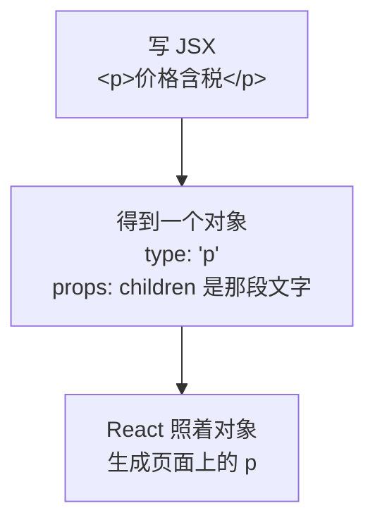
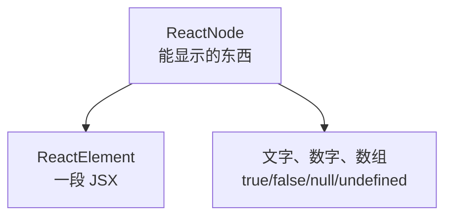

# 第 3D 章 ReactNode 和 ReactElement：JSX 写完得到的是什么

## 这一章解决什么问题

上一章给 `children` 声明了类型 `ReactNode`，只说了一句「任何 React 能显示的东西」。这一章把它打开来看：

- 一段 JSX，比如 `<p>价格含税</p>`，写完之后到底得到了什么？为什么能存进变量、能当 prop 传？
- `ReactNode` 具体包括哪些东西？为什么文字、数字能放进 `{}`，普通对象就不行？
- `children` 一定要写成 `ReactNode` 吗？还能写成什么？

这几件事后面一直会用到：第 5C 章的条件渲染靠「`false` 什么都不显示」；第 7D 章起，很多页面先把一段 JSX 存进 `let content: ReactNode` 变量再显示；报错信息里常见的 `Element`，指的就是本章的 ReactElement。

本章讲三个技术点：**ReactElement**、**ReactNode**、**children 可以声明成哪些类型**。

## 开始之前

- 上一章你已经会了：children、`Panel` 组件、`import type`。
- 起点代码：仓库 `code/ch03C/price-list`（不含练习答案）。在 `D:\react-study\price-list` 执行 `npm run dev`。
- 本章是「看清楚」的一章：三个小节都是临时改代码做实验，最后在「本章收尾」里把代码恢复成第 3C 章的样子，第 4A 章从那里接着写。
- 本章要看浏览器控制台：按 `F12`，切到「控制台（Console）」标签。
- 预计耗时：30 分钟。

## 正文

### 3D.1 ReactElement：一段 JSX 写完是一个对象

**白话定义**：JSX 不是 HTML，也不是字符串。`<p>价格含税</p>` 写完，得到的是一个普通的 JavaScript **对象**，里面记着「要画一个什么、带什么 props」。这种对象叫 React 元素（React element），它的 TypeScript 类型叫 `ReactElement`。React 拿到这个对象，才去生成浏览器里真正的 `<p>`。

可以把它看成一张「施工单」：单子上写着要做什么，真正动手的是 React。

**业务场景**：既然 JSX 是一个值，就能像数字、字符串一样存进变量、放进数组、当 prop 传给别的组件。上一章的 `children` 就是这样：`<Panel>` 中间那段 JSX 先变成对象，再作为 prop 交给 `Panel`。

**反例（什么时候不该用）**：不要自己去读、去改这个对象里的字段（比如判断 `children.type === 'p'` 再决定怎么显示）。它的内部结构是给 React 用的，React 版本一升级就可能变。组件需要数据时，用普通 prop 传数据。

#### 🖼 图解



#### 💻 最小可运行代码

用下面的内容整个替换 `src/App.tsx`。和第 3C 章相比：函数外面多了两个变量 `note`、`card` 和两行 `console.log`；耗材分组改成放 `{card}`；多了一个「说明」分组，里面放 `{note}`。

```tsx
// src/App.tsx（3D.1 版本：把一段 JSX 存进变量，打印出来看看）
import type { Product } from './types.ts'
import { PageHeader } from './components/PageHeader.tsx'
import { ProductCard } from './components/ProductCard.tsx'
import { PageFooter } from './components/PageFooter.tsx'
import { Panel } from './components/Panel.tsx'

// 标注 : Product 后，少写字段或类型不对，这里就会报错
const probe: Product = { id: 1, code: 'P-001', name: '凸阵探头 C5-2', category: '探头', price: 12800, stock: 6 }
// 多一个探头，「探头」分组里才有两张卡片
const linear: Product = { id: 2, code: 'P-002', name: '线阵探头 L12-5', category: '探头', price: 15600, stock: 3 }
const gel: Product = { id: 4, code: 'C-001', name: '耦合剂 250ml', category: '耗材', price: 18, stock: 120 }

// 一段 JSX 写完就是一个值，可以像数字、字符串一样存进变量
const note = <p>以上价格为含税单价，不含运费。</p>
const card = <ProductCard product={gel} unit="瓶" />
// 打印出来看看这两个值里装的是什么
console.log('note 是', note)
console.log('card 是', card)

function App() {
  return (
    <main>
      <PageHeader />
      <Panel title="探头">
        <ProductCard product={probe} />
        <ProductCard product={linear} />
      </Panel>
      {/* 变量里的 JSX 放进 {} 就显示出来，和直接写在这里效果一样 */}
      <Panel title="耗材">{card}</Panel>
      <Panel title="说明">{note}</Panel>
      <PageFooter />
    </main>
  )
}

export default App
```

#### 🔍 拆解运行结果

页面和第 3C 章一样，只是最后多了「说明」分组和那行文字。耗材分组里的卡片照常显示：放 `{card}` 和直接写 `<ProductCard ... />`，结果一样。

控制台打印两行。下面是在无头 Chromium 里实测的摘要，Windows 上的 Chrome、Edge 显示格式可能略有不同：

```text
note 是 {$$typeof: Symbol(react.transitional.element), type: p, key: null, props: Object, _owner: null}
card 是 {$$typeof: Symbol(react.transitional.element), type: , key: null, props: Object, _owner: null}
```

`card` 那一行的 `type:` 后面是空的，因为它的值是一个函数，摘要里显示不出来。

在控制台点开对象前面的小三角，能看到里面的字段（实测字段是 `$$typeof`、`type`、`key`、`props`、`_owner`、`_store`）。要关心的只有三个：

| 字段 | `note` 里的值 | `card` 里的值 | 意思 |
| --- | --- | --- | --- |
| `type` | `'p'` | `ProductCard` 这个函数 | 要画什么。小写开头的是 HTML 标签，写成字符串；大写开头的是组件，存的就是那个函数 |
| `props` | `{ children: '以上价格为含税单价，不含运费。' }` | `{ product: {…}, unit: '瓶' }` | 传给它的 props。**标签中间的内容在 `props.children` 里**，这就是上一章 children 名字的来历 |
| `key` | `null` | `null` | 第 5A 章讲 |

`$$typeof`、`_owner` 等以下划线或 `$$` 开头的字段是 React 内部用的，不用管。

另外注意 `card` 的 `props` 里**没有** `children`：`<ProductCard ... />` 是自闭合标签，中间没放东西。

TypeScript 报错里常见的 `Element`，全名是 `JSX.Element`。在 `@types/react` 19.3.0 里它的定义是 `interface Element extends React.ReactElement<any, any> {}`，就是 ReactElement。所以第 3C 章那条 `Type 'Element' is not assignable to type 'string'` 的意思是：「这里要字符串，你给的是一段 JSX」。

#### 改坏一处试试

**① 把它当成浏览器里的元素。** 浏览器里真正的元素有 `outerHTML` 属性，能拿到它的 HTML 文字。把 `console.log('note 是', note)` 改成 `console.log('note 是', note.outerHTML)`，`npx tsc -b` 报：

```text
src/App.tsx(18,28): error TS2339: Property 'outerHTML' does not exist on type 'Element'.
```

报错里的 `Element` 就是上面说的 `JSX.Element`，也就是 ReactElement。它只是一张「施工单」，还不是页面上的元素，所以没有 `outerHTML`。改回去。

### 3D.2 ReactNode：能放进 `{}` 显示的东西

**白话定义**：`ReactNode` 是 React 提供的一个类型，它规定了「React 能显示的所有东西」。一个 prop 或变量声明成 `ReactNode`，里面就可以放其中任何一种：一段 JSX、文字、数字、数组，还有 `true`、`false`、`null`、`undefined`。放了别的（比如一个普通对象），TypeScript 报错。

它的定义是把这几种类型用 `|` 连起来，`|` 读作「或」，意思是「满足其中一种就行」。这种写法叫联合类型（union type）。`@types/react` 19.3.0 里，去掉 React 内部用的几项，定义是：

```ts
type ReactNode =
  | ReactElement          // 一段 JSX
  | string                // 文字
  | number                // 数字
  | bigint                // 很大的整数，日常用不到
  | Iterable<ReactNode>   // 数组（里面每一项也是 ReactNode）
  | boolean               // true / false
  | null
  | undefined
```

ReactElement 是其中一种。两者的关系：



**业务场景**：页面上「有时显示、有时不显示」的东西，比如「缺货」标记，靠的就是 `false`、`null` 什么都不显示（第 5C 章）。「先根据情况决定显示哪段界面，存进变量，再放进页面」，变量的类型就是 `ReactNode`（第 7D 章）。

**反例（什么时候不该用）**：普通对象不在 `ReactNode` 里。产品对象 `probe` 不能直接 `{probe}` 放进页面，要取出字段：`{probe.name}`。

#### 💻 最小可运行代码

新建 `src/components/NodeDemo.tsx`：

```tsx
// src/components/NodeDemo.tsx（3D.2 版本：把各种值放进 {}，看页面上显示什么）
export function NodeDemo() {
  return (
    <ul>
      <li>文字：{'价格含税'}</li>
      <li>数字：{12800}</li>
      <li>零：{0}</li>
      <li>JSX：{<b>主机</b>}</li>
      <li>数组：{['探头', '、', '耗材']}</li>
      <li>true：{true}</li>
      <li>false：{false}</li>
      <li>null：{null}</li>
      <li>undefined：{undefined}</li>
    </ul>
  )
}
```

用下面的内容整个替换 `src/App.tsx`（就是第 3C 章的版本，加了 `NodeDemo` 的导入和页脚上面的 `<NodeDemo />`）：

```tsx
// src/App.tsx（3D.2 版本：页脚上面临时放一个 NodeDemo）
import type { Product } from './types.ts'
import { PageHeader } from './components/PageHeader.tsx'
import { ProductCard } from './components/ProductCard.tsx'
import { PageFooter } from './components/PageFooter.tsx'
import { Panel } from './components/Panel.tsx'
import { NodeDemo } from './components/NodeDemo.tsx'

// 标注 : Product 后，少写字段或类型不对，这里就会报错
const probe: Product = { id: 1, code: 'P-001', name: '凸阵探头 C5-2', category: '探头', price: 12800, stock: 6 }
// 多一个探头，「探头」分组里才有两张卡片
const linear: Product = { id: 2, code: 'P-002', name: '线阵探头 L12-5', category: '探头', price: 15600, stock: 3 }
const gel: Product = { id: 4, code: 'C-001', name: '耦合剂 250ml', category: '耗材', price: 18, stock: 120 }

function App() {
  return (
    <main>
      <PageHeader />
      {/* 同一个 Panel，中间放的东西不同：这次是两张卡片 */}
      <Panel title="探头">
        <ProductCard product={probe} />
        <ProductCard product={linear} />
      </Panel>
      <Panel title="耗材">
        {/* 耗材按「瓶」计，传 unit 覆盖默认的「台」 */}
        <ProductCard product={gel} unit="瓶" />
      </Panel>
      <NodeDemo />
      <PageFooter />
    </main>
  )
}

export default App
```

#### 🔍 拆解运行结果

页脚上面出现一个列表，实测显示：

| 放进 `{}` 的值 | 页面显示 | 说明 |
| --- | --- | --- |
| `'价格含税'` | 文字：价格含税 | |
| `12800` | 数字：12800 | 数字原样显示，不会加千分位，要加用 `toLocaleString()` |
| `0` | 零：**0** | **0 会显示出来**。第 5C 章会看到这带来的坑 |
| `<b>主机</b>` | JSX：**主机**（粗体） | |
| `['探头', '、', '耗材']` | 数组：探头、耗材 | 数组里的每一项依次显示，中间不加任何分隔 |
| `true` | true：（空） | |
| `false` | false：（空） | |
| `null` | null：（空） | |
| `undefined` | undefined：（空） | 这四个什么都不显示 |

最后四行很重要：`true`、`false`、`null`、`undefined` 是**合法**的 ReactNode，放进去不报错，只是什么都不显示。第 5C 章写 `{缺货 && <span>缺货</span>}`，不缺货时这个表达式的值是 `false`，于是什么都不显示，就是利用了这一点。

#### 改坏一处试试

**② 放一个普通对象。** 在 `NodeDemo.tsx` 的 `undefined` 那一行下面加一行 `<li>对象：{{ name: '探头' }}</li>`。`npx tsc -b` 报：

```text
src/components/NodeDemo.tsx(14,17): error TS2353: Object literal may only specify known properties, and 'name' does not exist in type 'Iterable<ReactNode> | Promise<AwaitedReactNode> | ReactElement<unknown, string | JSXElementConstructor<any>> | ReactPortal'.
```

报错很长，意思是：这个对象不是 ReactNode 里的任何一种。开发服务器不检查类型，所以浏览器里照样运行，结果是**整个页面变成空白**，控制台报：

```text
Objects are not valid as a React child (found: object with keys {name}). If you meant to render a collection of children, use an array instead.
```

React 不知道怎么把一个对象画到页面上，只好报错，而且一处出错，整个页面都不显示了。这也说明了为什么写完要跑 `npx tsc -b`：TypeScript 在编译时就能拦住这种错误。删掉这一行。

### 3D.3 children 可以声明成哪些类型

**白话定义**：React 只做一件事：把标签中间的内容放进名叫 `children` 的 prop。这个 prop 是什么类型，和别的 prop 一样**由你声明**。`ReactNode` 是最常用的写法，但不是唯一的写法。

| 声明 | 中间能放什么 | 适合 |
| --- | --- | --- |
| `children: ReactNode` | 3D.2 表里的一切 | 外框类组件（分组框、对话框），不关心里面放什么。**绝大多数情况用它** |
| `children: string` | 只能是一段文字 | 组件要把内容当字符串用，比如读长度、转大写 |
| `children: ReactElement` | 只能是**一个** JSX 元素 | 很少用：组件要求里面必须恰好是一个元素 |
| `PropsWithChildren<{ title: string }>` | 和 `ReactNode` 一样，但 children 是**可选**的 | React 自带的写法，等于在 props 里自动加 `children?: ReactNode` |

**业务场景**：`Panel` 里可能放卡片、可能放几段文字，用 `ReactNode`。一个「字数统计」组件要算 `children.length`，只有声明成 `string`，TypeScript 才允许你调用字符串的方法。

**反例（什么时候不该用）**：不要为了「严格」把外框组件的 children 声明成 `ReactElement`。用的人想在里面放一行文字或两个元素，就会报错，组件反而不好用。

#### 💻 最小可运行代码

新建 `src/components/ChildrenTypes.tsx`。这个文件只用来让 TypeScript 检查，不放到页面上：

```tsx
// src/components/ChildrenTypes.tsx（3D.3 版本：children 声明成不同类型，各能放什么）
// 这个文件只用来让 npx tsc -b 检查，不放到页面上
import type { PropsWithChildren, ReactElement, ReactNode } from 'react'

// ① ReactNode：能显示的东西都行
function AnyBox({ children }: { children: ReactNode }) {
  return <div>{children}</div>
}

// ② string：只能放文字。好处是组件里能把它当字符串用
function UpperText({ children }: { children: string }) {
  return <b>{children.toUpperCase()}</b>
}

// ③ ReactElement：只能放一个 JSX 元素
function OneElement({ children }: { children: ReactElement }) {
  return <div>{children}</div>
}

// ④ PropsWithChildren：React 自带的写法，自动加上可选的 children?: ReactNode
function Section({ title, children }: PropsWithChildren<{ title: string }>) {
  return (
    <section>
      <h2>{title}</h2>
      {children}
    </section>
  )
}

export function ChildrenTypesDemo() {
  return (
    <>
      <AnyBox>文字</AnyBox>
      <AnyBox>
        <i>一个元素</i>
        <i>两个元素</i>
      </AnyBox>
      <UpperText>abc</UpperText>
      <OneElement>
        <i>一个元素</i>
      </OneElement>
      <Section title="说明" />
    </>
  )
}
```

#### 🔍 拆解运行结果

在 `D:\react-study\price-list` 执行 `npx tsc -b`，不报错。几处用法都符合各自的声明：

| 用法 | 为什么通过 |
| --- | --- |
| `<AnyBox>文字</AnyBox>`、`<AnyBox>` 里放两个 `<i>` | `ReactNode` 什么都能放，两个元素会作为数组传进去 |
| `<UpperText>abc</UpperText>` | 中间是文字，正好是 `string`；组件里可以调用 `children.toUpperCase()` |
| `<OneElement>` 里放一个 `<i>` | 恰好一个元素 |
| `<Section title="说明" />` | `PropsWithChildren` 的 children 是可选的，不放也行。上一章手写的 `children: ReactNode` 是必填的，不放会报 `TS2741` |

#### 改坏一处试试

下面每个实验都是在 `<Section title="说明" />` 这一行下面加几行，执行 `npx tsc -b`，看完删掉。

**③ `string` 里放 JSX。** 加 `<UpperText><i>abc</i></UpperText>`（分成三行写），报：

```text
src/components/ChildrenTypes.tsx(43,8): error TS2745: This JSX tag's 'children' prop expects type 'string' which requires multiple children, but only a single child was provided.
```

报错的字面意思有点绕，记住结论就行：声明成 `string` 的地方放了 JSX。

**④ `string` 里混进一个数字。** 加 `<UpperText>共 {3} 种</UpperText>`，报：

```text
src/components/ChildrenTypes.tsx(43,20): error TS2322: Type 'number' is not assignable to type 'string'.
```

`共 {3} 种` 看起来是一段文字，其实是三项：`'共 '`、`3`、`' 种'`。中间那个 `3` 是数字，不是字符串。要当成一个字符串，写成 `` {`共 ${3} 种`} ``。

**⑤ `ReactElement` 里放文字。** 加 `<OneElement>文字</OneElement>`，报：

```text
src/components/ChildrenTypes.tsx(43,19): error TS2747: 'OneElement' components don't accept text as child elements. Text in JSX has the type 'string', but the expected type of 'children' is 'ReactElement<unknown, string | JSXElementConstructor<any>>'.
```

**⑥ `ReactElement` 里放两个元素。** 加一个 `<OneElement>`，中间放 `<i>一</i>` 和 `<i>二</i>`，报：

```text
src/components/ChildrenTypes.tsx(43,8): error TS2746: This JSX tag's 'children' prop expects a single child of type 'ReactElement<unknown, string | JSXElementConstructor<any>>', but multiple children were provided.
```

⑤⑥ 说明了「反例」：声明成 `ReactElement`，文字和多个元素都放不进去。

### 本章收尾：恢复成第 3C 章的代码

三个实验做完，删掉 `src/components/NodeDemo.tsx` 和 `src/components/ChildrenTypes.tsx`，再用下面的内容整个替换 `src/App.tsx`（和第 3C 章结束时完全相同）。第 4A 章从这里接着写。

```tsx
// src/App.tsx
import type { Product } from './types.ts'
import { PageHeader } from './components/PageHeader.tsx'
import { ProductCard } from './components/ProductCard.tsx'
import { PageFooter } from './components/PageFooter.tsx'
import { Panel } from './components/Panel.tsx'

// 标注 : Product 后，少写字段或类型不对，这里就会报错
const probe: Product = { id: 1, code: 'P-001', name: '凸阵探头 C5-2', category: '探头', price: 12800, stock: 6 }
// 多一个探头，「探头」分组里才有两张卡片
const linear: Product = { id: 2, code: 'P-002', name: '线阵探头 L12-5', category: '探头', price: 15600, stock: 3 }
const gel: Product = { id: 4, code: 'C-001', name: '耦合剂 250ml', category: '耗材', price: 18, stock: 120 }

function App() {
  return (
    <main>
      <PageHeader />
      {/* 同一个 Panel，中间放的东西不同：这次是两张卡片 */}
      <Panel title="探头">
        <ProductCard product={probe} />
        <ProductCard product={linear} />
      </Panel>
      <Panel title="耗材">
        {/* 耗材按「瓶」计，传 unit 覆盖默认的「台」 */}
        <ProductCard product={gel} unit="瓶" />
      </Panel>
      <PageFooter />
    </main>
  )
}

export default App
```

## ⚠ 踩坑警告

| 现象 | 原因 | 怎么改 |
| --- | --- | --- |
| 页面整个变成空白，控制台报 `Objects are not valid as a React child (found: object with keys {...})` | 把一个普通对象（比如整个产品 `{probe}`）放进了 `{}` | 取出要显示的字段：`{probe.name}`。写完跑 `npx tsc -b`，编译时就能发现（`TS2353`） |
| `children` 声明成 `string`，写 `<Badge>共 {n} 种</Badge>` 报 `TS2322: Type 'number' is not assignable to type 'string'.` | `共 {n} 种` 是三项，中间是数字 | 拼成一个字符串：`` <Badge>{`共 ${n} 种`}</Badge> `` |
| 以为 `{false}`、`{null}` 会显示成文字 `false`、`null`，结果什么都没有 | 它们是合法的 ReactNode，规定就是不显示 | 真要显示这几个字，写成字符串：`{String(flag)}` |
| 外框组件的 children 声明成 `ReactElement`，别人放一行文字就报 `TS2747` | `ReactElement` 只能放一个 JSX 元素 | 外框组件用 `ReactNode` |

## 🎯 动手练习

**练习 1：字数徽标**

新建 `Badge` 组件，children 声明成 `string`，显示成「内容（N 字）」。在页脚上面放 `<Badge>新品</Badge>`（外面包一个 `<p>`）。

验收标准：

- 页面上显示「新品（2 字）」。
- 改成 `<Badge>共 {3} 种</Badge>`，`npx tsc -b` 报 `TS2322: Type 'number' is not assignable to type 'string'.`。

**练习 2：先猜，再看**

在 3D.2 的 `NodeDemo` 里再加四行：空字符串 `{''}`、字符串零 `{'0'}`、`{NaN}`、空数组 `{[]}`。加之前，先在纸上写下你猜每一行会显示什么，再刷新页面对照。

验收标准：

- 四行的实际显示和你的猜测逐行对照过，能说出每一行为什么这样显示（提示：对照 3D.2 的类型定义，`NaN` 属于哪一种？）。

卡住了看文末参考答案。

## 📌 一句话总结

JSX 写完是 ReactElement 对象；能放进 {} 的叫 ReactNode；children 类型自己定。

## 下一章

页面还是死的，只能看不能操作。第 4A 章让按钮点了能改数字，页面跟着变。

---

<!-- 以下是参考答案，先自己动手，卡住了再往下翻 -->


## 参考答案

两个练习都做完后，`App.tsx` 是下面最后一个文件。

### 练习 1

思路：只有把 children 声明成 `string`，TypeScript 才允许读 `children.length`；声明成 `ReactNode` 时，它可能是数字、JSX、`null`，没有 `length` 可读。

```tsx
// src/components/Badge.tsx
// 练习 1：children 声明成 string，组件里就能把它当字符串用（这里读 length）
type BadgeProps = {
  children: string
}

export function Badge({ children }: BadgeProps) {
  return (
    <span>
      {children}（{children.length} 字）
    </span>
  )
}
```

### 练习 2

思路：对照 3D.2 的类型定义逐个归类。实测结果：

| 值 | 页面显示 | 为什么 |
| --- | --- | --- |
| `''` | 空字符串：（空） | 是 `string`，内容本身就是空的 |
| `'0'` | 字符串 0：0 | 是 `string`，显示这个字符 |
| `NaN` | NaN：NaN | `NaN` 的类型是 `number`，数字照常显示，而它转成文字就是 `NaN`。第 6C 章把输入框的内容转成数字时会遇到它 |
| `[]` | 空数组：（空） | 是数组，里面没有任何项，所以什么都不显示 |

```tsx
// src/components/NodeDemo.tsx
// 练习 2：在 3D.2 的基础上多放四个值，先猜，再看页面
export function NodeDemo() {
  return (
    <ul>
      <li>文字：{'价格含税'}</li>
      <li>数字：{12800}</li>
      <li>零：{0}</li>
      <li>JSX：{<b>主机</b>}</li>
      <li>数组：{['探头', '、', '耗材']}</li>
      <li>true：{true}</li>
      <li>false：{false}</li>
      <li>null：{null}</li>
      <li>undefined：{undefined}</li>
      {/* 练习 2 */}
      <li>空字符串：{''}</li>
      <li>字符串 0：{'0'}</li>
      <li>NaN：{NaN}</li>
      <li>空数组：{[]}</li>
    </ul>
  )
}
```

```tsx
// src/App.tsx
// 两个练习都做完后的版本
import type { Product } from './types.ts'
import { PageHeader } from './components/PageHeader.tsx'
import { ProductCard } from './components/ProductCard.tsx'
import { PageFooter } from './components/PageFooter.tsx'
import { Panel } from './components/Panel.tsx'
import { Badge } from './components/Badge.tsx'
import { NodeDemo } from './components/NodeDemo.tsx'

// 标注 : Product 后，少写字段或类型不对，这里就会报错
const probe: Product = { id: 1, code: 'P-001', name: '凸阵探头 C5-2', category: '探头', price: 12800, stock: 6 }
// 多一个探头，「探头」分组里才有两张卡片
const linear: Product = { id: 2, code: 'P-002', name: '线阵探头 L12-5', category: '探头', price: 15600, stock: 3 }
const gel: Product = { id: 4, code: 'C-001', name: '耦合剂 250ml', category: '耗材', price: 18, stock: 120 }

function App() {
  return (
    <main>
      <PageHeader />
      {/* 同一个 Panel，中间放的东西不同：这次是两张卡片 */}
      <Panel title="探头">
        <ProductCard product={probe} />
        <ProductCard product={linear} />
      </Panel>
      <Panel title="耗材">
        {/* 耗材按「瓶」计，传 unit 覆盖默认的「台」 */}
        <ProductCard product={gel} unit="瓶" />
      </Panel>
      {/* 练习 1 */}
      <p>
        <Badge>新品</Badge>
      </p>
      {/* 练习 2 */}
      <NodeDemo />
      <PageFooter />
    </main>
  )
}

export default App
```
