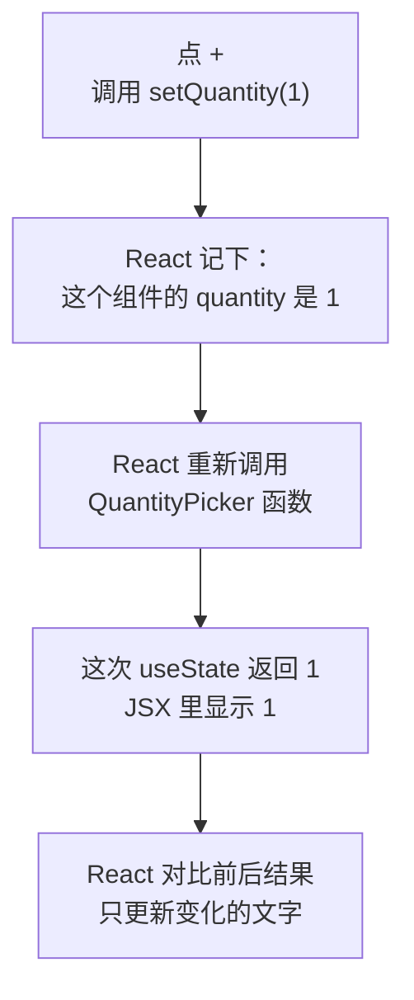
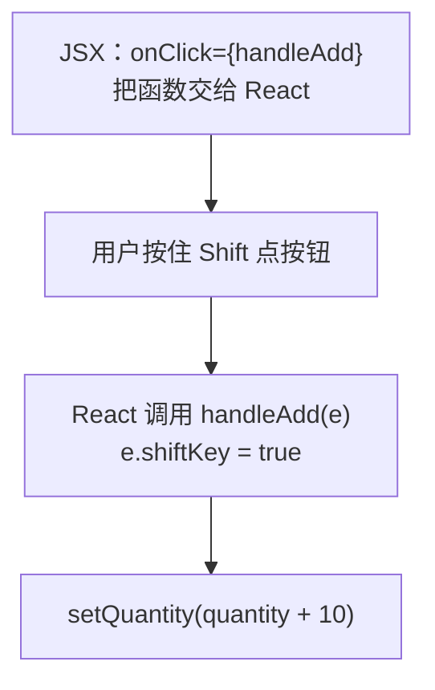
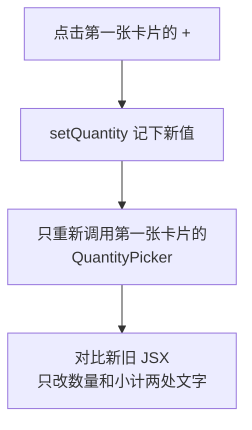

# 第 4 章 State：让页面动起来

## 这一章解决什么问题

每张产品卡片要能填「询价数量」：点「+」数量加 1，小计金额跟着变。你会自然地想到用一个变量记数量、点按钮时改它，但试一下就会发现：变量变了，页面纹丝不动。本章解决这个问题。

## 开始之前

- 上一章你已经会了：用 props 给组件传数据、用 `type` 声明 props、用 `children` 传一段界面。
- 起点代码：仓库 `code/ch03/price-list`（不含练习答案）。在 `D:\react-study\price-list` 执行 `npm run dev`。
- 本章要在浏览器开发者工具的「控制台」里看输出：按 `F12`，切到「控制台（Console）」标签。
- 预计耗时：50 分钟。

## 正文

### 4.1 useState

**白话定义**：state（状态）是组件自己记住的、会变化的数据。`useState` 是 React 提供的函数，用来声明一个 state，并拿到「当前值」和「修改它的函数」。用修改函数改值后，React 会重新执行组件函数，页面跟着更新。

**业务场景**：询价数量由用户点出来，不是外面传进来的，所以是卡片自己的 state。每张卡片记自己的数量，互不影响。

**反例（什么时候不该用）**：能从已有数据**算出来**的值不要放进 state。比如小计 = 单价 × 数量，有了 `quantity` 就能算，不要再 `useState` 一个 `subtotal`。存两份就得每次同时改两份，漏改一处页面就对不上。

#### 先看错误写法

新建 `src/components/QuantityPicker.tsx`，先用普通变量写：

```tsx
// src/components/QuantityPicker.tsx（4.1a 版本：错误示范，马上会改掉）
// 用普通变量记数量：点按钮时变量确实变了，但页面不会更新

type QuantityPickerProps = {
  price: number
}

export function QuantityPicker({ price }: QuantityPickerProps) {
  let quantity = 0

  function handleAdd() {
    quantity = quantity + 1
    console.log('quantity 现在是', quantity)
  }

  return (
    <div>
      询价数量：<strong>{quantity}</strong>{' '}
      <button type="button" onClick={handleAdd}>+</button>
      <p>小计：{(price * quantity).toLocaleString()} 元</p>
    </div>
  )
}
```

把它放进卡片：在 `ProductCard.tsx` 的 `import type { Product } ...` 下一行加 `import { QuantityPicker } from './QuantityPicker.tsx'`，在库存那段 `</p>` 后面加两行：

```tsx
      {/* 每张卡片里的 QuantityPicker 各有一份自己的 state */}
      <QuantityPicker price={product.price} />
```

`{' '}` 是插入一个空格。JSX 会去掉标签之间的换行和空白，要空格就得显式写。

在第一张卡片上点 3 次「+」。实测结果：页面上一直是「询价数量：0」「小计：0 元」，控制台却打印了：

```text
quantity 现在是 1
quantity 现在是 2
quantity 现在是 3
```

变量确实变了，但 React 不知道。React 只在**组件重新执行**时才更新页面，而改一个普通变量不会让组件重新执行。就算组件因为别的原因重新执行，`let quantity = 0` 也会再执行一遍，又回到 0。

#### 🖼 图解



state 的值存在 React 那里，不在函数的局部变量里，所以组件函数重新执行时值不会丢。

#### 💻 最小可运行代码

用下面的内容整个替换 `QuantityPicker.tsx`：

```tsx
// src/components/QuantityPicker.tsx（4.1b 版本，4.2 节会再改）
import { useState } from 'react'

type QuantityPickerProps = {
  price: number
}

export function QuantityPicker({ price }: QuantityPickerProps) {
  // useState 返回两样东西：当前值、修改它的函数。0 是初始值
  const [quantity, setQuantity] = useState(0)

  function handleAdd() {
    // 不是直接改 quantity，而是告诉 React「新值是多少」，React 会重新渲染
    setQuantity(quantity + 1)
  }

  function handleMinus() {
    if (quantity > 0) {
      setQuantity(quantity - 1)
    }
  }

  return (
    <div>
      询价数量：
      <button type="button" onClick={handleMinus}>−</button>
      <strong> {quantity} </strong>
      <button type="button" onClick={handleAdd}>+</button>
      <p>小计：{(price * quantity).toLocaleString()} 元</p>
    </div>
  )
}
```

#### 🔍 拆解运行结果

在第一张卡片上点「+」，数量变成 1，小计变成「12,800 元」。再点「−」回到 0，到 0 后再点「−」不变。第二张卡片的数量始终是 0。

| 代码 | 说明 |
| --- | --- |
| `const [quantity, setQuantity] = useState(0)` | 数组解构：`useState` 返回 `[当前值, 修改函数]` 两个元素。名字自己起，习惯写成 `xxx` 和 `setXxx` |
| `useState(0)` | `0` 只在组件**第一次**显示时用作初始值，之后每次重新执行都返回 React 记住的值 |
| TypeScript 类型 | 初始值是 `0`，TypeScript 推断 `quantity` 是 `number`，`setQuantity` 只接受 `number` |
| 两张卡片互不影响 | 每用一次 `<QuantityPicker />`，React 就为它单独存一份 state |

`useState` 这类以 `use` 开头的函数叫 Hook（钩子）。Hook 只能在组件函数的**最顶层**调用，不能放在 `if`、循环或普通函数里，原因见踩坑警告。

#### 改坏一处试试

**① 直接给 `quantity` 赋值。** 把 `handleMinus` 里的 `setQuantity(quantity - 1)` 改成 `quantity = quantity - 1`，报：

```text
error TS2588: Cannot assign to 'quantity' because it is a constant.
```

用 `const` 接收 state，就是为了防止你绕过 `setQuantity` 直接改值。

**② 传错类型。** 写成 `setQuantity('0')`，报 `TS2345: Argument of type 'string' is not assignable to parameter of type 'SetStateAction<number>'.`

### 4.2 事件处理及其类型

**白话定义**：事件处理函数（event handler）是用户操作（点击、输入、提交）发生时 React 调用的函数。在 JSX 里用 `onClick={函数}` 这样的属性绑定。React 调用它时会传入一个事件对象，里面有这次操作的详细信息。

**业务场景**：销售要一次填 30 台，点 30 下太麻烦。约定按住 `Shift` 点「+」一次加 10，这需要从事件对象里读「点击时有没有按住 Shift」。

**反例（什么时候不该用）**：用不到事件对象时，处理函数就不要写参数（像 `handleMinus` 那样）。写了不用，`noUnusedParameters` 检查会报错，读代码的人也会以为这里依赖了事件信息。

#### 🖼 图解



#### 💻 最小可运行代码

用下面的内容整个替换 `QuantityPicker.tsx`：

```tsx
// src/components/QuantityPicker.tsx（4.2 版本，4.3 节会再改）
import { useState } from 'react'
// MouseEvent 是 React 的鼠标事件类型，只用来标注参数，所以 import type
import type { MouseEvent } from 'react'

type QuantityPickerProps = {
  price: number
}

export function QuantityPicker({ price }: QuantityPickerProps) {
  const [quantity, setQuantity] = useState(0)

  // 按住 Shift 点「+」一次加 10。要读事件对象，参数类型写清是哪种元素上的鼠标事件
  function handleAdd(e: MouseEvent<HTMLButtonElement>) {
    const step = e.shiftKey ? 10 : 1
    setQuantity(quantity + step)
  }

  function handleMinus() {
    if (quantity > 0) {
      setQuantity(quantity - 1)
    }
  }

  return (
    <div>
      询价数量：
      <button type="button" onClick={handleMinus}>−</button>
      <strong> {quantity} </strong>
      {/* 传函数本身 handleAdd，不要写成 handleAdd() */}
      <button type="button" onClick={handleAdd}>+</button>
      <p>小计：{(price * quantity).toLocaleString()} 元</p>
    </div>
  )
}
```

#### 🔍 拆解运行结果

点一次「+」变 1；按住 `Shift` 再点一次变 11，小计「140,800 元」。

| 代码 | 说明 |
| --- | --- |
| `MouseEvent<HTMLButtonElement>` | React 的鼠标事件类型，尖括号里是事件发生在哪种元素上。从 `'react'` 导入，不是浏览器自带的同名类型 |
| `e.shiftKey` | 点击时是否按住了 Shift。写了类型后，输入 `e.` VS Code 会列出所有可用的字段 |
| `type="button"` | 按钮默认类型是 `submit`，放进表单里会提交表单。不是提交按钮就写明 `type="button"`，第 6 章会用到这一点 |

常用事件和类型对照（后面几章会用到）：

| JSX 属性 | 何时触发 | 处理函数的参数类型 |
| --- | --- | --- |
| `onClick` | 点击 | `MouseEvent<HTMLButtonElement>` |
| `onChange` | 输入框内容变化 | `ChangeEvent<HTMLInputElement>`（第 6 章） |
| `onSubmit` | 表单提交 | `SubmitEvent<HTMLFormElement>`（第 6 章） |

#### 改坏一处试试

**① 参数不写类型。** 把 `handleAdd(e: MouseEvent<HTMLButtonElement>)` 改成 `handleAdd(e)`，报：

```text
error TS7006: Parameter 'e' implicitly has an 'any' type.
```

严格模式不允许参数悄悄变成 `any`。

**② 绑定时写成了调用。** 把 `onClick={handleMinus}` 改成 `onClick={handleMinus()}`，报：

```text
error TS2322: Type 'void' is not assignable to type 'MouseEventHandler<HTMLButtonElement> | undefined'.
```

`handleMinus()` 会在**渲染时立刻执行**，交给 `onClick` 的是它的返回值（`void`，什么都没有），而不是函数。如果函数里调用了 `setQuantity`，后果更严重，见踩坑警告第 1 条。

每次实验后改回。

### 4.3 重新渲染的原理

**白话定义**：渲染（render）就是 React 调用组件函数、拿到 JSX 的过程。state 改变后，React 会重新渲染**这个组件和它里面的子组件**，再把新结果和上次对比，只修改浏览器页面上真正变化的部分。

**业务场景**：页面上有 3 张卡片。你在第一张上点「+」，只有第一张的 `QuantityPicker` 重新执行，其他卡片不受影响。

**反例（什么时候不该用）**：不要在组件函数体里（`return` 之前）做「每次渲染都执行就会出问题」的事，比如发请求、改全局变量、改 props。组件函数会被执行很多次，开发模式下还会被故意多执行一次。这类操作放到事件处理函数里，或者用第 7 章的 `useEffect`。

#### 🖼 图解



#### 💻 最小可运行代码

用下面的内容整个替换 `QuantityPicker.tsx`：加一行 `console.log` 观察渲染，再加一个「+2」按钮。

```tsx
// src/components/QuantityPicker.tsx
import { useState } from 'react'
// MouseEvent 是 React 的鼠标事件类型，只用来标注参数，所以 import type
import type { MouseEvent } from 'react'

type QuantityPickerProps = {
  price: number
}

export function QuantityPicker({ price }: QuantityPickerProps) {
  const [quantity, setQuantity] = useState(0)
  // 组件函数每执行一次（每次渲染）就打印一次，用来观察什么时候重新渲染
  console.log(`QuantityPicker 渲染，quantity = ${quantity}`)

  // 按住 Shift 点「+」一次加 10。要读事件对象，参数类型写清是哪种元素上的鼠标事件
  function handleAdd(e: MouseEvent<HTMLButtonElement>) {
    const step = e.shiftKey ? 10 : 1
    setQuantity(quantity + step)
  }

  function handleMinus() {
    if (quantity > 0) {
      setQuantity(quantity - 1)
    }
  }

  function handleAddTwo() {
    // 传「更新函数」：React 把上一次的结果作为 q 传进来，两次调用会依次累加
    setQuantity((q) => q + 1)
    setQuantity((q) => q + 1)
  }

  return (
    <div>
      询价数量：
      <button type="button" onClick={handleMinus}>−</button>
      <strong> {quantity} </strong>
      {/* 传函数本身 handleAdd，不要写成 handleAdd() */}
      <button type="button" onClick={handleAdd}>+</button>{' '}
      <button type="button" onClick={handleAddTwo}>+2</button>
      <p>小计：{(price * quantity).toLocaleString()} 元</p>
    </div>
  )
}
```

#### 🔍 拆解运行结果

刷新页面，控制台打印 **6 行** `QuantityPicker 渲染，quantity = 0`。在第一张卡片上点一次「+」，控制台只多出 **2 行** `QuantityPicker 渲染，quantity = 1`。

| 现象 | 原因 |
| --- | --- |
| 3 张卡片打印了 6 行 | 开发模式下 `StrictMode` 会把每次渲染执行两次，用来暴露「渲染时做了不该做的事」（第 3 章改 props 打了两次折就是这样被暴露的）。打包后的正式版本只执行一次 |
| 点「+」只多 2 行 | 只有第一张卡片的 state 变了，只有它重新渲染。另外两张卡片没有执行 |
| 点「+2」一次加 2 | 见下面的对比 |

**为什么「+2」要用更新函数？** 先试错误写法：把 `handleAddTwo` 里的两行改成 `setQuantity(quantity + 1)`，点一次「+2」，实测数量只从 0 变成 **1**。

一次渲染里的 `quantity` 是个固定值（像一张快照）。点击时 `quantity` 是 0，两行都是 `setQuantity(0 + 1)`，相当于把 1 设置了两次。React 要等事件处理函数执行完，才统一重新渲染。

写成 `setQuantity((q) => q + 1)` 时，传的是「怎么从旧值算新值」。React 依次执行：0 → 1 → 2。规则：**新值依赖旧值，并且同一次操作里要改多次时，用更新函数**。只改一次的 `setQuantity(quantity + step)` 两种写法结果相同。

#### 改坏一处试试

把「+」按钮的 `onClick={handleAdd}` 改成 `onClick={setQuantity(quantity + 1)}`。TypeScript 报 `TS2322: Type 'void' is not assignable to type ...`。不理会类型错误，看浏览器：页面变成**整片空白**，控制台里 `QuantityPicker 渲染` 从 0 打印到 25，然后报错：

```text
Uncaught Error: Too many re-renders. React limits the number of renders to prevent an infinite loop.
```

`setQuantity(...)` 在渲染时就执行 → 触发重新渲染 → 渲染时又执行 → ……无限循环。React 发现后停止并报错，整个应用都显示不出来。改回 `onClick={handleAdd}`。

## ⚠️ 踩坑警告

| 现象 | 原因 | 怎么改 |
| --- | --- | --- |
| 页面空白，控制台报 `Too many re-renders` | `onClick={setXxx(...)}` 或 `onClick={handleXxx()}`，在渲染时就调用了修改 state 的函数 | 交给 `onClick` 函数本身：`onClick={handleAdd}`；需要传参数时写箭头函数：`onClick={() => setQuantity(0)}` |
| 改了变量，页面不变 | 用 `let` 变量或直接改对象记数据，React 不知道数据变了 | 会变、并且要显示在页面上的数据用 `useState`，用 `setXxx` 修改 |
| 调用 `setQuantity` 后马上 `console.log(quantity)`，打印的还是旧值 | 本次渲染的 `quantity` 是固定的快照，新值在下一次渲染才拿得到 | 需要新值时，先算出来存到变量：`const next = quantity + 1; setQuantity(next); console.log(next)` |
| 把 `useState` 写在 `if` 后面（比如 `if (price < 0) return null` 之后），`tsc` 不报错，有时运行出错 | React 按调用顺序区分一个组件里的多个 Hook，某次渲染跳过了一个 Hook，后面的就对不上了 | Hook 一律写在组件函数最顶层、任何 `return` 和 `if` 之前。执行 `npm run lint` 能查出来：`react-hooks(rules-of-hooks): React Hook "useState" is called conditionally.` |

## 🎯 动手练习

**练习 1：询价数量不能超过库存**

给 `QuantityPicker` 加一个必填 prop `max`，`ProductCard` 把 `product.stock` 传进去。数量到达上限后，「+」和「+2」按钮变成禁用状态（灰色、点不动）；按住 Shift 加 10 也不能超过上限。

验收标准：

- 线阵探头（库存 3）：按住 Shift 点「+」，数量变成 3 而不是 10，「+」「+2」变灰。
- 点「−」变成 2，再点「+2」，数量变成 3。

提示：`<button disabled={true}>` 是禁用的按钮。

**练习 2：加一个「清零」按钮**

在「+2」后面加「清零」按钮，点了数量回到 0。

验收标准：

- 数量为 3 时点「清零」，显示「询价数量：0」「小计：0 元」，「+」重新可以点。

卡住了看文末参考答案。

## 📌 一句话总结

会变的数据放 state，用 setXxx 修改，React 重新调用组件更新页面。

## 下一章

现在每个产品都是手写的一行 `<ProductCard />`。第 5 章用一个数组渲染整张清单，并能删除产品。

---

<!-- 以下是参考答案，先自己动手，卡住了再往下翻 -->


## 参考答案

两个练习都改 `QuantityPicker.tsx`，下面是都做完后的版本。

### 练习 1

思路：上限通过 prop 从卡片传进来；是否到达上限由 `quantity` 和 `max` 算出来，不另存 state。Shift 加 10 和更新函数里都用 `Math.min` 截到上限。

`ProductCard.tsx` 里把原来那行改成：

```tsx
      {/* 练习 1：把库存作为上限传进去 */}
      <QuantityPicker price={product.price} max={product.stock} />
```

（完整文件见仓库 `code/ch04/answers/src/components/ProductCard.tsx`。）

### 练习 2

思路：清零就是把 state 设回初始值 0。

```tsx
// src/components/QuantityPicker.tsx
// 两个练习都做完后的版本
import { useState } from 'react'
import type { MouseEvent } from 'react'

type QuantityPickerProps = {
  price: number
  // 练习 1：最多能询价的数量（库存）
  max: number
}

export function QuantityPicker({ price, max }: QuantityPickerProps) {
  const [quantity, setQuantity] = useState(0)
  console.log(`QuantityPicker 渲染，quantity = ${quantity}`)

  function handleAdd(e: MouseEvent<HTMLButtonElement>) {
    const step = e.shiftKey ? 10 : 1
    // Shift 一次加 10 也可能超过库存，用 Math.min 截到最大值
    setQuantity(Math.min(quantity + step, max))
  }

  function handleMinus() {
    if (quantity > 0) {
      setQuantity(quantity - 1)
    }
  }

  function handleAddTwo() {
    setQuantity((q) => Math.min(q + 1, max))
    setQuantity((q) => Math.min(q + 1, max))
  }

  // 练习 2：清零就是把 state 设回初始值
  function handleReset() {
    setQuantity(0)
  }

  // 由 state 算出来的值，不需要再存一个 state
  const reachedMax = quantity >= max

  return (
    <div>
      询价数量：
      <button type="button" onClick={handleMinus}>−</button>
      <strong> {quantity} </strong>
      <button type="button" onClick={handleAdd} disabled={reachedMax}>+</button>{' '}
      <button type="button" onClick={handleAddTwo} disabled={reachedMax}>+2</button>{' '}
      <button type="button" onClick={handleReset}>清零</button>
      <p>小计：{(price * quantity).toLocaleString()} 元</p>
    </div>
  )
}
```
