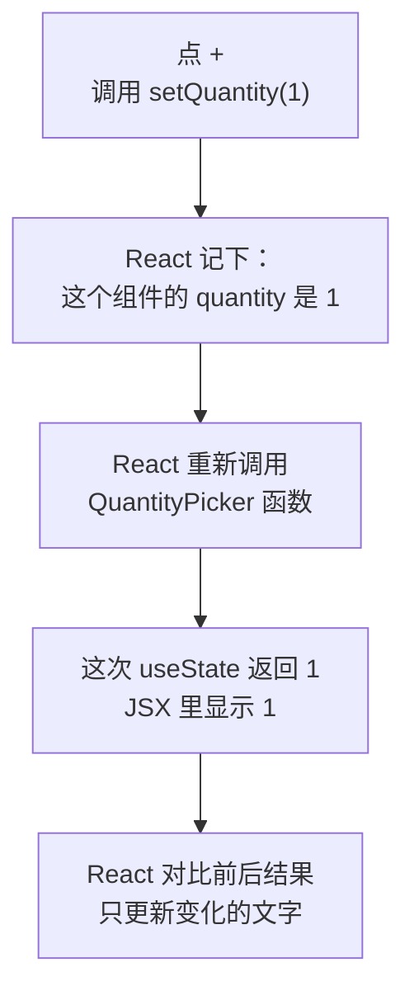

# 第 4A 章 useState：让组件记住会变的数据

## 这一章解决什么问题

每张产品卡片要能填「询价数量」：点「+」数量加 1，小计金额跟着变。你会自然地想到用一个变量记数量、点按钮时改它，但试一下就会发现：变量变了，页面纹丝不动。本章解决这个问题。

本章只讲一个技术点：**state 和 `useState`**。按钮怎么绑定点击、事件对象里有什么，下一章细讲，本章先照着写 `onClick={函数名}`。

## 开始之前

- 上一章你已经会了：用 props 给组件传数据、用 `type` 声明 props、用 `children` 传一段界面。
- 起点代码：仓库 `code/ch03C/price-list`（不含练习答案）。在 `D:\react-study\price-list` 执行 `npm run dev`。
- 本章要在浏览器开发者工具的「控制台」里看输出：按 `F12`，切到「控制台（Console）」标签。
- 预计耗时：25 分钟。

## 正文

### 4A.1 先看错误写法：普通变量

新建 `src/components/QuantityPicker.tsx`，先用普通变量写：

```tsx
// src/components/QuantityPicker.tsx（4A.1a 版本：错误示范，马上会改掉）
// 用普通变量记数量：点按钮时变量确实变了，但页面不会更新

type QuantityPickerProps = {
  price: number
}

export function QuantityPicker({ price }: QuantityPickerProps) {
  let quantity = 0

  function handleAdd() {
    quantity = quantity + 1
    console.log('quantity 现在是', quantity)
  }

  return (
    <div>
      询价数量：<strong>{quantity}</strong>{' '}
      <button type="button" onClick={handleAdd}>+</button>
      <p>小计：{(price * quantity).toLocaleString()} 元</p>
    </div>
  )
}
```

把它放进卡片：用下面的内容整个替换 `src/components/ProductCard.tsx`（和第 3C 章相比只多了两处：第 4 行的 `import`，以及库存下面的 `<QuantityPicker />`）。这个文件第 4 章后面都不再改。

```tsx
// src/components/ProductCard.tsx
// import type：只导入类型，翻译成 JavaScript 时整行会被去掉
import type { Product } from '../types.ts'
import { QuantityPicker } from './QuantityPicker.tsx'

type ProductCardProps = {
  // 传一个完整的产品对象，以后 Product 加字段时这里不用改
  product: Product
  // 问号表示可选：不传时用下面参数里写的默认值 '台'
  unit?: string
}

export function ProductCard({ product, unit = '台' }: ProductCardProps) {
  return (
    <div className="card">
      {/* 卡片放进 Panel 后，Panel 的标题是 h2，卡片标题降一级用 h3 */}
      <h3>{product.name}</h3>
      <p>编号：{product.code}</p>
      <p>单价：{product.price.toLocaleString()} 元</p>
      <p>
        库存：{product.stock} {unit}
      </p>
      {/* 每张卡片里的 QuantityPicker 各有一份自己的 state */}
      <QuantityPicker price={product.price} />
    </div>
  )
}
```

`{' '}` 是插入一个空格。JSX 会去掉标签之间的换行和空白，要空格就得显式写。`onClick={handleAdd}` 的意思是「点按钮时调用 `handleAdd`」，下一章细讲。

在第一张卡片上点 3 次「+」。实测结果：页面上一直是「询价数量：0」「小计：0 元」，控制台却打印了：

```text
quantity 现在是 1
quantity 现在是 2
quantity 现在是 3
```

变量确实变了，但 React 不知道。React 只在**组件重新执行**时才更新页面，而改一个普通变量不会让组件重新执行。就算组件因为别的原因重新执行，`let quantity = 0` 也会再执行一遍，又回到 0。

### 4A.2 useState 是什么

**白话定义**：state（状态）是组件自己记住的、会变化的数据。`useState` 是 React 提供的函数，用来声明一个 state，并拿到「当前值」和「修改它的函数」。用修改函数改值后，React 会重新执行组件函数，页面跟着更新。

**业务场景**：询价数量由用户点出来，不是外面传进来的，所以是卡片自己的 state。每张卡片记自己的数量，互不影响。

**反例（什么时候不该用）**：能从已有数据**算出来**的值不要放进 state。比如小计 = 单价 × 数量，有了 `quantity` 就能算，不要再 `useState` 一个 `subtotal`。存两份就得每次同时改两份，漏改一处页面就对不上。

和 props 对比：

| | props | state |
| --- | --- | --- |
| 数据从哪来 | 使用组件的地方传进来 | 组件自己记住 |
| 组件能不能改 | 不能（只读） | 能，用 `setXxx` 改 |
| 本章例子 | `price`（单价由卡片传进来） | `quantity`（数量由用户点出来） |

#### 🖼 图解



state 的值存在 React 那里，不在函数的局部变量里，所以组件函数重新执行时值不会丢。

### 4A.3 改用 useState

#### 💻 最小可运行代码

用下面的内容整个替换 `QuantityPicker.tsx`：

```tsx
// src/components/QuantityPicker.tsx
import { useState } from 'react'

type QuantityPickerProps = {
  price: number
}

export function QuantityPicker({ price }: QuantityPickerProps) {
  // useState 返回两样东西：当前值、修改它的函数。0 是初始值
  const [quantity, setQuantity] = useState(0)

  function handleAdd() {
    // 不是直接改 quantity，而是告诉 React「新值是多少」，React 会重新渲染
    setQuantity(quantity + 1)
  }

  function handleMinus() {
    if (quantity > 0) {
      setQuantity(quantity - 1)
    }
  }

  return (
    <div>
      询价数量：
      <button type="button" onClick={handleMinus}>−</button>
      <strong> {quantity} </strong>
      <button type="button" onClick={handleAdd}>+</button>
      <p>小计：{(price * quantity).toLocaleString()} 元</p>
    </div>
  )
}
```

#### 🔍 拆解运行结果

在第一张卡片上点「+」，数量变成 1，小计变成「12,800 元」。再点「−」回到 0，到 0 后再点「−」不变。第二张卡片的数量始终是 0。

| 代码 | 说明 |
| --- | --- |
| `import { useState } from 'react'` | `useState` 是 React 提供的函数，要先导入。它是真实存在的函数，不是类型，所以不写 `type` |
| `const [quantity, setQuantity] = useState(0)` | 数组解构：`useState` 返回 `[当前值, 修改函数]` 两个元素。名字自己起，习惯写成 `xxx` 和 `setXxx` |
| `useState(0)` | `0` 只在组件**第一次**显示时用作初始值，之后每次重新执行都返回 React 记住的值 |
| TypeScript 类型 | 初始值是 `0`，TypeScript 推断 `quantity` 是 `number`，`setQuantity` 只接受 `number` |
| 两张卡片互不影响 | 每用一次 `<QuantityPicker />`，React 就为它单独存一份 state |

`useState` 这类以 `use` 开头的函数叫 Hook（钩子）。Hook 只能在组件函数的**最顶层**调用，不能放在 `if`、循环或普通函数里，原因见踩坑警告。

#### 改坏一处试试

在 `D:\react-study\price-list` 执行 `npx tsc -b` 看报错。

**① 直接给 `quantity` 赋值。** 把 `handleMinus` 里的 `setQuantity(quantity - 1)` 改成 `quantity = quantity - 1`，报：

```text
src/components/QuantityPicker.tsx(19,7): error TS2588: Cannot assign to 'quantity' because it is a constant.
```

用 `const` 接收 state，就是为了防止你绕过 `setQuantity` 直接改值。

**② 传错类型。** 把 `handleAdd` 里的 `setQuantity(quantity + 1)` 改成 `setQuantity('0')`，报：

```text
src/components/QuantityPicker.tsx(14,17): error TS2345: Argument of type 'string' is not assignable to parameter of type 'SetStateAction<number>'.
```

`SetStateAction<number>` 是「能交给 `setQuantity` 的东西」，现在可以理解成 `number`。第 4C 章会看到它还能是一个函数。

**③ 忘了导入。** 删掉第一行 `import { useState } from 'react'`，报：

```text
src/components/QuantityPicker.tsx(9,35): error TS2304: Cannot find name 'useState'.
```

每次实验后改回。

## ⚠️ 踩坑警告

| 现象 | 原因 | 怎么改 |
| --- | --- | --- |
| 改了变量，控制台打印出了新值，页面不变 | 用 `let` 变量记数据，React 不知道数据变了，不会重新执行组件 | 会变、并且要显示在页面上的数据用 `useState`，用 `setXxx` 修改 |
| 把 `useState` 写在 `if` 后面（比如 `if (price < 0) { return null }` 之后），`npx tsc -b` 不报错，有时运行出错 | React 按调用顺序区分一个组件里的多个 Hook，某次渲染跳过了一个 Hook，后面的就对不上了 | Hook 一律写在组件函数最顶层、任何 `return` 和 `if` 之前。执行 `npm run lint` 能查出来（见下方） |
| 用 `setQuantity` 改了数量，又另外用一个 state 存小计，偶尔出现「数量 3、小计 25,600 元」 | 小计能从数量算出来，却存了两份，某处只改了一份 | 小计直接在 JSX 里算：`price * quantity` |

第 2 条的 `npm run lint` 实测输出（`lint` 是模板自带的命令，运行的是 Oxlint）：

```text
  x react-hooks(rules-of-hooks): React Hook "useState" is called conditionally. React Hooks must be called in the exact same order in every component render.
    ,-[src/components/QuantityPicker.tsx:13:35]
 12 |   }
 13 |   const [quantity, setQuantity] = useState(0)
    :                                   ^^^^^|^^^^^
    :                                        `-- This Hook call is not reachable on every render path.
```

## 🎯 动手练习

**练习 1：加一个「清零」按钮**

在「+」后面加「清零」按钮，点了数量回到 0。

验收标准：

- 点 3 次「+」后显示「询价数量：3」「小计：38,400 元」；点「清零」后显示「询价数量：0」「小计：0 元」。

**练习 2：一个组件里两个 state**

在询价数量下面加一行「样品数量」，也有一个「+」按钮。样品不计价，小计只按询价数量算。

验收标准：

- 点样品的「+」，样品数量变，询价数量和小计不变。
- 点询价的「清零」，样品数量不变。

卡住了看文末参考答案。

## 📌 一句话总结

会变的数据放 state，用 setXxx 修改，React 重新调用组件更新页面。

## 下一章

「+」现在一次只能加 1。销售要一次填 30 台，第 4B 章从点击事件里读出「有没有按住 Shift」，按住时一次加 10。

---

<!-- 以下是参考答案，先自己动手，卡住了再往下翻 -->


## 参考答案

两个练习都改 `QuantityPicker.tsx`，下面是都做完后的版本。

### 练习 1

思路：清零就是把 state 设回初始值 0，写一个 `handleReset` 绑到新按钮上。

### 练习 2

思路：再调用一次 `useState`，得到第二对「值 + 修改函数」。两个 state 各存各的，React 按调用顺序区分它们（这就是 Hook 必须写在最顶层的原因）。

```tsx
// src/components/QuantityPicker.tsx
// 两个练习都做完后的版本
import { useState } from 'react'

type QuantityPickerProps = {
  price: number
}

export function QuantityPicker({ price }: QuantityPickerProps) {
  const [quantity, setQuantity] = useState(0)
  // 练习 2：第二个 state。一个组件里可以有多个 state，各管各的
  const [samples, setSamples] = useState(0)

  function handleAdd() {
    setQuantity(quantity + 1)
  }

  function handleMinus() {
    if (quantity > 0) {
      setQuantity(quantity - 1)
    }
  }

  // 练习 1：清零就是把 state 设回初始值
  function handleReset() {
    setQuantity(0)
  }

  function handleAddSample() {
    setSamples(samples + 1)
  }

  return (
    <div>
      询价数量：
      <button type="button" onClick={handleMinus}>−</button>
      <strong> {quantity} </strong>
      <button type="button" onClick={handleAdd}>+</button>{' '}
      <button type="button" onClick={handleReset}>清零</button>
      <p>
        样品数量：<strong>{samples}</strong>{' '}
        <button type="button" onClick={handleAddSample}>+</button>
      </p>
      {/* 小计只和询价数量有关，样品不计价 */}
      <p>小计：{(price * quantity).toLocaleString()} 元</p>
    </div>
  )
}
```
