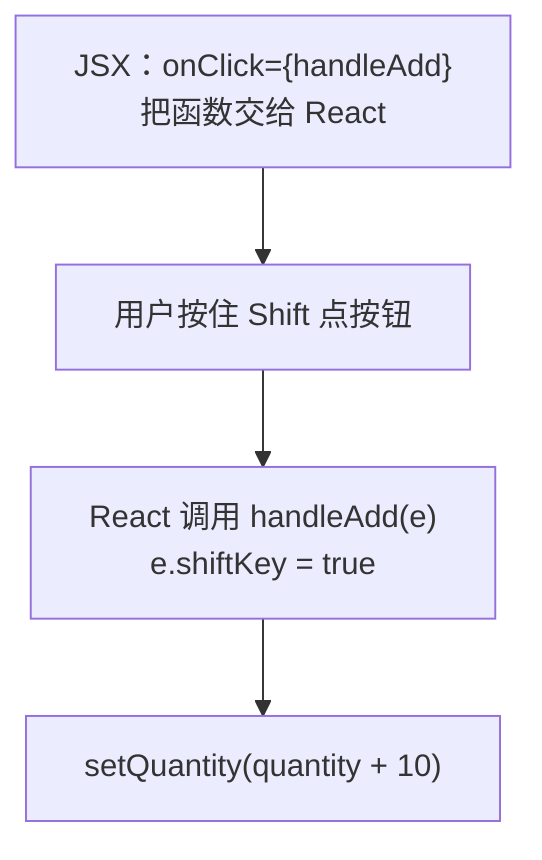

# 第 4B 章 事件处理：onClick 与事件对象的类型

## 这一章解决什么问题

上一章的「+」一次只能加 1。销售要一次填 30 台，点 30 下太麻烦。约定按住 `Shift` 点「+」一次加 10，这需要知道「点击的时候有没有按住 Shift」。这个信息在 React 传给处理函数的**事件对象**里。本章讲清楚处理函数怎么绑定、事件对象的类型怎么写。

本章只讲一个技术点：**事件处理及其类型**。

## 开始之前

- 上一章你已经会了：用 `useState` 声明 state、用 `setXxx` 修改、Hook 只能写在组件最顶层。
- 起点代码：仓库 `code/ch04A/price-list`（不含练习答案）。在 `D:\react-study\price-list` 执行 `npm run dev`。
- 预计耗时：25 分钟。

## 正文

### 4B.1 事件处理函数是什么

**白话定义**：事件处理函数（event handler）是用户操作（点击、输入、提交）发生时 React 调用的函数。在 JSX 里用 `onClick={函数}` 这样的属性绑定。React 调用它时会传入一个事件对象，里面有这次操作的详细信息。

**业务场景**：按住 `Shift` 点「+」一次加 10，需要从事件对象里读 `shiftKey`。

**反例（什么时候不该用）**：用不到事件对象时，处理函数就不要写参数（像 `handleMinus` 那样）。写了不用，`noUnusedParameters` 检查会报错，读代码的人也会以为这里依赖了事件信息。

#### 🖼 图解



### 4B.2 读事件对象

#### 💻 最小可运行代码

用下面的内容整个替换 `QuantityPicker.tsx`：

```tsx
// src/components/QuantityPicker.tsx
import { useState } from 'react'
// MouseEvent 是 React 的鼠标事件类型，只用来标注参数，所以 import type
import type { MouseEvent } from 'react'

type QuantityPickerProps = {
  price: number
}

export function QuantityPicker({ price }: QuantityPickerProps) {
  const [quantity, setQuantity] = useState(0)

  // 按住 Shift 点「+」一次加 10。要读事件对象，参数类型写清是哪种元素上的鼠标事件
  function handleAdd(e: MouseEvent<HTMLButtonElement>) {
    const step = e.shiftKey ? 10 : 1
    setQuantity(quantity + step)
  }

  function handleMinus() {
    if (quantity > 0) {
      setQuantity(quantity - 1)
    }
  }

  return (
    <div>
      询价数量：
      <button type="button" onClick={handleMinus}>−</button>
      <strong> {quantity} </strong>
      {/* 传函数本身 handleAdd，不要写成 handleAdd() */}
      <button type="button" onClick={handleAdd}>+</button>
      <p>小计：{(price * quantity).toLocaleString()} 元</p>
    </div>
  )
}
```

#### 🔍 拆解运行结果

点一次「+」变 1；按住 `Shift` 再点一次变 11，小计「140,800 元」。

| 代码 | 说明 |
| --- | --- |
| `import type { MouseEvent } from 'react'` | React 的鼠标事件类型。只用来标注参数，所以 `import type`（第 3B 章讲过） |
| `MouseEvent<HTMLButtonElement>` | 尖括号里是事件发生在哪种元素上，这里是按钮。从 `'react'` 导入，不是浏览器自带的同名类型 |
| `e.shiftKey` | 点击时是否按住了 Shift。写了类型后，输入 `e.` VS Code 会列出所有可用的字段，比如 `ctrlKey`、`altKey` |
| `e.shiftKey ? 10 : 1` | 三元表达式（conditional operator）：`条件 ? 成立时的值 : 不成立时的值`。它是一个表达式，有结果值，所以能直接赋给 `step`，后面几章也会大量写在 JSX 的花括号里 |
| `onClick={handleAdd}` | 交给 React 的是**函数本身**。React 在用户点击时才调用它，并把事件对象作为参数传进去 |
| `type="button"` | 按钮默认类型是 `submit`，放进表单里会提交表单。不是提交按钮就写明 `type="button"`，第 6 章会用到这一点 |

常用事件和类型对照（后面几章会用到）：

| JSX 属性 | 何时触发 | 处理函数的参数类型 |
| --- | --- | --- |
| `onClick` | 点击 | `MouseEvent<HTMLButtonElement>` |
| `onChange` | 输入框内容变化 | `ChangeEvent<HTMLInputElement>`（第 6 章） |
| `onSubmit` | 表单提交 | `SubmitEvent<HTMLFormElement>`（第 6 章） |

### 4B.3 函数本身和函数调用

`onClick={handleAdd}` 和 `onClick={handleAdd()}` 只差一对括号，意思完全不同：

| 写法 | 什么时候执行 | 交给 `onClick` 的是 |
| --- | --- | --- |
| `onClick={handleAdd}` | 用户点击时 | 函数本身 |
| `onClick={handleAdd()}` | **渲染时立刻执行** | 函数的返回值（这里什么都没有，是 `void`） |

需要给处理函数传自己的参数时，用一个新函数包一层，例如 `onClick={() => setQuantity(0)}`。`() => ...` 是箭头函数，第 4C 章细讲。

#### 改坏一处试试

在 `D:\react-study\price-list` 执行 `npx tsc -b` 看报错。

**① 参数不写类型。** 把 `handleAdd(e: MouseEvent<HTMLButtonElement>)` 改成 `handleAdd(e)`，报：

```text
src/components/QuantityPicker.tsx(4,15): error TS6196: 'MouseEvent' is declared but never used.
src/components/QuantityPicker.tsx(14,22): error TS7006: Parameter 'e' implicitly has an 'any' type.
```

第二条是关键：严格模式不允许参数悄悄变成 `any`。第一条是连带的，导入的类型没用上。

**② 绑定时写成了调用。** 把 `onClick={handleMinus}` 改成 `onClick={handleMinus()}`，报：

```text
src/components/QuantityPicker.tsx(28,29): error TS2322: Type 'void' is not assignable to type 'MouseEventHandler<HTMLButtonElement> | undefined'.
```

`MouseEventHandler` 是「处理鼠标事件的函数」。`handleMinus()` 的返回值是 `void`，不是函数。如果函数里直接调用了 `setQuantity`，后果更严重，第 4C 章会看到。

每次实验后改回。

## ⚠️ 踩坑警告

| 现象 | 原因 | 怎么改 |
| --- | --- | --- |
| 删掉了 `import type { MouseEvent } from 'react'`，报 `TS2315: Type 'MouseEvent' is not generic.` | 没导入时，`MouseEvent` 指的是浏览器自带的鼠标事件类型，它不带尖括号参数 | 从 `'react'` 导入：`import type { MouseEvent } from 'react'` |
| 写成 `import { MouseEvent } from 'react'`，报 `TS1484: 'MouseEvent' is a type and must be imported using a type-only import ...` | 项目开启了 `verbatimModuleSyntax`，类型要用 `import type` | 改成 `import type { MouseEvent } from 'react'` |
| `npx tsc -b` 报 `TS2322: Type 'void' is not assignable to type 'MouseEventHandler<HTMLButtonElement> \| undefined'.`；如果那个函数里改了 state，浏览器页面还会整片空白（第 4C 章看具体报错） | `onClick={handleXxx()}` 写成了调用，渲染时就执行了 | 去掉括号；要传参数时写 `onClick={() => handleXxx(参数)}` |

## 🎯 动手练习

**练习 1：询价数量不能超过库存**

给 `QuantityPicker` 加一个必填 prop `max`，`ProductCard` 把 `product.stock` 传进去。数量到达上限后，「+」按钮变成禁用状态（灰色、点不动）；按住 Shift 加 10 也不能超过上限。

验收标准：

- 线阵探头（库存 3）：按住 Shift 点「+」，数量变成 3 而不是 10，「+」变灰。
- 点「−」后「+」重新可以点。

提示：`<button disabled={true}>` 是禁用的按钮；`Math.min(a, b)` 取两个数里小的那个。

**练习 2：按住 Ctrl 点「−」直接清零**

不按 Ctrl 时，「−」照旧减 1；按住 `Ctrl` 点「−」，数量直接变成 0。

验收标准：

- 线阵探头数量为 3 时，按住 Ctrl 点「−」，显示「询价数量：0」「小计：0 元」。
- `handleMinus` 的参数写了类型，`npx tsc -b` 没有输出。

卡住了看文末参考答案。

## 📌 一句话总结

onClick 交函数本身，事件对象类型用 React 的 MouseEvent。

## 下一章

点「+」之后，React 到底重新执行了哪些组件？为什么连着调用两次 `setQuantity(quantity + 1)` 只加了 1？第 4C 章看清楚重新渲染的过程。

---

<!-- 以下是参考答案，先自己动手，卡住了再往下翻 -->


## 参考答案

两个练习做完后的完整代码。

### 练习 1

思路：上限通过 prop 从卡片传进来；是否到达上限由 `quantity` 和 `max` 算出来，不另存 state。Shift 加 10 时用 `Math.min` 截到上限。

`ProductCard.tsx` 只改了 `<QuantityPicker />` 那一行，把库存作为上限传进去：

```tsx
// src/components/ProductCard.tsx
// import type：只导入类型，翻译成 JavaScript 时整行会被去掉
import type { Product } from '../types.ts'
import { QuantityPicker } from './QuantityPicker.tsx'

type ProductCardProps = {
  // 传一个完整的产品对象，以后 Product 加字段时这里不用改
  product: Product
  // 问号表示可选：不传时用下面参数里写的默认值 '台'
  unit?: string
}

export function ProductCard({ product, unit = '台' }: ProductCardProps) {
  return (
    <div className="card">
      {/* 卡片放进 Panel 后，Panel 的标题是 h2，卡片标题降一级用 h3 */}
      <h3>{product.name}</h3>
      <p>编号：{product.code}</p>
      <p>单价：{product.price.toLocaleString()} 元</p>
      <p>
        库存：{product.stock} {unit}
      </p>
      {/* 每张卡片里的 QuantityPicker 各有一份自己的 state */}
      {/* 练习 1：把库存作为上限传进去 */}
      <QuantityPicker price={product.price} max={product.stock} />
    </div>
  )
}
```

### 练习 2

思路：`handleMinus` 现在要读事件对象，所以加上参数 `e: MouseEvent<HTMLButtonElement>`，和 `handleAdd` 一样。`e.ctrlKey` 为 `true` 时直接设成 0。

```tsx
// src/components/QuantityPicker.tsx
// 两个练习都做完后的版本
import { useState } from 'react'
import type { MouseEvent } from 'react'

type QuantityPickerProps = {
  price: number
  // 练习 1：最多能询价的数量（库存）
  max: number
}

export function QuantityPicker({ price, max }: QuantityPickerProps) {
  const [quantity, setQuantity] = useState(0)

  function handleAdd(e: MouseEvent<HTMLButtonElement>) {
    const step = e.shiftKey ? 10 : 1
    // 练习 1：Shift 一次加 10 也可能超过库存，用 Math.min 截到最大值
    setQuantity(Math.min(quantity + step, max))
  }

  // 练习 2：要读 e.ctrlKey，所以这里也写上事件参数
  function handleMinus(e: MouseEvent<HTMLButtonElement>) {
    if (e.ctrlKey) {
      setQuantity(0)
    } else if (quantity > 0) {
      setQuantity(quantity - 1)
    }
  }

  // 练习 1：是否到达上限由 quantity 和 max 算出来，不另存 state
  const reachedMax = quantity >= max

  return (
    <div>
      询价数量：
      <button type="button" onClick={handleMinus}>−</button>
      <strong> {quantity} </strong>
      <button type="button" onClick={handleAdd} disabled={reachedMax}>+</button>
      <p>小计：{(price * quantity).toLocaleString()} 元</p>
    </div>
  )
}
```
