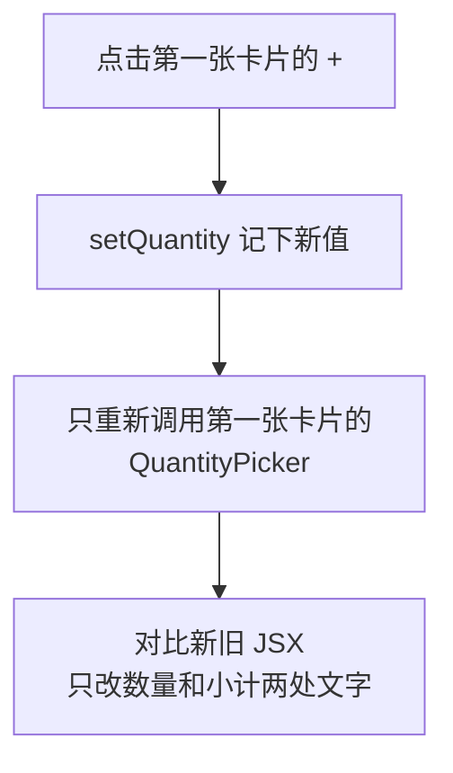

# 第 4C 章 重新渲染：state 变了之后发生什么

## 这一章解决什么问题

前两章你已经能让数量变化了，但还有几件事说不清：点一次「+」，React 重新执行了哪些组件？为什么在同一个处理函数里连着调用两次 `setQuantity(quantity + 1)`，结果只加了 1？为什么把 `setQuantity(...)` 直接写进 `onClick` 会让整个页面变空白？本章用 `console.log` 把重新渲染的过程打印出来看清楚。

本章只讲一个技术点：**重新渲染（re-render）**。

## 开始之前

- 上一章你已经会了：`onClick` 交函数本身、用 `MouseEvent<HTMLButtonElement>` 标注事件参数、按住 Shift 一次加 10。
- 起点代码：仓库 `code/ch04B/price-list`（不含练习答案）。在 `D:\react-study\price-list` 执行 `npm run dev`，按 `F12` 打开「控制台」。
- 预计耗时：30 分钟。

## 正文

### 4C.1 渲染是什么

**白话定义**：渲染（render）就是 React 调用组件函数、拿到 JSX 的过程。state 改变后，React 会重新渲染**这个组件和它里面的子组件**，再把新结果和上次对比，只修改浏览器页面上真正变化的部分。

**业务场景**：页面上有 3 张卡片。你在第一张上点「+」，只有第一张的 `QuantityPicker` 重新执行，其他卡片不受影响。

**反例（什么时候不该用）**：不要在组件函数体里（`return` 之前）做「每次渲染都执行就会出问题」的事，比如发请求、改全局变量、改 props。组件函数会被执行很多次，开发模式下还会被故意多执行一次。这类操作放到事件处理函数里，或者用第 7 章的 `useEffect`。

#### 🖼 图解



### 4C.2 把渲染打印出来

#### 💻 最小可运行代码

用下面的内容整个替换 `QuantityPicker.tsx`：加一行 `console.log` 观察渲染，再加一个「+2」按钮。

```tsx
// src/components/QuantityPicker.tsx
import { useState } from 'react'
// MouseEvent 是 React 的鼠标事件类型，只用来标注参数，所以 import type
import type { MouseEvent } from 'react'

type QuantityPickerProps = {
  price: number
}

export function QuantityPicker({ price }: QuantityPickerProps) {
  const [quantity, setQuantity] = useState(0)
  // 组件函数每执行一次（每次渲染）就打印一次，用来观察什么时候重新渲染
  console.log(`QuantityPicker 渲染，quantity = ${quantity}`)

  // 按住 Shift 点「+」一次加 10。要读事件对象，参数类型写清是哪种元素上的鼠标事件
  function handleAdd(e: MouseEvent<HTMLButtonElement>) {
    const step = e.shiftKey ? 10 : 1
    setQuantity(quantity + step)
  }

  function handleMinus() {
    if (quantity > 0) {
      setQuantity(quantity - 1)
    }
  }

  function handleAddTwo() {
    // 传「更新函数」：React 把上一次的结果作为 q 传进来，两次调用会依次累加
    setQuantity((q) => q + 1)
    setQuantity((q) => q + 1)
  }

  return (
    <div>
      询价数量：
      <button type="button" onClick={handleMinus}>−</button>
      <strong> {quantity} </strong>
      {/* 传函数本身 handleAdd，不要写成 handleAdd() */}
      <button type="button" onClick={handleAdd}>+</button>{' '}
      <button type="button" onClick={handleAddTwo}>+2</button>
      <p>小计：{(price * quantity).toLocaleString()} 元</p>
    </div>
  )
}
```

#### 🔍 拆解运行结果

刷新页面，控制台打印 **6 行** `QuantityPicker 渲染，quantity = 0`。在第一张卡片上点一次「+」，控制台只多出 **2 行** `QuantityPicker 渲染，quantity = 1`。

| 现象 | 原因 |
| --- | --- |
| 3 张卡片打印了 6 行 | 开发模式下 `StrictMode` 会把每次渲染执行两次，用来暴露「渲染时做了不该做的事」（第 3B 章改 props 打了两次折就是这样被暴露的）。打包后的正式版本只执行一次 |
| 点「+」只多 2 行 | 只有第一张卡片的 state 变了，只有它重新渲染。另外两张卡片没有执行 |
| 点「+2」一次加 2 | 见 4C.3 节 |

`` console.log(`QuantityPicker 渲染，quantity = ${quantity}`) `` 用的是模板字符串（template literal）：用反引号 `` ` `` 包起来的字符串，里面的 `${...}` 会被替换成表达式的值。和用 `+` 拼接 `'quantity = ' + quantity` 效果一样，写起来更直观。

### 4C.3 一次渲染里的 state 是快照

**为什么「+2」要写成 `setQuantity((q) => q + 1)`？** 先试错误写法：把 `handleAddTwo` 里的两行改成 `setQuantity(quantity + 1)`，点一次「+2」，实测数量只从 0 变成 **1**。

一次渲染里的 `quantity` 是个固定值（像一张快照）。点击时 `quantity` 是 0，两行都是 `setQuantity(0 + 1)`，相当于把 1 设置了两次。React 要等事件处理函数执行完，才统一重新渲染。

`(q) => q + 1` 是箭头函数（arrow function），是写函数的简短方式：箭头左边是参数，右边是返回值。下面三种写法完全等价：

| 写法 | 说明 |
| --- | --- |
| `function (q) { return q + 1 }` | 普通的匿名函数 |
| `(q) => { return q + 1 }` | 箭头函数，函数体用花括号时要写 `return` |
| `(q) => q + 1` | 函数体只有一个表达式时，可以省掉花括号和 `return` |

没有参数时写 `() => ...`，例如 `onClick={() => setQuantity(0)}`。React 代码里到处是箭头函数，后面几章不再重复解释。

写成 `setQuantity((q) => q + 1)` 时，传的是「怎么从旧值算新值」，叫更新函数（updater function）。React 依次执行：0 → 1 → 2。规则：**新值依赖旧值，并且同一次操作里要改多次时，用更新函数**。只改一次的 `setQuantity(quantity + step)` 两种写法结果相同。

第 4A 章报错里的 `SetStateAction<number>`，意思就是「一个 `number`，或者一个从旧 `number` 算出新 `number` 的函数」。

#### 改坏一处试试

把「+」按钮的 `onClick={handleAdd}` 改成 `onClick={setQuantity(quantity + 1)}`。TypeScript 报 `TS2322: Type 'void' is not assignable to type ...`。不理会类型错误，看浏览器：页面变成**整片空白**，控制台里 `QuantityPicker 渲染` 从 0 打印到 25，然后报错：

```text
Uncaught Error: Too many re-renders. React limits the number of renders to prevent an infinite loop.
```

`setQuantity(...)` 在渲染时就执行 → 触发重新渲染 → 渲染时又执行 → ……无限循环。React 发现后停止并报错，整个应用都显示不出来。改回 `onClick={handleAdd}`。

## ⚠️ 踩坑警告

| 现象 | 原因 | 怎么改 |
| --- | --- | --- |
| 页面空白，控制台报 `Too many re-renders` | `onClick={setXxx(...)}` 或 `onClick={handleXxx()}`，在渲染时就调用了修改 state 的函数 | 交给 `onClick` 函数本身：`onClick={handleAdd}`；需要传参数时写箭头函数：`onClick={() => setQuantity(0)}` |
| 调用 `setQuantity` 后马上 `console.log(quantity)`，打印的还是旧值 | 本次渲染的 `quantity` 是固定的快照，新值在下一次渲染才拿得到 | 需要新值时，先算出来存到变量：`const next = quantity + 1; setQuantity(next); console.log(next)` |
| 同一个处理函数里连着两次 `setQuantity(quantity + 1)`，只加了 1 | 两次用的都是同一张快照里的 `quantity` | 改成 `setQuantity((q) => q + 1)` |
| 开发时每个组件的 `console.log` 都打印两次，以为代码执行了两遍出了问题 | `StrictMode` 在开发模式下故意把每次渲染执行两次 | 正常现象，打包后只执行一次。正因为如此，渲染时不要做有副作用的事 |

## 🎯 动手练习

**练习 1：一次减 2 的按钮**

在「+2」后面加一个「−2」按钮，一次减 2，但不能小于 0。

验收标准：

- 数量为 3 时点「−2」变成 1，再点一次变成 0（不是 −1）。
- `handleMinusTwo` 里调用了两次 `setQuantity`，用的是更新函数。

提示：`Math.max(a, b)` 取两个数里大的那个。

**练习 2：卡片本身会不会重新渲染？**

在 `ProductCard` 函数体的第一行加 `` console.log(`ProductCard 渲染：${product.name}`) ``。刷新页面，然后在第一张卡片上点一次「+」。

验收标准：

- 刷新时控制台按顺序出现每张卡片的 `ProductCard 渲染` 和 `QuantityPicker 渲染`（各两次）。
- 点「+」后只多出两行 `QuantityPicker 渲染，quantity = 1`，**没有** `ProductCard 渲染`。能说出原因。

卡住了看文末参考答案。

## 📌 一句话总结

state 变了只重渲染该组件及其子组件；依赖旧值多次改用更新函数。

## 下一章

现在每个产品都是手写的一行 `<ProductCard />`。第 5 章用一个数组渲染整张清单，并能删除产品。

---

<!-- 以下是参考答案，先自己动手，卡住了再往下翻 -->


## 参考答案

### 练习 1

思路：和「+2」一样，两次修改都依赖上一次的结果，所以用更新函数；`Math.max(q - 1, 0)` 保证不小于 0。

```tsx
// src/components/QuantityPicker.tsx
// 练习 1 做完后的版本
import { useState } from 'react'
// MouseEvent 是 React 的鼠标事件类型，只用来标注参数，所以 import type
import type { MouseEvent } from 'react'

type QuantityPickerProps = {
  price: number
}

export function QuantityPicker({ price }: QuantityPickerProps) {
  const [quantity, setQuantity] = useState(0)
  // 组件函数每执行一次（每次渲染）就打印一次，用来观察什么时候重新渲染
  console.log(`QuantityPicker 渲染，quantity = ${quantity}`)

  // 按住 Shift 点「+」一次加 10。要读事件对象，参数类型写清是哪种元素上的鼠标事件
  function handleAdd(e: MouseEvent<HTMLButtonElement>) {
    const step = e.shiftKey ? 10 : 1
    setQuantity(quantity + step)
  }

  function handleMinus() {
    if (quantity > 0) {
      setQuantity(quantity - 1)
    }
  }

  function handleAddTwo() {
    // 传「更新函数」：React 把上一次的结果作为 q 传进来，两次调用会依次累加
    setQuantity((q) => q + 1)
    setQuantity((q) => q + 1)
  }

  // 练习 1：一次减 2，但不能小于 0。两次都依赖上一次的结果，所以用更新函数
  function handleMinusTwo() {
    setQuantity((q) => Math.max(q - 1, 0))
    setQuantity((q) => Math.max(q - 1, 0))
  }

  return (
    <div>
      询价数量：
      <button type="button" onClick={handleMinus}>−</button>
      <strong> {quantity} </strong>
      {/* 传函数本身 handleAdd，不要写成 handleAdd() */}
      <button type="button" onClick={handleAdd}>+</button>{' '}
      <button type="button" onClick={handleAddTwo}>+2</button>{' '}
      <button type="button" onClick={handleMinusTwo}>−2</button>
      <p>小计：{(price * quantity).toLocaleString()} 元</p>
    </div>
  )
}
```

### 练习 2

思路：state 在 `QuantityPicker` 里，变的是它自己。React 只重新渲染 state 所在的组件和它里面的子组件；`ProductCard` 是它的**父组件**，不受影响。

```tsx
// src/components/ProductCard.tsx
// 练习 2 做完后的版本
// import type：只导入类型，翻译成 JavaScript 时整行会被去掉
import type { Product } from '../types.ts'
import { QuantityPicker } from './QuantityPicker.tsx'

type ProductCardProps = {
  // 传一个完整的产品对象，以后 Product 加字段时这里不用改
  product: Product
  // 问号表示可选：不传时用下面参数里写的默认值 '台'
  unit?: string
}

export function ProductCard({ product, unit = '台' }: ProductCardProps) {
  // 练习 2：观察卡片本身什么时候重新渲染
  console.log(`ProductCard 渲染：${product.name}`)

  return (
    <div className="card">
      {/* 卡片放进 Panel 后，Panel 的标题是 h2，卡片标题降一级用 h3 */}
      <h3>{product.name}</h3>
      <p>编号：{product.code}</p>
      <p>单价：{product.price.toLocaleString()} 元</p>
      <p>
        库存：{product.stock} {unit}
      </p>
      {/* 每张卡片里的 QuantityPicker 各有一份自己的 state */}
      <QuantityPicker price={product.price} />
    </div>
  )
}
```

实测刷新后的控制台（开发模式，每次渲染执行两次）：

```text
ProductCard 渲染：凸阵探头 C5-2
ProductCard 渲染：凸阵探头 C5-2
QuantityPicker 渲染，quantity = 0
QuantityPicker 渲染，quantity = 0
ProductCard 渲染：线阵探头 L12-5
ProductCard 渲染：线阵探头 L12-5
QuantityPicker 渲染，quantity = 0
QuantityPicker 渲染，quantity = 0
ProductCard 渲染：耦合剂 250ml
ProductCard 渲染：耦合剂 250ml
QuantityPicker 渲染，quantity = 0
QuantityPicker 渲染，quantity = 0
```

点第一张卡片的「+」后只多出：

```text
QuantityPicker 渲染，quantity = 1
QuantityPicker 渲染，quantity = 1
```
