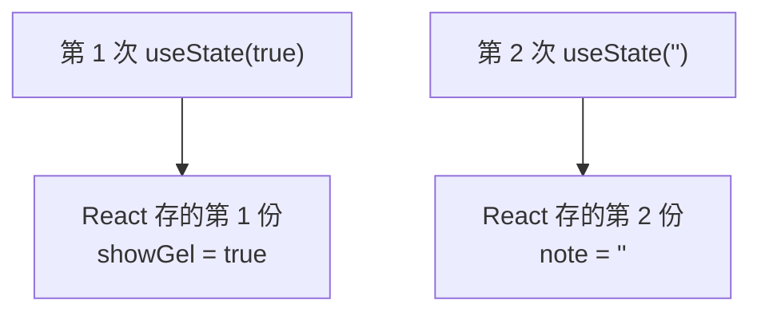
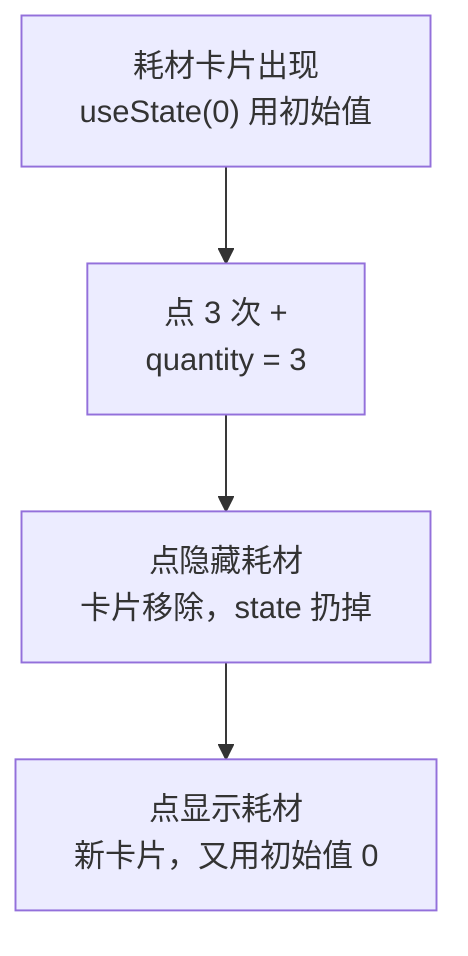
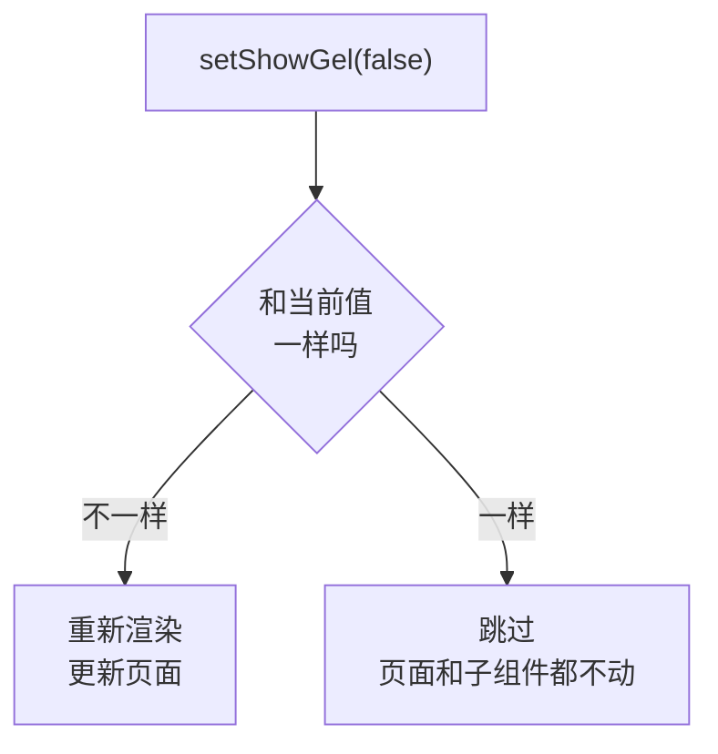

# 第 4D 章 state 的基本规则：几个、初始值、什么时候更新、什么时候清空

## 这一章解决什么问题

前三章一直在用 state，但有几个基本问题还没回答：一个组件能有几个 state？不给初始值会怎样？初始值是每次渲染都用吗？把 state 设成和原来一样的值，页面会不会刷新？面板收起再展开，里面填的数量还在不在？

这些问题不弄清楚，后面写表单、写列表时会遇到「数量莫名清零」「点了按钮没反应」这类现象，却不知道原因。本章在页面上加一个「隐藏/显示耗材」的开关，把这些规则逐个试出来。

本章讲三个技术点：**一个组件里的多个 state 和它们的类型**、**初始值和 state 的寿命**、**设成相同的值会跳过更新**。

## 开始之前

- 上一章你已经会了：`useState`、事件处理函数、更新函数 `setX((x) => ...)`、箭头函数、state 是一次渲染的快照、开发时 `StrictMode` 让每次渲染打印两次。
- 起点代码：仓库 `code/ch04C/price-list`（不含练习答案）。在 `D:\react-study\price-list` 执行 `npm run dev`。
- 本章只改 `src/App.tsx`，要看浏览器控制台（`F12` →「控制台」）。
- 预计耗时：30 分钟。

## 正文

### 4D.1 state 的定义

**定义**（和第 4A 章 4A.2 节相同，这里再完整看一遍）：state（状态）是 React 替**某一个组件实例**保存的一份数据。它有三个特点：

| 特点 | 说明 |
| --- | --- |
| 存在 React 那里 | 不在组件函数的局部变量里，所以组件函数重新执行时值不会丢 |
| 只能用配套的修改函数改 | 每个 state 都带一个 `setXxx`。直接赋值不行，`const` 也不允许（第 4A 章改坏 ①） |
| 一改就重新渲染 | 调用 `setXxx` 改了值，React 重新执行这个组件函数，页面跟着更新 |

拿第 4A 章 `QuantityPicker.tsx` 里的这一行来看：

```tsx
  const [quantity, setQuantity] = useState(0)
```

| 部分 | 意思 |
| --- | --- |
| `useState(0)` | 向 React 要一份 state，`0` 是初始值 |
| `[quantity, setQuantity]` | `useState` 返回两样东西，按顺序放进两个变量：当前值、修改函数。名字自己起 |
| `const` | 在这一次渲染里，`quantity` 是固定的，不能重新赋值（第 4C 章说的「快照」） |

**这一行是「声明一个 state」，但它和普通变量的定义不一样。** 普通的 `let quantity = 0` 每执行一次，`quantity` 就重新变回 0。`useState(0)` 这一行也是组件每渲染一次就执行一次，但只有**第一次**是新建 state，以后每次都是「取回 React 记住的值」，`0` 被忽略。第 4C 章的实测就是证据：点一次「+」后，控制台打印 `QuantityPicker 渲染，quantity = 1`。组件函数从头又执行了一遍，`useState(0)` 也执行了，返回的却是 1。

「这一行运行两次」有几种情况，结果各不相同：

| 情况 | 结果 | 在哪里实测 |
| --- | --- | --- |
| 同一行代码，随着组件每次渲染又执行一次 | 不会新建，取回记住的值 | 第 4C 章；本章 4D.4 |
| 同一个组件实例在页面上用了多次（三张卡片） | 每张卡片各有一份，互不影响 | 第 4A 章 |
| 同一个组件里换个名字再写一行 `useState` | 多出第二个 state | 本章 4D.3 |
| 同一个组件里把这一行原样再写一遍 | 编译报错 `TS2451`，同名变量不能声明两次 | 本章 4D.3 改坏 ① |

下面在页面上加一个开关，把这些规则逐个试出来。

### 4D.2 把开关放到页面上

用下面的内容整个替换 `src/App.tsx`。和第 4C 章相比改了四处，每处上面都有一行以 🟨 开头的注释，方便你找：导入 `useState`；`App` 函数开头的两个 state 和一行 `console.log`；页头下面的三个按钮；耗材面板外面包的一层 `{showGel && (...)}`。

```tsx
// src/App.tsx
// 🟨 本章新增：导入 useState
import { useState } from 'react'
import type { Product } from './types.ts'
import { PageHeader } from './components/PageHeader.tsx'
import { Panel } from './components/Panel.tsx'
import { ProductCard } from './components/ProductCard.tsx'
import { PageFooter } from './components/PageFooter.tsx'

// 标注 : Product 后，少写字段或类型不对，这里就会报错
const probe: Product = { id: 1, code: 'P-001', name: '凸阵探头 C5-2', category: '探头', price: 12800, stock: 6 }
const linear: Product = { id: 2, code: 'P-002', name: '线阵探头 L12-5', category: '探头', price: 15600, stock: 3 }
const gel: Product = { id: 4, code: 'C-001', name: '耦合剂 250ml', category: '耗材', price: 18, stock: 120 }

function App() {
  // 🟨 本章新增：两个 state。一个组件里可以有多个 state，每个 useState 管一份数据
  // 初始值 true 推断出 boolean，初始值 '' 推断出 string
  const [showGel, setShowGel] = useState(true)
  const [note, setNote] = useState('')
  // 🟨 本章新增：每次渲染都打印，用来观察 state 的值和渲染次数
  console.log(`App 渲染，showGel = ${showGel}，note = ${note}`)

  return (
    <main>
      <PageHeader />
      {/* 🟨 本章新增：三个按钮，后面显示核对备注 */}
      <p>
        <button type="button" onClick={() => setShowGel(false)}>隐藏耗材</button>{' '}
        <button type="button" onClick={() => setShowGel(true)}>显示耗材</button>{' '}
        <button type="button" onClick={() => setNote('已核对')}>标记已核对</button>
        {' '}{note}
      </p>
      <Panel title="探头">
        <ProductCard product={probe} />
        <ProductCard product={linear} />
      </Panel>
      {/* 🟨 本章新增：showGel 为 false 时，整个耗材面板（连同里面的卡片）从页面上移除 */}
      {showGel && (
        <Panel title="耗材">
          {/* 耗材按「瓶」计，传 unit 覆盖默认的「台」 */}
          <ProductCard product={gel} unit="瓶" />
        </Panel>
      )}
      <PageFooter />
    </main>
  )
}

export default App
```

`{showGel && (...)}` 的意思是：`showGel` 为 `true` 时显示括号里的内容，为 `false` 时什么都不显示。写法的细节第 5C 章讲，本章只用它来「把耗材面板从页面上拿掉」。

页面上多了「隐藏耗材」「显示耗材」「标记已核对」三个按钮。

### 4D.3 一个组件里的多个 state 和它们的类型

**白话定义**：一个组件里可以调用任意多次 `useState`，每调用一次就多一个 state，各存各的值，各有各的修改函数，没有数量上限。`showGel`、`note` 这些名字只是组件函数里的局部变量，React 不认名字，而是按**调用的先后顺序**区分 state：第 1 个 `useState` 对应第 1 份值，第 2 个对应第 2 份。

state 可以是任何类型：数字、文字、`true`/`false`、对象、数组都行。类型由初始值推断；推断不出来，或者以后可能变成别的类型时，在 `useState` 后面的尖括号里写明。

**业务场景**：页面上「耗材面板显示不显示」和「核对备注」是两件不相干的事，用两个 state 分开存，一个是 `boolean`，一个是 `string`，改一个不影响另一个。

**反例（什么时候不该用）**：几个值**总是一起改**（比如收货地址的省、市、详细地址），拆成三个 state 就得每次连着调三个 `setXxx`。这种情况可以合成一个对象放进一个 state，对象 state 怎么改第 5B 章讲。

#### 🖼 图解



这就是第 4A 章说「Hook 必须写在最顶层」的原因：如果某次渲染跳过了第 1 个 `useState`，第 2 个就会拿到第 1 份值，全乱了。

#### 💻 最小可运行代码

就是 4D.2 代码里的这两行：

```tsx
  const [showGel, setShowGel] = useState(true)
  const [note, setNote] = useState('')
```

#### 🔍 拆解运行结果

打开页面，控制台打印（每行两遍是 `StrictMode`，第 4C 章讲过）：

```text
App 渲染，showGel = true，note = 
```

点「标记已核对」，按钮后面出现「已核对」，控制台打印 `App 渲染，showGel = true，note = 已核对`：`note` 变了，`showGel` 还是 `true`。

| 代码 | 说明 |
| --- | --- |
| `useState(true)` | 初始值是 `true`，TypeScript 推断 `showGel` 是 `boolean`，`setShowGel` 只接受 `true`/`false` |
| `useState('')` | 初始值是空字符串，推断出 `string` |
| `onClick={() => setShowGel(false)}` | 要传参数，所以包一层箭头函数（第 4C 章）。直接写 `onClick={setShowGel(false)}` 会无限渲染 |
| 各管各的 | 改 `note` 不动 `showGel`，反过来也一样 |
| 名字随便起 | 把 `note`、`setNote` 全部改名成 `remark`、`setRemark`，运行结果完全一样，React 只认顺序 |
| 同名的 state 各是各的 | 不同组件里都叫 `quantity`，或者同一个组件在页面上用了好几次（三张卡片），每处都是独立的一份。state 是每个组件实例自己的数据，别的组件不能直接读写，要传给别人得通过 props（第 8A、8B 章） |

初始值决定类型，常见情况如下：

| 初始值 | TypeScript 推断出的类型 | 要不要写尖括号 |
| --- | --- | --- |
| `0`、`''`、`true` | `number`、`string`、`boolean` | 不用 |
| `{ name: '', price: 0 }` | `{ name: string; price: number }`，每个字段的类型都定下来了 | 不用。以后 `price` 只能设数字，设 `'5'` 报 `TS2322: Type 'string' is not assignable to type 'number'.` |
| `[]` | `never[]`，以后放不进任何东西 | 必须写，如 `useState<Product[]>([])`（第 5B 章） |
| `null`，或者什么都不写 | `null` 或 `undefined`，以后设不进别的值 | 必须写，如 `useState<number \| null>(null)`，`\|` 读作「或」：要么是数字，要么是 `null` |

#### 改坏一处试试

**① 同一个组件里两个同名的 state。** 把 `const [note, setNote] = useState('')` 这一行复制一份，紧贴着放在下面。`npx tsc -b` 报：

```text
src/App.tsx(19,10): error TS2451: Cannot redeclare block-scoped variable 'note'.
src/App.tsx(19,16): error TS2451: Cannot redeclare block-scoped variable 'setNote'.
src/App.tsx(20,10): error TS2451: Cannot redeclare block-scoped variable 'note'.
src/App.tsx(20,16): error TS2451: Cannot redeclare block-scoped variable 'setNote'.
```

同一个函数里不能用 `const` 声明两个同名变量，这是 TypeScript 的规则，和 React 无关。所以不会出现「调用两次 `useState` 却合成一个 state」：调用两次就是两个 state，只是你得给它们起不同的名字。删掉复制的那一行。

**② 不给初始值。** 把 `useState(true)` 改成 `useState()`，`npx tsc -b` 报：

```text
src/App.tsx(28,57): error TS2345: Argument of type 'false' is not assignable to parameter of type 'SetStateAction<undefined>'.
src/App.tsx(29,57): error TS2345: Argument of type 'true' is not assignable to parameter of type 'SetStateAction<undefined>'.
```

React 不会替你准备默认值：不传初始值，初始值就是 `undefined`，TypeScript 只能推断出类型是 `undefined`，以后什么都设不进去。

**③ 初始值写 `null`。** 再改成 `useState(null)`，报：

```text
src/App.tsx(28,57): error TS2345: Argument of type 'false' is not assignable to parameter of type 'SetStateAction<null>'.
src/App.tsx(29,57): error TS2345: Argument of type 'true' is not assignable to parameter of type 'SetStateAction<null>'.
```

道理一样：TypeScript 认定这个 state 永远是 `null`。所以 state 一律给一个合适的初始值：数字给 `0`，文字给 `''`，开关给 `true` 或 `false`。确实「一开始没有值」的情况（比如还没选中任何产品），初始值写 `null`，同时在尖括号里写明以后会是什么，例如 `useState<number | null>(null)`，第 12C 章的练习会用到。

改回 `useState(true)`。

### 4D.4 初始值只用一次，组件移除后 state 就清空

**白话定义**：`useState(初始值)` 里的初始值，只在组件**出现在页面上的那一次**使用。之后每次重新渲染，`useState` 那一行照样执行，但返回的是 React 记住的值，初始值被忽略。组件从页面上移除时，React 把它的 state 一起扔掉；它再次出现，就是一份全新的 state，又从初始值开始。

**业务场景**：耗材面板收起再展开，耦合剂的询价数量回到 0。如果业务要求「收起再展开数量还在」，就不能把数量放在会被移除的组件里，要放到不会被移除的父组件，第 8B 章讲怎么做。

**反例（什么时候不该用）**：要在**刷新页面后还在**的数据（比如填了一半的长表单），不能只放在 state 里。刷新时整个页面重新开始，所有 state 都回到初始值。这类数据要保存到服务器（第 12A 章起）。

#### 🖼 图解



#### 💻 最小可运行代码

不用改代码，按下面的顺序操作。

#### 🔍 拆解运行结果

**第一步：看初始值被忽略。** 先按 `F5` 刷新，再点「隐藏耗材」，控制台打印 `App 渲染，showGel = false，note = `。组件函数里写的仍然是 `useState(true)`，这次返回的却是 `false`：初始值只在第一次用。

**第二步：看移除后清空。** 先点「显示耗材」，然后在凸阵探头上点 2 次「+」，耦合剂上点 3 次「+」，再点「隐藏耗材」「显示耗材」。实测：

| 卡片 | 隐藏前 | 隐藏再显示后 |
| --- | --- | --- |
| 凸阵探头 C5-2 | 询价数量 2，小计 25,600 元 | 询价数量 2，小计 25,600 元（没被移除，不受影响） |
| 耦合剂 250ml | 询价数量 3，小计 54 元 | 询价数量 **0**，小计 **0 元** |

**第三步：刷新。** 按 `F5`，所有数量都是 0，「已核对」也没了。

state 什么时候回到初始值，总结如下：

| 情况 | state 怎样 |
| --- | --- |
| 组件重新渲染（state 或 props 变了） | 保留，初始值被忽略 |
| 组件从页面上移除，再出现 | 清空，重新从初始值开始 |
| 刷新浏览器、关闭标签页 | 整个页面的 state 全部清空 |

#### 改坏一处试试

**④ 开发时改初始值。** 先在凸阵探头上点 1 次「+」，再点「标记已核对」。然后把 `useState(true)` 改成 `useState(false)`，保存。实测：页面自动更新后，耗材面板消失，「已核对」没了，凸阵探头的数量也回到 0。控制台打印 `App 渲染，showGel = false，note = `。

初始值只在组件出现时用，所以热更新要让新初始值生效，只能把 `App` 当成新组件重新开始，`App` 和它里面所有组件的 state 都清空。这只发生在开发时改代码的场景，正式环境没有热更新。改回 `useState(true)`，保存。

### 4D.5 设成相同的值，React 跳过更新

**白话定义**：调用 `setXxx(新值)` 时，React 先比较新值和当前值。相同就跳过这次更新：不更新页面，子组件也不重新渲染。数字、文字、`true`/`false` 比的是值本身；数组和对象比的是「是不是同一个」，第 5B 章会用到这条规则。

**业务场景**：用户连点几次「隐藏耗材」，只有第一次真的有变化，后面几次 React 直接跳过，不做无用功。你不需要自己写 `if (showGel !== false)` 去判断。

**反例（什么时候不该用）**：不要指望「再设一次相同的值」来强制刷新页面，React 会跳过。页面该变的时候，一定是某个 state 真的变了。

#### 🖼 图解



#### 💻 最小可运行代码

不用改代码。刷新页面，在控制台点 🚫 图标清空，然后按顺序点按钮，每点一次看一下控制台。

#### 🔍 拆解运行结果

| 操作 | 控制台实测 |
| --- | --- |
| 点「显示耗材」（本来就显示着） | 什么都不打印 |
| 点「隐藏耗材」 | `App 渲染，showGel = false` 2 行，`QuantityPicker 渲染` 4 行（两张探头卡片） |
| 再点「隐藏耗材」 | 只有 `App 渲染，showGel = false` 2 行，`QuantityPicker` 不打印 |
| 第三次点「隐藏耗材」 | 什么都不打印 |

第三行看起来像例外：值没变，`App` 却又执行了一次。这是 React 的正常行为，官方文档的说法是：有时 React 要先调用一次组件函数，才能确定可以跳过，但不会更新页面，也不会渲染子组件，不影响你的代码（[useState 文档](https://react.dev/reference/react/useState)）。表里 `QuantityPicker` 没打印、页面没变化，可以证明这一点。

「标记已核对」连点三次，结果一样：第一次正常渲染，第二次只有 `App` 打印，第三次什么都不打印。

#### 改坏一处试试

**⑤ 每次都设一个新值。** 把「标记已核对」的 `setNote('已核对')` 改成 `setNote(note + '已核对')`，连点三次。实测按钮后面变成「已核对已核对已核对」，控制台每次都打印 `App 渲染`，`note` 依次是 `已核对`、`已核对已核对`、`已核对已核对已核对`。每次的新值都和旧值不同，React 每次都更新。改回 `setNote('已核对')`。

### 4D.6 改 state 的写法汇总

到这里，改 state 的写法都见过了，或者马上要见到：

| 写法 | 什么时候用 | 在哪一章 |
| --- | --- | --- |
| `setX(新值)` | 新值不依赖旧值，或者一次操作只改一次 | 第 4A 章 |
| `setX((x) => 新值)` | 新值依赖旧值，并且同一次操作里改多次 | 第 4C 章 |
| 生成新的数组/对象再交给 `setX` | state 是数组或对象 | 第 5B 章 |
| ❌ `x = 新值` | 不行：`const` 不能重新赋值，`npx tsc -b` 报 `TS2588` | 第 4A 章 |
| ❌ 改了数组再把同一个数组交给 `setX` | 不行：按 4D.5 的规则，React 认为「是同一个」，跳过更新 | 第 5B 章 |

## ⚠ 踩坑警告

| 现象 | 原因 | 怎么改 |
| --- | --- | --- |
| 面板收起再展开，里面填的数量变回 0 | 面板被移除时，里面组件的 state 一起被扔掉，再出现时从初始值开始 | 要保留数据，就把 state 放到不会被移除的父组件里（第 8B 章） |
| `useState()` 或 `useState(null)`，调用 `setXxx(true)` 时报 `TS2345 ... SetStateAction<undefined>`（或 `<null>`） | TypeScript 按初始值推断类型，推断出的类型只能是 `undefined` 或 `null` | 给合适的初始值：`useState(true)`、`useState('')`、`useState(0)`；一开始确实没有值时写 `useState<number \| null>(null)` |
| 开发时改了 `useState(...)` 括号里的初始值，保存后页面上填的数量、备注全没了 | 初始值只在组件出现时用，热更新为了让新初始值生效，把这个组件和它里面的组件都重新开始 | 正常现象，只在开发时出现。运行中改 state 只能用 `setXxx` |
| 重复设置相同的值，组件函数又执行了一次，以为「跳过」失效了 | React 有时要先执行一次组件函数才能确定可以跳过 | 正常现象，页面不会更新，子组件也不会渲染 |

## 🎯 动手练习

**练习 1：探头也能隐藏**

在三个按钮下面再加一行「隐藏探头」「显示探头」两个按钮，用一个新的 state 控制探头面板显示不显示。

验收标准：

- 在凸阵探头上点 1 次「+」、耦合剂上点 2 次「+」，然后点「隐藏探头」「显示探头」：凸阵探头的数量回到 0，耦合剂还是 2、小计 36 元。

**练习 2：统计耗材隐藏了几次**

在「显示探头」后面显示「耗材已隐藏 x 次」，初始是 0。耗材本来就隐藏着时，再点「隐藏耗材」不计数。

验收标准：

- 刷新后依次点「隐藏耗材」「隐藏耗材」「显示耗材」「隐藏耗材」，显示「耗材已隐藏 2 次」。

卡住了看文末参考答案。

## 📌 一句话总结

一个组件可有多个 state；初始值只在出现时用；值没变就跳过；组件移除就清空。

## 下一章

页面上的产品现在是一个一个手写的。第 5A 章把卡片换成表格，用 `map` 把一组产品一次生成多行。

---

<!-- 以下是参考答案，先自己动手，卡住了再往下翻 -->


## 参考答案

两个练习都改 `App.tsx`，下面是都做完后的版本。

### 练习 1

思路：再调用一次 `useState(true)` 得到第三个 state，探头面板也包一层 `{showProbe && (...)}`。探头面板被移除时，里面两张卡片的 state 一起清空；耗材面板没动，数量保留。

### 练习 2

思路：第四个 state `hideCount` 记次数。点「隐藏耗材」时先看当前的 `showGel`：是 `true` 才加 1。这里读到的 `showGel` 是这次渲染的快照，正好就是点击时页面上的状态。

```tsx
// src/App.tsx
// 两个练习都做完后的版本，🟨 标出练习改动的地方
// 导入 useState
import { useState } from 'react'
import type { Product } from './types.ts'
import { PageHeader } from './components/PageHeader.tsx'
import { Panel } from './components/Panel.tsx'
import { ProductCard } from './components/ProductCard.tsx'
import { PageFooter } from './components/PageFooter.tsx'

// 标注 : Product 后，少写字段或类型不对，这里就会报错
const probe: Product = { id: 1, code: 'P-001', name: '凸阵探头 C5-2', category: '探头', price: 12800, stock: 6 }
const linear: Product = { id: 2, code: 'P-002', name: '线阵探头 L12-5', category: '探头', price: 15600, stock: 3 }
const gel: Product = { id: 4, code: 'C-001', name: '耦合剂 250ml', category: '耗材', price: 18, stock: 120 }

function App() {
  // 两个 state。一个组件里可以有多个 state，每个 useState 管一份数据
  // 初始值 true 推断出 boolean，初始值 '' 推断出 string
  const [showGel, setShowGel] = useState(true)
  const [note, setNote] = useState('')
  // 🟨 练习 1：再加一个 state，管探头面板显示不显示
  const [showProbe, setShowProbe] = useState(true)
  // 🟨 练习 2：耗材被隐藏了几次
  const [hideCount, setHideCount] = useState(0)
  // 每次渲染都打印，用来观察 state 的值和渲染次数
  console.log(`App 渲染，showGel = ${showGel}，note = ${note}`)

  // 🟨 练习 2：已经隐藏时再点，不算一次。showGel 是这次渲染的快照，点击时读到的就是页面上的状态
  function handleHideGel() {
    if (showGel) {
      setHideCount(hideCount + 1)
    }
    setShowGel(false)
  }

  return (
    <main>
      <PageHeader />
      {/* 三个按钮，后面显示核对备注 */}
      <p>
        {/* 🟨 练习 2：改成调用 handleHideGel */}
        <button type="button" onClick={handleHideGel}>隐藏耗材</button>{' '}
        <button type="button" onClick={() => setShowGel(true)}>显示耗材</button>{' '}
        <button type="button" onClick={() => setNote('已核对')}>标记已核对</button>
        {' '}{note}
      </p>
      {/* 🟨 练习 1、2：探头开关和隐藏次数 */}
      <p>
        <button type="button" onClick={() => setShowProbe(false)}>隐藏探头</button>{' '}
        <button type="button" onClick={() => setShowProbe(true)}>显示探头</button>{' '}
        耗材已隐藏 {hideCount} 次
      </p>
      {/* 🟨 练习 1：探头面板也按 state 决定显示不显示 */}
      {showProbe && (
        <Panel title="探头">
          <ProductCard product={probe} />
          <ProductCard product={linear} />
        </Panel>
      )}
      {/* showGel 为 false 时，整个耗材面板（连同里面的卡片）从页面上移除 */}
      {showGel && (
        <Panel title="耗材">
          {/* 耗材按「瓶」计，传 unit 覆盖默认的「台」 */}
          <ProductCard product={gel} unit="瓶" />
        </Panel>
      )}
      <PageFooter />
    </main>
  )
}

export default App
```
