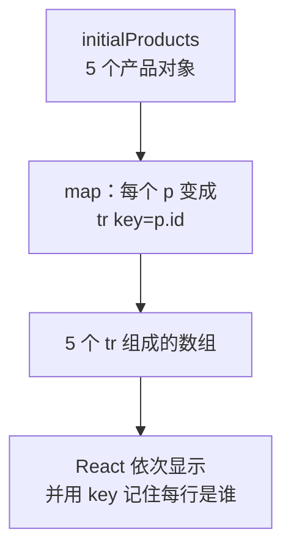
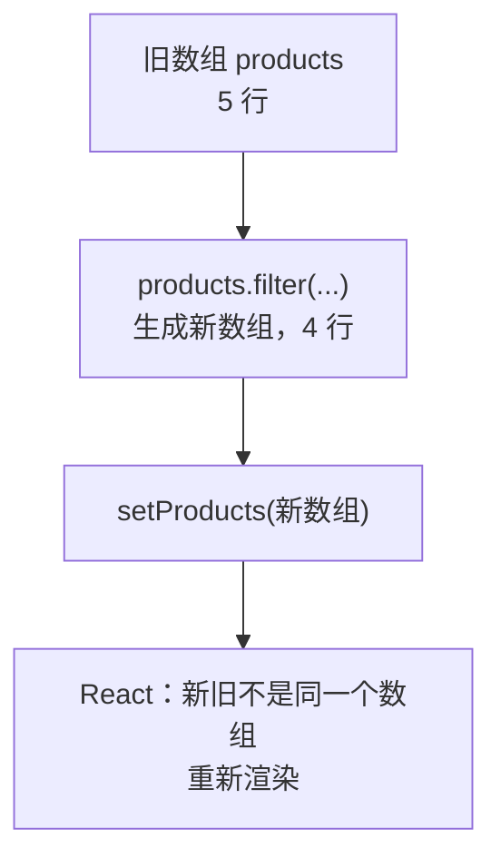
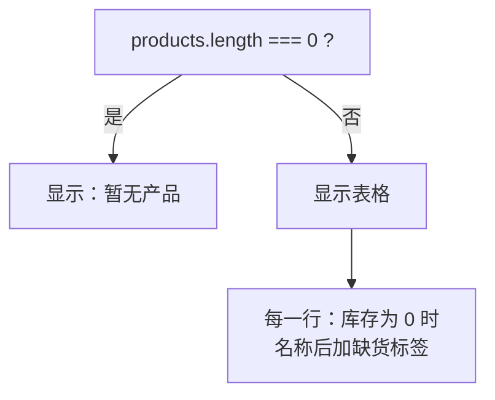

# 第 5 章 列表与条件渲染

## 这一章解决什么问题

清单里有几十种产品，不可能每种手写一行。本章用一个数组生成整张表，能入库、能删除，缺货的产品自动标红，删光了显示「暂无产品」。

## 开始之前

- 上一章你已经会了：`useState`、事件处理函数及其类型、更新函数 `setX((x) => ...)`。
- 起点代码：仓库 `code/ch04/price-list`。本章把卡片换成表格，`Panel`、`ProductCard`、`QuantityPicker` 这几个文件先不用，保留着（第 9 章的详情页还会用 `ProductCard`）。
- 在 `D:\react-study\price-list` 执行 `npm run dev`。预计耗时：50 分钟。

先新建数据文件 `src/data.ts`：

```ts
// src/data.ts
// 示例数据。第 7 章会把同样的数据搬到 public/products.json，改成从网络加载
import type { Product } from './types.ts'

export const initialProducts: Product[] = [
  { id: 1, code: 'P-001', name: '凸阵探头 C5-2', category: '探头', price: 12800, stock: 6 },
  { id: 2, code: 'P-002', name: '线阵探头 L12-5', category: '探头', price: 15600, stock: 3 },
  { id: 3, code: 'H-001', name: '便携彩超主机', category: '主机', price: 168000, stock: 2 },
  { id: 4, code: 'C-001', name: '耦合剂 250ml', category: '耗材', price: 18, stock: 120 },
  { id: 5, code: 'C-002', name: '探头保护套', category: '耗材', price: 6.5, stock: 0 },
]
```

在 `src/index.css` 末尾追加表格和提示的样式：

```css
.product-table {
  border-collapse: collapse;
  margin-bottom: 16px;
}

.product-table th,
.product-table td {
  border: 1px solid #ddd;
  padding: 6px 10px;
}

.out-of-stock {
  margin-left: 6px;
  padding: 0 6px;
  color: #fff;
  background: #dc2626;
  border-radius: 4px;
  font-size: 12px;
}

.low {
  color: #dc2626;
}

.empty {
  color: #999;
}
```

| 类名 | 用在哪 |
| --- | --- |
| `.product-table` | 表格本身；`border-collapse: collapse` 让相邻单元格的边框合成一条线 |
| `.out-of-stock` | 名称后面的红底白字「缺货」标签（5.3 节） |
| `.low` | 库存少于 5 时把数字标红（5.3 节） |
| `.empty` | 列表为空时的灰色提示（5.3 节） |

## 正文

### 5.1 map + key

**白话定义**：数组的 `map` 方法把每个元素变成另一个值。在 JSX 里，`products.map((p) => <tr>...</tr>)` 把每个产品变成一行，React 会把这一组 JSX 依次显示出来。每一项必须带一个 `key`，告诉 React「这一行是哪个产品」。

**业务场景**：价格清单的行数由数据决定。数据里加一条，表格就多一行，不用改 JSX。

**反例（什么时候不该用）**：列表项数量固定、内容各不相同时（比如页面顶部「首页 / 产品 / 报表」三个导航链接，每个链接的地址和图标都不一样），直接写三个标签更好读，不必为了用 `map` 硬造一个数组。

#### 🖼 图解



#### 💻 最小可运行代码

用下面的内容整个替换 `src/App.tsx`：

```tsx
// src/App.tsx（5.1 版本，5.2 节会再改）
import { initialProducts } from './data.ts'
import { PageHeader } from './components/PageHeader.tsx'
import { PageFooter } from './components/PageFooter.tsx'

function App() {
  return (
    <main>
      <PageHeader />
      <table className="product-table">
        <thead>
          <tr>
            <th>编号</th>
            <th>名称</th>
            <th>单价（元）</th>
            <th>库存</th>
          </tr>
        </thead>
        <tbody>
          {/* map 把每个产品对象变成一行 <tr>；key 让 React 认出每一行是谁 */}
          {initialProducts.map((p) => (
            <tr key={p.id}>
              <td>{p.code}</td>
              <td>{p.name}</td>
              <td>{p.price.toLocaleString()}</td>
              <td>{p.stock}</td>
            </tr>
          ))}
        </tbody>
      </table>
      <PageFooter />
    </main>
  )
}

export default App
```

#### 🔍 拆解运行结果

页面显示一张 5 行的表格，从「P-001 凸阵探头 C5-2 12,800 6」到「C-002 探头保护套 6.5 0」。

| 代码 | 说明 |
| --- | --- |
| `(p) => (<tr>...</tr>)` | 箭头函数，等价于 `function (p) { return <tr>...</tr> }`。外面的圆括号让多行 JSX 作为返回值 |
| `p` 的类型 | `initialProducts` 标注了 `Product[]`，TypeScript 自动知道 `p` 是 `Product`，输入 `p.` 有提示 |
| `key={p.id}` | key 写在 `map` 直接返回的那个元素上（这里是 `<tr>`）。同一个列表里 key 不能重复，用数据里的唯一编号 |

`key` 的作用：数据变化后，React 用 key 对比新旧两次的列表，判断哪一行是新增的、哪一行被删了、哪一行只是位置变了，只改动对应的行。没有 key，React 只能按位置一一对应。

#### 改坏一处试试

把 `<tr key={p.id}>` 改成 `<tr>`。页面看起来一样，但 TypeScript 不报错，浏览器控制台出现：

```text
Each child in a list should have a unique "key" prop.

Check the render method of `App`. See https://react.dev/link/warning-keys for more information.
```

React 提醒你 `App` 里有个列表缺 key。改回去。为什么不能偷懒用数组下标（`index`）当 key，5.2 节结尾有实验。

### 5.2 数组的不可变更新

**白话定义**：不可变更新（immutable update）指修改 state 里的数组或对象时，**不改原来那份，而是生成一份新的**交给 `setXxx`。React 通过比较「新旧是不是同一个数组」来判断有没有变化。

**业务场景**：点「删除」去掉一行，点「入库 +1」让某一行库存加 1。两种操作都要生成新数组。

**反例（什么时候不该用）**：不在 state 里的普通局部数组（比如在函数里临时拼一个数组用来计算合计），想怎么改就怎么改，`push`、`splice` 都可以。规则只针对 state，以及从 props 传进来的数据。

#### 🖼 图解



| 操作 | 会改原数组，**不要用在 state 上** | 返回新数组，**用这个** |
| --- | --- | --- |
| 删除 | `splice` | `filter` |
| 修改某一项 | `arr[i].stock = 1` | `map` + `{ ...p, stock: 1 }` |
| 添加 | `push` | `[...arr, 新项]`（第 6 章用） |

`{ ...p, stock: 1 }` 是对象展开（spread）：把 `p` 的所有字段复制到一个新对象里，再用 `stock: 1` 覆盖其中一个。

#### 💻 最小可运行代码

用下面的内容整个替换 `src/App.tsx`：

```tsx
// src/App.tsx（5.2 版本，5.3 节会再改）
import { useState } from 'react'
import type { Product } from './types.ts'
import { initialProducts } from './data.ts'
import { PageHeader } from './components/PageHeader.tsx'
import { PageFooter } from './components/PageFooter.tsx'

function App() {
  // 尖括号里写明 state 的类型：Product 数组
  const [products, setProducts] = useState<Product[]>(initialProducts)

  function handleDelete(id: number) {
    // filter 返回一个新数组，原数组不动
    setProducts(products.filter((p) => p.id !== id))
  }

  function handleRestock(id: number) {
    // map 返回新数组；要改的那一行用 { ...p, stock: 新值 } 生成新对象，其余行原样保留
    setProducts(products.map((p) => (p.id === id ? { ...p, stock: p.stock + 1 } : p)))
  }

  return (
    <main>
      <PageHeader />
      <table className="product-table">
        <thead>
          <tr>
            <th>编号</th>
            <th>名称</th>
            <th>单价（元）</th>
            <th>库存</th>
            <th>操作</th>
          </tr>
        </thead>
        <tbody>
          {products.map((p) => (
            <tr key={p.id}>
              <td>{p.code}</td>
              <td>{p.name}</td>
              <td>{p.price.toLocaleString()}</td>
              <td>{p.stock}</td>
              <td>
                {/* 要把 p.id 传进去，所以包一层箭头函数，点击时才执行 */}
                <button type="button" onClick={() => handleRestock(p.id)}>入库 +1</button>{' '}
                <button type="button" onClick={() => handleDelete(p.id)}>删除</button>
              </td>
            </tr>
          ))}
        </tbody>
      </table>
      <PageFooter />
    </main>
  )
}

export default App
```

#### 🔍 拆解运行结果

在「探头保护套」那行点「入库 +1」，库存从 0 变成 1。点「耦合剂 250ml」那行的「删除」，这一行消失。

| 代码 | 说明 |
| --- | --- |
| `useState<Product[]>(initialProducts)` | 尖括号是泛型参数，明确 state 的类型。初始值是空数组 `[]` 时必须写，否则 TypeScript 推断不出元素类型 |
| `onClick={() => handleDelete(p.id)}` | 第 4 章说过不能写 `onClick={handleDelete(p.id)}`。要传参数时包一层箭头函数，点击时才执行 |
| `p.id === id ? {...} : p` | 三元表达式：是要改的那行就生成新对象，不是就原样返回 |

用具体数据走一遍。原数组 `products` 有 5 个产品，id 依次是 1、2、3、4、5：

| 操作 | 执行的代码 | 得到的新数组 | 原数组 |
| --- | --- | --- | --- |
| 删除耦合剂（id 4） | `products.filter((p) => p.id !== 4)` | 4 个产品：id 1、2、3、5。`filter` 对每个产品问一次「`p.id !== 4` 吗？」，回答 `true` 的留下 | 不变，仍是 5 个 |
| 探头保护套（id 5）入库 | `products.map((p) => (p.id === 5 ? { ...p, stock: p.stock + 1 } : p))` | 5 个产品，前 4 个就是原来那 4 个对象；第 5 个是新对象 `{ id: 5, ..., stock: 1 }` | 不变，第 5 个的 `stock` 仍是 0 |

所以「不可变」不是说数据不能变，而是**每次变化都产生一份新的**，旧的那份保持原样。React 拿新旧两份一比，发现不是同一个数组，就知道要重新渲染。

#### 改坏一处试试

**① 用 `splice` 删除。** 把 `handleDelete` 里的那一行换成：

```tsx
    const index = products.findIndex((p) => p.id === id)
    products.splice(index, 1)
    setProducts(products)
```

点「耦合剂 250ml」的「删除」，实测**表格没有变化**，还是 5 行。原数组确实被改了，但交给 `setProducts` 的还是同一个数组，React 认为没变，不重新渲染。

再点第一行的「入库 +1」，表格突然变成 4 行，耦合剂不见了。`handleRestock` 用 `map` 生成了新数组，触发重新渲染，前面那次被「偷偷」做掉的删除这才显示出来。页面显示和数据不一致，这类 bug 很难查。改回 `filter`。

**② 用数组下标当 key。** 为了看出区别，在每行最前面临时加一个备注输入框 `<td><input placeholder="备注" /></td>`，然后：

- 用 `key={p.id}`：在第一行备注里输入「预留给张医生」，删除第一行。现在排第一的线阵探头那行备注是**空的**，正确。
- 改成 `products.map((p, index) => (` 和 `key={index}`，再做一次：删除第一行后，「预留给张医生」**出现在了线阵探头那一行**。

用下标当 key 时，删掉第 0 行后，原来的第 1 行变成新的第 0 行，React 认为「key 为 0 的那一行还在，只是内容变了」，于是保留了这一行里的输入框，只换了文字。实验完删掉备注列，key 改回 `p.id`。

### 5.3 条件渲染

**白话定义**：条件渲染就是按条件决定显示什么。JSX 的花括号里不能写 `if`（第 2 章试过），要用表达式：`条件 && 内容`（成立才显示）或 `条件 ? 甲 : 乙`（二选一）。

**业务场景**：库存为 0 的产品名后面显示红色「缺货」；库存少于 5 时数字标红；产品被删光时，不显示空表头，而是显示「暂无产品」。

**反例（什么时候不该用）**：条件很多、嵌套很深时（比如按 5 种审批状态显示 5 种不同的界面），不要在 JSX 里写一串 `a ? b : c ? d : e`。在 `return` 之前用普通的 `if` 或 `switch` 算好要显示的内容，第 7 章就会这样写。

#### 🖼 图解



#### 💻 最小可运行代码

用下面的内容整个替换 `src/App.tsx`：

```tsx
// src/App.tsx
import { useState } from 'react'
import type { Product } from './types.ts'
import { initialProducts } from './data.ts'
import { PageHeader } from './components/PageHeader.tsx'
import { PageFooter } from './components/PageFooter.tsx'

function App() {
  // 尖括号里写明 state 的类型：Product 数组
  const [products, setProducts] = useState<Product[]>(initialProducts)

  function handleDelete(id: number) {
    // filter 返回一个新数组，原数组不动
    setProducts(products.filter((p) => p.id !== id))
  }

  function handleRestock(id: number) {
    // map 返回新数组；要改的那一行用 { ...p, stock: 新值 } 生成新对象，其余行原样保留
    setProducts(products.map((p) => (p.id === id ? { ...p, stock: p.stock + 1 } : p)))
  }

  return (
    <main>
      <PageHeader />
      <p>共 {products.length} 种产品</p>
      {/* 条件 ? A : B：二选一。列表空了显示提示，否则显示表格 */}
      {products.length === 0 ? (
        <p className="empty">暂无产品</p>
      ) : (
        <table className="product-table">
          <thead>
            <tr>
              <th>编号</th>
              <th>名称</th>
              <th>单价（元）</th>
              <th>库存</th>
              <th>操作</th>
            </tr>
          </thead>
          <tbody>
            {products.map((p) => (
              <tr key={p.id}>
                <td>{p.code}</td>
                <td>
                  {p.name}
                  {/* 条件 && A：条件成立才显示 A，否则什么都不显示 */}
                  {p.stock === 0 && <span className="out-of-stock">缺货</span>}
                </td>
                <td>{p.price.toLocaleString()}</td>
                {/* 库存少于 5 用红色提醒：三元表达式也可以用在属性上 */}
                <td className={p.stock < 5 ? 'low' : undefined}>{p.stock}</td>
                <td>
                  {/* 要把 p.id 传进去，所以包一层箭头函数，点击时才执行 */}
                  <button type="button" onClick={() => handleRestock(p.id)}>入库 +1</button>{' '}
                  <button type="button" onClick={() => handleDelete(p.id)}>删除</button>
                </td>
              </tr>
            ))}
          </tbody>
        </table>
      )}
      <PageFooter />
    </main>
  )
}

export default App
```

#### 🔍 拆解运行结果

- 「探头保护套」后面有红色「缺货」标签，库存 3、2、0 显示为红色。
- 点「探头保护套」的「入库 +1」：库存变成 1，「缺货」消失，数字仍是红色（1 < 5）。
- 把 5 行全删掉：表格整个消失，显示「共 0 种产品」和灰色的「暂无产品」。

`className={... : undefined}`：属性值是 `undefined` 时，React 不输出这个属性。实测库存 120 的单元格是 `<td>120</td>`，没有空的 `class=""`。

#### 改坏一处试试

把缺货那一行改成 `{p.stock && <span className="out-of-stock">有货</span>}`（想表达「有库存就显示有货」）。实测：前 4 行显示「有货」，但「探头保护套」后面显示了一个 **`0`**。

`a && b` 在 `a` 不成立时，结果是 `a` 本身。`p.stock` 是 `0` 时整个表达式的值就是数字 `0`，React 会把数字显示出来（`false`、`null`、`undefined` 才什么都不显示）。`&&` 左边要写成真正的判断：`p.stock > 0 && ...`。改回原样。

## ⚠️ 踩坑警告

| 现象 | 原因 | 怎么改 |
| --- | --- | --- |
| 控制台 `Each child in a list should have a unique "key" prop.` | `map` 返回的元素没写 `key`，或 key 写在了里面的 `<td>` 上 | 在 `map` 直接返回的最外层元素上写 `key={p.id}` |
| 删除一行后，输入框里的内容「跑」到了下一行 | 用数组下标 `index` 当 key | 用数据自带的唯一 id 当 key |
| 点了删除，页面不变；点别的按钮后才突然变 | 用 `splice` / `push` / 直接赋值改了 state 里的数组，再把同一个数组交给 `setXxx` | 用 `filter` / `map` / `[...arr, x]` 生成新数组 |
| 列表旁边莫名其妙出现一个 `0` | `{数字 && 内容}`，数字为 0 时显示了 0 | 写成比较：`{count > 0 && 内容}` |

## 🎯 动手练习

**练习 1：出库按钮**

在「入库 +1」后面加「出库 −1」按钮，库存减 1；库存为 0 时按钮禁用。

验收标准：

- 「探头保护套」（库存 0）的「出库 −1」是灰色的。
- 「便携彩超主机」点两次「出库 −1」，库存变成 0，名称后出现「缺货」，按钮变灰。

**练习 2：只看有货**

在「共 5 种产品」后面加一个按钮。初始显示「只看有货」，点击后表格只显示库存大于 0 的产品，按钮文字变成「显示全部」；再点恢复。

验收标准：

- 刷新页面后点「只看有货」，「探头保护套」那行被隐藏，表格剩 4 行，「共 5 种产品」不变。
- 点「显示全部」，5 行全部回来，没有丢数据。

提示：不要用 `setProducts` 删掉缺货的行。

卡住了看文末参考答案。

## 📌 一句话总结

map 加 key 生成列表，用新数组更新 state，用 && 和 ? : 按条件显示。

## 下一章

现在只能改已有的产品。第 6 章做一个表单，录入新产品并检查填写是否正确。

---

<!-- 以下是参考答案，先自己动手，卡住了再往下翻 -->


## 参考答案

两个练习都改 `App.tsx`，下面是都做完后的版本。

### 练习 1

思路：出库和入库一样用 `map` 生成新数组，只是减 1。禁用条件 `p.stock === 0` 每行各算各的。

### 练习 2

思路：「只看有货」是一个开关，用 boolean state 记住；要显示哪些行是**算出来的**（`visibleProducts`），原始的 `products` 不动，所以切回「显示全部」时数据都在。「共 x 种产品」用的仍是 `products.length`。

```tsx
// src/App.tsx
// 两个练习都做完后的版本
import { useState } from 'react'
import type { Product } from './types.ts'
import { initialProducts } from './data.ts'
import { PageHeader } from './components/PageHeader.tsx'
import { PageFooter } from './components/PageFooter.tsx'

function App() {
  // 尖括号里写明 state 的类型：Product 数组
  const [products, setProducts] = useState<Product[]>(initialProducts)
  // 练习 2：是否只看有货。一个开关就是一个 boolean state
  const [onlyInStock, setOnlyInStock] = useState(false)

  function handleDelete(id: number) {
    // filter 返回一个新数组，原数组不动
    setProducts(products.filter((p) => p.id !== id))
  }

  function handleRestock(id: number) {
    // map 返回新数组；要改的那一行用 { ...p, stock: 新值 } 生成新对象，其余行原样保留
    setProducts(products.map((p) => (p.id === id ? { ...p, stock: p.stock + 1 } : p)))
  }

  // 练习 1：出库和入库写法相同，只是减 1
  function handleShip(id: number) {
    setProducts(products.map((p) => (p.id === id ? { ...p, stock: p.stock - 1 } : p)))
  }

  // 练习 2：要显示的行由 state 算出来，不另存一份「筛选后的数组」
  const visibleProducts = onlyInStock ? products.filter((p) => p.stock > 0) : products

  return (
    <main>
      <PageHeader />
      <p>
        共 {products.length} 种产品{' '}
        <button type="button" onClick={() => setOnlyInStock(!onlyInStock)}>
          {onlyInStock ? '显示全部' : '只看有货'}
        </button>
      </p>
      {/* 条件 ? A : B：二选一。列表空了显示提示，否则显示表格 */}
      {products.length === 0 ? (
        <p className="empty">暂无产品</p>
      ) : (
        <table className="product-table">
          <thead>
            <tr>
              <th>编号</th>
              <th>名称</th>
              <th>单价（元）</th>
              <th>库存</th>
              <th>操作</th>
            </tr>
          </thead>
          <tbody>
            {visibleProducts.map((p) => (
              <tr key={p.id}>
                <td>{p.code}</td>
                <td>
                  {p.name}
                  {/* 条件 && A：条件成立才显示 A，否则什么都不显示 */}
                  {p.stock === 0 && <span className="out-of-stock">缺货</span>}
                </td>
                <td>{p.price.toLocaleString()}</td>
                {/* 库存少于 5 用红色提醒：三元表达式也可以用在属性上 */}
                <td className={p.stock < 5 ? 'low' : undefined}>{p.stock}</td>
                <td>
                  {/* 要把 p.id 传进去，所以包一层箭头函数，点击时才执行 */}
                  <button type="button" onClick={() => handleRestock(p.id)}>入库 +1</button>{' '}
                  {/* 库存为 0 时不能再出库 */}
                  <button type="button" onClick={() => handleShip(p.id)} disabled={p.stock === 0}>
                    出库 −1
                  </button>{' '}
                  <button type="button" onClick={() => handleDelete(p.id)}>删除</button>
                </td>
              </tr>
            ))}
          </tbody>
        </table>
      )}
      <PageFooter />
    </main>
  )
}

export default App
```
