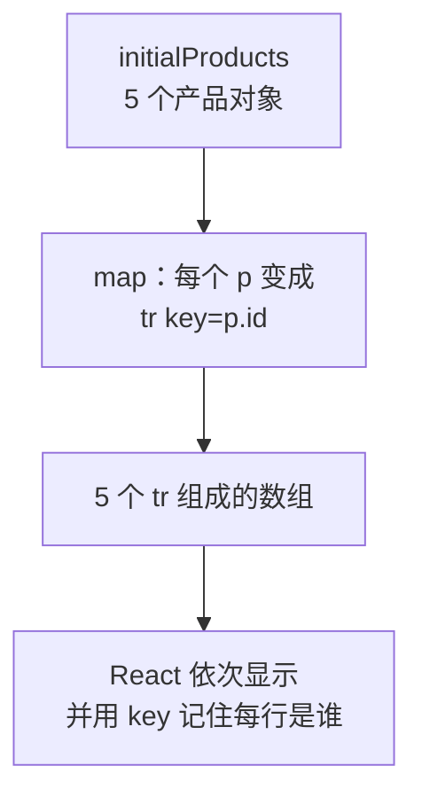

# 第 5A 章 map + key：用一个数组生成整张表

## 这一章解决什么问题

清单里有几十种产品，不可能每种手写一行 `<ProductCard />`。本章把产品放进一个数组，用数组的 `map` 方法生成整张表格：数据里加一条，表格就多一行，不用改 JSX。

本章只讲一个技术点：**用 `map` 渲染列表，以及每一项的 `key`**。

## 开始之前

- 上一章你已经会了：`useState`、事件处理函数及其类型、更新函数 `setX((x) => ...)`、箭头函数。
- 起点代码：仓库 `code/ch04C/price-list`（不含练习答案）。本章把卡片换成表格，`Panel`、`ProductCard`、`QuantityPicker` 这几个文件先不用，保留着（第 9 章的详情页还会用 `ProductCard`）。
- 在 `D:\react-study\price-list` 执行 `npm run dev`。
- 预计耗时：20 分钟。

## 正文

### 5A.1 准备数据和样式

新建数据文件 `src/data.ts`：

```ts
// src/data.ts
// 示例数据。第 7C 章会把同样的数据搬到 public/products.json，改成从网络加载
import type { Product } from './types.ts'

export const initialProducts: Product[] = [
  { id: 1, code: 'P-001', name: '凸阵探头 C5-2', category: '探头', price: 12800, stock: 6 },
  { id: 2, code: 'P-002', name: '线阵探头 L12-5', category: '探头', price: 15600, stock: 3 },
  { id: 3, code: 'H-001', name: '便携彩超主机', category: '主机', price: 168000, stock: 2 },
  { id: 4, code: 'C-001', name: '耦合剂 250ml', category: '耗材', price: 18, stock: 120 },
  { id: 5, code: 'C-002', name: '探头保护套', category: '耗材', price: 6.5, stock: 0 },
]
```

| 代码 | 说明 |
| --- | --- |
| `Product[]` | 「`Product` 组成的数组」。每个元素都必须符合第 3B 章的 `Product` 类型 |
| `export const` | 导出一个常量，和导出组件一样（第 2C 章） |
| 扩展名 `.ts` | 里面没有 JSX |

用下面的内容整个替换 `src/index.css`（和上一章相比，末尾多了表格的样式）：

```css
/* src/index.css */
/* 全局样式先保持最少，第 10 章再整理 */
body {
  margin: 24px;
  font-family: system-ui, 'Microsoft YaHei', sans-serif;
}

.subtitle {
  color: #666;
}

.card {
  border: 1px solid #ddd;
  border-radius: 6px;
  padding: 8px 16px;
  margin-bottom: 12px;
  max-width: 360px;
}

.panel {
  border-left: 4px solid #3b82f6;
  padding-left: 12px;
  margin-bottom: 16px;
}

.product-table {
  border-collapse: collapse;
  margin-bottom: 16px;
}

.product-table th,
.product-table td {
  border: 1px solid #ddd;
  padding: 6px 10px;
}
```

`border-collapse: collapse` 让相邻单元格的边框合成一条线。

### 5A.2 map 和 key 是什么

**白话定义**：数组的 `map` 方法把每个元素变成另一个值。在 JSX 里，`products.map((p) => <tr>...</tr>)` 把每个产品变成一行，React 会把这一组 JSX 依次显示出来。每一项必须带一个 `key`，告诉 React「这一行是哪个产品」。

**业务场景**：价格清单的行数由数据决定。数据里加一条，表格就多一行，不用改 JSX。

**反例（什么时候不该用）**：列表项数量固定、内容各不相同时（比如页面顶部「首页 / 产品 / 报表」三个导航链接，每个链接的地址和图标都不一样），直接写三个标签更好读，不必为了用 `map` 硬造一个数组。

先在 JSX 外面看一眼 `map` 做了什么：

```ts
[1, 2, 3].map((n) => n * 10)   // 得到新数组 [10, 20, 30]，原数组不变
```

对数组里的每个元素调用一次箭头函数，把每次的返回值收集成一个新数组。返回值换成 JSX，得到的就是「一组 JSX」。

#### 🖼 图解



### 5A.3 生成表格

#### 💻 最小可运行代码

用下面的内容整个替换 `src/App.tsx`：

```tsx
// src/App.tsx
import { initialProducts } from './data.ts'
import { PageHeader } from './components/PageHeader.tsx'
import { PageFooter } from './components/PageFooter.tsx'

function App() {
  return (
    <main>
      <PageHeader />
      <table className="product-table">
        <thead>
          <tr>
            <th>编号</th>
            <th>名称</th>
            <th>单价（元）</th>
            <th>库存</th>
          </tr>
        </thead>
        <tbody>
          {/* map 把每个产品对象变成一行 <tr>；key 让 React 认出每一行是谁 */}
          {initialProducts.map((p) => (
            <tr key={p.id}>
              <td>{p.code}</td>
              <td>{p.name}</td>
              <td>{p.price.toLocaleString()}</td>
              <td>{p.stock}</td>
            </tr>
          ))}
        </tbody>
      </table>
      <PageFooter />
    </main>
  )
}

export default App
```

#### 🔍 拆解运行结果

页面显示一张 5 行的表格，从「P-001 凸阵探头 C5-2 12,800 6」到「C-002 探头保护套 6.5 0」。

| 代码 | 说明 |
| --- | --- |
| `(p) => (<tr>...</tr>)` | 箭头函数，等价于 `function (p) { return <tr>...</tr> }`。外面的圆括号让多行 JSX 作为返回值 |
| `p` 的类型 | `initialProducts` 标注了 `Product[]`，TypeScript 自动知道 `p` 是 `Product`，输入 `p.` 有提示 |
| `key={p.id}` | key 写在 `map` 直接返回的那个元素上（这里是 `<tr>`）。同一个列表里 key 不能重复，用数据里的唯一编号 |

`key` 的作用：数据变化后，React 用 key 对比新旧两次的列表，判断哪一行是新增的、哪一行被删了、哪一行只是位置变了，只改动对应的行。没有 key，React 只能按位置一一对应。这一点在下一章删除行时能亲眼看到。

#### 改坏一处试试

**① 不写 key。** 把 `<tr key={p.id}>` 改成 `<tr>`。页面看起来一样，TypeScript 也不报错，但浏览器控制台出现：

```text
Each child in a list should have a unique "key" prop.

Check the render method of `App`. See https://react.dev/link/warning-keys for more information.
```

React 提醒你 `App` 里有个列表缺 key。

**② key 写在里面的 `<td>` 上。** 写成 `<tr>` 和 `<td key={p.id}>{p.code}</td>`，控制台还是同一个警告。key 必须写在 `map` 直接返回的最外层元素上。

**③ key 重复。** 写成 `<tr key={p.category}>`，控制台出现：

```text
Encountered two children with the same key, `探头`. Keys should be unique so that components maintain their identity across updates. Non-unique keys may cause children to be duplicated and/or omitted — the behavior is unsupported and could change in a future version.
```

两个探头的分类都是「探头」，key 撞了。耗材也一样，会再报一次 `耗材`。

每次实验后改回 `<tr key={p.id}>`。

## ⚠️ 踩坑警告

| 现象 | 原因 | 怎么改 |
| --- | --- | --- |
| 控制台 `Each child in a list should have a unique "key" prop.` | `map` 返回的元素没写 `key`，或 key 写在了里面的 `<td>` 上 | 在 `map` 直接返回的最外层元素上写 `key={p.id}` |
| 控制台 `Encountered two children with the same key` | 用了会重复的字段当 key，比如分类、名称 | 用数据自带的唯一 id |
| 把 `(p) => (` 写成了 `(p) => {`，表格一行都没有，`npx tsc -b` 报 `TS2322: Type 'void[]' is not assignable to type 'ReactNode'.` | 箭头函数用花括号时，函数体是语句，要写 `return` 才有返回值。没有 `return`，每个元素都变成了 `undefined`（`void`） | 用圆括号 `(p) => (<tr>...</tr>)`；或者花括号里写 `return <tr>...</tr>` |

## 🎯 动手练习

**练习 1：加一列分类**

在「名称」后面加一列「分类」，显示 `p.category`。

验收标准：

- 表头有「分类」，每行显示「探头」「主机」「耗材」之一。

**练习 2：只显示探头**

表格只显示分类是「探头」的产品。

验收标准：

- 表格只剩 2 行：凸阵探头 C5-2、线阵探头 L12-5。
- `data.ts` 没有改动。

提示：数组的 `filter` 方法按条件挑出一部分元素，返回新数组：`[1, 2, 3].filter((n) => n > 1)` 得到 `[2, 3]`。先 `filter` 再 `map`。

卡住了看文末参考答案。

## 📌 一句话总结

map 把数组变成一组 JSX，每项在最外层写唯一的 key。

## 下一章

表格现在只能看。第 5B 章加上「删除」和「入库 +1」按钮，学会怎样正确地修改 state 里的数组。

---

<!-- 以下是参考答案，先自己动手，卡住了再往下翻 -->


## 参考答案

两个练习都改 `App.tsx`，下面是都做完后的版本。

### 练习 1

思路：表头加一个 `<th>`，每行在同样的位置加一个 `<td>`。

### 练习 2

思路：在 `return` 前面先用 `filter` 算出要显示的产品，JSX 里对这个新数组 `map`。`filter` 返回新数组，`initialProducts` 不变。

```tsx
// src/App.tsx
// 两个练习都做完后的版本
import { initialProducts } from './data.ts'
import { PageHeader } from './components/PageHeader.tsx'
import { PageFooter } from './components/PageFooter.tsx'

function App() {
  // 练习 2：先用 filter 挑出探头，再用 map 生成行
  const probes = initialProducts.filter((p) => p.category === '探头')

  return (
    <main>
      <PageHeader />
      <table className="product-table">
        <thead>
          <tr>
            <th>编号</th>
            <th>名称</th>
            {/* 练习 1：多一列分类 */}
            <th>分类</th>
            <th>单价（元）</th>
            <th>库存</th>
          </tr>
        </thead>
        <tbody>
          {/* map 把每个产品对象变成一行 <tr>；key 让 React 认出每一行是谁 */}
          {probes.map((p) => (
            <tr key={p.id}>
              <td>{p.code}</td>
              <td>{p.name}</td>
              <td>{p.category}</td>
              <td>{p.price.toLocaleString()}</td>
              <td>{p.stock}</td>
            </tr>
          ))}
        </tbody>
      </table>
      <PageFooter />
    </main>
  )
}

export default App
```
