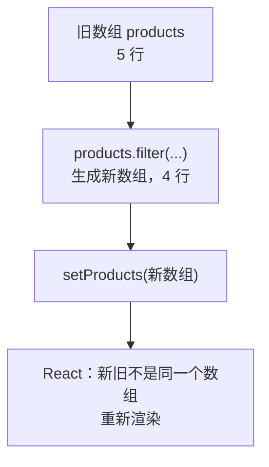

# 第 5B 章 数组的不可变更新：删除一行、修改一行

## 这一章解决什么问题

表格要能点「删除」去掉一行、点「入库 +1」让某一行库存加 1。产品数组要放进 state，修改时有一条规矩：**不改原来的数组，而是生成一个新数组**。不守这条规矩，会出现「点了删除页面不变、点别的按钮后才突然变」这种很难查的 bug。

本章只讲一个技术点：**不可变更新**。

## 开始之前

- 上一章你已经会了：用 `map` 生成表格行、`key` 写在最外层元素上、用 `filter` 挑出一部分元素。
- 起点代码：仓库 `code/ch05A/price-list`（不含练习答案）。在 `D:\react-study\price-list` 执行 `npm run dev`。
- 预计耗时：30 分钟。

## 正文

### 5B.1 不可变更新是什么

**白话定义**：不可变更新（immutable update）指修改 state 里的数组或对象时，**不改原来那份，而是生成一份新的**交给 `setXxx`。React 通过比较「新旧是不是同一个数组」来判断有没有变化。

**业务场景**：点「删除」去掉一行，点「入库 +1」让某一行库存加 1。两种操作都要生成新数组。

**反例（什么时候不该用）**：不在 state 里的普通局部数组（比如在函数里临时拼一个数组用来计算合计），想怎么改就怎么改，`push`、`splice` 都可以。规则只针对 state，以及从 props 传进来的数据。

#### 🖼 图解



| 操作 | 会改原数组，**不要用在 state 上** | 返回新数组，**用这个** |
| --- | --- | --- |
| 删除 | `splice` | `filter` |
| 修改某一项 | `arr[i].stock = 1` | `map` + `{ ...p, stock: 1 }` |
| 添加 | `push` | `[...arr, 新项]`（第 6B 章练习 2、第 8 章用） |
| 排序 | `sort`（原地排序） | `[...arr].sort(...)`（先复制再排） |

`{ ...p, stock: 1 }` 是对象展开（spread）：把 `p` 的所有字段复制到一个新对象里，再用 `stock: 1` 覆盖其中一个。`[...arr]` 是数组展开，复制出一个新数组。

### 5B.2 删除和入库

#### 💻 最小可运行代码

用下面的内容整个替换 `src/App.tsx`：

```tsx
// src/App.tsx
import { useState } from 'react'
import type { Product } from './types.ts'
import { initialProducts } from './data.ts'
import { PageHeader } from './components/PageHeader.tsx'
import { PageFooter } from './components/PageFooter.tsx'

function App() {
  // 尖括号里写明 state 的类型：Product 数组
  const [products, setProducts] = useState<Product[]>(initialProducts)

  function handleDelete(id: number) {
    // filter 返回一个新数组，原数组不动
    setProducts(products.filter((p) => p.id !== id))
  }

  function handleRestock(id: number) {
    // map 返回新数组；要改的那一行用 { ...p, stock: 新值 } 生成新对象，其余行原样保留
    setProducts(products.map((p) => (p.id === id ? { ...p, stock: p.stock + 1 } : p)))
  }

  return (
    <main>
      <PageHeader />
      <table className="product-table">
        <thead>
          <tr>
            <th>编号</th>
            <th>名称</th>
            <th>单价（元）</th>
            <th>库存</th>
            <th>操作</th>
          </tr>
        </thead>
        <tbody>
          {products.map((p) => (
            <tr key={p.id}>
              <td>{p.code}</td>
              <td>{p.name}</td>
              <td>{p.price.toLocaleString()}</td>
              <td>{p.stock}</td>
              <td>
                {/* 要把 p.id 传进去，所以包一层箭头函数，点击时才执行 */}
                <button type="button" onClick={() => handleRestock(p.id)}>入库 +1</button>{' '}
                <button type="button" onClick={() => handleDelete(p.id)}>删除</button>
              </td>
            </tr>
          ))}
        </tbody>
      </table>
      <PageFooter />
    </main>
  )
}

export default App
```

#### 🔍 拆解运行结果

在「探头保护套」那行点「入库 +1」，库存从 0 变成 1。点「耦合剂 250ml」那行的「删除」，这一行消失，表格剩 4 行。

| 代码 | 说明 |
| --- | --- |
| `useState<Product[]>(initialProducts)` | 尖括号是泛型参数，明确 state 的类型。初始值是空数组 `[]` 时必须写，否则 TypeScript 推断不出元素类型（见踩坑警告） |
| `onClick={() => handleDelete(p.id)}` | 第 4B 章说过不能写 `onClick={handleDelete(p.id)}`。要传参数时包一层箭头函数，点击时才执行 |
| `p.id === id ? {...} : p` | 三元表达式：是要改的那行就生成新对象，不是就原样返回 |

用具体数据走一遍。原数组 `products` 有 5 个产品，id 依次是 1、2、3、4、5：

| 操作 | 执行的代码 | 得到的新数组 | 原数组 |
| --- | --- | --- | --- |
| 删除耦合剂（id 4） | `products.filter((p) => p.id !== 4)` | 4 个产品：id 1、2、3、5。`filter` 对每个产品问一次「`p.id !== 4` 吗？」，回答 `true` 的留下 | 不变，仍是 5 个 |
| 探头保护套（id 5）入库 | `products.map((p) => (p.id === 5 ? { ...p, stock: p.stock + 1 } : p))` | 5 个产品，前 4 个就是原来那 4 个对象；第 5 个是新对象 `{ id: 5, ..., stock: 1 }` | 不变，第 5 个的 `stock` 仍是 0 |

所以「不可变」不是说数据不能变，而是**每次变化都产生一份新的**，旧的那份保持原样。React 拿新旧两份一比，发现不是同一个数组，就知道要重新渲染。

### 5B.3 违反规矩会怎样

#### 改坏一处试试

**① 用 `splice` 删除。** 把 `handleDelete` 里的那一行换成：

```tsx
    const index = products.findIndex((p) => p.id === id)
    products.splice(index, 1)
    setProducts(products)
```

点「耦合剂 250ml」的「删除」，实测**表格没有变化**，还是 5 行。原数组确实被改了，但交给 `setProducts` 的还是同一个数组，React 认为没变，不重新渲染。

再点第一行的「入库 +1」，表格突然变成 4 行，耦合剂不见了。`handleRestock` 用 `map` 生成了新数组，触发重新渲染，前面那次被「偷偷」做掉的删除这才显示出来。页面显示和数据不一致，这类 bug 很难查。改回 `filter`。

**② 用数组下标当 key。** 上一章说 key 要用唯一 id，现在有了删除，可以亲眼看到原因。为了看出区别，在每行最前面临时加一个备注输入框 `<td><input placeholder="备注" /></td>`，然后：

- 用 `key={p.id}`：在第一行备注里输入「预留给张医生」，删除第一行。现在排第一的线阵探头那行备注是**空的**，正确。
- 改成 `products.map((p, index) => (` 和 `key={index}`，再做一次：删除第一行后，「预留给张医生」**出现在了线阵探头那一行**。

`map` 的箭头函数可以有第二个参数 `index`，是元素在数组里的位置（从 0 开始）。用下标当 key 时，删掉第 0 行后，原来的第 1 行变成新的第 0 行，React 认为「key 为 0 的那一行还在，只是内容变了」，于是保留了这一行里的输入框，只换了文字。实验完删掉备注列，key 改回 `p.id`。

## ⚠️ 踩坑警告

| 现象 | 原因 | 怎么改 |
| --- | --- | --- |
| 点了删除，页面不变；点别的按钮后才突然变 | 用 `splice` / `push` / `sort` / 直接赋值改了 state 里的数组，再把同一个数组交给 `setXxx` | 用 `filter` / `map` / `[...arr, x]` / `[...arr].sort()` 生成新数组 |
| 删除一行后，输入框里的内容「跑」到了下一行 | 用数组下标 `index` 当 key | 用数据自带的唯一 id 当 key |
| 写 `useState([])`，后面报一串 `TS2339: Property 'id' does not exist on type 'never'.` | 空数组推断不出元素类型，TypeScript 把它当成「永远不会有元素」的 `never[]` | 写明泛型：`useState<Product[]>([])` |
| 写 `products.map((p) => { ...p, stock: 0 })`，报一串 `TS1128: Declaration or statement expected.` | 箭头函数后面的 `{` 被当成了函数体，不是对象 | 对象外面再包一层圆括号：`(p) => ({ ...p, stock: 0 })` |

## 🎯 动手练习

**练习 1：出库按钮**

在「入库 +1」后面加「出库 −1」按钮，库存减 1；库存为 0 时按钮禁用。

验收标准：

- 「探头保护套」（库存 0）的「出库 −1」是灰色的。
- 「便携彩超主机」点两次「出库 −1」，库存变成 0，按钮变灰。

**练习 2：全部入库**

在表格上方加一个「全部入库 +10」按钮，点一次每个产品的库存都加 10。

验收标准：

- 点一次后，凸阵探头库存 16、耦合剂 130、探头保护套 10。
- 「探头保护套」的「出库 −1」随之变成可以点。

卡住了看文末参考答案。

## 📌 一句话总结

改 state 里的数组要生成新数组：删用 filter，改用 map 加展开。

## 下一章

缺货的产品要标红、产品删光了要显示「暂无产品」。第 5C 章用条件渲染按条件决定显示什么。

---

<!-- 以下是参考答案，先自己动手，卡住了再往下翻 -->


## 参考答案

两个练习都改 `App.tsx`，下面是都做完后的版本。

### 练习 1

思路：出库和入库一样用 `map` 生成新数组，只是减 1。禁用条件 `p.stock === 0` 每行各算各的。

### 练习 2

思路：每一行都要改，所以 `map` 里不用判断 id，直接对每个 `p` 生成新对象。注意 `({ ...p, ... })` 外面的圆括号，原因见踩坑警告第 4 条。

```tsx
// src/App.tsx
// 两个练习都做完后的版本
import { useState } from 'react'
import type { Product } from './types.ts'
import { initialProducts } from './data.ts'
import { PageHeader } from './components/PageHeader.tsx'
import { PageFooter } from './components/PageFooter.tsx'

function App() {
  // 尖括号里写明 state 的类型：Product 数组
  const [products, setProducts] = useState<Product[]>(initialProducts)

  function handleDelete(id: number) {
    // filter 返回一个新数组，原数组不动
    setProducts(products.filter((p) => p.id !== id))
  }

  function handleRestock(id: number) {
    // map 返回新数组；要改的那一行用 { ...p, stock: 新值 } 生成新对象，其余行原样保留
    setProducts(products.map((p) => (p.id === id ? { ...p, stock: p.stock + 1 } : p)))
  }

  // 练习 1：出库和入库写法相同，只是减 1
  function handleShip(id: number) {
    setProducts(products.map((p) => (p.id === id ? { ...p, stock: p.stock - 1 } : p)))
  }

  // 练习 2：每一行都生成新对象，所以 map 里不用判断 id
  function handleRestockAll() {
    setProducts(products.map((p) => ({ ...p, stock: p.stock + 10 })))
  }

  return (
    <main>
      <PageHeader />
      <p>
        <button type="button" onClick={handleRestockAll}>全部入库 +10</button>
      </p>
      <table className="product-table">
        <thead>
          <tr>
            <th>编号</th>
            <th>名称</th>
            <th>单价（元）</th>
            <th>库存</th>
            <th>操作</th>
          </tr>
        </thead>
        <tbody>
          {products.map((p) => (
            <tr key={p.id}>
              <td>{p.code}</td>
              <td>{p.name}</td>
              <td>{p.price.toLocaleString()}</td>
              <td>{p.stock}</td>
              <td>
                {/* 要把 p.id 传进去，所以包一层箭头函数，点击时才执行 */}
                <button type="button" onClick={() => handleRestock(p.id)}>入库 +1</button>{' '}
                {/* 库存为 0 时不能再出库 */}
                <button type="button" onClick={() => handleShip(p.id)} disabled={p.stock === 0}>
                  出库 −1
                </button>{' '}
                <button type="button" onClick={() => handleDelete(p.id)}>删除</button>
              </td>
            </tr>
          ))}
        </tbody>
      </table>
      <PageFooter />
    </main>
  )
}

export default App
```
