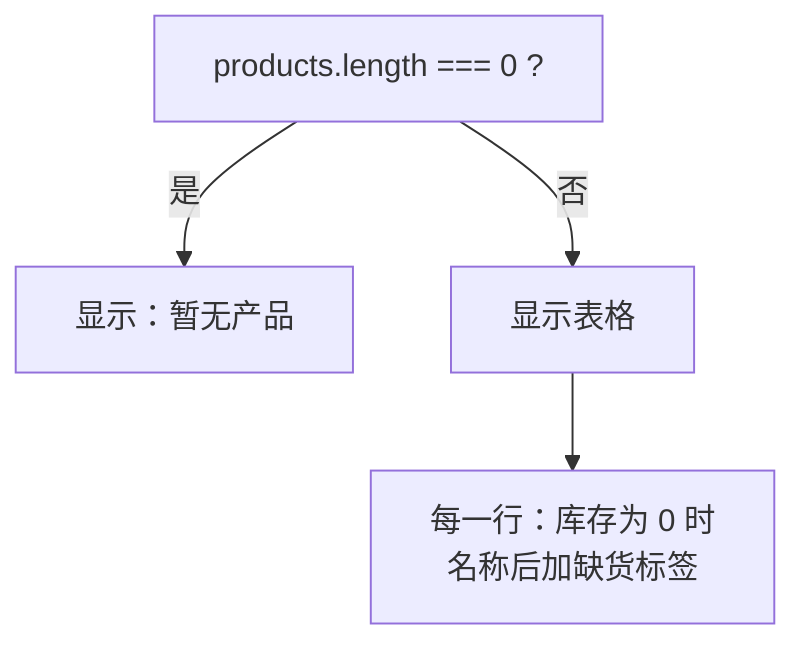

# 第 5C 章 条件渲染：缺货标红、删光了显示「暂无产品」

## 这一章解决什么问题

库存为 0 的产品要在名称后面显示红色「缺货」；库存少于 5 时数字标红；产品被删光时，不显示一个空表头，而是显示「暂无产品」。这些都是「按条件决定显示什么」。

本章只讲一个技术点：**条件渲染**。

## 开始之前

- 上一章你已经会了：用 `filter` / `map` 生成新数组来删除和修改 state 里的数据。
- 起点代码：仓库 `code/ch05B/price-list`（不含练习答案）。在 `D:\react-study\price-list` 执行 `npm run dev`。
- 预计耗时：25 分钟。

## 正文

### 5C.1 条件渲染是什么

**白话定义**：条件渲染就是按条件决定显示什么。JSX 的花括号里不能写 `if`（第 2B 章试过），要用表达式：`条件 && 内容`（成立才显示）或 `条件 ? 甲 : 乙`（二选一）。

**业务场景**：库存为 0 的产品名后面显示红色「缺货」；库存少于 5 时数字标红；产品被删光时显示「暂无产品」。

**反例（什么时候不该用）**：条件很多、嵌套很深时（比如按 5 种审批状态显示 5 种不同的界面），不要在 JSX 里写一串 `a ? b : c ? d : e`。在 `return` 之前用普通的 `if` 或 `switch` 算好要显示的内容（练习 2），第 7C 章也会这样写。

| 写法 | 意思 | 本章用在哪 |
| --- | --- | --- |
| `{条件 && <内容 />}` | 条件成立才显示，否则什么都不显示 | 「缺货」标签 |
| `{条件 ? <甲 /> : <乙 />}` | 二选一 | 「暂无产品」或表格 |
| `className={条件 ? 'low' : undefined}` | 属性也能按条件给值 | 库存数字标红 |

#### 🖼 图解



### 5C.2 三处条件

#### 💻 最小可运行代码

用下面的内容整个替换 `src/index.css`（末尾多了三个类）：

```css
/* src/index.css */
/* 全局样式先保持最少，第 10A 章再整理 */
body {
  margin: 24px;
  font-family: system-ui, 'Microsoft YaHei', sans-serif;
}

.subtitle {
  color: #666;
}

.card {
  border: 1px solid #ddd;
  border-radius: 6px;
  padding: 8px 16px;
  margin-bottom: 12px;
  max-width: 360px;
}

.panel {
  border-left: 4px solid #3b82f6;
  padding-left: 12px;
  margin-bottom: 16px;
}

.product-table {
  border-collapse: collapse;
  margin-bottom: 16px;
}

.product-table th,
.product-table td {
  border: 1px solid #ddd;
  padding: 6px 10px;
}

.out-of-stock {
  margin-left: 6px;
  padding: 0 6px;
  color: #fff;
  background: #dc2626;
  border-radius: 4px;
  font-size: 12px;
}

.low {
  color: #dc2626;
}

.empty {
  color: #999;
}
```

| 类名 | 用在哪 |
| --- | --- |
| `.out-of-stock` | 名称后面的红底白字「缺货」标签 |
| `.low` | 库存少于 5 时把数字标红 |
| `.empty` | 列表为空时的灰色提示 |

用下面的内容整个替换 `src/App.tsx`：

```tsx
// src/App.tsx
import { useState } from 'react'
import type { Product } from './types.ts'
import { initialProducts } from './data.ts'
import { PageHeader } from './components/PageHeader.tsx'
import { PageFooter } from './components/PageFooter.tsx'

function App() {
  // 尖括号里写明 state 的类型：Product 数组
  const [products, setProducts] = useState<Product[]>(initialProducts)

  function handleDelete(id: number) {
    // filter 返回一个新数组，原数组不动
    setProducts(products.filter((p) => p.id !== id))
  }

  function handleRestock(id: number) {
    // map 返回新数组；要改的那一行用 { ...p, stock: 新值 } 生成新对象，其余行原样保留
    setProducts(products.map((p) => (p.id === id ? { ...p, stock: p.stock + 1 } : p)))
  }

  return (
    <main>
      <PageHeader />
      <p>共 {products.length} 种产品</p>
      {/* 条件 ? A : B：二选一。列表空了显示提示，否则显示表格 */}
      {products.length === 0 ? (
        <p className="empty">暂无产品</p>
      ) : (
        <table className="product-table">
          <thead>
            <tr>
              <th>编号</th>
              <th>名称</th>
              <th>单价（元）</th>
              <th>库存</th>
              <th>操作</th>
            </tr>
          </thead>
          <tbody>
            {products.map((p) => (
              <tr key={p.id}>
                <td>{p.code}</td>
                <td>
                  {p.name}
                  {/* 条件 && A：条件成立才显示 A，否则什么都不显示 */}
                  {p.stock === 0 && <span className="out-of-stock">缺货</span>}
                </td>
                <td>{p.price.toLocaleString()}</td>
                {/* 库存少于 5 用红色提醒：三元表达式也可以用在属性上 */}
                <td className={p.stock < 5 ? 'low' : undefined}>{p.stock}</td>
                <td>
                  {/* 要把 p.id 传进去，所以包一层箭头函数，点击时才执行 */}
                  <button type="button" onClick={() => handleRestock(p.id)}>入库 +1</button>{' '}
                  <button type="button" onClick={() => handleDelete(p.id)}>删除</button>
                </td>
              </tr>
            ))}
          </tbody>
        </table>
      )}
      <PageFooter />
    </main>
  )
}

export default App
```

#### 🔍 拆解运行结果

- 「探头保护套」后面有红色「缺货」标签，库存 3、2、0 显示为红色。
- 点「探头保护套」的「入库 +1」：库存变成 1，「缺货」消失，数字仍是红色（1 < 5）。
- 把 5 行全删掉：表格整个消失，显示「共 0 种产品」和灰色的「暂无产品」。

在「元素」面板里看「探头保护套」那一行：

```html
<td>探头保护套<span class="out-of-stock">缺货</span></td><td>6.5</td><td class="low">0</td>
```

`className={... : undefined}`：属性值是 `undefined` 时，React 不输出这个属性。实测库存 120 的单元格是 `<td>120</td>`，没有空的 `class=""`。

| 代码 | 说明 |
| --- | --- |
| `{products.length === 0 ? (...) : (...)}` | 两个分支都是多行 JSX，各自用圆括号包起来 |
| `{p.stock === 0 && <span ...>缺货</span>}` | `&&` 左边成立，结果是右边的 JSX；不成立，结果是 `false`，React 不显示 `false` |
| `共 {products.length} 种产品` | 数组的 `length` 是元素个数，删一行就少一 |

#### 改坏一处试试

**① `&&` 左边写成数字。** 把缺货那一行改成 `{p.stock && <span className="out-of-stock">有货</span>}`（想表达「有库存就显示有货」）。实测：前 4 行显示「有货」，但「探头保护套」后面显示了一个 **`0`**。

`a && b` 在 `a` 不成立时，结果是 `a` 本身。`p.stock` 是 `0` 时整个表达式的值就是数字 `0`，React 会把数字显示出来（`false`、`null`、`undefined` 才什么都不显示）。`&&` 左边要写成真正的判断：`p.stock > 0 && ...`。TypeScript 不会报这个错。

**② 三元表达式少了 `:` 后面那一半。** 把缺货那一行写成 `{p.stock === 0 ? <span className="out-of-stock">缺货</span>}`，`npx tsc -b` 报：

```text
src/App.tsx(47,76): error TS1005: ':' expected.
```

`? :` 必须两个分支都写。只要一个分支时用 `&&`。

每次实验后改回原样。

## ⚠️ 踩坑警告

| 现象 | 原因 | 怎么改 |
| --- | --- | --- |
| 列表旁边莫名其妙出现一个 `0` | `{数字 && 内容}`，数字为 0 时显示了 0 | 写成比较：`{count > 0 && 内容}` |
| 报 `TS1005: ':' expected.` | 三元表达式只写了 `?` 的一边 | 补上 `: null`，或者改用 `&&` |
| 产品删光了，页面上还剩一个只有表头的空表格 | 只对 `tbody` 里的行做了 `map`，没判断数组为空 | 用 `products.length === 0 ? 提示 : 表格` 整个替换 |
| JSX 里嵌了三四层 `? :`，过几天自己都看不懂 | 条件太多不适合写在 JSX 里 | 在 `return` 前用 `if` 算好，或者写成一个返回结果的小函数（练习 2） |

## 🎯 动手练习

**练习 1：只看有货**

在「共 5 种产品」后面加一个按钮。初始显示「只看有货」，点击后表格只显示库存大于 0 的产品，按钮文字变成「显示全部」；再点恢复。

验收标准：

- 刷新页面后点「只看有货」，「探头保护套」那行被隐藏，表格剩 4 行，「共 5 种产品」不变。
- 点「显示全部」，5 行全部回来，没有丢数据。

提示：不要用 `setProducts` 删掉缺货的行。

**练习 2：状态列**

在「库存」后面加一列「状态」：库存为 0 显示「缺货」，少于 5 显示「偏少」，其余显示「充足」。不要在 JSX 里嵌套三元表达式。

验收标准：

- 凸阵探头「充足」，线阵探头和便携彩超主机「偏少」，探头保护套「缺货」。
- JSX 里只有一个函数调用，判断写在 JSX 外面。

卡住了看文末参考答案。

## 📌 一句话总结

一个分支用 &&，两个分支用 ? :，条件多了在 return 前用 if。

## 下一章

现在只能改已有的产品。第 6A 章开始做一个表单，录入新产品并检查填写是否正确。

---

<!-- 以下是参考答案，先自己动手，卡住了再往下翻 -->


## 参考答案

两个练习都改 `App.tsx`，下面是都做完后的版本。

### 练习 1

思路：「只看有货」是一个开关，用 boolean state 记住；要显示哪些行是**算出来的**（`visibleProducts`），原始的 `products` 不动，所以切回「显示全部」时数据都在。「共 x 种产品」用的仍是 `products.length`。按钮文字用三元表达式二选一。

### 练习 2

思路：三种情况用普通的 `if` 写在一个小函数 `stockStatus` 里，函数返回要显示的文字；JSX 里只写 `{stockStatus(p.stock)}`。这个函数不依赖组件里的任何东西，所以写在组件外面。

```tsx
// src/App.tsx
// 两个练习都做完后的版本
import { useState } from 'react'
import type { Product } from './types.ts'
import { initialProducts } from './data.ts'
import { PageHeader } from './components/PageHeader.tsx'
import { PageFooter } from './components/PageFooter.tsx'

// 练习 2：条件有三种，在 JSX 外面用普通的 if 算好文字，JSX 里只放结果
function stockStatus(stock: number) {
  if (stock === 0) {
    return '缺货'
  }
  if (stock < 5) {
    return '偏少'
  }
  return '充足'
}

function App() {
  // 尖括号里写明 state 的类型：Product 数组
  const [products, setProducts] = useState<Product[]>(initialProducts)
  // 练习 1：是否只看有货。一个开关就是一个 boolean state
  const [onlyInStock, setOnlyInStock] = useState(false)

  function handleDelete(id: number) {
    // filter 返回一个新数组，原数组不动
    setProducts(products.filter((p) => p.id !== id))
  }

  function handleRestock(id: number) {
    // map 返回新数组；要改的那一行用 { ...p, stock: 新值 } 生成新对象，其余行原样保留
    setProducts(products.map((p) => (p.id === id ? { ...p, stock: p.stock + 1 } : p)))
  }

  // 练习 1：要显示的行由 state 算出来，不另存一份「筛选后的数组」
  const visibleProducts = onlyInStock ? products.filter((p) => p.stock > 0) : products

  return (
    <main>
      <PageHeader />
      <p>
        共 {products.length} 种产品{' '}
        <button type="button" onClick={() => setOnlyInStock(!onlyInStock)}>
          {onlyInStock ? '显示全部' : '只看有货'}
        </button>
      </p>
      {/* 条件 ? A : B：二选一。列表空了显示提示，否则显示表格 */}
      {products.length === 0 ? (
        <p className="empty">暂无产品</p>
      ) : (
        <table className="product-table">
          <thead>
            <tr>
              <th>编号</th>
              <th>名称</th>
              <th>单价（元）</th>
              <th>库存</th>
              <th>状态</th>
              <th>操作</th>
            </tr>
          </thead>
          <tbody>
            {visibleProducts.map((p) => (
              <tr key={p.id}>
                <td>{p.code}</td>
                <td>
                  {p.name}
                  {/* 条件 && A：条件成立才显示 A，否则什么都不显示 */}
                  {p.stock === 0 && <span className="out-of-stock">缺货</span>}
                </td>
                <td>{p.price.toLocaleString()}</td>
                {/* 库存少于 5 用红色提醒：三元表达式也可以用在属性上 */}
                <td className={p.stock < 5 ? 'low' : undefined}>{p.stock}</td>
                <td>{stockStatus(p.stock)}</td>
                <td>
                  {/* 要把 p.id 传进去，所以包一层箭头函数，点击时才执行 */}
                  <button type="button" onClick={() => handleRestock(p.id)}>入库 +1</button>{' '}
                  <button type="button" onClick={() => handleDelete(p.id)}>删除</button>
                </td>
              </tr>
            ))}
          </tbody>
        </table>
      )}
      <PageFooter />
    </main>
  )
}

export default App
```
