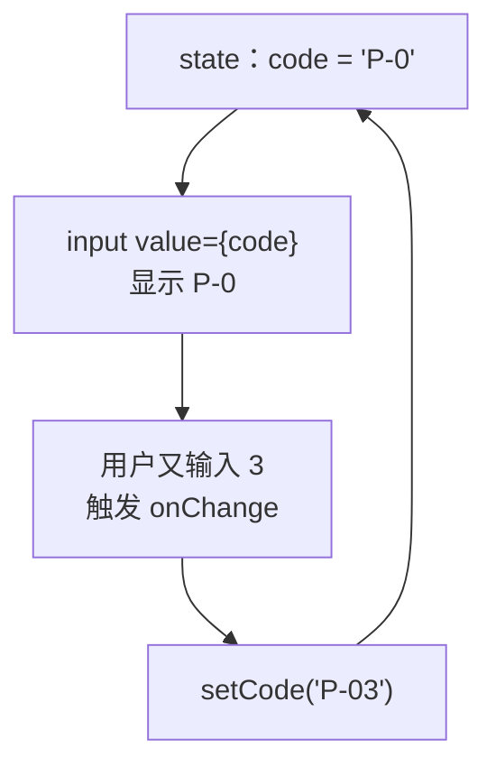
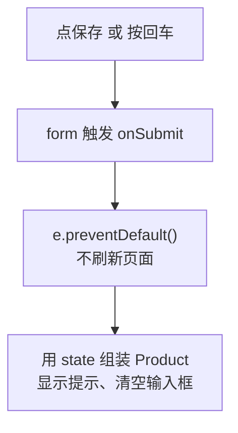
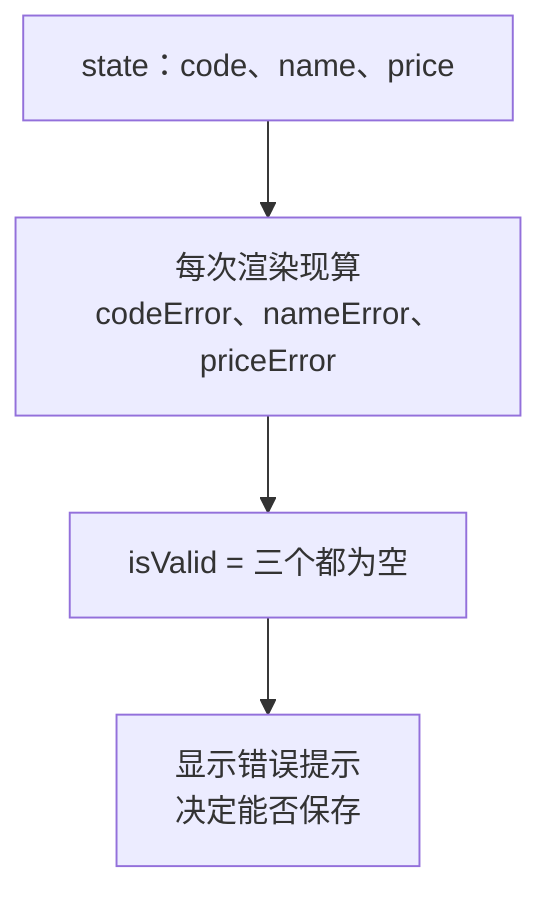

# 第 6 章 表单

## 这一章解决什么问题

要录入新产品：填编号、名称、分类、单价，点「保存」。名称空着、单价填了「abc」时要拦住并提示。本章做出这个表单。录入的产品先显示一条「已录入」提示，加进表格要等第 8 章，因为表格的数据在 `App` 里，表单在另一个组件里，两者怎么连起来是第 8 章的内容。

## 开始之前

- 上一章你已经会了：`map` + `key` 渲染列表、不可变更新、条件渲染（`&&` 和 `? :`）。
- 起点代码：仓库 `code/ch05/price-list`。在 `D:\react-study\price-list` 执行 `npm run dev`。
- 预计耗时：50 分钟。

先把表单放到页面上。用下面的内容整个替换 `src/App.tsx`。和第 5 章相比只改了两处：import 区最后多了 `ProductForm` 这一行；`<PageFooter />` 上面多了 `<ProductForm />`。本章后面不再改这个文件。

```tsx
// src/App.tsx
import { useState } from 'react'
import type { Product } from './types.ts'
import { initialProducts } from './data.ts'
import { PageHeader } from './components/PageHeader.tsx'
import { PageFooter } from './components/PageFooter.tsx'
import { ProductForm } from './components/ProductForm.tsx'

function App() {
  // 尖括号里写明 state 的类型：Product 数组
  const [products, setProducts] = useState<Product[]>(initialProducts)

  function handleDelete(id: number) {
    // filter 返回一个新数组，原数组不动
    setProducts(products.filter((p) => p.id !== id))
  }

  function handleRestock(id: number) {
    // map 返回新数组；要改的那一行用 { ...p, stock: 新值 } 生成新对象，其余行原样保留
    setProducts(products.map((p) => (p.id === id ? { ...p, stock: p.stock + 1 } : p)))
  }

  return (
    <main>
      <PageHeader />
      <p>共 {products.length} 种产品</p>
      {/* 条件 ? A : B：二选一。列表空了显示提示，否则显示表格 */}
      {products.length === 0 ? (
        <p className="empty">暂无产品</p>
      ) : (
        <table className="product-table">
          <thead>
            <tr>
              <th>编号</th>
              <th>名称</th>
              <th>单价（元）</th>
              <th>库存</th>
              <th>操作</th>
            </tr>
          </thead>
          <tbody>
            {products.map((p) => (
              <tr key={p.id}>
                <td>{p.code}</td>
                <td>
                  {p.name}
                  {/* 条件 && A：条件成立才显示 A，否则什么都不显示 */}
                  {p.stock === 0 && <span className="out-of-stock">缺货</span>}
                </td>
                <td>{p.price.toLocaleString()}</td>
                {/* 库存少于 5 用红色提醒：三元表达式也可以用在属性上 */}
                <td className={p.stock < 5 ? 'low' : undefined}>{p.stock}</td>
                <td>
                  {/* 要把 p.id 传进去，所以包一层箭头函数，点击时才执行 */}
                  <button type="button" onClick={() => handleRestock(p.id)}>入库 +1</button>{' '}
                  <button type="button" onClick={() => handleDelete(p.id)}>删除</button>
                </td>
              </tr>
            ))}
          </tbody>
        </table>
      )}
      {/* 第 6 章：表单先独立工作，第 8 章再把录入的产品加进上面的表格 */}
      <ProductForm />
      <PageFooter />
    </main>
  )
}

export default App
```

在 `src/index.css` 末尾追加：

```css
.product-form label { display: block; margin: 6px 0; }
.error { display: block; color: #dc2626; font-size: 14px; }
.success { color: #16a34a; }
```

`ProductForm.tsx` 下面马上新建。在它建好之前，页面空白，终端里显示 `Failed to load url /src/components/ProductForm.tsx ... Does the file exist?`，这是正常的。

## 正文

### 6.1 受控输入框

**白话定义**：受控输入框（controlled input）是指输入框显示的内容**来自 state**（`value={code}`），用户每输入一个字，`onChange` 就把新内容写回 state。输入框里是什么，以 state 为准。

**业务场景**：表单的编号、名称、单价都放在 state 里，所以随时可以拿来做校验、显示预览、在保存后一键清空。

**反例（什么时候不该用）**：只在提交那一刻才需要读值、中间不需要校验或联动的简单表单（比如一个「意见反馈」文本框），也可以不受控：只写 `defaultValue`，提交时从表单里读。本教程统一用受控写法，便于做即时校验。

#### 🖼 图解



#### 💻 最小可运行代码

新建 `src/components/ProductForm.tsx`：

```tsx
// src/components/ProductForm.tsx（6.1 版本，6.2 节会再改）
import { useState } from 'react'
import type { ChangeEvent } from 'react'

export function ProductForm() {
  // 每个输入框对应一个 state。输入框里的内容永远是字符串，单价也先按字符串存
  const [code, setCode] = useState('')
  const [name, setName] = useState('')
  const [category, setCategory] = useState('探头')
  const [price, setPrice] = useState('')

  // 单独写成函数时，参数类型要写明：input 元素上的变化事件
  function handlePriceChange(e: ChangeEvent<HTMLInputElement>) {
    setPrice(e.target.value)
  }

  return (
    <form className="product-form">
      <h2>录入新产品</h2>
      {/* value 来自 state，onChange 把用户输入写回 state：输入框完全由 React 控制 */}
      <label>编号 <input value={code} onChange={(e) => setCode(e.target.value)} /></label>
      <label>名称 <input value={name} onChange={(e) => setName(e.target.value)} /></label>
      <label>
        分类{' '}
        <select value={category} onChange={(e) => setCategory(e.target.value)}>
          <option value="探头">探头</option>
          <option value="主机">主机</option>
          <option value="耗材">耗材</option>
        </select>
      </label>
      <label>单价 <input value={price} onChange={handlePriceChange} /></label>
      <p>预览：{code} {name}（{category}）{price} 元</p>
    </form>
  )
}
```

#### 🔍 拆解运行结果

表格下面出现「录入新产品」表单。编号输入 `P-9`、分类选「耗材」、单价输入 `12`，预览那行实时显示「预览：P-9 （耗材）12 元」。

| 代码 | 说明 |
| --- | --- |
| `useState('')` | 输入框的值永远是字符串，所以单价也用 `''` 作初始值，保存时再转成数字 |
| `onChange={(e) => setCode(e.target.value)}` | 直接写在 JSX 里的箭头函数，TypeScript 能从 `onChange` 推断出 `e` 的类型，不用手写 |
| `handlePriceChange(e: ChangeEvent<HTMLInputElement>)` | 单独定义的函数，TypeScript 不知道它会被用在哪里，所以参数类型要手写。`<select>` 上用 `ChangeEvent<HTMLSelectElement>` |
| `<label>编号 <input /></label>` | 输入框写在 `label` 里面，点文字也能把光标放进输入框 |
| `<select value={category}>` | 下拉框也一样受控：`value` 决定选中哪项 |

React 的 `onChange` 在**每输入一个字符**时都触发，这和原生 HTML 里「离开输入框才触发 change」不同。

#### 改坏一处试试

**① 只写 `value`，不写 `onChange`。** 把编号输入框改成 `<input value={code} />`，再往里输入 `ABC`。实测输入框**一直是空的**，打不进字。控制台报：

```text
You provided a `value` prop to a form field without an `onChange` handler. This will render a read-only field. If the field should be mutable use `defaultValue`. Otherwise, set either `onChange` or `readOnly`.
```

每次按键后 React 都按 `value={code}` 把输入框恢复成 state 里的值，而 state 从没被改过。

**② 把数字存进字符串 state。** 把 `handlePriceChange` 里改成 `setPrice(Number(e.target.value))`，报 `TS2345: Argument of type 'number' is not assignable to parameter of type 'SetStateAction<string>'.`

**③ 事件类型用错元素。** 把下拉框改成 `onChange={handlePriceChange}`，报 `Type 'ChangeEvent<HTMLSelectElement, HTMLSelectElement>' is not assignable to type 'ChangeEvent<HTMLInputElement, Element>'.`，后面列出 `HTMLSelectElement` 缺少的输入框属性。

每次实验后改回。

### 6.2 表单提交

**白话定义**：用户点 `type="submit"` 的按钮，或在输入框里按回车，`<form>` 会触发提交事件。在 `onSubmit` 的处理函数里先调用 `e.preventDefault()`，阻止浏览器默认的整页提交，再用 state 里的值做事。

**业务场景**：录完一个产品，按回车就保存，不用伸手去点按钮；保存后清空表单，接着录下一个。

**反例（什么时候不该用）**：只有一个按钮、没有输入框的操作（比如表格里每行的「删除」），用普通 `type="button"` 按钮加 `onClick` 就行，不需要包一层 `<form>`。

#### 🖼 图解



#### 💻 最小可运行代码

用下面的内容整个替换 `ProductForm.tsx`：

```tsx
// src/components/ProductForm.tsx（6.2 版本，6.3 节会再改）
import { useState } from 'react'
import type { ChangeEvent, SubmitEvent } from 'react'
import type { Product } from '../types.ts'

export function ProductForm() {
  // 每个输入框对应一个 state。输入框里的内容永远是字符串，单价也先按字符串存
  const [code, setCode] = useState('')
  const [name, setName] = useState('')
  const [category, setCategory] = useState('探头')
  const [price, setPrice] = useState('')
  // 保存成功后显示的提示
  const [message, setMessage] = useState('')

  // 单独写成函数时，参数类型要写明：input 元素上的变化事件
  function handlePriceChange(e: ChangeEvent<HTMLInputElement>) {
    setPrice(e.target.value)
  }

  function handleSubmit(e: SubmitEvent<HTMLFormElement>) {
    // 阻止浏览器默认的「提交表单 = 刷新整页」，改由我们自己处理
    e.preventDefault()
    // 新产品还没入库，库存为 0；id 先用当前时间的毫秒数，保证不重复
    const product: Product = { id: Date.now(), code, name, category, price: Number(price), stock: 0 }
    console.log('新产品', product)
    setMessage(`已录入：${product.name}，单价 ${product.price.toLocaleString()} 元`)
    // 清空输入框：把 state 设回空字符串，输入框跟着变空
    setCode('')
    setName('')
    setPrice('')
  }

  return (
    <form className="product-form" onSubmit={handleSubmit}>
      <h2>录入新产品</h2>
      {/* value 来自 state，onChange 把用户输入写回 state：输入框完全由 React 控制 */}
      <label>编号 <input value={code} onChange={(e) => setCode(e.target.value)} /></label>
      <label>名称 <input value={name} onChange={(e) => setName(e.target.value)} /></label>
      <label>
        分类{' '}
        <select value={category} onChange={(e) => setCategory(e.target.value)}>
          <option value="探头">探头</option>
          <option value="主机">主机</option>
          <option value="耗材">耗材</option>
        </select>
      </label>
      <label>单价 <input value={price} onChange={handlePriceChange} /></label>
      {/* type="submit"：点击或在输入框里按回车都会触发表单的 onSubmit */}
      <button type="submit">保存</button>
      {message && <p className="success">{message}</p>}
    </form>
  )
}
```

#### 🔍 拆解运行结果

填「P-003」「微凸探头 C8-4」「9800」，在单价框里按回车。表单下面出现绿色的「已录入：微凸探头 C8-4，单价 9,800 元」，编号、名称、单价三个框变空，分类保留「探头」。控制台打印 `新产品` 和这个产品对象。

| 代码 | 说明 |
| --- | --- |
| `SubmitEvent<HTMLFormElement>` | React 的表单提交事件类型。网上很多资料写 `FormEvent`，在本项目的 `@types/react` 19.3 里它已被标为弃用（deprecated），VS Code 里会显示删除线，改用 `SubmitEvent` |
| `e.preventDefault()` | 浏览器默认会把表单提交到当前地址并刷新页面，React 的 state 会全部丢失 |
| `` `已录入：${product.name}` `` | 反引号字符串（模板字符串），`${}` 里放表达式 |
| `Number(price)` | 把字符串 `'9800'` 转成数字 `9800`。`Number('abc')` 得到 `NaN`（Not a Number，不是数字），下一节拦住它 |

#### 改坏一处试试

删掉 `e.preventDefault()` 这一行，填好表单点「保存」。实测：控制台闪过一行 `新产品 ...`，然后**整页刷新**，地址栏变成 `http://localhost:5173/?`，绿色提示没了。

浏览器做了表单的默认动作：用 GET 方式把表单提交到当前地址（输入框没写 `name` 属性，所以 `?` 后面是空的），页面重新加载，所有 state 回到初始值。改回去。

### 6.3 派生值：校验结果从 state 计算

**白话定义**：派生值（derived value）是每次渲染时由 state **现算**出来的值，不单独存成 state。表单的错误提示、按钮能不能点，都是派生值。

**业务场景**：编号、名称不能为空，单价必须是大于 0 的数字。错误提示要跟着输入实时变化：名称一填上，「请填写名称」就消失。

**反例（什么时候不该用）**：「用户有没有点过保存」这种**无法从其他数据算出来**的信息，就必须存成 state（下面的 `triedSubmit`）。派生值只适用于「有了别的 state 就能确定」的值。

#### 🖼 图解



对比两种做法：

| 做法 | 改名称时要做什么 | 风险 |
| --- | --- | --- |
| 错误也存成 state（`const [nameError, setNameError] = useState('')`） | 每个 `onChange` 里都要同时 `setName` 和 `setNameError` | 漏写一处，错误提示和输入框内容就对不上 |
| 错误作为派生值（本节写法） | 只 `setName`，错误在下次渲染时自动重算 | 无 |

#### 💻 最小可运行代码

用下面的内容整个替换 `ProductForm.tsx`：

```tsx
// src/components/ProductForm.tsx
import { useState } from 'react'
import type { ChangeEvent, SubmitEvent } from 'react'
import type { Product } from '../types.ts'

export function ProductForm() {
  // 每个输入框对应一个 state。输入框里的内容永远是字符串，单价也先按字符串存
  const [code, setCode] = useState('')
  const [name, setName] = useState('')
  const [category, setCategory] = useState('探头')
  const [price, setPrice] = useState('')
  // 保存成功后显示的提示
  const [message, setMessage] = useState('')
  // 点过一次「保存」才显示错误，免得一打开页面就满屏红字
  const [triedSubmit, setTriedSubmit] = useState(false)

  // 派生值：每次渲染都从 state 现算，不另存 state，所以永远和输入框一致
  const priceNumber = Number(price)
  const codeError = code.trim() === '' ? '请填写编号' : ''
  const nameError = name.trim() === '' ? '请填写名称' : ''
  // Number('abc') 是 NaN，NaN > 0 不成立，所以「不是数字」和「小于等于 0」一起拦住
  const priceError = price.trim() === '' ? '请填写单价' : priceNumber > 0 ? '' : '单价必须是大于 0 的数字'
  const isValid = codeError === '' && nameError === '' && priceError === ''

  // 单独写成函数时，参数类型要写明：input 元素上的变化事件
  function handlePriceChange(e: ChangeEvent<HTMLInputElement>) {
    setPrice(e.target.value)
  }

  function handleSubmit(e: SubmitEvent<HTMLFormElement>) {
    // 阻止浏览器默认的「提交表单 = 刷新整页」，改由我们自己处理
    e.preventDefault()
    setTriedSubmit(true)
    if (!isValid) {
      setMessage('')
      return
    }
    // 新产品还没入库，库存为 0；id 先用当前时间的毫秒数，保证不重复
    const product: Product = { id: Date.now(), code: code.trim(), name: name.trim(), category, price: priceNumber, stock: 0 }
    console.log('新产品', product)
    setMessage(`已录入：${product.name}，单价 ${product.price.toLocaleString()} 元`)
    // 清空输入框，并收起错误提示
    setCode('')
    setName('')
    setPrice('')
    setTriedSubmit(false)
  }

  return (
    <form className="product-form" onSubmit={handleSubmit}>
      <h2>录入新产品</h2>
      {/* value 来自 state，onChange 把用户输入写回 state：输入框完全由 React 控制 */}
      <label>编号 <input value={code} onChange={(e) => setCode(e.target.value)} /></label>
      {triedSubmit && codeError && <span className="error">{codeError}</span>}
      <label>名称 <input value={name} onChange={(e) => setName(e.target.value)} /></label>
      {triedSubmit && nameError && <span className="error">{nameError}</span>}
      <label>
        分类{' '}
        <select value={category} onChange={(e) => setCategory(e.target.value)}>
          <option value="探头">探头</option>
          <option value="主机">主机</option>
          <option value="耗材">耗材</option>
        </select>
      </label>
      <label>单价 <input value={price} onChange={handlePriceChange} /></label>
      {triedSubmit && priceError && <span className="error">{priceError}</span>}
      {/* type="submit"：点击或在输入框里按回车都会触发表单的 onSubmit */}
      <button type="submit">保存</button>
      {message && <p className="success">{message}</p>}
    </form>
  )
}
```

#### 🔍 拆解运行结果

实测过程：

| 操作 | 表单显示 |
| --- | --- |
| 什么都不填，点「保存」 | 三行红字：「请填写编号」「请填写名称」「请填写单价」 |
| 编号填 `P-003` | 「请填写编号」立刻消失，另外两条还在 |
| 名称填好，单价填 `abc`；再改成 `-5` | 单价下面显示「单价必须是大于 0 的数字」 |
| 单价改成 `9800`，按回车 | 红字全部消失，显示「已录入：微凸探头 C8-4，单价 9,800 元」，输入框清空 |

`handleSubmit` 里直接用了 `isValid`。它是这次渲染时算好的值，和用户看到的错误提示完全一致。

`{triedSubmit && codeError && <span>...}`：三个条件都成立才显示。`codeError` 是空字符串 `''` 时，`&&` 的结果是 `''`，React 显示空字符串等于什么都不显示，不会出现第 5 章那种多出一个 `0` 的问题。

#### 改坏一处试试

把 `priceError` 的判断从 `priceNumber > 0` 改成 `priceNumber !== 0`，单价填 `abc` 保存。实测通过了校验，显示「已录入：微凸探头，单价 NaN 元」。`NaN !== 0` 成立，`NaN` 混进了数据。所以判断要写成「大于 0」这种对 `NaN` 一定不成立的形式，或者显式用 `Number.isNaN(priceNumber)` 判断。改回去。

## ⚠️ 踩坑警告

| 现象 | 原因 | 怎么改 |
| --- | --- | --- |
| 输入框打不进字，控制台 `You provided a value prop to a form field without an onChange handler` | 写了 `value` 没写 `onChange` | 补上 `onChange={(e) => setXxx(e.target.value)}`；只想给初始值就用 `defaultValue` |
| 点保存后页面一闪，填的内容和提示全没了，地址栏多了个 `?` | 没写 `e.preventDefault()`，浏览器执行了默认的整页提交 | `onSubmit` 处理函数第一行写 `e.preventDefault()` |
| 表格里的「删除」按钮被放进表单后，一点就提交了表单 | `<button>` 不写 `type` 时默认是 `submit` | 非提交按钮一律写 `type="button"` |
| 单价相加得到 `"9800100"` 这样的字符串 | 输入框的值是字符串，忘了转换 | 保存或计算前用 `Number(...)` 转换，并校验结果不是 `NaN` |
| 照网上教程写 `FormEvent`，VS Code 显示删除线 | `@types/react` 19.3 把 `FormEvent` 标为弃用 | 提交事件用 `SubmitEvent<HTMLFormElement>`，输入变化用 `ChangeEvent<HTMLInputElement>` |

## 🎯 动手练习

**练习 1：加「库存」输入框**

在单价下面加「库存」输入框，保存时把它作为新产品的 `stock`。校验规则：不能为空；必须是不小于 0 的整数（`0` 可以，`1.5` 和 `-1` 不行）。

验收标准：

- 库存填 `1.5` 点保存，库存下面显示「库存必须是不小于 0 的整数」。
- 库存填 `0`，其他都正确时保存成功，四个输入框都被清空。

提示：`Number.isInteger(1.5)` 是 `false`。

**练习 2：名称字数提示**

名称输入框后面实时显示「已输入 x/20 字」；超过 20 个字时显示错误「名称不能超过 20 个字」，不能保存。

验收标准：

- 输入「微凸探头」时显示「已输入 4/20 字」。
- 粘贴 21 个字后，显示「已输入 21/20 字」；点保存后出现「名称不能超过 20 个字」。

卡住了看文末参考答案。

## 📌 一句话总结

输入框受 state 控制，提交先 preventDefault，校验结果每次渲染现算。

## 下一章

数据现在写死在 `data.ts` 里。第 7 章改成页面打开时从 `products.json` 加载，并显示「加载中」和「出错了」。

---

<!-- 以下是参考答案，先自己动手，卡住了再往下翻 -->


## 参考答案

两个练习都改 `ProductForm.tsx`，下面是都做完后的版本。

### 练习 1

思路：库存和单价一样按字符串存、保存前转数字。`Number('')` 是 `0`，所以先单独判断空字符串；`Number.isInteger` 对 `NaN`、小数都返回 `false`。

### 练习 2

思路：字数是派生值，直接用 `name.trim().length` 算，同时用于显示和校验，两处不会对不上。

```tsx
// src/components/ProductForm.tsx
// 两个练习都做完后的版本
import { useState } from 'react'
import type { ChangeEvent, SubmitEvent } from 'react'
import type { Product } from '../types.ts'

export function ProductForm() {
  // 每个输入框对应一个 state。输入框里的内容永远是字符串，单价也先按字符串存
  const [code, setCode] = useState('')
  const [name, setName] = useState('')
  const [category, setCategory] = useState('探头')
  const [price, setPrice] = useState('')
  // 练习 1：初始库存，同样按字符串存
  const [stock, setStock] = useState('')
  // 保存成功后显示的提示
  const [message, setMessage] = useState('')
  // 点过一次「保存」才显示错误，免得一打开页面就满屏红字
  const [triedSubmit, setTriedSubmit] = useState(false)

  // 派生值：每次渲染都从 state 现算，不另存 state，所以永远和输入框一致
  const priceNumber = Number(price)
  const codeError = code.trim() === '' ? '请填写编号' : ''
  // 练习 2：名称最多 20 个字
  const nameLength = name.trim().length
  const nameError = nameLength === 0 ? '请填写名称' : nameLength > 20 ? '名称不能超过 20 个字' : ''
  // Number('abc') 是 NaN，NaN > 0 不成立，所以「不是数字」和「小于等于 0」一起拦住
  const priceError = price.trim() === '' ? '请填写单价' : priceNumber > 0 ? '' : '单价必须是大于 0 的数字'
  // 练习 1：库存可以是 0，但必须是不小于 0 的整数
  const stockNumber = Number(stock)
  const stockError = stock.trim() === '' ? '请填写库存' : Number.isInteger(stockNumber) && stockNumber >= 0 ? '' : '库存必须是不小于 0 的整数'
  const isValid = codeError === '' && nameError === '' && priceError === '' && stockError === ''

  // 单独写成函数时，参数类型要写明：input 元素上的变化事件
  function handlePriceChange(e: ChangeEvent<HTMLInputElement>) {
    setPrice(e.target.value)
  }

  function handleSubmit(e: SubmitEvent<HTMLFormElement>) {
    // 阻止浏览器默认的「提交表单 = 刷新整页」，改由我们自己处理
    e.preventDefault()
    setTriedSubmit(true)
    if (!isValid) {
      setMessage('')
      return
    }
    // id 先用当前时间的毫秒数，保证不重复
    const product: Product = { id: Date.now(), code: code.trim(), name: name.trim(), category, price: priceNumber, stock: stockNumber }
    console.log('新产品', product)
    setMessage(`已录入：${product.name}，单价 ${product.price.toLocaleString()} 元`)
    // 清空输入框，并收起错误提示
    setCode('')
    setName('')
    setPrice('')
    setStock('')
    setTriedSubmit(false)
  }

  return (
    <form className="product-form" onSubmit={handleSubmit}>
      <h2>录入新产品</h2>
      {/* value 来自 state，onChange 把用户输入写回 state：输入框完全由 React 控制 */}
      <label>编号 <input value={code} onChange={(e) => setCode(e.target.value)} /></label>
      {triedSubmit && codeError && <span className="error">{codeError}</span>}
      <label>
        名称 <input value={name} onChange={(e) => setName(e.target.value)} /> 已输入 {nameLength}/20 字
      </label>
      {triedSubmit && nameError && <span className="error">{nameError}</span>}
      <label>
        分类{' '}
        <select value={category} onChange={(e) => setCategory(e.target.value)}>
          <option value="探头">探头</option>
          <option value="主机">主机</option>
          <option value="耗材">耗材</option>
        </select>
      </label>
      <label>单价 <input value={price} onChange={handlePriceChange} /></label>
      {triedSubmit && priceError && <span className="error">{priceError}</span>}
      <label>库存 <input value={stock} onChange={(e) => setStock(e.target.value)} /></label>
      {triedSubmit && stockError && <span className="error">{stockError}</span>}
      {/* type="submit"：点击或在输入框里按回车都会触发表单的 onSubmit */}
      <button type="submit">保存</button>
      {message && <p className="success">{message}</p>}
    </form>
  )
}
```
