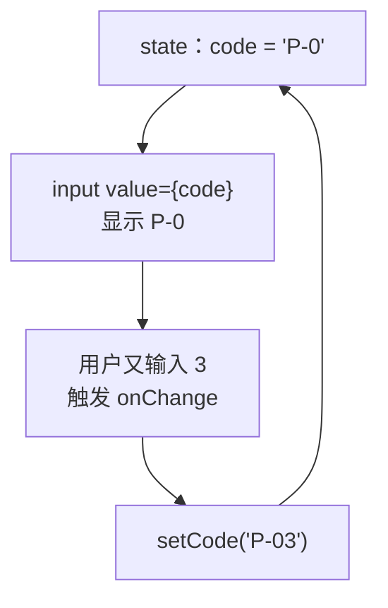

# 第 6A 章 受控输入框：输入框的内容由 state 决定

## 这一章解决什么问题

要录入新产品：填编号、名称、分类、单价。第一步是让输入框里的内容「进到」React 里，随时能拿来校验、预览、一键清空。本章做出表单的输入部分，下一章再做「保存」。

录入的产品加进表格要等第 8A 章：表格的数据在 `App` 里，表单在另一个组件里，两者怎么连起来是第 8A 章的内容。

本章只讲一个技术点：**受控输入框**。

## 开始之前

- 上一章你已经会了：`map` + `key` 渲染列表、不可变更新、条件渲染（`&&` 和 `? :`）。
- 起点代码：仓库 `code/ch05C/price-list`（不含练习答案）。在 `D:\react-study\price-list` 执行 `npm run dev`。
- 预计耗时：25 分钟。

## 正文

### 6A.1 把表单放到页面上

用下面的内容整个替换 `src/App.tsx`。和第 5C 章相比只改了两处：import 区最后多了 `ProductForm` 这一行；`<PageFooter />` 上面多了 `<ProductForm />`。第 6 章后面都不再改这个文件。

```tsx
// src/App.tsx
import { useState } from 'react'
import type { Product } from './types.ts'
import { initialProducts } from './data.ts'
import { PageHeader } from './components/PageHeader.tsx'
import { PageFooter } from './components/PageFooter.tsx'
import { ProductForm } from './components/ProductForm.tsx'

function App() {
  // 尖括号里写明 state 的类型：Product 数组
  const [products, setProducts] = useState<Product[]>(initialProducts)

  function handleDelete(id: number) {
    // filter 返回一个新数组，原数组不动
    setProducts(products.filter((p) => p.id !== id))
  }

  function handleRestock(id: number) {
    // map 返回新数组；要改的那一行用 { ...p, stock: 新值 } 生成新对象，其余行原样保留
    setProducts(products.map((p) => (p.id === id ? { ...p, stock: p.stock + 1 } : p)))
  }

  return (
    <main>
      <PageHeader />
      <p>共 {products.length} 种产品</p>
      {/* 条件 ? A : B：二选一。列表空了显示提示，否则显示表格 */}
      {products.length === 0 ? (
        <p className="empty">暂无产品</p>
      ) : (
        <table className="product-table">
          <thead>
            <tr>
              <th>编号</th>
              <th>名称</th>
              <th>单价（元）</th>
              <th>库存</th>
              <th>操作</th>
            </tr>
          </thead>
          <tbody>
            {products.map((p) => (
              <tr key={p.id}>
                <td>{p.code}</td>
                <td>
                  {p.name}
                  {/* 条件 && A：条件成立才显示 A，否则什么都不显示 */}
                  {p.stock === 0 && <span className="out-of-stock">缺货</span>}
                </td>
                <td>{p.price.toLocaleString()}</td>
                {/* 库存少于 5 用红色提醒：三元表达式也可以用在属性上 */}
                <td className={p.stock < 5 ? 'low' : undefined}>{p.stock}</td>
                <td>
                  {/* 要把 p.id 传进去，所以包一层箭头函数，点击时才执行 */}
                  <button type="button" onClick={() => handleRestock(p.id)}>入库 +1</button>{' '}
                  <button type="button" onClick={() => handleDelete(p.id)}>删除</button>
                </td>
              </tr>
            ))}
          </tbody>
        </table>
      )}
      {/* 第 6 章：表单先独立工作，第 8A 章再把录入的产品加进上面的表格 */}
      <ProductForm />
      <PageFooter />
    </main>
  )
}

export default App
```

用下面的内容整个替换 `src/index.css`（末尾多了表单的三行样式）：

```css
/* src/index.css */
/* 全局样式先保持最少，第 10 章再整理 */
body {
  margin: 24px;
  font-family: system-ui, 'Microsoft YaHei', sans-serif;
}

.subtitle {
  color: #666;
}

.card {
  border: 1px solid #ddd;
  border-radius: 6px;
  padding: 8px 16px;
  margin-bottom: 12px;
  max-width: 360px;
}

.panel {
  border-left: 4px solid #3b82f6;
  padding-left: 12px;
  margin-bottom: 16px;
}

.product-table {
  border-collapse: collapse;
  margin-bottom: 16px;
}

.product-table th,
.product-table td {
  border: 1px solid #ddd;
  padding: 6px 10px;
}

.out-of-stock {
  margin-left: 6px;
  padding: 0 6px;
  color: #fff;
  background: #dc2626;
  border-radius: 4px;
  font-size: 12px;
}

.low {
  color: #dc2626;
}

.empty {
  color: #999;
}

.product-form label { display: block; margin: 6px 0; }
.error { display: block; color: #dc2626; font-size: 14px; }
.success { color: #16a34a; }
```

`ProductForm.tsx` 下面马上新建。在它建好之前，页面空白，终端里显示 `Failed to load url /src/components/ProductForm.tsx ... Does the file exist?`，这是正常的。

### 6A.2 受控输入框是什么

**白话定义**：受控输入框（controlled input）是指输入框显示的内容**来自 state**（`value={code}`），用户每输入一个字，`onChange` 就把新内容写回 state。输入框里是什么，以 state 为准。

**业务场景**：表单的编号、名称、单价都放在 state 里，所以随时可以拿来做校验、显示预览、在保存后一键清空。

**反例（什么时候不该用）**：只在提交那一刻才需要读值、中间不需要校验或联动的简单表单（比如一个「意见反馈」文本框），也可以不受控：只写 `defaultValue`，提交时从表单里读。本教程统一用受控写法，便于做即时校验。

#### 🖼 图解



### 6A.3 写表单

#### 💻 最小可运行代码

新建 `src/components/ProductForm.tsx`：

```tsx
// src/components/ProductForm.tsx
import { useState } from 'react'
import type { ChangeEvent } from 'react'

export function ProductForm() {
  // 每个输入框对应一个 state。输入框里的内容永远是字符串，单价也先按字符串存
  const [code, setCode] = useState('')
  const [name, setName] = useState('')
  const [category, setCategory] = useState('探头')
  const [price, setPrice] = useState('')

  // 单独写成函数时，参数类型要写明：input 元素上的变化事件
  function handlePriceChange(e: ChangeEvent<HTMLInputElement>) {
    setPrice(e.target.value)
  }

  return (
    <form className="product-form">
      <h2>录入新产品</h2>
      {/* value 来自 state，onChange 把用户输入写回 state：输入框完全由 React 控制 */}
      <label>编号 <input value={code} onChange={(e) => setCode(e.target.value)} /></label>
      <label>名称 <input value={name} onChange={(e) => setName(e.target.value)} /></label>
      <label>
        分类{' '}
        <select value={category} onChange={(e) => setCategory(e.target.value)}>
          <option value="探头">探头</option>
          <option value="主机">主机</option>
          <option value="耗材">耗材</option>
        </select>
      </label>
      <label>单价 <input value={price} onChange={handlePriceChange} /></label>
      <p>预览：{code} {name}（{category}）{price} 元</p>
    </form>
  )
}
```

#### 🔍 拆解运行结果

表格下面出现「录入新产品」表单。编号输入 `P-9`、分类选「耗材」、单价输入 `12`，预览那行实时显示「预览：P-9 （耗材）12 元」。

| 代码 | 说明 |
| --- | --- |
| `useState('')` | 输入框的值永远是字符串，所以单价也用 `''` 作初始值，保存时再转成数字 |
| `onChange={(e) => setCode(e.target.value)}` | `e.target` 是触发事件的那个输入框，`.value` 是它现在的内容。直接写在 JSX 里的箭头函数，TypeScript 能从 `onChange` 推断出 `e` 的类型，不用手写 |
| `handlePriceChange(e: ChangeEvent<HTMLInputElement>)` | 单独定义的函数，TypeScript 不知道它会被用在哪里，所以参数类型要手写。`<select>` 上用 `ChangeEvent<HTMLSelectElement>` |
| `<label>编号 <input /></label>` | 输入框写在 `label` 里面，点文字也能把光标放进输入框 |
| `<select value={category}>` | 下拉框也一样受控：`value` 决定选中哪项 |

React 的 `onChange` 在**每输入一个字符**时都触发，这和原生 HTML 里「离开输入框才触发 change」不同。

#### 改坏一处试试

**① 只写 `value`，不写 `onChange`。** 把编号输入框改成 `<input value={code} />`，再往里输入 `ABC`。实测输入框**一直是空的**，打不进字。控制台报：

```text
You provided a `value` prop to a form field without an `onChange` handler. This will render a read-only field. If the field should be mutable use `defaultValue`. Otherwise, set either `onChange` or `readOnly`.
```

每次按键后 React 都按 `value={code}` 把输入框恢复成 state 里的值，而 state 从没被改过。

**② 把数字存进字符串 state。** 把 `handlePriceChange` 里改成 `setPrice(Number(e.target.value))`，`npx tsc -b` 报：

```text
src/components/ProductForm.tsx(14,14): error TS2345: Argument of type 'number' is not assignable to parameter of type 'SetStateAction<string>'.
```

**③ 事件类型用错元素。** 把下拉框改成 `onChange={handlePriceChange}`，报：

```text
src/components/ProductForm.tsx(25,34): error TS2322: Type '(e: ChangeEvent<HTMLInputElement, Element>) => void' is not assignable to type 'ChangeEventHandler<HTMLSelectElement, HTMLSelectElement>'.
  ...
      Type 'HTMLSelectElement' is missing the following properties from type 'HTMLInputElement': accept, align, alt, capture, and 38 more.
```

每次实验后改回。

## ⚠️ 踩坑警告

| 现象 | 原因 | 怎么改 |
| --- | --- | --- |
| 输入框打不进字，控制台 `You provided a value prop to a form field without an onChange handler` | 写了 `value` 没写 `onChange` | 补上 `onChange={(e) => setXxx(e.target.value)}`；只想给初始值就用 `defaultValue` |
| 写成 `onChange={setCode}`，报 `TS2322: Type 'Dispatch<SetStateAction<string>>' is not assignable to type 'ChangeEventHandler<HTMLInputElement, HTMLInputElement>'.` | `onChange` 传进来的是事件对象，不是字符串。直接交给 `setCode` 会把整个事件对象存进 state | 包一层：`onChange={(e) => setCode(e.target.value)}` |
| 写成 `useState<string>()` 不给初始值，第一次输入时控制台报 `A component is changing an uncontrolled input to be controlled.` | 初始值是 `undefined`，React 认为这个输入框一开始是「不受控」的，输入后又变成受控 | 输入框的 state 一律给初始值 `''` |

## 🎯 动手练习

**练习 1：加「库存」输入框**

在单价下面加「库存」输入框，同样受控。预览那行末尾显示「，库存 x」。

验收标准：

- 库存输入 `5`，预览末尾实时显示「，库存 5」。

**练习 2：清空按钮**

在表单最后加一个「清空」按钮，点一下五个输入项都回到初始状态（分类回到「探头」）。

验收标准：

- 填了编号和库存后点「清空」，输入框全变空，预览变成「预览： （探头） 元，库存」。
- 点完地址栏仍是 `http://localhost:5173/`，页面没有刷新。

提示：表单里的按钮如果不写 `type`，默认是提交按钮。试试不写 `type` 会发生什么。

卡住了看文末参考答案。

## 📌 一句话总结

value 来自 state，onChange 写回 state，输入框就受 React 控制。

## 下一章

现在填完了没法保存。第 6B 章处理表单提交：点「保存」或按回车，组装出一个新产品。

---

<!-- 以下是参考答案，先自己动手，卡住了再往下翻 -->


## 参考答案

两个练习都改 `ProductForm.tsx`，下面是都做完后的版本。

### 练习 1

思路：和单价一样，加一个字符串 state，`value` 和 `onChange` 成对写。

### 练习 2

思路：受控输入框显示的是 state，所以清空就是把每个 state 设回初始值。按钮一定写 `type="button"`。实测不写 `type` 时，点「清空」后页面整个刷新，地址栏变成 `http://localhost:5173/?`：按钮默认是 `submit`，触发了浏览器默认的表单提交（下一章细讲）。

```tsx
// src/components/ProductForm.tsx
// 两个练习都做完后的版本
import { useState } from 'react'
import type { ChangeEvent } from 'react'

export function ProductForm() {
  // 每个输入框对应一个 state。输入框里的内容永远是字符串，单价也先按字符串存
  const [code, setCode] = useState('')
  const [name, setName] = useState('')
  const [category, setCategory] = useState('探头')
  const [price, setPrice] = useState('')
  // 练习 1：库存也是输入框，同样按字符串存
  const [stock, setStock] = useState('')

  // 单独写成函数时，参数类型要写明：input 元素上的变化事件
  function handlePriceChange(e: ChangeEvent<HTMLInputElement>) {
    setPrice(e.target.value)
  }

  // 练习 2：清空就是把 state 设回初始值，输入框跟着变
  function handleClear() {
    setCode('')
    setName('')
    setCategory('探头')
    setPrice('')
    setStock('')
  }

  return (
    <form className="product-form">
      <h2>录入新产品</h2>
      {/* value 来自 state，onChange 把用户输入写回 state：输入框完全由 React 控制 */}
      <label>编号 <input value={code} onChange={(e) => setCode(e.target.value)} /></label>
      <label>名称 <input value={name} onChange={(e) => setName(e.target.value)} /></label>
      <label>
        分类{' '}
        <select value={category} onChange={(e) => setCategory(e.target.value)}>
          <option value="探头">探头</option>
          <option value="主机">主机</option>
          <option value="耗材">耗材</option>
        </select>
      </label>
      <label>单价 <input value={price} onChange={handlePriceChange} /></label>
      <label>库存 <input value={stock} onChange={(e) => setStock(e.target.value)} /></label>
      <p>预览：{code} {name}（{category}）{price} 元，库存 {stock}</p>
      {/* 练习 2：表单里的普通按钮一定要写 type="button"，否则默认是提交按钮 */}
      <button type="button" onClick={handleClear}>清空</button>
    </form>
  )
}
```
