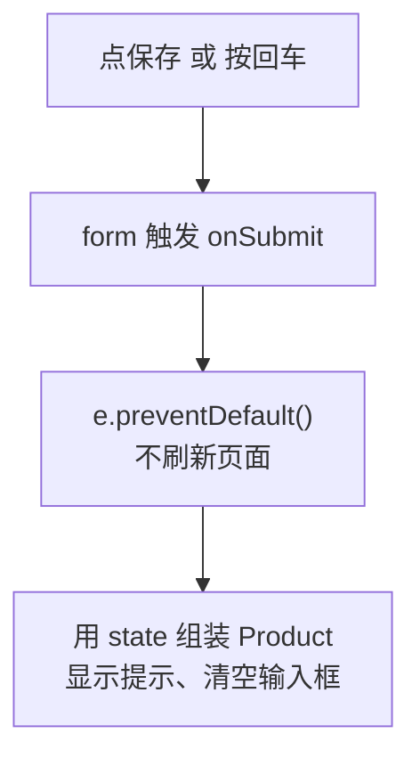

# 第 6B 章 表单提交：onSubmit 与 preventDefault

## 这一章解决什么问题

表单填好了，要能点「保存」或在输入框里按回车来保存：用输入框里的值组装出一个新产品，显示「已录入」提示，然后清空表单接着录下一个。直接做会遇到一个怪现象：点了保存，页面一闪，填的东西全没了。本章讲清楚原因和写法。

本章只讲一个技术点：**表单提交**。

## 开始之前

- 上一章你已经会了：受控输入框（`value` + `onChange`）、`ChangeEvent<HTMLInputElement>`、表单里的普通按钮要写 `type="button"`。
- 起点代码：仓库 `code/ch06A/price-list`（不含练习答案）。在 `D:\react-study\price-list` 执行 `npm run dev`。
- 预计耗时：25 分钟。

## 正文

### 6B.1 表单提交是什么

**白话定义**：用户点 `type="submit"` 的按钮，或在输入框里按回车，`<form>` 会触发提交事件。在 `onSubmit` 的处理函数里先调用 `e.preventDefault()`，阻止浏览器默认的整页提交，再用 state 里的值做事。

**业务场景**：录完一个产品，按回车就保存，不用伸手去点按钮；保存后清空表单，接着录下一个。

**反例（什么时候不该用）**：只有一个按钮、没有输入框的操作（比如表格里每行的「删除」），用普通 `type="button"` 按钮加 `onClick` 就行，不需要包一层 `<form>`。

#### 🖼 图解



### 6B.2 保存

#### 💻 最小可运行代码

用下面的内容整个替换 `ProductForm.tsx`：

```tsx
// src/components/ProductForm.tsx
import { useState } from 'react'
import type { ChangeEvent, SubmitEvent } from 'react'
import type { Product } from '../types.ts'

export function ProductForm() {
  // 每个输入框对应一个 state。输入框里的内容永远是字符串，单价也先按字符串存
  const [code, setCode] = useState('')
  const [name, setName] = useState('')
  const [category, setCategory] = useState('探头')
  const [price, setPrice] = useState('')
  // 保存成功后显示的提示
  const [message, setMessage] = useState('')

  // 单独写成函数时，参数类型要写明：input 元素上的变化事件
  function handlePriceChange(e: ChangeEvent<HTMLInputElement>) {
    setPrice(e.target.value)
  }

  function handleSubmit(e: SubmitEvent<HTMLFormElement>) {
    // 阻止浏览器默认的「提交表单 = 刷新整页」，改由我们自己处理
    e.preventDefault()
    // 新产品还没入库，库存为 0；id 先用当前时间的毫秒数，保证不重复
    const product: Product = { id: Date.now(), code, name, category, price: Number(price), stock: 0 }
    console.log('新产品', product)
    setMessage(`已录入：${product.name}，单价 ${product.price.toLocaleString()} 元`)
    // 清空输入框：把 state 设回空字符串，输入框跟着变空
    setCode('')
    setName('')
    setPrice('')
  }

  return (
    <form className="product-form" onSubmit={handleSubmit}>
      <h2>录入新产品</h2>
      {/* value 来自 state，onChange 把用户输入写回 state：输入框完全由 React 控制 */}
      <label>编号 <input value={code} onChange={(e) => setCode(e.target.value)} /></label>
      <label>名称 <input value={name} onChange={(e) => setName(e.target.value)} /></label>
      <label>
        分类{' '}
        <select value={category} onChange={(e) => setCategory(e.target.value)}>
          <option value="探头">探头</option>
          <option value="主机">主机</option>
          <option value="耗材">耗材</option>
        </select>
      </label>
      <label>单价 <input value={price} onChange={handlePriceChange} /></label>
      {/* type="submit"：点击或在输入框里按回车都会触发表单的 onSubmit */}
      <button type="submit">保存</button>
      {message && <p className="success">{message}</p>}
    </form>
  )
}
```

#### 🔍 拆解运行结果

填「P-003」「微凸探头 C8-4」「9800」，在单价框里按回车。表单下面出现绿色的「已录入：微凸探头 C8-4，单价 9,800 元」，编号、名称、单价三个框变空，分类保留「探头」。控制台打印 `新产品` 和这个产品对象。

| 代码 | 说明 |
| --- | --- |
| `<form onSubmit={handleSubmit}>` | 处理函数绑在 `form` 上，不是绑在按钮上。点按钮和按回车都会走到这里 |
| `SubmitEvent<HTMLFormElement>` | React 的表单提交事件类型。网上很多资料写 `FormEvent`，在本项目的 `@types/react` 19.3 里它已被标为弃用（deprecated），VS Code 里会显示删除线，改用 `SubmitEvent` |
| `e.preventDefault()` | 浏览器默认会把表单提交到当前地址并刷新页面，React 的 state 会全部丢失 |
| `const product: Product = {...}` | 标注 `: Product`，少写字段或类型不对当场报错 |
| `Number(price)` | 把字符串 `'9800'` 转成数字 `9800`。`Number('abc')` 得到 `NaN`（Not a Number，不是数字），下一章拦住它 |
| `` `已录入：${product.name}` `` | 模板字符串（第 4C 章），`${}` 里放表达式 |
| `{message && <p ...>}` | `message` 是空字符串时不显示。空字符串在 `&&` 左边不会显示出来（和数字 `0` 不同） |

#### 改坏一处试试

删掉 `e.preventDefault()` 这一行，填好表单点「保存」。实测：控制台闪过一行 `新产品 ...`，然后**整页刷新**，地址栏变成 `http://localhost:5173/?`，绿色提示没了。

浏览器做了表单的默认动作：用 GET 方式把表单提交到当前地址（输入框没写 `name` 属性，所以 `?` 后面是空的），页面重新加载，所有 state 回到初始值。改回去。

## ⚠️ 踩坑警告

| 现象 | 原因 | 怎么改 |
| --- | --- | --- |
| 点保存后页面一闪，填的内容和提示全没了，地址栏多了个 `?` | 没写 `e.preventDefault()`，浏览器执行了默认的整页提交 | `onSubmit` 处理函数第一行写 `e.preventDefault()` |
| 表单里的「清空」之类的按钮，一点就提交了表单 | `<button>` 不写 `type` 时默认是 `submit` | 非提交按钮一律写 `type="button"` |
| 单价相加得到 `"9800100"` 这样的字符串 | 输入框的值是字符串，忘了转换 | 保存或计算前用 `Number(...)` 转换，并校验结果不是 `NaN`（下一章） |
| 照网上教程写 `FormEvent`，VS Code 显示删除线 | `@types/react` 19.3 把 `FormEvent` 标为弃用 | 提交事件用 `SubmitEvent<HTMLFormElement>` |

## 🎯 动手练习

**练习 1：保存库存**

在单价下面加「库存」输入框，保存时把它作为新产品的 `stock`（转成数字），提示里显示「，库存 x」，保存后清空。先不做校验。

验收标准：

- 填库存 `4` 保存，提示是「已录入：微凸探头 C8-4，单价 9,800 元，库存 4」。
- 四个输入框都被清空。

**练习 2：列出本次录入的产品**

在提示下面列出这次打开页面以来录入过的所有产品，格式「编号 名称」，按录入顺序排列；上面一行显示「本次已录入 x 个：」。一个都没录入时，这两部分都不显示。

验收标准：

- 依次录入「P-003 微凸探头 C8-4」「C-003 消毒湿巾」后，显示「本次已录入 2 个：」和两行列表，顺序和录入顺序一致。
- 刷新页面后列表消失（数据只在内存里）。

提示：用一个 `Product[]` 类型的 state，添加时用第 5B 章表格里的 `[...arr, 新项]`。

卡住了看文末参考答案。

## 📌 一句话总结

onSubmit 绑在 form 上，第一行先 e.preventDefault()。

## 下一章

现在什么都不填也能保存，单价填「abc」也能保存。第 6C 章加上校验，而且错误提示要跟着输入实时变化。

---

<!-- 以下是参考答案，先自己动手，卡住了再往下翻 -->


## 参考答案

两个练习都改 `ProductForm.tsx`，下面是都做完后的版本。

### 练习 1

思路：库存和单价一样按字符串存，组装产品时用 `Number(stock)` 转换。

### 练习 2

思路：录入过的产品存进一个数组 state，初始值是空数组，所以写明 `useState<Product[]>([])`。每次保存用 `[...added, product]` 生成新数组。列表用 `map` + `key`；「有才显示」用 `added.length > 0 &&`，两部分用 Fragment 包起来。

```tsx
// src/components/ProductForm.tsx
// 两个练习都做完后的版本
import { useState } from 'react'
import type { ChangeEvent, SubmitEvent } from 'react'
import type { Product } from '../types.ts'

export function ProductForm() {
  // 每个输入框对应一个 state。输入框里的内容永远是字符串，单价也先按字符串存
  const [code, setCode] = useState('')
  const [name, setName] = useState('')
  const [category, setCategory] = useState('探头')
  const [price, setPrice] = useState('')
  // 练习 1：初始库存，同样按字符串存
  const [stock, setStock] = useState('')
  // 保存成功后显示的提示
  const [message, setMessage] = useState('')
  // 练习 2：本次录入过的产品。初始是空数组，所以要写明泛型
  const [added, setAdded] = useState<Product[]>([])

  // 单独写成函数时，参数类型要写明：input 元素上的变化事件
  function handlePriceChange(e: ChangeEvent<HTMLInputElement>) {
    setPrice(e.target.value)
  }

  function handleSubmit(e: SubmitEvent<HTMLFormElement>) {
    // 阻止浏览器默认的「提交表单 = 刷新整页」，改由我们自己处理
    e.preventDefault()
    // 练习 1：库存来自输入框，转成数字；id 先用当前时间的毫秒数，保证不重复
    const product: Product = { id: Date.now(), code, name, category, price: Number(price), stock: Number(stock) }
    console.log('新产品', product)
    setMessage(`已录入：${product.name}，单价 ${product.price.toLocaleString()} 元，库存 ${product.stock}`)
    // 练习 2：展开旧数组、末尾加一项，生成新数组（第 5B 章的不可变更新）
    setAdded([...added, product])
    // 清空输入框：把 state 设回空字符串，输入框跟着变空
    setCode('')
    setName('')
    setPrice('')
    setStock('')
  }

  return (
    <form className="product-form" onSubmit={handleSubmit}>
      <h2>录入新产品</h2>
      {/* value 来自 state，onChange 把用户输入写回 state：输入框完全由 React 控制 */}
      <label>编号 <input value={code} onChange={(e) => setCode(e.target.value)} /></label>
      <label>名称 <input value={name} onChange={(e) => setName(e.target.value)} /></label>
      <label>
        分类{' '}
        <select value={category} onChange={(e) => setCategory(e.target.value)}>
          <option value="探头">探头</option>
          <option value="主机">主机</option>
          <option value="耗材">耗材</option>
        </select>
      </label>
      <label>单价 <input value={price} onChange={handlePriceChange} /></label>
      <label>库存 <input value={stock} onChange={(e) => setStock(e.target.value)} /></label>
      {/* type="submit"：点击或在输入框里按回车都会触发表单的 onSubmit */}
      <button type="submit">保存</button>
      {message && <p className="success">{message}</p>}
      {added.length > 0 && (
        <>
          <p>本次已录入 {added.length} 个：</p>
          <ul>
            {added.map((p) => (
              <li key={p.id}>
                {p.code} {p.name}
              </li>
            ))}
          </ul>
        </>
      )}
    </form>
  )
}
```
