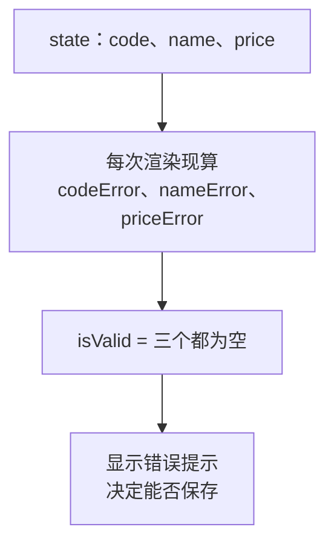

# 第 6C 章 派生值：校验结果从 state 现算

## 这一章解决什么问题

编号、名称不能为空，单价必须是大于 0 的数字。点「保存」时不合格要拦住并提示，而且错误提示要跟着输入实时变化：名称一填上，「请填写名称」就消失。直觉做法是再开几个 state 存错误信息，但那样每个 `onChange` 都要多改一处，漏一处就对不上。本章用「派生值」来做。

本章只讲一个技术点：**派生值**。

## 开始之前

- 上一章你已经会了：`<form onSubmit>`、`e.preventDefault()`、`SubmitEvent<HTMLFormElement>`、保存后清空输入框。
- 起点代码：仓库 `code/ch06B/price-list`（不含练习答案）。在 `D:\react-study\price-list` 执行 `npm run dev`。
- 预计耗时：30 分钟。

## 正文

### 6C.1 派生值是什么

**白话定义**：派生值（derived value）是每次渲染时由 state **现算**出来的值，不单独存成 state。表单的错误提示、按钮能不能点，都是派生值。第 4A 章的「小计 = 单价 × 数量」、第 5C 章练习 1 的 `visibleProducts` 也是。

**业务场景**：编号、名称不能为空，单价必须是大于 0 的数字。错误提示要跟着输入实时变化。

**反例（什么时候不该用）**：「用户有没有点过保存」这种**无法从其他数据算出来**的信息，就必须存成 state（下面的 `triedSubmit`）。派生值只适用于「有了别的 state 就能确定」的值。

#### 🖼 图解



对比两种做法：

| 做法 | 改名称时要做什么 | 风险 |
| --- | --- | --- |
| 错误也存成 state（`const [nameError, setNameError] = useState('')`） | 每个 `onChange` 里都要同时 `setName` 和 `setNameError` | 漏写一处，错误提示和输入框内容就对不上 |
| 错误作为派生值（本章写法） | 只 `setName`，错误在下次渲染时自动重算 | 无 |

### 6C.2 加上校验

#### 💻 最小可运行代码

用下面的内容整个替换 `ProductForm.tsx`：

```tsx
// src/components/ProductForm.tsx
import { useState } from 'react'
import type { ChangeEvent, SubmitEvent } from 'react'
import type { Product } from '../types.ts'

export function ProductForm() {
  // 每个输入框对应一个 state。输入框里的内容永远是字符串，单价也先按字符串存
  const [code, setCode] = useState('')
  const [name, setName] = useState('')
  const [category, setCategory] = useState('探头')
  const [price, setPrice] = useState('')
  // 保存成功后显示的提示
  const [message, setMessage] = useState('')
  // 点过一次「保存」才显示错误，免得一打开页面就满屏红字
  const [triedSubmit, setTriedSubmit] = useState(false)

  // 派生值：每次渲染都从 state 现算，不另存 state，所以永远和输入框一致
  const priceNumber = Number(price)
  const codeError = code.trim() === '' ? '请填写编号' : ''
  const nameError = name.trim() === '' ? '请填写名称' : ''
  // Number('abc') 是 NaN，NaN > 0 不成立，所以「不是数字」和「小于等于 0」一起拦住
  const priceError = price.trim() === '' ? '请填写单价' : priceNumber > 0 ? '' : '单价必须是大于 0 的数字'
  const isValid = codeError === '' && nameError === '' && priceError === ''

  // 单独写成函数时，参数类型要写明：input 元素上的变化事件
  function handlePriceChange(e: ChangeEvent<HTMLInputElement>) {
    setPrice(e.target.value)
  }

  function handleSubmit(e: SubmitEvent<HTMLFormElement>) {
    // 阻止浏览器默认的「提交表单 = 刷新整页」，改由我们自己处理
    e.preventDefault()
    setTriedSubmit(true)
    if (!isValid) {
      setMessage('')
      return
    }
    // 新产品还没入库，库存为 0；id 先用当前时间的毫秒数，保证不重复
    const product: Product = { id: Date.now(), code: code.trim(), name: name.trim(), category, price: priceNumber, stock: 0 }
    console.log('新产品', product)
    setMessage(`已录入：${product.name}，单价 ${product.price.toLocaleString()} 元`)
    // 清空输入框，并收起错误提示
    setCode('')
    setName('')
    setPrice('')
    setTriedSubmit(false)
  }

  return (
    <form className="product-form" onSubmit={handleSubmit}>
      <h2>录入新产品</h2>
      {/* value 来自 state，onChange 把用户输入写回 state：输入框完全由 React 控制 */}
      <label>编号 <input value={code} onChange={(e) => setCode(e.target.value)} /></label>
      {triedSubmit && codeError && <span className="error">{codeError}</span>}
      <label>名称 <input value={name} onChange={(e) => setName(e.target.value)} /></label>
      {triedSubmit && nameError && <span className="error">{nameError}</span>}
      <label>
        分类{' '}
        <select value={category} onChange={(e) => setCategory(e.target.value)}>
          <option value="探头">探头</option>
          <option value="主机">主机</option>
          <option value="耗材">耗材</option>
        </select>
      </label>
      <label>单价 <input value={price} onChange={handlePriceChange} /></label>
      {triedSubmit && priceError && <span className="error">{priceError}</span>}
      {/* type="submit"：点击或在输入框里按回车都会触发表单的 onSubmit */}
      <button type="submit">保存</button>
      {message && <p className="success">{message}</p>}
    </form>
  )
}
```

#### 🔍 拆解运行结果

实测过程：

| 操作 | 表单显示 |
| --- | --- |
| 什么都不填，点「保存」 | 三行红字：「请填写编号」「请填写名称」「请填写单价」 |
| 编号填 `P-003` | 「请填写编号」立刻消失，另外两条还在 |
| 名称填好，单价填 `abc`；再改成 `-5` | 单价下面显示「单价必须是大于 0 的数字」 |
| 单价改成 `9800`，按回车 | 红字全部消失，显示「已录入：微凸探头 C8-4，单价 9,800 元」，输入框清空 |

| 代码 | 说明 |
| --- | --- |
| `code.trim() === ''` | `trim()` 去掉首尾空格，只输入空格也算没填 |
| `priceNumber > 0 ? '' : '...'` | 连写的三元表达式：先判断空，再判断是不是大于 0 的数。只有两层，还看得清；再多就该改用 `if`（第 5C 章） |
| `isValid` | 三个错误都是空字符串才合格 |
| `triedSubmit` | 「点过保存没有」算不出来，只能存成 state |

`handleSubmit` 里直接用了 `isValid`。它是这次渲染时算好的值，和用户看到的错误提示完全一致。

`{triedSubmit && codeError && <span>...}`：三个条件都成立才显示。`codeError` 是空字符串 `''` 时，`&&` 的结果是 `''`，React 显示空字符串等于什么都不显示，不会出现第 5C 章那种多出一个 `0` 的问题。

#### 改坏一处试试

把 `priceError` 的判断从 `priceNumber > 0` 改成 `priceNumber !== 0`，单价填 `abc` 保存。实测通过了校验，显示「已录入：微凸探头，单价 NaN 元」。`NaN !== 0` 成立，`NaN` 混进了数据。所以判断要写成「大于 0」这种对 `NaN` 一定不成立的形式，或者显式用 `Number.isNaN(priceNumber)` 判断。改回去。

## ⚠️ 踩坑警告

| 现象 | 原因 | 怎么改 |
| --- | --- | --- |
| 单价填 `abc` 也能保存，显示「单价 NaN 元」 | 校验条件对 `NaN` 成立了（比如 `!== 0`） | 写成 `> 0`，或显式 `Number.isNaN(...)` |
| 库存什么都没填，保存后库存是 `0`，没有被拦住 | `Number('')` 是 `0`，不是 `NaN` | 先单独判断空字符串，再转数字 |
| 另开 state 存错误信息，偶尔出现「名称已经填了，红字还在」 | 某个 `onChange` 里忘了同时更新错误 state | 错误信息用派生值，每次渲染现算 |
| 一打开页面就满屏红字 | 错误提示没有等用户点过保存再显示 | 用一个 `triedSubmit` state 控制显示时机 |

## 🎯 动手练习

**练习 1：加「库存」输入框并校验**

在单价下面加「库存」输入框，保存时把它作为新产品的 `stock`。校验规则：不能为空；必须是不小于 0 的整数（`0` 可以，`1.5` 和 `-1` 不行）。

验收标准：

- 库存填 `1.5` 点保存，库存下面显示「库存必须是不小于 0 的整数」。
- 库存填 `0`，其他都正确时保存成功，四个输入框都被清空。

提示：`Number.isInteger(1.5)` 是 `false`。

**练习 2：名称字数提示**

名称输入框后面实时显示「已输入 x/20 字」；超过 20 个字时显示错误「名称不能超过 20 个字」，不能保存。

验收标准：

- 输入「微凸探头」时显示「已输入 4/20 字」。
- 粘贴 21 个字后，显示「已输入 21/20 字」；点保存后出现「名称不能超过 20 个字」。

卡住了看文末参考答案。

## 📌 一句话总结

能从 state 算出来的就现算，算不出来的才存成 state。

## 下一章

数据现在写死在 `data.ts` 里。第 7 章改成页面打开时从 `products.json` 加载，并显示「加载中」和「出错了」。

---

<!-- 以下是参考答案，先自己动手，卡住了再往下翻 -->


## 参考答案

两个练习都改 `ProductForm.tsx`，下面是都做完后的版本。

### 练习 1

思路：库存和单价一样按字符串存、保存前转数字。`Number('')` 是 `0`，所以先单独判断空字符串；`Number.isInteger` 对 `NaN`、小数都返回 `false`。

### 练习 2

思路：字数是派生值，直接用 `name.trim().length` 算，同时用于显示和校验，两处不会对不上。

```tsx
// src/components/ProductForm.tsx
// 两个练习都做完后的版本
import { useState } from 'react'
import type { ChangeEvent, SubmitEvent } from 'react'
import type { Product } from '../types.ts'

export function ProductForm() {
  // 每个输入框对应一个 state。输入框里的内容永远是字符串，单价也先按字符串存
  const [code, setCode] = useState('')
  const [name, setName] = useState('')
  const [category, setCategory] = useState('探头')
  const [price, setPrice] = useState('')
  // 练习 1：初始库存，同样按字符串存
  const [stock, setStock] = useState('')
  // 保存成功后显示的提示
  const [message, setMessage] = useState('')
  // 点过一次「保存」才显示错误，免得一打开页面就满屏红字
  const [triedSubmit, setTriedSubmit] = useState(false)

  // 派生值：每次渲染都从 state 现算，不另存 state，所以永远和输入框一致
  const priceNumber = Number(price)
  const codeError = code.trim() === '' ? '请填写编号' : ''
  // 练习 2：名称最多 20 个字
  const nameLength = name.trim().length
  const nameError = nameLength === 0 ? '请填写名称' : nameLength > 20 ? '名称不能超过 20 个字' : ''
  // Number('abc') 是 NaN，NaN > 0 不成立，所以「不是数字」和「小于等于 0」一起拦住
  const priceError = price.trim() === '' ? '请填写单价' : priceNumber > 0 ? '' : '单价必须是大于 0 的数字'
  // 练习 1：库存可以是 0，但必须是不小于 0 的整数
  const stockNumber = Number(stock)
  const stockError = stock.trim() === '' ? '请填写库存' : Number.isInteger(stockNumber) && stockNumber >= 0 ? '' : '库存必须是不小于 0 的整数'
  const isValid = codeError === '' && nameError === '' && priceError === '' && stockError === ''

  // 单独写成函数时，参数类型要写明：input 元素上的变化事件
  function handlePriceChange(e: ChangeEvent<HTMLInputElement>) {
    setPrice(e.target.value)
  }

  function handleSubmit(e: SubmitEvent<HTMLFormElement>) {
    // 阻止浏览器默认的「提交表单 = 刷新整页」，改由我们自己处理
    e.preventDefault()
    setTriedSubmit(true)
    if (!isValid) {
      setMessage('')
      return
    }
    // id 先用当前时间的毫秒数，保证不重复
    const product: Product = { id: Date.now(), code: code.trim(), name: name.trim(), category, price: priceNumber, stock: stockNumber }
    console.log('新产品', product)
    setMessage(`已录入：${product.name}，单价 ${product.price.toLocaleString()} 元`)
    // 清空输入框，并收起错误提示
    setCode('')
    setName('')
    setPrice('')
    setStock('')
    setTriedSubmit(false)
  }

  return (
    <form className="product-form" onSubmit={handleSubmit}>
      <h2>录入新产品</h2>
      {/* value 来自 state，onChange 把用户输入写回 state：输入框完全由 React 控制 */}
      <label>编号 <input value={code} onChange={(e) => setCode(e.target.value)} /></label>
      {triedSubmit && codeError && <span className="error">{codeError}</span>}
      <label>
        名称 <input value={name} onChange={(e) => setName(e.target.value)} /> 已输入 {nameLength}/20 字
      </label>
      {triedSubmit && nameError && <span className="error">{nameError}</span>}
      <label>
        分类{' '}
        <select value={category} onChange={(e) => setCategory(e.target.value)}>
          <option value="探头">探头</option>
          <option value="主机">主机</option>
          <option value="耗材">耗材</option>
        </select>
      </label>
      <label>单价 <input value={price} onChange={handlePriceChange} /></label>
      {triedSubmit && priceError && <span className="error">{priceError}</span>}
      <label>库存 <input value={stock} onChange={(e) => setStock(e.target.value)} /></label>
      {triedSubmit && stockError && <span className="error">{stockError}</span>}
      {/* type="submit"：点击或在输入框里按回车都会触发表单的 onSubmit */}
      <button type="submit">保存</button>
      {message && <p className="success">{message}</p>}
    </form>
  )
}
```
