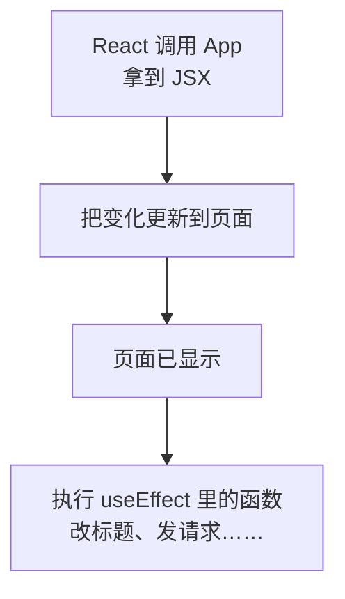
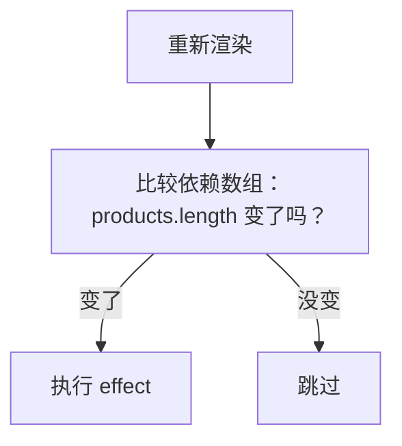
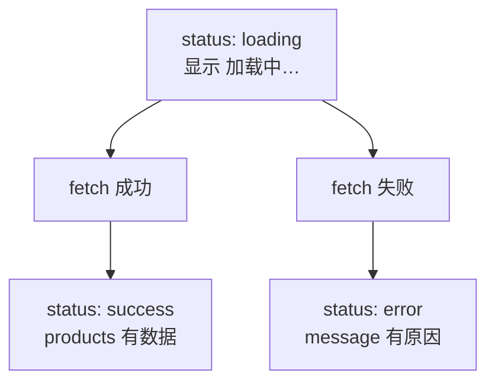

# 第 7 章 从接口加载数据

## 这一章解决什么问题

真实系统里，产品数据来自服务器，不是写死在代码里。页面打开后要自动去取数据；取的过程中显示「加载中…」，取失败了显示原因。本章从项目里的 `public/products.json` 加载数据（不用启动后端），换成真正的接口地址时写法相同。

## 开始之前

- 上一章你已经会了：受控输入框、表单提交、派生值。
- 起点代码：仓库 `code/ch06/price-list`。在 `D:\react-study\price-list` 执行 `npm run dev`。
- 本章要用浏览器开发者工具的「控制台」和「网络（Network）」两个标签。
- 预计耗时：60 分钟。

## 正文

### 7.1 useEffect

**白话定义**：副作用（side effect）指渲染之外的操作，比如发请求、改浏览器标签页标题、启动定时器。`useEffect(函数)` 告诉 React：把页面画到屏幕上**之后**，再执行这个函数。

**业务场景**：标签页标题要显示「产品价格清单（5 种）」，方便同时开多个系统页面时分辨。标题在 React 管理的 `#root` 之外，改它就是副作用。

**反例（什么时候不该用）**：能在渲染时直接算出来的值不要用 `useEffect`。比如「库存总金额」，直接 `const total = ...` 算就行。如果写成「`useEffect` 里算好再 `setTotal`」，页面会先显示旧值、再渲染一次显示新值，代码也多一倍。只有要和 React 之外的东西打交道（网络、浏览器 API）时才用它。

#### 🖼 图解



#### 💻 最小可运行代码

用下面的内容整个替换 `src/App.tsx`。和第 6 章相比改了两处：第一行 import 多了 `useEffect`；`const [products, setProducts] = ...` 下面多了一段 `useEffect(...)`。

```tsx
// src/App.tsx（7.1 版本，7.2 节会再改）
import { useEffect, useState } from 'react'
import type { Product } from './types.ts'
import { initialProducts } from './data.ts'
import { PageHeader } from './components/PageHeader.tsx'
import { PageFooter } from './components/PageFooter.tsx'
import { ProductForm } from './components/ProductForm.tsx'

function App() {
  // 尖括号里写明 state 的类型：Product 数组
  const [products, setProducts] = useState<Product[]>(initialProducts)

  // 副作用：修改浏览器标签页标题。React 先把页面画好，然后执行这个函数
  useEffect(() => {
    console.log('effect 执行：更新标题')
    document.title = `产品价格清单（${products.length} 种）`
  })

  function handleDelete(id: number) {
    // filter 返回一个新数组，原数组不动
    setProducts(products.filter((p) => p.id !== id))
  }

  function handleRestock(id: number) {
    // map 返回新数组；要改的那一行用 { ...p, stock: 新值 } 生成新对象，其余行原样保留
    setProducts(products.map((p) => (p.id === id ? { ...p, stock: p.stock + 1 } : p)))
  }

  return (
    <main>
      <PageHeader />
      <p>共 {products.length} 种产品</p>
      {/* 条件 ? A : B：二选一。列表空了显示提示，否则显示表格 */}
      {products.length === 0 ? (
        <p className="empty">暂无产品</p>
      ) : (
        <table className="product-table">
          <thead>
            <tr>
              <th>编号</th>
              <th>名称</th>
              <th>单价（元）</th>
              <th>库存</th>
              <th>操作</th>
            </tr>
          </thead>
          <tbody>
            {products.map((p) => (
              <tr key={p.id}>
                <td>{p.code}</td>
                <td>
                  {p.name}
                  {/* 条件 && A：条件成立才显示 A，否则什么都不显示 */}
                  {p.stock === 0 && <span className="out-of-stock">缺货</span>}
                </td>
                <td>{p.price.toLocaleString()}</td>
                {/* 库存少于 5 用红色提醒：三元表达式也可以用在属性上 */}
                <td className={p.stock < 5 ? 'low' : undefined}>{p.stock}</td>
                <td>
                  {/* 要把 p.id 传进去，所以包一层箭头函数，点击时才执行 */}
                  <button type="button" onClick={() => handleRestock(p.id)}>入库 +1</button>{' '}
                  <button type="button" onClick={() => handleDelete(p.id)}>删除</button>
                </td>
              </tr>
            ))}
          </tbody>
        </table>
      )}
      {/* 第 6 章：表单先独立工作，第 8 章再把录入的产品加进上面的表格 */}
      <ProductForm />
      <PageFooter />
    </main>
  )
}

export default App
```

`useEffect` 的参数是一个函数（这里写成箭头函数 `() => { ... }`）。React 不会马上执行它，而是记下来，等这次渲染的结果显示到页面上之后再调用。

#### 🔍 拆解运行结果

实测：

| 操作 | 标签页标题 | 控制台 |
| --- | --- | --- |
| 刷新页面 | 产品价格清单（5 种） | `effect 执行：更新标题` 两行 |
| 点任意一行「入库 +1」 | 不变 | 多一行 |
| 在下面的表单里打字 | 不变 | 不多 |

- 刷新后打印两行：开发模式下 `StrictMode` 会把组件「装上 → 拆掉 → 再装上」，effect 因此执行两次。这是故意的，用来检查你的 effect 被执行两次时会不会出问题，打包后只执行一次。
- 点「入库 +1」也打印：没写第二个参数时，**每次 App 重新渲染后**都会执行 effect。库存变了，产品数量并没变，这次执行是多余的。
- 在表单里打字不打印：state 在 `ProductForm` 里，只有 `ProductForm` 重新渲染，`App` 没有。

#### 改坏一处试试

把 `document.title = ...` 从 `useEffect` 里拿出来，直接写在组件函数体里。标题照样能改，但这是在**渲染过程中**操作外部世界：组件函数可能被调用多次，而且这时页面还没真正更新。改一下标题看不出问题，换成发请求，就会每次渲染发一次。改回去。

### 7.2 依赖数组

**白话定义**：`useEffect` 的第二个参数叫依赖数组（dependency array），列出 effect 用到的、会变化的值。React 每次渲染后比较这些值，**有变化才执行** effect。

**业务场景**：标题只和「产品数量」有关，所以依赖是 `[products.length]`：入库不会触发，删除才会。加载数据只需要在页面打开时做一次，依赖写 `[]`。

**反例（什么时候不该用）**：不要为了「少执行几次」故意不写 effect 里用到的值。比如 effect 用了 `products.length`，依赖却写 `[]`，删除产品后标题就不会更新了。执行 `npm run lint` 能查出来，会给出警告 `react-hooks(exhaustive-deps): React Hook useEffect has a missing dependency: 'products.length'`。

| 写法 | 什么时候执行 |
| --- | --- |
| `useEffect(fn)` 不写第二个参数 | 每次渲染后 |
| `useEffect(fn, [])` | 只在组件第一次显示后（开发模式下会多一次） |
| `useEffect(fn, [a, b])` | 第一次显示后，以及之后 `a` 或 `b` 变化后 |

#### 🖼 图解



#### 💻 最小可运行代码

用下面的内容整个替换 `src/App.tsx`。和 7.1 相比只改了 effect 的结尾：`})` 变成了 `}, [products.length])`，前面加了一行注释。

```tsx
// src/App.tsx（7.2 版本，7.3 节会再改）
import { useEffect, useState } from 'react'
import type { Product } from './types.ts'
import { initialProducts } from './data.ts'
import { PageHeader } from './components/PageHeader.tsx'
import { PageFooter } from './components/PageFooter.tsx'
import { ProductForm } from './components/ProductForm.tsx'

function App() {
  // 尖括号里写明 state 的类型：Product 数组
  const [products, setProducts] = useState<Product[]>(initialProducts)

  // 副作用：修改浏览器标签页标题。React 先把页面画好，然后执行这个函数
  useEffect(() => {
    console.log('effect 执行：更新标题')
    document.title = `产品价格清单（${products.length} 种）`
    // 依赖数组：只有 products.length 变了，才再次执行
  }, [products.length])

  function handleDelete(id: number) {
    // filter 返回一个新数组，原数组不动
    setProducts(products.filter((p) => p.id !== id))
  }

  function handleRestock(id: number) {
    // map 返回新数组；要改的那一行用 { ...p, stock: 新值 } 生成新对象，其余行原样保留
    setProducts(products.map((p) => (p.id === id ? { ...p, stock: p.stock + 1 } : p)))
  }

  return (
    <main>
      <PageHeader />
      <p>共 {products.length} 种产品</p>
      {/* 条件 ? A : B：二选一。列表空了显示提示，否则显示表格 */}
      {products.length === 0 ? (
        <p className="empty">暂无产品</p>
      ) : (
        <table className="product-table">
          <thead>
            <tr>
              <th>编号</th>
              <th>名称</th>
              <th>单价（元）</th>
              <th>库存</th>
              <th>操作</th>
            </tr>
          </thead>
          <tbody>
            {products.map((p) => (
              <tr key={p.id}>
                <td>{p.code}</td>
                <td>
                  {p.name}
                  {/* 条件 && A：条件成立才显示 A，否则什么都不显示 */}
                  {p.stock === 0 && <span className="out-of-stock">缺货</span>}
                </td>
                <td>{p.price.toLocaleString()}</td>
                {/* 库存少于 5 用红色提醒：三元表达式也可以用在属性上 */}
                <td className={p.stock < 5 ? 'low' : undefined}>{p.stock}</td>
                <td>
                  {/* 要把 p.id 传进去，所以包一层箭头函数，点击时才执行 */}
                  <button type="button" onClick={() => handleRestock(p.id)}>入库 +1</button>{' '}
                  <button type="button" onClick={() => handleDelete(p.id)}>删除</button>
                </td>
              </tr>
            ))}
          </tbody>
        </table>
      )}
      {/* 第 6 章：表单先独立工作，第 8 章再把录入的产品加进上面的表格 */}
      <ProductForm />
      <PageFooter />
    </main>
  )
}

export default App
```

#### 🔍 拆解运行结果

实测：刷新后仍打印两行（StrictMode）；点「入库 +1」**不再打印**；删除一行，打印一行，标题变成「产品价格清单（4 种）」。

React 比较依赖时用的是 `Object.is`，可以理解为 `===`：数字、字符串按值比较；数组、对象按「是不是同一个」比较。所以依赖里放数组时，每次生成新数组都算变化。

#### 改坏一处试试

把依赖改成 `[]`，删除一行。标题还停在「5 种」：effect 只执行过一次，后来的变化它不知道。这时执行 `npm run lint`，Oxlint 会警告 `React Hook useEffect has a missing dependency`。改回 `[products.length]`。

### 7.3 用判别联合表示加载状态

**白话定义**：判别联合（discriminated union）是 TypeScript 的一种类型写法：用 `|` 列出几种情况，每种情况都有一个同名字段（这里叫 `status`）取不同的固定值。检查了 `status` 之后，TypeScript 就知道当前是哪种情况、有哪些字段。

**业务场景**：加载数据只有三种情况：加载中（什么数据都没有）、出错（有错误信息）、成功（有产品列表）。用判别联合写，「加载中却有产品列表」这种不可能的组合在类型上就写不出来。

**反例（什么时候不该用）**：只有「有 / 没有」两种情况、也不带额外数据时（比如上一章的 `triedSubmit`），一个 `boolean` 就够了，不要硬造 `{ status: 'yes' } | { status: 'no' }`。

如果不用判别联合，常见写法是三个独立的 state：

| 写法 | 问题 |
| --- | --- |
| `loading`、`error`、`products` 三个 state | 要记得同时改三个；漏改一个就会出现「已加载完却还显示加载中」 |
| 一个 `LoadState` 判别联合 | 一次 `setState` 就切换到另一种情况，不可能处于两种情况之间 |

#### 🖼 图解



#### 先认识 fetch 和 async/await

加载数据要用到三样 JavaScript 自带的东西。它们不是 React 的概念，但本节代码离不开，先讲清楚。

**fetch**：浏览器自带的函数，向一个地址发 HTTP 请求。`fetch('/products.json')` 就是 GET 这个地址。

**Promise 和 await**：网络请求需要时间，`fetch` 不会停在那里等结果，而是马上返回一个 Promise（「承诺」，表示一个将来才有的结果）。在 Promise 前面写 `await`，代码就会在这一行「暂停」，等结果回来再往下执行，写起来像是按顺序执行的。`await` 只能写在 `async` 函数里：

```ts
// 示意代码，不用放进项目
async function load() {
  const response = await fetch('/products.json') // 等服务器响应
  const products = await response.json() // 等把响应内容解析成数组
  console.log(products.length)
}
```

「暂停」只暂停这个 `async` 函数，页面并不会卡住。实测在浏览器控制台里依次执行「打印 1 → 发 `fetch`（不 await）并在回来后打印 3 → 打印 2」，输出顺序是：

```text
1 开始 | 2 fetch 之后的下一行 | 3 响应回来了
```

`fetch` 后面的代码先跑完了，响应到了才执行打印 3 的那一段。这就是为什么组件函数里不能「等数据」：React 要求组件函数马上返回 JSX，所以先显示「加载中…」，数据回来后再用 `setState` 触发重新渲染。

**Response**：`await fetch(...)` 得到一个 Response（响应）对象，常用的几样：

| 写法 | 含义 | 实测（开发服务器） |
| --- | --- | --- |
| `response.status` | HTTP 状态码 | `products.json` 是 `200` |
| `response.ok` | 状态码在 200–299 之间时为 `true` | `true` |
| `await response.json()` | 把响应内容按 JSON 解析成对象或数组 | 得到 5 个产品的数组 |

**try / catch**：`await` 等到的如果是失败（比如网络断了，或者 `json()` 解析不了），会抛出错误。用 `try { ... } catch (err) { ... }` 接住，在 `catch` 里把错误显示给用户。实测请求一个连不上的地址，抛出的是 `TypeError: Failed to fetch`。注意：服务器返回 404、500 这类状态码时 `fetch` **不会**抛错，只是 `response.ok` 为 `false`，所以下面的代码要自己检查 `ok`，不对就 `throw new Error(...)` 主动抛出。

#### 💻 最小可运行代码

**① 准备数据文件。** 新建 `public/products.json`，内容就是 `src/data.ts` 里的 5 个产品，改成 JSON 格式（属性名加双引号）：

```json
[
  { "id": 1, "code": "P-001", "name": "凸阵探头 C5-2", "category": "探头", "price": 12800, "stock": 6 },
  { "id": 2, "code": "P-002", "name": "线阵探头 L12-5", "category": "探头", "price": 15600, "stock": 3 },
  { "id": 3, "code": "H-001", "name": "便携彩超主机", "category": "主机", "price": 168000, "stock": 2 },
  { "id": 4, "code": "C-001", "name": "耦合剂 250ml", "category": "耗材", "price": 18, "stock": 120 },
  { "id": 5, "code": "C-002", "name": "探头保护套", "category": "耗材", "price": 6.5, "stock": 0 }
]
```

`public/` 里的文件不经过翻译，开发服务器原样提供：`public/products.json` 的地址就是 `http://localhost:5173/products.json`，可以直接在浏览器里打开看。删除 `src/data.ts`，以后不再用它。

**② 用下面的内容整个替换 `src/App.tsx`：**

```tsx
// src/App.tsx
import { useEffect, useState } from 'react'
import type { ReactNode } from 'react'
import type { Product } from './types.ts'
import { PageHeader } from './components/PageHeader.tsx'
import { PageFooter } from './components/PageFooter.tsx'
import { ProductForm } from './components/ProductForm.tsx'

// 判别联合：三种情况各自带不同的数据，用 status 区分。
// 「加载中却有产品列表」「成功却有错误信息」这种自相矛盾的组合根本写不出来
type LoadState =
  | { status: 'loading' }
  | { status: 'error'; message: string }
  | { status: 'success'; products: Product[] }

function App() {
  const [state, setState] = useState<LoadState>({ status: 'loading' })

  // 依赖数组为空 []：只在组件第一次显示到页面上之后执行一次
  useEffect(() => {
    // 组件被移除后（或开发模式下第一次被 StrictMode 拆掉后）不再更新 state
    let ignore = false

    async function load() {
      try {
        // 模拟慢网络，便于看到「加载中」。正式代码删掉这一行
        await new Promise((resolve) => setTimeout(resolve, 1000))
        // 以 / 开头：从网站根目录取，对应项目里的 public/products.json
        const response = await fetch('/products.json')
        if (!response.ok) {
          throw new Error(`服务器返回 ${response.status}`)
        }
        // response.json() 的类型是 Promise<any>，马上标注成 Product[]，不让 any 往下传
        const products: Product[] = await response.json()
        if (!ignore) {
          setState({ status: 'success', products })
        }
      } catch (err) {
        if (!ignore) {
          // catch 到的东西类型是 unknown，确认是 Error 才能读 message
          setState({ status: 'error', message: err instanceof Error ? err.message : String(err) })
        }
      }
    }

    console.log('effect 执行：开始加载')
    load()

    // 清理函数：下次执行这个 effect 之前、或组件被移除时，React 会调用它
    return () => {
      ignore = true
    }
  }, [])

  // 成功时才有产品数量；其他状态算 0
  const count = state.status === 'success' ? state.products.length : 0

  useEffect(() => {
    document.title = `产品价格清单（${count} 种）`
  }, [count])

  function handleDelete(id: number) {
    // 先确认是 success，TypeScript 才允许读 state.products
    if (state.status !== 'success') return
    setState({ status: 'success', products: state.products.filter((p) => p.id !== id) })
  }

  function handleRestock(id: number) {
    if (state.status !== 'success') return
    setState({
      status: 'success',
      products: state.products.map((p) => (p.id === id ? { ...p, stock: p.stock + 1 } : p)),
    })
  }

  // 情况多时，在 return 之前用 if 算好要显示的内容，JSX 里只放结果
  let content: ReactNode
  if (state.status === 'loading') {
    content = <p>加载中…</p>
  } else if (state.status === 'error') {
    content = <p className="error">加载失败：{state.message}</p>
  } else if (state.products.length === 0) {
    content = <p className="empty">暂无产品</p>
  } else {
    content = (
      <table className="product-table">
        <thead>
          <tr>
            <th>编号</th>
            <th>名称</th>
            <th>单价（元）</th>
            <th>库存</th>
            <th>操作</th>
          </tr>
        </thead>
        <tbody>
          {state.products.map((p) => (
            <tr key={p.id}>
              <td>{p.code}</td>
              <td>
                {p.name}
                {p.stock === 0 && <span className="out-of-stock">缺货</span>}
              </td>
              <td>{p.price.toLocaleString()}</td>
              <td className={p.stock < 5 ? 'low' : undefined}>{p.stock}</td>
              <td>
                <button type="button" onClick={() => handleRestock(p.id)}>入库 +1</button>{' '}
                <button type="button" onClick={() => handleDelete(p.id)}>删除</button>
              </td>
            </tr>
          ))}
        </tbody>
      </table>
    )
  }

  return (
    <main>
      <PageHeader />
      <p>共 {count} 种产品</p>
      {content}
      <ProductForm />
      <PageFooter />
    </main>
  )
}

export default App
```

#### 🔍 拆解运行结果

刷新页面：先显示「共 0 种产品」「加载中…」，约 1 秒后出现 5 行表格，标题变成「产品价格清单（5 种）」。控制台打印两次 `effect 执行：开始加载`，「网络」标签里有**两次** `products.json` 请求。

| 现象 / 代码 | 说明 |
| --- | --- |
| 两次请求 | StrictMode 让 effect 执行了两次。第一次执行后组件被拆掉，清理函数把那一次的 `ignore` 设成 `true`，所以它的结果被丢弃，只有第二次的结果写进 state。正式版本只请求一次 |
| `async function load()` 写在 effect 里面 | effect 函数本身不能是 `async`，因为它只能返回清理函数或什么都不返回，`async` 函数会返回 Promise |
| `if (state.status !== 'success') return` | 收窄（narrowing）：这行之后 TypeScript 知道 `state` 是成功的那种，才允许读 `state.products` |
| `const products: Product[] = await response.json()` | 这里是**信任**服务器返回的格式，TypeScript 不会在运行时检查。字段名对不上时页面会显示空白单元格，不会报错 |

**改坏一处试试（类型）：**

- 删掉 `handleDelete` 里的 `if (state.status !== 'success') return`，报 `TS2339: Property 'products' does not exist on type 'LoadState'. Property 'products' does not exist on type '{ status: "loading"; }'.`
- 把 `'loading'` 拼成 `'loadding'`，报 `TS2367: This comparison appears to be unintentional because the types '"error" | "loading" | "success"' and '"loadding"' have no overlap.`
- 把 `useEffect(() => {` 写成 `useEffect(async () => {`，报 `TS2345: Argument of type '() => Promise<void>' is not assignable to parameter of type 'EffectCallback'.`

#### 改坏一处试试（运行）

**① 地址拼错。** 把 `fetch('/products.json')` 改成 `fetch('/product.json')`。实测页面显示：

```text
加载失败：Unexpected token '<', "<!doctype "... is not valid JSON
```

不是 404。开发服务器找不到文件时，返回的是 `index.html`（状态码 200），`response.json()` 解析 HTML 时出错。实测把 `public/products.json` 删掉也是同样的报错。部署到正式服务器后（第 10 章），找不到文件通常返回 404，显示的就是「加载失败：服务器返回 404」。看到这句 `<!doctype` 的报错，先查地址。

**② 忘了写依赖数组。** 把加载数据那个 effect 结尾的 `}, [])` 改成 `})`。实测 6 秒内「网络」里出现 6 次 `products.json` 请求，并且一直增加：加载成功 → `setState` 触发渲染 → 没有依赖数组，每次渲染后都执行 → 又发请求……改回 `[]`。

## ⚠️ 踩坑警告

| 现象 | 原因 | 怎么改 |
| --- | --- | --- |
| 开发时每个请求都发了两次 | StrictMode 故意让 effect 执行两次 | 正常现象，正式版本只有一次。写好清理函数（`ignore = true`），保证重复执行也不出错 |
| 请求不停地发 | effect 里调用了 `setState`，又没写依赖数组；或者依赖里放了每次渲染都新生成的对象/数组 | 只需加载一次就写 `[]`；依赖只放原始值（数字、字符串）或确实会变的 state |
| `加载失败：Unexpected token '<', "<!doctype "... is not valid JSON` | 地址写错，开发服务器返回了 `index.html` | 核对 `fetch` 的地址，并在浏览器里直接打开这个地址看返回什么 |
| `catch (err)` 里写 `err.message` 报 `TS18046: 'err' is of type 'unknown'.` | JavaScript 能 `throw` 任何值，TypeScript 把 `catch` 到的东西当作 `unknown` | 先判断 `err instanceof Error` 再读 `message` |
| 产品表格里某一列全是空白，或者报 `Cannot read properties of undefined` | JSON 里的字段名和 `Product` 类型对不上（例如 `productName`），而 `response.json()` 的结果是 `any` 加类型标注，运行时不检查 | 在浏览器里打开接口地址，核对字段名 |

## 🎯 动手练习

**练习 1：出错后可以重试**

加载失败时，错误信息后面显示「重试」按钮。点了以后页面先显示「加载中…」，然后重新请求一次。

验收标准：

- 把地址临时改成 `/product.json`，页面显示错误和「重试」按钮。
- 点「重试」，先显示「加载中…」，约 1 秒后再次显示错误，「网络」里多了**一次** `product.json` 请求。
- 地址改回来后，页面正常加载。

提示：再加一个数字 state，把它放进加载数据那个 effect 的依赖数组；点「重试」时让它加 1。

**练习 2：显示库存总金额**

加载成功后，在表格上面显示「库存总金额：461,760 元」（每个产品单价 × 库存，再相加）。

验收标准：

- 刷新后显示 `库存总金额：461,760 元`。
- 删除「耦合剂 250ml」后变成 `459,600 元`。
- 没有新增 state，也没有新增 `useEffect`。

卡住了看文末参考答案。

## 📌 一句话总结

请求放进 useEffect 并写对依赖，加载状态用判别联合，三种情况互不混淆。

## 下一章

表单录入的产品还没进表格，取数代码也全挤在 `App` 里。第 8 章把它们拆开并连起来。

---

<!-- 以下是参考答案，先自己动手，卡住了再往下翻 -->


## 参考答案

两个练习都改 `App.tsx`，下面是都做完后的版本。

### 练习 1

思路：effect 只在依赖变化时重新执行，所以加一个专门用来「触发重新加载」的 `reloadKey`，点「重试」时加 1。同时先把状态切回 `loading`，页面才会显示「加载中…」。

### 练习 2

思路：总金额是派生值，用数组的 `reduce` 方法累加：`reduce((sum, p) => sum + p.price * p.stock, 0)` 从 0 开始，每个产品加上一次。只有 `success` 分支里才有 `state.products`，所以在这个分支里算。表格上面多了一个 `<p>`，两个元素并列，用 Fragment 包住。

```tsx
// src/App.tsx
// 两个练习都做完后的版本
import { useEffect, useState } from 'react'
import type { ReactNode } from 'react'
import type { Product } from './types.ts'
import { PageHeader } from './components/PageHeader.tsx'
import { PageFooter } from './components/PageFooter.tsx'
import { ProductForm } from './components/ProductForm.tsx'

// 判别联合：三种情况各自带不同的数据，用 status 区分。
// 「加载中却有产品列表」「成功却有错误信息」这种自相矛盾的组合根本写不出来
type LoadState =
  | { status: 'loading' }
  | { status: 'error'; message: string }
  | { status: 'success'; products: Product[] }

function App() {
  const [state, setState] = useState<LoadState>({ status: 'loading' })
  // 练习 1：每点一次「重试」加 1。它在依赖数组里，变了 effect 就重新执行
  const [reloadKey, setReloadKey] = useState(0)

  // 依赖 reloadKey：第一次显示时执行一次，之后 reloadKey 每变一次再执行一次
  useEffect(() => {
    // 组件被移除后（或开发模式下第一次被 StrictMode 拆掉后）不再更新 state
    let ignore = false

    async function load() {
      try {
        // 模拟慢网络，便于看到「加载中」。正式代码删掉这一行
        await new Promise((resolve) => setTimeout(resolve, 1000))
        // 以 / 开头：从网站根目录取，对应项目里的 public/products.json
        const response = await fetch('/products.json')
        if (!response.ok) {
          throw new Error(`服务器返回 ${response.status}`)
        }
        // response.json() 的类型是 Promise<any>，马上标注成 Product[]，不让 any 往下传
        const products: Product[] = await response.json()
        if (!ignore) {
          setState({ status: 'success', products })
        }
      } catch (err) {
        if (!ignore) {
          // catch 到的东西类型是 unknown，确认是 Error 才能读 message
          setState({ status: 'error', message: err instanceof Error ? err.message : String(err) })
        }
      }
    }

    console.log('effect 执行：开始加载')
    load()

    // 清理函数：下次执行这个 effect 之前、或组件被移除时，React 会调用它
    return () => {
      ignore = true
    }
  }, [reloadKey])

  // 练习 1：先切回「加载中」，再让 effect 重新执行
  function handleRetry() {
    setState({ status: 'loading' })
    setReloadKey(reloadKey + 1)
  }

  // 成功时才有产品数量；其他状态算 0
  const count = state.status === 'success' ? state.products.length : 0

  useEffect(() => {
    document.title = `产品价格清单（${count} 种）`
  }, [count])

  function handleDelete(id: number) {
    // 先确认是 success，TypeScript 才允许读 state.products
    if (state.status !== 'success') return
    setState({ status: 'success', products: state.products.filter((p) => p.id !== id) })
  }

  function handleRestock(id: number) {
    if (state.status !== 'success') return
    setState({
      status: 'success',
      products: state.products.map((p) => (p.id === id ? { ...p, stock: p.stock + 1 } : p)),
    })
  }

  // 情况多时，在 return 之前用 if 算好要显示的内容，JSX 里只放结果
  let content: ReactNode
  if (state.status === 'loading') {
    content = <p>加载中…</p>
  } else if (state.status === 'error') {
    content = (
      <p className="error">
        加载失败：{state.message}{' '}
        <button type="button" onClick={handleRetry}>重试</button>
      </p>
    )
  } else if (state.products.length === 0) {
    content = <p className="empty">暂无产品</p>
  } else {
    // 练习 2：只有 success 分支里才能读 state.products，所以在这里算
    const totalValue = state.products.reduce((sum, p) => sum + p.price * p.stock, 0)
    content = (
      <>
        <p>库存总金额：{totalValue.toLocaleString()} 元</p>
        <table className="product-table">
          <thead>
            <tr>
              <th>编号</th>
              <th>名称</th>
              <th>单价（元）</th>
              <th>库存</th>
              <th>操作</th>
            </tr>
          </thead>
          <tbody>
            {state.products.map((p) => (
              <tr key={p.id}>
                <td>{p.code}</td>
                <td>
                  {p.name}
                  {p.stock === 0 && <span className="out-of-stock">缺货</span>}
                </td>
                <td>{p.price.toLocaleString()}</td>
                <td className={p.stock < 5 ? 'low' : undefined}>{p.stock}</td>
                <td>
                  <button type="button" onClick={() => handleRestock(p.id)}>入库 +1</button>{' '}
                  <button type="button" onClick={() => handleDelete(p.id)}>删除</button>
                </td>
              </tr>
            ))}
          </tbody>
        </table>
      </>
    )
  }

  return (
    <main>
      <PageHeader />
      <p>共 {count} 种产品</p>
      {content}
      <ProductForm />
      <PageFooter />
    </main>
  )
}

export default App
```
