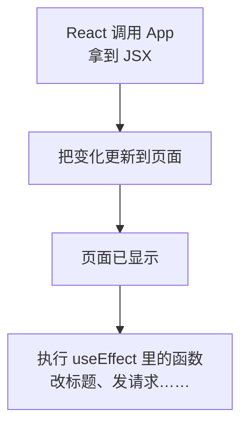

# 第 7A 章 useEffect：页面显示之后再做的事

## 这一章解决什么问题

浏览器标签页的标题要显示「产品价格清单（5 种）」，删掉一种就变成「4 种」，方便同时开多个系统页面时分辨。标题在 React 管理的 `#root` 之外，组件的 JSX 管不到它，得用代码去改 `document.title`。这类「渲染之外的操作」要放在 `useEffect` 里。本章先用改标题这个最简单的例子认识 `useEffect`，第 7C 章再用它加载数据。

本章只讲一个技术点：**`useEffect`**。

## 开始之前

- 上一章你已经会了：受控输入框、表单提交、派生值。
- 起点代码：仓库 `code/ch06C/price-list`（不含练习答案）。在 `D:\react-study\price-list` 执行 `npm run dev`。
- 本章要用浏览器开发者工具的「控制台」：按 `F12`，切到「控制台（Console）」标签。
- 预计耗时：20 分钟。

## 正文

### 7A.1 副作用和 useEffect 是什么

**白话定义**：副作用（side effect）指渲染之外的操作，比如发请求、改浏览器标签页标题、启动定时器。`useEffect(函数)` 告诉 React：把页面画到屏幕上**之后**，再执行这个函数。

**业务场景**：标签页标题要显示「产品价格清单（5 种）」。标题在 React 管理的 `#root` 之外，改它就是副作用。

**反例（什么时候不该用）**：能在渲染时直接算出来的值不要用 `useEffect`。比如「库存总金额」，直接 `const total = ...` 算就行。如果写成「`useEffect` 里算好再 `setTotal`」，页面会先显示旧值、再渲染一次显示新值，代码也多一倍。只有要和 React 之外的东西打交道（网络、浏览器 API）时才用它。

#### 🖼 图解



### 7A.2 用 useEffect 改标题

#### 💻 最小可运行代码

用下面的内容整个替换 `src/App.tsx`。和第 6C 章相比改了两处：第一行 import 多了 `useEffect`；`const [products, setProducts] = ...` 下面多了一段 `useEffect(...)`。

```tsx
// src/App.tsx
import { useEffect, useState } from 'react'
import type { Product } from './types.ts'
import { initialProducts } from './data.ts'
import { PageHeader } from './components/PageHeader.tsx'
import { PageFooter } from './components/PageFooter.tsx'
import { ProductForm } from './components/ProductForm.tsx'

function App() {
  // 尖括号里写明 state 的类型：Product 数组
  const [products, setProducts] = useState<Product[]>(initialProducts)

  // 副作用：修改浏览器标签页标题。React 先把页面画好，然后执行这个函数
  useEffect(() => {
    console.log('effect 执行：更新标题')
    document.title = `产品价格清单（${products.length} 种）`
  })

  function handleDelete(id: number) {
    // filter 返回一个新数组，原数组不动
    setProducts(products.filter((p) => p.id !== id))
  }

  function handleRestock(id: number) {
    // map 返回新数组；要改的那一行用 { ...p, stock: 新值 } 生成新对象，其余行原样保留
    setProducts(products.map((p) => (p.id === id ? { ...p, stock: p.stock + 1 } : p)))
  }

  return (
    <main>
      <PageHeader />
      <p>共 {products.length} 种产品</p>
      {/* 条件 ? A : B：二选一。列表空了显示提示，否则显示表格 */}
      {products.length === 0 ? (
        <p className="empty">暂无产品</p>
      ) : (
        <table className="product-table">
          <thead>
            <tr>
              <th>编号</th>
              <th>名称</th>
              <th>单价（元）</th>
              <th>库存</th>
              <th>操作</th>
            </tr>
          </thead>
          <tbody>
            {products.map((p) => (
              <tr key={p.id}>
                <td>{p.code}</td>
                <td>
                  {p.name}
                  {/* 条件 && A：条件成立才显示 A，否则什么都不显示 */}
                  {p.stock === 0 && <span className="out-of-stock">缺货</span>}
                </td>
                <td>{p.price.toLocaleString()}</td>
                {/* 库存少于 5 用红色提醒：三元表达式也可以用在属性上 */}
                <td className={p.stock < 5 ? 'low' : undefined}>{p.stock}</td>
                <td>
                  {/* 要把 p.id 传进去，所以包一层箭头函数，点击时才执行 */}
                  <button type="button" onClick={() => handleRestock(p.id)}>入库 +1</button>{' '}
                  <button type="button" onClick={() => handleDelete(p.id)}>删除</button>
                </td>
              </tr>
            ))}
          </tbody>
        </table>
      )}
      {/* 第 6 章：表单先独立工作，第 8A 章再把录入的产品加进上面的表格 */}
      <ProductForm />
      <PageFooter />
    </main>
  )
}

export default App
```

`useEffect` 的参数是一个函数（这里写成箭头函数 `() => { ... }`）。React 不会马上执行它，而是记下来，等这次渲染的结果显示到页面上之后再调用。

#### 🔍 拆解运行结果

实测：

| 操作 | 标签页标题 | 控制台 |
| --- | --- | --- |
| 刷新页面 | 产品价格清单（5 种） | `effect 执行：更新标题` 两行 |
| 点任意一行「入库 +1」 | 不变 | 多一行 |
| 在下面的表单里打字 | 不变 | 不多 |

- 刷新后打印两行：开发模式下 `StrictMode` 会把组件「装上 → 拆掉 → 再装上」，effect 因此执行两次。这是故意的，用来检查你的 effect 被执行两次时会不会出问题，打包后只执行一次。
- 点「入库 +1」也打印：没写第二个参数时，**每次 App 重新渲染后**都会执行 effect。库存变了，产品数量并没变，这次执行是多余的，下一章解决。
- 在表单里打字不打印：state 在 `ProductForm` 里，只有 `ProductForm` 重新渲染，`App` 没有（第 4C 章讲过渲染的范围）。

#### 改坏一处试试

**① 不放进 useEffect。** 把 `document.title = ...` 从 `useEffect` 里拿出来，直接写在组件函数体里。标题照样能改，但这是在**渲染过程中**操作外部世界：组件函数可能被调用多次，而且这时页面还没真正更新。改一下标题看不出问题，换成发请求，就会每次渲染发一次。改回去。

**② 忘了导入。** 第一行改回 `import { useState } from 'react'`，`npx tsc -b` 报：

```text
src/App.tsx(14,3): error TS2304: Cannot find name 'useEffect'.
```

改回去。

## ⚠️ 踩坑警告

| 现象 | 原因 | 怎么改 |
| --- | --- | --- |
| 把 effect 简写成 `useEffect(() => document.title = ...)`，报 `TS2322: Type 'string' is not assignable to type 'void \| Destructor'.` | 箭头函数省略花括号时会**返回**右边的值。effect 函数只能返回「清理函数」或什么都不返回（第 7C 章讲清理函数），这里返回了一个字符串 | 函数体用花括号：`useEffect(() => { document.title = ... })` |
| 开发时 effect 里的 `console.log` 每次刷新打印两次 | `StrictMode` 故意把组件装上、拆掉、再装上 | 正常现象，打包后只执行一次 |
| 本来能直接算的值，写成了「effect 里算好再 setState」，页面闪一下才显示正确的数 | effect 在页面显示**之后**才执行，第一次显示的是旧值 | 能算出来的值直接在渲染时算（第 6C 章的派生值），不要用 effect |

## 🎯 动手练习

**练习 1：标题里加上缺货种数**

标签页标题改成「产品价格清单（5 种，缺货 1 种）」。缺货是指库存为 0。

验收标准：

- 刷新后标题是「产品价格清单（5 种，缺货 1 种）」。
- 给「探头保护套」点「入库 +1」后，标题变成「产品价格清单（5 种，缺货 0 种）」。

**练习 2：渲染中和渲染后**

在 `App` 函数体里（`useEffect` 外面）加一行 `console.log('App 渲染中')`，在 effect 里加一行 `console.log('App 渲染后')`，刷新页面。

验收标准：

- 能说出控制台里这几行的顺序，以及为什么各出现两次。

卡住了看文末参考答案。

## 📌 一句话总结

渲染之外的事放进 useEffect，它在页面显示之后执行。

## 下一章

现在每次 `App` 重新渲染都会执行 effect，点「入库 +1」也会改一次标题。第 7B 章用依赖数组告诉 React「什么变了才执行」。

---

<!-- 以下是参考答案，先自己动手，卡住了再往下翻 -->


## 参考答案

两个练习都改 `App.tsx`，下面是都做完后的版本。

### 练习 1

思路：缺货种数用 `filter` 挑出库存为 0 的产品，再取 `length`。

### 练习 2

思路：组件函数体里的代码在渲染时执行，effect 在页面显示之后执行。实测刷新后控制台：

```text
App 渲染中
App 渲染中
App 渲染后
App 渲染后
```

前两行：`StrictMode` 在开发模式下把每次渲染执行两次（第 4C 章）。后两行：`StrictMode` 把组件装上、拆掉、再装上，effect 跟着执行两次。两种「两次」都只在开发模式下出现。

```tsx
// src/App.tsx
// 两个练习都做完后的版本
import { useEffect, useState } from 'react'
import type { Product } from './types.ts'
import { initialProducts } from './data.ts'
import { PageHeader } from './components/PageHeader.tsx'
import { PageFooter } from './components/PageFooter.tsx'
import { ProductForm } from './components/ProductForm.tsx'

function App() {
  // 尖括号里写明 state 的类型：Product 数组
  const [products, setProducts] = useState<Product[]>(initialProducts)

  // 练习 2：组件函数体里的代码在渲染过程中执行
  console.log('App 渲染中')

  useEffect(() => {
    // 练习 2：effect 里的代码在页面显示之后执行
    console.log('App 渲染后')
    // 练习 1：缺货的种数
    const outOfStock = products.filter((p) => p.stock === 0).length
    document.title = `产品价格清单（${products.length} 种，缺货 ${outOfStock} 种）`
  })

  function handleDelete(id: number) {
    // filter 返回一个新数组，原数组不动
    setProducts(products.filter((p) => p.id !== id))
  }

  function handleRestock(id: number) {
    // map 返回新数组；要改的那一行用 { ...p, stock: 新值 } 生成新对象，其余行原样保留
    setProducts(products.map((p) => (p.id === id ? { ...p, stock: p.stock + 1 } : p)))
  }

  return (
    <main>
      <PageHeader />
      <p>共 {products.length} 种产品</p>
      {/* 条件 ? A : B：二选一。列表空了显示提示，否则显示表格 */}
      {products.length === 0 ? (
        <p className="empty">暂无产品</p>
      ) : (
        <table className="product-table">
          <thead>
            <tr>
              <th>编号</th>
              <th>名称</th>
              <th>单价（元）</th>
              <th>库存</th>
              <th>操作</th>
            </tr>
          </thead>
          <tbody>
            {products.map((p) => (
              <tr key={p.id}>
                <td>{p.code}</td>
                <td>
                  {p.name}
                  {/* 条件 && A：条件成立才显示 A，否则什么都不显示 */}
                  {p.stock === 0 && <span className="out-of-stock">缺货</span>}
                </td>
                <td>{p.price.toLocaleString()}</td>
                {/* 库存少于 5 用红色提醒：三元表达式也可以用在属性上 */}
                <td className={p.stock < 5 ? 'low' : undefined}>{p.stock}</td>
                <td>
                  {/* 要把 p.id 传进去，所以包一层箭头函数，点击时才执行 */}
                  <button type="button" onClick={() => handleRestock(p.id)}>入库 +1</button>{' '}
                  <button type="button" onClick={() => handleDelete(p.id)}>删除</button>
                </td>
              </tr>
            ))}
          </tbody>
        </table>
      )}
      {/* 第 6 章：表单先独立工作，第 8A 章再把录入的产品加进上面的表格 */}
      <ProductForm />
      <PageFooter />
    </main>
  )
}

export default App
```
