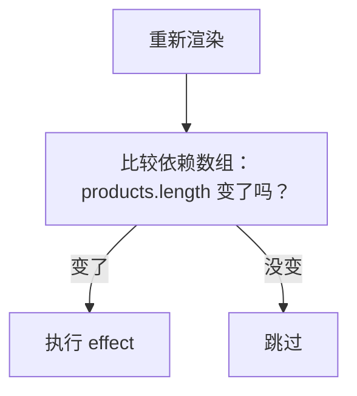

# 第 7B 章 依赖数组：什么变了才执行 effect

## 这一章解决什么问题

上一章的 effect 每次 `App` 重新渲染后都执行，点「入库 +1」也会改一次标题，可产品数量根本没变。改标题无所谓，但下一章要在 effect 里发网络请求，每次渲染都发一次就麻烦了。本章用 `useEffect` 的第二个参数，告诉 React「只有这些值变了才执行」。

本章只讲一个技术点：**依赖数组**。

## 开始之前

- 上一章你已经会了：用 `useEffect` 在页面显示之后改标题，`StrictMode` 下 effect 会执行两次。
- 起点代码：仓库 `code/ch07A/price-list`（不含练习答案）。在 `D:\react-study\price-list` 执行 `npm run dev`，打开「控制台」。
- 预计耗时：20 分钟。

## 正文

### 7B.1 依赖数组是什么

**白话定义**：`useEffect` 的第二个参数叫依赖数组（dependency array），列出 effect 用到的、会变化的值。React 每次渲染后比较这些值，**有变化才执行** effect。

**业务场景**：标题只和「产品数量」有关，所以依赖是 `[products.length]`：入库不会触发，删除才会。加载数据只需要在页面打开时做一次，依赖写 `[]`（下一章）。

**反例（什么时候不该用）**：不要为了「少执行几次」故意不写 effect 里用到的值。比如 effect 用了 `products.length`，依赖却写 `[]`，删除产品后标题就不会更新了。

| 写法 | 什么时候执行 |
| --- | --- |
| `useEffect(fn)` 不写第二个参数 | 每次渲染后 |
| `useEffect(fn, [])` | 只在组件第一次显示后（开发模式下会多一次） |
| `useEffect(fn, [a, b])` | 第一次显示后，以及之后 `a` 或 `b` 变化后 |

#### 🖼 图解



### 7B.2 只在数量变化时改标题

#### 💻 最小可运行代码

用下面的内容整个替换 `src/App.tsx`。和上一章相比只改了 effect 的结尾：`})` 变成了 `}, [products.length])`，前面加了一行注释。

```tsx
// src/App.tsx
import { useEffect, useState } from 'react'
import type { Product } from './types.ts'
import { initialProducts } from './data.ts'
import { PageHeader } from './components/PageHeader.tsx'
import { PageFooter } from './components/PageFooter.tsx'
import { ProductForm } from './components/ProductForm.tsx'

function App() {
  // 尖括号里写明 state 的类型：Product 数组
  const [products, setProducts] = useState<Product[]>(initialProducts)

  // 副作用：修改浏览器标签页标题。React 先把页面画好，然后执行这个函数
  useEffect(() => {
    console.log('effect 执行：更新标题')
    document.title = `产品价格清单（${products.length} 种）`
    // 依赖数组：只有 products.length 变了，才再次执行
  }, [products.length])

  function handleDelete(id: number) {
    // filter 返回一个新数组，原数组不动
    setProducts(products.filter((p) => p.id !== id))
  }

  function handleRestock(id: number) {
    // map 返回新数组；要改的那一行用 { ...p, stock: 新值 } 生成新对象，其余行原样保留
    setProducts(products.map((p) => (p.id === id ? { ...p, stock: p.stock + 1 } : p)))
  }

  return (
    <main>
      <PageHeader />
      <p>共 {products.length} 种产品</p>
      {/* 条件 ? A : B：二选一。列表空了显示提示，否则显示表格 */}
      {products.length === 0 ? (
        <p className="empty">暂无产品</p>
      ) : (
        <table className="product-table">
          <thead>
            <tr>
              <th>编号</th>
              <th>名称</th>
              <th>单价（元）</th>
              <th>库存</th>
              <th>操作</th>
            </tr>
          </thead>
          <tbody>
            {products.map((p) => (
              <tr key={p.id}>
                <td>{p.code}</td>
                <td>
                  {p.name}
                  {/* 条件 && A：条件成立才显示 A，否则什么都不显示 */}
                  {p.stock === 0 && <span className="out-of-stock">缺货</span>}
                </td>
                <td>{p.price.toLocaleString()}</td>
                {/* 库存少于 5 用红色提醒：三元表达式也可以用在属性上 */}
                <td className={p.stock < 5 ? 'low' : undefined}>{p.stock}</td>
                <td>
                  {/* 要把 p.id 传进去，所以包一层箭头函数，点击时才执行 */}
                  <button type="button" onClick={() => handleRestock(p.id)}>入库 +1</button>{' '}
                  <button type="button" onClick={() => handleDelete(p.id)}>删除</button>
                </td>
              </tr>
            ))}
          </tbody>
        </table>
      )}
      {/* 第 6 章：表单先独立工作，第 8 章再把录入的产品加进上面的表格 */}
      <ProductForm />
      <PageFooter />
    </main>
  )
}

export default App
```

#### 🔍 拆解运行结果

实测：刷新后仍打印两行（StrictMode）；点「入库 +1」**不再打印**；删除一行，打印一行，标题变成「产品价格清单（4 种）」。

React 比较依赖时用的是 `Object.is`，可以理解为 `===`：数字、字符串按值比较；数组、对象按「是不是同一个」比较。所以依赖里放数组时，每次生成新数组都算变化（练习 2）。

#### 改坏一处试试

把依赖改成 `[]`，删除一行。标题还停在「5 种」：effect 只执行过一次，后来的变化它不知道。这时执行 `npm run lint`，Oxlint 会警告：

```text
  ! react-hooks(exhaustive-deps): React Hook useEffect has a missing dependency: 'products.length'
    ,-[src/App.tsx:18:6]
 15 |     console.log('effect 执行：更新标题')
 16 |     document.title = `产品价格清单（${products.length} 种）`
    :                                       ^^^^|^^^
    :                                           `-- useEffect uses `products.length` here
 17 |     // 依赖数组：只有 products.length 变了，才再次执行
 18 |   }, [])
```

TypeScript 不检查依赖数组，`npx tsc -b` 不会报错，所以写完 effect 要跑一次 `npm run lint`。改回 `[products.length]`。

## ⚠️ 踩坑警告

| 现象 | 原因 | 怎么改 |
| --- | --- | --- |
| 数据变了，effect 没重新执行，标题停在旧值 | effect 用到的值没写进依赖数组 | 用到的、会变的值都写进去；执行 `npm run lint` 检查 `exhaustive-deps` 警告 |
| 依赖写了 `[products]`，点「入库 +1」也执行 | 入库用 `map` 生成了新数组，数组按「是不是同一个」比较，算变化 | 依赖尽量写真正关心的原始值，比如 `products.length` |
| effect 里又调用了 `setXxx`，依赖里也有这个 state，页面不停地重新渲染 | effect 改 state → 依赖变了 → 再执行 effect → 又改 state…… | effect 里改的 state 不要同时放进它自己的依赖；能算出来的值改用派生值 |

## 🎯 动手练习

**练习 1：标题里加上缺货种数，依赖写对**

标签页标题改成「产品价格清单（5 种，缺货 1 种）」。缺货种数在渲染时算好（派生值），effect 只负责写标题。依赖数组要写对：只在数量或缺货种数变化时执行。

验收标准：

- 给「凸阵探头」点「入库 +1」，控制台**不**打印 `effect 执行：更新标题`。
- 给「探头保护套」点「入库 +1」，打印一行，标题变成「产品价格清单（5 种，缺货 0 种）」。
- `npm run lint` 没有 `exhaustive-deps` 警告。

**练习 2：把依赖换成整个数组**

把依赖临时改成 `[products]`，点「凸阵探头」的「入库 +1」，看控制台。

验收标准：

- 能说出这次为什么打印了 `effect 执行：更新标题`，而 `[products.length]` 时不打印。
- 做完改回去。

卡住了看文末参考答案。

## 📌 一句话总结

依赖数组列出 effect 用到的会变的值，变了才执行，用 lint 检查漏写。

## 下一章

第 7C 章用 `useEffect` 加上 `[]` 做最常见的事：页面打开时从服务器加载数据。

---

<!-- 以下是参考答案，先自己动手，卡住了再往下翻 -->


## 参考答案

### 练习 1

思路：`outOfStock` 是派生值，在渲染时算好。effect 里用到了 `products.length` 和 `outOfStock` 两个会变的值，两个都写进依赖。入库凸阵探头时两个值都没变，effect 跳过；入库探头保护套时缺货种数从 1 变成 0，effect 执行。

```tsx
// src/App.tsx
// 练习 1 做完后的版本
import { useEffect, useState } from 'react'
import type { Product } from './types.ts'
import { initialProducts } from './data.ts'
import { PageHeader } from './components/PageHeader.tsx'
import { PageFooter } from './components/PageFooter.tsx'
import { ProductForm } from './components/ProductForm.tsx'

function App() {
  // 尖括号里写明 state 的类型：Product 数组
  const [products, setProducts] = useState<Product[]>(initialProducts)

  // 练习 1：缺货种数是派生值，在渲染时算好，effect 只负责把它写进标题
  const outOfStock = products.filter((p) => p.stock === 0).length

  useEffect(() => {
    console.log('effect 执行：更新标题')
    document.title = `产品价格清单（${products.length} 种，缺货 ${outOfStock} 种）`
    // effect 用到了两个会变的值，两个都要写进依赖数组
  }, [products.length, outOfStock])

  function handleDelete(id: number) {
    // filter 返回一个新数组，原数组不动
    setProducts(products.filter((p) => p.id !== id))
  }

  function handleRestock(id: number) {
    // map 返回新数组；要改的那一行用 { ...p, stock: 新值 } 生成新对象，其余行原样保留
    setProducts(products.map((p) => (p.id === id ? { ...p, stock: p.stock + 1 } : p)))
  }

  return (
    <main>
      <PageHeader />
      <p>共 {products.length} 种产品</p>
      {/* 条件 ? A : B：二选一。列表空了显示提示，否则显示表格 */}
      {products.length === 0 ? (
        <p className="empty">暂无产品</p>
      ) : (
        <table className="product-table">
          <thead>
            <tr>
              <th>编号</th>
              <th>名称</th>
              <th>单价（元）</th>
              <th>库存</th>
              <th>操作</th>
            </tr>
          </thead>
          <tbody>
            {products.map((p) => (
              <tr key={p.id}>
                <td>{p.code}</td>
                <td>
                  {p.name}
                  {/* 条件 && A：条件成立才显示 A，否则什么都不显示 */}
                  {p.stock === 0 && <span className="out-of-stock">缺货</span>}
                </td>
                <td>{p.price.toLocaleString()}</td>
                {/* 库存少于 5 用红色提醒：三元表达式也可以用在属性上 */}
                <td className={p.stock < 5 ? 'low' : undefined}>{p.stock}</td>
                <td>
                  {/* 要把 p.id 传进去，所以包一层箭头函数，点击时才执行 */}
                  <button type="button" onClick={() => handleRestock(p.id)}>入库 +1</button>{' '}
                  <button type="button" onClick={() => handleDelete(p.id)}>删除</button>
                </td>
              </tr>
            ))}
          </tbody>
        </table>
      )}
      {/* 第 6 章：表单先独立工作，第 8 章再把录入的产品加进上面的表格 */}
      <ProductForm />
      <PageFooter />
    </main>
  )
}

export default App
```

只写 `[products.length]` 时，`npm run lint` 报：

```text
  ! react-hooks(exhaustive-deps): React Hook useEffect has a missing dependency: 'outOfStock'
```

### 练习 2

不用写代码。实测改成 `[products]` 后，点「凸阵探头」的「入库 +1」，控制台打印了一行 `effect 执行：更新标题`。

`handleRestock` 用 `map` 生成了一个**新数组**（第 5B 章的不可变更新）。依赖按 `Object.is` 比较，新数组和旧数组不是同一个，React 认为依赖变了。`products.length` 是数字，入库前后都是 5，所以不执行。
