# 第 7C 章 在 useEffect 里加载数据：fetch、await 与清理函数

## 这一章解决什么问题

真实系统里，产品数据来自服务器，不是写死在代码里。页面打开后要自动去取数据；取的过程中显示「加载中…」，取失败了显示原因。本章从项目里的 `public/products.json` 加载数据（不用启动后端），换成真正的接口地址时写法相同。

本章只讲一个技术点：**在 effect 里加载数据**。为此要先认识 JavaScript 自带的 `fetch` 和 `async` / `await`，以及 effect 的清理函数。

## 开始之前

- 上一章你已经会了：`useEffect` 的依赖数组，`[]` 表示只在第一次显示后执行。
- 起点代码：仓库 `code/ch07B/price-list`（不含练习答案）。在 `D:\react-study\price-list` 执行 `npm run dev`。
- 本章要用浏览器开发者工具的「控制台」和「网络（Network）」两个标签。
- 预计耗时：35 分钟。

## 正文

### 7C.1 先认识 fetch 和 async/await

加载数据要用到三样 JavaScript 自带的东西。它们不是 React 的概念，但本章代码离不开，先讲清楚。

**fetch**：浏览器自带的函数，向一个地址发 HTTP 请求。`fetch('/products.json')` 就是 GET 这个地址。

**Promise 和 await**：网络请求需要时间，`fetch` 不会停在那里等结果，而是马上返回一个 Promise（「承诺」，表示一个将来才有的结果）。在 Promise 前面写 `await`，代码就会在这一行「暂停」，等结果回来再往下执行，写起来像是按顺序执行的。`await` 只能写在 `async` 函数里：

```ts
// 示意代码，不用放进项目
async function load() {
  const response = await fetch('/products.json') // 等服务器响应
  const products = await response.json() // 等把响应内容解析成数组
  console.log(products.length)
}
```

「暂停」只暂停这个 `async` 函数，页面并不会卡住。实测在浏览器控制台里依次执行「打印 1 → 发 `fetch`（不 await）并在回来后打印 3 → 打印 2」，输出顺序是：

```text
1 开始 | 2 fetch 之后的下一行 | 3 响应回来了
```

`fetch` 后面的代码先跑完了，响应到了才执行打印 3 的那一段。这就是为什么组件函数里不能「等数据」：React 要求组件函数马上返回 JSX，所以先显示「加载中…」，数据回来后再用 `setState` 触发重新渲染。

**Response**：`await fetch(...)` 得到一个 Response（响应）对象，常用的几样：

| 写法 | 含义 | 实测（开发服务器） |
| --- | --- | --- |
| `response.status` | HTTP 状态码 | `products.json` 是 `200` |
| `response.ok` | 状态码在 200–299 之间时为 `true` | `true` |
| `await response.json()` | 把响应内容按 JSON 解析成对象或数组 | 得到 5 个产品的数组 |

**try / catch**：`await` 等到的如果是失败（比如网络断了，或者 `json()` 解析不了），会抛出错误。用 `try { ... } catch (err) { ... }` 接住，在 `catch` 里把错误显示给用户。实测请求一个连不上的地址，抛出的是 `TypeError: Failed to fetch`。注意：服务器返回 404、500 这类状态码时 `fetch` **不会**抛错，只是 `response.ok` 为 `false`，所以下面的代码要自己检查 `ok`，不对就 `throw new Error(...)` 主动抛出。

### 7C.2 在 effect 里加载数据是什么

**白话定义**：页面第一次显示后，在依赖为 `[]` 的 effect 里发请求；结果回来后用 `setState` 存起来，React 重新渲染显示数据。effect 可以返回一个**清理函数**，React 在下次执行这个 effect 之前、或组件被移除时调用它，用来作废已经过时的请求结果。

**业务场景**：打开价格清单页面就自动取最新的产品列表，取的过程中显示「加载中…」，失败了显示原因。

**反例（什么时候不该用）**：用户点按钮才发的请求（比如「保存」「删除」），直接写在事件处理函数里，不要绕道 effect（第 12 章就是这样写的）。effect 只用于「页面显示了就该去做」的事。

#### 🖼 图解

```mermaid
graph TB
    A["第一次渲染<br/>显示 加载中…"] --> B["effect 执行<br/>fetch('/products.json')"]
    B --> C["数据回来<br/>setProducts、setLoading(false)"]
    C --> D["重新渲染<br/>显示表格"]
```



### 7C.3 从 products.json 加载

#### 💻 最小可运行代码

**① 准备数据文件。** 新建 `public/products.json`，内容就是 `src/data.ts` 里的 5 个产品，改成 JSON 格式（属性名加双引号）：

```json
[
  { "id": 1, "code": "P-001", "name": "凸阵探头 C5-2", "category": "探头", "price": 12800, "stock": 6 },
  { "id": 2, "code": "P-002", "name": "线阵探头 L12-5", "category": "探头", "price": 15600, "stock": 3 },
  { "id": 3, "code": "H-001", "name": "便携彩超主机", "category": "主机", "price": 168000, "stock": 2 },
  { "id": 4, "code": "C-001", "name": "耦合剂 250ml", "category": "耗材", "price": 18, "stock": 120 },
  { "id": 5, "code": "C-002", "name": "探头保护套", "category": "耗材", "price": 6.5, "stock": 0 }
]
```

`public/` 里的文件不经过翻译，开发服务器原样提供：`public/products.json` 的地址就是 `http://localhost:5173/products.json`，可以直接在浏览器里打开看。删除 `src/data.ts`，以后不再用它。

**② 用下面的内容整个替换 `src/App.tsx`：**

```tsx
// src/App.tsx
import { useEffect, useState } from 'react'
import type { ReactNode } from 'react'
import type { Product } from './types.ts'
import { PageHeader } from './components/PageHeader.tsx'
import { PageFooter } from './components/PageFooter.tsx'
import { ProductForm } from './components/ProductForm.tsx'

function App() {
  // 数据一开始是空的，加载回来再填进去
  const [products, setProducts] = useState<Product[]>([])
  // 加载中、错误信息各用一个 state。第 7D 章会把这三个合成一个
  const [loading, setLoading] = useState(true)
  const [error, setError] = useState('')

  // 依赖数组为空 []：只在组件第一次显示到页面上之后执行一次
  useEffect(() => {
    // 组件被移除后（或开发模式下第一次被 StrictMode 拆掉后）不再更新 state
    let ignore = false

    async function load() {
      try {
        // 模拟慢网络，便于看到「加载中」。正式代码删掉这一行
        await new Promise((resolve) => setTimeout(resolve, 1000))
        // 以 / 开头：从网站根目录取，对应项目里的 public/products.json
        const response = await fetch('/products.json')
        if (!response.ok) {
          throw new Error(`服务器返回 ${response.status}`)
        }
        // response.json() 的类型是 Promise<any>，马上标注成 Product[]，不让 any 往下传
        const data: Product[] = await response.json()
        if (!ignore) {
          setProducts(data)
          setLoading(false)
        }
      } catch (err) {
        if (!ignore) {
          // catch 到的东西类型是 unknown，确认是 Error 才能读 message
          setError(err instanceof Error ? err.message : String(err))
          setLoading(false)
        }
      }
    }

    console.log('effect 执行：开始加载')
    load()

    // 清理函数：下次执行这个 effect 之前、或组件被移除时，React 会调用它
    return () => {
      ignore = true
    }
  }, [])

  useEffect(() => {
    document.title = `产品价格清单（${products.length} 种）`
  }, [products.length])

  function handleDelete(id: number) {
    setProducts(products.filter((p) => p.id !== id))
  }

  function handleRestock(id: number) {
    setProducts(products.map((p) => (p.id === id ? { ...p, stock: p.stock + 1 } : p)))
  }

  // 情况多时，在 return 之前用 if 算好要显示的内容，JSX 里只放结果
  let content: ReactNode
  if (loading) {
    content = <p>加载中…</p>
  } else if (error !== '') {
    content = <p className="error">加载失败：{error}</p>
  } else if (products.length === 0) {
    content = <p className="empty">暂无产品</p>
  } else {
    content = (
      <table className="product-table">
        <thead>
          <tr>
            <th>编号</th>
            <th>名称</th>
            <th>单价（元）</th>
            <th>库存</th>
            <th>操作</th>
          </tr>
        </thead>
        <tbody>
          {products.map((p) => (
            <tr key={p.id}>
              <td>{p.code}</td>
              <td>
                {p.name}
                {p.stock === 0 && <span className="out-of-stock">缺货</span>}
              </td>
              <td>{p.price.toLocaleString()}</td>
              <td className={p.stock < 5 ? 'low' : undefined}>{p.stock}</td>
              <td>
                <button type="button" onClick={() => handleRestock(p.id)}>入库 +1</button>{' '}
                <button type="button" onClick={() => handleDelete(p.id)}>删除</button>
              </td>
            </tr>
          ))}
        </tbody>
      </table>
    )
  }

  return (
    <main>
      <PageHeader />
      <p>共 {products.length} 种产品</p>
      {content}
      <ProductForm />
      <PageFooter />
    </main>
  )
}

export default App
```

#### 🔍 拆解运行结果

刷新页面：先显示「共 0 种产品」「加载中…」，约 1 秒后出现 5 行表格，标题变成「产品价格清单（5 种）」。控制台打印两次 `effect 执行：开始加载`，「网络」标签里有**两次** `products.json` 请求。

| 现象 / 代码 | 说明 |
| --- | --- |
| 两次请求 | StrictMode 让 effect 执行了两次。第一次执行后组件被拆掉，清理函数把那一次的 `ignore` 设成 `true`，所以它的结果被丢弃，只有第二次的结果写进 state。正式版本只请求一次 |
| `let ignore = false` 和 `return () => { ignore = true }` | 每次执行 effect 都有自己的一个 `ignore`。清理函数把它设成 `true`，这次请求的结果回来时就不再写进 state |
| `async function load()` 写在 effect 里面 | effect 函数本身不能是 `async`，因为它只能返回清理函数或什么都不返回，`async` 函数会返回 Promise |
| `const data: Product[] = await response.json()` | 这里是**信任**服务器返回的格式，TypeScript 不会在运行时检查。字段名对不上时页面会显示空白单元格，不会报错 |
| `err instanceof Error ? err.message : String(err)` | `catch` 到的东西类型是 `unknown`（JavaScript 能 `throw` 任何值），确认是 `Error` 才能读 `message` |
| `let content: ReactNode` 加 `if / else if` | 第 5C 章说过，情况多时在 `return` 前用 `if` 算好。`ReactNode` 是「React 能显示的任何东西」（第 3C 章） |

#### 改坏一处试试

**① 地址拼错。** 把 `fetch('/products.json')` 改成 `fetch('/product.json')`。实测页面显示：

```text
加载失败：Unexpected token '<', "<!doctype "... is not valid JSON
```

不是 404。开发服务器找不到文件时，返回的是 `index.html`（状态码 200），`response.json()` 解析 HTML 时出错。实测把 `public/products.json` 删掉也是同样的报错。部署到正式服务器后（第 10 章），找不到文件通常返回 404，显示的就是「加载失败：服务器返回 404」。看到这句 `<!doctype` 的报错，先查地址。改回去。

**② 忘了写依赖数组。** 把加载数据那个 effect 结尾的 `}, [])` 改成 `})`。实测 6 秒内「网络」里出现 6 次 `products.json` 请求，并且一直增加：加载成功 → `setProducts` 触发渲染 → 没有依赖数组，每次渲染后都执行 → 又发请求……改回 `[]`。

## ⚠️ 踩坑警告

| 现象 | 原因 | 怎么改 |
| --- | --- | --- |
| 开发时每个请求都发了两次 | StrictMode 故意让 effect 执行两次 | 正常现象，正式版本只有一次。写好清理函数（`ignore = true`），保证重复执行也不出错 |
| 请求不停地发 | effect 里调用了 `setState`，又没写依赖数组；或者依赖里放了每次渲染都新生成的对象/数组 | 只需加载一次就写 `[]`；依赖只放原始值（数字、字符串）或确实会变的 state |
| `加载失败：Unexpected token '<', "<!doctype "... is not valid JSON` | 地址写错，开发服务器返回了 `index.html` | 核对 `fetch` 的地址，并在浏览器里直接打开这个地址看返回什么 |
| `catch (err)` 里写 `err.message` 报 `TS18046: 'err' is of type 'unknown'.` | JavaScript 能 `throw` 任何值，TypeScript 把 `catch` 到的东西当作 `unknown` | 先判断 `err instanceof Error` 再读 `message` |
| 产品表格里某一列全是空白，或者报 `Cannot read properties of undefined` | JSON 里的字段名和 `Product` 类型对不上（例如 `productName`），而 `response.json()` 的结果是 `any` 加类型标注，运行时不检查 | 在浏览器里打开接口地址，核对字段名 |

## 🎯 动手练习

**练习 1：显示加载完成的时间**

加载成功后，在表格上面显示「数据加载于 时:分:秒」。删除、入库时这个时间不变。

验收标准：

- 刷新约 1 秒后，表格上面出现「数据加载于 …」。实测环境（英文系统）显示成「12:12:42 PM」这样，中文 Windows 上应显示成「12:12:42」（⚠️ 中文系统的格式未实机验证）。
- 点「入库 +1」后时间不变。

提示：`new Date().toLocaleTimeString()` 得到当前时间的「时:分:秒」字符串。

**练习 2：再加载一个公告**

新建 `public/notice.json`，内容是 `{ "text": "11 月起耦合剂统一调价，请以新价格为准" }`。页面打开时也去取它，取到了就在页头下面显示「公告：…」；取不到时页面照常显示，不出错误提示。

验收标准：

- 刷新后页头下面出现「公告：11 月起耦合剂统一调价，请以新价格为准」。
- 「网络」里能看到 `notice.json` 请求（开发模式下两次）。
- 把 `notice.json` 临时改名，页面没有公告，产品表格照常显示。

卡住了看文末参考答案。

## 📌 一句话总结

effect 里用 async 函数 fetch，依赖写 []，清理函数作废过时的结果。

## 下一章

现在加载状态用了 `loading`、`error`、`products` 三个 state，每次切换都要记得同时改好几个。第 7D 章用 TypeScript 的判别联合把它们合成一个，不可能的组合根本写不出来。

---

<!-- 以下是参考答案，先自己动手，卡住了再往下翻 -->


## 参考答案

两个练习都改 `App.tsx`，下面是都做完后的版本。

### 练习 1

思路：加载时间只在加载成功那一刻产生，算不出来，所以存成 state，和 `setProducts` 放在一起。表格上面多了一个 `<p>`，两个元素并列，用 Fragment 包住。

### 练习 2

思路：公告是另一个数据来源，单独写一个 effect，同样依赖 `[]`、同样有清理函数。它失败了只在控制台打印，不影响产品列表。新建的文件：

```json
{ "text": "11 月起耦合剂统一调价，请以新价格为准" }
```

```tsx
// src/App.tsx
// 两个练习都做完后的版本
import { useEffect, useState } from 'react'
import type { ReactNode } from 'react'
import type { Product } from './types.ts'
import { PageHeader } from './components/PageHeader.tsx'
import { PageFooter } from './components/PageFooter.tsx'
import { ProductForm } from './components/ProductForm.tsx'

// 练习 2：notice.json 的结构
type Notice = {
  text: string
}

function App() {
  // 数据一开始是空的，加载回来再填进去
  const [products, setProducts] = useState<Product[]>([])
  // 加载中、错误信息各用一个 state。第 7D 章会把这三个合成一个
  const [loading, setLoading] = useState(true)
  const [error, setError] = useState('')
  // 练习 1：加载成功的时间
  const [loadedAt, setLoadedAt] = useState('')
  // 练习 2：公告文字。取不到就保持空字符串，不显示
  const [notice, setNotice] = useState('')

  // 依赖数组为空 []：只在组件第一次显示到页面上之后执行一次
  useEffect(() => {
    // 组件被移除后（或开发模式下第一次被 StrictMode 拆掉后）不再更新 state
    let ignore = false

    async function load() {
      try {
        // 模拟慢网络，便于看到「加载中」。正式代码删掉这一行
        await new Promise((resolve) => setTimeout(resolve, 1000))
        // 以 / 开头：从网站根目录取，对应项目里的 public/products.json
        const response = await fetch('/products.json')
        if (!response.ok) {
          throw new Error(`服务器返回 ${response.status}`)
        }
        // response.json() 的类型是 Promise<any>，马上标注成 Product[]，不让 any 往下传
        const data: Product[] = await response.json()
        if (!ignore) {
          setProducts(data)
          // 练习 1：toLocaleTimeString 按系统地区格式化成「时:分:秒」
          setLoadedAt(new Date().toLocaleTimeString())
          setLoading(false)
        }
      } catch (err) {
        if (!ignore) {
          // catch 到的东西类型是 unknown，确认是 Error 才能读 message
          setError(err instanceof Error ? err.message : String(err))
          setLoading(false)
        }
      }
    }

    console.log('effect 执行：开始加载')
    load()

    // 清理函数：下次执行这个 effect 之前、或组件被移除时，React 会调用它
    return () => {
      ignore = true
    }
  }, [])

  // 练习 2：另一个数据来源，单独写一个 effect，和加载产品互不影响
  useEffect(() => {
    let ignore = false

    async function loadNotice() {
      try {
        const response = await fetch('/notice.json')
        if (!response.ok) {
          throw new Error(`服务器返回 ${response.status}`)
        }
        const data: Notice = await response.json()
        if (!ignore) {
          setNotice(data.text)
        }
      } catch (err) {
        // 公告不是必需的，取不到只在控制台提示，页面照常显示
        console.log('公告加载失败', err)
      }
    }

    loadNotice()

    return () => {
      ignore = true
    }
  }, [])

  useEffect(() => {
    document.title = `产品价格清单（${products.length} 种）`
  }, [products.length])

  function handleDelete(id: number) {
    setProducts(products.filter((p) => p.id !== id))
  }

  function handleRestock(id: number) {
    setProducts(products.map((p) => (p.id === id ? { ...p, stock: p.stock + 1 } : p)))
  }

  // 情况多时，在 return 之前用 if 算好要显示的内容，JSX 里只放结果
  let content: ReactNode
  if (loading) {
    content = <p>加载中…</p>
  } else if (error !== '') {
    content = <p className="error">加载失败：{error}</p>
  } else if (products.length === 0) {
    content = <p className="empty">暂无产品</p>
  } else {
    content = (
      <>
        {/* 练习 1：和表格并列，所以外面包一层 Fragment */}
        <p>数据加载于 {loadedAt}</p>
          <table className="product-table">
          <thead>
            <tr>
              <th>编号</th>
              <th>名称</th>
              <th>单价（元）</th>
              <th>库存</th>
              <th>操作</th>
            </tr>
          </thead>
          <tbody>
            {products.map((p) => (
              <tr key={p.id}>
                <td>{p.code}</td>
                <td>
                  {p.name}
                  {p.stock === 0 && <span className="out-of-stock">缺货</span>}
                </td>
                <td>{p.price.toLocaleString()}</td>
                <td className={p.stock < 5 ? 'low' : undefined}>{p.stock}</td>
                <td>
                  <button type="button" onClick={() => handleRestock(p.id)}>入库 +1</button>{' '}
                  <button type="button" onClick={() => handleDelete(p.id)}>删除</button>
                </td>
              </tr>
            ))}
          </tbody>
        </table>
      </>
    )
  }

  return (
    <main>
      <PageHeader />
      {notice !== '' && <p className="success">公告：{notice}</p>}
      <p>共 {products.length} 种产品</p>
      {content}
      <ProductForm />
      <PageFooter />
    </main>
  )
}

export default App
```
