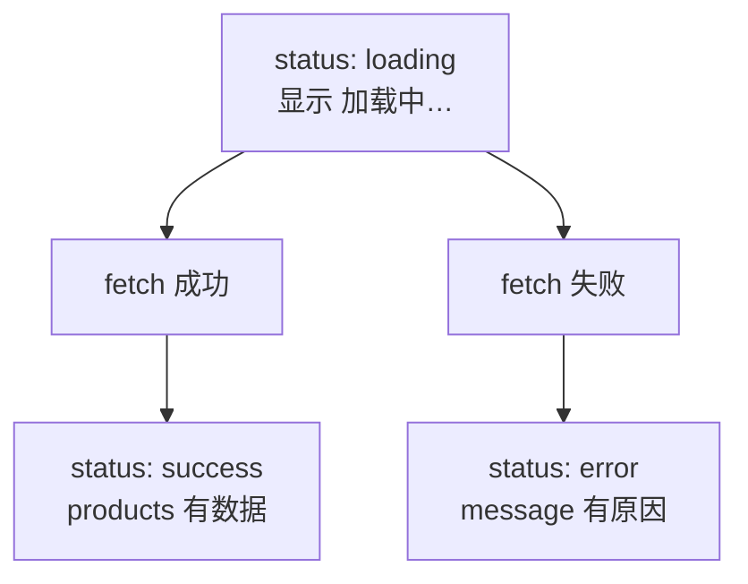

# 第 7D 章 判别联合：用一个 state 表示加载状态

## 这一章解决什么问题

上一章用 `loading`、`error`、`products` 三个 state 表示加载状态。三个值能组合出 8 种情况，真正合理的只有 3 种：加载中、出错、成功。比如做「重试」时，要同时把 `loading` 改回 `true`、把 `error` 清空，漏改一个，页面就可能「数据已经回来了，却还显示加载失败」。本章用 TypeScript 的判别联合把三个 state 合成一个，不合理的组合在类型上就写不出来。

本章只讲一个技术点：**判别联合**。

## 开始之前

- 上一章你已经会了：在 effect 里用 `fetch` 加载数据、`async` / `await`、`try` / `catch`、清理函数。
- 起点代码：仓库 `code/ch07C/price-list`（不含练习答案）。在 `D:\react-study\price-list` 执行 `npm run dev`。
- 预计耗时：30 分钟。

## 正文

### 7D.1 判别联合是什么

**白话定义**：判别联合（discriminated union）是 TypeScript 的一种类型写法：用 `|` 列出几种情况，每种情况都有一个同名字段（这里叫 `status`）取不同的固定值。检查了 `status` 之后，TypeScript 就知道当前是哪种情况、有哪些字段。

**业务场景**：加载数据只有三种情况：加载中（什么数据都没有）、出错（有错误信息）、成功（有产品列表）。用判别联合写，「加载中却有产品列表」这种不可能的组合在类型上就写不出来。

**反例（什么时候不该用）**：只有「有 / 没有」两种情况、也不带额外数据时（比如第 6C 章的 `triedSubmit`），一个 `boolean` 就够了，不要硬造 `{ status: 'yes' } | { status: 'no' }`。

| 写法 | 问题 |
| --- | --- |
| `loading`、`error`、`products` 三个 state（上一章） | 要记得同时改三个；漏改一个就会出现「已加载完却还显示加载中」 |
| 一个 `LoadState` 判别联合（本章） | 一次 `setState` 就切换到另一种情况，不可能处于两种情况之间 |

#### 🖼 图解



### 7D.2 改成一个 LoadState

#### 💻 最小可运行代码

用下面的内容整个替换 `src/App.tsx`：

```tsx
// src/App.tsx
import { useEffect, useState } from 'react'
import type { ReactNode } from 'react'
import type { Product } from './types.ts'
import { PageHeader } from './components/PageHeader.tsx'
import { PageFooter } from './components/PageFooter.tsx'
import { ProductForm } from './components/ProductForm.tsx'

// 判别联合：三种情况各自带不同的数据，用 status 区分。
// 「加载中却有产品列表」「成功却有错误信息」这种自相矛盾的组合根本写不出来
type LoadState =
  | { status: 'loading' }
  | { status: 'error'; message: string }
  | { status: 'success'; products: Product[] }

function App() {
  const [state, setState] = useState<LoadState>({ status: 'loading' })

  // 依赖数组为空 []：只在组件第一次显示到页面上之后执行一次
  useEffect(() => {
    // 组件被移除后（或开发模式下第一次被 StrictMode 拆掉后）不再更新 state
    let ignore = false

    async function load() {
      try {
        // 模拟慢网络，便于看到「加载中」。正式代码删掉这一行
        await new Promise((resolve) => setTimeout(resolve, 1000))
        // 以 / 开头：从网站根目录取，对应项目里的 public/products.json
        const response = await fetch('/products.json')
        if (!response.ok) {
          throw new Error(`服务器返回 ${response.status}`)
        }
        // response.json() 的类型是 Promise<any>，马上标注成 Product[]，不让 any 往下传
        const products: Product[] = await response.json()
        if (!ignore) {
          setState({ status: 'success', products })
        }
      } catch (err) {
        if (!ignore) {
          // catch 到的东西类型是 unknown，确认是 Error 才能读 message
          setState({ status: 'error', message: err instanceof Error ? err.message : String(err) })
        }
      }
    }

    console.log('effect 执行：开始加载')
    load()

    // 清理函数：下次执行这个 effect 之前、或组件被移除时，React 会调用它
    return () => {
      ignore = true
    }
  }, [])

  // 成功时才有产品数量；其他状态算 0
  const count = state.status === 'success' ? state.products.length : 0

  useEffect(() => {
    document.title = `产品价格清单（${count} 种）`
  }, [count])

  function handleDelete(id: number) {
    // 先确认是 success，TypeScript 才允许读 state.products
    if (state.status !== 'success') return
    setState({ status: 'success', products: state.products.filter((p) => p.id !== id) })
  }

  function handleRestock(id: number) {
    if (state.status !== 'success') return
    setState({
      status: 'success',
      products: state.products.map((p) => (p.id === id ? { ...p, stock: p.stock + 1 } : p)),
    })
  }

  // 情况多时，在 return 之前用 if 算好要显示的内容，JSX 里只放结果
  let content: ReactNode
  if (state.status === 'loading') {
    content = <p>加载中…</p>
  } else if (state.status === 'error') {
    content = <p className="error">加载失败：{state.message}</p>
  } else if (state.products.length === 0) {
    content = <p className="empty">暂无产品</p>
  } else {
    content = (
      <table className="product-table">
        <thead>
          <tr>
            <th>编号</th>
            <th>名称</th>
            <th>单价（元）</th>
            <th>库存</th>
            <th>操作</th>
          </tr>
        </thead>
        <tbody>
          {state.products.map((p) => (
            <tr key={p.id}>
              <td>{p.code}</td>
              <td>
                {p.name}
                {p.stock === 0 && <span className="out-of-stock">缺货</span>}
              </td>
              <td>{p.price.toLocaleString()}</td>
              <td className={p.stock < 5 ? 'low' : undefined}>{p.stock}</td>
              <td>
                <button type="button" onClick={() => handleRestock(p.id)}>入库 +1</button>{' '}
                <button type="button" onClick={() => handleDelete(p.id)}>删除</button>
              </td>
            </tr>
          ))}
        </tbody>
      </table>
    )
  }

  return (
    <main>
      <PageHeader />
      <p>共 {count} 种产品</p>
      {content}
      <ProductForm />
      <PageFooter />
    </main>
  )
}

export default App
```

和上一章相比改了这些地方：

| 位置 | 上一章 | 本章 |
| --- | --- | --- |
| state | `products`、`loading`、`error` 三个 | `state` 一个，类型是 `LoadState` |
| 加载成功 | `setProducts(data)` 加 `setLoading(false)` | `setState({ status: 'success', products })` |
| 加载失败 | `setError(...)` 加 `setLoading(false)` | `setState({ status: 'error', message: ... })` |
| 删除、入库 | 直接 `setProducts(...)` | 先确认 `state.status === 'success'`，再生成新的 success 状态 |
| 产品数量 | `products.length` | `count`：成功时是产品数，其他情况算 0 |

#### 🔍 拆解运行结果

页面表现和上一章完全一样：先「加载中…」，约 1 秒后出现 5 行表格。变的是代码的可靠性。

| 代码 | 说明 |
| --- | --- |
| `type LoadState = \| {...} \| {...} \| {...}` | 三种情况用 `\|` 连起来。开头那个 `\|` 可写可不写，写上排版整齐 |
| `status: 'loading'` | 类型不是 `string`，而是固定的字符串 `'loading'`（字面量类型），只能是这个值 |
| `useState<LoadState>({ status: 'loading' })` | 初始状态是「加载中」，这时没有 `products` 也没有 `message` |
| `if (state.status !== 'success') return` | 收窄（narrowing）：这行之后 TypeScript 知道 `state` 是成功的那种，才允许读 `state.products` |
| `else if (state.status === 'error')` 分支里的 `state.message` | 同样是收窄：这个分支里 `state` 一定是出错的那种 |

#### 改坏一处试试

在 `D:\react-study\price-list` 执行 `npx tsc -b` 看报错。

**① 不检查 status 就读 products。** 删掉 `handleDelete` 里的 `if (state.status !== 'success') return`，报：

```text
src/App.tsx(63,51): error TS2339: Property 'products' does not exist on type 'LoadState'.
  Property 'products' does not exist on type '{ status: "loading"; }'.
```

加载中的时候根本没有产品列表，TypeScript 不让你读。

**② status 拼错。** 把 `state.status === 'loading'` 拼成 `'loadding'`，报：

```text
src/App.tsx(78,7): error TS2367: This comparison appears to be unintentional because the types '"error" | "loading" | "success"' and '"loadding"' have no overlap.
```

后面还会跟着几条连带错误：拼错之后这个分支不再收窄，后面的分支就分不清是哪种情况了。

**③ 出错状态少了 message。** 把 `catch` 里的 `setState(...)` 改成 `setState({ status: 'error' })`，报：

```text
src/App.tsx(41,20): error TS2345: Argument of type '{ status: "error"; }' is not assignable to parameter of type 'SetStateAction<LoadState>'.
  ...
    Property 'message' is missing in type '{ status: "error"; }' but required in type '{ status: "error"; message: string; }'.
```

**④ effect 写成 async。** 把加载数据的 `useEffect(() => {` 写成 `useEffect(async () => {`，报：

```text
src/App.tsx(20,13): error TS2345: Argument of type '() => Promise<() => void>' is not assignable to parameter of type 'EffectCallback'.
  Type 'Promise<() => void>' is not assignable to type 'void | Destructor'.
```

每次实验后改回。

## ⚠️ 踩坑警告

| 现象 | 原因 | 怎么改 |
| --- | --- | --- |
| 报 `Property 'products' does not exist on type 'LoadState'` | 没有先检查 `status` 就读了只有某种情况才有的字段 | 先 `if (state.status === 'success')` 或 `if (state.status !== 'success') return`，再读 |
| 报 `TS2367: This comparison appears to be unintentional ...` | `status` 的值拼错了，和类型里的任何一种都对不上 | 照提示里列出的值改 |
| 改成判别联合后，「共 x 种产品」报错或显示不对 | 只有成功时才有 `products`，其他情况没有 `length` 可读 | 像 `count` 那样，用三元表达式给其他情况一个值 |
| 用了判别联合，还另外留着一个 `loading` state | 两处都表示「是不是加载中」，又回到了要同时改两处的老问题 | 删掉多余的 state，一切以 `state.status` 为准 |

## 🎯 动手练习

**练习 1：出错后可以重试**

加载失败时，错误信息后面显示「重试」按钮。点了以后页面先显示「加载中…」，然后重新请求一次。

验收标准：

- 把地址临时改成 `/product.json`，页面显示错误和「重试」按钮。
- 点「重试」，先显示「加载中…」，约 1 秒后再次显示错误，「网络」里多了**一次** `product.json` 请求。
- 地址改回来后，页面正常加载。

提示：再加一个数字 state，把它放进加载数据那个 effect 的依赖数组；点「重试」时让它加 1。

**练习 2：显示库存总金额**

加载成功后，在表格上面显示「库存总金额：461,760 元」（每个产品单价 × 库存，再相加）。

验收标准：

- 刷新后显示 `库存总金额：461,760 元`。
- 删除「耦合剂 250ml」后变成 `459,600 元`。
- 没有新增 state，也没有新增 `useEffect`。

卡住了看文末参考答案。

## 📌 一句话总结

几种情况各带不同数据时用判别联合，先查 status 再读字段。

## 下一章

表单录入的产品还没进表格，取数代码也全挤在 `App` 里。第 8A 章开始把它们拆开并连起来。

---

<!-- 以下是参考答案，先自己动手，卡住了再往下翻 -->


## 参考答案

两个练习都改 `App.tsx`，下面是都做完后的版本。

### 练习 1

思路：effect 只在依赖变化时重新执行，所以加一个专门用来「触发重新加载」的 `reloadKey`，点「重试」时加 1。同时先把状态切回 `loading`，页面才会显示「加载中…」。用判别联合时，切回加载中只需要一次 `setState({ status: 'loading' })`，不会残留上一次的错误信息。

### 练习 2

思路：总金额是派生值，用数组的 `reduce` 方法累加：`reduce((sum, p) => sum + p.price * p.stock, 0)` 从 0 开始，每个产品加上一次。只有 `success` 分支里才有 `state.products`，所以在这个分支里算。表格上面多了一个 `<p>`，两个元素并列，用 Fragment 包住。

```tsx
// src/App.tsx
// 两个练习都做完后的版本
import { useEffect, useState } from 'react'
import type { ReactNode } from 'react'
import type { Product } from './types.ts'
import { PageHeader } from './components/PageHeader.tsx'
import { PageFooter } from './components/PageFooter.tsx'
import { ProductForm } from './components/ProductForm.tsx'

// 判别联合：三种情况各自带不同的数据，用 status 区分。
// 「加载中却有产品列表」「成功却有错误信息」这种自相矛盾的组合根本写不出来
type LoadState =
  | { status: 'loading' }
  | { status: 'error'; message: string }
  | { status: 'success'; products: Product[] }

function App() {
  const [state, setState] = useState<LoadState>({ status: 'loading' })
  // 练习 1：每点一次「重试」加 1。它在依赖数组里，变了 effect 就重新执行
  const [reloadKey, setReloadKey] = useState(0)

  // 依赖 reloadKey：第一次显示时执行一次，之后 reloadKey 每变一次再执行一次
  useEffect(() => {
    // 组件被移除后（或开发模式下第一次被 StrictMode 拆掉后）不再更新 state
    let ignore = false

    async function load() {
      try {
        // 模拟慢网络，便于看到「加载中」。正式代码删掉这一行
        await new Promise((resolve) => setTimeout(resolve, 1000))
        // 以 / 开头：从网站根目录取，对应项目里的 public/products.json
        const response = await fetch('/products.json')
        if (!response.ok) {
          throw new Error(`服务器返回 ${response.status}`)
        }
        // response.json() 的类型是 Promise<any>，马上标注成 Product[]，不让 any 往下传
        const products: Product[] = await response.json()
        if (!ignore) {
          setState({ status: 'success', products })
        }
      } catch (err) {
        if (!ignore) {
          // catch 到的东西类型是 unknown，确认是 Error 才能读 message
          setState({ status: 'error', message: err instanceof Error ? err.message : String(err) })
        }
      }
    }

    console.log('effect 执行：开始加载')
    load()

    // 清理函数：下次执行这个 effect 之前、或组件被移除时，React 会调用它
    return () => {
      ignore = true
    }
  }, [reloadKey])

  // 练习 1：先切回「加载中」，再让 effect 重新执行
  function handleRetry() {
    setState({ status: 'loading' })
    setReloadKey(reloadKey + 1)
  }

  // 成功时才有产品数量；其他状态算 0
  const count = state.status === 'success' ? state.products.length : 0

  useEffect(() => {
    document.title = `产品价格清单（${count} 种）`
  }, [count])

  function handleDelete(id: number) {
    // 先确认是 success，TypeScript 才允许读 state.products
    if (state.status !== 'success') return
    setState({ status: 'success', products: state.products.filter((p) => p.id !== id) })
  }

  function handleRestock(id: number) {
    if (state.status !== 'success') return
    setState({
      status: 'success',
      products: state.products.map((p) => (p.id === id ? { ...p, stock: p.stock + 1 } : p)),
    })
  }

  // 情况多时，在 return 之前用 if 算好要显示的内容，JSX 里只放结果
  let content: ReactNode
  if (state.status === 'loading') {
    content = <p>加载中…</p>
  } else if (state.status === 'error') {
    content = (
      <p className="error">
        加载失败：{state.message}{' '}
        <button type="button" onClick={handleRetry}>重试</button>
      </p>
    )
  } else if (state.products.length === 0) {
    content = <p className="empty">暂无产品</p>
  } else {
    // 练习 2：只有 success 分支里才能读 state.products，所以在这里算
    const totalValue = state.products.reduce((sum, p) => sum + p.price * p.stock, 0)
    content = (
      <>
        <p>库存总金额：{totalValue.toLocaleString()} 元</p>
        <table className="product-table">
          <thead>
            <tr>
              <th>编号</th>
              <th>名称</th>
              <th>单价（元）</th>
              <th>库存</th>
              <th>操作</th>
            </tr>
          </thead>
          <tbody>
            {state.products.map((p) => (
              <tr key={p.id}>
                <td>{p.code}</td>
                <td>
                  {p.name}
                  {p.stock === 0 && <span className="out-of-stock">缺货</span>}
                </td>
                <td>{p.price.toLocaleString()}</td>
                <td className={p.stock < 5 ? 'low' : undefined}>{p.stock}</td>
                <td>
                  <button type="button" onClick={() => handleRestock(p.id)}>入库 +1</button>{' '}
                  <button type="button" onClick={() => handleDelete(p.id)}>删除</button>
                </td>
              </tr>
            ))}
          </tbody>
        </table>
      </>
    )
  }

  return (
    <main>
      <PageHeader />
      <p>共 {count} 种产品</p>
      {content}
      <ProductForm />
      <PageFooter />
    </main>
  )
}

export default App
```
