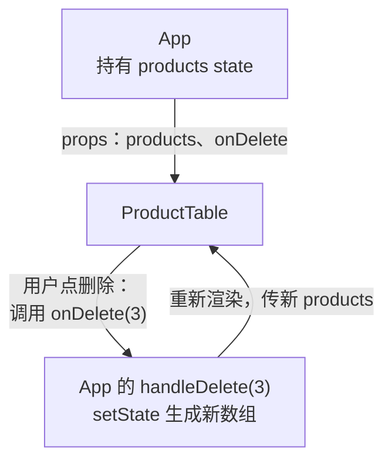
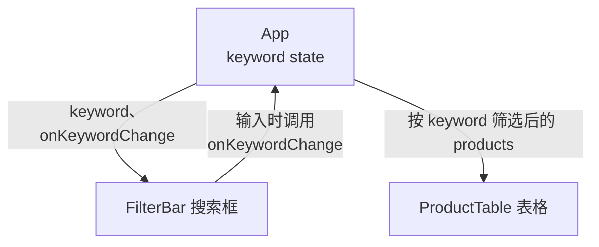

# 第 8 章 组件之间共享数据与自定义 Hook

## 这一章解决什么问题

表单录入的产品要出现在表格里，但产品列表在 `App` 里，表单在 `ProductForm` 里，表单够不着 `App` 的 state。表格上方还要加一个搜索框，搜索框和表格又是两个组件。`App` 已经一百多行，取数代码和页面代码混在一起。本章解决这三件事。

## 开始之前

- 上一章你已经会了：`useEffect` 和依赖数组、用判别联合表示加载状态。
- 起点代码：仓库 `code/ch07/price-list`。在 `D:\react-study\price-list` 执行 `npm run dev`。预计耗时：50 分钟。

## 正文

### 8.1 回调 props：子组件通知父组件

**白话定义**：回调 props（callback props）是父组件通过 props 传给子组件的**函数**。子组件不自己改数据，而是在用户操作时调用这个函数，把「发生了什么」告诉父组件，由父组件去改 state。

**业务场景**：把表格拆成 `ProductTable` 组件后，「删除」按钮在表格里，产品数据在 `App` 里。`App` 传 `onDelete` 给表格，表格里点删除时调用 `onDelete(p.id)`。表单也一样：保存成功时调用 `onAdd(product)`。

**反例（什么时候不该用）**：子组件自己用、别人不关心的数据，不要为了「统一管理」都提到父组件再用回调改。比如第 4 章 `QuantityPicker` 的询价数量，只有卡片自己用，就留在它自己的 state 里。

#### 🖼 图解



数据往下传（props），事件往上报（回调）。数据始终只在 `App` 一个地方改。

#### 💻 最小可运行代码

**① 新建 `src/components/ProductTable.tsx`**，把第 7 章 `App` 里的表格搬过来：

```tsx
// src/components/ProductTable.tsx
// 只负责显示表格。数据从 props 来；点了按钮不自己改数据，而是调用父组件给的函数「通知」它
import type { Product } from '../types.ts'

type ProductTableProps = {
  products: Product[]
  // 回调 props：类型写清楚「调用时传什么参数、返回什么」。void 表示不关心返回值
  onDelete: (id: number) => void
  onRestock: (id: number) => void
}

export function ProductTable({ products, onDelete, onRestock }: ProductTableProps) {
  if (products.length === 0) {
    return <p className="empty">暂无产品</p>
  }

  return (
    <table className="product-table">
      <thead>
        <tr>
          <th>编号</th>
          <th>名称</th>
          <th>单价（元）</th>
          <th>库存</th>
          <th>操作</th>
        </tr>
      </thead>
      <tbody>
        {products.map((p) => (
          <tr key={p.id}>
            <td>{p.code}</td>
            <td>
              {p.name}
              {p.stock === 0 && <span className="out-of-stock">缺货</span>}
            </td>
            <td>{p.price.toLocaleString()}</td>
            <td className={p.stock < 5 ? 'low' : undefined}>{p.stock}</td>
            <td>
              <button type="button" onClick={() => onRestock(p.id)}>入库 +1</button>{' '}
              <button type="button" onClick={() => onDelete(p.id)}>删除</button>
            </td>
          </tr>
        ))}
      </tbody>
    </table>
  )
}
```

**② 改 `src/components/ProductForm.tsx`**：把 `export function ProductForm() {` 换成下面几行，再把 `handleSubmit` 里的 `console.log('新产品', product)` 换成 `onAdd(product)`。

```tsx
type ProductFormProps = {
  // 保存成功时把新产品交给父组件。表单不知道、也不关心父组件怎么存
  onAdd: (product: Product) => void
}

export function ProductForm({ onAdd }: ProductFormProps) {
```

**③ 改 `src/App.tsx`**，三处（完整文件见仓库 `code/ch08/steps/8.1/src/App.tsx`）：

- import 区加 `import { ProductTable } from './components/ProductTable.tsx'`；在 `handleDelete` 上面加添加产品的函数：

```tsx
  function handleAdd(product: Product) {
    if (state.status !== 'success') return
    // 添加：展开旧数组，在末尾放新产品，得到一个新数组
    setState({ status: 'success', products: [...state.products, product] })
  }
```

- 删掉 `else if (state.products.length === 0)` 分支（「暂无产品」已搬进 `ProductTable`），把最后的 `else` 分支和 `<ProductForm />` 改成：

```tsx
  } else {
    // 回调 props：把「删除」「入库」的处理函数交给表格，表格里点按钮时调用它们
    content = <ProductTable products={state.products} onDelete={handleDelete} onRestock={handleRestock} />
  }
```

```tsx
      {/* 表单保存成功时调用 handleAdd，新产品就进了 App 的 state */}
      <ProductForm onAdd={handleAdd} />
```

#### 🔍 拆解运行结果

等表格加载出来，在表单里填「P-003」「微凸探头 C8-4」「9800」保存。实测：表格最后多出一行「P-003 微凸探头 C8-4 9,800 0」，名称后带「缺货」（新产品库存为 0）；「共 6 种产品」，标签页标题变成「（6 种）」。点这一行的「删除」，它又消失了。

- `onDelete: (id: number) => void` 是函数类型：参数是一个数字，不关心返回值。TypeScript 会检查父组件传进来的函数是否符合。惯例是回调 props 叫 `onXxx`，父组件里的处理函数叫 `handleXxx`。
- `ProductTable` 只管显示和报告事件，不知道数据存在哪。以后数据改成存到服务器，表格一行都不用改。

#### 改坏一处试试

不传 `onAdd`（写 `<ProductForm />`），报 `TS2741: Property 'onAdd' is missing in type '{}' but required in type 'ProductFormProps'.`。传一个参数类型不对的函数 `onDelete={(p: string) => console.log(p)}`，报 `TS2322: Type '(p: string) => void' is not assignable to type '(id: number) => void'.`

### 8.2 状态提升

**白话定义**：状态提升（lifting state up）是指：两个兄弟组件要用同一份数据时，把 state 移到它们**最近的共同父组件**里，再通过 props 分别传下去。

**业务场景**：搜索框 `FilterBar` 里输入「探头」，表格 `ProductTable` 只显示名称或编号里含「探头」的行。关键字 `keyword` 两个组件都要用，所以放在它们共同的父组件 `App` 里。

**反例（什么时候不该用）**：只有一个组件用的 state 不要提升。提得越高，这个 state 一变，重新渲染的组件就越多，代码也要多传一层 props。比如表单里正在输入的编号、名称，只有表单用，就留在 `ProductForm` 里。

#### 🖼 图解



#### 💻 最小可运行代码

新建 `src/components/FilterBar.tsx`：

```tsx
// src/components/FilterBar.tsx
// 搜索框。它自己不存关键字：值从父组件传进来，用户输入时调用 onKeywordChange 通知父组件
type FilterBarProps = {
  keyword: string
  onKeywordChange: (keyword: string) => void
}

export function FilterBar({ keyword, onKeywordChange }: FilterBarProps) {
  return (
    <label className="filter-bar">
      搜索 <input value={keyword} placeholder="编号或名称" onChange={(e) => onKeywordChange(e.target.value)} />
    </label>
  )
}
```

在 `src/index.css` 末尾加一行：`.filter-bar { display: block; margin-bottom: 8px; }`。然后改 `src/App.tsx`（完整文件见仓库 `code/ch08/steps/8.2/src/App.tsx`）：import 区加 `import { FilterBar } from './components/FilterBar.tsx'`；在 `useState<LoadState>` 那行下面加 `const [keyword, setKeyword] = useState('')`；然后把 `else` 分支改成先筛选再传给表格，并在 `{content}` 上面放搜索框：

```tsx
  } else {
    // 筛选结果是派生值：由 products 和 keyword 现算，不另存 state
    const k = keyword.trim().toLowerCase()
    const visible = state.products.filter(
      (p) => p.name.toLowerCase().includes(k) || p.code.toLowerCase().includes(k),
    )
    content = <ProductTable products={visible} onDelete={handleDelete} onRestock={handleRestock} />
  }
```

```tsx
      {/* 把值和「修改它的函数」一起交给搜索框 */}
      <FilterBar keyword={keyword} onKeywordChange={setKeyword} />
```

#### 🔍 拆解运行结果

实测：

| 搜索框输入 | 表格显示 |
| --- | --- |
| `探头` | 凸阵探头 C5-2、线阵探头 L12-5、探头保护套 |
| `c-00`（小写） | 耦合剂 250ml、探头保护套（编号 C-001、C-002） |
| `xyz` | 暂无产品 |

「共 5 种产品」不随搜索变化：它用完整的 `state.products`，表格用筛选后的 `visible`。`onKeywordChange={setKeyword}` 能直接传，因为 `setKeyword` 本身就是「接收一个字符串」的函数，正好符合 `(keyword: string) => void`。

#### 改坏一处试试

写成 `onKeywordChange={setKeyword('')}`，报 `TS2322: Type 'void' is not assignable to type '(keyword: string) => void'.` 和第 4 章一样：要传函数本身，不是调用结果。

### 8.3 自定义 Hook

**白话定义**：自定义 Hook（custom hook）是一个名字以 `use` 开头、内部调用了其他 Hook 的普通函数。它把一段「state + effect + 修改函数」打包起来，组件调用它就得到这套逻辑。

**业务场景**：第 9 章的产品详情页也要加载 `products.json`。把加载和增删改的代码从 `App` 里抽成 `useProducts()`，列表页、详情页各调用一次就行，`App` 也只剩页面结构。

**反例（什么时候不该用）**：自定义 Hook 共享的是**逻辑**，不是**数据**。两个组件各调用一次 `useProducts()`，就是两份独立的 state、两次请求，一边删了产品另一边不会变（下面「改坏一处」实测）。要多个组件看到同一份数据，用 8.2 的状态提升。另外，不包含任何 Hook 的工具函数（比如格式化金额）写成普通函数，不要加 `use` 前缀。

#### 💻 最小可运行代码

结构很简单：`useProducts()` 内部有 state、加载 effect 和增删改函数，最后返回 `{ state, addProduct, ... }`，`App` 解构拿到需要的部分。新建文件夹 `src/hooks`，在里面新建 `useProducts.ts`（没有 JSX，所以是 `.ts`）。把第 7 章 `App` 里的 `LoadState`、加载 effect、增删改函数搬进来：

```ts
// src/hooks/useProducts.ts
// 自定义 Hook：把「加载产品 + 增删改」这一整套逻辑打包，任何组件调用它都能用
import { useEffect, useState } from 'react'
import type { Product } from '../types.ts'

export type LoadState =
  | { status: 'loading' }
  | { status: 'error'; message: string }
  | { status: 'success'; products: Product[] }

// 名字必须以 use 开头：React 和 lint 工具靠这个识别它是 Hook，按 Hook 的规则检查
export function useProducts() {
  const [state, setState] = useState<LoadState>({ status: 'loading' })

  useEffect(() => {
    let ignore = false

    async function load() {
      try {
        // 模拟慢网络，便于看到「加载中」。正式代码删掉这一行
        await new Promise((resolve) => setTimeout(resolve, 1000))
        const response = await fetch('/products.json')
        if (!response.ok) {
          throw new Error(`服务器返回 ${response.status}`)
        }
        const products: Product[] = await response.json()
        if (!ignore) {
          setState({ status: 'success', products })
        }
      } catch (err) {
        if (!ignore) {
          setState({ status: 'error', message: err instanceof Error ? err.message : String(err) })
        }
      }
    }

    load()
    return () => {
      ignore = true
    }
  }, [])

  function addProduct(product: Product) {
    if (state.status !== 'success') return
    // 添加：展开旧数组，在末尾放新产品，得到一个新数组
    setState({ status: 'success', products: [...state.products, product] })
  }

  function deleteProduct(id: number) {
    if (state.status !== 'success') return
    setState({ status: 'success', products: state.products.filter((p) => p.id !== id) })
  }

  function restockProduct(id: number) {
    if (state.status !== 'success') return
    setState({
      status: 'success',
      products: state.products.map((p) => (p.id === id ? { ...p, stock: p.stock + 1 } : p)),
    })
  }

  // 返回一个对象，调用方按名字取自己需要的部分
  return { state, addProduct, deleteProduct, restockProduct }
}
```

用下面的内容整个替换 `src/App.tsx`：

```tsx
// src/App.tsx
import { useEffect, useState } from 'react'
import type { ReactNode } from 'react'
import { useProducts } from './hooks/useProducts.ts'
import { PageHeader } from './components/PageHeader.tsx'
import { FilterBar } from './components/FilterBar.tsx'
import { ProductTable } from './components/ProductTable.tsx'
import { ProductForm } from './components/ProductForm.tsx'
import { PageFooter } from './components/PageFooter.tsx'

function App() {
  // 加载和增删改的细节都在 useProducts 里，App 只拿结果
  const { state, addProduct, deleteProduct, restockProduct } = useProducts()
  // 状态提升：搜索框和表格都要用 keyword，所以放在它们共同的父组件 App 里
  const [keyword, setKeyword] = useState('')

  const count = state.status === 'success' ? state.products.length : 0

  useEffect(() => {
    document.title = `产品价格清单（${count} 种）`
  }, [count])

  let content: ReactNode
  if (state.status === 'loading') {
    content = <p>加载中…</p>
  } else if (state.status === 'error') {
    content = <p className="error">加载失败：{state.message}</p>
  } else {
    // 筛选结果是派生值：由 products 和 keyword 现算，不另存 state
    const k = keyword.trim().toLowerCase()
    const visible = state.products.filter(
      (p) => p.name.toLowerCase().includes(k) || p.code.toLowerCase().includes(k),
    )
    // 把 useProducts 给的函数直接作为回调传下去
    content = <ProductTable products={visible} onDelete={deleteProduct} onRestock={restockProduct} />
  }

  return (
    <main>
      <PageHeader />
      <p>共 {count} 种产品</p>
      {/* 把值和「修改它的函数」一起交给搜索框 */}
      <FilterBar keyword={keyword} onKeywordChange={setKeyword} />
      {content}
      <ProductForm onAdd={addProduct} />
      <PageFooter />
    </main>
  )
}

export default App
```

#### 🔍 拆解运行结果

页面行为和 8.2 完全一样，`npm run lint` 显示 `Found 0 warnings and 0 errors.`。`App` 从一百多行变成五十行，只描述「页面由什么组成」。自定义 Hook 里的 `useState`、`useEffect` 就像直接写在调用它的组件里一样：state 属于调用它的那个组件（这里是 `App`），Hook 的调用规则（最顶层、不能放在 `if` 里）对它同样适用。

#### 改坏一处试试

**① 调用两次，看是不是同一份数据。** 在 `App` 里 `keyword` 那行下面临时加 `const other = useProducts()`，并在「共 x 种产品」下面加 `<p>另一份：{other.state.status === 'success' ? other.state.products.length : 0} 种</p>`。刷新后删除「耦合剂」，实测显示：

```text
共 4 种产品
另一份：5 种
```

「网络」里的 `products.json` 请求也从 2 次变成 4 次：两份完全独立的 state。实验完删掉这两行。

**② 在不以 `use` 开头的函数里调用 Hook。** 在 `App` 里写一个 `function loadCount() { return useProducts() }`，`tsc` 不报错，但 `npm run lint` 报 `React Hook "useProducts" is called in function "loadCount" that is neither a React function component nor a custom React Hook function.`，并提示 Hook 的名字必须以 `use` 开头。

## ⚠️ 踩坑警告

| 现象 | 原因 | 怎么改 |
| --- | --- | --- |
| 两个组件都调用了 `useProducts()`，一边删了产品另一边没变 | 自定义 Hook 只共享逻辑，每次调用都是独立的 state | 在共同的父组件里调用一次，把结果用 props 传下去 |
| 新增的产品刷新后就没了 | 数据只在浏览器内存的 state 里，`products.json` 是只读的静态文件 | 正常现象。要持久保存，需要后端接口把数据写进数据库 |

## 🎯 动手练习

**练习 1：按分类筛选**

在搜索框后面加分类下拉框（全部 / 探头 / 主机 / 耗材），和关键字同时生效。分类的 state 也放在 `App`。

验收标准：

- 选「耗材」：只显示耦合剂 250ml、探头保护套。
- 再在搜索框输入「保护」：只剩探头保护套。
- 选回「全部」、清空搜索框：5 行都回来。

**练习 2：写一个 `useDocumentTitle` Hook**

新建 `src/hooks/useDocumentTitle.ts`，导出 `useDocumentTitle(title: string)`，把 `App` 里改标题的 `useEffect` 换成一行 `useDocumentTitle(...)`。

验收标准：

- 刷新后标题是「产品价格清单（5 种）」，删除一行后变成「（4 种）」。
- `App.tsx` 里不再有 `useEffect`，`npm run lint` 和 `npm run build` 都通过。

卡住了看文末参考答案。

## 📌 一句话总结

共享的 state 放共同父组件，子组件用回调报事件，可复用的逻辑抽成 useXxx。

## 下一章

所有内容都挤在一个页面上。第 9 章加路由，点产品名进入详情页，地址栏跟着变。

---

<!-- 以下是参考答案，先自己动手，卡住了再往下翻 -->


## 参考答案

### 练习 1

思路：分类和关键字一样是 `FilterBar` 与表格共用的数据，所以提升到 `App`。筛选条件用 `&&` 组合：分类为「全部」或等于产品分类，并且关键字匹配。

```tsx
// src/components/FilterBar.tsx
// 练习 1：多了分类下拉框。两个值都由父组件保管，这里只负责显示和通知
type FilterBarProps = {
  keyword: string
  onKeywordChange: (keyword: string) => void
  category: string
  onCategoryChange: (category: string) => void
}

export function FilterBar({ keyword, onKeywordChange, category, onCategoryChange }: FilterBarProps) {
  return (
    <div className="filter-bar">
      <label>
        搜索 <input value={keyword} placeholder="编号或名称" onChange={(e) => onKeywordChange(e.target.value)} />
      </label>{' '}
      <label>
        分类{' '}
        <select value={category} onChange={(e) => onCategoryChange(e.target.value)}>
          <option value="全部">全部</option>
          <option value="探头">探头</option>
          <option value="主机">主机</option>
          <option value="耗材">耗材</option>
        </select>
      </label>
    </div>
  )
}
```

### 练习 2

思路：把 `useEffect` 原样搬进一个 `use` 开头的函数，要变化的部分（标题文字）作为参数传进来，并写进依赖数组。

```ts
// src/hooks/useDocumentTitle.ts
// 练习 2：把「随数据更新标签页标题」抽成自定义 Hook，任何页面一行就能用
import { useEffect } from 'react'

export function useDocumentTitle(title: string) {
  useEffect(() => {
    document.title = title
  }, [title])
}
```

两个练习都做完后的 `App.tsx`：

```tsx
// src/App.tsx
// 两个练习都做完后的版本
import { useState } from 'react'
import type { ReactNode } from 'react'
import { useProducts } from './hooks/useProducts.ts'
import { useDocumentTitle } from './hooks/useDocumentTitle.ts'
import { PageHeader } from './components/PageHeader.tsx'
import { FilterBar } from './components/FilterBar.tsx'
import { ProductTable } from './components/ProductTable.tsx'
import { ProductForm } from './components/ProductForm.tsx'
import { PageFooter } from './components/PageFooter.tsx'

function App() {
  // 加载和增删改的细节都在 useProducts 里，App 只拿结果
  const { state, addProduct, deleteProduct, restockProduct } = useProducts()
  // 状态提升：搜索框和表格都要用 keyword，所以放在它们共同的父组件 App 里
  const [keyword, setKeyword] = useState('')
  // 练习 1：分类筛选同样提升到 App
  const [category, setCategory] = useState('全部')

  const count = state.status === 'success' ? state.products.length : 0

  // 练习 2：原来的 useEffect 换成一行自定义 Hook
  useDocumentTitle(`产品价格清单（${count} 种）`)

  let content: ReactNode
  if (state.status === 'loading') {
    content = <p>加载中…</p>
  } else if (state.status === 'error') {
    content = <p className="error">加载失败：{state.message}</p>
  } else {
    // 筛选结果是派生值：由 products、keyword、category 现算，不另存 state
    const k = keyword.trim().toLowerCase()
    const visible = state.products.filter(
      (p) =>
        (category === '全部' || p.category === category) &&
        (p.name.toLowerCase().includes(k) || p.code.toLowerCase().includes(k)),
    )
    // 把 useProducts 给的函数直接作为回调传下去
    content = <ProductTable products={visible} onDelete={deleteProduct} onRestock={restockProduct} />
  }

  return (
    <main>
      <PageHeader />
      <p>共 {count} 种产品</p>
      {/* 把值和「修改它的函数」一起交给搜索框 */}
      <FilterBar
        keyword={keyword}
        onKeywordChange={setKeyword}
        category={category}
        onCategoryChange={setCategory}
      />
      {content}
      <ProductForm onAdd={addProduct} />
      <PageFooter />
    </main>
  )
}

export default App
```
