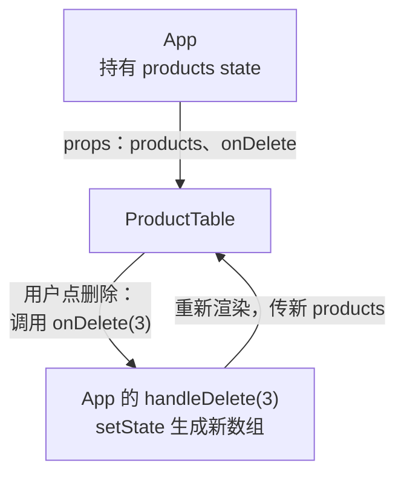

# 第 8A 章 回调 props：子组件通知父组件

## 这一章解决什么问题

表单录入的产品要出现在表格里，但产品列表在 `App` 的 state 里，表单在 `ProductForm` 里，表单够不着 `App` 的 state。`App` 也已经一百多行，表格的 JSX 占了一大半。本章先把表格拆成独立的 `ProductTable` 组件，再让表单、表格在用户操作时「通知」`App`，由 `App` 去改数据。

本章只讲一个技术点：**回调 props**。

## 开始之前

- 上一章你已经会了：`useEffect` 和依赖数组、在 effect 里加载数据、用判别联合表示加载状态。
- 起点代码：仓库 `code/ch07D/price-list`（不含练习答案）。在 `D:\react-study\price-list` 执行 `npm run dev`。
- 预计耗时：30 分钟。

## 正文

### 8A.1 回调 props 是什么

**白话定义**：回调 props（callback props）是父组件通过 props 传给子组件的**函数**。子组件不自己改数据，而是在用户操作时调用这个函数，把「发生了什么」告诉父组件，由父组件去改 state。

**业务场景**：把表格拆成 `ProductTable` 组件后，「删除」按钮在表格里，产品数据在 `App` 里。`App` 传 `onDelete` 给表格，表格里点删除时调用 `onDelete(p.id)`。表单也一样：保存成功时调用 `onAdd(product)`。

**反例（什么时候不该用）**：子组件自己用、别人不关心的数据，不要为了「统一管理」都提到父组件再用回调改。比如第 4A 章 `QuantityPicker` 的询价数量，只有卡片自己用，就留在它自己的 state 里。

#### 🖼 图解



数据往下传（props），事件往上报（回调）。数据始终只在 `App` 一个地方改。

### 8A.2 拆出表格，连上表单

#### 💻 最小可运行代码

**① 新建 `src/components/ProductTable.tsx`**，把第 7D 章 `App` 里的表格搬过来：

```tsx
// src/components/ProductTable.tsx
// 只负责显示表格。数据从 props 来；点了按钮不自己改数据，而是调用父组件给的函数「通知」它
import type { Product } from '../types.ts'

type ProductTableProps = {
  products: Product[]
  // 回调 props：类型写清楚「调用时传什么参数、返回什么」。void 表示不关心返回值
  onDelete: (id: number) => void
  onRestock: (id: number) => void
}

export function ProductTable({ products, onDelete, onRestock }: ProductTableProps) {
  if (products.length === 0) {
    return <p className="empty">暂无产品</p>
  }

  return (
    <table className="product-table">
      <thead>
        <tr>
          <th>编号</th>
          <th>名称</th>
          <th>单价（元）</th>
          <th>库存</th>
          <th>操作</th>
        </tr>
      </thead>
      <tbody>
        {products.map((p) => (
          <tr key={p.id}>
            <td>{p.code}</td>
            <td>
              {p.name}
              {p.stock === 0 && <span className="out-of-stock">缺货</span>}
            </td>
            <td>{p.price.toLocaleString()}</td>
            <td className={p.stock < 5 ? 'low' : undefined}>{p.stock}</td>
            <td>
              <button type="button" onClick={() => onRestock(p.id)}>入库 +1</button>{' '}
              <button type="button" onClick={() => onDelete(p.id)}>删除</button>
            </td>
          </tr>
        ))}
      </tbody>
    </table>
  )
}
```

**② 改 `src/components/ProductForm.tsx`**。用下面的内容整个替换。和第 6C 章相比改了两处：`export function ProductForm` 上面多了 `ProductFormProps` 类型，函数改成接收 `{ onAdd }`；`handleSubmit` 里原来的 `console.log('新产品', product)` 换成了 `onAdd(product)`。

```tsx
// src/components/ProductForm.tsx
import { useState } from 'react'
import type { ChangeEvent, SubmitEvent } from 'react'
import type { Product } from '../types.ts'

type ProductFormProps = {
  // 保存成功时把新产品交给父组件。表单不知道、也不关心父组件怎么存
  onAdd: (product: Product) => void
}

export function ProductForm({ onAdd }: ProductFormProps) {
  // 每个输入框对应一个 state。输入框里的内容永远是字符串，单价也先按字符串存
  const [code, setCode] = useState('')
  const [name, setName] = useState('')
  const [category, setCategory] = useState('探头')
  const [price, setPrice] = useState('')
  // 保存成功后显示的提示
  const [message, setMessage] = useState('')
  // 点过一次「保存」才显示错误，免得一打开页面就满屏红字
  const [triedSubmit, setTriedSubmit] = useState(false)

  // 派生值：每次渲染都从 state 现算，不另存 state，所以永远和输入框一致
  const priceNumber = Number(price)
  const codeError = code.trim() === '' ? '请填写编号' : ''
  const nameError = name.trim() === '' ? '请填写名称' : ''
  // Number('abc') 是 NaN，NaN > 0 不成立，所以「不是数字」和「小于等于 0」一起拦住
  const priceError = price.trim() === '' ? '请填写单价' : priceNumber > 0 ? '' : '单价必须是大于 0 的数字'
  const isValid = codeError === '' && nameError === '' && priceError === ''

  // 单独写成函数时，参数类型要写明：input 元素上的变化事件
  function handlePriceChange(e: ChangeEvent<HTMLInputElement>) {
    setPrice(e.target.value)
  }

  function handleSubmit(e: SubmitEvent<HTMLFormElement>) {
    // 阻止浏览器默认的「提交表单 = 刷新整页」，改由我们自己处理
    e.preventDefault()
    setTriedSubmit(true)
    if (!isValid) {
      setMessage('')
      return
    }
    // 新产品还没入库，库存为 0；id 先用当前时间的毫秒数，保证不重复
    const product: Product = { id: Date.now(), code: code.trim(), name: name.trim(), category, price: priceNumber, stock: 0 }
    onAdd(product)
    setMessage(`已录入：${product.name}，单价 ${product.price.toLocaleString()} 元`)
    // 清空输入框，并收起错误提示
    setCode('')
    setName('')
    setPrice('')
    setTriedSubmit(false)
  }

  return (
    <form className="product-form" onSubmit={handleSubmit}>
      <h2>录入新产品</h2>
      {/* value 来自 state，onChange 把用户输入写回 state：输入框完全由 React 控制 */}
      <label>编号 <input value={code} onChange={(e) => setCode(e.target.value)} /></label>
      {triedSubmit && codeError && <span className="error">{codeError}</span>}
      <label>名称 <input value={name} onChange={(e) => setName(e.target.value)} /></label>
      {triedSubmit && nameError && <span className="error">{nameError}</span>}
      <label>
        分类{' '}
        <select value={category} onChange={(e) => setCategory(e.target.value)}>
          <option value="探头">探头</option>
          <option value="主机">主机</option>
          <option value="耗材">耗材</option>
        </select>
      </label>
      <label>单价 <input value={price} onChange={handlePriceChange} /></label>
      {triedSubmit && priceError && <span className="error">{priceError}</span>}
      {/* type="submit"：点击或在输入框里按回车都会触发表单的 onSubmit */}
      <button type="submit">保存</button>
      {message && <p className="success">{message}</p>}
    </form>
  )
}
```

**③ 改 `src/App.tsx`**。用下面的内容整个替换。和第 7D 章相比：

- import 区多了 `ProductTable`；
- 多了 `handleAdd` 函数，用 `[...state.products, product]` 把新产品加到数组末尾（第 5B 章表格里「添加」那一行）；
- 原来那一大段 `<table>` 和 `else if (state.products.length === 0)` 分支都删掉了（表格和「暂无产品」已搬进 `ProductTable`），换成一行 `<ProductTable ... />`；
- `<ProductForm />` 变成 `<ProductForm onAdd={handleAdd} />`；
- 删掉了加载 effect 里的 `console.log`。

```tsx
// src/App.tsx
import { useEffect, useState } from 'react'
import type { ReactNode } from 'react'
import type { Product } from './types.ts'
import { PageHeader } from './components/PageHeader.tsx'
import { ProductTable } from './components/ProductTable.tsx'
import { ProductForm } from './components/ProductForm.tsx'
import { PageFooter } from './components/PageFooter.tsx'

type LoadState =
  | { status: 'loading' }
  | { status: 'error'; message: string }
  | { status: 'success'; products: Product[] }

function App() {
  const [state, setState] = useState<LoadState>({ status: 'loading' })

  useEffect(() => {
    let ignore = false

    async function load() {
      try {
        // 模拟慢网络，便于看到「加载中」。正式代码删掉这一行
        await new Promise((resolve) => setTimeout(resolve, 1000))
        const response = await fetch('/products.json')
        if (!response.ok) {
          throw new Error(`服务器返回 ${response.status}`)
        }
        const products: Product[] = await response.json()
        if (!ignore) {
          setState({ status: 'success', products })
        }
      } catch (err) {
        if (!ignore) {
          setState({ status: 'error', message: err instanceof Error ? err.message : String(err) })
        }
      }
    }

    load()
    return () => {
      ignore = true
    }
  }, [])

  const count = state.status === 'success' ? state.products.length : 0

  useEffect(() => {
    document.title = `产品价格清单（${count} 种）`
  }, [count])

  function handleAdd(product: Product) {
    if (state.status !== 'success') return
    // 添加：展开旧数组，在末尾放新产品，得到一个新数组
    setState({ status: 'success', products: [...state.products, product] })
  }

  function handleDelete(id: number) {
    if (state.status !== 'success') return
    setState({ status: 'success', products: state.products.filter((p) => p.id !== id) })
  }

  function handleRestock(id: number) {
    if (state.status !== 'success') return
    setState({
      status: 'success',
      products: state.products.map((p) => (p.id === id ? { ...p, stock: p.stock + 1 } : p)),
    })
  }

  let content: ReactNode
  if (state.status === 'loading') {
    content = <p>加载中…</p>
  } else if (state.status === 'error') {
    content = <p className="error">加载失败：{state.message}</p>
  } else {
    // 回调 props：把「删除」「入库」的处理函数交给表格，表格里点按钮时调用它们
    content = <ProductTable products={state.products} onDelete={handleDelete} onRestock={handleRestock} />
  }

  return (
    <main>
      <PageHeader />
      <p>共 {count} 种产品</p>
      {content}
      {/* 表单保存成功时调用 handleAdd，新产品就进了 App 的 state */}
      <ProductForm onAdd={handleAdd} />
      <PageFooter />
    </main>
  )
}

export default App
```

#### 🔍 拆解运行结果

等表格加载出来，在表单里填「P-003」「微凸探头 C8-4」「9800」保存。实测：表格最后多出一行「P-003 微凸探头 C8-4 9,800 0」，名称后带「缺货」（新产品库存为 0）；「共 6 种产品」，标签页标题变成「（6 种）」。点这一行的「删除」，它又消失了。

| 代码 | 说明 |
| --- | --- |
| `onDelete: (id: number) => void` | 函数类型：调用时传一个数字，不关心返回值（`void`）。TypeScript 会检查父组件传进来的函数是否符合 |
| `onClick={() => onDelete(p.id)}` | 表格里点按钮时，调用父组件给的函数，并告诉它是哪一行 |
| `onDelete={handleDelete}` | 父组件把自己的处理函数传下去。传的是函数本身，没有括号 |
| 名字以 `on` / `handle` 开头 | 惯例：回调 props 叫 `onXxx`（「发生了 Xxx 时」），父组件里的处理函数叫 `handleXxx`（「处理 Xxx」） |
| `[...state.products, product]` | 展开旧数组，末尾加一项，生成新数组。和第 5B 章一样，不能用 `push` 改原数组 |
| `ProductTable` 里的 `if (products.length === 0) return ...` | 组件也可以提前 `return`，没有产品时直接返回提示，不渲染表格 |

整个过程按时间顺序是：用户点「删除」→ 表格调用 `onDelete(5)` → 实际执行的是 `App` 的 `handleDelete(5)` → `setState` 存入新数组 → `App` 重新渲染，把新数组作为 `products` 传给表格 → 表格少了一行。

`ProductTable` 只管显示和报告事件，不知道数据存在哪。以后数据改成存到服务器，表格一行都不用改。

#### 改坏一处试试

在 `D:\react-study\price-list` 执行 `npx tsc -b` 看报错。

**① 不传 `onAdd`。** 写成 `<ProductForm />`，报：

```text
src/App.tsx(52,12): error TS6133: 'handleAdd' is declared but its value is never read.
src/App.tsx(87,8): error TS2741: Property 'onAdd' is missing in type '{}' but required in type 'ProductFormProps'.
```

**② 传一个参数类型不对的函数。** 写成 `onDelete={(p: string) => console.log(p)}`，报：

```text
src/App.tsx(78,55): error TS2322: Type '(p: string) => void' is not assignable to type '(id: number) => void'.
  Types of parameters 'p' and 'id' are incompatible.
    Type 'number' is not assignable to type 'string'.
```

表格调用时会传数字进去，而这个函数要的是字符串，对不上。

每次实验后改回。

## ⚠️ 踩坑警告

| 现象 | 原因 | 怎么改 |
| --- | --- | --- |
| 写成 `onDelete={handleDelete(1)}`，报 `TS2322: Type 'void' is not assignable to type '(id: number) => void'.` | 传的是调用结果，不是函数（第 4B 章） | 传函数本身 `onDelete={handleDelete}`；子组件里要带参数时写 `() => onDelete(p.id)` |
| 子组件里改了 props 里的数组（如 `products.splice(...)`），页面不更新或乱掉 | 数据归父组件所有，子组件改的是父组件的原数组，React 不知道数据变了 | 子组件只调用回调（`onDelete(id)`），由父组件生成新数组 |
| 新增的产品刷新后就没了 | 数据只在浏览器内存的 state 里，`products.json` 是只读的静态文件 | 正常现象。要持久保存，需要后端接口把数据写进数据库（第 12A 章） |

## 🎯 动手练习

**练习 1：出库按钮**

表格每行加「出库 −1」按钮，库存为 0 时禁用。表格本身不改数据，用一个新的回调 prop `onShip` 通知 `App`。

验收标准：

- 「探头保护套」的「出库 −1」是灰色的。
- 「便携彩超主机」点一次「出库 −1」，库存从 2 变成 1。

**练习 2：查看产品**

表格每行加「查看」按钮。点了以后，在「共 5 种产品」下面显示「已选中：线阵探头 L12-5（P-002）」这样的文字。回调 prop `onSelect` 交给父组件的是**整个产品对象**，显示成什么样由 `App` 决定。

验收标准：

- 点「线阵探头」那行的「查看」，显示「已选中：线阵探头 L12-5（P-002）」。
- 没点过任何「查看」时，这一行不显示。

卡住了看文末参考答案。

## 📌 一句话总结

父组件把函数作为 props 传下去，子组件调用它报告发生了什么。

## 下一章

表格上方还要加一个搜索框。搜索框和表格是两个兄弟组件，都要用同一个关键字。第 8B 章用「状态提升」把它们连起来。

---

<!-- 以下是参考答案，先自己动手，卡住了再往下翻 -->


## 参考答案

两个练习都改 `ProductTable.tsx` 和 `App.tsx`，下面是都做完后的版本。

### 练习 1

思路：和入库一样，表格里调用 `onShip(p.id)`，`App` 的 `handleShip` 用 `map` 生成库存减 1 的新数组。禁用条件 `p.stock === 0` 在表格里每行各算各的。

### 练习 2

思路：回调的参数可以是任何类型，这里是 `Product`。表格只负责「告诉父组件选了哪个产品」，`App` 用一个字符串 state 存要显示的文字，空字符串表示还没选。

```tsx
// src/components/ProductTable.tsx
// 两个练习都做完后的版本
// 只负责显示表格。数据从 props 来；点了按钮不自己改数据，而是调用父组件给的函数「通知」它
import type { Product } from '../types.ts'

type ProductTableProps = {
  products: Product[]
  // 回调 props：类型写清楚「调用时传什么参数、返回什么」。void 表示不关心返回值
  onDelete: (id: number) => void
  onRestock: (id: number) => void
  // 练习 1：出库
  onShip: (id: number) => void
  // 练习 2：回调也可以把整个产品对象交给父组件
  onSelect: (product: Product) => void
}

export function ProductTable({ products, onDelete, onRestock, onShip, onSelect }: ProductTableProps) {
  if (products.length === 0) {
    return <p className="empty">暂无产品</p>
  }

  return (
    <table className="product-table">
      <thead>
        <tr>
          <th>编号</th>
          <th>名称</th>
          <th>单价（元）</th>
          <th>库存</th>
          <th>操作</th>
        </tr>
      </thead>
      <tbody>
        {products.map((p) => (
          <tr key={p.id}>
            <td>{p.code}</td>
            <td>
              {p.name}
              {p.stock === 0 && <span className="out-of-stock">缺货</span>}
            </td>
            <td>{p.price.toLocaleString()}</td>
            <td className={p.stock < 5 ? 'low' : undefined}>{p.stock}</td>
            <td>
              <button type="button" onClick={() => onRestock(p.id)}>入库 +1</button>{' '}
              <button type="button" onClick={() => onShip(p.id)} disabled={p.stock === 0}>
                出库 −1
              </button>{' '}
              <button type="button" onClick={() => onSelect(p)}>查看</button>{' '}
              <button type="button" onClick={() => onDelete(p.id)}>删除</button>
            </td>
          </tr>
        ))}
      </tbody>
    </table>
  )
}
```

```tsx
// src/App.tsx
// 两个练习都做完后的版本
import { useEffect, useState } from 'react'
import type { ReactNode } from 'react'
import type { Product } from './types.ts'
import { PageHeader } from './components/PageHeader.tsx'
import { ProductTable } from './components/ProductTable.tsx'
import { ProductForm } from './components/ProductForm.tsx'
import { PageFooter } from './components/PageFooter.tsx'

type LoadState =
  | { status: 'loading' }
  | { status: 'error'; message: string }
  | { status: 'success'; products: Product[] }

function App() {
  const [state, setState] = useState<LoadState>({ status: 'loading' })
  // 练习 2：选中的产品显示成一行文字，空字符串表示还没选
  const [selected, setSelected] = useState('')

  useEffect(() => {
    let ignore = false

    async function load() {
      try {
        // 模拟慢网络，便于看到「加载中」。正式代码删掉这一行
        await new Promise((resolve) => setTimeout(resolve, 1000))
        const response = await fetch('/products.json')
        if (!response.ok) {
          throw new Error(`服务器返回 ${response.status}`)
        }
        const products: Product[] = await response.json()
        if (!ignore) {
          setState({ status: 'success', products })
        }
      } catch (err) {
        if (!ignore) {
          setState({ status: 'error', message: err instanceof Error ? err.message : String(err) })
        }
      }
    }

    load()
    return () => {
      ignore = true
    }
  }, [])

  const count = state.status === 'success' ? state.products.length : 0

  useEffect(() => {
    document.title = `产品价格清单（${count} 种）`
  }, [count])

  function handleAdd(product: Product) {
    if (state.status !== 'success') return
    // 添加：展开旧数组，在末尾放新产品，得到一个新数组
    setState({ status: 'success', products: [...state.products, product] })
  }

  function handleDelete(id: number) {
    if (state.status !== 'success') return
    setState({ status: 'success', products: state.products.filter((p) => p.id !== id) })
  }

  function handleRestock(id: number) {
    if (state.status !== 'success') return
    setState({
      status: 'success',
      products: state.products.map((p) => (p.id === id ? { ...p, stock: p.stock + 1 } : p)),
    })
  }

  // 练习 1：出库，库存减 1
  function handleShip(id: number) {
    if (state.status !== 'success') return
    setState({
      status: 'success',
      products: state.products.map((p) => (p.id === id ? { ...p, stock: p.stock - 1 } : p)),
    })
  }

  // 练习 2：表格把整个产品对象交上来，App 决定怎么用
  function handleSelect(product: Product) {
    setSelected(`${product.name}（${product.code}）`)
  }

  let content: ReactNode
  if (state.status === 'loading') {
    content = <p>加载中…</p>
  } else if (state.status === 'error') {
    content = <p className="error">加载失败：{state.message}</p>
  } else {
    // 回调 props：把「删除」「入库」的处理函数交给表格，表格里点按钮时调用它们
    content = (
      <ProductTable
        products={state.products}
        onDelete={handleDelete}
        onRestock={handleRestock}
        onShip={handleShip}
        onSelect={handleSelect}
      />
    )
  }

  return (
    <main>
      <PageHeader />
      <p>共 {count} 种产品</p>
      {selected !== '' && <p>已选中：{selected}</p>}
      {content}
      {/* 表单保存成功时调用 handleAdd，新产品就进了 App 的 state */}
      <ProductForm onAdd={handleAdd} />
      <PageFooter />
    </main>
  )
}

export default App
```
