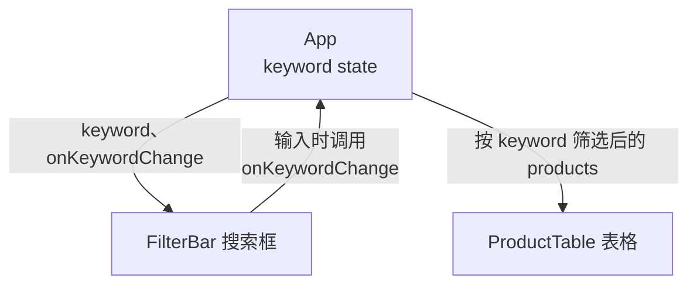

# 第 8B 章 状态提升：两个兄弟组件共用一份数据

## 这一章解决什么问题

表格上方要加一个搜索框：输入「探头」，表格只显示名称或编号里含「探头」的行。搜索框 `FilterBar` 和表格 `ProductTable` 是两个兄弟组件，兄弟之间不能直接传数据。关键字该放在哪里，两个组件才都能用？

本章只讲一个技术点：**状态提升**。

## 开始之前

- 上一章你已经会了：回调 props，子组件调用父组件给的函数报告事件。
- 起点代码：仓库 `code/ch08A/price-list`（不含练习答案）。在 `D:\react-study\price-list` 执行 `npm run dev`。
- 预计耗时：25 分钟。

## 正文

### 8B.1 状态提升是什么

**白话定义**：状态提升（lifting state up）是指：两个兄弟组件要用同一份数据时，把 state 移到它们**最近的共同父组件**里，再通过 props 分别传下去。

**业务场景**：搜索框 `FilterBar` 里输入「探头」，表格 `ProductTable` 只显示名称或编号里含「探头」的行。关键字 `keyword` 两个组件都要用，所以放在它们共同的父组件 `App` 里。

**反例（什么时候不该用）**：只有一个组件用的 state 不要提升。提得越高，这个 state 一变，重新渲染的组件就越多，代码也要多传一层 props。比如表单里正在输入的编号、名称，只有表单用，就留在 `ProductForm` 里。

#### 🖼 图解



搜索框是一个受控输入框（第 6A 章），只是它的 `value` 和 `onChange` 不来自自己的 state，而是来自父组件的 props。

### 8B.2 加搜索框

#### 💻 最小可运行代码

新建 `src/components/FilterBar.tsx`：

```tsx
// src/components/FilterBar.tsx
// 搜索框。它自己不存关键字：值从父组件传进来，用户输入时调用 onKeywordChange 通知父组件
type FilterBarProps = {
  keyword: string
  onKeywordChange: (keyword: string) => void
}

export function FilterBar({ keyword, onKeywordChange }: FilterBarProps) {
  return (
    <label className="filter-bar">
      搜索 <input value={keyword} placeholder="编号或名称" onChange={(e) => onKeywordChange(e.target.value)} />
    </label>
  )
}
```

用下面的内容整个替换 `src/index.css`（末尾多了 `.filter-bar` 一行）：

```css
/* src/index.css */
/* 全局样式先保持最少，第 10A 章再整理 */
body {
  margin: 24px;
  font-family: system-ui, 'Microsoft YaHei', sans-serif;
}

.subtitle {
  color: #666;
}

.card {
  border: 1px solid #ddd;
  border-radius: 6px;
  padding: 8px 16px;
  margin-bottom: 12px;
  max-width: 360px;
}

.panel {
  border-left: 4px solid #3b82f6;
  padding-left: 12px;
  margin-bottom: 16px;
}

.product-table {
  border-collapse: collapse;
  margin-bottom: 16px;
}

.product-table th,
.product-table td {
  border: 1px solid #ddd;
  padding: 6px 10px;
}

.out-of-stock {
  margin-left: 6px;
  padding: 0 6px;
  color: #fff;
  background: #dc2626;
  border-radius: 4px;
  font-size: 12px;
}

.low {
  color: #dc2626;
}

.empty {
  color: #999;
}

.product-form label { display: block; margin: 6px 0; }
.error { display: block; color: #dc2626; font-size: 14px; }
.success { color: #16a34a; }
.filter-bar { display: block; margin-bottom: 8px; }
```

然后用下面的内容整个替换 `src/App.tsx`。和上一章相比改了四处：import 区多了 `FilterBar`；多了 `keyword` 这个 state；`else` 分支里先筛选出 `visible` 再传给表格；`{content}` 上面多了 `<FilterBar ... />`。

```tsx
// src/App.tsx
import { useEffect, useState } from 'react'
import type { ReactNode } from 'react'
import type { Product } from './types.ts'
import { PageHeader } from './components/PageHeader.tsx'
import { FilterBar } from './components/FilterBar.tsx'
import { ProductTable } from './components/ProductTable.tsx'
import { ProductForm } from './components/ProductForm.tsx'
import { PageFooter } from './components/PageFooter.tsx'

type LoadState =
  | { status: 'loading' }
  | { status: 'error'; message: string }
  | { status: 'success'; products: Product[] }

function App() {
  const [state, setState] = useState<LoadState>({ status: 'loading' })
  // 状态提升：搜索框和表格都要用 keyword，所以放在它们共同的父组件 App 里
  const [keyword, setKeyword] = useState('')

  useEffect(() => {
    let ignore = false

    async function load() {
      try {
        // 模拟慢网络，便于看到「加载中」。正式代码删掉这一行
        await new Promise((resolve) => setTimeout(resolve, 1000))
        const response = await fetch('/products.json')
        if (!response.ok) {
          throw new Error(`服务器返回 ${response.status}`)
        }
        const products: Product[] = await response.json()
        if (!ignore) {
          setState({ status: 'success', products })
        }
      } catch (err) {
        if (!ignore) {
          setState({ status: 'error', message: err instanceof Error ? err.message : String(err) })
        }
      }
    }

    load()
    return () => {
      ignore = true
    }
  }, [])

  const count = state.status === 'success' ? state.products.length : 0

  useEffect(() => {
    document.title = `产品价格清单（${count} 种）`
  }, [count])

  function handleAdd(product: Product) {
    if (state.status !== 'success') return
    // 添加：展开旧数组，在末尾放新产品，得到一个新数组
    setState({ status: 'success', products: [...state.products, product] })
  }

  function handleDelete(id: number) {
    if (state.status !== 'success') return
    setState({ status: 'success', products: state.products.filter((p) => p.id !== id) })
  }

  function handleRestock(id: number) {
    if (state.status !== 'success') return
    setState({
      status: 'success',
      products: state.products.map((p) => (p.id === id ? { ...p, stock: p.stock + 1 } : p)),
    })
  }

  let content: ReactNode
  if (state.status === 'loading') {
    content = <p>加载中…</p>
  } else if (state.status === 'error') {
    content = <p className="error">加载失败：{state.message}</p>
  } else {
    // 筛选结果是派生值：由 products 和 keyword 现算，不另存 state
    const k = keyword.trim().toLowerCase()
    const visible = state.products.filter(
      (p) => p.name.toLowerCase().includes(k) || p.code.toLowerCase().includes(k),
    )
    content = <ProductTable products={visible} onDelete={handleDelete} onRestock={handleRestock} />
  }

  return (
    <main>
      <PageHeader />
      <p>共 {count} 种产品</p>
      {/* 把值和「修改它的函数」一起交给搜索框 */}
      <FilterBar keyword={keyword} onKeywordChange={setKeyword} />
      {content}
      <ProductForm onAdd={handleAdd} />
      <PageFooter />
    </main>
  )
}

export default App
```

筛选那几行用到的字符串方法：

| 写法 | 作用 | 例子 |
| --- | --- | --- |
| `trim()` | 去掉首尾空格 | `' 探头 '.trim()` 得到 `'探头'` |
| `toLowerCase()` | 转成小写，让搜索不区分大小写 | `'C-001'.toLowerCase()` 得到 `'c-001'` |
| `includes(k)` | 是否包含 `k`；`k` 是空字符串时总是 `true`，所以搜索框为空时显示全部 | `'凸阵探头'.includes('探头')` 得到 `true` |

#### 🔍 拆解运行结果

实测：

| 搜索框输入 | 表格显示 |
| --- | --- |
| `探头` | 凸阵探头 C5-2、线阵探头 L12-5、探头保护套 |
| `c-00`（小写） | 耦合剂 250ml、探头保护套（编号 C-001、C-002） |
| `xyz` | 暂无产品 |

「共 5 种产品」不随搜索变化：它用完整的 `state.products`，表格用筛选后的 `visible`。筛选结果是派生值（第 6C 章），不另存 state。

`onKeywordChange={setKeyword}` 能直接传，因为 `setKeyword` 本身就是「接收一个字符串」的函数，正好符合 `(keyword: string) => void`。

#### 改坏一处试试

**① 传成调用结果。** 写成 `onKeywordChange={setKeyword('')}`，`npx tsc -b` 报：

```text
src/App.tsx(93,36): error TS2322: Type 'void' is not assignable to type '(keyword: string) => void'.
```

和第 4B 章一样：要传函数本身，不是调用结果。

**② 少传修改函数。** 删掉 ` onKeywordChange={setKeyword}`，报：

```text
src/App.tsx(19,19): error TS6133: 'setKeyword' is declared but its value is never read.
src/App.tsx(93,8): error TS2741: Property 'onKeywordChange' is missing in type '{ keyword: string; }' but required in type 'FilterBarProps'.
```

只给值不给修改函数，搜索框就成了只读的。

每次实验后改回。

## ⚠️ 踩坑警告

| 现象 | 原因 | 怎么改 |
| --- | --- | --- |
| 搜索框能输入，表格却不筛选 | 关键字只存在 `FilterBar` 自己的 state 里，`App` 拿不到 | 关键字放在共同父组件 `App`，`FilterBar` 通过 props 接收值和修改函数 |
| 关键字在 `App` 里了，表格还是显示全部 | 筛选后仍把 `state.products` 传给了表格 | 表格要传筛选后的 `visible` |
| 把表单的输入框内容也提升到了 `App`，每输入一个字整个页面都重新渲染 | 只有一个组件用的 state 被不必要地提升了 | 只提升确实被多个组件共用的 state |

## 🎯 动手练习

**练习 1：按分类筛选**

在搜索框后面加分类下拉框（全部 / 探头 / 主机 / 耗材），和关键字同时生效。分类的 state 也放在 `App`。

验收标准：

- 选「耗材」：只显示耦合剂 250ml、探头保护套。
- 再在搜索框输入「保护」：只剩探头保护套。
- 选回「全部」、清空搜索框：5 行都回来。

**练习 2：清除按钮**

在搜索框后面加「清除」按钮，点了搜索框变空、表格按当前分类显示。不要给 `FilterBar` 加新的 prop。

验收标准：

- 选「耗材」、输入「保护」后点「清除」：搜索框变空，表格显示两种耗材。

卡住了看文末参考答案。

## 📌 一句话总结

兄弟组件共用的 state 放到共同父组件，用 props 传值和修改函数。

## 下一章

`App` 里加载数据、增删改的代码和页面结构混在一起，第 9C 章的详情页也要加载产品。第 8C 章把这套逻辑抽成自定义 Hook `useProducts`。

---

<!-- 以下是参考答案，先自己动手，卡住了再往下翻 -->


## 参考答案

两个练习都改 `FilterBar.tsx` 和 `App.tsx`，下面是都做完后的版本。

### 练习 1

思路：分类和关键字一样是 `FilterBar` 与表格共用的数据，所以提升到 `App`。筛选条件用 `&&` 组合：分类为「全部」或等于产品分类，并且关键字匹配。`FilterBar` 里有两个 `label` 和一个按钮并列，外层改成 `div`。

### 练习 2

思路：清除就是「通知父组件把关键字改成空字符串」，调用已有的 `onKeywordChange('')` 就行。

```tsx
// src/components/FilterBar.tsx
// 两个练习都做完后的版本。两个值都由父组件保管，这里只负责显示和通知
type FilterBarProps = {
  keyword: string
  onKeywordChange: (keyword: string) => void
  // 练习 1：分类
  category: string
  onCategoryChange: (category: string) => void
}

export function FilterBar({ keyword, onKeywordChange, category, onCategoryChange }: FilterBarProps) {
  return (
    <div className="filter-bar">
      <label>
        搜索 <input value={keyword} placeholder="编号或名称" onChange={(e) => onKeywordChange(e.target.value)} />
      </label>{' '}
      {/* 练习 2：清除也是「通知父组件把关键字改成空字符串」，不需要新的 prop */}
      <button type="button" onClick={() => onKeywordChange('')}>清除</button>{' '}
      <label>
        分类{' '}
        <select value={category} onChange={(e) => onCategoryChange(e.target.value)}>
          <option value="全部">全部</option>
          <option value="探头">探头</option>
          <option value="主机">主机</option>
          <option value="耗材">耗材</option>
        </select>
      </label>
    </div>
  )
}
```

```tsx
// src/App.tsx
// 两个练习都做完后的版本
import { useEffect, useState } from 'react'
import type { ReactNode } from 'react'
import type { Product } from './types.ts'
import { PageHeader } from './components/PageHeader.tsx'
import { FilterBar } from './components/FilterBar.tsx'
import { ProductTable } from './components/ProductTable.tsx'
import { ProductForm } from './components/ProductForm.tsx'
import { PageFooter } from './components/PageFooter.tsx'

type LoadState =
  | { status: 'loading' }
  | { status: 'error'; message: string }
  | { status: 'success'; products: Product[] }

function App() {
  const [state, setState] = useState<LoadState>({ status: 'loading' })
  // 状态提升：搜索框和表格都要用 keyword，所以放在它们共同的父组件 App 里
  const [keyword, setKeyword] = useState('')
  // 练习 1：分类筛选同样是搜索栏和表格共用的，也提升到 App
  const [category, setCategory] = useState('全部')

  useEffect(() => {
    let ignore = false

    async function load() {
      try {
        // 模拟慢网络，便于看到「加载中」。正式代码删掉这一行
        await new Promise((resolve) => setTimeout(resolve, 1000))
        const response = await fetch('/products.json')
        if (!response.ok) {
          throw new Error(`服务器返回 ${response.status}`)
        }
        const products: Product[] = await response.json()
        if (!ignore) {
          setState({ status: 'success', products })
        }
      } catch (err) {
        if (!ignore) {
          setState({ status: 'error', message: err instanceof Error ? err.message : String(err) })
        }
      }
    }

    load()
    return () => {
      ignore = true
    }
  }, [])

  const count = state.status === 'success' ? state.products.length : 0

  useEffect(() => {
    document.title = `产品价格清单（${count} 种）`
  }, [count])

  function handleAdd(product: Product) {
    if (state.status !== 'success') return
    // 添加：展开旧数组，在末尾放新产品，得到一个新数组
    setState({ status: 'success', products: [...state.products, product] })
  }

  function handleDelete(id: number) {
    if (state.status !== 'success') return
    setState({ status: 'success', products: state.products.filter((p) => p.id !== id) })
  }

  function handleRestock(id: number) {
    if (state.status !== 'success') return
    setState({
      status: 'success',
      products: state.products.map((p) => (p.id === id ? { ...p, stock: p.stock + 1 } : p)),
    })
  }

  let content: ReactNode
  if (state.status === 'loading') {
    content = <p>加载中…</p>
  } else if (state.status === 'error') {
    content = <p className="error">加载失败：{state.message}</p>
  } else {
    // 筛选结果是派生值：由 products、keyword、category 现算，不另存 state
    const k = keyword.trim().toLowerCase()
    const visible = state.products.filter(
      (p) =>
        (category === '全部' || p.category === category) &&
        (p.name.toLowerCase().includes(k) || p.code.toLowerCase().includes(k)),
    )
    content = <ProductTable products={visible} onDelete={handleDelete} onRestock={handleRestock} />
  }

  return (
    <main>
      <PageHeader />
      <p>共 {count} 种产品</p>
      {/* 把值和「修改它的函数」一起交给搜索框 */}
      <FilterBar
        keyword={keyword}
        onKeywordChange={setKeyword}
        category={category}
        onCategoryChange={setCategory}
      />
      {content}
      <ProductForm onAdd={handleAdd} />
      <PageFooter />
    </main>
  )
}

export default App
```
