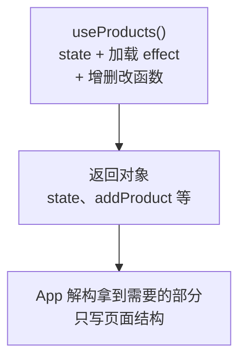

# 第 8C 章 自定义 Hook：把取数逻辑抽成 useProducts

## 这一章解决什么问题

`App` 里加载数据的 effect、增删改函数和页面结构混在一起，已经一百多行。第 9 章的产品详情页也要加载 `products.json`，难道把这一大段再复制一遍？本章把「state + effect + 修改函数」这一整套逻辑抽成一个函数 `useProducts()`，哪个组件要用就调用一次。

本章只讲一个技术点：**自定义 Hook**。

## 开始之前

- 上一章你已经会了：状态提升，搜索框和表格共用 `App` 里的 `keyword`。
- 起点代码：仓库 `code/ch08B/price-list`（不含练习答案）。在 `D:\react-study\price-list` 执行 `npm run dev`。
- 预计耗时：30 分钟。

## 正文

### 8C.1 自定义 Hook 是什么

**白话定义**：自定义 Hook（custom hook）是一个名字以 `use` 开头、内部调用了其他 Hook 的普通函数。它把一段「state + effect + 修改函数」打包起来，组件调用它就得到这套逻辑。

**业务场景**：第 9 章的产品详情页也要加载 `products.json`。把加载和增删改的代码从 `App` 里抽成 `useProducts()`，列表页、详情页各调用一次就行，`App` 也只剩页面结构。

**反例（什么时候不该用）**：自定义 Hook 共享的是**逻辑**，不是**数据**。两个组件各调用一次 `useProducts()`，就是两份独立的 state、两次请求，一边删了产品另一边不会变（下面「改坏一处」实测）。要多个组件看到同一份数据，用第 8B 章的状态提升。另外，不包含任何 Hook 的工具函数（比如格式化金额）写成普通函数，不要加 `use` 前缀。

#### 🖼 图解



### 8C.2 抽出 useProducts

#### 💻 最小可运行代码

新建文件夹 `src/hooks`，在里面新建 `useProducts.ts`（没有 JSX，所以是 `.ts`）。把 `App` 里的 `LoadState`、加载 effect、增删改函数搬进来：

```ts
// src/hooks/useProducts.ts
// 自定义 Hook：把「加载产品 + 增删改」这一整套逻辑打包，任何组件调用它都能用
import { useEffect, useState } from 'react'
import type { Product } from '../types.ts'

export type LoadState =
  | { status: 'loading' }
  | { status: 'error'; message: string }
  | { status: 'success'; products: Product[] }

// 名字必须以 use 开头：React 和 lint 工具靠这个识别它是 Hook，按 Hook 的规则检查
export function useProducts() {
  const [state, setState] = useState<LoadState>({ status: 'loading' })

  useEffect(() => {
    let ignore = false

    async function load() {
      try {
        // 模拟慢网络，便于看到「加载中」。正式代码删掉这一行
        await new Promise((resolve) => setTimeout(resolve, 1000))
        const response = await fetch('/products.json')
        if (!response.ok) {
          throw new Error(`服务器返回 ${response.status}`)
        }
        const products: Product[] = await response.json()
        if (!ignore) {
          setState({ status: 'success', products })
        }
      } catch (err) {
        if (!ignore) {
          setState({ status: 'error', message: err instanceof Error ? err.message : String(err) })
        }
      }
    }

    load()
    return () => {
      ignore = true
    }
  }, [])

  function addProduct(product: Product) {
    if (state.status !== 'success') return
    // 添加：展开旧数组，在末尾放新产品，得到一个新数组
    setState({ status: 'success', products: [...state.products, product] })
  }

  function deleteProduct(id: number) {
    if (state.status !== 'success') return
    setState({ status: 'success', products: state.products.filter((p) => p.id !== id) })
  }

  function restockProduct(id: number) {
    if (state.status !== 'success') return
    setState({
      status: 'success',
      products: state.products.map((p) => (p.id === id ? { ...p, stock: p.stock + 1 } : p)),
    })
  }

  // 返回一个对象，调用方按名字取自己需要的部分
  return { state, addProduct, deleteProduct, restockProduct }
}
```

用下面的内容整个替换 `src/App.tsx`：

```tsx
// src/App.tsx
import { useEffect, useState } from 'react'
import type { ReactNode } from 'react'
import { useProducts } from './hooks/useProducts.ts'
import { PageHeader } from './components/PageHeader.tsx'
import { FilterBar } from './components/FilterBar.tsx'
import { ProductTable } from './components/ProductTable.tsx'
import { ProductForm } from './components/ProductForm.tsx'
import { PageFooter } from './components/PageFooter.tsx'

function App() {
  // 加载和增删改的细节都在 useProducts 里，App 只拿结果
  const { state, addProduct, deleteProduct, restockProduct } = useProducts()
  // 状态提升：搜索框和表格都要用 keyword，所以放在它们共同的父组件 App 里
  const [keyword, setKeyword] = useState('')

  const count = state.status === 'success' ? state.products.length : 0

  useEffect(() => {
    document.title = `产品价格清单（${count} 种）`
  }, [count])

  let content: ReactNode
  if (state.status === 'loading') {
    content = <p>加载中…</p>
  } else if (state.status === 'error') {
    content = <p className="error">加载失败：{state.message}</p>
  } else {
    // 筛选结果是派生值：由 products 和 keyword 现算，不另存 state
    const k = keyword.trim().toLowerCase()
    const visible = state.products.filter(
      (p) => p.name.toLowerCase().includes(k) || p.code.toLowerCase().includes(k),
    )
    // 把 useProducts 给的函数直接作为回调传下去
    content = <ProductTable products={visible} onDelete={deleteProduct} onRestock={restockProduct} />
  }

  return (
    <main>
      <PageHeader />
      <p>共 {count} 种产品</p>
      {/* 把值和「修改它的函数」一起交给搜索框 */}
      <FilterBar keyword={keyword} onKeywordChange={setKeyword} />
      {content}
      <ProductForm onAdd={addProduct} />
      <PageFooter />
    </main>
  )
}

export default App
```

#### 🔍 拆解运行结果

页面行为和上一章完全一样，`npm run lint` 显示 `Found 0 warnings and 0 errors.`。`App` 从一百多行变成五十行，只描述「页面由什么组成」。

这次重构把上一章的 `App` 拆成了两部分：

| 原来在 `App` 里的代码 | 现在在哪 | 名字变化 |
| --- | --- | --- |
| `type LoadState = ...` | `useProducts.ts`，并加了 `export`，第 9 章别的文件要用 | 不变 |
| `useState<LoadState>` 和加载数据的 `useEffect` | `useProducts.ts` | 不变 |
| `handleAdd`、`handleDelete`、`handleRestock` | `useProducts.ts` | 改成 `addProduct`、`deleteProduct`、`restockProduct`：它们现在是「数据的操作」，不再是某个页面的事件处理 |
| `keyword`、筛选、标题 `useEffect`、JSX | 留在 `App` | 不变 |

`const { state, addProduct, deleteProduct, restockProduct } = useProducts()` 是对象解构：`useProducts()` 返回一个有 4 个字段的对象，这一行按名字把它们取出来，变成 4 个变量。

自定义 Hook 里的 `useState`、`useEffect` 就像直接写在调用它的组件里一样：state 属于调用它的那个组件（这里是 `App`），Hook 的调用规则（最顶层、不能放在 `if` 里，第 4A 章）对它同样适用。

#### 改坏一处试试

**① 调用两次，看是不是同一份数据。** 在 `App` 里 `keyword` 那行下面临时加 `const other = useProducts()`，并在「共 x 种产品」下面加 `<p>另一份：{other.state.status === 'success' ? other.state.products.length : 0} 种</p>`。刷新后删除「耦合剂」，实测显示：

```text
共 4 种产品
另一份：5 种
```

「网络」里的 `products.json` 请求也从 2 次变成 4 次：两份完全独立的 state。实验完删掉这两行。

**② 在不以 `use` 开头的函数里调用 Hook。** 在 `App` 里写一个 `function loadCount() { return useProducts() }`，`tsc` 不报错，但 `npm run lint` 报 `React Hook "useProducts" is called in function "loadCount" that is neither a React function component nor a custom React Hook function.`，并提示 Hook 的名字必须以 `use` 开头。

## ⚠️ 踩坑警告

| 现象 | 原因 | 怎么改 |
| --- | --- | --- |
| 两个组件都调用了 `useProducts()`，一边删了产品另一边没变 | 自定义 Hook 只共享逻辑，每次调用都是独立的 state | 在共同的父组件里调用一次，把结果用 props 传下去 |
| `npm run lint` 报 `React Hook "useXxx" is called in function "..." that is neither a React function component nor a custom React Hook function.` | 在普通函数里调用了 Hook | Hook 只能在组件或另一个 `use` 开头的函数的最顶层调用 |
| 自己写的函数叫 `getProducts`，里面用了 `useState`，lint 报错 | 名字不以 `use` 开头，React 和 lint 工具不把它当 Hook | 改名为 `useXxx` |
| 把 `formatPrice` 这样的纯工具函数也命名成 `useFormatPrice` | 它里面没有调用任何 Hook，加了 `use` 反而要受 Hook 规则限制，不能在 `if` 里用 | 不含 Hook 的函数写成普通函数（第 2C 章练习 2） |

## 🎯 动手练习

**练习 1：写一个 `useDocumentTitle` Hook**

新建 `src/hooks/useDocumentTitle.ts`，导出 `useDocumentTitle(title: string)`，把 `App` 里改标题的 `useEffect` 换成一行 `useDocumentTitle(...)`。

验收标准：

- 刷新后标题是「产品价格清单（5 种）」，删除一行后变成「（4 种）」。
- `App.tsx` 里不再有 `useEffect`，`npm run lint` 和 `npm run build` 都通过。

**练习 2：给 useProducts 加一个 reload**

`useProducts` 多返回一个函数 `reload()`，调用后重新加载数据。`App` 在「共 5 种产品」后面加「刷新数据」按钮调用它。

验收标准：

- 删除「耦合剂」后点「刷新数据」：先显示「加载中…」，约 1 秒后 5 行都回来，标题回到「（5 种）」。
- `App.tsx` 里没有新增 state。

提示：第 7D 章练习 1 的重试就是这样做的，只是这次写在 Hook 里面。

卡住了看文末参考答案。

## 📌 一句话总结

把 state、effect 和操作函数打包成 useXxx，共享的是逻辑，不是数据。

## 下一章

所有内容都挤在一个页面上。第 9 章加路由，点产品名进入详情页，地址栏跟着变。

---

<!-- 以下是参考答案，先自己动手，卡住了再往下翻 -->


## 参考答案

### 练习 1

思路：把 `useEffect` 原样搬进一个 `use` 开头的函数，要变化的部分（标题文字）作为参数传进来，并写进依赖数组。

```ts
// src/hooks/useDocumentTitle.ts
// 练习 1：把「随数据更新标签页标题」抽成自定义 Hook，任何页面一行就能用
import { useEffect } from 'react'

export function useDocumentTitle(title: string) {
  useEffect(() => {
    document.title = title
  }, [title])
}
```

### 练习 2

思路：重新加载的细节（`reloadKey`、切回加载中）都在 Hook 里面，`App` 只拿到一个 `reload` 函数。这正是自定义 Hook 的好处：调用方不用知道内部怎么实现。

```ts
// src/hooks/useProducts.ts
// 练习 2 做完后的版本
// 自定义 Hook：把「加载产品 + 增删改」这一整套逻辑打包，任何组件调用它都能用
import { useEffect, useState } from 'react'
import type { Product } from '../types.ts'

export type LoadState =
  | { status: 'loading' }
  | { status: 'error'; message: string }
  | { status: 'success'; products: Product[] }

// 名字必须以 use 开头：React 和 lint 工具靠这个识别它是 Hook，按 Hook 的规则检查
export function useProducts() {
  const [state, setState] = useState<LoadState>({ status: 'loading' })
  // 练习 2：每调用一次 reload 加 1，它在依赖数组里，变了就重新加载
  const [reloadKey, setReloadKey] = useState(0)

  useEffect(() => {
    let ignore = false

    async function load() {
      try {
        // 模拟慢网络，便于看到「加载中」。正式代码删掉这一行
        await new Promise((resolve) => setTimeout(resolve, 1000))
        const response = await fetch('/products.json')
        if (!response.ok) {
          throw new Error(`服务器返回 ${response.status}`)
        }
        const products: Product[] = await response.json()
        if (!ignore) {
          setState({ status: 'success', products })
        }
      } catch (err) {
        if (!ignore) {
          setState({ status: 'error', message: err instanceof Error ? err.message : String(err) })
        }
      }
    }

    load()
    return () => {
      ignore = true
    }
  }, [reloadKey])

  function addProduct(product: Product) {
    if (state.status !== 'success') return
    // 添加：展开旧数组，在末尾放新产品，得到一个新数组
    setState({ status: 'success', products: [...state.products, product] })
  }

  function deleteProduct(id: number) {
    if (state.status !== 'success') return
    setState({ status: 'success', products: state.products.filter((p) => p.id !== id) })
  }

  function restockProduct(id: number) {
    if (state.status !== 'success') return
    setState({
      status: 'success',
      products: state.products.map((p) => (p.id === id ? { ...p, stock: p.stock + 1 } : p)),
    })
  }

  // 练习 2：先切回「加载中」，再让 effect 重新执行。调用方不需要知道 reloadKey 的存在
  function reload() {
    setState({ status: 'loading' })
    setReloadKey(reloadKey + 1)
  }

  // 返回一个对象，调用方按名字取自己需要的部分
  return { state, addProduct, deleteProduct, restockProduct, reload }
}
```

两个练习都做完后的 `App.tsx`：

```tsx
// src/App.tsx
// 两个练习都做完后的版本
import { useState } from 'react'
import type { ReactNode } from 'react'
import { useProducts } from './hooks/useProducts.ts'
import { useDocumentTitle } from './hooks/useDocumentTitle.ts'
import { PageHeader } from './components/PageHeader.tsx'
import { FilterBar } from './components/FilterBar.tsx'
import { ProductTable } from './components/ProductTable.tsx'
import { ProductForm } from './components/ProductForm.tsx'
import { PageFooter } from './components/PageFooter.tsx'

function App() {
  // 加载和增删改的细节都在 useProducts 里，App 只拿结果
  const { state, addProduct, deleteProduct, restockProduct, reload } = useProducts()
  // 状态提升：搜索框和表格都要用 keyword，所以放在它们共同的父组件 App 里
  const [keyword, setKeyword] = useState('')

  const count = state.status === 'success' ? state.products.length : 0

  // 练习 1：原来的 useEffect 换成一行自定义 Hook
  useDocumentTitle(`产品价格清单（${count} 种）`)

  let content: ReactNode
  if (state.status === 'loading') {
    content = <p>加载中…</p>
  } else if (state.status === 'error') {
    content = <p className="error">加载失败：{state.message}</p>
  } else {
    // 筛选结果是派生值：由 products 和 keyword 现算，不另存 state
    const k = keyword.trim().toLowerCase()
    const visible = state.products.filter(
      (p) => p.name.toLowerCase().includes(k) || p.code.toLowerCase().includes(k),
    )
    // 把 useProducts 给的函数直接作为回调传下去
    content = <ProductTable products={visible} onDelete={deleteProduct} onRestock={restockProduct} />
  }

  return (
    <main>
      <PageHeader />
      <p>
        共 {count} 种产品{' '}
        {/* 练习 2：重新加载的细节在 useProducts 里，这里只调用 reload */}
        <button type="button" onClick={reload}>刷新数据</button>
      </p>
      {/* 把值和「修改它的函数」一起交给搜索框 */}
      <FilterBar keyword={keyword} onKeywordChange={setKeyword} />
      {content}
      <ProductForm onAdd={addProduct} />
      <PageFooter />
    </main>
  )
}

export default App
```
