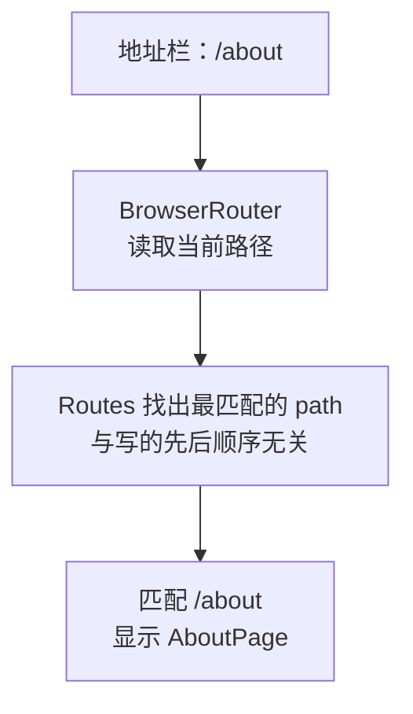
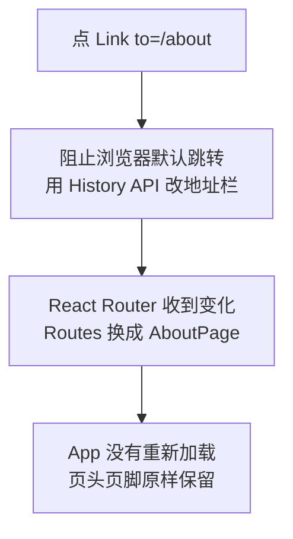
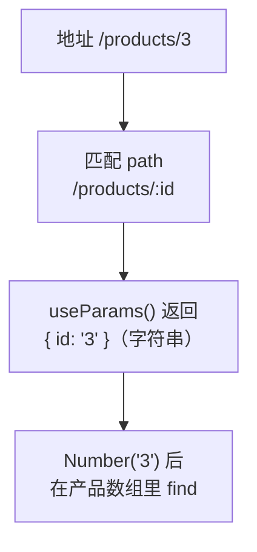

# 第 9 章 路由：多个页面

## 这一章解决什么问题

点产品名，要进入这个产品的详情页；地址栏显示 `/products/1`，把地址发给同事，对方打开也是这个产品；按浏览器的「后退」能回到列表。现在所有内容都在一个页面里，做不到这些。本章用 React Router 实现多页面。

## 开始之前

- 上一章你已经会了：回调 props、状态提升、自定义 Hook `useProducts`。
- 起点代码：仓库 `code/ch08/price-list`。预计耗时：50 分钟。

安装 React Router（先在终端按 `Ctrl + C` 停掉开发服务器）：

```powershell
# 在 D:\react-study\price-list 目录执行
npm install react-router@8.5.1
npm run dev
```

本教程实测版本是 `react-router` 8.5.1，它要求 Node.js ≥ 22.22。React Router 有几种用法，本章用最简单的「声明式」写法（`BrowserRouter` + `Routes` + `Route`）。网上很多教程还在用 v6 的 `react-router-dom` 包，v7 起合并进了 `react-router`，本项目不需要装 `react-router-dom`。

先把列表页从 `App` 里搬出来。新建文件夹 `src/pages`，在里面新建 `ListPage.tsx`：把第 8 章 `App.tsx` 的内容复制过去，然后改 5 处：

1. 第一行注释改成 `// src/pages/ListPage.tsx`。
2. import 路径里的 `./` 改成 `../`（文件深了一层），删掉 `PageHeader`、`PageFooter` 两行 import。
3. `function App() {` 改成 `export function ListPage() {`。
4. `return` 里的 `<main>` 和 `</main>` 改成 `<section>` 和 `</section>`，删掉 `<PageHeader />` 和 `<PageFooter />`（它们留在 `App` 里，所有页面共用）。
5. 删掉最后的 `export default App`。

改完的完整文件：

```tsx
// src/pages/ListPage.tsx
// 产品列表页：第 8 章 App 的内容原样搬过来，去掉页头页脚（它们留在 App 里，所有页面共用）
import { useEffect, useState } from 'react'
import type { ReactNode } from 'react'
import { useProducts } from '../hooks/useProducts.ts'
import { FilterBar } from '../components/FilterBar.tsx'
import { ProductTable } from '../components/ProductTable.tsx'
import { ProductForm } from '../components/ProductForm.tsx'

export function ListPage() {
  // 加载和增删改的细节都在 useProducts 里，列表页只拿结果
  const { state, addProduct, deleteProduct, restockProduct } = useProducts()
  // 状态提升：搜索框和表格都要用 keyword，所以放在它们共同的父组件 App 里
  const [keyword, setKeyword] = useState('')

  const count = state.status === 'success' ? state.products.length : 0

  useEffect(() => {
    document.title = `产品价格清单（${count} 种）`
  }, [count])

  let content: ReactNode
  if (state.status === 'loading') {
    content = <p>加载中…</p>
  } else if (state.status === 'error') {
    content = <p className="error">加载失败：{state.message}</p>
  } else {
    // 筛选结果是派生值：由 products 和 keyword 现算，不另存 state
    const k = keyword.trim().toLowerCase()
    const visible = state.products.filter(
      (p) => p.name.toLowerCase().includes(k) || p.code.toLowerCase().includes(k),
    )
    // 把 useProducts 给的函数直接作为回调传下去
    content = <ProductTable products={visible} onDelete={deleteProduct} onRestock={restockProduct} />
  }

  return (
    <section>
      <p>共 {count} 种产品</p>
      {/* 把值和「修改它的函数」一起交给搜索框 */}
      <FilterBar keyword={keyword} onKeywordChange={setKeyword} />
      {content}
      <ProductForm onAdd={addProduct} />
    </section>
  )
}
```

为什么页头、页脚不放进 `ListPage`：它们每个页面都要显示，放在 `App` 里写一次，切换页面时只换中间的部分。

再新建两个简单页面：

```tsx
// src/pages/AboutPage.tsx
// 一个静态页面，用来演示多个路由
export function AboutPage() {
  return (
    <section>
      <h2>关于</h2>
      <p>本页面列出超声事业部的产品价格，仅供内部报价参考。</p>
    </section>
  )
}
```

```tsx
// src/pages/NotFoundPage.tsx
// 地址和路由表里的哪一条都对不上时显示
import { Link } from 'react-router'

export function NotFoundPage() {
  return (
    <section>
      <h2>页面不存在</h2>
      <p>
        <Link to="/">返回产品清单</Link>
      </p>
    </section>
  )
}
```

## 正文

### 9.1 路由表

**白话定义**：路由（routing）是「根据地址栏的路径决定显示哪个页面」。路由表就是一组「路径 → 页面组件」的对应关系，写成 `<Routes>` 里的多个 `<Route path="..." element={...} />`。

**业务场景**：`/` 显示产品清单，`/about` 显示关于页，其他地址显示「页面不存在」。这些都在浏览器里完成，服务器始终只返回同一个 `index.html`。这种网站叫单页应用（SPA，Single Page Application）。

**反例（什么时候不该用）**：页面上的选项卡、展开/收起这类「切换显示内容、但没人需要收藏或分享这个状态」的情况，用 state 就够了，不需要做成路由。

#### 🖼 图解



#### 💻 最小可运行代码

用下面的内容整个替换 `src/main.tsx`（只多了 `BrowserRouter`）：

```tsx
// src/main.tsx
// 整个前端的入口：index.html 里的 <script> 只引用这一个文件
import { StrictMode } from 'react'
import { createRoot } from 'react-dom/client'
import { BrowserRouter } from 'react-router'
// CSS 也能 import：Vite 会把它变成 <style> 插进页面
import './index.css'
import App from './App.tsx'

// 找到 index.html 里的 <div id="root">，React 从此接管它里面的内容
// 末尾的 ! 告诉 TypeScript：这个元素一定存在（否则它认为可能是 null）
createRoot(document.getElementById('root')!).render(
  // StrictMode 只在开发时做额外检查，打包后的正式版本不受影响
  <StrictMode>
    {/* BrowserRouter 用浏览器地址栏的路径决定显示哪个页面；包在最外层，里面的组件才能用路由功能 */}
    <BrowserRouter>
      <App />
    </BrowserRouter>
  </StrictMode>,
)
```

用下面的内容整个替换 `src/App.tsx`：

```tsx
// src/App.tsx（9.1 版本，9.2 节会再改）
// App 变成「外框」：页头、导航、页脚所有页面共用，中间按地址显示不同的页面
import { Route, Routes } from 'react-router'
import { PageHeader } from './components/PageHeader.tsx'
import { PageFooter } from './components/PageFooter.tsx'
import { ListPage } from './pages/ListPage.tsx'
import { AboutPage } from './pages/AboutPage.tsx'
import { NotFoundPage } from './pages/NotFoundPage.tsx'

function App() {
  return (
    <main>
      <PageHeader />
      {/* 路由表：React Router 找出与当前地址最匹配的那条 path，显示它的 element */}
      <Routes>
        <Route path="/" element={<ListPage />} />
        <Route path="/about" element={<AboutPage />} />
        {/* * 匹配任何地址，但只有别的路由都对不上时才会用它，相当于兜底 */}
        <Route path="*" element={<NotFoundPage />} />
      </Routes>
      <PageFooter />
    </main>
  )
}

export default App
```

#### 🔍 拆解运行结果

在地址栏分别输入：

| 地址 | 页头和页脚之间显示 |
| --- | --- |
| `http://localhost:5173/` | 产品清单（和第 8 章一样） |
| `http://localhost:5173/about` | 「关于」和那句说明 |
| `http://localhost:5173/xyz` | 「页面不存在」和「返回产品清单」链接 |

页头、页脚在 `<Routes>` 外面，所以每个页面都有。`element={<AboutPage />}` 传的是 JSX（一个具体要显示的元素），不是组件函数本身。

#### 改坏一处试试

- 写成 `element={AboutPage}`，报 `TS2322: Type '() => Element' is not assignable to type 'ReactNode'.`
- 把 `main.tsx` 里的 `<BrowserRouter>` 去掉，只留 `<App />`。页面空白，控制台报 `useRoutes() may be used only in the context of a <Router> component.`，并提示错误发生在 `<Routes>` 组件里。路由相关的组件和 Hook 必须放在 `BrowserRouter` 里面。

每次实验后改回。

### 9.2 Link

**白话定义**：`<Link to="/about">` 渲染成一个普通的 `<a>` 链接，但点击时**不让浏览器重新加载页面**，而是只改地址栏，再由 React Router 换掉显示的页面组件。

**业务场景**：页头下面加导航「产品清单 | 关于」，来回切换时页面不闪、不重新下载 JavaScript，浏览器的「后退」「前进」按钮照样能用。

**反例（什么时候不该用）**：链接到**本应用以外**的地址（比如公司官网、其他系统），用普通的 `<a href="https://...">`。`Link` 只用于本应用内部的页面。

#### 🖼 图解



#### 💻 最小可运行代码

用下面的内容整个替换 `src/App.tsx`：

```tsx
// src/App.tsx（9.2 版本，9.3 节会再改）
// App 变成「外框」：页头、导航、页脚所有页面共用，中间按地址显示不同的页面
import { Link, Route, Routes } from 'react-router'
import { PageHeader } from './components/PageHeader.tsx'
import { PageFooter } from './components/PageFooter.tsx'
import { ListPage } from './pages/ListPage.tsx'
import { AboutPage } from './pages/AboutPage.tsx'
import { NotFoundPage } from './pages/NotFoundPage.tsx'

function App() {
  return (
    <main>
      <PageHeader />
      <nav className="nav">
        {/* Link 改地址但不刷新页面；React Router 发现地址变了，换掉下面 Routes 里显示的页面 */}
        <Link to="/">产品清单</Link> | <Link to="/about">关于</Link>
      </nav>
      {/* 路由表：React Router 找出与当前地址最匹配的那条 path，显示它的 element */}
      <Routes>
        <Route path="/" element={<ListPage />} />
        <Route path="/about" element={<AboutPage />} />
        {/* * 匹配任何地址，但只有别的路由都对不上时才会用它，相当于兜底 */}
        <Route path="*" element={<NotFoundPage />} />
      </Routes>
      <PageFooter />
    </main>
  )
}

export default App
```

在 `src/index.css` 末尾加一行：

```css
.nav { margin-bottom: 12px; }
```

#### 🔍 拆解运行结果

点「关于」，地址变成 `/about`，中间换成关于页；点「产品清单」回到列表。实测：在页面上放一个标记值后点「关于」，标记**还在**，说明页面没有重新加载。

`F12` 在「元素」面板里看，`<Link to="/about">关于</Link>` 渲染出来就是 `<a href="/about">关于</a>`。区别在点击时：React Router 拦下了点击，自己处理跳转。

#### 改坏一处试试

把「关于」那个 `Link` 换成 `<a href="/about">关于</a>`，再点它。实测：地址同样变成 `/about`，但页面上的标记**消失**了，「网络」里重新请求了 `/src/main.tsx`，整个应用重新加载。对用户来说页面会闪一下；更麻烦的是所有 state 都回到初始值。改回 `Link`。另外，`Link` 的属性是 `to` 不是 `href`，写 `<Link href=...>` 会报 `Property 'href' does not exist on type ... LinkProps ...`。

### 9.3 URL 参数

**白话定义**：路由的 `path` 里以 `:` 开头的部分是参数（URL parameter），例如 `/products/:id`，它能匹配 `/products/1`、`/products/25`。页面组件里用 `useParams()` 取出参数的值。

**业务场景**：每个产品一个详情页，地址里带产品编号。不同产品共用一个 `ProductDetailPage` 组件，组件从地址里读出编号，去数据里找对应的产品。

**反例（什么时候不该用）**：筛选条件、排序方式这类**可选**的、可能有多个的值，不要硬塞进路径（比如 `/products/探头/价格升序`）。这类值一般放在查询字符串里（`?category=探头&sort=price`），本教程不展开。路径参数适合「标识是哪一个」的必需值。

#### 🖼 图解



#### 💻 最小可运行代码

新建 `src/pages/ProductDetailPage.tsx`：

```tsx
// src/pages/ProductDetailPage.tsx
// 产品详情页：地址是 /products/3 这种形式，从地址里取出 3，再找到对应的产品
import { Link, useParams } from 'react-router'
import { useProducts } from '../hooks/useProducts.ts'
import { ProductCard } from '../components/ProductCard.tsx'

export function ProductDetailPage() {
  // 路由表里写的是 :id，这里就按 id 取。地址里的值永远是字符串，也可能没有（undefined）
  const { id } = useParams()
  // 详情页自己加载一次数据（第 8 章说过：这和列表页那份是两份独立的数据）
  const { state } = useProducts()

  if (state.status === 'loading') {
    return <p>加载中…</p>
  }
  if (state.status === 'error') {
    return <p className="error">加载失败：{state.message}</p>
  }

  // 地址里的 '3' 是字符串，产品的 id 是数字，先转换再比较
  const product = state.products.find((p) => p.id === Number(id))

  return (
    <section>
      <p>
        <Link to="/">← 返回列表</Link>
      </p>
      {/* 第 3、4 章做的卡片在这里派上用场，自带询价数量 */}
      {product ? <ProductCard product={product} /> : <p className="empty">找不到编号为 {id} 的产品</p>}
    </section>
  )
}
```

用下面的内容整个替换 `src/App.tsx`。和 9.2 相比加了两行：import 区的 `ProductDetailPage`，以及路由表里的 `/products/:id` 这一条。`Routes` 会按「具体程度」选出最匹配的一条，和书写顺序无关：实测把 `*` 那一条挪到最前面，`/about`、`/products/2` 照样显示正确的页面。习惯上仍把 `*` 写在最后，读代码时一眼能看出它是兜底。

```tsx
// src/App.tsx
// App 变成「外框」：页头、导航、页脚所有页面共用，中间按地址显示不同的页面
import { Link, Route, Routes } from 'react-router'
import { PageHeader } from './components/PageHeader.tsx'
import { PageFooter } from './components/PageFooter.tsx'
import { ListPage } from './pages/ListPage.tsx'
import { AboutPage } from './pages/AboutPage.tsx'
import { ProductDetailPage } from './pages/ProductDetailPage.tsx'
import { NotFoundPage } from './pages/NotFoundPage.tsx'

function App() {
  return (
    <main>
      <PageHeader />
      <nav className="nav">
        {/* Link 改地址但不刷新页面；React Router 发现地址变了，换掉下面 Routes 里显示的页面 */}
        <Link to="/">产品清单</Link> | <Link to="/about">关于</Link>
      </nav>
      {/* 路由表：React Router 找出与当前地址最匹配的那条 path，显示它的 element */}
      <Routes>
        <Route path="/" element={<ListPage />} />
        <Route path="/about" element={<AboutPage />} />
        {/* :id 是参数，/products/1、/products/25 都匹配这一条 */}
        <Route path="/products/:id" element={<ProductDetailPage />} />
        {/* * 匹配任何地址，但只有别的路由都对不上时才会用它，相当于兜底 */}
        <Route path="*" element={<NotFoundPage />} />
      </Routes>
      <PageFooter />
    </main>
  )
}

export default App
```

最后让表格里的产品名可以点。用下面的内容整个替换 `src/components/ProductTable.tsx`。和第 8 章相比改了两处：顶部多了 `import { Link } from 'react-router'`；名称单元格里的 `{p.name}` 换成了 `<Link>`。

```tsx
// src/components/ProductTable.tsx
// 只负责显示表格。数据从 props 来；点了按钮不自己改数据，而是调用父组件给的函数「通知」它
import { Link } from 'react-router'
import type { Product } from '../types.ts'

type ProductTableProps = {
  products: Product[]
  // 回调 props：类型写清楚「调用时传什么参数、返回什么」。void 表示不关心返回值
  onDelete: (id: number) => void
  onRestock: (id: number) => void
}

export function ProductTable({ products, onDelete, onRestock }: ProductTableProps) {
  if (products.length === 0) {
    return <p className="empty">暂无产品</p>
  }

  return (
    <table className="product-table">
      <thead>
        <tr>
          <th>编号</th>
          <th>名称</th>
          <th>单价（元）</th>
          <th>库存</th>
          <th>操作</th>
        </tr>
      </thead>
      <tbody>
        {products.map((p) => (
          <tr key={p.id}>
            <td>{p.code}</td>
            <td>
              {/* 点产品名进入详情页，地址形如 /products/3 */}
              <Link to={`/products/${p.id}`}>{p.name}</Link>
              {p.stock === 0 && <span className="out-of-stock">缺货</span>}
            </td>
            <td>{p.price.toLocaleString()}</td>
            <td className={p.stock < 5 ? 'low' : undefined}>{p.stock}</td>
            <td>
              <button type="button" onClick={() => onRestock(p.id)}>入库 +1</button>{' '}
              <button type="button" onClick={() => onDelete(p.id)}>删除</button>
            </td>
          </tr>
        ))}
      </tbody>
    </table>
  )
}
```

`` to={`/products/${p.id}`} `` 用模板字符串拼出地址：`p.id` 是 3 时，地址就是 `/products/3`。

#### 🔍 拆解运行结果

实测：

| 操作 | 结果 |
| --- | --- |
| 列表里点「凸阵探头 C5-2」 | 地址变成 `/products/1`，先「加载中…」，约 1 秒后显示第 4 章的产品卡片（含询价数量） |
| 点「← 返回列表」或浏览器「后退」 | 回到列表 |
| 直接打开 `/products/2` 或在详情页按 `F5` | 显示线阵探头 L12-5 |
| 打开 `/products/99` | 「找不到编号为 99 的产品」 |

详情页先显示「加载中…」，「网络」里多了两次 `products.json` 请求：详情页自己调用了 `useProducts()`，又加载了一遍。这带来一个问题，见下面的实验。

`F5` 刷新详情页在开发时正常，是因为开发服务器对不存在的路径一律返回 `index.html`。部署到正式服务器时要专门配置，第 10 章讲。

#### 改坏一处试试

**① 不转换类型直接比较。** 把 `p.id === Number(id)` 改成 `p.id === id`，报：

```text
error TS2367: This comparison appears to be unintentional because the types 'number' and 'string | undefined' have no overlap.
```

TypeScript 发现数字和字符串永远不会相等。改回去。

**② 新录入的产品点进去找不到。** 在列表页录入一个新产品「微凸探头 C8-4」，再点它的名字。实测地址是 `/products/1793378287241`（第 6 章用 `Date.now()` 生成的 id），页面显示「找不到编号为 1793378287241 的产品」。按「后退」回到列表，显示「共 5 种产品」，刚录入的产品也不见了。

原因有两层：详情页自己调用 `useProducts()`，拿到的是从 `products.json` 新加载的一份，里面没有新产品；离开列表页时 `ListPage` 被移除，它的 state 跟着丢了，回来时又重新加载。练习 1 用第 8 章的状态提升解决。

## ⚠️ 踩坑警告

| 现象 | 原因 | 怎么改 |
| --- | --- | --- |
| 页面空白，控制台 `useRoutes() may be used only in the context of a <Router> component.`；页面里有 `Link` 时也可能是 `Cannot destructure property 'basename' of ... as it is null.` | 用了 `Routes`、`Link`、`useParams`，但外面没有 `BrowserRouter` | 在 `main.tsx` 里用 `<BrowserRouter>` 包住 `<App />` |
| 点内部链接时页面闪一下，填的东西全没了 | 用了 `<a href>` 而不是 `Link`，浏览器重新加载了整个应用 | 本应用内的跳转一律用 `<Link to>` |
| 详情页永远显示「找不到」 | `useParams()` 得到的是字符串，和数字 id 比较永远不相等（有类型检查时会报 `TS2367`） | `Number(id)` 后再比较 |
| 换页后，之前新增、删除的数据都恢复原样 | 数据放在页面组件里，换页时页面组件被移除，state 一起丢掉 | 把 `useProducts()` 提到不会被移除的 `App` 里，用 props 传给各页面 |
| `npm install react-router-dom` 之后代码里两种 import 混用 | v7 起 `react-router-dom` 的内容已合并进 `react-router` | 只装、只 import `react-router` |

## 🎯 动手练习

**练习 1：两个页面共用一份数据**

把 `useProducts()` 改为只在 `App` 里调用一次，`state` 和三个函数通过 props 传给 `ListPage`，`state` 传给 `ProductDetailPage`。两个页面里都不再调用 `useProducts()`。

验收标准：

- 录入「微凸探头 C8-4」后点它的名字，详情页显示这个产品，没有「加载中…」。
- 点「关于」再点「产品清单」，显示「共 6 种产品」，「网络」里没有新的 `products.json` 请求。

提示：`LoadState` 类型已经从 `useProducts.ts` 导出了。

**练习 2：详情页的「上一个 / 下一个」**

详情页卡片下面显示「上一个：xxx | 下一个：xxx」两个链接，顺序和列表一致。第一个产品没有上一个，显示「已经是第一个」；最后一个显示「已经是最后一个」。

验收标准：

- 打开凸阵探头 C5-2 的详情：显示「已经是第一个 | 下一个：线阵探头 L12-5」。
- 点「下一个」，地址变成 `/products/2`，显示线阵探头。

提示：数组的 `findIndex` 返回找到的下标，找不到返回 `-1`。

卡住了看文末参考答案。

## 📌 一句话总结

Routes 按地址选页面，Link 换页不刷新，:id 参数用 useParams 取出。

## 下一章

页面还很朴素，而且只能在开发服务器上看。第 10 章整理样式，打包成能部署的文件。

---

<!-- 以下是参考答案，先自己动手，卡住了再往下翻 -->


## 参考答案

### 练习 1

思路：`App` 不会因为换页被移除，在它里面调用一次 `useProducts()`，数据就一直在，两个页面通过 props 拿到的是同一份。这就是第 8 章的状态提升，只是这次共同父组件是 `App`。

```tsx
// src/App.tsx
// 两个练习都做完后的版本
import { Link, Route, Routes } from 'react-router'
import { useProducts } from './hooks/useProducts.ts'
import { PageHeader } from './components/PageHeader.tsx'
import { PageFooter } from './components/PageFooter.tsx'
import { ListPage } from './pages/ListPage.tsx'
import { AboutPage } from './pages/AboutPage.tsx'
import { ProductDetailPage } from './pages/ProductDetailPage.tsx'
import { NotFoundPage } from './pages/NotFoundPage.tsx'

function App() {
  // 练习 1：只在 App 里调用一次。App 不会随换页被移除，数据就一直在；两个页面看到的是同一份
  const { state, addProduct, deleteProduct, restockProduct } = useProducts()

  return (
    <main>
      <PageHeader />
      <nav className="nav">
        {/* Link 改地址但不刷新页面；React Router 发现地址变了，换掉下面 Routes 里显示的页面 */}
        <Link to="/">产品清单</Link> | <Link to="/about">关于</Link>
      </nav>
      {/* 路由表：React Router 找出与当前地址最匹配的那条 path，显示它的 element */}
      <Routes>
        <Route
          path="/"
          element={<ListPage state={state} onAdd={addProduct} onDelete={deleteProduct} onRestock={restockProduct} />}
        />
        <Route path="/about" element={<AboutPage />} />
        <Route path="/products/:id" element={<ProductDetailPage state={state} />} />
        <Route path="*" element={<NotFoundPage />} />
      </Routes>
      <PageFooter />
    </main>
  )
}

export default App
```

`ListPage.tsx` 的改法：删掉 `useProducts` 的 import 和调用，加上 `ListPageProps` 类型，把用到 `addProduct`、`deleteProduct`、`restockProduct` 的地方换成 `onAdd`、`onDelete`、`onRestock`。完整文件：

```tsx
// src/pages/ListPage.tsx
// 练习 1 之后的版本：数据和增删改函数都由 App 通过 props 传进来
import { useEffect, useState } from 'react'
import type { ReactNode } from 'react'
import type { Product } from '../types.ts'
import type { LoadState } from '../hooks/useProducts.ts'
import { FilterBar } from '../components/FilterBar.tsx'
import { ProductTable } from '../components/ProductTable.tsx'
import { ProductForm } from '../components/ProductForm.tsx'

type ListPageProps = {
  state: LoadState
  onAdd: (product: Product) => void
  onDelete: (id: number) => void
  onRestock: (id: number) => void
}

export function ListPage({ state, onAdd, onDelete, onRestock }: ListPageProps) {
  // 状态提升：搜索框和表格都要用 keyword，所以放在它们共同的父组件 App 里
  const [keyword, setKeyword] = useState('')

  const count = state.status === 'success' ? state.products.length : 0

  useEffect(() => {
    document.title = `产品价格清单（${count} 种）`
  }, [count])

  let content: ReactNode
  if (state.status === 'loading') {
    content = <p>加载中…</p>
  } else if (state.status === 'error') {
    content = <p className="error">加载失败：{state.message}</p>
  } else {
    // 筛选结果是派生值：由 products 和 keyword 现算，不另存 state
    const k = keyword.trim().toLowerCase()
    const visible = state.products.filter(
      (p) => p.name.toLowerCase().includes(k) || p.code.toLowerCase().includes(k),
    )
    content = <ProductTable products={visible} onDelete={onDelete} onRestock={onRestock} />
  }

  return (
    <section>
      <p>共 {count} 种产品</p>
      {/* 把值和「修改它的函数」一起交给搜索框 */}
      <FilterBar keyword={keyword} onKeywordChange={setKeyword} />
      {content}
      <ProductForm onAdd={onAdd} />
    </section>
  )
}
```

### 练习 2

思路：用 `findIndex` 找到当前产品的下标，下标减 1、加 1 就是前后两个；到头时显示文字而不是链接。

```tsx
// src/pages/ProductDetailPage.tsx
// 两个练习都做完后的版本
import { Link, useParams } from 'react-router'
import type { LoadState } from '../hooks/useProducts.ts'
import { ProductCard } from '../components/ProductCard.tsx'

type ProductDetailPageProps = {
  // 练习 1：数据由 App 传进来，不再自己调用 useProducts
  state: LoadState
}

export function ProductDetailPage({ state }: ProductDetailPageProps) {
  const { id } = useParams()

  if (state.status === 'loading') {
    return <p>加载中…</p>
  }
  if (state.status === 'error') {
    return <p className="error">加载失败：{state.message}</p>
  }

  const products = state.products
  // 练习 2：用下标找前后两个产品。找不到时 findIndex 返回 -1
  const index = products.findIndex((p) => p.id === Number(id))
  const product = index === -1 ? undefined : products[index]
  const prev = index > 0 ? products[index - 1] : undefined
  const next = index !== -1 && index < products.length - 1 ? products[index + 1] : undefined

  return (
    <section>
      <p>
        <Link to="/">← 返回列表</Link>
      </p>
      {product ? <ProductCard product={product} /> : <p className="empty">找不到编号为 {id} 的产品</p>}
      <p>
        {prev ? <Link to={`/products/${prev.id}`}>上一个：{prev.name}</Link> : '已经是第一个'}
        {' | '}
        {next ? <Link to={`/products/${next.id}`}>下一个：{next.name}</Link> : '已经是最后一个'}
      </p>
    </section>
  )
}
```
