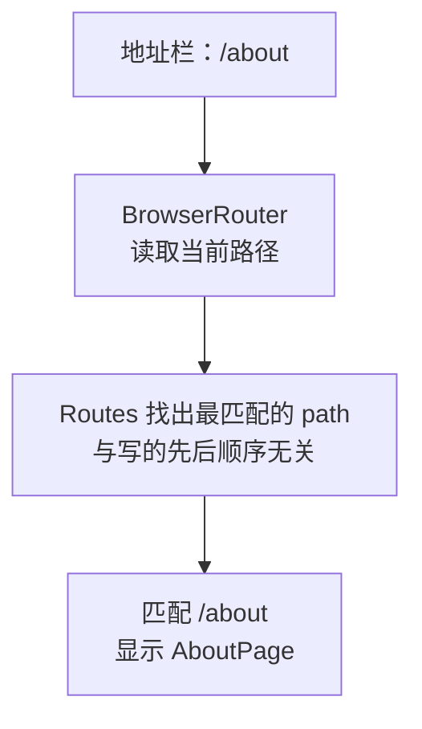

# 第 9A 章 路由表：按地址显示不同的页面

## 这一章解决什么问题

点产品名，要进入这个产品的详情页；地址栏显示 `/products/1`，把地址发给同事，对方打开也是这个产品；按浏览器的「后退」能回到列表。现在所有内容都在一个页面里，做不到这些。第 9 章用 React Router 实现多页面，分三步：本章先装好 React Router，写出「地址 → 页面」的路由表；第 9B 章做导航链接；第 9C 章做带编号的详情页。

本章只讲一个技术点：**路由表**。

## 开始之前

- 上一章你已经会了：回调 props、状态提升、自定义 Hook `useProducts`。
- 起点代码：仓库 `code/ch08C/price-list`（不含练习答案）。
- 预计耗时：30 分钟。

## 正文

### 9A.1 安装 React Router

先在终端按 `Ctrl + C` 停掉开发服务器，然后执行：

```powershell
# 在 D:\react-study\price-list 目录执行
npm install react-router@8.5.1
npm run dev
```

本教程实测版本是 `react-router` 8.5.1，它要求 Node.js ≥ 22.22。React Router 有几种用法，本章用最简单的「声明式」写法（`BrowserRouter` + `Routes` + `Route`）。网上很多教程还在用 v6 的 `react-router-dom` 包，v7 起合并进了 `react-router`，本项目不需要装 `react-router-dom`。

### 9A.2 把列表页搬出 App

`App` 以后要变成所有页面共用的「外框」，所以先把列表页从 `App` 里搬出来。新建文件夹 `src/pages`，在里面新建 `ListPage.tsx`：把第 8C 章 `App.tsx` 的内容复制过去，然后改 5 处：

1. 第一行注释改成 `// src/pages/ListPage.tsx`。
2. import 路径里的 `./` 改成 `../`（文件深了一层），删掉 `PageHeader`、`PageFooter` 两行 import。
3. `function App() {` 改成 `export function ListPage() {`。
4. `return` 里的 `<main>` 和 `</main>` 改成 `<section>` 和 `</section>`，删掉 `<PageHeader />` 和 `<PageFooter />`（它们留在 `App` 里，所有页面共用）。
5. 删掉最后的 `export default App`。

改完的完整文件：

```tsx
// src/pages/ListPage.tsx
// 产品列表页：第 8C 章 App 的内容原样搬过来，去掉页头页脚（它们留在 App 里，所有页面共用）
import { useEffect, useState } from 'react'
import type { ReactNode } from 'react'
import { useProducts } from '../hooks/useProducts.ts'
import { FilterBar } from '../components/FilterBar.tsx'
import { ProductTable } from '../components/ProductTable.tsx'
import { ProductForm } from '../components/ProductForm.tsx'

export function ListPage() {
  // 加载和增删改的细节都在 useProducts 里，列表页只拿结果
  const { state, addProduct, deleteProduct, restockProduct } = useProducts()
  // 状态提升：搜索框和表格都要用 keyword，所以放在它们共同的父组件 App 里
  const [keyword, setKeyword] = useState('')

  const count = state.status === 'success' ? state.products.length : 0

  useEffect(() => {
    document.title = `产品价格清单（${count} 种）`
  }, [count])

  let content: ReactNode
  if (state.status === 'loading') {
    content = <p>加载中…</p>
  } else if (state.status === 'error') {
    content = <p className="error">加载失败：{state.message}</p>
  } else {
    // 筛选结果是派生值：由 products 和 keyword 现算，不另存 state
    const k = keyword.trim().toLowerCase()
    const visible = state.products.filter(
      (p) => p.name.toLowerCase().includes(k) || p.code.toLowerCase().includes(k),
    )
    // 把 useProducts 给的函数直接作为回调传下去
    content = <ProductTable products={visible} onDelete={deleteProduct} onRestock={restockProduct} />
  }

  return (
    <section>
      <p>共 {count} 种产品</p>
      {/* 把值和「修改它的函数」一起交给搜索框 */}
      <FilterBar keyword={keyword} onKeywordChange={setKeyword} />
      {content}
      <ProductForm onAdd={addProduct} />
    </section>
  )
}
```

为什么页头、页脚不放进 `ListPage`：它们每个页面都要显示，放在 `App` 里写一次，切换页面时只换中间的部分。

再新建两个简单页面：

```tsx
// src/pages/AboutPage.tsx
// 一个静态页面，用来演示多个路由
export function AboutPage() {
  return (
    <section>
      <h2>关于</h2>
      <p>本页面列出超声事业部的产品价格，仅供内部报价参考。</p>
    </section>
  )
}
```

```tsx
// src/pages/NotFoundPage.tsx
// 地址和路由表里的哪一条都对不上时显示
import { Link } from 'react-router'

export function NotFoundPage() {
  return (
    <section>
      <h2>页面不存在</h2>
      <p>
        <Link to="/">返回产品清单</Link>
      </p>
    </section>
  )
}
```

`NotFoundPage` 里的 `<Link to="/">` 是 React Router 提供的链接，下一章细讲，现在把它当成「回到首页的链接」就行。

### 9A.3 路由表是什么

**白话定义**：路由（routing）是「根据地址栏的路径决定显示哪个页面」。路由表就是一组「路径 → 页面组件」的对应关系，写成 `<Routes>` 里的多个 `<Route path="..." element={...} />`。

**业务场景**：`/` 显示产品清单，`/about` 显示关于页，其他地址显示「页面不存在」。这些都在浏览器里完成，服务器始终只返回同一个 `index.html`。这种网站叫单页应用（SPA，Single Page Application）。

**反例（什么时候不该用）**：页面上的选项卡、展开/收起这类「切换显示内容、但没人需要收藏或分享这个状态」的情况，用 state 就够了，不需要做成路由。

#### 🖼 图解



### 9A.4 写路由表

#### 💻 最小可运行代码

用下面的内容整个替换 `src/main.tsx`（只多了 `BrowserRouter`）：

```tsx
// src/main.tsx
// 整个前端的入口：index.html 里的 <script> 只引用这一个文件
import { StrictMode } from 'react'
import { createRoot } from 'react-dom/client'
import { BrowserRouter } from 'react-router'
// CSS 也能 import：Vite 会把它变成 <style> 插进页面
import './index.css'
import App from './App.tsx'

// 找到 index.html 里的 <div id="root">，React 从此接管它里面的内容
// 末尾的 ! 告诉 TypeScript：这个元素一定存在（否则它认为可能是 null）
createRoot(document.getElementById('root')!).render(
  // StrictMode 只在开发时做额外检查，打包后的正式版本不受影响
  <StrictMode>
    {/* BrowserRouter 用浏览器地址栏的路径决定显示哪个页面；包在最外层，里面的组件才能用路由功能 */}
    <BrowserRouter>
      <App />
    </BrowserRouter>
  </StrictMode>,
)
```

用下面的内容整个替换 `src/App.tsx`：

```tsx
// src/App.tsx
// App 变成「外框」：页头、导航、页脚所有页面共用，中间按地址显示不同的页面
import { Route, Routes } from 'react-router'
import { PageHeader } from './components/PageHeader.tsx'
import { PageFooter } from './components/PageFooter.tsx'
import { ListPage } from './pages/ListPage.tsx'
import { AboutPage } from './pages/AboutPage.tsx'
import { NotFoundPage } from './pages/NotFoundPage.tsx'

function App() {
  return (
    <main>
      <PageHeader />
      {/* 路由表：React Router 找出与当前地址最匹配的那条 path，显示它的 element */}
      <Routes>
        <Route path="/" element={<ListPage />} />
        <Route path="/about" element={<AboutPage />} />
        {/* * 匹配任何地址，但只有别的路由都对不上时才会用它，相当于兜底 */}
        <Route path="*" element={<NotFoundPage />} />
      </Routes>
      <PageFooter />
    </main>
  )
}

export default App
```

#### 🔍 拆解运行结果

在地址栏分别输入：

| 地址 | 页头和页脚之间显示 |
| --- | --- |
| `http://localhost:5173/` | 产品清单（和第 8C 章一样） |
| `http://localhost:5173/about` | 「关于」和那句说明 |
| `http://localhost:5173/xyz` | 「页面不存在」和「返回产品清单」链接 |

| 代码 | 说明 |
| --- | --- |
| `<BrowserRouter>` | 读浏览器地址栏的路径。包在最外层，里面的组件才能用路由功能 |
| `<Route path="/about" element={<AboutPage />} />` | 一条路由：地址是 `/about` 时显示 `AboutPage`。`element` 传的是 JSX（一个具体要显示的元素），不是组件函数本身 |
| `path="*"` | 匹配任何地址，但只有别的路由都对不上时才会用它，相当于兜底 |
| 页头、页脚在 `<Routes>` 外面 | 所以每个页面都有 |

#### 改坏一处试试

**① element 传组件函数。** 写成 `element={AboutPage}`，`npx tsc -b` 报：

```text
src/App.tsx(17,38): error TS2322: Type '() => Element' is not assignable to type 'ReactNode'.
```

**② 去掉 BrowserRouter。** 把 `main.tsx` 里的 `<BrowserRouter>` 去掉，只留 `<App />`。页面空白，控制台报 `useRoutes() may be used only in the context of a <Router> component.`，并提示错误发生在 `<Routes>` 组件里。路由相关的组件和 Hook 必须放在 `BrowserRouter` 里面。

每次实验后改回。

## ⚠️ 踩坑警告

| 现象 | 原因 | 怎么改 |
| --- | --- | --- |
| 页面空白，控制台 `useRoutes() may be used only in the context of a <Router> component.` | 用了 `Routes`，但外面没有 `BrowserRouter` | 在 `main.tsx` 里用 `<BrowserRouter>` 包住 `<App />` |
| `element={AboutPage}` 报 `TS2322: Type '() => Element' is not assignable to type 'ReactNode'.` | `element` 要的是 JSX，不是函数 | 写成 `element={<AboutPage />}` |
| 新建页面后 `import AboutPage from ...` 报 `TS2613: Module ... has no default export.` | 页面组件用的是命名导出（第 2C 章） | 写成 `import { AboutPage } from ...` |
| `npm install react-router-dom` 之后代码里两种 import 混用 | v7 起 `react-router-dom` 的内容已合并进 `react-router` | 只装、只 import `react-router` |

## 🎯 动手练习

**练习 1：加一个「联系我们」页**

新建 `src/pages/ContactPage.tsx`，显示标题「联系我们」和两行「销售部：分机 8021」「售后服务：分机 8035」。地址是 `/contact`。

验收标准：

- 打开 `http://localhost:5173/contact`，页头页脚之间显示联系信息。
- 打开 `/contacts`（多一个 s），显示「页面不存在」。

**练习 2：「页面不存在」时改标签页标题**

打开不存在的地址时，标签页标题显示「页面不存在」。

验收标准：

- 打开 `/xyz`，标签页标题是「页面不存在」。

提示：标签页标题要用 `useEffect` 改（第 7A 章）。

卡住了看文末参考答案。

## 📌 一句话总结

BrowserRouter 包住 App，Routes 里每个 Route 对应一个地址和一个页面。

## 下一章

现在只能在地址栏手动输入地址来换页。第 9B 章用 `Link` 做导航，点一下就换页，而且页面不重新加载。

---

<!-- 以下是参考答案，先自己动手，卡住了再往下翻 -->


## 参考答案

### 练习 1

思路：新页面就是一个普通组件，再在路由表里登记一条 `Route`。`/contacts` 和哪条都对不上，落到 `*`。

```tsx
// src/pages/ContactPage.tsx
// 练习 1：新页面就是一个普通组件，再在路由表里登记一条
export function ContactPage() {
  return (
    <section>
      <h2>联系我们</h2>
      <p>销售部：分机 8021</p>
      <p>售后服务：分机 8035</p>
    </section>
  )
}
```

```tsx
// src/App.tsx
// 练习 1 做完后的版本
// App 变成「外框」：页头、导航、页脚所有页面共用，中间按地址显示不同的页面
import { Route, Routes } from 'react-router'
import { PageHeader } from './components/PageHeader.tsx'
import { PageFooter } from './components/PageFooter.tsx'
import { ListPage } from './pages/ListPage.tsx'
import { AboutPage } from './pages/AboutPage.tsx'
import { ContactPage } from './pages/ContactPage.tsx'
import { NotFoundPage } from './pages/NotFoundPage.tsx'

function App() {
  return (
    <main>
      <PageHeader />
      {/* 路由表：React Router 找出与当前地址最匹配的那条 path，显示它的 element */}
      <Routes>
        <Route path="/" element={<ListPage />} />
        <Route path="/about" element={<AboutPage />} />
        {/* 练习 1：多一条路由 */}
        <Route path="/contact" element={<ContactPage />} />
        {/* * 匹配任何地址，但只有别的路由都对不上时才会用它，相当于兜底 */}
        <Route path="*" element={<NotFoundPage />} />
      </Routes>
      <PageFooter />
    </main>
  )
}

export default App
```

### 练习 2

思路：在 `NotFoundPage` 里用 `useEffect` 改标题，依赖写 `[]`：标题是固定的，显示一次改一次就够。

```tsx
// src/pages/NotFoundPage.tsx
// 练习 2 做完后的版本
import { useEffect } from 'react'
import { Link } from 'react-router'

export function NotFoundPage() {
  // 练习 2：标签页标题在 #root 之外，用 effect 修改（第 7A 章）
  useEffect(() => {
    document.title = '页面不存在'
  }, [])

  return (
    <section>
      <h2>页面不存在</h2>
      <p>
        <Link to="/">返回产品清单</Link>
      </p>
    </section>
  )
}
```
