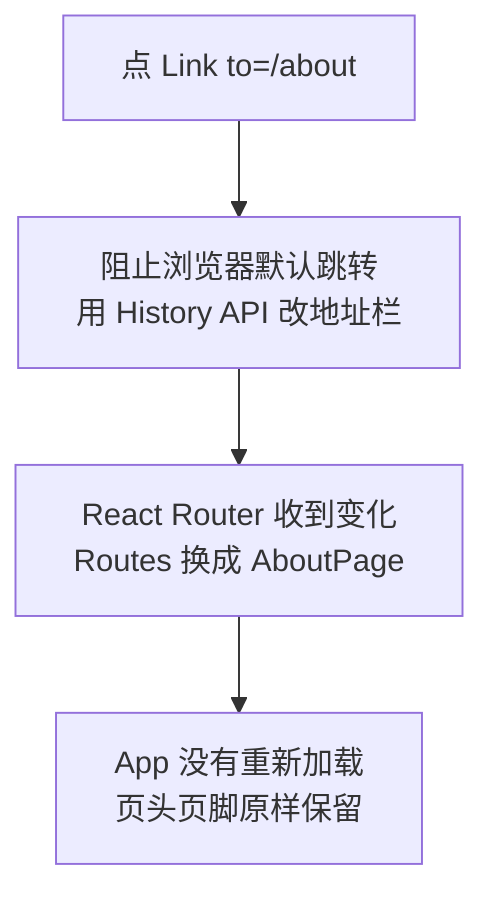

# 第 9B 章 Link：换页不重新加载

## 这一章解决什么问题

页头下面要有导航「产品清单 | 关于」，点一下就换页。用 HTML 的 `<a href>` 也能跳过去，但浏览器会重新加载整个应用：页面闪一下，所有 state 回到初始值。本章用 React Router 的 `Link` 做导航。

本章只讲一个技术点：**`Link`**。

## 开始之前

- 上一章你已经会了：安装 React Router、`BrowserRouter`、用 `Routes` / `Route` 写路由表。
- 起点代码：仓库 `code/ch09A/price-list`（不含练习答案）。在 `D:\react-study\price-list` 执行 `npm run dev`。
- 预计耗时：20 分钟。

## 正文

### 9B.1 Link 是什么

**白话定义**：`<Link to="/about">` 渲染成一个普通的 `<a>` 链接，但点击时**不让浏览器重新加载页面**，而是只改地址栏，再由 React Router 换掉显示的页面组件。

**业务场景**：页头下面加导航「产品清单 | 关于」，来回切换时页面不闪、不重新下载 JavaScript，浏览器的「后退」「前进」按钮照样能用。

**反例（什么时候不该用）**：链接到**本应用以外**的地址（比如公司官网、其他系统），用普通的 `<a href="https://...">`。`Link` 只用于本应用内部的页面。

#### 🖼 图解



History API 是浏览器提供的一组函数，能在不重新加载页面的情况下改地址栏、记录「后退」历史。

### 9B.2 加导航

#### 💻 最小可运行代码

用下面的内容整个替换 `src/App.tsx`：

```tsx
// src/App.tsx
// App 变成「外框」：页头、导航、页脚所有页面共用，中间按地址显示不同的页面
import { Link, Route, Routes } from 'react-router'
import { PageHeader } from './components/PageHeader.tsx'
import { PageFooter } from './components/PageFooter.tsx'
import { ListPage } from './pages/ListPage.tsx'
import { AboutPage } from './pages/AboutPage.tsx'
import { NotFoundPage } from './pages/NotFoundPage.tsx'

function App() {
  return (
    <main>
      <PageHeader />
      <nav className="nav">
        {/* Link 改地址但不刷新页面；React Router 发现地址变了，换掉下面 Routes 里显示的页面 */}
        <Link to="/">产品清单</Link> | <Link to="/about">关于</Link>
      </nav>
      {/* 路由表：React Router 找出与当前地址最匹配的那条 path，显示它的 element */}
      <Routes>
        <Route path="/" element={<ListPage />} />
        <Route path="/about" element={<AboutPage />} />
        {/* * 匹配任何地址，但只有别的路由都对不上时才会用它，相当于兜底 */}
        <Route path="*" element={<NotFoundPage />} />
      </Routes>
      <PageFooter />
    </main>
  )
}

export default App
```

用下面的内容整个替换 `src/index.css`（末尾多了 `.nav` 一行）：

```css
/* src/index.css */
/* 全局样式先保持最少，第 10 章再整理 */
body {
  margin: 24px;
  font-family: system-ui, 'Microsoft YaHei', sans-serif;
}

.subtitle {
  color: #666;
}

.card {
  border: 1px solid #ddd;
  border-radius: 6px;
  padding: 8px 16px;
  margin-bottom: 12px;
  max-width: 360px;
}

.panel {
  border-left: 4px solid #3b82f6;
  padding-left: 12px;
  margin-bottom: 16px;
}

.product-table {
  border-collapse: collapse;
  margin-bottom: 16px;
}

.product-table th,
.product-table td {
  border: 1px solid #ddd;
  padding: 6px 10px;
}

.out-of-stock {
  margin-left: 6px;
  padding: 0 6px;
  color: #fff;
  background: #dc2626;
  border-radius: 4px;
  font-size: 12px;
}

.low {
  color: #dc2626;
}

.empty {
  color: #999;
}

.product-form label { display: block; margin: 6px 0; }
.error { display: block; color: #dc2626; font-size: 14px; }
.success { color: #16a34a; }
.filter-bar { display: block; margin-bottom: 8px; }
.nav { margin-bottom: 12px; }
```

#### 🔍 拆解运行结果

点「关于」，地址变成 `/about`，中间换成关于页；点「产品清单」回到列表。实测：在浏览器控制台执行 `window.__mark = 1` 放一个标记值，然后点「关于」，再执行 `window.__mark`，结果**还是 1**，说明页面没有重新加载。

`F12` 在「元素」面板里看导航，渲染出来是：

```html
<a href="/" data-discover="true">产品清单</a> | <a href="/about" data-discover="true">关于</a>
```

就是普通的 `<a>`（`data-discover` 是 React Router 自己用的标记，不用管）。区别在点击时：React Router 拦下了点击，自己处理跳转。

#### 改坏一处试试

**① 换成普通的 a。** 把「关于」那个 `Link` 换成 `<a href="/about">关于</a>`，再按上面的方法放标记、点它。实测：地址同样变成 `/about`，但 `window.__mark` 变成了 `undefined`，「网络」里重新请求了 `/src/main.tsx`，整个应用重新加载。对用户来说页面会闪一下；更麻烦的是所有 state 都回到初始值。改回 `Link`。

**② 属性写成 href。** 写成 `<Link href="/about">`，`npx tsc -b` 报：

```text
src/App.tsx(16,42): error TS2322: Type '{ href: string; children: string; }' is not assignable to type 'IntrinsicAttributes & LinkProps & RefAttributes<HTMLAnchorElement>'.
  Property 'href' does not exist on type 'IntrinsicAttributes & LinkProps & RefAttributes<HTMLAnchorElement>'. Did you mean 'ref'?
```

`Link` 的属性是 `to`。改回去。

## ⚠️ 踩坑警告

| 现象 | 原因 | 怎么改 |
| --- | --- | --- |
| 点内部链接时页面闪一下，填的东西全没了 | 用了 `<a href>` 而不是 `Link`，浏览器重新加载了整个应用 | 本应用内的跳转一律用 `<Link to>` |
| `<Link href=...>` 报 `Property 'href' does not exist on type ... LinkProps ...` | `Link` 用 `to`，不用 `href` | 改成 `to` |
| 页面空白，控制台 `Cannot destructure property 'basename' of ... as it is null.` | 在 `BrowserRouter` 外面用了 `Link` | `Link` 只能放在 `BrowserRouter` 里面的组件中 |

## 🎯 动手练习

**练习 1：关于页里的两种链接**

在关于页的说明下面加两个链接：「查看产品清单」回到 `/`；「公司官网」打开 `https://www.example.com`，在新标签页打开。

验收标准：

- 点「查看产品清单」回到列表，页面不重新加载。
- 「元素」面板里「公司官网」是 `<a href="https://www.example.com" target="_blank" rel="noreferrer">`。

**练习 2：标出当前页面**

导航里当前所在页面的链接显示成粗体、没有下划线。

验收标准：

- 在 `/` 时「产品清单」是粗体；点「关于」后，「关于」变粗体，「产品清单」恢复普通样式。

提示：React Router 还提供一个 `NavLink`，用法和 `Link` 一样，地址匹配时会自动给 `<a>` 加上 `class="active"`。

卡住了看文末参考答案。

## 📌 一句话总结

应用内跳转用 Link to，外部网站用普通 a。

## 下一章

第 9C 章做产品详情页：地址里带产品编号，比如 `/products/3`，一个页面组件显示任意一个产品。

---

<!-- 以下是参考答案，先自己动手，卡住了再往下翻 -->


## 参考答案

### 练习 1

思路：内部页面用 `Link`，外部网站用 `a`。`target="_blank"` 在新标签页打开；`rel="noreferrer"` 让新页面拿不到来源页的信息，打开外部网站时一般都加上。

```tsx
// src/pages/AboutPage.tsx
// 练习 1 做完后的版本
import { Link } from 'react-router'

export function AboutPage() {
  return (
    <section>
      <h2>关于</h2>
      <p>本页面列出超声事业部的产品价格，仅供内部报价参考。</p>
      <p>
        {/* 本应用内部的页面用 Link，不重新加载 */}
        <Link to="/">查看产品清单</Link>
      </p>
      <p>
        {/* 本应用以外的网站用普通的 a。target="_blank" 在新标签页打开 */}
        <a href="https://www.example.com" target="_blank" rel="noreferrer">
          公司官网
        </a>
      </p>
    </section>
  )
}
```

### 练习 2

思路：把导航里的 `Link` 换成 `NavLink`，再用 CSS 给 `.active` 写样式。实测在 `/` 时渲染成 `<a aria-current="page" class="active" href="/">产品清单</a>`，在 `/about` 时 `class="active"` 移到了「关于」上。

```tsx
// src/App.tsx
// 练习 2 做完后的版本
// App 变成「外框」：页头、导航、页脚所有页面共用，中间按地址显示不同的页面
import { NavLink, Route, Routes } from 'react-router'
import { PageHeader } from './components/PageHeader.tsx'
import { PageFooter } from './components/PageFooter.tsx'
import { ListPage } from './pages/ListPage.tsx'
import { AboutPage } from './pages/AboutPage.tsx'
import { NotFoundPage } from './pages/NotFoundPage.tsx'

function App() {
  return (
    <main>
      <PageHeader />
      <nav className="nav">
        {/* 练习 2：NavLink 和 Link 一样不刷新页面；地址匹配时会自动加上 class="active" */}
        <NavLink to="/">产品清单</NavLink> | <NavLink to="/about">关于</NavLink>
      </nav>
      {/* 路由表：React Router 找出与当前地址最匹配的那条 path，显示它的 element */}
      <Routes>
        <Route path="/" element={<ListPage />} />
        <Route path="/about" element={<AboutPage />} />
        {/* * 匹配任何地址，但只有别的路由都对不上时才会用它，相当于兜底 */}
        <Route path="*" element={<NotFoundPage />} />
      </Routes>
      <PageFooter />
    </main>
  )
}

export default App
```

```css
/* src/index.css */
/* 全局样式先保持最少，第 10 章再整理 */
body {
  margin: 24px;
  font-family: system-ui, 'Microsoft YaHei', sans-serif;
}

.subtitle {
  color: #666;
}

.card {
  border: 1px solid #ddd;
  border-radius: 6px;
  padding: 8px 16px;
  margin-bottom: 12px;
  max-width: 360px;
}

.panel {
  border-left: 4px solid #3b82f6;
  padding-left: 12px;
  margin-bottom: 16px;
}

.product-table {
  border-collapse: collapse;
  margin-bottom: 16px;
}

.product-table th,
.product-table td {
  border: 1px solid #ddd;
  padding: 6px 10px;
}

.out-of-stock {
  margin-left: 6px;
  padding: 0 6px;
  color: #fff;
  background: #dc2626;
  border-radius: 4px;
  font-size: 12px;
}

.low {
  color: #dc2626;
}

.empty {
  color: #999;
}

.product-form label { display: block; margin: 6px 0; }
.error { display: block; color: #dc2626; font-size: 14px; }
.success { color: #16a34a; }
.filter-bar { display: block; margin-bottom: 8px; }
.nav { margin-bottom: 12px; }
/* 练习 2：当前页面的导航链接加粗、不显示下划线 */
.nav a.active { font-weight: bold; text-decoration: none; }
```
