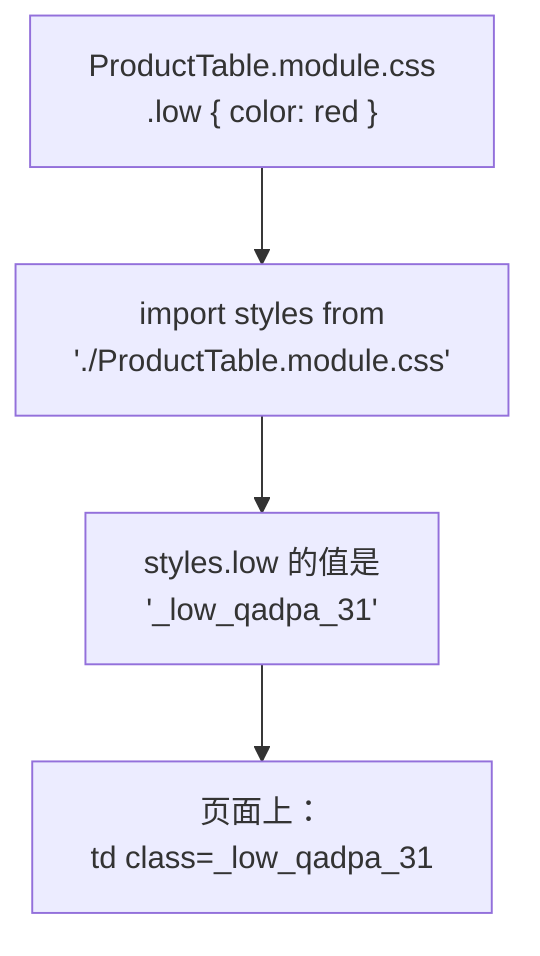
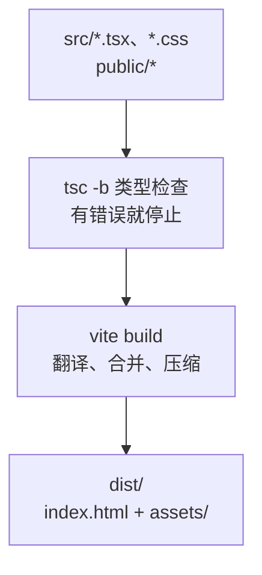
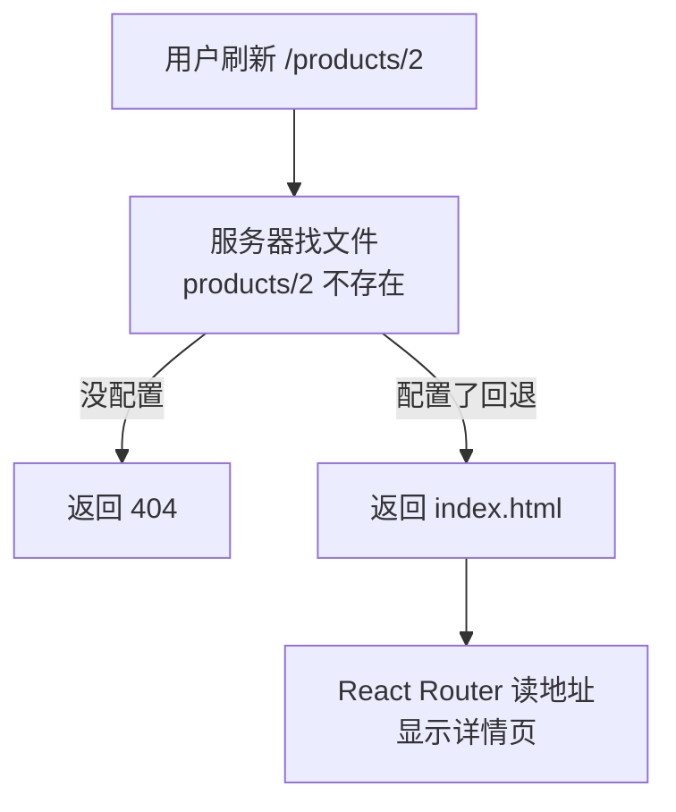

# 第 10 章 样式与打包发布

## 这一章解决什么问题

到上一章为止，所有样式都堆在一个 `index.css` 里，类名像 `.low`、`.error` 这样很短，项目大了很容易两个组件用了同一个类名、互相覆盖。页面也只能在开发服务器上看。本章把组件的样式和组件放在一起、互不干扰，并把项目打包成能交给 Web 服务器部署的静态文件。

## 开始之前

- 上一章你已经会了：路由表、`Link`、URL 参数。
- 起点代码：仓库 `code/ch09/price-list`（不含练习答案）。在 `D:\react-study\price-list` 执行 `npm run dev`。
- 预计耗时：40 分钟。

## 正文

### 10.1 CSS Modules

**白话定义**：CSS Modules 是一种 CSS 文件写法：文件名以 `.module.css` 结尾，里面的类名只在导入它的组件里有效。Vite 打包时会把类名改成带随机后缀的唯一名字（如 `.low` 变成 `_low_qadpa_31`），所以不同文件里的同名类不会冲突。

**业务场景**：表格的 `.low`（库存不足标红）只属于 `ProductTable`。放进 `ProductTable.module.css` 后，别的组件就算也写了 `.low`，也不会被表格的样式影响。

**反例（什么时候不该用）**：整个网站通用的基础样式（`body` 的字体和边距、全局的「出错红字」`.error`）放在 `index.css` 这种全局文件里。把它们拆进各个模块，每个组件都要重复写一遍。

#### 🖼 图解



#### 💻 最小可运行代码

新建 `src/components/ProductTable.module.css`：

```css
/* src/components/ProductTable.module.css */
/* 只给 ProductTable 用的样式。类名打包时会被改成唯一的名字，不会和别的文件冲突 */
.table {
  border-collapse: collapse;
  margin-bottom: 16px;
  min-width: 560px;
}

/* 类名后面跟元素选择器也可以：只影响 .table 里面的 th、td */
.table th,
.table td {
  border: 1px solid #ddd;
  padding: 6px 10px;
}

.table th {
  background: #f3f4f6;
  text-align: left;
}

/* 类名用驼峰写法，在 TSX 里就能写成 styles.outOfStock */
.outOfStock {
  margin-left: 6px;
  padding: 0 6px;
  color: #fff;
  background: #dc2626;
  border-radius: 4px;
  font-size: 12px;
}

.low {
  color: #dc2626;
  font-weight: bold;
}
```

用下面的内容整个替换 `src/components/ProductTable.tsx`（改了 4 处：多一行 import，三处 `className`）：

```tsx
// src/components/ProductTable.tsx
// 只负责显示表格。数据从 props 来；点了按钮不自己改数据，而是调用父组件给的函数「通知」它
import { Link } from 'react-router'
import type { Product } from '../types.ts'
// 导入 CSS Module 得到一个对象：键是你写的类名，值是打包后真正使用的类名
import styles from './ProductTable.module.css'

type ProductTableProps = {
  products: Product[]
  // 回调 props：类型写清楚「调用时传什么参数、返回什么」。void 表示不关心返回值
  onDelete: (id: number) => void
  onRestock: (id: number) => void
}

export function ProductTable({ products, onDelete, onRestock }: ProductTableProps) {
  if (products.length === 0) {
    return <p className="empty">暂无产品</p>
  }

  return (
    <table className={styles.table}>
      <thead>
        <tr>
          <th>编号</th>
          <th>名称</th>
          <th>单价（元）</th>
          <th>库存</th>
          <th>操作</th>
        </tr>
      </thead>
      <tbody>
        {products.map((p) => (
          <tr key={p.id}>
            <td>{p.code}</td>
            <td>
              {/* 点产品名进入详情页，地址形如 /products/3 */}
              <Link to={`/products/${p.id}`}>{p.name}</Link>
              {p.stock === 0 && <span className={styles.outOfStock}>缺货</span>}
            </td>
            <td>{p.price.toLocaleString()}</td>
            <td className={p.stock < 5 ? styles.low : undefined}>{p.stock}</td>
            <td>
              <button type="button" onClick={() => onRestock(p.id)}>入库 +1</button>{' '}
              <button type="button" onClick={() => onDelete(p.id)}>删除</button>
            </td>
          </tr>
        ))}
      </tbody>
    </table>
  )
}
```

表格的样式搬走后，`src/index.css` 里第 5 章加的 `.product-table`、`.product-table th, .product-table td`、`.out-of-stock`、`.low` 这四段就用不到了。用下面的内容整个替换 `src/index.css`，只留全局样式：

```css
/* src/index.css */
/* 全局样式：整个页面通用的基础样式。只属于某一个组件的样式，放到它自己的 .module.css 里 */
body {
  margin: 24px;
  font-family: system-ui, 'Microsoft YaHei', sans-serif;
}

.subtitle {
  color: #666;
}

.card {
  border: 1px solid #ddd;
  border-radius: 6px;
  padding: 8px 16px;
  margin-bottom: 12px;
  max-width: 360px;
}

.panel {
  border-left: 4px solid #3b82f6;
  padding-left: 12px;
  margin-bottom: 16px;
}

.empty {
  color: #999;
}

.product-form label { display: block; margin: 6px 0; }
.error { display: block; color: #dc2626; font-size: 14px; }
.success { color: #16a34a; }
.filter-bar { display: block; margin-bottom: 8px; }
.nav { margin-bottom: 12px; }
```

现在这个文件里留下的，都是多个组件共用或整个页面通用的样式：`.card`（第 9 章详情页的卡片）、`.error`（列表页、详情页、表单都用）等。

#### 🔍 拆解运行结果

表头变成浅灰底色，库存少于 5 的数字变成红色粗体。`F12` 看「元素」面板，实测：

```html
<table class="_table_qadpa_3">
<span class="_outOfStock_qadpa_21">缺货</span>
<td class="_low_qadpa_31">3</td>
```

类名后缀（`qadpa`）由文件路径算出来，你那边的可能不同。

| 代码 | 说明 |
| --- | --- |
| `import styles from './ProductTable.module.css'` | Vite 自带对 `.module.css` 的类型声明，`styles` 的类型是 `{ readonly [key: string]: string }`，不用自己写类型 |
| `className={styles.table}` | 取的是改名后的真实类名 |
| `.outOfStock` 用驼峰 | 写成 `.out-of-stock` 也行，但 TSX 里只能写 `styles['out-of-stock']`，不方便 |

偶尔要按数值算样式时，可以用 `style` 属性。它在 React 里是**对象**，属性名用驼峰：`style={{ fontSize: 14 }}`（数字默认单位 px）。写成 HTML 那样的 `style="color: red"` 会报 `TS2559: Type 'string' has no properties in common with type 'Properties<...>'`；写 `{ 'font-size': '14px' }` 会报 `TS2353: ... ''font-size'' does not exist in type 'Properties<...>'`。

#### 改坏一处试试

把 `className={styles.table}` 写成 `className={styles.tabel}`。实测 `tsc` **不报错**，页面上的 `<table>` 没有 `class` 属性，表格边框变回了浏览器默认样式（不合并的双线）。

`styles` 的类型允许任意键名，拼错的键取到的是 `undefined`，React 就不输出 `class`。所以看到某个组件「样式突然没了」，先查类名拼写。改回去。

### 10.2 npm run build

**白话定义**：`npm run build` 先用 TypeScript 做一遍完整的类型检查（`tsc -b`），通过后再由 Vite 把所有 `.tsx`、`.css` 翻译、合并、压缩，输出到 `dist` 文件夹。`dist` 里只有浏览器能直接用的 HTML、JS、CSS 和 `public/` 里的文件。

**业务场景**：开发完成后，把 `dist` 交给运维部署到服务器。服务器上不需要装 Node.js，也不需要 `node_modules`。

**反例（什么时候不该用）**：开发调试时不要每次改代码都 `build` 再看结果，那样要等完整打包，也没有热更新。开发时用 `npm run dev`，交付或验证打包结果时才 `build`。

#### 🖼 图解



#### 💻 最小可运行代码

先删掉第 7 章为了看「加载中」加的模拟延迟：打开 `src/hooks/useProducts.ts`，删掉这两行：

```ts
        // 模拟慢网络，便于看到「加载中」。正式代码删掉这一行
        await new Promise((resolve) => setTimeout(resolve, 1000))
```

然后另开一个终端（开发服务器不用停）：

```powershell
# 在 D:\react-study\price-list 目录执行
npm run build
npm run preview
```

#### 🔍 拆解运行结果

`npm run build` 的输出（实测，文件名里的随机串每次内容变化时都会变）：

```text
vite v8.3.5 building client environment for production...
transforming...
✓ 106 modules transformed.
rendering chunks...
computing gzip size...
dist/index.html                   0.47 kB │ gzip:  0.32 kB
dist/assets/index-DO0M7wN0.css    0.83 kB │ gzip:  0.42 kB
dist/assets/index-DMpE_-Fa.js   262.96 kB │ gzip: 83.59 kB

✓ built in 144ms
```

`dist` 里的文件：

| 文件 | 来源 |
| --- | --- |
| `index.html` | 项目根目录的 `index.html`，`<script>` 已经换成指向打包后的 JS |
| `assets/index-xxxx.js` | 所有 `.tsx`/`.ts` 加上 React、React Router，合成一个文件 |
| `assets/index-xxxx.css` | `index.css` 和所有 `.module.css` 合成一个文件 |
| `products.json`、`favicon.svg` | 从 `public/` 原样复制 |

文件名里的 `DO0M7wN0` 这类字符串由文件内容算出来。内容变了文件名就变，浏览器不会用到旧缓存，所以服务器可以放心地让 `assets/` 下的文件长期缓存。

`npm run preview` 用一个本机服务器提供 `dist` 里的文件，输出 `Local: http://localhost:4173/`。打开这个地址，页面和开发时一样，但用的是打包后的文件。确认打包结果没问题再交付。

#### 改坏一处试试

在资源管理器里双击 `dist\index.html`。页面是空白的，控制台报 `Access to script at 'file:///assets/index-....js' from origin 'null' has been blocked by CORS policy`。和第 1 章一样，打包后的文件也必须通过 Web 服务器（`http://`）访问，不能直接双击打开。

### 10.3 dist 目录与部署

**白话定义**：`dist` 是一组纯静态文件，任何能提供静态文件的 Web 服务器都能部署：IIS、Nginx、Apache，或者公司已有的文件服务器。部署就是把 `dist` 里的**所有内容**复制到网站目录。要注意两件事：刷新子页面时的 404，以及网站不在根路径时的地址。

**业务场景**：公司内网 IIS 上已有一个网站，要把价格清单放上去。

**反例（什么时候不该用）**：「改了 `products.json` 就想让页面显示新数据」不要靠重新打包部署。静态文件适合放程序，业务数据应该来自后端接口；本教程用 `products.json` 只是为了不依赖后端。

#### 🖼 图解



#### 💻 最小可运行代码

**① 刷新 404。** 在应用里点进 `/products/2` 没问题（`Link` 不请求服务器），但在这个页面按 `F5`，浏览器会向服务器请求 `/products/2` 这个路径。服务器上没有这个文件，就返回 404。实测（用 `npx serve` 这个简单静态服务器测试，第一次运行时会提示安装，输入 `y`）：

| 服务器 | 打开 `/products/2` |
| --- | --- |
| `npx serve dist` | 404：`The requested path could not be found` |
| `npx serve -s dist`（`-s` 表示单页应用回退） | 正常显示线阵探头 L12-5 |
| `npm run preview` | 正常（Vite 默认就有回退） |

服务器要配置「找不到文件时返回 `index.html`」。IIS 的做法是在网站目录放一个 `web.config`。把它放在 `public/` 里，每次打包会自动复制到 `dist/`。新建 `public/web.config`：

> ⚠️ 本段 IIS 配置未实机验证（实测环境没有 IIS）。需要先在服务器上安装 IIS 的 URL Rewrite 模块。

```xml
<?xml version="1.0" encoding="UTF-8"?>
<!-- public/web.config：IIS 用的配置。放在 public/ 里，打包时会原样复制到 dist/ -->
<!-- 需要先在 IIS 上安装 URL Rewrite 模块 -->
<configuration>
  <system.webServer>
    <rewrite>
      <rules>
        <!-- 请求的不是真实存在的文件或文件夹时（例如 /products/2），一律返回 index.html，交给 React Router 处理 -->
        <rule name="SPA fallback" stopProcessing="true">
          <match url=".*" />
          <conditions logicalGrouping="MatchAll">
            <add input="{REQUEST_FILENAME}" matchType="IsFile" negate="true" />
            <add input="{REQUEST_FILENAME}" matchType="IsDirectory" negate="true" />
          </conditions>
          <action type="Rewrite" url="/index.html" />
        </rule>
      </rules>
    </rewrite>
  </system.webServer>
</configuration>
```

**② 网站不在根路径。** 如果网站地址是 `http://服务器/price-list/` 而不是 `http://服务器/`，要在 `vite.config.ts` 里设置 `base: '/price-list/'`（练习 1）。代码里还有两处写死了根路径 `/`，要改成用 `import.meta.env.BASE_URL`（Vite 提供的变量，值就是 `base`，默认 `/`）。

`src/hooks/useProducts.ts` 里的 `fetch` 那一行改成：

```ts
        // BASE_URL 默认是 /，部署到子路径时自动变成 /price-list/ 这样，地址就不用改代码
        const response = await fetch(`${import.meta.env.BASE_URL}products.json`)
```

用下面的内容整个替换 `src/main.tsx`（给 `BrowserRouter` 加了 `basename`）：

```tsx
// src/main.tsx
// 整个前端的入口：index.html 里的 <script> 只引用这一个文件
import { StrictMode } from 'react'
import { createRoot } from 'react-dom/client'
import { BrowserRouter } from 'react-router'
// CSS 也能 import：Vite 会把它变成 <style> 插进页面
import './index.css'
import App from './App.tsx'

// 找到 index.html 里的 <div id="root">，React 从此接管它里面的内容
// 末尾的 ! 告诉 TypeScript：这个元素一定存在（否则它认为可能是 null）
createRoot(document.getElementById('root')!).render(
  // StrictMode 只在开发时做额外检查，打包后的正式版本不受影响
  <StrictMode>
    {/* BrowserRouter 用浏览器地址栏的路径决定显示哪个页面；包在最外层，里面的组件才能用路由功能 */}
    {/* basename：网站部署在子路径（如 /price-list/）时，路由要去掉这个前缀再匹配。值来自 vite.config.ts 的 base */}
    <BrowserRouter basename={import.meta.env.BASE_URL}>
      <App />
    </BrowserRouter>
  </StrictMode>,
)
```

#### 🔍 拆解运行结果

`base` 还是默认的 `/` 时，`BASE_URL` 就是 `/`，页面和之前完全一样。实测用 `--base /price-list/` 打包后：

- `dist/index.html` 里的地址都带上了前缀：`src="/price-list/assets/index-....js"`。
- 打开 `http://localhost:4173/price-list/` 显示列表，`/price-list/products/3` 显示便携彩超主机。

部署到 IIS 子路径时，`web.config` 里的 `url="/index.html"` 也要改成 `url="/price-list/index.html"`（⚠️ 未实机验证）。部署时复制的是 `dist` **里面**的全部文件，网站目录下应该直接看到 `index.html`。

#### 改坏一处试试

用第 9 章的代码（`fetch` 和 `BrowserRouter` 都没改），同样以 `base: '/price-list/'` 打包，实测：

| 没改的地方 | 现象 |
| --- | --- |
| `BrowserRouter` 没加 `basename` | 打开 `/price-list/` 显示「页面不存在」：路由拿完整路径 `/price-list/` 去匹配，路由表里没有这一条 |
| `fetch('/products.json')` 没改 | 请求的是 `/products.json`，返回 404；文件其实在 `/price-list/products.json` |

## ⚠️ 踩坑警告

| 现象 | 原因 | 怎么改 |
| --- | --- | --- |
| 部署后首页正常，在子页面按 F5 变成 404 | 服务器上没有 `/products/2` 这个文件，也没配置回退 | 配置「找不到文件时返回 `index.html`」：IIS 用 `web.config` + URL Rewrite，测试时用 `npx serve -s dist` |
| 部署到子路径后页面空白，控制台里 JS、CSS 都是 404 | 没设置 `base`，`index.html` 里引用的是 `/assets/...`，而文件在 `/price-list/assets/...` | `vite.config.ts` 里设置 `base: '/price-list/'`，重新打包 |
| 设置了 `base`，页面显示「页面不存在」或「加载失败」 | 代码里还写着根路径：路由没加 `basename`，`fetch` 写的是 `'/products.json'` | 都改用 `import.meta.env.BASE_URL` |
| 某个组件的样式突然没了，`tsc` 也不报错 | CSS Modules 的类名拼错，`styles.xxx` 取到 `undefined` | 对照 `.module.css` 检查拼写 |
| 重新部署后，用户看到的还是旧页面 | 服务器或中间的代理把 `index.html` 也长期缓存了，浏览器一直用旧的 `index.html`，它引用的还是旧的 JS 文件名 | 让 `index.html` 不缓存；`assets/` 下的文件名带内容哈希，可以长期缓存。具体配置方法因服务器而异（⚠️ 未实机验证） |

## 🎯 动手练习

**练习 1：打包到子路径**

在 `vite.config.ts` 里把 `base` 设成 `/price-list/`，然后执行 `npm run build` 和 `npm run preview`。

验收标准：

- `dist/index.html` 里的 JS、CSS 地址都以 `/price-list/assets/` 开头。
- `npm run preview` 显示的地址变成 `http://localhost:4173/price-list/`；打开它能看到产品列表，打开 `http://localhost:4173/price-list/products/3` 显示便携彩超主机。
- 做完把 `base` 改回去（或删掉这一行），以免影响后面的开发。

**练习 2：表单样式改成 CSS Module**

新建 `src/components/ProductForm.module.css`，把表单用到的 `.product-form label` 和 `.success` 搬进去，`ProductForm.tsx` 改用 `styles.xxx`。`.error` 在列表页、详情页也用到了，在 `index.css` 里保留一份。

验收标准：

- 表单的样式和之前一样：每个输入框一行，错误提示红色，保存成功绿色。
- 「元素」面板里表单的类名形如 `_form_xxxxx_3`。
- `index.css` 里不再有 `.product-form` 和 `.success`。

卡住了看文末参考答案。

## 📌 一句话总结

组件样式用 .module.css 隔离，build 生成 dist，部署要配回退和 base。

## 下一章

本教程到此结束。你已经能用 React 19 + TypeScript 完成一个带列表、表单、取数、路由的前端，并打包部署。下一步可以把 `products.json` 换成真实的后端接口。

---

<!-- 以下是参考答案，先自己动手，卡住了再往下翻 -->


## 参考答案

### 练习 1

思路：`base` 决定打包后所有资源地址的前缀，`import.meta.env.BASE_URL` 也跟着变，所以 10.3 改过的 `fetch` 和 `basename` 自动生效，不用再改代码。

```ts
// vite.config.ts
import react from '@vitejs/plugin-react'
import { defineConfig } from 'vite'

// https://vite.dev/config/
export default defineConfig({
  plugins: [react()],
  // 练习 1：网站部署在 https://服务器/price-list/ 下。开头和结尾的 / 都不能少
  base: '/price-list/',
})
```

### 练习 2

思路：表单专用的样式搬进模块；`.error` 多个组件都在用，属于全局样式，表单里另写一份模块版本，两者互不影响。

```css
/* src/components/ProductForm.module.css */
/* 练习 2：表单专用的样式，从 index.css 搬过来 */
.form label {
  display: block;
  margin: 6px 0;
}

.error {
  display: block;
  color: #dc2626;
  font-size: 14px;
}

.success {
  color: #16a34a;
}
```

`ProductForm.tsx` 里的改动：import 区加 `import styles from './ProductForm.module.css'`；`className="product-form"` 改成 `className={styles.form}`；三处 `className="error"` 改成 `className={styles.error}`；`className="success"` 改成 `className={styles.success}`。完整文件：

```tsx
// src/components/ProductForm.tsx
// 练习 2：类名改用 CSS Module
import { useState } from 'react'
import type { ChangeEvent, SubmitEvent } from 'react'
import type { Product } from '../types.ts'
import styles from './ProductForm.module.css'

type ProductFormProps = {
  // 保存成功时把新产品交给父组件。表单不知道、也不关心父组件怎么存
  onAdd: (product: Product) => void
}

export function ProductForm({ onAdd }: ProductFormProps) {
  // 每个输入框对应一个 state。输入框里的内容永远是字符串，单价也先按字符串存
  const [code, setCode] = useState('')
  const [name, setName] = useState('')
  const [category, setCategory] = useState('探头')
  const [price, setPrice] = useState('')
  // 保存成功后显示的提示
  const [message, setMessage] = useState('')
  // 点过一次「保存」才显示错误，免得一打开页面就满屏红字
  const [triedSubmit, setTriedSubmit] = useState(false)

  // 派生值：每次渲染都从 state 现算，不另存 state，所以永远和输入框一致
  const priceNumber = Number(price)
  const codeError = code.trim() === '' ? '请填写编号' : ''
  const nameError = name.trim() === '' ? '请填写名称' : ''
  // Number('abc') 是 NaN，NaN > 0 不成立，所以「不是数字」和「小于等于 0」一起拦住
  const priceError = price.trim() === '' ? '请填写单价' : priceNumber > 0 ? '' : '单价必须是大于 0 的数字'
  const isValid = codeError === '' && nameError === '' && priceError === ''

  // 单独写成函数时，参数类型要写明：input 元素上的变化事件
  function handlePriceChange(e: ChangeEvent<HTMLInputElement>) {
    setPrice(e.target.value)
  }

  function handleSubmit(e: SubmitEvent<HTMLFormElement>) {
    // 阻止浏览器默认的「提交表单 = 刷新整页」，改由我们自己处理
    e.preventDefault()
    setTriedSubmit(true)
    if (!isValid) {
      setMessage('')
      return
    }
    // 新产品还没入库，库存为 0；id 先用当前时间的毫秒数，保证不重复
    const product: Product = { id: Date.now(), code: code.trim(), name: name.trim(), category, price: priceNumber, stock: 0 }
    onAdd(product)
    setMessage(`已录入：${product.name}，单价 ${product.price.toLocaleString()} 元`)
    // 清空输入框，并收起错误提示
    setCode('')
    setName('')
    setPrice('')
    setTriedSubmit(false)
  }

  return (
    <form className={styles.form} onSubmit={handleSubmit}>
      <h2>录入新产品</h2>
      {/* value 来自 state，onChange 把用户输入写回 state：输入框完全由 React 控制 */}
      <label>编号 <input value={code} onChange={(e) => setCode(e.target.value)} /></label>
      {triedSubmit && codeError && <span className={styles.error}>{codeError}</span>}
      <label>名称 <input value={name} onChange={(e) => setName(e.target.value)} /></label>
      {triedSubmit && nameError && <span className={styles.error}>{nameError}</span>}
      <label>
        分类{' '}
        <select value={category} onChange={(e) => setCategory(e.target.value)}>
          <option value="探头">探头</option>
          <option value="主机">主机</option>
          <option value="耗材">耗材</option>
        </select>
      </label>
      <label>单价 <input value={price} onChange={handlePriceChange} /></label>
      {triedSubmit && priceError && <span className={styles.error}>{priceError}</span>}
      {/* type="submit"：点击或在输入框里按回车都会触发表单的 onSubmit */}
      <button type="submit">保存</button>
      {message && <p className={styles.success}>{message}</p>}
    </form>
  )
}
```

`index.css` 里删掉 `.product-form label` 和 `.success` 两行，保留 `.error`：

```css
/* src/index.css */
/* 全局样式：整个页面通用的基础样式。只属于某一个组件的样式，放到它自己的 .module.css 里 */
body {
  margin: 24px;
  font-family: system-ui, 'Microsoft YaHei', sans-serif;
}

.subtitle {
  color: #666;
}

.card {
  border: 1px solid #ddd;
  border-radius: 6px;
  padding: 8px 16px;
  margin-bottom: 12px;
  max-width: 360px;
}

.panel {
  border-left: 4px solid #3b82f6;
  padding-left: 12px;
  margin-bottom: 16px;
}

.empty {
  color: #999;
}

.error { display: block; color: #dc2626; font-size: 14px; }
.filter-bar { display: block; margin-bottom: 8px; }
.nav { margin-bottom: 12px; }
```
