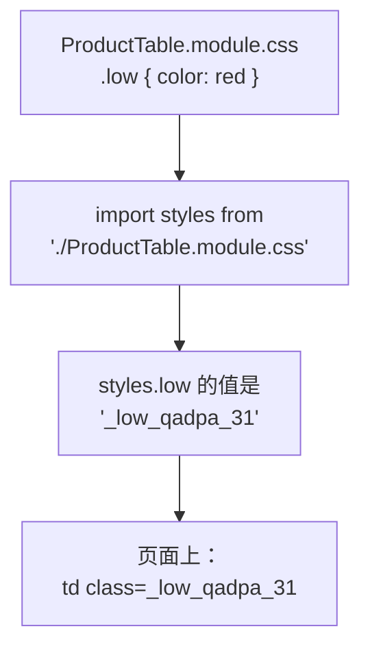

# 第 10A 章 CSS Modules：组件自己的样式不互相干扰

## 这一章解决什么问题

到上一章为止，所有样式都堆在一个 `index.css` 里，类名像 `.low`、`.error` 这样很短。项目大了，很容易两个组件用了同一个类名、互相覆盖，改一处样式不知道会影响哪些页面。本章把组件的样式和组件放在一起，类名只在这个组件里有效。

本章只讲一个技术点：**CSS Modules**。

## 开始之前

- 上一章你已经会了：路由表、`Link`、URL 参数。
- 起点代码：仓库 `code/ch09C/price-list`（不含练习答案）。在 `D:\react-study\price-list` 执行 `npm run dev`。
- 预计耗时：25 分钟。

## 正文

### 10A.1 CSS Modules 是什么

**白话定义**：CSS Modules 是一种 CSS 文件写法：文件名以 `.module.css` 结尾，里面的类名只在导入它的组件里有效。Vite 会把类名改成带随机后缀的唯一名字（如 `.low` 变成 `_low_qadpa_31`），所以不同文件里的同名类不会冲突。

**业务场景**：表格的 `.low`（库存不足标红）只属于 `ProductTable`。放进 `ProductTable.module.css` 后，别的组件就算也写了 `.low`，也不会被表格的样式影响。

**反例（什么时候不该用）**：整个网站通用的基础样式（`body` 的字体和边距、全局的「出错红字」`.error`）放在 `index.css` 这种全局文件里。把它们拆进各个模块，每个组件都要重复写一遍。

#### 🖼 图解



### 10A.2 把表格的样式搬进模块

#### 💻 最小可运行代码

新建 `src/components/ProductTable.module.css`：

```css
/* src/components/ProductTable.module.css */
/* 只给 ProductTable 用的样式。类名打包时会被改成唯一的名字，不会和别的文件冲突 */
.table {
  border-collapse: collapse;
  margin-bottom: 16px;
  min-width: 560px;
}

/* 类名后面跟元素选择器也可以：只影响 .table 里面的 th、td */
.table th,
.table td {
  border: 1px solid #ddd;
  padding: 6px 10px;
}

.table th {
  background: #f3f4f6;
  text-align: left;
}

/* 类名用驼峰写法，在 TSX 里就能写成 styles.outOfStock */
.outOfStock {
  margin-left: 6px;
  padding: 0 6px;
  color: #fff;
  background: #dc2626;
  border-radius: 4px;
  font-size: 12px;
}

.low {
  color: #dc2626;
  font-weight: bold;
}
```

用下面的内容整个替换 `src/components/ProductTable.tsx`（改了 4 处：多一行 import，三处 `className`）：

```tsx
// src/components/ProductTable.tsx
// 只负责显示表格。数据从 props 来；点了按钮不自己改数据，而是调用父组件给的函数「通知」它
import { Link } from 'react-router'
import type { Product } from '../types.ts'
// 导入 CSS Module 得到一个对象：键是你写的类名，值是打包后真正使用的类名
import styles from './ProductTable.module.css'

type ProductTableProps = {
  products: Product[]
  // 回调 props：类型写清楚「调用时传什么参数、返回什么」。void 表示不关心返回值
  onDelete: (id: number) => void
  onRestock: (id: number) => void
}

export function ProductTable({ products, onDelete, onRestock }: ProductTableProps) {
  if (products.length === 0) {
    return <p className="empty">暂无产品</p>
  }

  return (
    <table className={styles.table}>
      <thead>
        <tr>
          <th>编号</th>
          <th>名称</th>
          <th>单价（元）</th>
          <th>库存</th>
          <th>操作</th>
        </tr>
      </thead>
      <tbody>
        {products.map((p) => (
          <tr key={p.id}>
            <td>{p.code}</td>
            <td>
              {/* 点产品名进入详情页，地址形如 /products/3 */}
              <Link to={`/products/${p.id}`}>{p.name}</Link>
              {p.stock === 0 && <span className={styles.outOfStock}>缺货</span>}
            </td>
            <td>{p.price.toLocaleString()}</td>
            <td className={p.stock < 5 ? styles.low : undefined}>{p.stock}</td>
            <td>
              <button type="button" onClick={() => onRestock(p.id)}>入库 +1</button>{' '}
              <button type="button" onClick={() => onDelete(p.id)}>删除</button>
            </td>
          </tr>
        ))}
      </tbody>
    </table>
  )
}
```

表格的样式搬走后，`src/index.css` 里第 5A、5C 章加的 `.product-table`、`.product-table th, .product-table td`、`.out-of-stock`、`.low` 这四段就用不到了。用下面的内容整个替换 `src/index.css`，只留全局样式：

```css
/* src/index.css */
/* 全局样式：整个页面通用的基础样式。只属于某一个组件的样式，放到它自己的 .module.css 里 */
body {
  margin: 24px;
  font-family: system-ui, 'Microsoft YaHei', sans-serif;
}

.subtitle {
  color: #666;
}

.card {
  border: 1px solid #ddd;
  border-radius: 6px;
  padding: 8px 16px;
  margin-bottom: 12px;
  max-width: 360px;
}

.panel {
  border-left: 4px solid #3b82f6;
  padding-left: 12px;
  margin-bottom: 16px;
}

.empty {
  color: #999;
}

.product-form label { display: block; margin: 6px 0; }
.error { display: block; color: #dc2626; font-size: 14px; }
.success { color: #16a34a; }
.filter-bar { display: block; margin-bottom: 8px; }
.nav { margin-bottom: 12px; }
```

现在这个文件里留下的，都是多个组件共用或整个页面通用的样式：`.card`（第 9C 章详情页的卡片）、`.error`（列表页、详情页、表单都用）等。

#### 🔍 拆解运行结果

表头变成浅灰底色，库存少于 5 的数字变成红色粗体。`F12` 看「元素」面板，实测：

```html
<table class="_table_qadpa_3">
<span class="_outOfStock_qadpa_21">缺货</span>
<td class="_low_qadpa_31">3</td>
```

类名后缀（`qadpa`）由文件路径算出来，你那边的可能不同。

| 代码 | 说明 |
| --- | --- |
| `import styles from './ProductTable.module.css'` | Vite 自带对 `.module.css` 的类型声明，`styles` 的类型是 `{ readonly [key: string]: string }`，不用自己写类型 |
| `className={styles.table}` | 取的是改名后的真实类名 |
| `.outOfStock` 用驼峰 | 写成 `.out-of-stock` 也行，但 TSX 里只能写 `styles['out-of-stock']`，不方便（见踩坑警告） |

偶尔要按数值算样式时，可以用 `style` 属性。它在 React 里是**对象**，属性名用驼峰：`style={{ fontSize: 14 }}`（数字默认单位 px）。外层花括号表示「这里是表达式」，内层是对象（第 2B 章踩坑警告见过）。

#### 改坏一处试试

把 `className={styles.table}` 写成 `className={styles.tabel}`。实测 `tsc` **不报错**，页面上的 `<table>` 没有 `class` 属性，表格边框变回了浏览器默认样式（不合并的双线）。

`styles` 的类型允许任意键名，拼错的键取到的是 `undefined`，React 就不输出 `class`。所以看到某个组件「样式突然没了」，先查类名拼写。改回去。

## ⚠️ 踩坑警告

| 现象 | 原因 | 怎么改 |
| --- | --- | --- |
| 某个组件的样式突然没了，`tsc` 也不报错 | CSS Modules 的类名拼错，`styles.xxx` 取到 `undefined` | 对照 `.module.css` 检查拼写 |
| 类名写成 `.out-of-stock`，TSX 里写 `styles.out-of-stock`，报 `TS2362: The left-hand side of an arithmetic operation must be of type ...` 和 `TS2304: Cannot find name 'of'.` | `-` 被当成了减号，变成 `styles.out - of - stock` | CSS 里类名用驼峰 `.outOfStock`；或者写 `styles['out-of-stock']` |
| `style={{ 'font-size': '14px' }}` 报 `TS2353: ... ''font-size'' does not exist in type 'Properties<...>'.` | React 的 `style` 对象用驼峰属性名 | 写成 `style={{ fontSize: 14 }}` |
| 样式文件叫 `ProductTable.css`（少了 `.module`），`npx tsc -b` 报 `TS2339: Property 'table' does not exist on type 'typeof import("*.css")'.`，页面上表格出不来；`npm run build` 报 `"default" is not exported by "src/components/ProductTable.css"` | 文件名没有 `.module`，Vite 把它当成普通的全局 CSS，不提供类名对象 | 文件名必须以 `.module.css` 结尾 |

## 🎯 动手练习

**练习 1：表单样式改成 CSS Module**

新建 `src/components/ProductForm.module.css`，把表单用到的 `.product-form label` 和 `.success` 搬进去，`ProductForm.tsx` 改用 `styles.xxx`。`.error` 在列表页、详情页也用到了，在 `index.css` 里保留一份。

验收标准：

- 表单的样式和之前一样：每个输入框一行，错误提示红色，保存成功绿色。
- 「元素」面板里表单的类名形如 `_form_xxxxx_3`。
- `index.css` 里不再有 `.product-form` 和 `.success`。

**练习 2：用 style 调一处小样式**

详情页顶部的「← 返回列表」那一行，字号改成 14px、颜色改成灰色 `#666`。只改这一处，不新建 CSS 文件。

验收标准：

- 「元素」面板里那个 `<p>` 是 `<p style="font-size: 14px; color: rgb(102, 102, 102);">`。

卡住了看文末参考答案。

## 📌 一句话总结

组件专用的样式放 .module.css，用 styles.类名 引用，全局样式留在 index.css。

## 下一章

页面还只能在开发服务器上看。第 10B 章用 `npm run build` 打包成浏览器能直接用的文件。

---

<!-- 以下是参考答案，先自己动手，卡住了再往下翻 -->


## 参考答案

### 练习 1

思路：表单专用的样式搬进模块；`.error` 多个组件都在用，属于全局样式，表单里另写一份模块版本，两者互不影响。

```css
/* src/components/ProductForm.module.css */
/* 练习 1：表单专用的样式，从 index.css 搬过来 */
.form label {
  display: block;
  margin: 6px 0;
}

.error {
  display: block;
  color: #dc2626;
  font-size: 14px;
}

.success {
  color: #16a34a;
}
```

`ProductForm.tsx` 里的改动：import 区加 `import styles from './ProductForm.module.css'`；`className="product-form"` 改成 `className={styles.form}`；三处 `className="error"` 改成 `className={styles.error}`；`className="success"` 改成 `className={styles.success}`。完整文件：

```tsx
// src/components/ProductForm.tsx
// 练习 1：类名改用 CSS Module
import { useState } from 'react'
import type { ChangeEvent, SubmitEvent } from 'react'
import type { Product } from '../types.ts'
import styles from './ProductForm.module.css'

type ProductFormProps = {
  // 保存成功时把新产品交给父组件。表单不知道、也不关心父组件怎么存
  onAdd: (product: Product) => void
}

export function ProductForm({ onAdd }: ProductFormProps) {
  // 每个输入框对应一个 state。输入框里的内容永远是字符串，单价也先按字符串存
  const [code, setCode] = useState('')
  const [name, setName] = useState('')
  const [category, setCategory] = useState('探头')
  const [price, setPrice] = useState('')
  // 保存成功后显示的提示
  const [message, setMessage] = useState('')
  // 点过一次「保存」才显示错误，免得一打开页面就满屏红字
  const [triedSubmit, setTriedSubmit] = useState(false)

  // 派生值：每次渲染都从 state 现算，不另存 state，所以永远和输入框一致
  const priceNumber = Number(price)
  const codeError = code.trim() === '' ? '请填写编号' : ''
  const nameError = name.trim() === '' ? '请填写名称' : ''
  // Number('abc') 是 NaN，NaN > 0 不成立，所以「不是数字」和「小于等于 0」一起拦住
  const priceError = price.trim() === '' ? '请填写单价' : priceNumber > 0 ? '' : '单价必须是大于 0 的数字'
  const isValid = codeError === '' && nameError === '' && priceError === ''

  // 单独写成函数时，参数类型要写明：input 元素上的变化事件
  function handlePriceChange(e: ChangeEvent<HTMLInputElement>) {
    setPrice(e.target.value)
  }

  function handleSubmit(e: SubmitEvent<HTMLFormElement>) {
    // 阻止浏览器默认的「提交表单 = 刷新整页」，改由我们自己处理
    e.preventDefault()
    setTriedSubmit(true)
    if (!isValid) {
      setMessage('')
      return
    }
    // 新产品还没入库，库存为 0；id 先用当前时间的毫秒数，保证不重复
    const product: Product = { id: Date.now(), code: code.trim(), name: name.trim(), category, price: priceNumber, stock: 0 }
    onAdd(product)
    setMessage(`已录入：${product.name}，单价 ${product.price.toLocaleString()} 元`)
    // 清空输入框，并收起错误提示
    setCode('')
    setName('')
    setPrice('')
    setTriedSubmit(false)
  }

  return (
    <form className={styles.form} onSubmit={handleSubmit}>
      <h2>录入新产品</h2>
      {/* value 来自 state，onChange 把用户输入写回 state：输入框完全由 React 控制 */}
      <label>编号 <input value={code} onChange={(e) => setCode(e.target.value)} /></label>
      {triedSubmit && codeError && <span className={styles.error}>{codeError}</span>}
      <label>名称 <input value={name} onChange={(e) => setName(e.target.value)} /></label>
      {triedSubmit && nameError && <span className={styles.error}>{nameError}</span>}
      <label>
        分类{' '}
        <select value={category} onChange={(e) => setCategory(e.target.value)}>
          <option value="探头">探头</option>
          <option value="主机">主机</option>
          <option value="耗材">耗材</option>
        </select>
      </label>
      <label>单价 <input value={price} onChange={handlePriceChange} /></label>
      {triedSubmit && priceError && <span className={styles.error}>{priceError}</span>}
      {/* type="submit"：点击或在输入框里按回车都会触发表单的 onSubmit */}
      <button type="submit">保存</button>
      {message && <p className={styles.success}>{message}</p>}
    </form>
  )
}
```

`index.css` 里删掉 `.product-form label` 和 `.success` 两行，保留 `.error`：

```css
/* src/index.css */
/* 全局样式：整个页面通用的基础样式。只属于某一个组件的样式，放到它自己的 .module.css 里 */
body {
  margin: 24px;
  font-family: system-ui, 'Microsoft YaHei', sans-serif;
}

.subtitle {
  color: #666;
}

.card {
  border: 1px solid #ddd;
  border-radius: 6px;
  padding: 8px 16px;
  margin-bottom: 12px;
  max-width: 360px;
}

.panel {
  border-left: 4px solid #3b82f6;
  padding-left: 12px;
  margin-bottom: 16px;
}

.empty {
  color: #999;
}

.error { display: block; color: #dc2626; font-size: 14px; }
.filter-bar { display: block; margin-bottom: 8px; }
.nav { margin-bottom: 12px; }
```

### 练习 2

思路：只有一处、以后也不会复用的小样式，用 `style` 对象最省事。属性名驼峰，`fontSize: 14` 的单位默认是 px。

```tsx
// src/pages/ProductDetailPage.tsx
// 练习 2 做完后的版本
// 产品详情页：地址是 /products/3 这种形式，从地址里取出 3，再找到对应的产品
import { Link, useParams } from 'react-router'
import { useProducts } from '../hooks/useProducts.ts'
import { ProductCard } from '../components/ProductCard.tsx'

export function ProductDetailPage() {
  // 路由表里写的是 :id，这里就按 id 取。地址里的值永远是字符串，也可能没有（undefined）
  const { id } = useParams()
  // 详情页自己加载一次数据（第 8C 章说过：这和列表页那份是两份独立的数据）
  const { state } = useProducts()

  if (state.status === 'loading') {
    return <p>加载中…</p>
  }
  if (state.status === 'error') {
    return <p className="error">加载失败：{state.message}</p>
  }

  // 地址里的 '3' 是字符串，产品的 id 是数字，先转换再比较
  const product = state.products.find((p) => p.id === Number(id))

  return (
    <section>
      {/* 练习 2：style 是对象，属性名用驼峰；数字默认单位是 px */}
      <p style={{ fontSize: 14, color: '#666' }}>
        <Link to="/">← 返回列表</Link>
      </p>
      {/* 第 3、4 章做的卡片在这里派上用场，自带询价数量 */}
      {product ? <ProductCard product={product} /> : <p className="empty">找不到编号为 {id} 的产品</p>}
    </section>
  )
}
```
