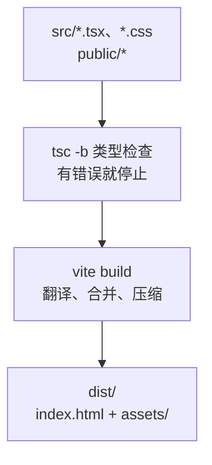

# 第 10B 章 npm run build：打包成浏览器能直接用的文件

## 这一章解决什么问题

开发服务器只适合开发：它边运行边翻译 `.tsx`，没有为正式访问做优化，也不该暴露给别人用。要交给运维部署，得先把项目打包成一组纯静态文件：HTML、JS、CSS。本章执行打包，看清楚打包出来的是什么。

本章只讲一个技术点：**`npm run build`**。

## 开始之前

- 上一章你已经会了：用 CSS Modules 写组件专用的样式。
- 起点代码：仓库 `code/ch10A/price-list`（不含练习答案）。在 `D:\react-study\price-list` 执行 `npm run dev`。
- 预计耗时：20 分钟。

## 正文

### 10B.1 npm run build 是什么

**白话定义**：`npm run build` 先用 TypeScript 做一遍完整的类型检查（`tsc -b`），通过后再由 Vite 把所有 `.tsx`、`.css` 翻译、合并、压缩，输出到 `dist` 文件夹。`dist` 里只有浏览器能直接用的 HTML、JS、CSS 和 `public/` 里的文件。第 1D 章用它找过类型错误。

**业务场景**：开发完成后，把 `dist` 交给运维部署到服务器。服务器上不需要装 Node.js，也不需要 `node_modules`。

**反例（什么时候不该用）**：开发调试时不要每次改代码都 `build` 再看结果，那样要等完整打包，也没有热更新。开发时用 `npm run dev`，交付或验证打包结果时才 `build`。

#### 🖼 图解



### 10B.2 打包和预览

#### 💻 最小可运行代码

先删掉第 7C 章为了看「加载中」加的模拟延迟：打开 `src/hooks/useProducts.ts`，删掉这两行：

```ts
        // 模拟慢网络，便于看到「加载中」。正式代码删掉这一行
        await new Promise((resolve) => setTimeout(resolve, 1000))
```

删完的完整文件：

```ts
// src/hooks/useProducts.ts
// 自定义 Hook：把「加载产品 + 增删改」这一整套逻辑打包，任何组件调用它都能用
import { useEffect, useState } from 'react'
import type { Product } from '../types.ts'

export type LoadState =
  | { status: 'loading' }
  | { status: 'error'; message: string }
  | { status: 'success'; products: Product[] }

// 名字必须以 use 开头：React 和 lint 工具靠这个识别它是 Hook，按 Hook 的规则检查
export function useProducts() {
  const [state, setState] = useState<LoadState>({ status: 'loading' })

  useEffect(() => {
    let ignore = false

    async function load() {
      try {
        const response = await fetch('/products.json')
        if (!response.ok) {
          throw new Error(`服务器返回 ${response.status}`)
        }
        const products: Product[] = await response.json()
        if (!ignore) {
          setState({ status: 'success', products })
        }
      } catch (err) {
        if (!ignore) {
          setState({ status: 'error', message: err instanceof Error ? err.message : String(err) })
        }
      }
    }

    load()
    return () => {
      ignore = true
    }
  }, [])

  function addProduct(product: Product) {
    if (state.status !== 'success') return
    // 添加：展开旧数组，在末尾放新产品，得到一个新数组
    setState({ status: 'success', products: [...state.products, product] })
  }

  function deleteProduct(id: number) {
    if (state.status !== 'success') return
    setState({ status: 'success', products: state.products.filter((p) => p.id !== id) })
  }

  function restockProduct(id: number) {
    if (state.status !== 'success') return
    setState({
      status: 'success',
      products: state.products.map((p) => (p.id === id ? { ...p, stock: p.stock + 1 } : p)),
    })
  }

  // 返回一个对象，调用方按名字取自己需要的部分
  return { state, addProduct, deleteProduct, restockProduct }
}
```

然后另开一个终端（开发服务器不用停）：

```powershell
# 在 D:\react-study\price-list 目录执行
npm run build
npm run preview
```

#### 🔍 拆解运行结果

`npm run build` 的输出（实测，文件名里的随机串每次内容变化时都会变）：

```text
vite v8.3.5 building client environment for production...
transforming...
✓ 106 modules transformed.
rendering chunks...
computing gzip size...
dist/index.html                   0.47 kB │ gzip:  0.32 kB
dist/assets/index-DO0M7wN0.css    0.83 kB │ gzip:  0.42 kB
dist/assets/index-ViYoyZsM.js   262.95 kB │ gzip: 83.59 kB

✓ built in 146ms
```

`dist` 里的文件：

| 文件 | 来源 |
| --- | --- |
| `index.html` | 项目根目录的 `index.html`，`<script>` 已经换成指向打包后的 JS |
| `assets/index-xxxx.js` | 所有 `.tsx`/`.ts` 加上 React、React Router，合成一个文件 |
| `assets/index-xxxx.css` | `index.css` 和所有 `.module.css` 合成一个文件 |
| `products.json`、`favicon.svg` | 从 `public/` 原样复制 |

| 输出 | 含义 |
| --- | --- |
| `106 modules transformed` | 一共处理了 106 个文件（你的代码加上用到的库） |
| `262.95 kB │ gzip: 83.59 kB` | 文件大小，以及服务器开启 gzip 压缩后实际传输的大小 |

文件名里的 `ViYoyZsM` 这类字符串由文件内容算出来（练习 2 验证）。内容变了文件名就变，浏览器不会用到旧缓存，所以服务器可以放心地让 `assets/` 下的文件长期缓存。

`npm run preview` 用一个本机服务器提供 `dist` 里的文件，输出 `Local: http://localhost:4173/`。打开这个地址，页面和开发时一样，但用的是打包后的文件。确认打包结果没问题再交付。

#### 改坏一处试试

在资源管理器里双击 `dist\index.html`。页面是空白的，控制台报 `Access to script at 'file:///assets/index-....js' from origin 'null' has been blocked by CORS policy`。和第 1A 章一样，打包后的文件也必须通过 Web 服务器（`http://`）访问，不能直接双击打开。

## ⚠️ 踩坑警告

| 现象 | 原因 | 怎么改 |
| --- | --- | --- |
| 双击 `dist\index.html` 是空白页 | 浏览器不允许 `file://` 页面加载模块脚本 | 用 `npm run preview` 或部署到 Web 服务器后用 `http://` 访问 |
| `npm run build` 报了类型错误，`dist` 里却还有文件，部署后是旧页面 | `tsc -b` 失败后 `vite build` 没执行，`dist` 是上一次的结果（第 1D 章） | 看输出最后一行是不是 `✓ built in ...ms` |
| `npm run preview` 显示的是旧页面 | `preview` 只是提供 `dist` 里现有的文件，改了代码没重新 `build` | 先 `npm run build` 再 `npm run preview` |
| 正式环境里页面一直显示「加载中」的时间比开发时长 1 秒 | 忘了删模拟延迟 | 打包前删掉 `setTimeout` 那两行 |

## 🎯 动手练习

**练习 1：public 里的文件原样进入 dist**

在 `public/` 下新建 `version.txt`，写上三行：「产品价格清单 前端」「版本：1.0.0」「打包日期：2026-10-31」。重新打包。

验收标准：

- `dist` 里出现 `version.txt`，内容和 `public/version.txt` 一样。
- `npm run preview` 后打开 `http://localhost:4173/version.txt` 能看到这三行。

**练习 2：内容变了，文件名就变**

记下当前 `dist/assets` 里 JS 和 CSS 的文件名。把 `PageFooter.tsx` 里的「数据更新日期：」改成「数据更新于：」，重新打包。

验收标准：

- JS 文件名变了，CSS 文件名没变。
- 能说出为什么 CSS 的文件名没变。

卡住了看文末参考答案。

## 📌 一句话总结

npm run build 先查类型再打包到 dist，用 npm run preview 验证。

## 下一章

`dist` 已经有了，第 10C 章把它部署到 Web 服务器，处理刷新子页面 404 和部署到子路径两个问题。

---

<!-- 以下是参考答案，先自己动手，卡住了再往下翻 -->


## 参考答案

### 练习 1

思路：`public/` 里的文件不经过翻译，打包时原样复制到 `dist` 根目录，地址也是从网站根目录算起。新建的文件：

```text
产品价格清单 前端
版本：1.0.0
打包日期：2026-10-31
```

实测打包后 `dist` 里的文件：`assets`、`favicon.svg`、`index.html`、`products.json`、`version.txt`。

### 练习 2

实测：改字之前文件名是 `index-ViYoyZsM.js` 和 `index-DO0M7wN0.css`；改字后变成 `index-DRfx_Vbr.js`，CSS 仍是 `index-DO0M7wN0.css`。

文件名里的字符串是根据文件**内容**算出来的。这次只改了 TSX，打包出来的 JS 内容变了，CSS 内容一个字都没变，所以 CSS 文件名不变。用户再次打开页面时，浏览器会下载新的 JS，CSS 直接用缓存。做完把文字改回去。
