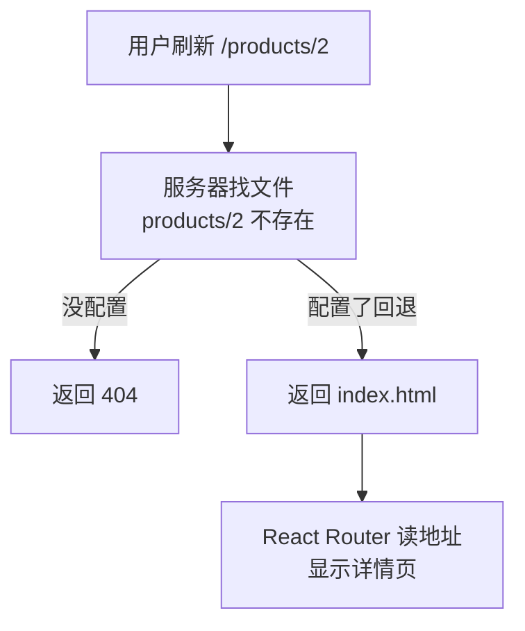

# 第 10C 章 部署 dist：刷新 404 与子路径

## 这一章解决什么问题

把 `dist` 复制到 Web 服务器上，首页能打开，但在 `/products/2` 页面按 `F5` 变成了 404；网站要放在 `http://服务器/price-list/` 下而不是根路径时，页面直接空白。本章解决部署时最常见的这两个问题。

本章只讲一个技术点：**部署 `dist` 时的服务器配置和 `base`**。

## 开始之前

- 上一章你已经会了：`npm run build` 打包到 `dist`、`npm run preview` 预览。
- 起点代码：仓库 `code/ch10B/price-list`（不含练习答案）。
- 本章要用 `npx serve` 这个简单的静态文件服务器测试，第一次运行时会提示安装，输入 `y`。
- 预计耗时：30 分钟。

## 正文

### 10C.1 部署 dist 是什么

**白话定义**：`dist` 是一组纯静态文件，任何能提供静态文件的 Web 服务器都能部署：IIS、Nginx、Apache，或者公司已有的文件服务器。部署就是把 `dist` 里的**所有内容**复制到网站目录。要注意两件事：刷新子页面时的 404，以及网站不在根路径时的地址。

**业务场景**：公司内网 IIS 上已有一个网站，要把价格清单放上去。

**反例（什么时候不该用）**：「改了 `products.json` 就想让页面显示新数据」不要靠重新打包部署。静态文件适合放程序，业务数据应该来自后端接口；本教程用 `products.json` 只是为了不依赖后端。

#### 🖼 图解



### 10C.2 刷新子页面 404

在应用里点进 `/products/2` 没问题（`Link` 不请求服务器），但在这个页面按 `F5`，浏览器会向服务器请求 `/products/2` 这个路径。服务器上没有这个文件，就返回 404。实测：

| 服务器 | 打开 `/products/2` |
| --- | --- |
| `npx serve dist` | 404：`The requested path could not be found` |
| `npx serve -s dist`（`-s` 表示单页应用回退） | 正常显示线阵探头 L12-5 |
| `npm run preview` | 正常（Vite 默认就有回退） |

服务器要配置「找不到文件时返回 `index.html`」。IIS 的做法是在网站目录放一个 `web.config`。把它放在 `public/` 里，每次打包会自动复制到 `dist/`。

#### 💻 最小可运行代码

新建 `public/web.config`：

> ⚠️ 本段 IIS 配置未实机验证（实测环境没有 IIS）。需要先在服务器上安装 IIS 的 URL Rewrite 模块。

```xml
<?xml version="1.0" encoding="UTF-8"?>
<!-- public/web.config：IIS 用的配置。放在 public/ 里，打包时会原样复制到 dist/ -->
<!-- 需要先在 IIS 上安装 URL Rewrite 模块 -->
<configuration>
  <system.webServer>
    <rewrite>
      <rules>
        <!-- 请求的不是真实存在的文件或文件夹时（例如 /products/2），一律返回 index.html，交给 React Router 处理 -->
        <rule name="SPA fallback" stopProcessing="true">
          <match url=".*" />
          <conditions logicalGrouping="MatchAll">
            <add input="{REQUEST_FILENAME}" matchType="IsFile" negate="true" />
            <add input="{REQUEST_FILENAME}" matchType="IsDirectory" negate="true" />
          </conditions>
          <action type="Rewrite" url="/index.html" />
        </rule>
      </rules>
    </rewrite>
  </system.webServer>
</configuration>
```

### 10C.3 网站不在根路径

如果网站地址是 `http://服务器/price-list/` 而不是 `http://服务器/`，要在 `vite.config.ts` 里设置 `base: '/price-list/'`（练习 1）。代码里还有两处写死了根路径 `/`，要改成用 `import.meta.env.BASE_URL`（Vite 提供的变量，值就是 `base`，默认 `/`）。

#### 💻 最小可运行代码

用下面的内容整个替换 `src/hooks/useProducts.ts`（只改了 `fetch` 那一行和它上面的注释）：

```ts
// src/hooks/useProducts.ts
// 自定义 Hook：把「加载产品 + 增删改」这一整套逻辑打包，任何组件调用它都能用
import { useEffect, useState } from 'react'
import type { Product } from '../types.ts'

export type LoadState =
  | { status: 'loading' }
  | { status: 'error'; message: string }
  | { status: 'success'; products: Product[] }

// 名字必须以 use 开头：React 和 lint 工具靠这个识别它是 Hook，按 Hook 的规则检查
export function useProducts() {
  const [state, setState] = useState<LoadState>({ status: 'loading' })

  useEffect(() => {
    let ignore = false

    async function load() {
      try {
        // BASE_URL 默认是 /，部署到子路径时自动变成 /price-list/ 这样，地址就不用改代码
        const response = await fetch(`${import.meta.env.BASE_URL}products.json`)
        if (!response.ok) {
          throw new Error(`服务器返回 ${response.status}`)
        }
        const products: Product[] = await response.json()
        if (!ignore) {
          setState({ status: 'success', products })
        }
      } catch (err) {
        if (!ignore) {
          setState({ status: 'error', message: err instanceof Error ? err.message : String(err) })
        }
      }
    }

    load()
    return () => {
      ignore = true
    }
  }, [])

  function addProduct(product: Product) {
    if (state.status !== 'success') return
    // 添加：展开旧数组，在末尾放新产品，得到一个新数组
    setState({ status: 'success', products: [...state.products, product] })
  }

  function deleteProduct(id: number) {
    if (state.status !== 'success') return
    setState({ status: 'success', products: state.products.filter((p) => p.id !== id) })
  }

  function restockProduct(id: number) {
    if (state.status !== 'success') return
    setState({
      status: 'success',
      products: state.products.map((p) => (p.id === id ? { ...p, stock: p.stock + 1 } : p)),
    })
  }

  // 返回一个对象，调用方按名字取自己需要的部分
  return { state, addProduct, deleteProduct, restockProduct }
}
```

用下面的内容整个替换 `src/main.tsx`（给 `BrowserRouter` 加了 `basename`）：

```tsx
// src/main.tsx
// 整个前端的入口：index.html 里的 <script> 只引用这一个文件
import { StrictMode } from 'react'
import { createRoot } from 'react-dom/client'
import { BrowserRouter } from 'react-router'
// CSS 也能 import：Vite 会把它变成 <style> 插进页面
import './index.css'
import App from './App.tsx'

// 找到 index.html 里的 <div id="root">，React 从此接管它里面的内容
// 末尾的 ! 告诉 TypeScript：这个元素一定存在（否则它认为可能是 null）
createRoot(document.getElementById('root')!).render(
  // StrictMode 只在开发时做额外检查，打包后的正式版本不受影响
  <StrictMode>
    {/* BrowserRouter 用浏览器地址栏的路径决定显示哪个页面；包在最外层，里面的组件才能用路由功能 */}
    {/* basename：网站部署在子路径（如 /price-list/）时，路由要去掉这个前缀再匹配。值来自 vite.config.ts 的 base */}
    <BrowserRouter basename={import.meta.env.BASE_URL}>
      <App />
    </BrowserRouter>
  </StrictMode>,
)
```

#### 🔍 拆解运行结果

`base` 还是默认的 `/` 时，`BASE_URL` 就是 `/`，页面和之前完全一样。实测用 `--base /price-list/` 打包后：

- `dist/index.html` 里的地址都带上了前缀：`src="/price-list/assets/index-....js"`。
- 打开 `http://localhost:4173/price-list/` 显示列表，`/price-list/products/3` 显示便携彩超主机。

| 代码 | 说明 |
| --- | --- |
| `import.meta.env.BASE_URL` | Vite 在打包时把它替换成 `base` 的值。默认 `/`，设了 `base: '/price-list/'` 就是 `/price-list/` |
| `` fetch(`${import.meta.env.BASE_URL}products.json`) `` | 拼出 `/products.json` 或 `/price-list/products.json` |
| `<BrowserRouter basename={...}>` | 路由匹配前先去掉这个前缀，路由表不用改 |

部署到 IIS 子路径时，`web.config` 里的 `url="/index.html"` 也要改成 `url="/price-list/index.html"`（⚠️ 未实机验证）。部署时复制的是 `dist` **里面**的全部文件，网站目录下应该直接看到 `index.html`。

#### 改坏一处试试

用上一章的代码（`fetch` 和 `BrowserRouter` 都没改），同样以 `base: '/price-list/'` 打包，实测：

| 没改的地方 | 现象 |
| --- | --- |
| `BrowserRouter` 没加 `basename` | 打开 `/price-list/` 显示「页面不存在」：路由拿完整路径 `/price-list/` 去匹配，路由表里没有这一条 |
| `fetch('/products.json')` 没改 | 请求的是 `/products.json`，返回 404；文件其实在 `/price-list/products.json` |

## ⚠️ 踩坑警告

| 现象 | 原因 | 怎么改 |
| --- | --- | --- |
| 部署后首页正常，在子页面按 F5 变成 404 | 服务器上没有 `/products/2` 这个文件，也没配置回退 | 配置「找不到文件时返回 `index.html`」：IIS 用 `web.config` + URL Rewrite，测试时用 `npx serve -s dist` |
| 部署到子路径后页面空白，控制台里 JS、CSS 都是 404 | 没设置 `base`，`index.html` 里引用的是 `/assets/...`，而文件在 `/price-list/assets/...` | `vite.config.ts` 里设置 `base: '/price-list/'`，重新打包 |
| 设置了 `base`，页面显示「页面不存在」或「加载失败」 | 代码里还写着根路径：路由没加 `basename`，`fetch` 写的是 `'/products.json'` | 都改用 `import.meta.env.BASE_URL` |
| 重新部署后，用户看到的还是旧页面 | 服务器或中间的代理把 `index.html` 也长期缓存了，浏览器一直用旧的 `index.html`，它引用的还是旧的 JS 文件名 | 让 `index.html` 不缓存；`assets/` 下的文件名带内容哈希，可以长期缓存。具体配置方法因服务器而异（⚠️ 未实机验证） |

## 🎯 动手练习

**练习 1：打包到子路径**

在 `vite.config.ts` 里把 `base` 设成 `/price-list/`，然后执行 `npm run build` 和 `npm run preview`。

验收标准：

- `dist/index.html` 里的 JS、CSS 地址都以 `/price-list/assets/` 开头。
- `npm run preview` 显示的地址变成 `http://localhost:4173/price-list/`；打开它能看到产品列表，打开 `http://localhost:4173/price-list/products/3` 显示便携彩超主机。
- 做完把 `base` 改回去（或删掉这一行），以免影响后面的开发。

**练习 2：亲手验证刷新 404**

用默认的 `base` 重新打包，分别用 `npx serve dist` 和 `npx serve -s dist` 启动（两次之间按 `Ctrl + C` 停掉前一个），每次都直接在地址栏打开 `http://localhost:3000/products/2`。

验收标准：

- 不带 `-s` 时显示 404；带 `-s` 时显示线阵探头 L12-5。
- 能说出 `-s` 让服务器多做了什么。

卡住了看文末参考答案。

## 📌 一句话总结

服务器要把找不到的路径回退到 index.html，子路径部署设 base 并用 BASE_URL。

## 下一章

数据还来自静态文件 `products.json`，只能看不能存。第 11 章启动一个本地模拟接口，前端改为从接口加载数据。

---

<!-- 以下是参考答案，先自己动手，卡住了再往下翻 -->


## 参考答案

### 练习 1

思路：`base` 决定打包后所有资源地址的前缀，`import.meta.env.BASE_URL` 也跟着变，所以 10C.3 改过的 `fetch` 和 `basename` 自动生效，不用再改代码。

```ts
// vite.config.ts
import react from '@vitejs/plugin-react'
import { defineConfig } from 'vite'

// https://vite.dev/config/
export default defineConfig({
  plugins: [react()],
  // 练习 1：网站部署在 https://服务器/price-list/ 下。开头和结尾的 / 都不能少
  base: '/price-list/',
})
```

### 练习 2

不用写代码。`serve` 默认只提供真实存在的文件，`/products/2` 不是一个文件，所以返回 404。加上 `-s`（single-page，单页应用）后，找不到文件时改为返回 `index.html`，浏览器加载应用，React Router 读地址栏显示详情页。这正是 IIS 的 `web.config` 要做的事。

`serve` 默认用 3000 端口；如果 3000 被占用，它会换一个端口并在终端里显示，以终端显示的地址为准。
