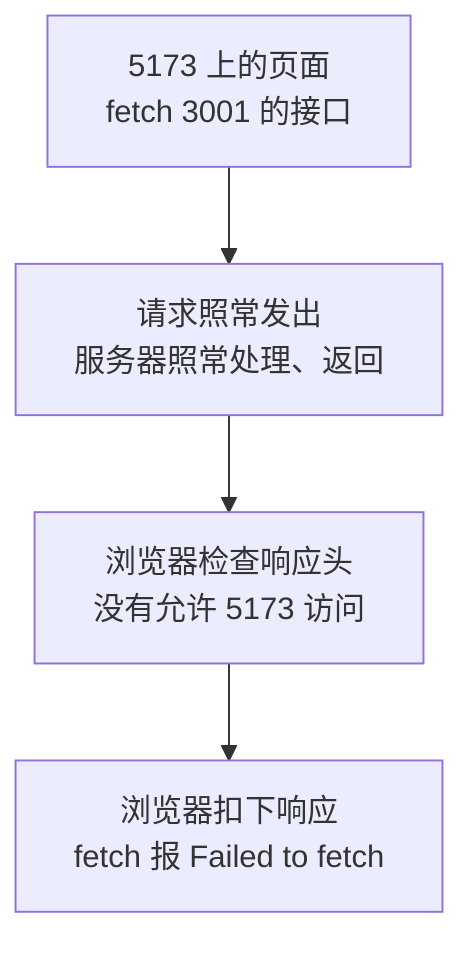
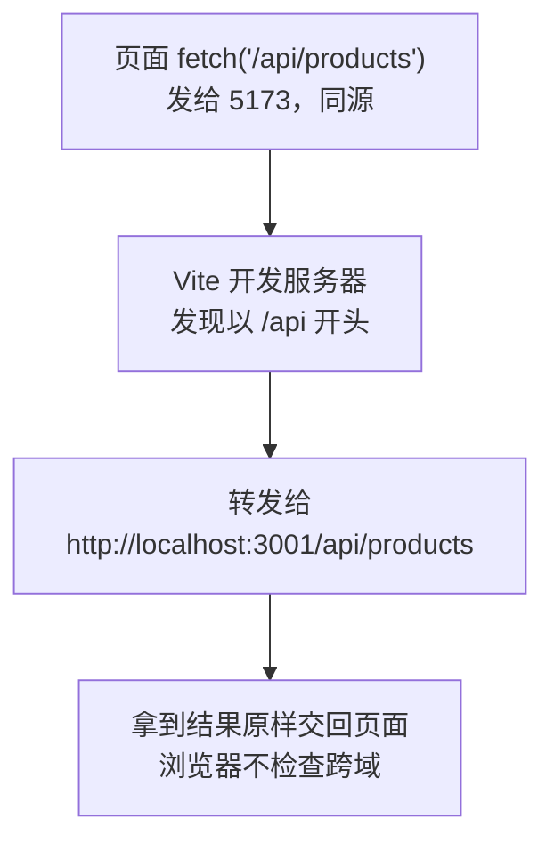
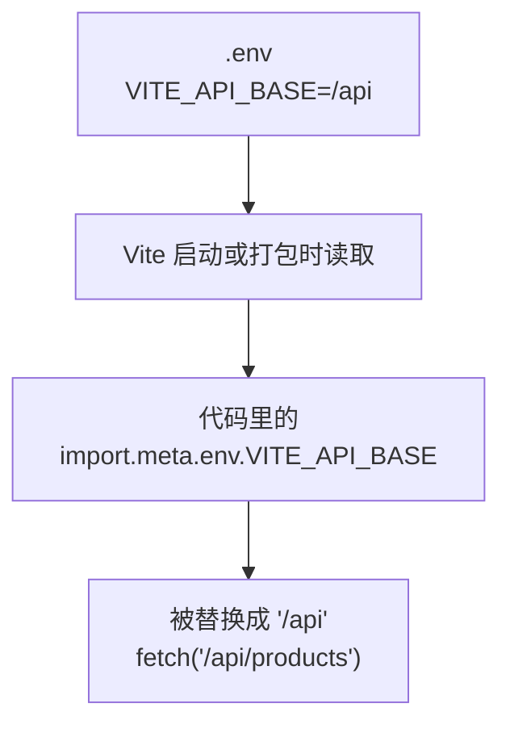

# 第 11 章 连接接口：开发代理、跨域与环境变量

## 这一章解决什么问题

到第 10 章为止，产品数据来自项目里的 `public/products.json`。真实系统里，数据由后端接口提供：前端页面运行在一个地址（开发时是 `http://localhost:5173`），后端接口运行在另一个地址。本章启动一个本地模拟接口，把数据来源换成它。过程中你会遇到前端连后端最常见的拦路虎「跨域」，并用开发代理解决；最后把接口地址放进配置文件，换环境时不用改代码。

## 开始之前

- 前面你已经会了：用 `useEffect` 加载数据、用判别联合表示加载状态（第 7 章），把取数逻辑抽成 `useProducts`（第 8 章），打包和部署（第 10 章）。
- 起点代码：仓库 `code/ch10/price-list`（不含练习答案）。
- 预计耗时：60 分钟。

### 准备本地模拟接口

模拟接口是一个很小的 Web 服务器，行为和真实后端一样：收到 HTTP 请求，返回 JSON。它只用 Node.js 自带的功能，不需要安装数据库或别的软件。第 11–14 章都用它。

**① 新建文件。** 在项目根目录（和 `src` 同一层）新建文件夹 `mock-server`，在里面新建 `server.ts`，内容如下。这个文件是「后端」，不属于前端代码，不需要读懂每一行，知道它提供了哪些接口就行（下面有表格）。

```ts
// mock-server/server.ts
// 本地模拟接口：只用 Node.js 自带的 http 模块，不用安装任何东西。
// 数据放在内存里：增删改在服务器运行期间一直有效，关掉服务器再启动就恢复成初始的 5 个产品。
// 启动方法：在项目目录执行 npm run mock
import { createServer } from 'node:http'
import type { IncomingMessage, ServerResponse } from 'node:http'

type Product = { id: number; code: string; name: string; category: string; price: number; stock: number }
type ProductInput = Omit<Product, 'id'>
type User = { username: string; password: string; name: string; role: 'admin' | 'sales' }

const PORT = 3001
// 每个请求故意延迟 500 毫秒，让「加载中」「保存中」看得见。可以用环境变量 MOCK_DELAY 改
const DELAY = Number(process.env.MOCK_DELAY ?? 500)
const CATEGORIES = ['探头', '主机', '耗材']

let products: Product[] = [
  { id: 1, code: 'P-001', name: '凸阵探头 C5-2', category: '探头', price: 12800, stock: 6 },
  { id: 2, code: 'P-002', name: '线阵探头 L12-5', category: '探头', price: 15600, stock: 3 },
  { id: 3, code: 'H-001', name: '便携彩超主机', category: '主机', price: 168000, stock: 2 },
  { id: 4, code: 'C-001', name: '耦合剂 250ml', category: '耗材', price: 18, stock: 120 },
  { id: 5, code: 'C-002', name: '探头保护套', category: '耗材', price: 6.5, stock: 0 },
]

const users: User[] = [
  { username: 'admin', password: '123456', name: '系统管理员', role: 'admin' },
  { username: 'zhangsan', password: '123456', name: '张三', role: 'sales' },
]

// 返回 JSON。body 不传时（例如删除成功的 204）不带内容
function send(res: ServerResponse, status: number, body?: unknown) {
  res.writeHead(status, { 'Content-Type': 'application/json; charset=utf-8' })
  res.end(body === undefined ? '' : JSON.stringify(body))
}

// 读出请求体并按 JSON 解析。内容不是合法 JSON 时 JSON.parse 会抛错，由下面统一处理
async function readJson(req: IncomingMessage): Promise<Record<string, unknown>> {
  let text = ''
  for await (const chunk of req) {
    text += String(chunk)
  }
  const value: unknown = text === '' ? {} : JSON.parse(text)
  return typeof value === 'object' && value !== null ? (value as Record<string, unknown>) : {}
}

// 后端校验：前端校验过了也要再查一遍，前端的检查可以被绕过。selfId 是编辑时自己的 id，查重时排除自己
function validate(body: Record<string, unknown>, selfId: number | null) {
  const input: ProductInput = {
    code: typeof body.code === 'string' ? body.code.trim() : '',
    name: typeof body.name === 'string' ? body.name.trim() : '',
    category: typeof body.category === 'string' ? body.category : '',
    price: typeof body.price === 'number' ? body.price : NaN,
    stock: typeof body.stock === 'number' ? body.stock : NaN,
  }
  const errors: Record<string, string> = {}
  if (input.code === '') {
    errors.code = '请填写编号'
  } else if (products.some((p) => p.code === input.code && p.id !== selfId)) {
    errors.code = `编号 ${input.code} 已存在`
  }
  if (input.name === '') errors.name = '请填写名称'
  if (!CATEGORIES.includes(input.category)) errors.category = '分类必须是探头、主机或耗材'
  if (!(input.price > 0)) errors.price = '单价必须大于 0'
  if (!(Number.isInteger(input.stock) && input.stock >= 0)) errors.stock = '库存必须是不小于 0 的整数'
  return { input, errors }
}

async function handle(req: IncomingMessage, res: ServerResponse) {
  const method = req.method ?? 'GET'
  const path = new URL(req.url ?? '/', `http://localhost:${PORT}`).pathname
  // /api/products/3 这种地址，取出最后的数字
  const match = path.match(/^\/api\/products\/(\d+)$/)
  const id = match ? Number(match[1]) : null

  // 新增、修改、登录都要求请求体是 JSON，并在请求头里写明。真实后端（比如 Spring Boot）也是这样，不写会返回 415
  const isJson = (req.headers['content-type'] ?? '').includes('application/json')
  if ((method === 'POST' || method === 'PUT') && !isJson) {
    return send(res, 415, { message: '请求头 Content-Type 必须是 application/json' })
  }

  if (path === '/api/products' && method === 'GET') {
    return send(res, 200, products)
  }

  if (path === '/api/products' && method === 'POST') {
    const { input, errors } = validate(await readJson(req), null)
    if (Object.keys(errors).length > 0) {
      return send(res, 400, { message: '校验失败', errors })
    }
    const product: Product = { id: Math.max(0, ...products.map((p) => p.id)) + 1, ...input }
    products = [...products, product]
    return send(res, 201, product)
  }

  if (id !== null) {
    const existing = products.find((p) => p.id === id)
    if (!existing) {
      return send(res, 404, { message: `产品 ${id} 不存在` })
    }
    if (method === 'GET') {
      return send(res, 200, existing)
    }
    if (method === 'PUT') {
      const { input, errors } = validate(await readJson(req), id)
      if (Object.keys(errors).length > 0) {
        return send(res, 400, { message: '校验失败', errors })
      }
      const updated: Product = { id, ...input }
      products = products.map((p) => (p.id === id ? updated : p))
      return send(res, 200, updated)
    }
    if (method === 'DELETE') {
      // 业务规则：还有库存的产品不能删除。用来演示「后端拒绝了操作」
      if (existing.stock > 0) {
        return send(res, 409, { message: `${existing.name} 还有库存 ${existing.stock}，不能删除` })
      }
      products = products.filter((p) => p.id !== id)
      return send(res, 204)
    }
  }

  if (path === '/api/login' && method === 'POST') {
    const body = await readJson(req)
    const user = users.find((u) => u.username === body.username && u.password === body.password)
    if (!user) {
      return send(res, 401, { message: '用户名或密码错误' })
    }
    // 不返回密码
    return send(res, 200, { username: user.username, name: user.name, role: user.role })
  }

  send(res, 404, { message: `没有这个接口：${method} ${path}` })
}

const server = createServer(async (req, res) => {
  await new Promise((resolve) => setTimeout(resolve, DELAY))
  // 每个请求打印一行，方便在终端里看到前端到底发了什么
  console.log(`${new Date().toLocaleTimeString()} ${req.method} ${req.url}`)
  try {
    await handle(req, res)
  } catch {
    send(res, 400, { message: '请求内容不是合法的 JSON' })
  }
})

server.listen(PORT, () => {
  console.log(`模拟接口已启动：http://localhost:${PORT}/api/products`)
})
```

**② 加一条启动命令。** 用下面的内容整个替换 `package.json`。和第 10 章相比只在 `scripts` 里多了一行 `"mock": "node mock-server/server.ts"`。

```json
{
  "name": "price-list",
  "private": true,
  "version": "0.0.0",
  "type": "module",
  "scripts": {
    "dev": "vite",
    "build": "tsc -b && vite build",
    "lint": "oxlint",
    "preview": "vite preview",
    "mock": "node mock-server/server.ts"
  },
  "dependencies": {
    "react": "^19.3.1",
    "react-dom": "^19.3.1",
    "react-router": "^8.5.1"
  },
  "devDependencies": {
    "@types/node": "^24.19.2",
    "@types/react": "^19.3.0",
    "@types/react-dom": "^19.3.0",
    "@vitejs/plugin-react": "^6.1.2",
    "oxlint": "^1.89.0",
    "typescript": "~7.0.2",
    "vite": "^8.3.5"
  }
}
```

`"type": "module"` 那一行是模板原有的，它让 Node.js 按 `import` / `export` 的方式加载 `server.ts`。

**③ 让 TypeScript 也检查它。** 用下面的内容整个替换 `tsconfig.node.json`。只改了最后一行 `include`，多了 `"mock-server"`，这样 `npm run build` 时也会检查 `server.ts` 的类型。

```json
{
  "compilerOptions": {
    "tsBuildInfoFile": "./node_modules/.tmp/tsconfig.node.tsbuildinfo",
    "target": "es2023",
    "lib": ["ES2023"],
    "types": ["node"],
    "skipLibCheck": true,

    /* Bundler mode */
    "module": "nodenext",
    "allowImportingTsExtensions": true,
    "verbatimModuleSyntax": true,
    "moduleDetection": "force",
    "noEmit": true,

    /* Linting */
    "noUnusedLocals": true,
    "noUnusedParameters": true,
    "erasableSyntaxOnly": true,
    "noFallthroughCasesInSwitch": true
  },
  "include": ["vite.config.ts", "mock-server"]
}
```

**④ 启动。** 模拟接口要和开发服务器**同时**运行，所以要开第二个终端：在 VS Code 终端面板右上角点 `+`，新终端的当前目录也是项目文件夹。

```powershell
# 在 D:\react-study\price-list 目录执行（第二个终端，开着不要关）
npm run mock
```

实测输出：

```text
> price-list@0.0.0 mock
> node mock-server/server.ts

模拟接口已启动：http://localhost:3001/api/products
```

Node.js 24 可以直接运行 `.ts` 文件：它在运行前把类型标注去掉，剩下的就是 JavaScript（实测 Node.js 24.22.2）。如果你看到 `Unknown file extension ".ts"`，说明 Node.js 版本太旧，按第 1 章装最新的 LTS 版（⚠️ 这条报错未实机验证）。

在浏览器地址栏打开 `http://localhost:3001/api/products`，能看到 5 个产品的 JSON，和 `products.json` 的内容一样。终端里同时多出一行 `12:41:38 AM GET /api/products`：模拟接口把收到的每个请求都打印出来，后面几章靠它确认「前端到底发了什么请求」。

模拟接口提供的接口（第 12–14 章会逐个用到）：

| 请求 | 作用 | 成功时 | 出错时 |
| --- | --- | --- | --- |
| `GET /api/products` | 取全部产品 | 200 + 产品数组 | |
| `GET /api/products/3` | 取一个产品 | 200 + 产品对象 | 404 `{ "message": "产品 3 不存在" }` |
| `POST /api/products` | 新增产品（第 12 章） | 201 + 新产品（带服务器分配的 id） | 400 `{ "message": "校验失败", "errors": { ... } }` |
| `PUT /api/products/3` | 修改产品（第 13 章） | 200 + 修改后的产品 | 400 / 404 |
| `DELETE /api/products/3` | 删除产品（第 12 章） | 204，没有内容 | 409：还有库存的产品不能删 |
| `POST /api/login` | 登录（第 14 章） | 200 + 用户信息 | 401 `{ "message": "用户名或密码错误" }` |

`POST`、`PUT` 请求必须在请求头里写明 `Content-Type: application/json`，否则返回 415（第 12 章会讲为什么）。

两点要知道：

- 数据放在模拟接口的内存里。新增、删除在它运行期间一直有效，**刷新浏览器也还在**；在它的终端按 `Ctrl + C` 停掉再 `npm run mock`，数据恢复成初始的 5 个产品。想从头再来时就这样重启。
- 每个请求故意延迟 500 毫秒才返回，让「加载中」「保存中」能看清楚。第 7 章在前端代码里加的 1 秒模拟延迟第 10 章已经删了，现在的延迟来自「服务器」，更接近真实情况。

## 正文

### 11.1 跨域（CORS）

**白话定义**：同源（same origin）指两个地址的**协议、主机名、端口**三样都相同。浏览器默认不允许页面里的 JavaScript 读取**不同源**接口的响应，除非那个接口在响应头里明确声明「允许这个来源访问」。这套规则叫 CORS（Cross-Origin Resource Sharing，跨源资源共享），违反时的报错俗称「跨域」。

**业务场景**：前端开发服务器在 `http://localhost:5173`，模拟接口在 `http://localhost:3001`。端口不同，就是不同源，页面直接请求接口会被浏览器拦下。连公司的真实后端时也一样。

**反例（什么时候不该用）**：这一节讲的是一个**要避开**的问题，不是一个要用的功能。不要为了让请求通过，去装浏览器插件关掉检查，或者用参数启动一个关闭安全检查的浏览器：只有你自己的电脑能用，用户那边照样失败。正确的做法是 11.2 的开发代理，或者由后端在响应里加上 CORS 响应头。

| 地址 A | 地址 B | 同源吗 | 原因 |
| --- | --- | --- | --- |
| `http://localhost:5173/` | `http://localhost:5173/api/products` | 是 | 三样都相同，路径不算 |
| `http://localhost:5173/` | `http://localhost:3001/api/products` | 否 | 端口不同 |
| `http://localhost:5173/` | `https://localhost:5173/` | 否 | 协议不同 |
| `http://localhost:5173/` | `http://127.0.0.1:5173/` | 否 | 主机名写法不同，浏览器按字面比较 |

#### 🖼 图解



拦截发生在**浏览器**里，不在服务器上：请求其实已经到达服务器并被处理了，只是浏览器不把结果交给页面。

#### 💻 最小可运行代码

开发服务器（第一个终端的 `npm run dev`）和模拟接口（第二个终端的 `npm run mock`）都保持运行。用下面的内容整个替换 `src/hooks/useProducts.ts`，只改了 `fetch` 那一行，直接写模拟接口的完整地址：

```ts
// src/hooks/useProducts.ts（11.1 版本：直接请求模拟接口，会被浏览器拦下）
// 自定义 Hook：把「加载产品 + 增删改」这一整套逻辑打包，任何组件调用它都能用
import { useEffect, useState } from 'react'
import type { Product } from '../types.ts'

export type LoadState =
  | { status: 'loading' }
  | { status: 'error'; message: string }
  | { status: 'success'; products: Product[] }

// 名字必须以 use 开头：React 和 lint 工具靠这个识别它是 Hook，按 Hook 的规则检查
export function useProducts() {
  const [state, setState] = useState<LoadState>({ status: 'loading' })

  useEffect(() => {
    let ignore = false

    async function load() {
      try {
        // 直接写模拟接口的完整地址。页面在 5173 端口，接口在 3001 端口，浏览器会拦下这个请求
        const response = await fetch('http://localhost:3001/api/products')
        if (!response.ok) {
          throw new Error(`服务器返回 ${response.status}`)
        }
        const products: Product[] = await response.json()
        if (!ignore) {
          setState({ status: 'success', products })
        }
      } catch (err) {
        if (!ignore) {
          setState({ status: 'error', message: err instanceof Error ? err.message : String(err) })
        }
      }
    }

    load()
    return () => {
      ignore = true
    }
  }, [])

  function addProduct(product: Product) {
    if (state.status !== 'success') return
    // 添加：展开旧数组，在末尾放新产品，得到一个新数组
    setState({ status: 'success', products: [...state.products, product] })
  }

  function deleteProduct(id: number) {
    if (state.status !== 'success') return
    setState({ status: 'success', products: state.products.filter((p) => p.id !== id) })
  }

  function restockProduct(id: number) {
    if (state.status !== 'success') return
    setState({
      status: 'success',
      products: state.products.map((p) => (p.id === id ? { ...p, stock: p.stock + 1 } : p)),
    })
  }

  // 返回一个对象，调用方按名字取自己需要的部分
  return { state, addProduct, deleteProduct, restockProduct }
}
```

#### 🔍 拆解运行结果

刷新列表页，实测显示「共 0 种产品」「加载失败：Failed to fetch」。`F12` 控制台里是：

```text
Access to fetch at 'http://localhost:3001/api/products' from origin 'http://localhost:5173' has been blocked by CORS policy: No 'Access-Control-Allow-Origin' header is present on the requested resource.
```

逐段看这句报错：

| 片段 | 含义 |
| --- | --- |
| `Access to fetch at 'http://localhost:3001/...'` | 要请求的接口地址 |
| `from origin 'http://localhost:5173'` | 发起请求的页面来源 |
| `blocked by CORS policy` | 被跨域规则拦下 |
| `No 'Access-Control-Allow-Origin' header` | 原因：响应里没有「允许谁访问」的响应头 |

再看第二个终端（模拟接口）：多了两行 `GET /api/products`（StrictMode 让 effect 执行了两次）。这证明请求确实到达了服务器，服务器也返回了数据，是浏览器没让页面拿到。

#### 改坏一处试试

在浏览器地址栏**直接打开** `http://localhost:3001/api/products`，JSON 正常显示，没有任何报错。

跨域规则只管「一个页面里的 JavaScript 读取另一个来源的数据」。直接在地址栏打开时，当前页面就是 3001 自己，不存在「跨」。所以「地址栏能打开，页面里请求却失败」几乎一定是跨域问题。

### 11.2 开发代理

**白话定义**：开发代理（dev proxy）是 Vite 开发服务器的一个功能：页面请求某个前缀（比如 `/api`）的地址时，开发服务器**替页面**把请求转发给后端，再把结果原样交回。对浏览器来说，页面和接口都在 5173 端口，是同源的，跨域问题就不存在了。

**业务场景**：开发时前端在 5173、后端在 3001（或公司测试服务器上），用代理后前端代码里只写 `/api/products`，不用关心后端在哪。

**反例（什么时候不该用）**：开发代理只在 `npm run dev` 时存在。`npm run build` 打出来的 `dist` 是纯静态文件，里面没有代理。部署时要么把前端和后端放在同一个网站下（由 Web 服务器做转发，比如 Nginx 的反向代理、IIS 的 ARR，⚠️ 本教程未实机验证），要么由后端开启 CORS。不要以为开发时能连上，部署后也自然能连上。

#### 🖼 图解



服务器之间转发请求不受 CORS 限制。CORS 是浏览器保护用户的规则，只在浏览器里生效。

#### 💻 最小可运行代码

用下面的内容整个替换 `vite.config.ts`，在 `plugins` 下面加了 `server.proxy`：

```ts
import react from '@vitejs/plugin-react'
import { defineConfig } from 'vite'

// https://vite.dev/config/
export default defineConfig({
  plugins: [react()],
  server: {
    // 开发代理：浏览器请求 /api 开头的地址时，Vite 开发服务器替它转发给 3001 端口的模拟接口
    proxy: {
      '/api': 'http://localhost:3001',
    },
  },
})
```

保存后 Vite 会自动重启（终端显示 `vite.config.ts changed, restarting server...`，第 1 章见过）。再用下面的内容整个替换 `src/hooks/useProducts.ts`，`fetch` 里只写路径：

```ts
// src/hooks/useProducts.ts（11.2 版本，11.3 节会再改）
// 自定义 Hook：把「加载产品 + 增删改」这一整套逻辑打包，任何组件调用它都能用
import { useEffect, useState } from 'react'
import type { Product } from '../types.ts'

export type LoadState =
  | { status: 'loading' }
  | { status: 'error'; message: string }
  | { status: 'success'; products: Product[] }

// 名字必须以 use 开头：React 和 lint 工具靠这个识别它是 Hook，按 Hook 的规则检查
export function useProducts() {
  const [state, setState] = useState<LoadState>({ status: 'loading' })

  useEffect(() => {
    let ignore = false

    async function load() {
      try {
        // 只写路径，请求发给页面所在的 Vite 开发服务器，由它转发给 3001 端口的模拟接口
        const response = await fetch('/api/products')
        if (!response.ok) {
          throw new Error(`服务器返回 ${response.status}`)
        }
        const products: Product[] = await response.json()
        if (!ignore) {
          setState({ status: 'success', products })
        }
      } catch (err) {
        if (!ignore) {
          setState({ status: 'error', message: err instanceof Error ? err.message : String(err) })
        }
      }
    }

    load()
    return () => {
      ignore = true
    }
  }, [])

  function addProduct(product: Product) {
    if (state.status !== 'success') return
    // 添加：展开旧数组，在末尾放新产品，得到一个新数组
    setState({ status: 'success', products: [...state.products, product] })
  }

  function deleteProduct(id: number) {
    if (state.status !== 'success') return
    setState({ status: 'success', products: state.products.filter((p) => p.id !== id) })
  }

  function restockProduct(id: number) {
    if (state.status !== 'success') return
    setState({
      status: 'success',
      products: state.products.map((p) => (p.id === id ? { ...p, stock: p.stock + 1 } : p)),
    })
  }

  // 返回一个对象，调用方按名字取自己需要的部分
  return { state, addProduct, deleteProduct, restockProduct }
}
```

`public/products.json` 现在用不到了，删掉它。

#### 🔍 拆解运行结果

刷新列表页，约半秒后显示 5 个产品。`F12`「网络」里的请求地址是 `http://localhost:5173/api/products`，状态 200：浏览器以为数据来自 5173。第二个终端（模拟接口）里同时出现 `GET /api/products`：请求实际是 3001 处理的。

| 代码 | 说明 |
| --- | --- |
| `proxy: { '/api': 'http://localhost:3001' }` | 路径以 `/api` 开头的请求转发给 3001，路径原样保留：`/api/products` 转发后还是 `/api/products` |
| `fetch('/api/products')` | 以 `/` 开头、不写协议和主机，表示「当前网站的这个路径」，也就是 5173 |
| 其他请求不受影响 | `/`、`/src/main.tsx`、`/products/2` 这些不以 `/api` 开头，仍由 Vite 自己处理 |

为什么详情页 `/products/2` 不会被转发？它以 `/products` 开头，不以 `/api` 开头。这也是接口习惯加 `/api` 前缀的原因之一：和页面路由分得清清楚楚。

#### 改坏一处试试

在第二个终端按 `Ctrl + C` 停掉模拟接口，刷新页面。实测页面显示「加载失败：服务器返回 502」，第一个终端（Vite）里出现：

```text
[vite] http proxy error: /api/products
Error: connect ECONNREFUSED 127.0.0.1:3001
```

502（Bad Gateway，网关错误）表示「代理本身没问题，但它要转发的那个服务器连不上」。`ECONNREFUSED` 是「连接被拒绝」，3001 端口上没有程序在监听。以后开发中看到 502，先检查后端有没有启动。重新执行 `npm run mock`，刷新页面恢复正常。

### 11.3 环境变量

**白话定义**：环境变量（environment variable）是放在代码外面的配置。Vite 会读取项目根目录的 `.env` 文件，把其中**以 `VITE_` 开头**的变量放进 `import.meta.env`，代码里用 `import.meta.env.VITE_API_BASE` 读取。打包时，这些值会被直接替换进 JS 文件。

**业务场景**：开发时接口前缀是 `/api`（走开发代理），部署到正式环境后，后端可能挂在 `/price-api` 下。把前缀放进 `.env`，打包正式版时用 `.env.production` 覆盖，代码一个字都不用改。

**反例（什么时候不该用）**：**不要把密码、密钥、令牌放进 `VITE_` 变量。** 它们会被原样写进打包后的 JS 文件，任何打开网页的人都能在开发者工具里看到。练习 2 会实测这一点。需要保密的东西只能放在后端。

#### 🖼 图解



#### 💻 最小可运行代码

**① 新建 `.env`。** 放在项目根目录（和 `package.json` 同一层），文件名就是 `.env`，前面有个点，没有扩展名：

```ini
# .env
# 所有环境共用的配置。只有 VITE_ 开头的变量才会被放进前端代码
VITE_API_BASE=/api
```

`#` 开头的是注释。`变量名=值`，等号两边不要加空格，值不用加引号。

**② 声明类型。** 新建 `src/vite-env.d.ts`。`.d.ts` 文件只写类型、不写代码，TypeScript 会自动读取 `src` 下的所有 `.d.ts`：

```ts
// src/vite-env.d.ts
// 给 import.meta.env 补上类型：.env 里加了变量，就在这里声明一行

// 打开严格模式：没在下面声明的变量名，TypeScript 直接报错（不打开时，写错名字只会得到 undefined）
interface ViteTypeOptions {
  strictImportMetaEnv: unknown
}

interface ImportMetaEnv {
  // 接口地址前缀，例如 /api
  readonly VITE_API_BASE: string
}
```

**③ 用下面的内容整个替换 `src/hooks/useProducts.ts`**，`fetch` 改成用环境变量拼地址：

```ts
// src/hooks/useProducts.ts
// 自定义 Hook：把「加载产品 + 增删改」这一整套逻辑打包，任何组件调用它都能用
import { useEffect, useState } from 'react'
import type { Product } from '../types.ts'

export type LoadState =
  | { status: 'loading' }
  | { status: 'error'; message: string }
  | { status: 'success'; products: Product[] }

// 名字必须以 use 开头：React 和 lint 工具靠这个识别它是 Hook，按 Hook 的规则检查
export function useProducts() {
  const [state, setState] = useState<LoadState>({ status: 'loading' })

  useEffect(() => {
    let ignore = false

    async function load() {
      try {
        // 接口地址的前半段来自 .env 文件里的 VITE_API_BASE，换环境只改配置，不改代码
        const response = await fetch(`${import.meta.env.VITE_API_BASE}/products`)
        if (!response.ok) {
          throw new Error(`服务器返回 ${response.status}`)
        }
        const products: Product[] = await response.json()
        if (!ignore) {
          setState({ status: 'success', products })
        }
      } catch (err) {
        if (!ignore) {
          setState({ status: 'error', message: err instanceof Error ? err.message : String(err) })
        }
      }
    }

    load()
    return () => {
      ignore = true
    }
  }, [])

  function addProduct(product: Product) {
    if (state.status !== 'success') return
    // 添加：展开旧数组，在末尾放新产品，得到一个新数组
    setState({ status: 'success', products: [...state.products, product] })
  }

  function deleteProduct(id: number) {
    if (state.status !== 'success') return
    setState({ status: 'success', products: state.products.filter((p) => p.id !== id) })
  }

  function restockProduct(id: number) {
    if (state.status !== 'success') return
    setState({
      status: 'success',
      products: state.products.map((p) => (p.id === id ? { ...p, stock: p.stock + 1 } : p)),
    })
  }

  // 返回一个对象，调用方按名字取自己需要的部分
  return { state, addProduct, deleteProduct, restockProduct }
}
```

#### 🔍 拆解运行结果

保存 `.env` 时，Vite 终端显示 `.env changed, restarting server...` 和 `server restarted.`，自动重启了。刷新页面，和 11.2 完全一样：请求 `/api/products`，显示 5 个产品。

| 文件 / 代码 | 说明 |
| --- | --- |
| `.env` | 所有环境都读取。还可以有 `.env.development`（只在 `npm run dev` 时读）、`.env.production`（只在 `npm run build` 时读），同名变量后者覆盖前者 |
| `.env.local` | 只在你自己电脑上生效、不提交到 Git 的配置。模板的 `.gitignore` 里有 `*.local` 这一行，所以它不会被提交 |
| `VITE_` 前缀 | 只有这种变量会进前端代码。没有前缀的变量（比如别人放在 `.env` 里给后端用的 `DB_PASSWORD`）不会进入，防止误把机密打包出去 |
| `strictImportMetaEnv` | Vite 默认把 `import.meta.env` 上任何名字都当作 `any`，写错名字也不报错。打开它以后，只有在 `ImportMetaEnv` 里声明过的名字才能用 |

打开严格模式的效果：把代码里的 `VITE_API_BASE` 故意写成 `VITE_API_BAS`，实测报：

```text
error TS2551: Property 'VITE_API_BAS' does not exist on type 'ImportMetaEnv'. Did you mean 'VITE_API_BASE'?
```

#### 改坏一处试试

把 `.env` 里的 `VITE_API_BASE=/api` 改成 `API_BASE=/api`（去掉前缀），保存，等 Vite 自动重启后刷新页面。实测：

- 页面显示「加载失败：Unexpected token '<', "<!doctype "... is not valid JSON」。
- 「网络」里的请求地址变成了 `http://localhost:5173/undefined/products`。
- `tsc` **不报错**。

没有 `VITE_` 前缀的变量不会进入前端，`import.meta.env.VITE_API_BASE` 的值是 `undefined`，拼出来的地址就成了 `undefined/products`。这个地址不以 `/api` 开头，不走代理，Vite 返回了 `index.html`（第 7 章见过这句报错）。

TypeScript 为什么没发现？`vite-env.d.ts` 里的声明是你对 TypeScript 的**承诺**：「这个变量一定存在，是字符串」。TypeScript 只检查代码是否遵守承诺，不会去读 `.env` 文件核对。所以看到地址里出现 `undefined`，先查 `.env`。改回 `VITE_API_BASE=/api`。

## ⚠️ 踩坑警告

| 现象 | 原因 | 怎么改 |
| --- | --- | --- |
| 控制台 `blocked by CORS policy: No 'Access-Control-Allow-Origin' header`，页面显示 `Failed to fetch`；但地址栏直接打开接口地址是好的 | 页面和接口不同源（端口不同），浏览器拦下了响应 | 开发时用 Vite 开发代理，代码里只写 `/api/...`；部署时前后端放同一网站，或由后端开启 CORS |
| 页面显示「服务器返回 502」，Vite 终端 `http proxy error ... ECONNREFUSED` | 代理要转发的后端没启动，或端口写错 | 启动后端（本教程是 `npm run mock`），核对 `vite.config.ts` 里的端口 |
| 改了 `vite.config.ts` 的代理，请求还是不通 | 改的是配置文件，有时开发服务器没成功重启；或者 `fetch` 里还写着 `http://localhost:3001` 的完整地址，根本没经过代理 | 看终端有没有 `server restarted.`，没有就 `Ctrl + C` 后重新 `npm run dev`；`fetch` 里只写以 `/api` 开头的路径 |
| 请求地址里出现 `undefined` | `.env` 里的变量没有 `VITE_` 前缀、名字拼错，或者 `.env` 放错了位置（不在项目根目录） | `.env` 和 `package.json` 放同一层，变量以 `VITE_` 开头 |
| 部署后接口全部 404，开发时却正常 | 开发代理只在 `npm run dev` 时存在，`dist` 里没有代理 | 部署时由 Web 服务器把 `/api` 转发给后端，或用 `.env.production` 配置正式环境的接口地址 |
| `npm run mock` 报 `Error: listen EADDRINUSE: address already in use :::3001` | 3001 端口已经被占用，通常是上一次的模拟接口还在另一个终端里运行 | 关掉多余的终端，或在任务管理器里结束多余的 `node` 进程 |

## 🎯 动手练习

**练习 1：详情页只请求一个产品**

现在详情页调用 `useProducts()`，加载了整张产品表，再从里面找一个。改成调用一个新的 `useProduct(id)` Hook，请求 `GET /api/products/:id`，只取这一个产品。出错时显示**服务器返回的 `message`**，而不只是状态码。

验收标准：

- 打开 `/products/3`：先显示「加载中…」，然后显示便携彩超主机。「网络」里请求的是 `/api/products/3`，没有 `/api/products`。
- 打开 `/products/99`：显示「加载失败：产品 99 不存在」（这句话来自模拟接口）。
- 详情页里点「上一个 / 下一个」这类链接切换产品时（如果你做了第 9 章练习 2），内容会跟着变。提示：`id` 要放进 effect 的依赖数组。

**练习 2：正式环境用另一个接口前缀**

新建 `.env.production`，让 `npm run build` 打包时接口前缀变成 `/price-api`，`npm run dev` 时仍是 `/api`。

验收标准：

- 执行 `npm run build` 后，在 `dist/assets/index-xxxx.js` 里搜索 `/price-api` 能找到（VS Code 里打开这个文件，按 `Ctrl + F`）。这也说明 `VITE_` 变量会原样出现在发给用户的文件里。
- `npm run dev` 时，「网络」里仍然请求 `/api/products`，页面正常。

卡住了看文末参考答案。

## 📌 一句话总结

浏览器拦跨域，开发时用代理转发 /api，接口地址放进 VITE_ 环境变量。

## 下一章

现在只是读数据。第 12 章把新增和删除真正保存到接口里，刷新页面数据还在。

---

<!-- 以下是参考答案，先自己动手，卡住了再往下翻 -->


## 参考答案

### 练习 1

思路：和 `useProducts` 一样的写法，只是地址里带上 `id`，并把 `id` 放进依赖数组，`id` 变了就重新请求。`response.ok` 为 `false` 时先读出服务器返回的 `{ message }`，再用它抛错。

```ts
// src/hooks/useProduct.ts
// 练习 1：只加载一个产品。id 来自地址栏，所以 id 要写进依赖数组：从 /products/1 换到 /products/2 时重新加载
import { useEffect, useState } from 'react'
import type { Product } from '../types.ts'

export type ProductState =
  | { status: 'loading' }
  | { status: 'error'; message: string }
  | { status: 'success'; product: Product }

export function useProduct(id: string | undefined) {
  const [state, setState] = useState<ProductState>({ status: 'loading' })

  useEffect(() => {
    let ignore = false
    // 换了 id 先回到「加载中」，否则会短暂显示上一个产品
    setState({ status: 'loading' })

    async function load() {
      try {
        const response = await fetch(`${import.meta.env.VITE_API_BASE}/products/${id}`)
        if (!response.ok) {
          // 模拟接口出错时返回 { message: '...' }，把它显示给用户，比只显示状态码清楚
          const body: { message?: string } = await response.json()
          throw new Error(body.message ?? `服务器返回 ${response.status}`)
        }
        const product: Product = await response.json()
        if (!ignore) {
          setState({ status: 'success', product })
        }
      } catch (err) {
        if (!ignore) {
          setState({ status: 'error', message: err instanceof Error ? err.message : String(err) })
        }
      }
    }

    load()
    return () => {
      ignore = true
    }
  }, [id])

  return state
}
```

详情页不用再从数组里 `find`，直接按三种状态显示：

```tsx
// src/pages/ProductDetailPage.tsx
// 练习 1：详情页只请求这一个产品，不再加载整张列表
import { Link, useParams } from 'react-router'
import { useProduct } from '../hooks/useProduct.ts'
import { ProductCard } from '../components/ProductCard.tsx'

export function ProductDetailPage() {
  const { id } = useParams()
  const state = useProduct(id)

  return (
    <section>
      <p>
        <Link to="/">← 返回列表</Link>
      </p>
      {state.status === 'loading' && <p>加载中…</p>}
      {state.status === 'error' && <p className="error">加载失败：{state.message}</p>}
      {state.status === 'success' && <ProductCard product={state.product} />}
    </section>
  )
}
```

### 练习 2

思路：`.env.production` 只在 `npm run build` 时读取，并覆盖 `.env` 里的同名变量。新建在项目根目录：

```ini
# .env.production
# 只在 npm run build 时使用，会覆盖 .env 里的同名变量
VITE_API_BASE=/price-api
```

实测打包后的 JS 里能搜到 `/price-api`，搜不到 `"/api"`。部署时由 Web 服务器把 `/price-api` 转发给后端。
