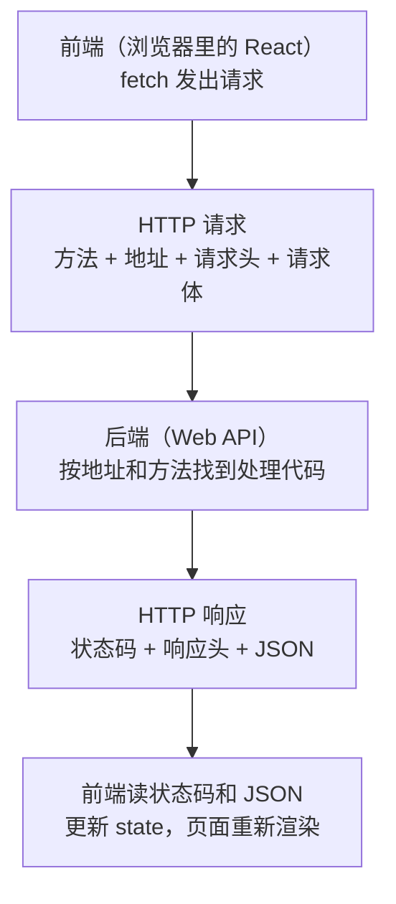

# 第 11A 章 Web API 是什么：前端和后端怎么对话

## 这一章解决什么问题

到第 10C 章为止，产品数据来自项目里的静态文件 `public/products.json`，只能看不能存。真实系统里，数据放在后端，前端通过后端提供的 **Web API** 读取和保存：查列表、新增、修改、删除，每一样都是一次 HTTP 请求。

第 7C 章用 `fetch` 取过数据，但没有把「一次请求到底包含什么」「后端接口按什么规律设计」讲清楚。后面第 11B–15C 章天天和接口打交道，本章先把全貌讲明白：请求和响应由哪几部分组成，接口的地址、方法、状态码各表示什么。

本章只讲一个技术点：**Web API**。本章不改代码，用浏览器和命令行观察请求。

## 开始之前

- 上一章你已经会了：打包、部署 `dist`。更早在第 7C 章用 `fetch` 加载过 `products.json`。
- 起点代码：仓库 `code/ch10C/price-list`（不含练习答案），本章结束时代码不变（仓库 `code/ch11A/price-list` 和它相同）。在 `D:\react-study\price-list` 执行 `npm run dev`。
- 本章要用到命令行工具 curl。Windows 10/11 自带，在 PowerShell 里要写成 `curl.exe`：只写 `curl` 时，旧版 PowerShell 会把它当成另一个命令 `Invoke-WebRequest`，输出格式完全不同（⚠️ Windows 下的 curl 写法未实机验证，下面的输出在 Linux 上实测）。
- 预计耗时：25 分钟。

## 正文

### 11A.1 Web API 是什么

**白话定义**：Web API（网络应用程序接口）是后端提供给别的程序调用的一组网址。前端向某个网址发一个 HTTP 请求，说明要做什么；后端处理后返回一个 HTTP 响应，里面通常是 JSON 数据。页面上显示什么、怎么显示，由前端决定；数据存在哪、规则对不对，由后端决定。

**业务场景**：价格清单页面打开时，向 `GET /api/products` 要产品列表；点「删除」时，发 `DELETE /api/products/5`；后端返回「删除成功」或「还有库存，不能删除」。前端和后端各写各的，只要双方对这组网址的约定一致就能配合。

**反例（什么时候不该用）**：

- 页面之间的跳转（`/products/2` 这种地址）不是 Web API，那是前端路由（第 9A–9C 章），浏览器拿到的是页面，不是数据。
- 需要服务器**主动**把消息推给页面的场景（聊天、实时报警），普通的请求和响应做不到：前端不问，后端就没法说。这类要用 WebSocket 等技术，本教程不讲。

#### 🖼 图解



### 11A.2 一次请求长什么样

#### 💻 最小可运行代码

开发服务器保持运行，另开一个终端执行：

```powershell
# 在任意目录执行（开发服务器要开着）
curl.exe -v -o NUL http://localhost:5173/products.json
```

`-v` 表示把请求和响应的头部都打印出来，`-o NUL` 表示不显示内容本身（Linux 上写 `-o /dev/null`）。

#### 🔍 拆解运行结果

实测输出（`>` 开头是发出的请求，`<` 开头是收到的响应，日期等每次不同）：

```text
> GET /products.json HTTP/1.1
> Host: localhost:5173
> User-Agent: curl/8.21.0
> Accept: */*
>
< HTTP/1.1 200 OK
< Vary: Origin
< Content-Length: 554
< Content-Type: application/json
< Last-Modified: Sun, 15 Nov 2026 06:30:16 GMT
< ETag: W/"554-1794724216932"
< Cache-Control: no-cache
< Date: Sun, 15 Nov 2026 06:31:03 GMT
< Connection: keep-alive
< Keep-Alive: timeout=5
<
```

一次 HTTP 交互就是这两段文字，各部分的意思：

| 部分 | 这次的值 | 含义 |
| --- | --- | --- |
| 请求行：方法 | `GET` | 要做什么。GET 是「取」 |
| 请求行：地址 | `/products.json` | 要对哪份数据做。前面的 `http://localhost:5173` 写在 `Host` 里 |
| 请求头 | `Host`、`Accept` 等 | 附加信息。第 12A 章发 JSON 时要加 `Content-Type: application/json` |
| 请求体 | 这次没有 | 新增、修改时放要保存的内容（第 12A 章） |
| 状态行：状态码 | `200 OK` | 结果。200 表示成功 |
| 响应头 | `Content-Type: application/json` | 返回的内容是什么格式 |
| 响应体 | 5 个产品的 JSON（被 `-o NUL` 隐藏了） | 数据本身 |

`fetch` 做的就是同样的事，只是换成了代码。在页面的控制台里执行：

```js
const r = await fetch('/products.json'); [r.status, r.ok, r.headers.get('content-type'), (await r.json()).length]
```

实测输出 `[200, true, 'application/json', 5]`：状态码、是否成功、响应头里的格式、响应体解析后的数组长度，和 curl 看到的一一对应。按 `F12` 在「网络（Network）」面板里点这条请求，「标头」和「响应」两个标签页显示的也是这些内容。

### 11A.3 接口按什么规律设计

后面几章用的产品接口（模拟接口和第 15A 章的 Minimal API 都按这张表实现），遵循一种叫 **REST**（Representational State Transfer，表述性状态转移）的常见风格。不用记全称，记住三条规律：

1. **地址表示数据**：`/api/products` 是「全部产品」，`/api/products/3` 是「3 号产品」。地址里用名词，不用 `getProduct`、`deleteProduct` 这样的动词。
2. **方法表示动作**：同一个地址，GET 是取、PUT 是改、DELETE 是删。
3. **状态码表示结果**：成功、数据不存在、校验没通过，各有固定的数字。

| 要做的事 | 方法 | 地址 | 请求体 | 成功时 | 第几章用到 |
| --- | --- | --- | --- | --- | --- |
| 取全部产品 | `GET` | `/api/products` | 无 | 200 + 产品数组 | 11B–11E |
| 取一个产品 | `GET` | `/api/products/3` | 无 | 200 + 产品对象 | 11D 练习、13A |
| 新增产品 | `POST` | `/api/products` | 不含 id 的产品 | 201 + 带 id 的新产品 | 12A |
| 修改产品 | `PUT` | `/api/products/3` | 修改后的产品 | 200 + 修改后的产品 | 12A、13A |
| 删除产品 | `DELETE` | `/api/products/3` | 无 | 204，没有内容 | 12A |
| 登录 | `POST` | `/api/login` | 用户名和密码 | 200 + 用户信息 | 14A |

登录不是「一份数据」，所以地址里没有名词复数。实际项目里这种例外很常见，规律是帮你读懂接口的，不是死规定。

常见的状态码（数字的第一位表示大类：2 成功、4 请求有问题、5 服务器有问题）：

| 状态码 | 含义 | 本教程里什么时候出现 |
| --- | --- | --- |
| 200 OK | 成功 | 取数据、修改成功（7C、12A） |
| 201 Created | 新建成功 | 新增产品（12A） |
| 204 No Content | 成功，但没有内容返回 | 删除成功（12A） |
| 400 Bad Request | 请求内容不对，通常是校验没通过 | 编号重复、单价不合法（12A、13C） |
| 401 Unauthorized | 没登录或登录信息不对 | 用户名密码错误（14A） |
| 404 Not Found | 地址对应的数据不存在 | 产品 99（11B 练习、11D 练习） |
| 409 Conflict | 和现有数据冲突，不能执行 | 还有库存不能删除（12A、12C） |
| 415 Unsupported Media Type | 请求体的格式没说明或不支持 | 忘了写 `Content-Type`（12C） |
| 500 Internal Server Error | 后端程序自己出错了 | 本教程没有故意制造，遇到时看后端日志 |
| 502 Bad Gateway | 代理连不上后端 | 后端没启动（11D） |

记住第 7C 章说过的一点：`fetch` 只有在网络不通时才抛错；收到 404、409、500 这些状态码时**不抛错**，要自己检查 `response.ok`。

#### 改坏一处试试

**① 对静态文件发 POST。** 在页面控制台里执行：

```js
const r = await fetch('/products.json', { method: 'POST' }); [r.status, r.ok]
```

实测输出 `[200, true]`，返回的还是那 5 个产品，什么都没保存。`products.json` 是一个静态文件，开发服务器不管你用什么方法都原样返回它，它不是 Web API。能保存数据的必须是后端程序，第 11B 章就来准备一个。

**② 请求一个还不存在的接口。** 执行：

```js
const r = await fetch('/api/products'); [r.status, r.headers.get('content-type')]
```

实测输出 `[200, 'text/html']`：状态码是 200，但返回的是 `index.html` 这个网页，不是数据。开发服务器找不到文件时一律返回页面（第 7C、10C 章见过）。所以判断「拿到的是不是数据」，除了看状态码，还要看 `Content-Type` 是不是 `application/json`。

## ⚠️ 踩坑警告

| 现象 | 原因 | 怎么改 |
| --- | --- | --- |
| 接口返回了 404 或 409，页面却当作成功处理 | `fetch` 收到错误状态码不抛错，`response.ok` 为 `false` | 每次请求后检查 `response.ok`，不对就主动 `throw`（第 7C、12A 章的写法） |
| 状态码是 200，`response.json()` 却报 `Unexpected token '<'` | 地址写错，服务器返回了网页（`Content-Type: text/html`） | 在「网络」面板里看这条请求的 `Content-Type` 和响应内容，核对地址 |
| 给 GET 请求加了请求体，控制台报 `TypeError: Failed to execute 'fetch' on 'Window': Request with GET/HEAD method cannot have body.` | GET 只能用地址表达要什么，不能带请求体 | 查询条件放在地址里（如 `/api/products/3`）；要提交内容就用 POST 或 PUT |
| 在 PowerShell 里执行 `curl -v ...` 报参数错误，或者输出格式和本章不一样（⚠️ 未实机验证） | 旧版 PowerShell 里 `curl` 是 `Invoke-WebRequest` 的别名 | 写成 `curl.exe` |

## 🎯 动手练习

**练习 1：比较不同文件的 Content-Type**

用 `curl.exe -i` 分别请求 `http://localhost:5173/favicon.svg` 和 `http://localhost:5173/`（`-i` 表示同时显示响应头和内容）。

验收标准：

- 能找到两个响应各自的 `Content-Type`，说出它们分别是什么格式。
- 能说出 `products.json` 的 `Content-Type` 和它们有什么不同，以及前端调用 `response.json()` 之前为什么要关心这一行。

**练习 2：按规律设计一组接口**

公司要在系统里加「供应商」管理：查看全部供应商、查看一个供应商、新增、修改、删除。按 11A.3 的三条规律，写出这 5 个接口的方法、地址、成功时的状态码。不用写代码。

验收标准：

- 地址里用名词，不出现 `get`、`add`、`delete` 这样的动词。
- 5 个接口里有两对是同一个地址、不同方法。

卡住了看文末参考答案。

## 📌 一句话总结

Web API 用地址表示数据、方法表示动作、状态码表示结果。

## 下一章

静态文件不能保存数据。第 11B 章启动一个按上面那张接口表实现的本地模拟接口，不用装后端也有真正的 Web API 可以连。

---

<!-- 以下是参考答案，先自己动手，卡住了再往下翻 -->


## 参考答案

### 练习 1

实测：`/favicon.svg` 的响应头里是 `Content-Type: image/svg+xml`（一张 SVG 图片）；`/` 返回的是首页，`Content-Type: text/html`（网页）；`products.json` 是 `Content-Type: application/json`（JSON 数据）。

前端拿到响应后，要按格式处理内容：`response.json()` 只能解析 JSON。如果响应其实是网页，解析就会报 `Unexpected token '<'`。所以出问题时先看 `Content-Type`，就知道服务器到底返回了什么。

### 练习 2

| 要做的事 | 方法 | 地址 | 成功时 |
| --- | --- | --- | --- |
| 查看全部供应商 | `GET` | `/api/suppliers` | 200 + 供应商数组 |
| 查看一个供应商 | `GET` | `/api/suppliers/7` | 200 + 供应商对象 |
| 新增 | `POST` | `/api/suppliers` | 201 + 带 id 的新供应商 |
| 修改 | `PUT` | `/api/suppliers/7` | 200 + 修改后的供应商 |
| 删除 | `DELETE` | `/api/suppliers/7` | 204 |

同一个地址、不同方法的两对：`/api/suppliers` 上的 GET 和 POST；`/api/suppliers/7` 上的 GET、PUT、DELETE。写成 `/api/getSupplier?id=7`、`/api/deleteSupplier` 也能工作，但每个动作一个地址，接口一多就很难记，这正是 REST 风格要避免的。
