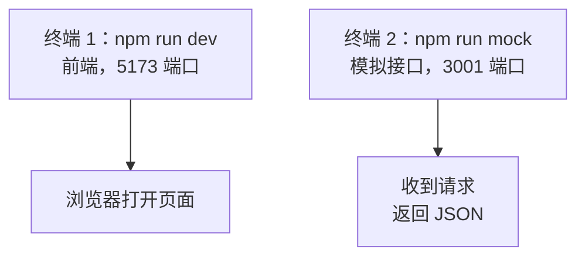

# 第 11A 章 本地模拟接口：不装后端也有接口可连

## 这一章解决什么问题

到第 10C 章为止，产品数据来自项目里的 `public/products.json`。真实系统里，数据由后端接口提供：前端页面运行在一个地址（开发时是 `http://localhost:5173`），后端接口运行在另一个地址。第 11 章把数据来源换成接口，分四步：本章先启动一个本地模拟接口；第 11B 章直接请求它，遇到「跨域」；第 11C 章用开发代理解决；第 11D 章把接口地址放进配置文件。

本章只讲一个技术点：**模拟接口**（一个只用 Node.js 自带功能写成的小后端）。前端的页面代码本章不改。

## 开始之前

- 前面你已经会了：用 `useEffect` 加载数据、用判别联合表示加载状态（第 7A–7D 章），把取数逻辑抽成 `useProducts`（第 8C 章），打包和部署（第 10A–10C 章）。
- 起点代码：仓库 `code/ch10C/price-list`（不含练习答案）。
- 预计耗时：25 分钟。

## 正文

### 11A.1 模拟接口是什么

**白话定义**：模拟接口（mock server）是一个行为和真实后端一样的小 Web 服务器：收到 HTTP 请求，返回 JSON。数据放在内存里，不连数据库。

**业务场景**：后端还没写好，或者在家里连不上公司的测试服务器时，前端照样能开发、调试「加载中」「保存失败」这些情况。

**反例（什么时候不该用）**：模拟接口只是开发工具。不要把它部署出去给别人用，也不要在里面写真实的业务规则，真正的规则在后端（第 15A 章换成真实后端）。

#### 🖼 图解



两个程序各占一个终端，同时运行。

### 11A.2 准备并启动模拟接口

模拟接口是一个很小的 Web 服务器，行为和真实后端一样：收到 HTTP 请求，返回 JSON。它只用 Node.js 自带的功能，不需要安装数据库或别的软件。第 11–14 章都用它。

#### 💻 最小可运行代码

**① 新建文件。** 在项目根目录（和 `src` 同一层）新建文件夹 `mock-server`，在里面新建 `server.ts`，内容如下。这个文件是「后端」，不属于前端代码，不需要读懂每一行，知道它提供了哪些接口就行（下面有表格）。

```ts
// mock-server/server.ts
// 本地模拟接口：只用 Node.js 自带的 http 模块，不用安装任何东西。
// 数据放在内存里：增删改在服务器运行期间一直有效，关掉服务器再启动就恢复成初始的 5 个产品。
// 启动方法：在项目目录执行 npm run mock
import { createServer } from 'node:http'
import type { IncomingMessage, ServerResponse } from 'node:http'

type Product = { id: number; code: string; name: string; category: string; price: number; stock: number }
type ProductInput = Omit<Product, 'id'>
type User = { username: string; password: string; name: string; role: 'admin' | 'sales' }

const PORT = 3001
// 每个请求故意延迟 500 毫秒，让「加载中」「保存中」看得见。可以用环境变量 MOCK_DELAY 改
const DELAY = Number(process.env.MOCK_DELAY ?? 500)
const CATEGORIES = ['探头', '主机', '耗材']

let products: Product[] = [
  { id: 1, code: 'P-001', name: '凸阵探头 C5-2', category: '探头', price: 12800, stock: 6 },
  { id: 2, code: 'P-002', name: '线阵探头 L12-5', category: '探头', price: 15600, stock: 3 },
  { id: 3, code: 'H-001', name: '便携彩超主机', category: '主机', price: 168000, stock: 2 },
  { id: 4, code: 'C-001', name: '耦合剂 250ml', category: '耗材', price: 18, stock: 120 },
  { id: 5, code: 'C-002', name: '探头保护套', category: '耗材', price: 6.5, stock: 0 },
]

const users: User[] = [
  { username: 'admin', password: '123456', name: '系统管理员', role: 'admin' },
  { username: 'zhangsan', password: '123456', name: '张三', role: 'sales' },
]

// 返回 JSON。body 不传时（例如删除成功的 204）不带内容
function send(res: ServerResponse, status: number, body?: unknown) {
  res.writeHead(status, { 'Content-Type': 'application/json; charset=utf-8' })
  res.end(body === undefined ? '' : JSON.stringify(body))
}

// 读出请求体并按 JSON 解析。内容不是合法 JSON 时 JSON.parse 会抛错，由下面统一处理
async function readJson(req: IncomingMessage): Promise<Record<string, unknown>> {
  let text = ''
  for await (const chunk of req) {
    text += String(chunk)
  }
  const value: unknown = text === '' ? {} : JSON.parse(text)
  return typeof value === 'object' && value !== null ? (value as Record<string, unknown>) : {}
}

// 后端校验：前端校验过了也要再查一遍，前端的检查可以被绕过。selfId 是编辑时自己的 id，查重时排除自己
function validate(body: Record<string, unknown>, selfId: number | null) {
  const input: ProductInput = {
    code: typeof body.code === 'string' ? body.code.trim() : '',
    name: typeof body.name === 'string' ? body.name.trim() : '',
    category: typeof body.category === 'string' ? body.category : '',
    price: typeof body.price === 'number' ? body.price : NaN,
    stock: typeof body.stock === 'number' ? body.stock : NaN,
  }
  const errors: Record<string, string> = {}
  if (input.code === '') {
    errors.code = '请填写编号'
  } else if (products.some((p) => p.code === input.code && p.id !== selfId)) {
    errors.code = `编号 ${input.code} 已存在`
  }
  if (input.name === '') errors.name = '请填写名称'
  if (!CATEGORIES.includes(input.category)) errors.category = '分类必须是探头、主机或耗材'
  if (!(input.price > 0)) errors.price = '单价必须大于 0'
  if (!(Number.isInteger(input.stock) && input.stock >= 0)) errors.stock = '库存必须是不小于 0 的整数'
  return { input, errors }
}

async function handle(req: IncomingMessage, res: ServerResponse) {
  const method = req.method ?? 'GET'
  const path = new URL(req.url ?? '/', `http://localhost:${PORT}`).pathname
  // /api/products/3 这种地址，取出最后的数字
  const match = path.match(/^\/api\/products\/(\d+)$/)
  const id = match ? Number(match[1]) : null

  // 新增、修改、登录都要求请求体是 JSON，并在请求头里写明。真实后端（比如 Spring Boot）也是这样，不写会返回 415
  const isJson = (req.headers['content-type'] ?? '').includes('application/json')
  if ((method === 'POST' || method === 'PUT') && !isJson) {
    return send(res, 415, { message: '请求头 Content-Type 必须是 application/json' })
  }

  if (path === '/api/products' && method === 'GET') {
    return send(res, 200, products)
  }

  if (path === '/api/products' && method === 'POST') {
    const { input, errors } = validate(await readJson(req), null)
    if (Object.keys(errors).length > 0) {
      return send(res, 400, { message: '校验失败', errors })
    }
    const product: Product = { id: Math.max(0, ...products.map((p) => p.id)) + 1, ...input }
    products = [...products, product]
    return send(res, 201, product)
  }

  if (id !== null) {
    const existing = products.find((p) => p.id === id)
    if (!existing) {
      return send(res, 404, { message: `产品 ${id} 不存在` })
    }
    if (method === 'GET') {
      return send(res, 200, existing)
    }
    if (method === 'PUT') {
      const { input, errors } = validate(await readJson(req), id)
      if (Object.keys(errors).length > 0) {
        return send(res, 400, { message: '校验失败', errors })
      }
      const updated: Product = { id, ...input }
      products = products.map((p) => (p.id === id ? updated : p))
      return send(res, 200, updated)
    }
    if (method === 'DELETE') {
      // 业务规则：还有库存的产品不能删除。用来演示「后端拒绝了操作」
      if (existing.stock > 0) {
        return send(res, 409, { message: `${existing.name} 还有库存 ${existing.stock}，不能删除` })
      }
      products = products.filter((p) => p.id !== id)
      return send(res, 204)
    }
  }

  if (path === '/api/login' && method === 'POST') {
    const body = await readJson(req)
    const user = users.find((u) => u.username === body.username && u.password === body.password)
    if (!user) {
      return send(res, 401, { message: '用户名或密码错误' })
    }
    // 不返回密码
    return send(res, 200, { username: user.username, name: user.name, role: user.role })
  }

  send(res, 404, { message: `没有这个接口：${method} ${path}` })
}

const server = createServer(async (req, res) => {
  await new Promise((resolve) => setTimeout(resolve, DELAY))
  // 每个请求打印一行，方便在终端里看到前端到底发了什么
  console.log(`${new Date().toLocaleTimeString()} ${req.method} ${req.url}`)
  try {
    await handle(req, res)
  } catch {
    send(res, 400, { message: '请求内容不是合法的 JSON' })
  }
})

server.listen(PORT, () => {
  console.log(`模拟接口已启动：http://localhost:${PORT}/api/products`)
})
```

**② 加一条启动命令。** 用下面的内容整个替换 `package.json`。和第 10C 章相比只在 `scripts` 里多了一行 `"mock": "node mock-server/server.ts"`。

```json
{
  "name": "price-list",
  "private": true,
  "version": "0.0.0",
  "type": "module",
  "scripts": {
    "dev": "vite",
    "build": "tsc -b && vite build",
    "lint": "oxlint",
    "preview": "vite preview",
    "mock": "node mock-server/server.ts"
  },
  "dependencies": {
    "react": "^19.3.1",
    "react-dom": "^19.3.1",
    "react-router": "^8.5.1"
  },
  "devDependencies": {
    "@types/node": "^24.19.2",
    "@types/react": "^19.3.0",
    "@types/react-dom": "^19.3.0",
    "@vitejs/plugin-react": "^6.1.2",
    "oxlint": "^1.89.0",
    "typescript": "~7.0.2",
    "vite": "^8.3.5"
  }
}
```

`"type": "module"` 那一行是模板原有的，它让 Node.js 按 `import` / `export` 的方式加载 `server.ts`。

**③ 让 TypeScript 也检查它。** 用下面的内容整个替换 `tsconfig.node.json`。只改了最后一行 `include`，多了 `"mock-server"`，这样 `npm run build` 时也会检查 `server.ts` 的类型。

```json
{
  "compilerOptions": {
    "tsBuildInfoFile": "./node_modules/.tmp/tsconfig.node.tsbuildinfo",
    "target": "es2023",
    "lib": ["ES2023"],
    "types": ["node"],
    "skipLibCheck": true,

    /* Bundler mode */
    "module": "nodenext",
    "allowImportingTsExtensions": true,
    "verbatimModuleSyntax": true,
    "moduleDetection": "force",
    "noEmit": true,

    /* Linting */
    "noUnusedLocals": true,
    "noUnusedParameters": true,
    "erasableSyntaxOnly": true,
    "noFallthroughCasesInSwitch": true
  },
  "include": ["vite.config.ts", "mock-server"]
}
```

**④ 启动。** 模拟接口要和开发服务器**同时**运行，所以要开第二个终端：在 VS Code 终端面板右上角点 `+`，新终端的当前目录也是项目文件夹。

```powershell
# 在 D:\react-study\price-list 目录执行（第二个终端，开着不要关）
npm run mock
```

实测输出：

```text
> price-list@0.0.0 mock
> node mock-server/server.ts

模拟接口已启动：http://localhost:3001/api/products
```

Node.js 24 可以直接运行 `.ts` 文件：它在运行前把类型标注去掉，剩下的就是 JavaScript（实测 Node.js 24.22.2）。如果你看到 `Unknown file extension ".ts"`，说明 Node.js 版本太旧，按第 1A 章装最新的 LTS 版（⚠️ 这条报错未实机验证）。

在浏览器地址栏打开 `http://localhost:3001/api/products`，能看到 5 个产品的 JSON，和 `products.json` 的内容一样。终端里同时多出一行 `12:41:38 AM GET /api/products`：模拟接口把收到的每个请求都打印出来，后面几章靠它确认「前端到底发了什么请求」。

模拟接口提供的接口（第 12–14 章会逐个用到）：

| 请求 | 作用 | 成功时 | 出错时 |
| --- | --- | --- | --- |
| `GET /api/products` | 取全部产品 | 200 + 产品数组 | |
| `GET /api/products/3` | 取一个产品 | 200 + 产品对象 | 404 `{ "message": "产品 3 不存在" }` |
| `POST /api/products` | 新增产品（第 12A 章） | 201 + 新产品（带服务器分配的 id） | 400 `{ "message": "校验失败", "errors": { ... } }` |
| `PUT /api/products/3` | 修改产品（第 13A 章） | 200 + 修改后的产品 | 400 / 404 |
| `DELETE /api/products/3` | 删除产品（第 12A 章） | 204，没有内容 | 409：还有库存的产品不能删 |
| `POST /api/login` | 登录（第 14A 章） | 200 + 用户信息 | 401 `{ "message": "用户名或密码错误" }` |

`POST`、`PUT` 请求必须在请求头里写明 `Content-Type: application/json`，否则返回 415（第 12A、12C 章会看到）。

两点要知道：

- 数据放在模拟接口的内存里。新增、删除在它运行期间一直有效，**刷新浏览器也还在**；在它的终端按 `Ctrl + C` 停掉再 `npm run mock`，数据恢复成初始的 5 个产品。想从头再来时就这样重启。
- 每个请求故意延迟 500 毫秒才返回，让「加载中」「保存中」能看清楚。第 7C 章在前端代码里加的 1 秒模拟延迟第 10B 章已经删了，现在的延迟来自「服务器」，更接近真实情况。

## ⚠️ 踩坑警告

| 现象 | 原因 | 怎么改 |
| --- | --- | --- |
| `npm run mock` 报 `Error: listen EADDRINUSE: address already in use :::3001` | 3001 端口已经被占用，通常是上一次的模拟接口还在另一个终端里运行 | 关掉多余的终端，或在任务管理器里结束多余的 `node` 进程 |
| `npm run mock` 报 `Unknown file extension ".ts"`（⚠️ 未实机验证） | Node.js 版本太旧，不能直接运行 `.ts` | 按第 1A 章装最新的 LTS 版 |
| 改了 `server.ts` 里的数据，浏览器里看到的还是旧的 | 模拟接口启动时读一次代码，运行中改文件不生效 | 在它的终端按 `Ctrl + C`，再 `npm run mock` |
| 关掉了运行 `npm run mock` 的终端，后面几章页面全部加载失败 | 模拟接口停了，没有程序在 3001 端口响应 | 每次开发都开两个终端：一个运行开发服务器，一个运行 `npm run mock` |

## 🎯 动手练习

**练习 1：直接访问几个接口**

在浏览器地址栏依次打开 `http://localhost:3001/api/products/3` 和 `http://localhost:3001/api/products/99`。

验收标准：

- 第一个显示便携彩超主机的 JSON。
- 第二个显示 `{"message":"产品 99 不存在"}`；按 `F12` 在「网络」里看，状态码是 404。
- 模拟接口的终端里多了两行 `GET /api/products/3`、`GET /api/products/99`。

**练习 2：给模拟接口加一个初始产品**

在 `server.ts` 的初始数据里加第 6 个产品：id 6，编号 `P-003`，名称「微凸探头 C8-4」，分类「探头」，单价 9800，库存 4。

验收标准：

- 重启模拟接口后，打开 `http://localhost:3001/api/products`，能看到 6 个产品。
- 改完不重启时看不到（验证踩坑警告第 3 条）。

卡住了看文末参考答案。

## 📌 一句话总结

npm run mock 在 3001 端口启动模拟接口，和开发服务器同时运行。

## 下一章

接口有了。第 11B 章让页面直接去请求它，会撞上前端连后端最常见的问题「跨域」。

---

<!-- 以下是参考答案，先自己动手，卡住了再往下翻 -->


## 参考答案

### 练习 1

不用写代码。实测 `/api/products/99` 返回 404 和 `{"message":"产品 99 不存在"}`。第 11C 章练习 1 会把这句话显示在详情页上。

### 练习 2

思路：初始数据就是 `server.ts` 开头的 `products` 数组，加一个对象即可。改完要重启模拟接口。实测重启后 `/api/products` 返回 id 1 到 6 共 6 个产品。练习做完改回原样，后面几章按 5 个产品写。

```ts
// mock-server/server.ts
// 练习 2 做完后的版本：初始数据多了第 6 个产品
// 本地模拟接口：只用 Node.js 自带的 http 模块，不用安装任何东西。
// 数据放在内存里：增删改在服务器运行期间一直有效，关掉服务器再启动就恢复成初始的 5 个产品。
// 启动方法：在项目目录执行 npm run mock
import { createServer } from 'node:http'
import type { IncomingMessage, ServerResponse } from 'node:http'

type Product = { id: number; code: string; name: string; category: string; price: number; stock: number }
type ProductInput = Omit<Product, 'id'>
type User = { username: string; password: string; name: string; role: 'admin' | 'sales' }

const PORT = 3001
// 每个请求故意延迟 500 毫秒，让「加载中」「保存中」看得见。可以用环境变量 MOCK_DELAY 改
const DELAY = Number(process.env.MOCK_DELAY ?? 500)
const CATEGORIES = ['探头', '主机', '耗材']

let products: Product[] = [
  { id: 1, code: 'P-001', name: '凸阵探头 C5-2', category: '探头', price: 12800, stock: 6 },
  { id: 2, code: 'P-002', name: '线阵探头 L12-5', category: '探头', price: 15600, stock: 3 },
  { id: 3, code: 'H-001', name: '便携彩超主机', category: '主机', price: 168000, stock: 2 },
  { id: 4, code: 'C-001', name: '耦合剂 250ml', category: '耗材', price: 18, stock: 120 },
  { id: 5, code: 'C-002', name: '探头保护套', category: '耗材', price: 6.5, stock: 0 },
  // 练习 2：新加的产品。改了这个文件要重启模拟接口才生效
  { id: 6, code: 'P-003', name: '微凸探头 C8-4', category: '探头', price: 9800, stock: 4 },
]

const users: User[] = [
  { username: 'admin', password: '123456', name: '系统管理员', role: 'admin' },
  { username: 'zhangsan', password: '123456', name: '张三', role: 'sales' },
]

// 返回 JSON。body 不传时（例如删除成功的 204）不带内容
function send(res: ServerResponse, status: number, body?: unknown) {
  res.writeHead(status, { 'Content-Type': 'application/json; charset=utf-8' })
  res.end(body === undefined ? '' : JSON.stringify(body))
}

// 读出请求体并按 JSON 解析。内容不是合法 JSON 时 JSON.parse 会抛错，由下面统一处理
async function readJson(req: IncomingMessage): Promise<Record<string, unknown>> {
  let text = ''
  for await (const chunk of req) {
    text += String(chunk)
  }
  const value: unknown = text === '' ? {} : JSON.parse(text)
  return typeof value === 'object' && value !== null ? (value as Record<string, unknown>) : {}
}

// 后端校验：前端校验过了也要再查一遍，前端的检查可以被绕过。selfId 是编辑时自己的 id，查重时排除自己
function validate(body: Record<string, unknown>, selfId: number | null) {
  const input: ProductInput = {
    code: typeof body.code === 'string' ? body.code.trim() : '',
    name: typeof body.name === 'string' ? body.name.trim() : '',
    category: typeof body.category === 'string' ? body.category : '',
    price: typeof body.price === 'number' ? body.price : NaN,
    stock: typeof body.stock === 'number' ? body.stock : NaN,
  }
  const errors: Record<string, string> = {}
  if (input.code === '') {
    errors.code = '请填写编号'
  } else if (products.some((p) => p.code === input.code && p.id !== selfId)) {
    errors.code = `编号 ${input.code} 已存在`
  }
  if (input.name === '') errors.name = '请填写名称'
  if (!CATEGORIES.includes(input.category)) errors.category = '分类必须是探头、主机或耗材'
  if (!(input.price > 0)) errors.price = '单价必须大于 0'
  if (!(Number.isInteger(input.stock) && input.stock >= 0)) errors.stock = '库存必须是不小于 0 的整数'
  return { input, errors }
}

async function handle(req: IncomingMessage, res: ServerResponse) {
  const method = req.method ?? 'GET'
  const path = new URL(req.url ?? '/', `http://localhost:${PORT}`).pathname
  // /api/products/3 这种地址，取出最后的数字
  const match = path.match(/^\/api\/products\/(\d+)$/)
  const id = match ? Number(match[1]) : null

  // 新增、修改、登录都要求请求体是 JSON，并在请求头里写明。真实后端（比如 Spring Boot）也是这样，不写会返回 415
  const isJson = (req.headers['content-type'] ?? '').includes('application/json')
  if ((method === 'POST' || method === 'PUT') && !isJson) {
    return send(res, 415, { message: '请求头 Content-Type 必须是 application/json' })
  }

  if (path === '/api/products' && method === 'GET') {
    return send(res, 200, products)
  }

  if (path === '/api/products' && method === 'POST') {
    const { input, errors } = validate(await readJson(req), null)
    if (Object.keys(errors).length > 0) {
      return send(res, 400, { message: '校验失败', errors })
    }
    const product: Product = { id: Math.max(0, ...products.map((p) => p.id)) + 1, ...input }
    products = [...products, product]
    return send(res, 201, product)
  }

  if (id !== null) {
    const existing = products.find((p) => p.id === id)
    if (!existing) {
      return send(res, 404, { message: `产品 ${id} 不存在` })
    }
    if (method === 'GET') {
      return send(res, 200, existing)
    }
    if (method === 'PUT') {
      const { input, errors } = validate(await readJson(req), id)
      if (Object.keys(errors).length > 0) {
        return send(res, 400, { message: '校验失败', errors })
      }
      const updated: Product = { id, ...input }
      products = products.map((p) => (p.id === id ? updated : p))
      return send(res, 200, updated)
    }
    if (method === 'DELETE') {
      // 业务规则：还有库存的产品不能删除。用来演示「后端拒绝了操作」
      if (existing.stock > 0) {
        return send(res, 409, { message: `${existing.name} 还有库存 ${existing.stock}，不能删除` })
      }
      products = products.filter((p) => p.id !== id)
      return send(res, 204)
    }
  }

  if (path === '/api/login' && method === 'POST') {
    const body = await readJson(req)
    const user = users.find((u) => u.username === body.username && u.password === body.password)
    if (!user) {
      return send(res, 401, { message: '用户名或密码错误' })
    }
    // 不返回密码
    return send(res, 200, { username: user.username, name: user.name, role: user.role })
  }

  send(res, 404, { message: `没有这个接口：${method} ${path}` })
}

const server = createServer(async (req, res) => {
  await new Promise((resolve) => setTimeout(resolve, DELAY))
  // 每个请求打印一行，方便在终端里看到前端到底发了什么
  console.log(`${new Date().toLocaleTimeString()} ${req.method} ${req.url}`)
  try {
    await handle(req, res)
  } catch {
    send(res, 400, { message: '请求内容不是合法的 JSON' })
  }
})

server.listen(PORT, () => {
  console.log(`模拟接口已启动：http://localhost:${PORT}/api/products`)
})
```
