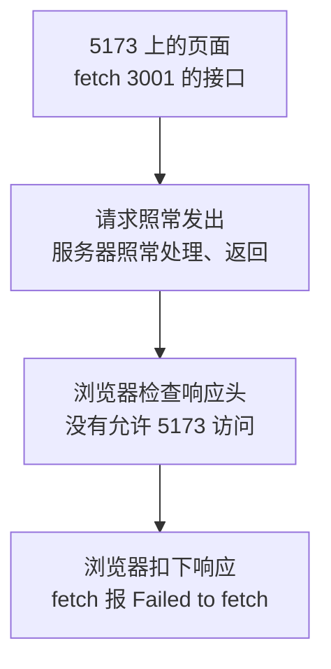

# 第 11B 章 跨域：浏览器为什么拦下了请求

## 这一章解决什么问题

模拟接口已经在 3001 端口运行，地址栏打开它也能看到数据。可是让页面直接 `fetch('http://localhost:3001/api/products')`，页面却显示「加载失败：Failed to fetch」。本章看清楚是谁拦下了请求、为什么拦。

本章只讲一个技术点：**跨域（CORS）**。

## 开始之前

- 上一章你已经会了：用 `npm run mock` 启动模拟接口，它和开发服务器同时运行。
- 起点代码：仓库 `code/ch11A/price-list`（不含练习答案）。两个终端分别启动开发服务器和模拟接口。
- 预计耗时：20 分钟。

## 正文

### 11B.1 跨域是什么

**白话定义**：同源（same origin）指两个地址的**协议、主机名、端口**三样都相同。浏览器默认不允许页面里的 JavaScript 读取**不同源**接口的响应，除非那个接口在响应头里明确声明「允许这个来源访问」。这套规则叫 CORS（Cross-Origin Resource Sharing，跨源资源共享），违反时的报错俗称「跨域」。

**业务场景**：前端开发服务器在 `http://localhost:5173`，模拟接口在 `http://localhost:3001`。端口不同，就是不同源，页面直接请求接口会被浏览器拦下。连公司的真实后端时也一样。

**反例（什么时候不该用）**：这一节讲的是一个**要避开**的问题，不是一个要用的功能。不要为了让请求通过，去装浏览器插件关掉检查，或者用参数启动一个关闭安全检查的浏览器：只有你自己的电脑能用，用户那边照样失败。正确的做法是第 11C 章的开发代理，或者由后端在响应里加上 CORS 响应头。

| 地址 A | 地址 B | 同源吗 | 原因 |
| --- | --- | --- | --- |
| `http://localhost:5173/` | `http://localhost:5173/api/products` | 是 | 三样都相同，路径不算 |
| `http://localhost:5173/` | `http://localhost:3001/api/products` | 否 | 端口不同 |
| `http://localhost:5173/` | `https://localhost:5173/` | 否 | 协议不同 |
| `http://localhost:5173/` | `http://127.0.0.1:5173/` | 否 | 主机名写法不同，浏览器按字面比较 |

#### 🖼 图解



拦截发生在**浏览器**里，不在服务器上：请求其实已经到达服务器并被处理了，只是浏览器不把结果交给页面。

#### 💻 最小可运行代码

开发服务器（第一个终端的 `npm run dev`）和模拟接口（第二个终端的 `npm run mock`）都保持运行。用下面的内容整个替换 `src/hooks/useProducts.ts`，只改了 `fetch` 那一行，直接写模拟接口的完整地址：

```ts
// src/hooks/useProducts.ts
// 自定义 Hook：把「加载产品 + 增删改」这一整套逻辑打包，任何组件调用它都能用
import { useEffect, useState } from 'react'
import type { Product } from '../types.ts'

export type LoadState =
  | { status: 'loading' }
  | { status: 'error'; message: string }
  | { status: 'success'; products: Product[] }

// 名字必须以 use 开头：React 和 lint 工具靠这个识别它是 Hook，按 Hook 的规则检查
export function useProducts() {
  const [state, setState] = useState<LoadState>({ status: 'loading' })

  useEffect(() => {
    let ignore = false

    async function load() {
      try {
        // 直接写模拟接口的完整地址。页面在 5173 端口，接口在 3001 端口，浏览器会拦下这个请求
        const response = await fetch('http://localhost:3001/api/products')
        if (!response.ok) {
          throw new Error(`服务器返回 ${response.status}`)
        }
        const products: Product[] = await response.json()
        if (!ignore) {
          setState({ status: 'success', products })
        }
      } catch (err) {
        if (!ignore) {
          setState({ status: 'error', message: err instanceof Error ? err.message : String(err) })
        }
      }
    }

    load()
    return () => {
      ignore = true
    }
  }, [])

  function addProduct(product: Product) {
    if (state.status !== 'success') return
    // 添加：展开旧数组，在末尾放新产品，得到一个新数组
    setState({ status: 'success', products: [...state.products, product] })
  }

  function deleteProduct(id: number) {
    if (state.status !== 'success') return
    setState({ status: 'success', products: state.products.filter((p) => p.id !== id) })
  }

  function restockProduct(id: number) {
    if (state.status !== 'success') return
    setState({
      status: 'success',
      products: state.products.map((p) => (p.id === id ? { ...p, stock: p.stock + 1 } : p)),
    })
  }

  // 返回一个对象，调用方按名字取自己需要的部分
  return { state, addProduct, deleteProduct, restockProduct }
}
```

#### 🔍 拆解运行结果

刷新列表页，实测显示「共 0 种产品」「加载失败：Failed to fetch」。`F12` 控制台里是：

```text
Access to fetch at 'http://localhost:3001/api/products' from origin 'http://localhost:5173' has been blocked by CORS policy: No 'Access-Control-Allow-Origin' header is present on the requested resource.
```

逐段看这句报错：

| 片段 | 含义 |
| --- | --- |
| `Access to fetch at 'http://localhost:3001/...'` | 要请求的接口地址 |
| `from origin 'http://localhost:5173'` | 发起请求的页面来源 |
| `blocked by CORS policy` | 被跨域规则拦下 |
| `No 'Access-Control-Allow-Origin' header` | 原因：响应里没有「允许谁访问」的响应头 |

再看第二个终端（模拟接口）：多了两行 `GET /api/products`（StrictMode 让 effect 执行了两次）。这证明请求确实到达了服务器，服务器也返回了数据，是浏览器没让页面拿到。

#### 改坏一处试试

在浏览器地址栏**直接打开** `http://localhost:3001/api/products`，JSON 正常显示，没有任何报错。

跨域规则只管「一个页面里的 JavaScript 读取另一个来源的数据」。直接在地址栏打开时，当前页面就是 3001 自己，不存在「跨」。所以「地址栏能打开，页面里请求却失败」几乎一定是跨域问题。

## ⚠️ 踩坑警告

| 现象 | 原因 | 怎么改 |
| --- | --- | --- |
| 控制台 `blocked by CORS policy: No 'Access-Control-Allow-Origin' header`，页面显示 `Failed to fetch`；但地址栏直接打开接口地址是好的 | 页面和接口不同源（端口不同），浏览器拦下了响应 | 开发时用 Vite 开发代理（下一章）；部署时前后端放同一网站，或由后端开启 CORS |
| 以为请求没发出去，去查后端代码 | 跨域报错时请求其实已经到了服务器，模拟接口终端里能看到 `GET /api/products` | 跨域是浏览器的规则，问题不在后端的处理逻辑，而在响应头 |
| 用 `127.0.0.1:5173` 打开页面，请求 `localhost:3001`，或者反过来，以为「都是本机」没问题 | 浏览器按字面比较主机名，`localhost` 和 `127.0.0.1` 是不同源 | 统一用一种写法；用开发代理后就不用操心 |

## 🎯 动手练习

**练习 1：在两个页面的控制台里请求同一个接口**

1. 打开 `http://localhost:3001/api/products`，按 `F12` 在「控制台」里执行 `(await (await fetch('http://localhost:3001/api/products')).json()).length`。
2. 回到 `http://localhost:5173/`，在控制台里执行同一句。

验收标准：

- 第 1 步输出 `5`。
- 第 2 步报 `TypeError: Failed to fetch`，并出现 CORS 报错。
- 能说出两次结果不同的原因。

**练习 2：判断是否同源**

不用写代码，判断下面每组地址是否同源：

| 页面 | 接口 |
| --- | --- |
| `http://localhost:5173/products/2` | `http://localhost:5173/api/products/2` |
| `http://localhost:5173/` | `http://localhost:3001/` |
| `http://intranet.example.com/` | `https://intranet.example.com/` |
| `http://intranet.example.com/` | `http://api.example.com/` |

验收标准：

- 四组都判断正确，并说出不同源时是哪一样不同。

卡住了看文末参考答案。

## 📌 一句话总结

协议、主机、端口有一样不同就是跨域，浏览器会扣下响应。

## 下一章

第 11C 章用 Vite 的开发代理让页面和接口「看起来」同源，绕开跨域。

---

<!-- 以下是参考答案，先自己动手，卡住了再往下翻 -->


## 参考答案

### 练习 1

实测第 1 步输出 `5`，第 2 步报 `TypeError: Failed to fetch`。在 3001 的页面里请求 3001 的接口，页面和接口同源；在 5173 的页面里请求 3001，端口不同，浏览器拦下了响应。同一个接口、同一句代码，结果取决于**发起请求的页面**在哪个源。

### 练习 2

| 页面 | 接口 | 同源吗 | 原因 |
| --- | --- | --- | --- |
| `http://localhost:5173/products/2` | `http://localhost:5173/api/products/2` | 是 | 路径不算 |
| `http://localhost:5173/` | `http://localhost:3001/` | 否 | 端口不同 |
| `http://intranet.example.com/` | `https://intranet.example.com/` | 否 | 协议不同（`http` 和 `https`） |
| `http://intranet.example.com/` | `http://api.example.com/` | 否 | 主机名不同 |
