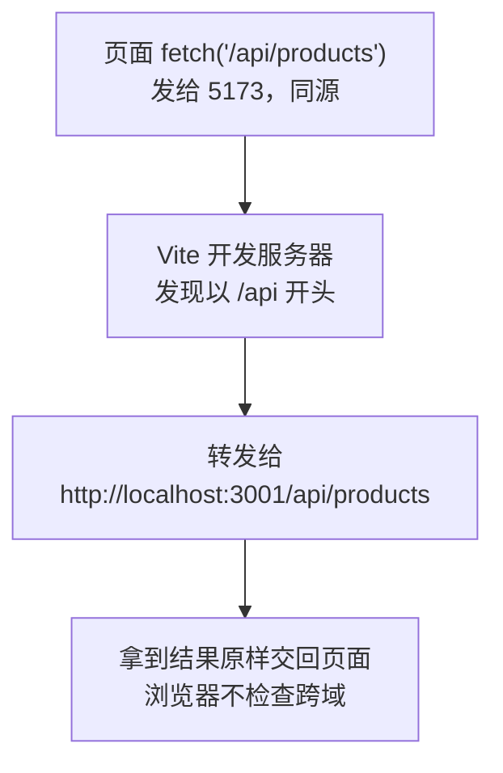

# 第 11C 章 开发代理：让请求经过开发服务器转发

## 这一章解决什么问题

上一章页面直接请求 `http://localhost:3001` 被浏览器拦下了。本章让页面只请求自己所在的 5173 端口，由 Vite 开发服务器把以 `/api` 开头的请求转发给模拟接口。对浏览器来说页面和接口同源，跨域问题就不存在了。

本章只讲一个技术点：**开发代理**。

## 开始之前

- 上一章你已经会了：同源的三个条件、跨域报错是浏览器拦下的。
- 起点代码：仓库 `code/ch11B/price-list`（不含练习答案）。两个终端分别启动开发服务器和模拟接口。
- 预计耗时：25 分钟。

## 正文

### 11C.1 开发代理是什么

**白话定义**：开发代理（dev proxy）是 Vite 开发服务器的一个功能：页面请求某个前缀（比如 `/api`）的地址时，开发服务器**替页面**把请求转发给后端，再把结果原样交回。对浏览器来说，页面和接口都在 5173 端口，是同源的，跨域问题就不存在了。

**业务场景**：开发时前端在 5173、后端在 3001（或公司测试服务器上），用代理后前端代码里只写 `/api/products`，不用关心后端在哪。

**反例（什么时候不该用）**：开发代理只在 `npm run dev` 时存在。`npm run build` 打出来的 `dist` 是纯静态文件，里面没有代理。部署时要么把前端和后端放在同一个网站下（由 Web 服务器做转发，比如 Nginx 的反向代理、IIS 的 ARR，⚠️ 本教程未实机验证），要么由后端开启 CORS。不要以为开发时能连上，部署后也自然能连上。

#### 🖼 图解



服务器之间转发请求不受 CORS 限制。CORS 是浏览器保护用户的规则，只在浏览器里生效。

#### 💻 最小可运行代码

用下面的内容整个替换 `vite.config.ts`，在 `plugins` 下面加了 `server.proxy`：

```ts
import react from '@vitejs/plugin-react'
import { defineConfig } from 'vite'

// https://vite.dev/config/
export default defineConfig({
  plugins: [react()],
  server: {
    // 开发代理：浏览器请求 /api 开头的地址时，Vite 开发服务器替它转发给 3001 端口的模拟接口
    proxy: {
      '/api': 'http://localhost:3001',
    },
  },
})
```

保存后 Vite 会自动重启（终端显示 `vite.config.ts changed, restarting server...`，第 1A 章见过）。再用下面的内容整个替换 `src/hooks/useProducts.ts`，`fetch` 里只写路径：

```ts
// src/hooks/useProducts.ts
// 自定义 Hook：把「加载产品 + 增删改」这一整套逻辑打包，任何组件调用它都能用
import { useEffect, useState } from 'react'
import type { Product } from '../types.ts'

export type LoadState =
  | { status: 'loading' }
  | { status: 'error'; message: string }
  | { status: 'success'; products: Product[] }

// 名字必须以 use 开头：React 和 lint 工具靠这个识别它是 Hook，按 Hook 的规则检查
export function useProducts() {
  const [state, setState] = useState<LoadState>({ status: 'loading' })

  useEffect(() => {
    let ignore = false

    async function load() {
      try {
        // 只写路径，请求发给页面所在的 Vite 开发服务器，由它转发给 3001 端口的模拟接口
        const response = await fetch('/api/products')
        if (!response.ok) {
          throw new Error(`服务器返回 ${response.status}`)
        }
        const products: Product[] = await response.json()
        if (!ignore) {
          setState({ status: 'success', products })
        }
      } catch (err) {
        if (!ignore) {
          setState({ status: 'error', message: err instanceof Error ? err.message : String(err) })
        }
      }
    }

    load()
    return () => {
      ignore = true
    }
  }, [])

  function addProduct(product: Product) {
    if (state.status !== 'success') return
    // 添加：展开旧数组，在末尾放新产品，得到一个新数组
    setState({ status: 'success', products: [...state.products, product] })
  }

  function deleteProduct(id: number) {
    if (state.status !== 'success') return
    setState({ status: 'success', products: state.products.filter((p) => p.id !== id) })
  }

  function restockProduct(id: number) {
    if (state.status !== 'success') return
    setState({
      status: 'success',
      products: state.products.map((p) => (p.id === id ? { ...p, stock: p.stock + 1 } : p)),
    })
  }

  // 返回一个对象，调用方按名字取自己需要的部分
  return { state, addProduct, deleteProduct, restockProduct }
}
```

`public/products.json` 现在用不到了，删掉它。

#### 🔍 拆解运行结果

刷新列表页，约半秒后显示 5 个产品。`F12`「网络」里的请求地址是 `http://localhost:5173/api/products`，状态 200：浏览器以为数据来自 5173。第二个终端（模拟接口）里同时出现 `GET /api/products`：请求实际是 3001 处理的。

| 代码 | 说明 |
| --- | --- |
| `proxy: { '/api': 'http://localhost:3001' }` | 路径以 `/api` 开头的请求转发给 3001，路径原样保留：`/api/products` 转发后还是 `/api/products` |
| `fetch('/api/products')` | 以 `/` 开头、不写协议和主机，表示「当前网站的这个路径」，也就是 5173 |
| 其他请求不受影响 | `/`、`/src/main.tsx`、`/products/2` 这些不以 `/api` 开头，仍由 Vite 自己处理 |

为什么详情页 `/products/2` 不会被转发？它以 `/products` 开头，不以 `/api` 开头。这也是接口习惯加 `/api` 前缀的原因之一：和页面路由分得清清楚楚。

#### 改坏一处试试

在第二个终端按 `Ctrl + C` 停掉模拟接口，刷新页面。实测页面显示「加载失败：服务器返回 502」，第一个终端（Vite）里出现：

```text
[vite] http proxy error: /api/products
Error: connect ECONNREFUSED 127.0.0.1:3001
```

502（Bad Gateway，网关错误）表示「代理本身没问题，但它要转发的那个服务器连不上」。`ECONNREFUSED` 是「连接被拒绝」，3001 端口上没有程序在监听。以后开发中看到 502，先检查后端有没有启动。重新执行 `npm run mock`，刷新页面恢复正常。

## ⚠️ 踩坑警告

| 现象 | 原因 | 怎么改 |
| --- | --- | --- |
| 页面显示「服务器返回 502」，Vite 终端 `http proxy error ... ECONNREFUSED` | 代理要转发的后端没启动，或端口写错 | 启动后端（本教程是 `npm run mock`），核对 `vite.config.ts` 里的端口 |
| 改了 `vite.config.ts` 的代理，请求还是不通 | 有时开发服务器没成功重启；或者 `fetch` 里还写着 `http://localhost:3001` 的完整地址，根本没经过代理 | 看终端有没有 `server restarted.`，没有就 `Ctrl + C` 后重新启动开发服务器；`fetch` 里只写以 `/api` 开头的路径 |
| 部署后接口全部 404，开发时却正常 | 开发代理只在开发服务器里存在，`dist` 里没有代理 | 部署时由 Web 服务器把 `/api` 转发给后端，或者由后端开启 CORS（第 15C 章把前后端放在同一个网站） |

## 🎯 动手练习

**练习 1：详情页只请求一个产品**

现在详情页调用 `useProducts()`，加载了整张产品表，再从里面找一个。改成调用一个新的 `useProduct(id)` Hook，请求 `GET /api/products/:id`，只取这一个产品。出错时显示**服务器返回的 `message`**，而不只是状态码。

验收标准：

- 打开 `/products/3`：先显示「加载中…」，然后显示便携彩超主机。「网络」里请求的是 `/api/products/3`，没有 `/api/products`。
- 打开 `/products/99`：显示「加载失败：产品 99 不存在」（这句话来自模拟接口）。
- 详情页里点「上一个 / 下一个」这类链接切换产品时（如果你做了第 9C 章练习 2），内容会跟着变。提示：`id` 要放进 effect 的依赖数组。

**练习 2：在地址栏里经过代理**

在浏览器地址栏打开 `http://localhost:5173/api/products/3`（注意端口是 5173）。

验收标准：

- 页面显示便携彩超主机的 JSON。
- 模拟接口的终端里出现 `GET /api/products/3`。
- 能说出这个请求经过了哪两个程序。

卡住了看文末参考答案。

## 📌 一句话总结

代理把 /api 请求从 5173 转发到后端，浏览器只看到同源请求。

## 下一章

接口前缀 `/api` 写死在代码里，部署到正式环境后可能不一样。第 11D 章把它放进 `.env` 配置文件。

---

<!-- 以下是参考答案，先自己动手，卡住了再往下翻 -->


## 参考答案

### 练习 1

思路：和 `useProducts` 一样的写法，只是地址里带上 `id`，并把 `id` 放进依赖数组，`id` 变了就重新请求。`response.ok` 为 `false` 时先读出服务器返回的 `{ message }`，再用它抛错。

还有一个细节：`id` 变了以后，旧结果属于上一个产品，不能继续显示。这里不在 effect 一开始 `setState` 成「加载中」（`npm run lint` 会警告 `set-state-in-effect`），而是记下「结果属于哪个 id」，最后一行用它**算出**当前状态：结果的 id 和当前 id 不同，就当作「加载中」。`'loading' as const` 让 TypeScript 把它当作固定值 `'loading'`，而不是任意字符串。

```ts
// src/hooks/useProduct.ts
// 练习 1：只加载一个产品。id 来自地址栏，所以 id 要写进依赖数组：从 /products/1 换到 /products/2 时重新加载
import { useEffect, useState } from 'react'
import type { Product } from '../types.ts'

export type ProductState =
  | { status: 'loading' }
  | { status: 'error'; message: string }
  | { status: 'success'; product: Product }

export function useProduct(id: string | undefined) {
  // 记下「这份结果是哪个 id 的」。还没有结果时是 null
  const [loaded, setLoaded] = useState<{ id: string | undefined; state: ProductState } | null>(null)

  useEffect(() => {
    let ignore = false

    async function load() {
      try {
        const response = await fetch(`/api/products/${id}`)
        if (!response.ok) {
          // 模拟接口出错时返回 { message: '...' }，把它显示给用户，比只显示状态码清楚
          const body: { message?: string } = await response.json()
          throw new Error(body.message ?? `服务器返回 ${response.status}`)
        }
        const product: Product = await response.json()
        if (!ignore) {
          setLoaded({ id, state: { status: 'success', product } })
        }
      } catch (err) {
        if (!ignore) {
          setLoaded({ id, state: { status: 'error', message: err instanceof Error ? err.message : String(err) } })
        }
      }
    }

    load()
    return () => {
      ignore = true
    }
  }, [id])

  // 派生出当前状态：还没有结果，或者结果属于上一个 id（刚从 /products/1 换到 /products/2），都算「加载中」
  // 这样就不用在 effect 里先 setState 成 loading，少一次多余的渲染
  return loaded !== null && loaded.id === id ? loaded.state : { status: 'loading' as const }
}
```

详情页不用再从数组里 `find`，直接按三种状态显示：

```tsx
// src/pages/ProductDetailPage.tsx
// 练习 1：详情页只请求这一个产品，不再加载整张列表
import { Link, useParams } from 'react-router'
import { useProduct } from '../hooks/useProduct.ts'
import { ProductCard } from '../components/ProductCard.tsx'

export function ProductDetailPage() {
  const { id } = useParams()
  const state = useProduct(id)

  return (
    <section>
      <p>
        <Link to="/">← 返回列表</Link>
      </p>
      {state.status === 'loading' && <p>加载中…</p>}
      {state.status === 'error' && <p className="error">加载失败：{state.message}</p>}
      {state.status === 'success' && <ProductCard product={state.product} />}
    </section>
  )
}
```

### 练习 2

不用写代码。实测页面显示 `{"id":3,"code":"H-001","name":"便携彩超主机",...}`，模拟接口终端里多了一行 `GET /api/products/3`。请求先到 Vite 开发服务器（5173），它发现路径以 `/api` 开头，转发给模拟接口（3001），再把结果交回浏览器。代理不分「页面里的 `fetch`」还是「地址栏」，只看路径。
