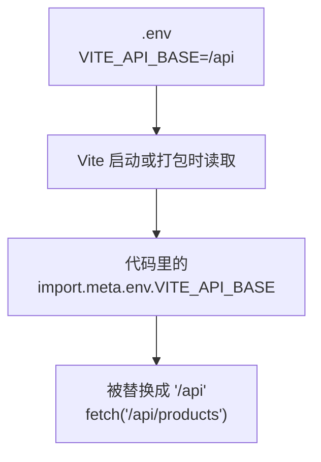

# 第 11D 章 环境变量：接口地址放进配置文件

## 这一章解决什么问题

接口前缀 `/api` 现在写死在 `useProducts.ts` 里。部署到正式环境后，后端可能挂在 `/price-api` 下；以后接口多了，每个文件都写一遍，换环境时要改一堆代码。本章把它放进 `.env` 配置文件，打包正式版时用另一份配置覆盖，代码一个字都不用改。

本章只讲一个技术点：**环境变量**。

## 开始之前

- 上一章你已经会了：开发代理把 `/api` 转发给模拟接口。
- 起点代码：仓库 `code/ch11C/price-list`（不含练习答案）。两个终端分别启动开发服务器和模拟接口。
- 预计耗时：25 分钟。

## 正文

### 11D.1 环境变量是什么

**白话定义**：环境变量（environment variable）是放在代码外面的配置。Vite 会读取项目根目录的 `.env` 文件，把其中**以 `VITE_` 开头**的变量放进 `import.meta.env`，代码里用 `import.meta.env.VITE_API_BASE` 读取。打包时，这些值会被直接替换进 JS 文件。

**业务场景**：开发时接口前缀是 `/api`（走开发代理），部署到正式环境后，后端可能挂在 `/price-api` 下。把前缀放进 `.env`，打包正式版时用 `.env.production` 覆盖，代码一个字都不用改。

**反例（什么时候不该用）**：**不要把密码、密钥、令牌放进 `VITE_` 变量。** 它们会被原样写进打包后的 JS 文件，任何打开网页的人都能在开发者工具里看到。练习 2 会实测这一点。需要保密的东西只能放在后端。

#### 🖼 图解



#### 💻 最小可运行代码

**① 新建 `.env`。** 放在项目根目录（和 `package.json` 同一层），文件名就是 `.env`，前面有个点，没有扩展名：

```ini
# .env
# 所有环境共用的配置。只有 VITE_ 开头的变量才会被放进前端代码
VITE_API_BASE=/api
```

`#` 开头的是注释。`变量名=值`，等号两边不要加空格，值不用加引号。

**② 声明类型。** 新建 `src/vite-env.d.ts`。`.d.ts` 文件只写类型、不写代码，TypeScript 会自动读取 `src` 下的所有 `.d.ts`：

```ts
// src/vite-env.d.ts
// 给 import.meta.env 补上类型：.env 里加了变量，就在这里声明一行

// 打开严格模式：没在下面声明的变量名，TypeScript 直接报错（不打开时，写错名字只会得到 undefined）
interface ViteTypeOptions {
  strictImportMetaEnv: unknown
}

interface ImportMetaEnv {
  // 接口地址前缀，例如 /api
  readonly VITE_API_BASE: string
}
```

**③ 用下面的内容整个替换 `src/hooks/useProducts.ts`**，`fetch` 改成用环境变量拼地址：

```ts
// src/hooks/useProducts.ts
// 自定义 Hook：把「加载产品 + 增删改」这一整套逻辑打包，任何组件调用它都能用
import { useEffect, useState } from 'react'
import type { Product } from '../types.ts'

export type LoadState =
  | { status: 'loading' }
  | { status: 'error'; message: string }
  | { status: 'success'; products: Product[] }

// 名字必须以 use 开头：React 和 lint 工具靠这个识别它是 Hook，按 Hook 的规则检查
export function useProducts() {
  const [state, setState] = useState<LoadState>({ status: 'loading' })

  useEffect(() => {
    let ignore = false

    async function load() {
      try {
        // 接口地址的前半段来自 .env 文件里的 VITE_API_BASE，换环境只改配置，不改代码
        const response = await fetch(`${import.meta.env.VITE_API_BASE}/products`)
        if (!response.ok) {
          throw new Error(`服务器返回 ${response.status}`)
        }
        const products: Product[] = await response.json()
        if (!ignore) {
          setState({ status: 'success', products })
        }
      } catch (err) {
        if (!ignore) {
          setState({ status: 'error', message: err instanceof Error ? err.message : String(err) })
        }
      }
    }

    load()
    return () => {
      ignore = true
    }
  }, [])

  function addProduct(product: Product) {
    if (state.status !== 'success') return
    // 添加：展开旧数组，在末尾放新产品，得到一个新数组
    setState({ status: 'success', products: [...state.products, product] })
  }

  function deleteProduct(id: number) {
    if (state.status !== 'success') return
    setState({ status: 'success', products: state.products.filter((p) => p.id !== id) })
  }

  function restockProduct(id: number) {
    if (state.status !== 'success') return
    setState({
      status: 'success',
      products: state.products.map((p) => (p.id === id ? { ...p, stock: p.stock + 1 } : p)),
    })
  }

  // 返回一个对象，调用方按名字取自己需要的部分
  return { state, addProduct, deleteProduct, restockProduct }
}
```

#### 🔍 拆解运行结果

保存 `.env` 时，Vite 终端显示 `.env changed, restarting server...` 和 `server restarted.`，自动重启了。刷新页面，和第 11C 章完全一样：请求 `/api/products`，显示 5 个产品。

| 文件 / 代码 | 说明 |
| --- | --- |
| `.env` | 所有环境都读取。还可以有 `.env.development`（只在 `npm run dev` 时读）、`.env.production`（只在 `npm run build` 时读），同名变量后者覆盖前者 |
| `.env.local` | 只在你自己电脑上生效、不提交到 Git 的配置。模板的 `.gitignore` 里有 `*.local` 这一行，所以它不会被提交 |
| `VITE_` 前缀 | 只有这种变量会进前端代码。没有前缀的变量（比如别人放在 `.env` 里给后端用的 `DB_PASSWORD`）不会进入，防止误把机密打包出去 |
| `strictImportMetaEnv` | Vite 默认把 `import.meta.env` 上任何名字都当作 `any`，写错名字也不报错。打开它以后，只有在 `ImportMetaEnv` 里声明过的名字才能用 |

打开严格模式的效果：把代码里的 `VITE_API_BASE` 故意写成 `VITE_API_BAS`，实测报：

```text
error TS2551: Property 'VITE_API_BAS' does not exist on type 'ImportMetaEnv'. Did you mean 'VITE_API_BASE'?
```

#### 改坏一处试试

把 `.env` 里的 `VITE_API_BASE=/api` 改成 `API_BASE=/api`（去掉前缀），保存，等 Vite 自动重启后刷新页面。实测：

- 页面显示「加载失败：Unexpected token '<', "<!doctype "... is not valid JSON」。
- 「网络」里的请求地址变成了 `http://localhost:5173/undefined/products`。
- `tsc` **不报错**。

没有 `VITE_` 前缀的变量不会进入前端，`import.meta.env.VITE_API_BASE` 的值是 `undefined`，拼出来的地址就成了 `undefined/products`。这个地址不以 `/api` 开头，不走代理，Vite 返回了 `index.html`（第 7C 章见过这句报错）。

TypeScript 为什么没发现？`vite-env.d.ts` 里的声明是你对 TypeScript 的**承诺**：「这个变量一定存在，是字符串」。TypeScript 只检查代码是否遵守承诺，不会去读 `.env` 文件核对。所以看到地址里出现 `undefined`，先查 `.env`。改回 `VITE_API_BASE=/api`。

## ⚠️ 踩坑警告

| 现象 | 原因 | 怎么改 |
| --- | --- | --- |
| 请求地址里出现 `undefined` | `.env` 里的变量没有 `VITE_` 前缀、名字拼错，或者 `.env` 放错了位置（不在项目根目录） | `.env` 和 `package.json` 放同一层，变量以 `VITE_` 开头 |
| 代码里写错了变量名，`tsc` 不报错，值是 `undefined` | 没有打开 `strictImportMetaEnv`，`import.meta.env` 上任何名字都被当作 `any` | 在 `vite-env.d.ts` 里打开它，并声明用到的每个变量 |
| 把密钥写进了 `VITE_` 变量，以为放在 `.env` 里别人看不到 | `VITE_` 变量会原样写进打包后的 JS，任何人都能在浏览器里看到 | 机密只放在后端 |

## 🎯 动手练习

**练习 1：正式环境用另一个接口前缀**

新建 `.env.production`，让 `npm run build` 打包时接口前缀变成 `/price-api`，开发时仍是 `/api`。

验收标准：

- 执行 `npm run build` 后，在 `dist/assets/index-xxxx.js` 里搜索 `/price-api` 能找到（VS Code 里打开这个文件，按 `Ctrl + F`）。这也说明 `VITE_` 变量会原样出现在发给用户的文件里。
- 开发服务器上，「网络」里仍然请求 `/api/products`，页面正常。

**练习 2：页面标题也放进配置**

在 `.env` 里加 `VITE_APP_TITLE=产品价格清单`，`PageHeader` 的大标题改为显示这个变量。

验收标准：

- 页面标题仍是「产品价格清单」。
- 把 `.env` 里的值改成「产品价格清单（测试）」并保存，Vite 自动重启后刷新，大标题跟着变。
- `vite-env.d.ts` 里声明了这个变量，代码里拼错名字时 `npx tsc -b` 会报错。

卡住了看文末参考答案。

## 📌 一句话总结

可变的配置放进 .env，只有 VITE_ 开头的变量进前端，机密不要放。

## 下一章

现在只是读数据。第 12A 章把新增和删除真正保存到接口里，刷新页面数据还在。

---

<!-- 以下是参考答案，先自己动手，卡住了再往下翻 -->


## 参考答案

### 练习 1

思路：`.env.production` 只在 `npm run build` 时读取，并覆盖 `.env` 里的同名变量。新建在项目根目录：

```ini
# .env.production
# 练习 1
# 只在 npm run build 时使用，会覆盖 .env 里的同名变量
VITE_API_BASE=/price-api
```

实测打包后的 JS 里有 `` fetch(`/price-api/products`) ``，没有 `/api/`。部署时由 Web 服务器把 `/price-api` 转发给后端。

### 练习 2

思路：新变量要在两处出现：`.env` 里给值，`vite-env.d.ts` 里声明类型。

```ini
# .env
# 所有环境共用的配置。只有 VITE_ 开头的变量才会被放进前端代码
VITE_API_BASE=/api
# 练习 2：页面标题也放进配置
VITE_APP_TITLE=产品价格清单
```

```ts
// src/vite-env.d.ts
// 给 import.meta.env 补上类型：.env 里加了变量，就在这里声明一行

// 打开严格模式：没在下面声明的变量名，TypeScript 直接报错（不打开时，写错名字只会得到 undefined）
interface ViteTypeOptions {
  strictImportMetaEnv: unknown
}

interface ImportMetaEnv {
  // 接口地址前缀，例如 /api
  readonly VITE_API_BASE: string
  // 练习 2：页面标题
  readonly VITE_APP_TITLE: string
}
```

```tsx
// src/components/PageHeader.tsx
// 练习 2：标题来自 .env 里的 VITE_APP_TITLE
export function PageHeader() {
  return (
    <header>
      <h1>{import.meta.env.VITE_APP_TITLE}</h1>
      <p className="subtitle">超声事业部 · 内部报价参考</p>
    </header>
  )
}
```

实测把值改成「产品价格清单（测试）」后，大标题变成「产品价格清单（测试）」。练习做完把值改回「产品价格清单」。
