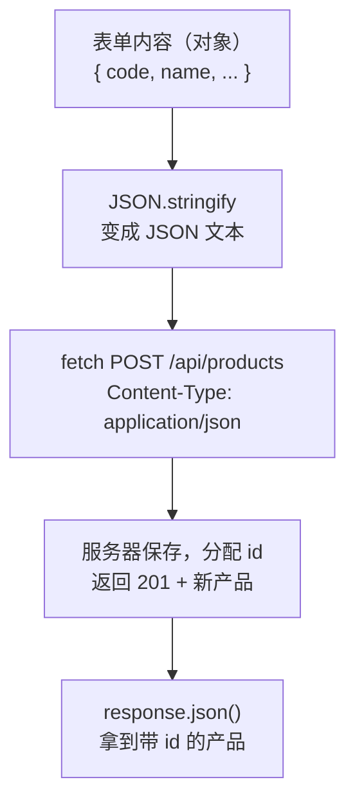
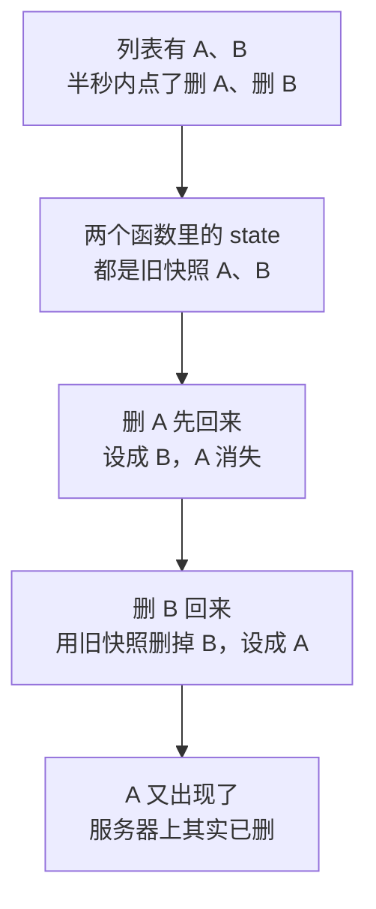
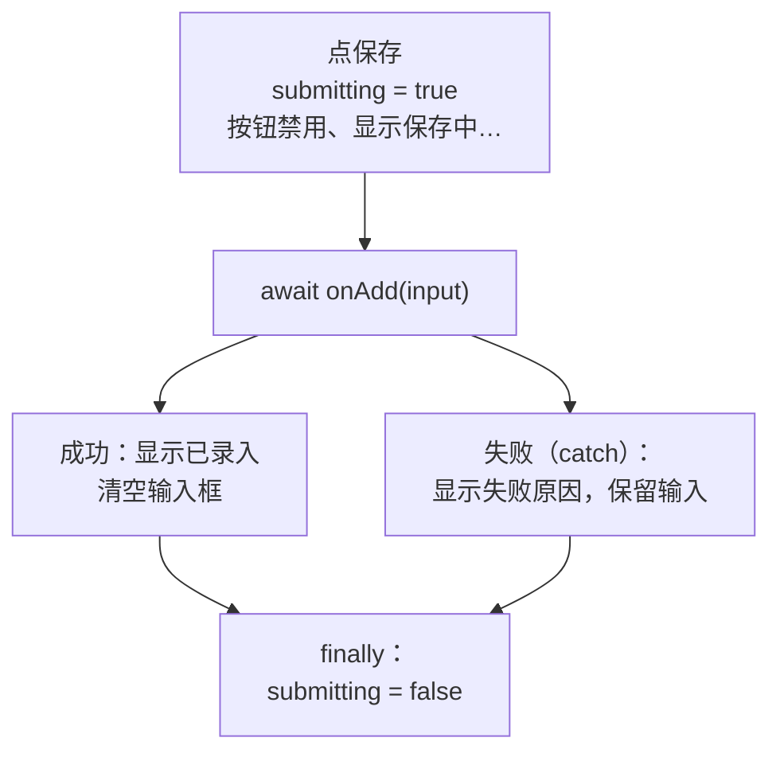

# 第 12 章 保存数据：新增、删除、修改写回接口

## 这一章解决什么问题

第 8 章的新增、删除、入库只改了浏览器里的 state，刷新页面就没了。本章让这三个操作真正调用接口：数据保存在服务器上，刷新、换电脑打开都还在。保存需要时间，也可能失败（编号重复、还有库存不能删），所以还要处理「保存中」和「失败了」这两种情况，并避开两个只有异步操作才会出现的 bug。

## 开始之前

- 上一章你已经会了：启动模拟接口、用开发代理连接 `/api`、用 `.env` 配置接口前缀。
- 起点代码：仓库 `code/ch11/price-list`（不含练习答案）。
- 两个终端都要运行：第一个 `npm run dev`，第二个 `npm run mock`。本章会多次「想从头再来」，在第二个终端按 `Ctrl + C` 再 `npm run mock`，数据就恢复成初始的 5 个产品。
- 预计耗时：70 分钟。

## 正文

### 12.1 写请求：带上方法、请求头和请求体

**白话定义**：`fetch` 默认发 GET 请求，只取数据。要让服务器保存数据，第二个参数里写明三样东西：`method`（请求方法：新增 `POST`、修改 `PUT`、删除 `DELETE`）、`headers`（请求头，告诉服务器请求体是什么格式）、`body`（请求体，要保存的内容，必须是字符串）。

**业务场景**：录入新产品时，把表单内容 `POST` 到 `/api/products`，服务器分配 id 后返回保存好的产品；点「入库 +1」时，把库存加 1 后的产品 `PUT` 到 `/api/products/4`；点「删除」时 `DELETE /api/products/5`。

**反例（什么时候不该用）**：不要在每个组件里各写一遍 `fetch(...)` 和请求头。地址、请求头、错误处理散落在各处，后端改一个规则就要找遍全项目。本节把所有写请求放进一个文件 `src/api.ts`，组件只调用 `createProduct(...)` 这样的函数。

| 操作 | 方法 | 地址 | 请求体 | 成功时返回 |
| --- | --- | --- | --- | --- |
| 新增 | `POST` | `/api/products` | 不含 id 的产品 | 201 + 带 id 的新产品 |
| 修改 | `PUT` | `/api/products/4` | 修改后的完整产品（不含 id） | 200 + 修改后的产品 |
| 删除 | `DELETE` | `/api/products/5` | 无 | 204，没有内容 |

#### 🖼 图解



#### 💻 最小可运行代码

**① 新建 `src/api.ts`**，放三个写接口的函数：

```ts
// src/api.ts
// 所有「写」接口集中放在这里。页面和 Hook 只调用这些函数，不直接拼地址、写请求头
import type { Product } from './types.ts'

// 新增、修改时提交的内容：Product 去掉 id。id 由服务器分配，前端不能自己定
export type ProductInput = Omit<Product, 'id'>

const BASE = import.meta.env.VITE_API_BASE

// 失败时从响应里取出给用户看的文字。模拟接口出错时返回 { message, errors? }
async function failMessage(response: Response): Promise<string> {
  try {
    const body: { message?: string; errors?: Record<string, string> } = await response.json()
    // 有逐个字段的错误时（例如编号重复），把它们连起来显示，比「校验失败」更具体
    if (body.errors) {
      return Object.values(body.errors).join('；')
    }
    return body.message ?? `服务器返回 ${response.status}`
  } catch {
    // 响应内容不是 JSON（例如代理返回的 502 页面），只能显示状态码
    return `服务器返回 ${response.status}`
  }
}

export async function createProduct(input: ProductInput): Promise<Product> {
  const response = await fetch(`${BASE}/products`, {
    // 默认是 GET，新增要写明 POST
    method: 'POST',
    // 告诉服务器：请求体是 JSON。不写的话很多后端不知道怎么解析，会拒绝
    headers: { 'Content-Type': 'application/json' },
    // 请求体只能是字符串，把对象转成 JSON 文本
    body: JSON.stringify(input),
  })
  if (!response.ok) {
    throw new Error(await failMessage(response))
  }
  // 服务器返回保存后的产品，带上了它分配的 id
  const saved: Product = await response.json()
  return saved
}

export async function updateProduct(id: number, input: ProductInput): Promise<Product> {
  const response = await fetch(`${BASE}/products/${id}`, {
    method: 'PUT',
    headers: { 'Content-Type': 'application/json' },
    body: JSON.stringify(input),
  })
  if (!response.ok) {
    throw new Error(await failMessage(response))
  }
  const saved: Product = await response.json()
  return saved
}

export async function deleteProduct(id: number): Promise<void> {
  const response = await fetch(`${BASE}/products/${id}`, { method: 'DELETE' })
  if (!response.ok) {
    throw new Error(await failMessage(response))
  }
  // 删除成功返回 204，没有内容，不要调用 response.json()
}
```

这个文件里有几样新写法：

| 写法 | 含义 |
| --- | --- |
| `Omit<Product, 'id'>` | TypeScript 自带的类型工具：取 `Product` 的所有字段，**去掉** `id`。新增时 id 由服务器分配，前端提交的内容里不该有它 |
| `JSON.stringify(input)` | 把对象转成 JSON 文本。`body` 只接受字符串等少数几种类型，不接受普通对象 |
| `Record<string, string>` | 「键是字符串、值也是字符串」的对象，用来描述 `errors: { code: '编号 P-003 已存在' }` 这种结构 |
| `Object.values(body.errors).join('；')` | 取出对象的所有值组成数组，再用「；」连成一句话 |
| `throw new Error(...)` | 主动抛出错误。调用方用 `try / catch` 接住（12.3 节） |
| `Promise<void>` | 这个 `async` 函数完成时没有返回值 |

**② 用下面的内容整个替换 `src/hooks/useProducts.ts`。** 加载部分和第 11 章一样；`addProduct`、`deleteProduct`、`restockProduct` 三个函数改成先调用接口、成功后再改 state：

```ts
// src/hooks/useProducts.ts
// 自定义 Hook：把「加载产品 + 增删改」这一整套逻辑打包，任何组件调用它都能用
import { useEffect, useState } from 'react'
import type { Product } from '../types.ts'
// 把 api.ts 导出的所有东西收进一个叫 api 的对象，用 api.createProduct 这样调用，不和下面同名的函数混淆
import * as api from '../api.ts'
import type { ProductInput } from '../api.ts'

export type LoadState =
  | { status: 'loading' }
  | { status: 'error'; message: string }
  | { status: 'success'; products: Product[] }

// 名字必须以 use 开头：React 和 lint 工具靠这个识别它是 Hook，按 Hook 的规则检查
export function useProducts() {
  const [state, setState] = useState<LoadState>({ status: 'loading' })

  useEffect(() => {
    let ignore = false

    async function load() {
      try {
        // 接口地址的前半段来自 .env 文件里的 VITE_API_BASE，换环境只改配置，不改代码
        const response = await fetch(`${import.meta.env.VITE_API_BASE}/products`)
        if (!response.ok) {
          throw new Error(`服务器返回 ${response.status}`)
        }
        const products: Product[] = await response.json()
        if (!ignore) {
          setState({ status: 'success', products })
        }
      } catch (err) {
        if (!ignore) {
          setState({ status: 'error', message: err instanceof Error ? err.message : String(err) })
        }
      }
    }

    load()
    return () => {
      ignore = true
    }
  }, [])

  // 下面三个函数先调用接口，接口成功后再改 state。接口失败时抛出的错误不在这里处理，交给调用方显示
  async function addProduct(input: ProductInput): Promise<Product> {
    const saved = await api.createProduct(input)
    // await 之后不能再用外面的 state（那是调用时的旧快照），用更新函数拿最新的 prev
    setState((prev) => (prev.status === 'success' ? { status: 'success', products: [...prev.products, saved] } : prev))
    return saved
  }

  async function deleteProduct(id: number): Promise<void> {
    await api.deleteProduct(id)
    setState((prev) =>
      prev.status === 'success' ? { status: 'success', products: prev.products.filter((p) => p.id !== id) } : prev,
    )
  }

  async function restockProduct(id: number): Promise<void> {
    if (state.status !== 'success') return
    const current = state.products.find((p) => p.id === id)
    if (!current) return
    // 把库存加 1 后的完整内容发给服务器，用服务器返回的结果替换这一行
    const saved = await api.updateProduct(id, { ...current, stock: current.stock + 1 })
    setState((prev) =>
      prev.status === 'success'
        ? { status: 'success', products: prev.products.map((p) => (p.id === id ? saved : p)) }
        : prev,
    )
  }

  // 返回一个对象，调用方按名字取自己需要的部分
  return { state, addProduct, deleteProduct, restockProduct }
}
```

`import * as api from '../api.ts'` 把 `api.ts` 导出的所有函数收进一个名叫 `api` 的对象。这里 Hook 自己也有一个 `deleteProduct`，写成 `api.deleteProduct` 一眼就能看出调用的是接口。`setState((prev) => ...)` 这种写法 12.2 节专门讲。

**③ 用下面的内容整个替换 `src/components/ProductForm.tsx`。** 和第 6 章相比改了三处：`onAdd` 的类型变了（交出不含 id 的内容，拿回服务器保存好的产品）；`handleSubmit` 前面加了 `async`，里面 `await onAdd(input)`；成功提示里显示服务器分配的 id。

```tsx
// src/components/ProductForm.tsx（12.1 版本，12.3 节会再改）
import { useState } from 'react'
import type { ChangeEvent, SubmitEvent } from 'react'
import type { Product } from '../types.ts'
import type { ProductInput } from '../api.ts'

type ProductFormProps = {
  // 保存时把填好的内容交给父组件，父组件负责调用接口。返回 Promise：表单要等它完成，才知道成功还是失败
  onAdd: (input: ProductInput) => Promise<Product>
}

export function ProductForm({ onAdd }: ProductFormProps) {
  // 每个输入框对应一个 state。输入框里的内容永远是字符串，单价也先按字符串存
  const [code, setCode] = useState('')
  const [name, setName] = useState('')
  const [category, setCategory] = useState('探头')
  const [price, setPrice] = useState('')
  // 保存成功后显示的提示
  const [message, setMessage] = useState('')
  // 点过一次「保存」才显示错误，免得一打开页面就满屏红字
  const [triedSubmit, setTriedSubmit] = useState(false)

  // 派生值：每次渲染都从 state 现算，不另存 state，所以永远和输入框一致
  const priceNumber = Number(price)
  const codeError = code.trim() === '' ? '请填写编号' : ''
  const nameError = name.trim() === '' ? '请填写名称' : ''
  // Number('abc') 是 NaN，NaN > 0 不成立，所以「不是数字」和「小于等于 0」一起拦住
  const priceError = price.trim() === '' ? '请填写单价' : priceNumber > 0 ? '' : '单价必须是大于 0 的数字'
  const isValid = codeError === '' && nameError === '' && priceError === ''

  // 单独写成函数时，参数类型要写明：input 元素上的变化事件
  function handlePriceChange(e: ChangeEvent<HTMLInputElement>) {
    setPrice(e.target.value)
  }

  async function handleSubmit(e: SubmitEvent<HTMLFormElement>) {
    // 阻止浏览器默认的「提交表单 = 刷新整页」，改由我们自己处理
    e.preventDefault()
    setTriedSubmit(true)
    if (!isValid) {
      setMessage('')
      return
    }
    // 新产品还没入库，库存为 0。不再自己生成 id，由服务器分配
    const input: ProductInput = { code: code.trim(), name: name.trim(), category, price: priceNumber, stock: 0 }
    // 等接口返回保存后的产品。await 只能写在 async 函数里，所以 handleSubmit 前面加了 async
    const saved = await onAdd(input)
    setMessage(`已录入：${saved.name}（编号 ${saved.code}，id ${saved.id}）`)
    setCode('')
    setName('')
    setPrice('')
    setTriedSubmit(false)
  }

  return (
    <form className="product-form" onSubmit={handleSubmit}>
      <h2>录入新产品</h2>
      {/* value 来自 state，onChange 把用户输入写回 state：输入框完全由 React 控制 */}
      <label>编号 <input value={code} onChange={(e) => setCode(e.target.value)} /></label>
      {triedSubmit && codeError && <span className="error">{codeError}</span>}
      <label>名称 <input value={name} onChange={(e) => setName(e.target.value)} /></label>
      {triedSubmit && nameError && <span className="error">{nameError}</span>}
      <label>
        分类{' '}
        <select value={category} onChange={(e) => setCategory(e.target.value)}>
          <option value="探头">探头</option>
          <option value="主机">主机</option>
          <option value="耗材">耗材</option>
        </select>
      </label>
      <label>单价 <input value={price} onChange={handlePriceChange} /></label>
      {triedSubmit && priceError && <span className="error">{priceError}</span>}
      {/* type="submit"：点击或在输入框里按回车都会触发表单的 onSubmit */}
      <button type="submit">保存</button>
      {message && <p className="success">{message}</p>}
    </form>
  )
}
```

`ListPage.tsx` 这一节不用改：它把 `useProducts()` 给的 `addProduct` 传给表单、把 `deleteProduct`、`restockProduct` 传给表格，函数名没变。

#### 🔍 拆解运行结果

实测：

| 操作 | 页面 | 第二个终端（模拟接口） |
| --- | --- | --- |
| 录入「P-003 微凸探头 C8-4 9800」保存 | 约半秒后表格末尾多一行 P-003，提示「已录入：微凸探头 C8-4（编号 P-003，id 6）」 | `POST /api/products` |
| 刷新页面 | P-003 **还在** | `GET /api/products` |
| 「耦合剂 250ml」点「入库 +1」 | 约半秒后库存 120 变成 121；刷新后还是 121 | `PUT /api/products/4` |
| 「探头保护套」（库存 0）点「删除」 | 约半秒后这一行消失 | `DELETE /api/products/5` |

数据现在保存在模拟接口里。刷新浏览器只是重新 `GET` 一次，拿到的是服务器上的最新数据。id 6 是服务器分配的：现有最大 id 加 1。

注意有个半秒的空档：点了「入库 +1」，数字要等服务器响应后才变。这期间页面没有任何提示，用户可能以为没点上又点一次。12.3 节解决。

再试两个会失败的操作：

- 再录入一次编号 P-003：页面**没有任何变化**，输入框也没清空。控制台里有两条报错：`Failed to load resource: the server responded with a status of 400 (Bad Request)`，以及一条未处理的错误，内容是「编号 P-003 已存在」。
- 「凸阵探头 C5-2」（库存 6）点「删除」：页面同样没变化，控制台是 409 和「凸阵探头 C5-2 还有库存 6，不能删除」。

`api.ts` 正确地抛出了错误，但没有人接住，用户什么也看不到。这也是 12.3 节要做的。

#### 改坏一处试试

- 把 `createProduct` 里的 `body: JSON.stringify(input)` 写成 `body: input`，报 `TS2322: Type 'ProductInput' is not assignable to type 'BodyInit | null | undefined'.`：`body` 不接受普通对象。
- 把 `addProduct` 里的 `await api.createProduct(input)` 去掉 `await`，`saved` 就成了一个 Promise 而不是产品，TypeScript 在下一行报一长串错误，关键是最后一句 `Type 'Promise<Product>' is missing the following properties from type 'Product': id, code, name, category, and 2 more.`。忘写 `await` 是异步代码最常见的错误，看到 `Promise<...>` 出现在不该出现的地方，先查 `await`。

### 12.2 异步操作之后，用更新函数修改 state

**白话定义**：第 4 章讲过，一次渲染里的 state 是一张固定的快照。`await` 等待期间，页面可能已经因为别的操作重新渲染了好几次，但函数里的 `state` 变量还是**调用那一刻**的旧快照。所以 `await` 之后要改 state 时，用更新函数 `setState((prev) => ...)`：React 把**最新的**值作为 `prev` 传进来。

**业务场景**：用户手快，半秒内连续删除了两个产品。两个删除请求同时在路上，谁先回来不确定。每个请求回来时，都要在**当时最新**的列表上删掉自己那一行。

**反例（什么时候不该用）**：新值和旧值无关时不需要更新函数，比如加载成功后整个替换 `setState({ status: 'success', products })`，或者 `setMessage('已录入')`。只有「在旧值基础上改」（加一项、删一项、改一项、加 1）并且中间隔着 `await` 时才必须用。

#### 🖼 图解



用更新函数时，第二步的 `prev` 是 C 设好的「只有 B」，删掉 B 后得到空列表，结果正确。

#### 💻 最小可运行代码

12.1 的 `useProducts.ts` 已经是正确写法，本节不用改代码，看懂这一段：

```ts
  async function deleteProduct(id: number): Promise<void> {
    await api.deleteProduct(id)
    setState((prev) =>
      prev.status === 'success' ? { status: 'success', products: prev.products.filter((p) => p.id !== id) } : prev,
    )
  }
```

| 部分 | 含义 |
| --- | --- |
| `(prev) => ...` | 更新函数。React 调用它时，`prev` 是此刻最新的 state |
| `prev.status === 'success' ? ... : prev` | 只有成功加载的列表才能删；万一此刻不是 success（理论上不会），原样返回，不改 |
| `prev.products.filter(...)` | 在最新的列表上删除，而不是在调用时的旧快照上 |

`restockProduct` 里有一处读的是外面的 `state`：`state.products.find(...)`。那是在 `await` **之前**读当前产品，用来组装要提交的内容，这时快照就是最新的，没有问题。`await` 之后的 `setState` 仍然用更新函数。

#### 🔍 拆解运行结果

先重启模拟接口恢复数据，再录入一个库存为 0 的产品 P-008（库存为 0 才能删）。然后在半秒内先后点「探头保护套」和「P-008」的「删除」，两行都消失，刷新后也都不在。正确。

#### 改坏一处试试

把 `deleteProduct` 里 `await` 后面那几行换成直接用外面的 `state`：

```ts
    await api.deleteProduct(id)
    if (state.status !== 'success') return
    setState({ status: 'success', products: state.products.filter((p) => p.id !== id) })
```

TypeScript 不报错。重做上面的实验（重启模拟接口、录入 P-008、半秒内连删两行），实测：两个 `DELETE` 都返回 204，但页面上**探头保护套又出现了**，只有 P-008 消失。刷新页面后探头保护套才真正不见：服务器上早已删除，是页面显示错了。和图解描述的过程完全一致。改回更新函数的写法。

这种 bug 只在操作很快、网络有延迟时出现，平时测试很难发现，所以要从写法上杜绝：**`await` 之后改 state，一律用更新函数。**

### 12.3 提交中与失败状态

**白话定义**：一次保存有三个阶段：等待中、成功、失败。「等待中」要让用户看到并防止重复提交（按钮禁用、文字变成「保存中…」）；「失败」要把服务器给的原因显示出来，并保留用户填的内容。实现上就是两个 state：`submitting`（是否正在提交）和 `submitError`（失败原因），再配合 `try / catch / finally`。

**业务场景**：网络慢时，用户点了「保存」没反应，又点了一次，结果同一个产品提交了两次；编号重复时，用户要知道为什么没保存成功，而不是对着没反应的页面发呆。

**反例（什么时候不该用）**：不要用 `alert()` 弹窗显示每个错误。弹窗会挡住页面、必须点掉才能继续，用户也没法一边看错误一边改表单。错误就近显示在表单或列表上方。确认删除这种「需要用户做决定」的场合可以用浏览器自带的确认框（练习 1）。

#### 🖼 图解



`try` 里的代码抛出错误时，跳到 `catch`；`finally` 里的代码**不管成功还是失败都会执行**，恢复按钮的代码写在这里，就不会出现「失败后按钮一直是灰的」。

#### 💻 最小可运行代码

**① 用下面的内容整个替换 `src/components/ProductForm.tsx`。** 和 12.1 相比：多了 `submitting`、`submitError` 两个 state；`await onAdd(input)` 包进了 `try / catch / finally`；按钮加了 `disabled={submitting}` 和「保存中…」；下面多了失败提示。

```tsx
// src/components/ProductForm.tsx
import { useState } from 'react'
import type { ChangeEvent, SubmitEvent } from 'react'
import type { Product } from '../types.ts'
import type { ProductInput } from '../api.ts'

type ProductFormProps = {
  // 保存时把填好的内容交给父组件，父组件负责调用接口。返回 Promise：表单要等它完成，才知道成功还是失败
  onAdd: (input: ProductInput) => Promise<Product>
}

export function ProductForm({ onAdd }: ProductFormProps) {
  // 每个输入框对应一个 state。输入框里的内容永远是字符串，单价也先按字符串存
  const [code, setCode] = useState('')
  const [name, setName] = useState('')
  const [category, setCategory] = useState('探头')
  const [price, setPrice] = useState('')
  // 保存成功后显示的提示
  const [message, setMessage] = useState('')
  // 点过一次「保存」才显示错误，免得一打开页面就满屏红字
  const [triedSubmit, setTriedSubmit] = useState(false)
  // 正在等服务器响应。这期间禁用保存按钮，防止重复提交
  const [submitting, setSubmitting] = useState(false)
  // 服务器返回的失败原因
  const [submitError, setSubmitError] = useState('')

  // 派生值：每次渲染都从 state 现算，不另存 state，所以永远和输入框一致
  const priceNumber = Number(price)
  const codeError = code.trim() === '' ? '请填写编号' : ''
  const nameError = name.trim() === '' ? '请填写名称' : ''
  // Number('abc') 是 NaN，NaN > 0 不成立，所以「不是数字」和「小于等于 0」一起拦住
  const priceError = price.trim() === '' ? '请填写单价' : priceNumber > 0 ? '' : '单价必须是大于 0 的数字'
  const isValid = codeError === '' && nameError === '' && priceError === ''

  // 单独写成函数时，参数类型要写明：input 元素上的变化事件
  function handlePriceChange(e: ChangeEvent<HTMLInputElement>) {
    setPrice(e.target.value)
  }

  async function handleSubmit(e: SubmitEvent<HTMLFormElement>) {
    // 阻止浏览器默认的「提交表单 = 刷新整页」，改由我们自己处理
    e.preventDefault()
    setTriedSubmit(true)
    if (!isValid) {
      setMessage('')
      return
    }
    // 新产品还没入库，库存为 0。不再自己生成 id，由服务器分配
    const input: ProductInput = { code: code.trim(), name: name.trim(), category, price: priceNumber, stock: 0 }
    setSubmitting(true)
    setSubmitError('')
    setMessage('')
    try {
      const saved = await onAdd(input)
      setMessage(`已录入：${saved.name}（编号 ${saved.code}，id ${saved.id}）`)
      // 保存成功才清空输入框；失败时保留，方便用户改了再提交
      setCode('')
      setName('')
      setPrice('')
      setTriedSubmit(false)
    } catch (err) {
      setSubmitError(err instanceof Error ? err.message : String(err))
    } finally {
      // 不管成功还是失败，都要恢复按钮。写在 finally 里就不会漏
      setSubmitting(false)
    }
  }

  return (
    <form className="product-form" onSubmit={handleSubmit}>
      <h2>录入新产品</h2>
      {/* value 来自 state，onChange 把用户输入写回 state：输入框完全由 React 控制 */}
      <label>编号 <input value={code} onChange={(e) => setCode(e.target.value)} /></label>
      {triedSubmit && codeError && <span className="error">{codeError}</span>}
      <label>名称 <input value={name} onChange={(e) => setName(e.target.value)} /></label>
      {triedSubmit && nameError && <span className="error">{nameError}</span>}
      <label>
        分类{' '}
        <select value={category} onChange={(e) => setCategory(e.target.value)}>
          <option value="探头">探头</option>
          <option value="主机">主机</option>
          <option value="耗材">耗材</option>
        </select>
      </label>
      <label>单价 <input value={price} onChange={handlePriceChange} /></label>
      {triedSubmit && priceError && <span className="error">{priceError}</span>}
      {/* type="submit"：点击或在输入框里按回车都会触发表单的 onSubmit */}
      <button type="submit" disabled={submitting}>
        {submitting ? '保存中…' : '保存'}
      </button>
      {message && <p className="success">{message}</p>}
      {submitError && <p className="error">保存失败：{submitError}</p>}
    </form>
  )
}
```

**② 用下面的内容整个替换 `src/pages/ListPage.tsx`。** 表格的删除、入库失败也要显示：多了 `actionError` 这个 state 和 `handleDelete`、`handleRestock` 两个函数，它们调用 `useProducts` 给的函数并接住错误；传给表格的换成这两个函数；表格上方多了错误提示。

```tsx
// src/pages/ListPage.tsx
// 产品列表页：第 8 章 App 的内容原样搬过来，去掉页头页脚（它们留在 App 里，所有页面共用）
import { useEffect, useState } from 'react'
import type { ReactNode } from 'react'
import { useProducts } from '../hooks/useProducts.ts'
import { FilterBar } from '../components/FilterBar.tsx'
import { ProductTable } from '../components/ProductTable.tsx'
import { ProductForm } from '../components/ProductForm.tsx'

export function ListPage() {
  // 加载和增删改的细节都在 useProducts 里，列表页只拿结果
  const { state, addProduct, deleteProduct, restockProduct } = useProducts()
  // 状态提升：搜索框和表格都要用 keyword，所以放在它们共同的父组件 App 里
  const [keyword, setKeyword] = useState('')
  // 删除、入库失败时显示的原因（例如「还有库存，不能删除」）
  const [actionError, setActionError] = useState('')

  // 表格只负责报告「点了哪一行」，调用接口、处理失败在这里做
  async function handleDelete(id: number) {
    setActionError('')
    try {
      await deleteProduct(id)
    } catch (err) {
      setActionError(`删除失败：${err instanceof Error ? err.message : String(err)}`)
    }
  }

  async function handleRestock(id: number) {
    setActionError('')
    try {
      await restockProduct(id)
    } catch (err) {
      setActionError(`入库失败：${err instanceof Error ? err.message : String(err)}`)
    }
  }

  const count = state.status === 'success' ? state.products.length : 0

  useEffect(() => {
    document.title = `产品价格清单（${count} 种）`
  }, [count])

  let content: ReactNode
  if (state.status === 'loading') {
    content = <p>加载中…</p>
  } else if (state.status === 'error') {
    content = <p className="error">加载失败：{state.message}</p>
  } else {
    // 筛选结果是派生值：由 products 和 keyword 现算，不另存 state
    const k = keyword.trim().toLowerCase()
    const visible = state.products.filter(
      (p) => p.name.toLowerCase().includes(k) || p.code.toLowerCase().includes(k),
    )
    // 传的是上面包了一层错误处理的函数
    content = <ProductTable products={visible} onDelete={handleDelete} onRestock={handleRestock} />
  }

  return (
    <section>
      <p>共 {count} 种产品</p>
      {/* 把值和「修改它的函数」一起交给搜索框 */}
      <FilterBar keyword={keyword} onKeywordChange={setKeyword} />
      {actionError && <p className="error">{actionError}</p>}
      {content}
      <ProductForm onAdd={addProduct} />
    </section>
  )
}
```

`ProductTable` 的 `onDelete` 类型还是 `(id: number) => void`，传进去的 `handleDelete` 返回 `Promise<void>`，TypeScript 允许：`void` 表示「不关心返回值」，返回什么都可以。

#### 🔍 拆解运行结果

重启模拟接口后实测：

| 操作 | 页面 |
| --- | --- |
| 录入 P-003 点保存，0.15 秒时 | 按钮变成灰色的「保存中…」，点不动 |
| 约半秒后 | 按钮恢复「保存」，提示「已录入：微凸探头 C8-4（编号 P-003，id 6）」，输入框清空，表格多一行 |
| 再录入编号 P-003、名称「重复」保存 | 红字「保存失败：编号 P-003 已存在」，输入框里的 P-003 和「重复」**保留着**，改一下编号就能再提交 |
| 「凸阵探头 C5-2」点删除 | 表格上方红字「删除失败：凸阵探头 C5-2 还有库存 6，不能删除」，这一行还在 |
| 停掉模拟接口，再删除、保存 | 分别显示「删除失败：服务器返回 502」「保存失败：服务器返回 502」 |

502 时为什么只显示状态码？代理返回的错误内容不是 JSON，`failMessage` 里的 `response.json()` 解析失败，走到 `catch`，只能用状态码。

#### 改坏一处试试

**① 去掉按钮的 `disabled={submitting}`。** 录入 P-007 后**快速点两次**保存。实测第二个终端出现两次 `POST /api/products`：第一次 201 保存成功，第二次 400。页面上同时显示「已录入：双击测试」和「保存失败：编号 P-007 已存在」。这次幸好编号重复被后端拦住了；如果是没有唯一性检查的数据（比如一条留言、一笔订单），就会真的保存两份。改回去。

**② 去掉请求头。** 删掉 `api.ts` 里 `createProduct` 的 `headers: { 'Content-Type': 'application/json' },` 那一行，保存一个新产品。实测显示「保存失败：请求头 Content-Type 必须是 application/json」，状态码 415（Unsupported Media Type，不支持的内容类型）。请求体虽然是 JSON 文本，但没有请求头说明，服务器不知道该按什么格式解析。真实后端（比如 Spring Boot）大多也会这样拒绝。改回去。

**③ 忘了 `await`。** 把 `ListPage` 里 `handleDelete` 的 `await deleteProduct(id)` 去掉 `await`，再删除「凸阵探头 C5-2」。实测表格上方**没有任何提示**，控制台里却出现了未处理的错误「凸阵探头 C5-2 还有库存 6，不能删除」。

没有 `await`，`deleteProduct(id)` 只是「发出去」就继续往下走了，`try` 块立刻结束；等半秒后错误抛出来时，早已不在 `try` 里，`catch` 接不到。TypeScript 和 `npm run lint` 都不报这个错，只能靠习惯：**调用返回 Promise 的函数，前面写 `await`。** 改回去。

## ⚠️ 踩坑警告

| 现象 | 原因 | 怎么改 |
| --- | --- | --- |
| 保存失败了，页面没有任何提示；控制台里有未处理的错误 | 错误抛出了但没人接住：没写 `try / catch`，或者调用时忘了 `await` | 调用接口的地方用 `try { await ... } catch (err) { 显示错误 }` |
| 后端返回 415 | 请求头没写 `Content-Type: application/json` | 所有带 JSON 请求体的请求都加上这个请求头；集中写在 `api.ts` 里就不会漏 |
| 后端说请求体是空的或格式不对 | `body` 直接传了对象（TypeScript 会报 `TS2322`），或者传了 `String(obj)`（得到 `[object Object]`） | 用 `JSON.stringify(对象)` |
| 网络慢时同一条数据保存了两次 | 提交期间按钮没有禁用，用户点了两次 | 用 `submitting` state 禁用按钮，成功或失败后在 `finally` 里恢复 |
| 失败后保存按钮一直是灰的 | 恢复 `submitting` 的代码写在 `try` 的末尾，出错时跳过了 | 写在 `finally` 里 |
| 连续快速操作后，删掉的行又出现，刷新后才消失 | `await` 之后用了外面的旧 `state` | `await` 之后改 state 用 `setState((prev) => ...)` |
| 删除成功了却报 `Failed to execute 'json' on 'Response': Unexpected end of JSON input` | 删除返回 204 没有内容，代码里仍然调用了 `response.json()` | 204 时不要解析响应体 |

## 🎯 动手练习

**练习 1：删除前确认**

点「删除」时先弹出浏览器自带的确认框「确定删除「探头保护套」吗？」，点「取消」什么都不发生，点「确定」才调用接口。

验收标准：

- 点「取消」：第二个终端没有出现 `DELETE`，表格不变。
- 点「确定」：出现 `DELETE /api/products/5`，这一行消失。

提示：`window.confirm('文字')` 弹出确认框，点「确定」返回 `true`，点「取消」返回 `false`。确认框会暂停页面上的一切，这里正好需要用户做决定。

**练习 2：表格里的「处理中」**

点某一行的「删除」或「入库 +1」后，在服务器响应前，这一行的两个按钮都禁用，并在按钮后面显示「处理中…」。

验收标准：

- 「耦合剂 250ml」点「入库 +1」后立刻看：这一行显示「处理中…」，两个按钮是灰的；约半秒后恢复，库存加 1。
- 其他行的按钮不受影响。

提示：在 `ListPage` 里用一个 `useState<number | null>(null)` 记住正在处理的那一行的 id，传给 `ProductTable`。`number | null` 表示「要么是数字，要么是 null（没有）」。

卡住了看文末参考答案。

## 📌 一句话总结

写请求带上方法、请求头和 JSON；await 后用更新函数改 state；保存中禁用按钮，失败就显示原因。

## 下一章

现在只能「库存加 1」这样改。第 13 章做编辑页，修改产品的任意字段，并把服务器的校验错误显示在对应的输入框下面。

---

<!-- 以下是参考答案，先自己动手，卡住了再往下翻 -->


## 参考答案

两个练习都改 `ListPage.tsx`，练习 2 还要改 `ProductTable.tsx`。下面是都做完后的版本。

### 练习 1

思路：在调用接口之前先 `window.confirm`，返回 `false` 就直接 `return`。为了在提示里显示产品名，先从列表里找出这个产品；`target?.name` 是可选链（optional chaining）：`target` 是 `undefined` 时整个表达式得到 `undefined`，不会报错，`?? id` 再退回显示 id。

### 练习 2

思路：「正在处理哪一行」只有一个值，用 `busyId` 记住；开始时设成这一行的 id，在 `finally` 里设回 `null`。表格按 `busyId === p.id` 决定这一行的按钮是否禁用。

```tsx
// src/pages/ListPage.tsx
// 两个练习都做完后的版本
// 产品列表页：第 8 章 App 的内容原样搬过来，去掉页头页脚（它们留在 App 里，所有页面共用）
import { useEffect, useState } from 'react'
import type { ReactNode } from 'react'
import { useProducts } from '../hooks/useProducts.ts'
import { FilterBar } from '../components/FilterBar.tsx'
import { ProductTable } from '../components/ProductTable.tsx'
import { ProductForm } from '../components/ProductForm.tsx'

export function ListPage() {
  // 加载和增删改的细节都在 useProducts 里，列表页只拿结果
  const { state, addProduct, deleteProduct, restockProduct } = useProducts()
  // 状态提升：搜索框和表格都要用 keyword，所以放在它们共同的父组件 App 里
  const [keyword, setKeyword] = useState('')
  // 删除、入库失败时显示的原因（例如「还有库存，不能删除」）
  const [actionError, setActionError] = useState('')
  // 练习 2：正在处理的那一行的 id，没有就是 null
  const [busyId, setBusyId] = useState<number | null>(null)

  // 表格只负责报告「点了哪一行」，调用接口、处理失败在这里做
  async function handleDelete(id: number) {
    // 练习 1：先确认。confirm 弹出浏览器自带的确认框，点「确定」返回 true，点「取消」返回 false
    const target = state.status === 'success' ? state.products.find((p) => p.id === id) : undefined
    if (!window.confirm(`确定删除「${target?.name ?? id}」吗？`)) {
      return
    }
    setActionError('')
    setBusyId(id)
    try {
      await deleteProduct(id)
    } catch (err) {
      setActionError(`删除失败：${err instanceof Error ? err.message : String(err)}`)
    } finally {
      setBusyId(null)
    }
  }

  async function handleRestock(id: number) {
    setActionError('')
    setBusyId(id)
    try {
      await restockProduct(id)
    } catch (err) {
      setActionError(`入库失败：${err instanceof Error ? err.message : String(err)}`)
    } finally {
      setBusyId(null)
    }
  }

  const count = state.status === 'success' ? state.products.length : 0

  useEffect(() => {
    document.title = `产品价格清单（${count} 种）`
  }, [count])

  let content: ReactNode
  if (state.status === 'loading') {
    content = <p>加载中…</p>
  } else if (state.status === 'error') {
    content = <p className="error">加载失败：{state.message}</p>
  } else {
    // 筛选结果是派生值：由 products 和 keyword 现算，不另存 state
    const k = keyword.trim().toLowerCase()
    const visible = state.products.filter(
      (p) => p.name.toLowerCase().includes(k) || p.code.toLowerCase().includes(k),
    )
    // 传的是上面包了一层错误处理的函数
    content = <ProductTable products={visible} busyId={busyId} onDelete={handleDelete} onRestock={handleRestock} />
  }

  return (
    <section>
      <p>共 {count} 种产品</p>
      {/* 把值和「修改它的函数」一起交给搜索框 */}
      <FilterBar keyword={keyword} onKeywordChange={setKeyword} />
      {actionError && <p className="error">{actionError}</p>}
      {content}
      <ProductForm onAdd={addProduct} />
    </section>
  )
}
```

```tsx
// src/components/ProductTable.tsx
// 练习 2 之后的版本：多了 busyId
// 只负责显示表格。数据从 props 来；点了按钮不自己改数据，而是调用父组件给的函数「通知」它
import { Link } from 'react-router'
import type { Product } from '../types.ts'
// 导入 CSS Module 得到一个对象：键是你写的类名，值是打包后真正使用的类名
import styles from './ProductTable.module.css'

type ProductTableProps = {
  products: Product[]
  // 正在处理的那一行。这一行的按钮禁用，避免重复点击
  busyId: number | null
  // 回调 props：类型写清楚「调用时传什么参数、返回什么」。void 表示不关心返回值
  onDelete: (id: number) => void
  onRestock: (id: number) => void
}

export function ProductTable({ products, busyId, onDelete, onRestock }: ProductTableProps) {
  if (products.length === 0) {
    return <p className="empty">暂无产品</p>
  }

  return (
    <table className={styles.table}>
      <thead>
        <tr>
          <th>编号</th>
          <th>名称</th>
          <th>单价（元）</th>
          <th>库存</th>
          <th>操作</th>
        </tr>
      </thead>
      <tbody>
        {products.map((p) => (
          <tr key={p.id}>
            <td>{p.code}</td>
            <td>
              {/* 点产品名进入详情页，地址形如 /products/3 */}
              <Link to={`/products/${p.id}`}>{p.name}</Link>
              {p.stock === 0 && <span className={styles.outOfStock}>缺货</span>}
            </td>
            <td>{p.price.toLocaleString()}</td>
            <td className={p.stock < 5 ? styles.low : undefined}>{p.stock}</td>
            <td>
              <button type="button" disabled={busyId === p.id} onClick={() => onRestock(p.id)}>
                入库 +1
              </button>{' '}
              <button type="button" disabled={busyId === p.id} onClick={() => onDelete(p.id)}>
                删除
              </button>
              {busyId === p.id && ' 处理中…'}
            </td>
          </tr>
        ))}
      </tbody>
    </table>
  )
}
```

实测：点「取消」没有发出请求；点「确定」后这一行先显示「处理中…」、按钮变灰，约半秒后消失。
