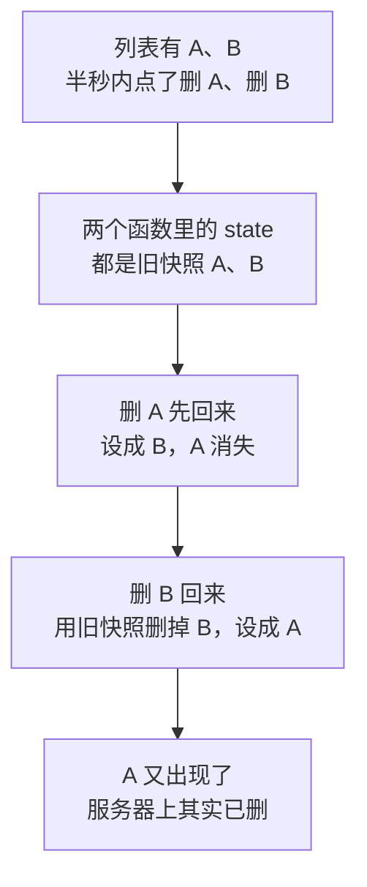

# 第 12B 章 await 之后用更新函数改 state

## 这一章解决什么问题

上一章的三个保存函数都是「先 `await` 接口，再用外面的 `state` 算出新列表」。一次只点一个按钮时没有问题；可是用户手快，半秒内连续删了两个产品，删掉的一行会**重新出现**，刷新后才消失。本章先复现这个 bug，再用更新函数修掉。

本章只讲一个技术点：**`await` 之后用更新函数修改 state**。

## 开始之前

- 上一章你已经会了：用 `api.ts` 发 `POST`、`PUT`、`DELETE` 请求，成功后再改 state。
- 起点代码：仓库 `code/ch12A/price-list`（不含练习答案）。两个终端分别运行开发服务器和 `npm run mock`。
- 预计耗时：25 分钟。

## 正文

### 12B.1 先复现 bug

在模拟接口的终端按 `Ctrl + C` 再 `npm run mock`，恢复初始数据。然后：

1. 录入一个库存为 0 的产品：编号 `P-008`、名称「测试」、单价 `1`（库存为 0 的产品才能删）。
2. 在半秒内先后点「探头保护套」和「P-008」两行的「删除」。

实测：两个 `DELETE` 都返回 204，但页面上**探头保护套又出现了**，只有 P-008 消失。刷新页面后探头保护套才真正不见：服务器上早已删除，是页面显示错了。

### 12B.2 为什么会这样

**白话定义**：第 4C 章讲过，一次渲染里的 state 是一张固定的快照。`await` 等待期间，页面可能已经因为别的操作重新渲染了好几次，但函数里的 `state` 变量还是**调用那一刻**的旧快照。所以 `await` 之后要改 state 时，用更新函数 `setState((prev) => ...)`：React 把**最新的**值作为 `prev` 传进来。

**业务场景**：用户手快，半秒内连续删除了两个产品。两个删除请求同时在路上，谁先回来不确定。每个请求回来时，都要在**当时最新**的列表上删掉自己那一行。

**反例（什么时候不该用）**：新值和旧值无关时不需要更新函数，比如加载成功后整个替换 `setState({ status: 'success', products })`，或者 `setMessage('已录入')`。只有「在旧值基础上改」（加一项、删一项、改一项、加 1）并且中间隔着 `await` 时才必须用。

#### 🖼 图解



用更新函数时，第二步的 `prev` 是 C 设好的「只有 B」，删掉 B 后得到空列表，结果正确。

### 12B.3 改成更新函数

#### 💻 最小可运行代码

用下面的内容整个替换 `src/hooks/useProducts.ts`。三个保存函数 `await` 之后的 `setState` 都改成了更新函数：

```ts
// src/hooks/useProducts.ts
// 自定义 Hook：把「加载产品 + 增删改」这一整套逻辑打包，任何组件调用它都能用
import { useEffect, useState } from 'react'
import type { Product } from '../types.ts'
// 把 api.ts 导出的所有东西收进一个叫 api 的对象，用 api.createProduct 这样调用，不和下面同名的函数混淆
import * as api from '../api.ts'
import type { ProductInput } from '../api.ts'

export type LoadState =
  | { status: 'loading' }
  | { status: 'error'; message: string }
  | { status: 'success'; products: Product[] }

// 名字必须以 use 开头：React 和 lint 工具靠这个识别它是 Hook，按 Hook 的规则检查
export function useProducts() {
  const [state, setState] = useState<LoadState>({ status: 'loading' })

  useEffect(() => {
    let ignore = false

    async function load() {
      try {
        // 接口地址的前半段来自 .env 文件里的 VITE_API_BASE，换环境只改配置，不改代码
        const response = await fetch(`${import.meta.env.VITE_API_BASE}/products`)
        if (!response.ok) {
          throw new Error(`服务器返回 ${response.status}`)
        }
        const products: Product[] = await response.json()
        if (!ignore) {
          setState({ status: 'success', products })
        }
      } catch (err) {
        if (!ignore) {
          setState({ status: 'error', message: err instanceof Error ? err.message : String(err) })
        }
      }
    }

    load()
    return () => {
      ignore = true
    }
  }, [])

  // 下面三个函数先调用接口，接口成功后再改 state。接口失败时抛出的错误不在这里处理，交给调用方显示
  async function addProduct(input: ProductInput): Promise<Product> {
    const saved = await api.createProduct(input)
    // await 之后不能再用外面的 state（那是调用时的旧快照），用更新函数拿最新的 prev
    setState((prev) => (prev.status === 'success' ? { status: 'success', products: [...prev.products, saved] } : prev))
    return saved
  }

  async function deleteProduct(id: number): Promise<void> {
    await api.deleteProduct(id)
    setState((prev) =>
      prev.status === 'success' ? { status: 'success', products: prev.products.filter((p) => p.id !== id) } : prev,
    )
  }

  async function restockProduct(id: number): Promise<void> {
    if (state.status !== 'success') return
    const current = state.products.find((p) => p.id === id)
    if (!current) return
    // 把库存加 1 后的完整内容发给服务器，用服务器返回的结果替换这一行
    const saved = await api.updateProduct(id, { ...current, stock: current.stock + 1 })
    setState((prev) =>
      prev.status === 'success'
        ? { status: 'success', products: prev.products.map((p) => (p.id === id ? saved : p)) }
        : prev,
    )
  }

  // 返回一个对象，调用方按名字取自己需要的部分
  return { state, addProduct, deleteProduct, restockProduct }
}
```

拿 `deleteProduct` 对比一下：

```ts
  // 第 12A 章：await 之后用外面的 state（旧快照）
  async function deleteProduct(id: number): Promise<void> {
    await api.deleteProduct(id)
    if (state.status !== 'success') return
    setState({ status: 'success', products: state.products.filter((p) => p.id !== id) })
  }

  // 本章：await 之后用更新函数，prev 是此刻最新的 state
  async function deleteProduct(id: number): Promise<void> {
    await api.deleteProduct(id)
    setState((prev) =>
      prev.status === 'success' ? { status: 'success', products: prev.products.filter((p) => p.id !== id) } : prev,
    )
  }
```

| 部分 | 含义 |
| --- | --- |
| `(prev) => ...` | 更新函数。React 调用它时，`prev` 是此刻最新的 state |
| `prev.status === 'success' ? ... : prev` | 只有成功加载的列表才能删；万一此刻不是 success（理论上不会），原样返回，不改 |
| `prev.products.filter(...)` | 在最新的列表上删除，而不是在调用时的旧快照上 |

`restockProduct` 里有一处读的是外面的 `state`：`state.products.find(...)`。那是在 `await` **之前**读当前产品，用来组装要提交的内容，这时快照就是最新的，没有问题。`await` 之后的 `setState` 仍然用更新函数。

#### 🔍 拆解运行结果

重启模拟接口，重做 12B.1 的实验（录入 P-008、半秒内连删两行），实测两行都消失，刷新后也都不在。正确。

这种 bug 只在操作很快、网络有延迟时出现，平时测试很难发现，TypeScript 也不报错，所以要从写法上杜绝：**`await` 之后改 state，一律用更新函数。**

## ⚠️ 踩坑警告

| 现象 | 原因 | 怎么改 |
| --- | --- | --- |
| 连续快速操作后，删掉的行又出现，刷新后才消失 | `await` 之后用了外面的旧 `state` | `await` 之后改 state 用 `setState((prev) => ...)` |
| 快速给两行各点一次「入库 +1」，页面上第一行的数字又变回去了，刷新后才是对的 | 同一个原因：第二个请求回来时，用旧快照替换整张表，把第一行的新数字盖掉了（练习 1 实测） | 同上 |
| 同一行快速点两次「入库 +1」，服务器上只加了 1 | 两次请求体都是从**同一张快照**算出来的，都提交了 121。更新函数只管 `await` 之后，管不到请求体（练习 2 实测） | 处理期间禁用这一行的按钮（第 12C 章练习 2） |

## 🎯 动手练习

**练习 1：两行快速入库**

先用第 12A 章的写法（`code/ch12A/price-list` 里的 `useProducts.ts`）做一次，再用本章的写法做一次：重启模拟接口，在半秒内先后点「凸阵探头」和「线阵探头」的「入库 +1」，各看一眼页面，再刷新看一眼。

验收标准：

- 第 12A 章写法：页面上凸阵探头还是 6、线阵探头是 4；刷新后凸阵探头变成 7。
- 本章写法：页面上直接是 7 和 4，刷新后不变。
- 能说出 12A 写法下凸阵探头的 7 是怎么被盖掉的。

**练习 2：同一行快速点两次**

用本章的写法，重启模拟接口，在半秒内对「耦合剂 250ml」连点两次「入库 +1」，在「网络」里看两个 `PUT` 的请求体。

验收标准：

- 两个 `PUT` 的请求体里 `stock` 都是 121。
- 页面和刷新后都是 121，不是 122。
- 能说出为什么更新函数解决不了这个问题。

卡住了看文末参考答案。

## 📌 一句话总结

await 之后改 state 一律用 setState((prev) => ...)，在最新值上改。

## 下一章

保存要半秒，这期间页面没有任何提示；保存失败时，错误只出现在控制台里。第 12C 章处理「保存中」和「失败了」。

---

<!-- 以下是参考答案，先自己动手，卡住了再往下翻 -->


## 参考答案

### 练习 1

实测（重启模拟接口后，0.15 秒内先后点两行）：

| 写法 | 页面上 | 刷新后（服务器上） |
| --- | --- | --- |
| 第 12A 章 | 凸阵探头 6，线阵探头 4 | 7 和 4 |
| 本章 | 7 和 4 | 7 和 4 |

12A 写法下：两次点击时，两个函数拿到的都是「6、3」那张快照。凸阵探头的请求先回来，用快照算出「7、3」并设置；线阵探头的请求后回来，还是用「6、3」那张快照，只把线阵探头换成 4，得到「6、4」，把刚设好的 7 盖掉了。服务器上两次 `PUT` 都成功，所以刷新后是对的。

### 练习 2

实测两个 `PUT /api/products/4` 的请求体完全一样：

```text
{"id":4,"code":"C-001","name":"耦合剂 250ml","category":"耗材","price":18,"stock":121}
```

页面和刷新后都是 121。两次点击都发生在第一个请求回来之前，`restockProduct` 在 `await` **之前**用同一张快照算出 `120 + 1`，服务器收到两次「设成 121」。更新函数只能让 `await` 之后的 `setState` 用上最新值，管不到已经发出去的请求体。解决办法是处理期间不让用户再点这一行（第 12C 章练习 2）。
