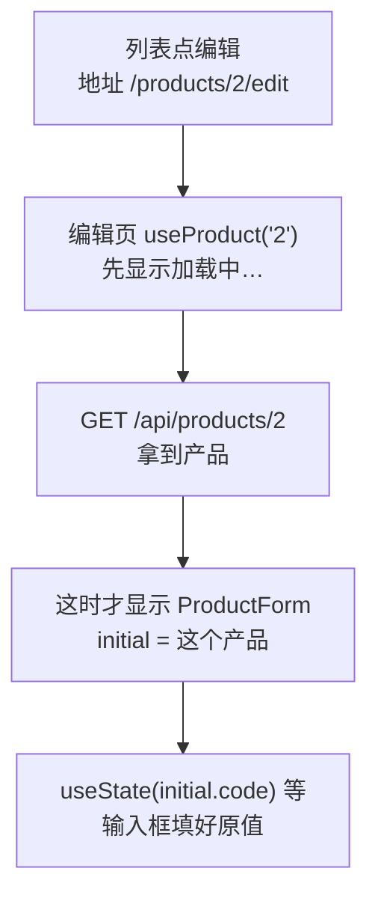
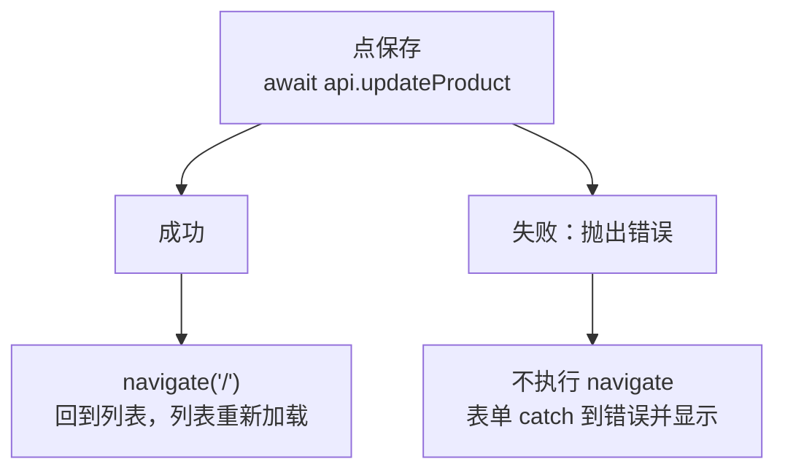
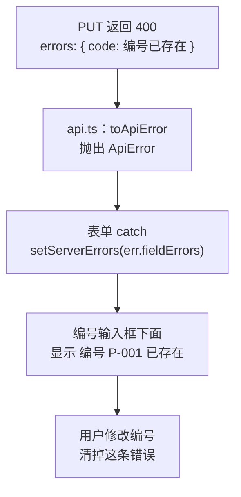

# 第 13 章 编辑产品：表单初始值、保存后跳转、后端校验错误

## 这一章解决什么问题

第 12 章只能「库存加 1」，名称写错了、价格调整了都没法改。本章做一个编辑页：从列表点「编辑」进入，表单里已经填好这个产品原来的值，改完保存后自动回到列表。还有一类错误只有服务器知道，比如「编号和别的产品重复了」，这类错误要显示在对应的输入框下面，而不是笼统地显示「保存失败」。

## 开始之前

- 上一章你已经会了：在 `api.ts` 里写 POST / PUT / DELETE；`await` 之后用更新函数改 state；用 `submitting` 和 `try / catch / finally` 处理保存中和失败。
- 起点代码：仓库 `code/ch12/price-list`（不含练习答案）。两个终端分别运行 `npm run dev` 和 `npm run mock`。
- 预计耗时：60 分钟。

## 正文

### 13.1 用已有数据做表单的初始值

**白话定义**：编辑表单和新增表单的区别只有一个：输入框一开始不是空的，而是原来的值。做法是把原来的产品作为 prop（这里叫 `initial`）传给表单，表单用它作为 `useState` 的初始值。关键一点：**`useState(初始值)` 只在组件第一次显示时读取初始值**，之后再变也不管。所以必须等数据加载完，再显示表单。

**业务场景**：「线阵探头 L12-5」调价了。在列表里点它的「编辑」，表单里已经是 P-002、线阵探头 L12-5、探头、15600，只改单价就能保存。

**反例（什么时候不该用）**：不要为编辑单独再写一个表单组件。新增和编辑的输入框、校验规则完全一样，写两份以后改校验规则就要改两处。本节让同一个 `ProductForm` 同时支持两种用法：不传 `initial` 是新增，传了是编辑。

#### 🖼 图解



#### 💻 最小可运行代码

**① 加载单个产品的 Hook。** 新建 `src/hooks/useProduct.ts`（如果做了第 11 章练习 1，用下面的内容替换）：

```ts
// src/hooks/useProduct.ts
// 只加载一个产品。id 来自地址栏，所以 id 要写进依赖数组：从 /products/1 换到 /products/2 时重新加载
import { useEffect, useState } from 'react'
import type { Product } from '../types.ts'

export type ProductState =
  | { status: 'loading' }
  | { status: 'error'; message: string }
  | { status: 'success'; product: Product }

export function useProduct(id: string | undefined) {
  // 记下「这份结果是哪个 id 的」。还没有结果时是 null
  const [loaded, setLoaded] = useState<{ id: string | undefined; state: ProductState } | null>(null)

  useEffect(() => {
    let ignore = false

    async function load() {
      try {
        const response = await fetch(`${import.meta.env.VITE_API_BASE}/products/${id}`)
        if (!response.ok) {
          // 模拟接口出错时返回 { message: '...' }，把它显示给用户，比只显示状态码清楚
          const body: { message?: string } = await response.json()
          throw new Error(body.message ?? `服务器返回 ${response.status}`)
        }
        const product: Product = await response.json()
        if (!ignore) {
          setLoaded({ id, state: { status: 'success', product } })
        }
      } catch (err) {
        if (!ignore) {
          setLoaded({ id, state: { status: 'error', message: err instanceof Error ? err.message : String(err) } })
        }
      }
    }

    load()
    return () => {
      ignore = true
    }
  }, [id])

  // 派生出当前状态：还没有结果，或者结果属于上一个 id（刚从 /products/1 换到 /products/2），都算「加载中」
  // 这样就不用在 effect 里先 setState 成 loading，少一次多余的渲染
  return loaded !== null && loaded.id === id ? loaded.state : { status: 'loading' as const }
}
```

这个 Hook 有一个和第 7 章不同的地方：`id` 变了以后，effect 不先 `setState` 成「加载中」，而是**记下结果属于哪个 id**，最后一行用「结果的 id 是不是当前 id」**算出**当前状态。从 `/products/1/edit` 换到 `/products/2/edit` 时，旧结果的 id 是 `'1'`，和当前的 `'2'` 不一样，就当作「加载中」，不会把产品 1 的数据显示在产品 2 的页面上。这是第 6 章派生值思路的又一次应用。（如果在 effect 一开始写 `setState({ status: 'loading' })`，`npm run lint` 会警告 `react(set-state-in-effect): Calling setState synchronously within an effect can trigger cascading renders`。）

`'loading' as const` 告诉 TypeScript：这里的 `'loading'` 就是这个固定值，不是任意字符串，这样它才符合 `ProductState` 里的 `{ status: 'loading' }`。

**② 让表单支持编辑。** 用下面的内容整个替换 `src/components/ProductForm.tsx`。和第 12 章相比：

- props 改了：多了可选的 `title` 和 `initial`；`onAdd` 改名为 `onSubmit`，因为它现在可能是新增也可能是修改；
- 四个 `useState` 的初始值改成「有 `initial` 用原值，没有就为空」；
- 保存时库存用 `initial?.stock ?? 0`：编辑时这个表单不改库存，沿用原来的值；
- 保存成功后，只有新增才清空输入框；
- 标题改用 `{title}`，成功提示改成「已保存：……」。

```tsx
// src/components/ProductForm.tsx（13.1 版本，13.3 节会再改）
// 新增和编辑共用的表单。传了 initial 就是编辑：输入框先填好原来的值
import { useState } from 'react'
import type { ChangeEvent, SubmitEvent } from 'react'
import type { Product } from '../types.ts'
import type { ProductInput } from '../api.ts'

type ProductFormProps = {
  // 标题，新增时是「录入新产品」，编辑时由编辑页传「编辑产品」
  title?: string
  // 编辑时的原始数据。不传就是新增
  initial?: Product
  // 保存时把填好的内容交给父组件，父组件决定调哪个接口。返回 Promise：表单要等它完成，才知道成功还是失败
  onSubmit: (input: ProductInput) => Promise<Product>
}

export function ProductForm({ title = '录入新产品', initial, onSubmit }: ProductFormProps) {
  // useState 的参数只在组件第一次显示时使用。编辑时用原来的值，新增时为空。数字要转成字符串，输入框只认字符串
  const [code, setCode] = useState(initial?.code ?? '')
  const [name, setName] = useState(initial?.name ?? '')
  const [category, setCategory] = useState(initial?.category ?? '探头')
  const [price, setPrice] = useState(initial ? String(initial.price) : '')
  // 保存成功后显示的提示
  const [message, setMessage] = useState('')
  // 点过一次「保存」才显示错误，免得一打开页面就满屏红字
  const [triedSubmit, setTriedSubmit] = useState(false)
  // 正在等服务器响应。这期间禁用保存按钮，防止重复提交
  const [submitting, setSubmitting] = useState(false)
  // 服务器返回的失败原因
  const [submitError, setSubmitError] = useState('')

  // 派生值：每次渲染都从 state 现算，不另存 state，所以永远和输入框一致
  const priceNumber = Number(price)
  const codeError = code.trim() === '' ? '请填写编号' : ''
  const nameError = name.trim() === '' ? '请填写名称' : ''
  // Number('abc') 是 NaN，NaN > 0 不成立，所以「不是数字」和「小于等于 0」一起拦住
  const priceError = price.trim() === '' ? '请填写单价' : priceNumber > 0 ? '' : '单价必须是大于 0 的数字'
  const isValid = codeError === '' && nameError === '' && priceError === ''

  // 单独写成函数时，参数类型要写明：input 元素上的变化事件
  function handlePriceChange(e: ChangeEvent<HTMLInputElement>) {
    setPrice(e.target.value)
  }

  async function handleSubmit(e: SubmitEvent<HTMLFormElement>) {
    // 阻止浏览器默认的「提交表单 = 刷新整页」，改由我们自己处理
    e.preventDefault()
    setTriedSubmit(true)
    if (!isValid) {
      setMessage('')
      return
    }
    // 新增时库存为 0；编辑时这个表单不改库存，沿用原来的值
    const input: ProductInput = {
      code: code.trim(),
      name: name.trim(),
      category,
      price: priceNumber,
      stock: initial?.stock ?? 0,
    }
    setSubmitting(true)
    setSubmitError('')
    setMessage('')
    try {
      const saved = await onSubmit(input)
      setMessage(`已保存：${saved.name}（编号 ${saved.code}，id ${saved.id}）`)
      // 新增成功后清空，方便录下一个；编辑时保留，父组件会跳转走
      if (!initial) {
        setCode('')
        setName('')
        setPrice('')
        setTriedSubmit(false)
      }
    } catch (err) {
      setSubmitError(err instanceof Error ? err.message : String(err))
    } finally {
      // 不管成功还是失败，都要恢复按钮。写在 finally 里就不会漏
      setSubmitting(false)
    }
  }

  return (
    <form className="product-form" onSubmit={handleSubmit}>
      <h2>{title}</h2>
      {/* value 来自 state，onChange 把用户输入写回 state：输入框完全由 React 控制 */}
      <label>编号 <input value={code} onChange={(e) => setCode(e.target.value)} /></label>
      {triedSubmit && codeError && <span className="error">{codeError}</span>}
      <label>名称 <input value={name} onChange={(e) => setName(e.target.value)} /></label>
      {triedSubmit && nameError && <span className="error">{nameError}</span>}
      <label>
        分类{' '}
        <select value={category} onChange={(e) => setCategory(e.target.value)}>
          <option value="探头">探头</option>
          <option value="主机">主机</option>
          <option value="耗材">耗材</option>
        </select>
      </label>
      <label>单价 <input value={price} onChange={handlePriceChange} /></label>
      {triedSubmit && priceError && <span className="error">{priceError}</span>}
      {/* type="submit"：点击或在输入框里按回车都会触发表单的 onSubmit */}
      <button type="submit" disabled={submitting}>
        {submitting ? '保存中…' : '保存'}
      </button>
      {message && <p className="success">{message}</p>}
      {submitError && <p className="error">保存失败：{submitError}</p>}
    </form>
  )
}
```

几个写法：

| 写法 | 含义 |
| --- | --- |
| `initial?.code` | 可选链：`initial` 是 `undefined` 时整个表达式得到 `undefined`，不会报错 |
| `?? ''` | 空值合并：左边是 `undefined` 或 `null` 时用右边的值。和 `\|\|` 不同，它不把 `0`、`''` 当成「没有」 |
| `String(initial.price)` | 数字 15600 转成字符串 `'15600'`，输入框的值只能是字符串 |
| `title = '录入新产品'` | 解构时的默认值（第 3 章讲过）：新增页不传 `title`，就用它 |

**③ 新建编辑页 `src/pages/ProductEditPage.tsx`：**

```tsx
// src/pages/ProductEditPage.tsx（13.1 版本，13.2 节会再改）
// 编辑页：地址 /products/3/edit。先加载这个产品，加载完再显示表单
import { Link, useParams } from 'react-router'
import { useProduct } from '../hooks/useProduct.ts'
import { ProductForm } from '../components/ProductForm.tsx'
import * as api from '../api.ts'
import type { ProductInput } from '../api.ts'

export function ProductEditPage() {
  const { id } = useParams()
  const state = useProduct(id)

  async function handleSubmit(input: ProductInput) {
    // 调用修改接口。失败时 updateProduct 抛出错误，这里不接住，交给表单显示
    return await api.updateProduct(Number(id), input)
  }

  return (
    <section>
      <p>
        <Link to="/">← 返回列表</Link>
      </p>
      {state.status === 'loading' && <p>加载中…</p>}
      {state.status === 'error' && <p className="error">加载失败：{state.message}</p>}
      {/* 加载成功后才显示表单：表单的 useState 只在第一次显示时读取 initial，必须那时数据已经到了 */}
      {state.status === 'success' && <ProductForm title="编辑产品" initial={state.product} onSubmit={handleSubmit} />}
    </section>
  )
}
```

这一节先用第 12 章的 `api.ts`，不用改。

**④ 加路由、加入口。** 用下面的内容整个替换 `src/App.tsx`，在路由表里加了 `/products/:id/edit`：

```tsx
// src/App.tsx
// App 变成「外框」：页头、导航、页脚所有页面共用，中间按地址显示不同的页面
import { Link, Route, Routes } from 'react-router'
import { PageHeader } from './components/PageHeader.tsx'
import { PageFooter } from './components/PageFooter.tsx'
import { ListPage } from './pages/ListPage.tsx'
import { AboutPage } from './pages/AboutPage.tsx'
import { ProductDetailPage } from './pages/ProductDetailPage.tsx'
import { ProductEditPage } from './pages/ProductEditPage.tsx'
import { NotFoundPage } from './pages/NotFoundPage.tsx'

function App() {
  return (
    <main>
      <PageHeader />
      <nav className="nav">
        {/* Link 改地址但不刷新页面；React Router 发现地址变了，换掉下面 Routes 里显示的页面 */}
        <Link to="/">产品清单</Link> | <Link to="/about">关于</Link>
      </nav>
      {/* 路由表：React Router 找出与当前地址最匹配的那条 path，显示它的 element */}
      <Routes>
        <Route path="/" element={<ListPage />} />
        <Route path="/about" element={<AboutPage />} />
        {/* :id 是参数，/products/1、/products/25 都匹配这一条 */}
        <Route path="/products/:id" element={<ProductDetailPage />} />
        {/* 编辑页：/products/3/edit */}
        <Route path="/products/:id/edit" element={<ProductEditPage />} />
        {/* * 匹配任何地址，但只有别的路由都对不上时才会用它，相当于兜底 */}
        <Route path="*" element={<NotFoundPage />} />
      </Routes>
      <PageFooter />
    </main>
  )
}

export default App
```

用下面的内容整个替换 `src/components/ProductTable.tsx`，在「删除」后面加了一个「编辑」链接：

```tsx
// src/components/ProductTable.tsx
// 只负责显示表格。数据从 props 来；点了按钮不自己改数据，而是调用父组件给的函数「通知」它
import { Link } from 'react-router'
import type { Product } from '../types.ts'
// 导入 CSS Module 得到一个对象：键是你写的类名，值是打包后真正使用的类名
import styles from './ProductTable.module.css'

type ProductTableProps = {
  products: Product[]
  // 回调 props：类型写清楚「调用时传什么参数、返回什么」。void 表示不关心返回值
  onDelete: (id: number) => void
  onRestock: (id: number) => void
}

export function ProductTable({ products, onDelete, onRestock }: ProductTableProps) {
  if (products.length === 0) {
    return <p className="empty">暂无产品</p>
  }

  return (
    <table className={styles.table}>
      <thead>
        <tr>
          <th>编号</th>
          <th>名称</th>
          <th>单价（元）</th>
          <th>库存</th>
          <th>操作</th>
        </tr>
      </thead>
      <tbody>
        {products.map((p) => (
          <tr key={p.id}>
            <td>{p.code}</td>
            <td>
              {/* 点产品名进入详情页，地址形如 /products/3 */}
              <Link to={`/products/${p.id}`}>{p.name}</Link>
              {p.stock === 0 && <span className={styles.outOfStock}>缺货</span>}
            </td>
            <td>{p.price.toLocaleString()}</td>
            <td className={p.stock < 5 ? styles.low : undefined}>{p.stock}</td>
            <td>
              <button type="button" onClick={() => onRestock(p.id)}>入库 +1</button>{' '}
              <button type="button" onClick={() => onDelete(p.id)}>删除</button>{' '}
              {/* 编辑是换一个页面，所以用 Link，不是按钮 */}
              <Link to={`/products/${p.id}/edit`}>编辑</Link>
            </td>
          </tr>
        ))}
      </tbody>
    </table>
  )
}
```

最后，列表页的表单 prop 改了名字。用下面的内容整个替换 `src/pages/ListPage.tsx`，只改了一处：`<ProductForm onAdd={addProduct} />` 变成 `<ProductForm onSubmit={addProduct} />`。

```tsx
// src/pages/ListPage.tsx
// 产品列表页：第 8 章 App 的内容原样搬过来，去掉页头页脚（它们留在 App 里，所有页面共用）
import { useEffect, useState } from 'react'
import type { ReactNode } from 'react'
import { useProducts } from '../hooks/useProducts.ts'
import { FilterBar } from '../components/FilterBar.tsx'
import { ProductTable } from '../components/ProductTable.tsx'
import { ProductForm } from '../components/ProductForm.tsx'

export function ListPage() {
  // 加载和增删改的细节都在 useProducts 里，列表页只拿结果
  const { state, addProduct, deleteProduct, restockProduct } = useProducts()
  // 状态提升：搜索框和表格都要用 keyword，所以放在它们共同的父组件 App 里
  const [keyword, setKeyword] = useState('')
  // 删除、入库失败时显示的原因（例如「还有库存，不能删除」）
  const [actionError, setActionError] = useState('')

  // 表格只负责报告「点了哪一行」，调用接口、处理失败在这里做
  async function handleDelete(id: number) {
    setActionError('')
    try {
      await deleteProduct(id)
    } catch (err) {
      setActionError(`删除失败：${err instanceof Error ? err.message : String(err)}`)
    }
  }

  async function handleRestock(id: number) {
    setActionError('')
    try {
      await restockProduct(id)
    } catch (err) {
      setActionError(`入库失败：${err instanceof Error ? err.message : String(err)}`)
    }
  }

  const count = state.status === 'success' ? state.products.length : 0

  useEffect(() => {
    document.title = `产品价格清单（${count} 种）`
  }, [count])

  let content: ReactNode
  if (state.status === 'loading') {
    content = <p>加载中…</p>
  } else if (state.status === 'error') {
    content = <p className="error">加载失败：{state.message}</p>
  } else {
    // 筛选结果是派生值：由 products 和 keyword 现算，不另存 state
    const k = keyword.trim().toLowerCase()
    const visible = state.products.filter(
      (p) => p.name.toLowerCase().includes(k) || p.code.toLowerCase().includes(k),
    )
    // 传的是上面包了一层错误处理的函数
    content = <ProductTable products={visible} onDelete={handleDelete} onRestock={handleRestock} />
  }

  return (
    <section>
      <p>共 {count} 种产品</p>
      {/* 把值和「修改它的函数」一起交给搜索框 */}
      <FilterBar keyword={keyword} onKeywordChange={setKeyword} />
      {actionError && <p className="error">{actionError}</p>}
      {content}
      <ProductForm onSubmit={addProduct} />
    </section>
  )
}
```

#### 🔍 拆解运行结果

实测：

| 操作 | 结果 |
| --- | --- |
| 列表每一行最后多了「编辑」链接 | `P-001 凸阵探头 C5-2 12,800 6 入库 +1 删除 编辑` |
| 点「线阵探头 L12-5」的「编辑」 | 地址变成 `/products/2/edit`，先显示「加载中…」 |
| 约半秒后 | 标题「编辑产品」，四个输入框是 `P-002`、`线阵探头 L12-5`、`探头`、`15600` |
| 名称改成「线阵探头 L12-5（新款）」，单价改成 16800，保存 | 第二个终端 `PUT /api/products/2`，提示「已保存：线阵探头 L12-5（新款）（编号 P-002，id 2）」，输入框保持修改后的值 |
| 点「← 返回列表」 | 第二行显示「线阵探头 L12-5（新款） 16,800」 |
| 再进编辑页把编号改成 P-001 保存 | 「保存失败：编号 P-001 已存在」（13.3 节会把它挪到编号输入框下面） |

列表页每次显示都会重新加载（`useProducts` 的 effect），所以从编辑页回来看到的是服务器上的最新数据，不用手动刷新。

#### 改坏一处试试

不等数据加载，直接显示表单。把编辑页 `return` 里那三行 `{state.status === ...}` 换成一行：

```tsx
      <ProductForm title="编辑产品" initial={state.status === 'success' ? state.product : undefined} onSubmit={handleSubmit} />
```

TypeScript 不报错。打开 `/products/3/edit` 等一秒多，实测四个输入框是：编号空、名称空、分类「探头」、单价空。数据明明已经加载完了（`initial` 已经是便携彩超主机），输入框却一直是空的。

表单第一次显示时数据还没到，`initial` 是 `undefined`，`useState` 用空字符串作初始值；数据到了以后表单重新渲染，`initial` 变了，但 `useState` **不会再读初始值**，state 仍然是空字符串。改回原来的写法：加载成功后才显示表单。

### 13.2 保存后跳转：useNavigate

**白话定义**：`useNavigate()` 是 React Router 提供的 Hook，返回一个函数（习惯叫 `navigate`）。调用 `navigate('/')` 就跳转到 `/`，效果和点 `<Link to="/">` 一样，区别是它可以写在代码里，在「保存成功之后」这样的时机调用。

**业务场景**：编辑完点保存，成功后自动回到列表，看到修改后的结果。保存失败时留在编辑页，让用户看到错误、改完再提交。

**反例（什么时候不该用）**：用户点一下就要去另一个页面、不需要先做别的事时，用 `<Link>`，不要写成 `<button onClick={() => navigate('/about')}>`。`Link` 渲染成真正的 `<a>` 链接，浏览器能识别：可以右键「在新标签页中打开」，鼠标移上去能在左下角看到地址，读屏软件也能识别为链接。

#### 🖼 图解



#### 💻 最小可运行代码

用下面的内容整个替换 `src/pages/ProductEditPage.tsx`。和 13.1 相比：import 里多了 `useNavigate`；多了 `const navigate = useNavigate()`；`handleSubmit` 在保存成功后调用 `navigate('/')`。

```tsx
// src/pages/ProductEditPage.tsx
// 编辑页：地址 /products/3/edit。先加载这个产品，加载完再显示表单；保存成功后回到列表
import { Link, useNavigate, useParams } from 'react-router'
import { useProduct } from '../hooks/useProduct.ts'
import { ProductForm } from '../components/ProductForm.tsx'
import * as api from '../api.ts'
import type { ProductInput } from '../api.ts'

export function ProductEditPage() {
  const { id } = useParams()
  const state = useProduct(id)
  // useNavigate 返回一个函数，调用它就跳转到指定地址，效果和点 Link 一样
  const navigate = useNavigate()

  async function handleSubmit(input: ProductInput) {
    // 失败时 updateProduct 抛出 ApiError，这里不接住，交给表单显示
    const saved = await api.updateProduct(Number(id), input)
    navigate('/')
    return saved
  }

  return (
    <section>
      <p>
        <Link to="/">← 返回列表</Link>
      </p>
      {state.status === 'loading' && <p>加载中…</p>}
      {state.status === 'error' && <p className="error">加载失败：{state.message}</p>}
      {/* 加载成功后才显示表单：表单的 useState 只在第一次显示时读取 initial，必须那时数据已经到了 */}
      {state.status === 'success' && <ProductForm title="编辑产品" initial={state.product} onSubmit={handleSubmit} />}
    </section>
  )
}
```

#### 🔍 拆解运行结果

进入便携彩超主机的编辑页，把编号改成 H-002 保存。实测：按钮先变成「保存中…」，地址还是 `/products/3/edit`；约半秒后跳到 `/`，列表第三行编号是 H-002。第二个终端依次是 `PUT /api/products/3`、`GET /api/products`（列表页重新加载）。

`handleSubmit` 里 `await api.updateProduct(...)` 失败时会抛出错误，后面的 `navigate('/')` 就不会执行。错误继续往外抛，被表单的 `catch` 接住并显示。编辑页自己不需要写 `try / catch`。

跳转后按浏览器的「后退」，会回到编辑页，并重新加载，显示的是保存后的值 H-002。`navigate('/')` 默认在浏览历史里**新增**一条记录；如果不想让用户后退回编辑页，可以写 `navigate('/', { replace: true })`，用新地址**替换**当前这条记录。实测改成这样后，保存回到列表再按「后退」，停在列表，不会回到编辑页。

#### 改坏一处试试

把 `handleSubmit` 里的 `await` 去掉：`const saved = api.updateProduct(Number(id), input)`。TypeScript **不报错**（`async` 函数返回一个 Promise 时，结果会被自动展开，类型对得上）。

进入凸阵探头的编辑页，把编号改成 P-002（和线阵探头重复）保存。实测：页面**立刻**跳回列表，第二个终端里那次 `PUT` 返回的是 400，修改并没有保存，页面上却没有任何提示。

没有 `await`，`navigate('/')` 在请求发出后马上执行，不等结果。用户以为保存成功了。改回 `await`。第 12 章说的规则在这里同样适用：调用返回 Promise 的函数，前面写 `await`。

### 13.3 把后端校验错误显示到对应的输入框

**白话定义**：后端校验失败时，常见做法是返回 400，并在响应里按字段列出错误，比如 `{ "message": "校验失败", "errors": { "code": "编号 P-001 已存在" } }`。前端要做三件事：把这些字段错误从响应里取出来带给表单；表单把每条错误显示在对应输入框下面；用户修改了这个输入框，就把它的旧错误清掉。

**业务场景**：「编号不能重复」只有服务器知道，前端拿不到所有产品的编号去比对。编号重复时，错误应该出现在编号输入框下面，用户一眼就知道改哪里。

**反例（什么时候不该用）**：不要因为后端会校验，就删掉前端校验；也不要因为前端校验了，就以为后端可以不校验。前端校验让用户**马上**看到错误，不用等网络往返；后端校验保证数据**一定**正确，因为前端的检查可以被绕过（比如有人直接用工具发请求）。两边都要有：前端检查格式（必填、是不是数字），后端检查全部规则，包括只有它才知道的规则（编号重复）。

#### 🖼 图解



#### 💻 最小可运行代码

**① 用下面的内容整个替换 `src/api.ts`。** 和第 12 章相比：原来的 `failMessage` 只返回一句文字，换成了 `toApiError`，返回一个 `ApiError` 对象，里面带着状态码和逐个字段的错误；三处 `throw new Error(await failMessage(response))` 换成了 `throw await toApiError(response)`。

```ts
// src/api.ts
// 所有「写」接口集中放在这里。页面和 Hook 只调用这些函数，不直接拼地址、写请求头
import type { Product } from './types.ts'

// 新增、修改时提交的内容：Product 去掉 id。id 由服务器分配，前端不能自己定
export type ProductInput = Omit<Product, 'id'>

const BASE = import.meta.env.VITE_API_BASE

// 接口失败时抛出的错误。比普通 Error 多带两样东西：HTTP 状态码，以及逐个字段的校验错误
export class ApiError extends Error {
  status: number
  // 例如 { code: '编号 P-001 已存在' }。没有字段错误时是空对象
  fieldErrors: Record<string, string>

  constructor(message: string, status: number, fieldErrors: Record<string, string>) {
    // super(...) 调用父类 Error 的构造函数，设置 message
    super(message)
    this.status = status
    this.fieldErrors = fieldErrors
  }
}

// 把失败的响应转换成 ApiError。模拟接口出错时返回 { message, errors? }
async function toApiError(response: Response): Promise<ApiError> {
  try {
    const body: { message?: string; errors?: Record<string, string> } = await response.json()
    return new ApiError(body.message ?? `服务器返回 ${response.status}`, response.status, body.errors ?? {})
  } catch {
    // 响应内容不是 JSON（例如代理返回的 502 页面），只能用状态码
    return new ApiError(`服务器返回 ${response.status}`, response.status, {})
  }
}

export async function createProduct(input: ProductInput): Promise<Product> {
  const response = await fetch(`${BASE}/products`, {
    // 默认是 GET，新增要写明 POST
    method: 'POST',
    // 告诉服务器：请求体是 JSON。不写的话很多后端不知道怎么解析，会拒绝
    headers: { 'Content-Type': 'application/json' },
    // 请求体只能是字符串，把对象转成 JSON 文本
    body: JSON.stringify(input),
  })
  if (!response.ok) {
    throw await toApiError(response)
  }
  // 服务器返回保存后的产品，带上了它分配的 id
  const saved: Product = await response.json()
  return saved
}

export async function updateProduct(id: number, input: ProductInput): Promise<Product> {
  const response = await fetch(`${BASE}/products/${id}`, {
    method: 'PUT',
    headers: { 'Content-Type': 'application/json' },
    body: JSON.stringify(input),
  })
  if (!response.ok) {
    throw await toApiError(response)
  }
  const saved: Product = await response.json()
  return saved
}

export async function deleteProduct(id: number): Promise<void> {
  const response = await fetch(`${BASE}/products/${id}`, { method: 'DELETE' })
  if (!response.ok) {
    throw await toApiError(response)
  }
  // 删除成功返回 204，没有内容，不要调用 response.json()
}
```

`class ApiError extends Error` 定义了一个**类**（class）：`extends Error` 表示它是一种 `Error`，拥有 `message`，另外多了 `status` 和 `fieldErrors` 两个字段。`constructor` 是 `new ApiError(...)` 时执行的函数，`super(message)` 先让父类 `Error` 设置好 `message`，再给新字段赋值。因为 `ApiError` 是一种 `Error`，第 12 章列表页里 `err instanceof Error ? err.message : ...` 的写法不用改，删除失败时照样显示「还有库存，不能删除」。

**② 用下面的内容整个替换 `src/components/ProductForm.tsx`。** 和 13.1 相比：

- 多了 `serverErrors` 这个 state，存服务器返回的字段错误；
- 多了 `errorOf` 函数：每个字段显示哪条错误，前端检查到的优先，没有就显示服务器给的；
- 多了 `clearServerError` 函数：编号、名称、单价的 `onChange` 里都调用它，清掉这个字段的旧错误；
- `catch` 里用 `err instanceof ApiError` 判断，是就取出 `fieldErrors`；
- 三个输入框下面改成显示 `codeMessage` 等。

```tsx
// src/components/ProductForm.tsx
// 新增和编辑共用的表单。传了 initial 就是编辑：输入框先填好原来的值
import { useState } from 'react'
import type { ChangeEvent, SubmitEvent } from 'react'
import type { Product } from '../types.ts'
import { ApiError } from '../api.ts'
import type { ProductInput } from '../api.ts'

type ProductFormProps = {
  // 标题，新增时是「录入新产品」，编辑时由编辑页传「编辑产品」
  title?: string
  // 编辑时的原始数据。不传就是新增
  initial?: Product
  // 保存时把填好的内容交给父组件，父组件决定调哪个接口。返回 Promise：表单要等它完成，才知道成功还是失败
  onSubmit: (input: ProductInput) => Promise<Product>
}

export function ProductForm({ title = '录入新产品', initial, onSubmit }: ProductFormProps) {
  // useState 的参数只在组件第一次显示时使用。编辑时用原来的值，新增时为空。数字要转成字符串，输入框只认字符串
  const [code, setCode] = useState(initial?.code ?? '')
  const [name, setName] = useState(initial?.name ?? '')
  const [category, setCategory] = useState(initial?.category ?? '探头')
  const [price, setPrice] = useState(initial ? String(initial.price) : '')
  // 保存成功后显示的提示
  const [message, setMessage] = useState('')
  // 点过一次「保存」才显示错误，免得一打开页面就满屏红字
  const [triedSubmit, setTriedSubmit] = useState(false)
  // 正在等服务器响应。这期间禁用保存按钮，防止重复提交
  const [submitting, setSubmitting] = useState(false)
  // 服务器返回的失败原因
  const [submitError, setSubmitError] = useState('')
  // 服务器返回的逐个字段的错误，例如 { code: '编号 P-001 已存在' }
  const [serverErrors, setServerErrors] = useState<Record<string, string>>({})

  // 派生值：每次渲染都从 state 现算，不另存 state，所以永远和输入框一致
  const priceNumber = Number(price)
  const codeError = code.trim() === '' ? '请填写编号' : ''
  const nameError = name.trim() === '' ? '请填写名称' : ''
  // Number('abc') 是 NaN，NaN > 0 不成立，所以「不是数字」和「小于等于 0」一起拦住
  const priceError = price.trim() === '' ? '请填写单价' : priceNumber > 0 ? '' : '单价必须是大于 0 的数字'
  const isValid = codeError === '' && nameError === '' && priceError === ''

  // 每个字段最终显示哪条错误：前端检查到的优先，没有时显示服务器给的
  function errorOf(field: string, clientError: string): string {
    return triedSubmit && clientError ? clientError : (serverErrors[field] ?? '')
  }

  // 用户改了某个字段，就把服务器对这个字段的旧错误清掉：那条错误针对的是改之前的值
  function clearServerError(field: string) {
    setServerErrors((prev) => {
      const next = { ...prev }
      delete next[field]
      return next
    })
  }

  // 单独写成函数时，参数类型要写明：input 元素上的变化事件
  function handlePriceChange(e: ChangeEvent<HTMLInputElement>) {
    setPrice(e.target.value)
    clearServerError('price')
  }

  async function handleSubmit(e: SubmitEvent<HTMLFormElement>) {
    // 阻止浏览器默认的「提交表单 = 刷新整页」，改由我们自己处理
    e.preventDefault()
    setTriedSubmit(true)
    if (!isValid) {
      setMessage('')
      return
    }
    // 新增时库存为 0；编辑时这个表单不改库存，沿用原来的值
    const input: ProductInput = {
      code: code.trim(),
      name: name.trim(),
      category,
      price: priceNumber,
      stock: initial?.stock ?? 0,
    }
    setSubmitting(true)
    setSubmitError('')
    setServerErrors({})
    setMessage('')
    try {
      const saved = await onSubmit(input)
      setMessage(`已保存：${saved.name}（编号 ${saved.code}，id ${saved.id}）`)
      // 新增成功后清空，方便录下一个；编辑时保留，父组件会跳转走
      if (!initial) {
        setCode('')
        setName('')
        setPrice('')
        setTriedSubmit(false)
      }
    } catch (err) {
      if (err instanceof ApiError) {
        // instanceof 判断成立后，TypeScript 知道 err 有 fieldErrors
        setServerErrors(err.fieldErrors)
        setSubmitError(Object.keys(err.fieldErrors).length > 0 ? '请修改标红的项' : err.message)
      } else {
        // 网络断了等情况，fetch 抛出的是普通错误，没有 fieldErrors
        setSubmitError(err instanceof Error ? err.message : String(err))
      }
    } finally {
      // 不管成功还是失败，都要恢复按钮。写在 finally 里就不会漏
      setSubmitting(false)
    }
  }

  const codeMessage = errorOf('code', codeError)
  const nameMessage = errorOf('name', nameError)
  const priceMessage = errorOf('price', priceError)

  return (
    <form className="product-form" onSubmit={handleSubmit}>
      <h2>{title}</h2>
      {/* value 来自 state，onChange 把用户输入写回 state：输入框完全由 React 控制 */}
      <label>
        编号{' '}
        <input
          value={code}
          onChange={(e) => {
            setCode(e.target.value)
            clearServerError('code')
          }}
        />
      </label>
      {codeMessage && <span className="error">{codeMessage}</span>}
      <label>
        名称{' '}
        <input
          value={name}
          onChange={(e) => {
            setName(e.target.value)
            clearServerError('name')
          }}
        />
      </label>
      {nameMessage && <span className="error">{nameMessage}</span>}
      <label>
        分类{' '}
        <select value={category} onChange={(e) => setCategory(e.target.value)}>
          <option value="探头">探头</option>
          <option value="主机">主机</option>
          <option value="耗材">耗材</option>
        </select>
      </label>
      <label>单价 <input value={price} onChange={handlePriceChange} /></label>
      {priceMessage && <span className="error">{priceMessage}</span>}
      {/* type="submit"：点击或在输入框里按回车都会触发表单的 onSubmit */}
      <button type="submit" disabled={submitting}>
        {submitting ? '保存中…' : '保存'}
      </button>
      {message && <p className="success">{message}</p>}
      {submitError && <p className="error">保存失败：{submitError}</p>}
    </form>
  )
}
```

`clearServerError` 里先复制一份对象（`{ ...prev }`），再用 `delete next[field]` 删掉一个键，最后返回这份新对象。和第 5 章的数组一样，state 里的对象也不能直接改，要生成新的。

#### 🔍 拆解运行结果

进入便携彩超主机（H-001）的编辑页，实测：

| 操作 | 表单显示 |
| --- | --- |
| 编号改成 P-001、单价改成 0，保存 | 只有单价下面「单价必须是大于 0 的数字」。前端校验没通过，**没有发请求** |
| 单价改回 168000，保存 | 第二个终端 `PUT /api/products/3`，返回 400。编号下面「编号 P-001 已存在」，底部「保存失败：请修改标红的项」 |
| 把编号改成 H-002 | 编号下面的错误立刻消失（底部那句要等下次保存才更新） |
| 保存 | 「保存中…」，然后跳回列表，第三行编号 H-002 |

前端校验和后端校验的分工在这里看得很清楚：格式错误前端马上拦住，省一次网络请求；编号重复只能等服务器告诉我们。

#### 改坏一处试试

把 `catch` 里的 `if (err instanceof ApiError)` 整段换成 `setServerErrors(err.fieldErrors)`，报：

```text
error TS18046: 'err' is of type 'unknown'.
```

`catch` 接到的可能是任何东西：`ApiError`、网络断开时 `fetch` 抛出的 `TypeError`，甚至不是错误对象。只有 `instanceof ApiError` 判断成立之后，TypeScript 才允许读 `fieldErrors`。这和第 7 章判别联合的「收窄」是同一个道理。改回去。

## ⚠️ 踩坑警告

| 现象 | 原因 | 怎么改 |
| --- | --- | --- |
| 编辑页的输入框是空的，数据明明已经加载了 | 数据到达前表单就显示了，`useState` 只在第一次读取初始值 | 加载成功后再显示表单：`{state.status === 'success' && <ProductForm initial={...} />}` |
| 从一个产品的编辑页换到另一个，表单还是上一个产品的值 | 同一个路由的页面组件没有重新创建，表单的 state 保留着 | 换 id 时让表单重新显示：本章 `useProduct` 换 id 时先回到「加载中」，表单会被移除再创建。实测从 `/products/1/edit` 换到 `/products/2/edit`，先显示「加载中…」，然后编号变成 P-002 |
| 保存失败了，页面却跳回了列表 | 调用接口时少了 `await`，`navigate` 没等结果就执行了 | `await` 接口调用，成功后再 `navigate` |
| 服务器返回了字段错误，页面只显示「保存失败」 | 错误对象里没带字段信息，或者表单没按字段显示 | 用 `ApiError` 带上 `fieldErrors`，表单按字段名取出显示 |
| 改了输入框，旧的服务器错误还挂在下面 | 服务器错误存在 state 里，没人清 | 在这个字段的 `onChange` 里清掉对应的错误 |
| 只做了前端校验，后来发现数据库里有重复编号 | 前端校验可以被绕过，并且前端不知道别的数据 | 后端必须校验全部规则；前端校验只是为了让用户早点看到错误 |

## 🎯 动手练习

**练习 1：编辑页的「取消」按钮**

在编辑页表单下面加一个「取消」按钮，点了以后回到进入编辑页之前的那一页，不保存。

验收标准：

- 从列表进入便携彩超主机的编辑页，改了单价但不保存，点「取消」：回到列表，单价没变；第二个终端没有出现 `PUT`。

提示：`navigate(-1)` 相当于点浏览器的「后退」。

**练习 2：表单里加库存，只靠服务器校验**

在单价下面加「库存」输入框（新增时默认 0，编辑时显示原值）。**不写前端校验**，填错时显示服务器返回的错误。

验收标准：

- 编辑便携彩超主机，库存显示 2；改成 1.5 保存：库存下面显示「库存必须是不小于 0 的整数」（这句话来自模拟接口），第二个终端是 `PUT ... ` 返回 400。
- 在列表页录入新产品，库存填 -1：同样的错误显示在库存下面；改成 4 保存，表格里新产品的库存是 4。

提示：库存没有前端错误，`errorOf('stock', '')` 就只会显示服务器的。

卡住了看文末参考答案。

## 📌 一句话总结

数据到了再显示编辑表单，保存成功再 navigate，服务器的字段错误显示在对应输入框下。

## 下一章

现在谁都能删除产品。第 14 章加登录，在所有页面共享「当前用户」，只有管理员能看到删除按钮。

---

<!-- 以下是参考答案，先自己动手，卡住了再往下翻 -->


## 参考答案

### 练习 1

思路：`navigate(-1)` 回到浏览历史的上一条。按钮写 `type="button"`，并且放在 `<form>` 外面，点它不会提交表单。

```tsx
// src/pages/ProductEditPage.tsx
// 练习 1 之后的版本：多了「取消」按钮
// 编辑页：地址 /products/3/edit。先加载这个产品，加载完再显示表单；保存成功后回到列表
import { Link, useNavigate, useParams } from 'react-router'
import { useProduct } from '../hooks/useProduct.ts'
import { ProductForm } from '../components/ProductForm.tsx'
import * as api from '../api.ts'
import type { ProductInput } from '../api.ts'

export function ProductEditPage() {
  const { id } = useParams()
  const state = useProduct(id)
  // useNavigate 返回一个函数，调用它就跳转到指定地址，效果和点 Link 一样
  const navigate = useNavigate()

  async function handleSubmit(input: ProductInput) {
    // 失败时 updateProduct 抛出 ApiError，这里不接住，交给表单显示
    const saved = await api.updateProduct(Number(id), input)
    navigate('/')
    return saved
  }

  return (
    <section>
      <p>
        <Link to="/">← 返回列表</Link>
      </p>
      {state.status === 'loading' && <p>加载中…</p>}
      {state.status === 'error' && <p className="error">加载失败：{state.message}</p>}
      {/* 加载成功后才显示表单：表单的 useState 只在第一次显示时读取 initial，必须那时数据已经到了 */}
      {state.status === 'success' && <ProductForm title="编辑产品" initial={state.product} onSubmit={handleSubmit} />}
      {/* 练习 1：navigate(-1) 相当于点浏览器的「后退」，回到进入编辑页之前的那一页 */}
      <button type="button" onClick={() => navigate(-1)}>
        取消
      </button>
    </section>
  )
}
```

### 练习 2

思路：库存和单价一样按字符串存，保存时 `Number(stock)` 转换。`Number('1.5')` 是 1.5，`Number('-1')` 是 -1，都原样发给服务器，由服务器判断。服务器返回 `errors.stock` 时，`errorOf('stock', '')` 把它显示在库存下面。

```tsx
// src/components/ProductForm.tsx
// 练习 2 之后的版本：多了库存输入框，库存只靠服务器校验
// 新增和编辑共用的表单。传了 initial 就是编辑：输入框先填好原来的值
import { useState } from 'react'
import type { ChangeEvent, SubmitEvent } from 'react'
import type { Product } from '../types.ts'
import { ApiError } from '../api.ts'
import type { ProductInput } from '../api.ts'

type ProductFormProps = {
  // 标题，新增时是「录入新产品」，编辑时由编辑页传「编辑产品」
  title?: string
  // 编辑时的原始数据。不传就是新增
  initial?: Product
  // 保存时把填好的内容交给父组件，父组件决定调哪个接口。返回 Promise：表单要等它完成，才知道成功还是失败
  onSubmit: (input: ProductInput) => Promise<Product>
}

export function ProductForm({ title = '录入新产品', initial, onSubmit }: ProductFormProps) {
  // useState 的参数只在组件第一次显示时使用。编辑时用原来的值，新增时为空。数字要转成字符串，输入框只认字符串
  const [code, setCode] = useState(initial?.code ?? '')
  const [name, setName] = useState(initial?.name ?? '')
  const [category, setCategory] = useState(initial?.category ?? '探头')
  const [price, setPrice] = useState(initial ? String(initial.price) : '')
  // 练习 2：库存。新增时默认 0
  const [stock, setStock] = useState(initial ? String(initial.stock) : '0')
  // 保存成功后显示的提示
  const [message, setMessage] = useState('')
  // 点过一次「保存」才显示错误，免得一打开页面就满屏红字
  const [triedSubmit, setTriedSubmit] = useState(false)
  // 正在等服务器响应。这期间禁用保存按钮，防止重复提交
  const [submitting, setSubmitting] = useState(false)
  // 服务器返回的失败原因
  const [submitError, setSubmitError] = useState('')
  // 服务器返回的逐个字段的错误，例如 { code: '编号 P-001 已存在' }
  const [serverErrors, setServerErrors] = useState<Record<string, string>>({})

  // 派生值：每次渲染都从 state 现算，不另存 state，所以永远和输入框一致
  const priceNumber = Number(price)
  const codeError = code.trim() === '' ? '请填写编号' : ''
  const nameError = name.trim() === '' ? '请填写名称' : ''
  // Number('abc') 是 NaN，NaN > 0 不成立，所以「不是数字」和「小于等于 0」一起拦住
  const priceError = price.trim() === '' ? '请填写单价' : priceNumber > 0 ? '' : '单价必须是大于 0 的数字'
  const isValid = codeError === '' && nameError === '' && priceError === ''

  // 每个字段最终显示哪条错误：前端检查到的优先，没有时显示服务器给的
  function errorOf(field: string, clientError: string): string {
    return triedSubmit && clientError ? clientError : (serverErrors[field] ?? '')
  }

  // 用户改了某个字段，就把服务器对这个字段的旧错误清掉：那条错误针对的是改之前的值
  function clearServerError(field: string) {
    setServerErrors((prev) => {
      const next = { ...prev }
      delete next[field]
      return next
    })
  }

  // 单独写成函数时，参数类型要写明：input 元素上的变化事件
  function handlePriceChange(e: ChangeEvent<HTMLInputElement>) {
    setPrice(e.target.value)
    clearServerError('price')
  }

  async function handleSubmit(e: SubmitEvent<HTMLFormElement>) {
    // 阻止浏览器默认的「提交表单 = 刷新整页」，改由我们自己处理
    e.preventDefault()
    setTriedSubmit(true)
    if (!isValid) {
      setMessage('')
      return
    }
    // 练习 2：库存由用户填写。故意不在前端检查，填错时显示服务器返回的错误
    const input: ProductInput = {
      code: code.trim(),
      name: name.trim(),
      category,
      price: priceNumber,
      stock: Number(stock),
    }
    setSubmitting(true)
    setSubmitError('')
    setServerErrors({})
    setMessage('')
    try {
      const saved = await onSubmit(input)
      setMessage(`已保存：${saved.name}（编号 ${saved.code}，id ${saved.id}）`)
      // 新增成功后清空，方便录下一个；编辑时保留，父组件会跳转走
      if (!initial) {
        setCode('')
        setName('')
        setPrice('')
        setStock('0')
        setTriedSubmit(false)
      }
    } catch (err) {
      if (err instanceof ApiError) {
        // instanceof 判断成立后，TypeScript 知道 err 有 fieldErrors
        setServerErrors(err.fieldErrors)
        setSubmitError(Object.keys(err.fieldErrors).length > 0 ? '请修改标红的项' : err.message)
      } else {
        // 网络断了等情况，fetch 抛出的是普通错误，没有 fieldErrors
        setSubmitError(err instanceof Error ? err.message : String(err))
      }
    } finally {
      // 不管成功还是失败，都要恢复按钮。写在 finally 里就不会漏
      setSubmitting(false)
    }
  }

  const codeMessage = errorOf('code', codeError)
  const nameMessage = errorOf('name', nameError)
  const priceMessage = errorOf('price', priceError)
  // 库存没有前端检查，只显示服务器给的错误
  const stockMessage = errorOf('stock', '')

  return (
    <form className="product-form" onSubmit={handleSubmit}>
      <h2>{title}</h2>
      {/* value 来自 state，onChange 把用户输入写回 state：输入框完全由 React 控制 */}
      <label>
        编号{' '}
        <input
          value={code}
          onChange={(e) => {
            setCode(e.target.value)
            clearServerError('code')
          }}
        />
      </label>
      {codeMessage && <span className="error">{codeMessage}</span>}
      <label>
        名称{' '}
        <input
          value={name}
          onChange={(e) => {
            setName(e.target.value)
            clearServerError('name')
          }}
        />
      </label>
      {nameMessage && <span className="error">{nameMessage}</span>}
      <label>
        分类{' '}
        <select value={category} onChange={(e) => setCategory(e.target.value)}>
          <option value="探头">探头</option>
          <option value="主机">主机</option>
          <option value="耗材">耗材</option>
        </select>
      </label>
      <label>单价 <input value={price} onChange={handlePriceChange} /></label>
      {priceMessage && <span className="error">{priceMessage}</span>}
      <label>
        库存{' '}
        <input
          value={stock}
          onChange={(e) => {
            setStock(e.target.value)
            clearServerError('stock')
          }}
        />
      </label>
      {stockMessage && <span className="error">{stockMessage}</span>}
      {/* type="submit"：点击或在输入框里按回车都会触发表单的 onSubmit */}
      <button type="submit" disabled={submitting}>
        {submitting ? '保存中…' : '保存'}
      </button>
      {message && <p className="success">{message}</p>}
      {submitError && <p className="error">保存失败：{submitError}</p>}
    </form>
  )
}
```

实测：编辑页库存填 1.5、新增时库存填 -1，都显示「库存必须是不小于 0 的整数」，请求分别是 `PUT` 400 和 `POST` 400；库存填 4 保存后，表格里新产品库存为 4，输入框恢复成 0。
