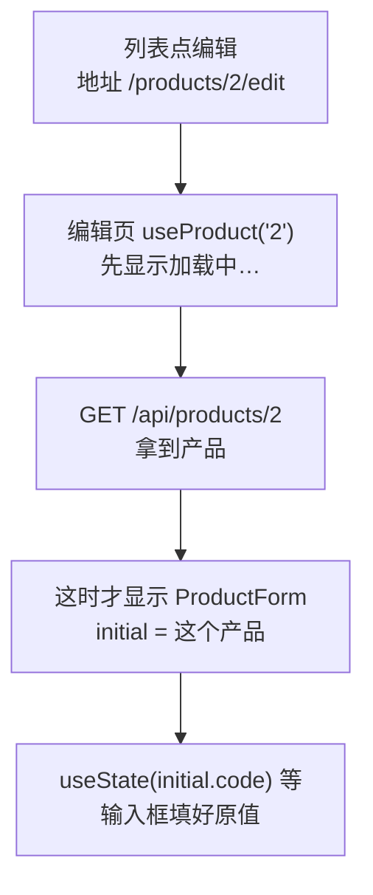

# 第 13A 章 编辑页：用已有数据做表单的初始值

## 这一章解决什么问题

第 12A–12C 章只能「库存加 1」，名称写错了、价格调整了都没法改。第 13 章做一个编辑页，分三步：本章让表单打开时就填好这个产品原来的值；第 13B 章保存成功后自动回到列表；第 13C 章把「编号重复」这类只有服务器知道的错误显示在对应的输入框下面。

本章只讲一个技术点：**用已有数据做表单的初始值**。

## 开始之前

- 上一章你已经会了：在 `api.ts` 里写 POST / PUT / DELETE；`await` 之后用更新函数改 state；用 `submitting` 和 `try / catch / finally` 处理保存中和失败。
- 起点代码：仓库 `code/ch12C/price-list`（不含练习答案）。两个终端分别运行开发服务器和 `npm run mock`。
- 预计耗时：35 分钟。

## 正文

### 13A.1 表单初始值是什么

**白话定义**：编辑表单和新增表单的区别只有一个：输入框一开始不是空的，而是原来的值。做法是把原来的产品作为 prop（这里叫 `initial`）传给表单，表单用它作为 `useState` 的初始值。关键一点：**`useState(初始值)` 只在组件第一次显示时读取初始值**，之后再变也不管。所以必须等数据加载完，再显示表单。

**业务场景**：「线阵探头 L12-5」调价了。在列表里点它的「编辑」，表单里已经是 P-002、线阵探头 L12-5、探头、15600，只改单价就能保存。

**反例（什么时候不该用）**：不要为编辑单独再写一个表单组件。新增和编辑的输入框、校验规则完全一样，写两份以后改校验规则就要改两处。本章让同一个 `ProductForm` 同时支持两种用法：不传 `initial` 是新增，传了是编辑。

#### 🖼 图解



#### 💻 最小可运行代码

**① 加载单个产品的 Hook。** 新建 `src/hooks/useProduct.ts`（如果做了第 11C 章练习 1，用下面的内容替换）：

```ts
// src/hooks/useProduct.ts
// 只加载一个产品。id 来自地址栏，所以 id 要写进依赖数组：从 /products/1 换到 /products/2 时重新加载
import { useEffect, useState } from 'react'
import type { Product } from '../types.ts'

export type ProductState =
  | { status: 'loading' }
  | { status: 'error'; message: string }
  | { status: 'success'; product: Product }

export function useProduct(id: string | undefined) {
  // 记下「这份结果是哪个 id 的」。还没有结果时是 null
  const [loaded, setLoaded] = useState<{ id: string | undefined; state: ProductState } | null>(null)

  useEffect(() => {
    let ignore = false

    async function load() {
      try {
        const response = await fetch(`${import.meta.env.VITE_API_BASE}/products/${id}`)
        if (!response.ok) {
          // 模拟接口出错时返回 { message: '...' }，把它显示给用户，比只显示状态码清楚
          const body: { message?: string } = await response.json()
          throw new Error(body.message ?? `服务器返回 ${response.status}`)
        }
        const product: Product = await response.json()
        if (!ignore) {
          setLoaded({ id, state: { status: 'success', product } })
        }
      } catch (err) {
        if (!ignore) {
          setLoaded({ id, state: { status: 'error', message: err instanceof Error ? err.message : String(err) } })
        }
      }
    }

    load()
    return () => {
      ignore = true
    }
  }, [id])

  // 派生出当前状态：还没有结果，或者结果属于上一个 id（刚从 /products/1 换到 /products/2），都算「加载中」
  // 这样就不用在 effect 里先 setState 成 loading，少一次多余的渲染
  return loaded !== null && loaded.id === id ? loaded.state : { status: 'loading' as const }
}
```

这个 Hook 有一个和第 7D 章不同的地方：`id` 变了以后，effect 不先 `setState` 成「加载中」，而是**记下结果属于哪个 id**，最后一行用「结果的 id 是不是当前 id」**算出**当前状态。从 `/products/1/edit` 换到 `/products/2/edit` 时，旧结果的 id 是 `'1'`，和当前的 `'2'` 不一样，就当作「加载中」，不会把产品 1 的数据显示在产品 2 的页面上。这是第 6C 章派生值思路的又一次应用。（如果在 effect 一开始写 `setState({ status: 'loading' })`，`npm run lint` 会警告 `react(set-state-in-effect): Calling setState synchronously within an effect can trigger cascading renders`。）

`'loading' as const` 告诉 TypeScript：这里的 `'loading'` 就是这个固定值，不是任意字符串，这样它才符合 `ProductState` 里的 `{ status: 'loading' }`。

**② 让表单支持编辑。** 用下面的内容整个替换 `src/components/ProductForm.tsx`。和第 12C 章相比：

- props 改了：多了可选的 `title` 和 `initial`；`onAdd` 改名为 `onSubmit`，因为它现在可能是新增也可能是修改；
- 四个 `useState` 的初始值改成「有 `initial` 用原值，没有就为空」；
- 保存时库存用 `initial?.stock ?? 0`：编辑时这个表单不改库存，沿用原来的值；
- 保存成功后，只有新增才清空输入框；
- 标题改用 `{title}`，成功提示改成「已保存：……」。

```tsx
// src/components/ProductForm.tsx
// 新增和编辑共用的表单。传了 initial 就是编辑：输入框先填好原来的值
import { useState } from 'react'
import type { ChangeEvent, SubmitEvent } from 'react'
import type { Product } from '../types.ts'
import type { ProductInput } from '../api.ts'

type ProductFormProps = {
  // 标题，新增时是「录入新产品」，编辑时由编辑页传「编辑产品」
  title?: string
  // 编辑时的原始数据。不传就是新增
  initial?: Product
  // 保存时把填好的内容交给父组件，父组件决定调哪个接口。返回 Promise：表单要等它完成，才知道成功还是失败
  onSubmit: (input: ProductInput) => Promise<Product>
}

export function ProductForm({ title = '录入新产品', initial, onSubmit }: ProductFormProps) {
  // useState 的参数只在组件第一次显示时使用。编辑时用原来的值，新增时为空。数字要转成字符串，输入框只认字符串
  const [code, setCode] = useState(initial?.code ?? '')
  const [name, setName] = useState(initial?.name ?? '')
  const [category, setCategory] = useState(initial?.category ?? '探头')
  const [price, setPrice] = useState(initial ? String(initial.price) : '')
  // 保存成功后显示的提示
  const [message, setMessage] = useState('')
  // 点过一次「保存」才显示错误，免得一打开页面就满屏红字
  const [triedSubmit, setTriedSubmit] = useState(false)
  // 正在等服务器响应。这期间禁用保存按钮，防止重复提交
  const [submitting, setSubmitting] = useState(false)
  // 服务器返回的失败原因
  const [submitError, setSubmitError] = useState('')

  // 派生值：每次渲染都从 state 现算，不另存 state，所以永远和输入框一致
  const priceNumber = Number(price)
  const codeError = code.trim() === '' ? '请填写编号' : ''
  const nameError = name.trim() === '' ? '请填写名称' : ''
  // Number('abc') 是 NaN，NaN > 0 不成立，所以「不是数字」和「小于等于 0」一起拦住
  const priceError = price.trim() === '' ? '请填写单价' : priceNumber > 0 ? '' : '单价必须是大于 0 的数字'
  const isValid = codeError === '' && nameError === '' && priceError === ''

  // 单独写成函数时，参数类型要写明：input 元素上的变化事件
  function handlePriceChange(e: ChangeEvent<HTMLInputElement>) {
    setPrice(e.target.value)
  }

  async function handleSubmit(e: SubmitEvent<HTMLFormElement>) {
    // 阻止浏览器默认的「提交表单 = 刷新整页」，改由我们自己处理
    e.preventDefault()
    setTriedSubmit(true)
    if (!isValid) {
      setMessage('')
      return
    }
    // 新增时库存为 0；编辑时这个表单不改库存，沿用原来的值
    const input: ProductInput = {
      code: code.trim(),
      name: name.trim(),
      category,
      price: priceNumber,
      stock: initial?.stock ?? 0,
    }
    setSubmitting(true)
    setSubmitError('')
    setMessage('')
    try {
      const saved = await onSubmit(input)
      setMessage(`已保存：${saved.name}（编号 ${saved.code}，id ${saved.id}）`)
      // 新增成功后清空，方便录下一个；编辑时保留，父组件会跳转走
      if (!initial) {
        setCode('')
        setName('')
        setPrice('')
        setTriedSubmit(false)
      }
    } catch (err) {
      setSubmitError(err instanceof Error ? err.message : String(err))
    } finally {
      // 不管成功还是失败，都要恢复按钮。写在 finally 里就不会漏
      setSubmitting(false)
    }
  }

  return (
    <form className="product-form" onSubmit={handleSubmit}>
      <h2>{title}</h2>
      {/* value 来自 state，onChange 把用户输入写回 state：输入框完全由 React 控制 */}
      <label>编号 <input value={code} onChange={(e) => setCode(e.target.value)} /></label>
      {triedSubmit && codeError && <span className="error">{codeError}</span>}
      <label>名称 <input value={name} onChange={(e) => setName(e.target.value)} /></label>
      {triedSubmit && nameError && <span className="error">{nameError}</span>}
      <label>
        分类{' '}
        <select value={category} onChange={(e) => setCategory(e.target.value)}>
          <option value="探头">探头</option>
          <option value="主机">主机</option>
          <option value="耗材">耗材</option>
        </select>
      </label>
      <label>单价 <input value={price} onChange={handlePriceChange} /></label>
      {triedSubmit && priceError && <span className="error">{priceError}</span>}
      {/* type="submit"：点击或在输入框里按回车都会触发表单的 onSubmit */}
      <button type="submit" disabled={submitting}>
        {submitting ? '保存中…' : '保存'}
      </button>
      {message && <p className="success">{message}</p>}
      {submitError && <p className="error">保存失败：{submitError}</p>}
    </form>
  )
}
```

几个写法：

| 写法 | 含义 |
| --- | --- |
| `initial?.code` | 可选链：`initial` 是 `undefined` 时整个表达式得到 `undefined`，不会报错 |
| `?? ''` | 空值合并：左边是 `undefined` 或 `null` 时用右边的值。和 `\|\|` 不同，它不把 `0`、`''` 当成「没有」 |
| `String(initial.price)` | 数字 15600 转成字符串 `'15600'`，输入框的值只能是字符串 |
| `title = '录入新产品'` | 解构时的默认值（第 3B 章讲过）：新增页不传 `title`，就用它 |

**③ 新建编辑页 `src/pages/ProductEditPage.tsx`：**

```tsx
// src/pages/ProductEditPage.tsx
// 编辑页：地址 /products/3/edit。先加载这个产品，加载完再显示表单
import { Link, useParams } from 'react-router'
import { useProduct } from '../hooks/useProduct.ts'
import { ProductForm } from '../components/ProductForm.tsx'
import * as api from '../api.ts'
import type { ProductInput } from '../api.ts'

export function ProductEditPage() {
  const { id } = useParams()
  const state = useProduct(id)

  async function handleSubmit(input: ProductInput) {
    // 调用修改接口。失败时 updateProduct 抛出错误，这里不接住，交给表单显示
    return await api.updateProduct(Number(id), input)
  }

  return (
    <section>
      <p>
        <Link to="/">← 返回列表</Link>
      </p>
      {state.status === 'loading' && <p>加载中…</p>}
      {state.status === 'error' && <p className="error">加载失败：{state.message}</p>}
      {/* 加载成功后才显示表单：表单的 useState 只在第一次显示时读取 initial，必须那时数据已经到了 */}
      {state.status === 'success' && <ProductForm title="编辑产品" initial={state.product} onSubmit={handleSubmit} />}
    </section>
  )
}
```

这一章先用第 12A 章的 `api.ts`，不用改。保存成功后页面停在编辑页，自动回到列表是第 13B 章的事。

**④ 加路由、加入口。** 用下面的内容整个替换 `src/App.tsx`，在路由表里加了 `/products/:id/edit`：

```tsx
// src/App.tsx
// App 变成「外框」：页头、导航、页脚所有页面共用，中间按地址显示不同的页面
import { Link, Route, Routes } from 'react-router'
import { PageHeader } from './components/PageHeader.tsx'
import { PageFooter } from './components/PageFooter.tsx'
import { ListPage } from './pages/ListPage.tsx'
import { AboutPage } from './pages/AboutPage.tsx'
import { ProductDetailPage } from './pages/ProductDetailPage.tsx'
import { ProductEditPage } from './pages/ProductEditPage.tsx'
import { NotFoundPage } from './pages/NotFoundPage.tsx'

function App() {
  return (
    <main>
      <PageHeader />
      <nav className="nav">
        {/* Link 改地址但不刷新页面；React Router 发现地址变了，换掉下面 Routes 里显示的页面 */}
        <Link to="/">产品清单</Link> | <Link to="/about">关于</Link>
      </nav>
      {/* 路由表：React Router 找出与当前地址最匹配的那条 path，显示它的 element */}
      <Routes>
        <Route path="/" element={<ListPage />} />
        <Route path="/about" element={<AboutPage />} />
        {/* :id 是参数，/products/1、/products/25 都匹配这一条 */}
        <Route path="/products/:id" element={<ProductDetailPage />} />
        {/* 编辑页：/products/3/edit */}
        <Route path="/products/:id/edit" element={<ProductEditPage />} />
        {/* * 匹配任何地址，但只有别的路由都对不上时才会用它，相当于兜底 */}
        <Route path="*" element={<NotFoundPage />} />
      </Routes>
      <PageFooter />
    </main>
  )
}

export default App
```

用下面的内容整个替换 `src/components/ProductTable.tsx`，在「删除」后面加了一个「编辑」链接：

```tsx
// src/components/ProductTable.tsx
// 只负责显示表格。数据从 props 来；点了按钮不自己改数据，而是调用父组件给的函数「通知」它
import { Link } from 'react-router'
import type { Product } from '../types.ts'
// 导入 CSS Module 得到一个对象：键是你写的类名，值是打包后真正使用的类名
import styles from './ProductTable.module.css'

type ProductTableProps = {
  products: Product[]
  // 回调 props：类型写清楚「调用时传什么参数、返回什么」。void 表示不关心返回值
  onDelete: (id: number) => void
  onRestock: (id: number) => void
}

export function ProductTable({ products, onDelete, onRestock }: ProductTableProps) {
  if (products.length === 0) {
    return <p className="empty">暂无产品</p>
  }

  return (
    <table className={styles.table}>
      <thead>
        <tr>
          <th>编号</th>
          <th>名称</th>
          <th>单价（元）</th>
          <th>库存</th>
          <th>操作</th>
        </tr>
      </thead>
      <tbody>
        {products.map((p) => (
          <tr key={p.id}>
            <td>{p.code}</td>
            <td>
              {/* 点产品名进入详情页，地址形如 /products/3 */}
              <Link to={`/products/${p.id}`}>{p.name}</Link>
              {p.stock === 0 && <span className={styles.outOfStock}>缺货</span>}
            </td>
            <td>{p.price.toLocaleString()}</td>
            <td className={p.stock < 5 ? styles.low : undefined}>{p.stock}</td>
            <td>
              <button type="button" onClick={() => onRestock(p.id)}>入库 +1</button>{' '}
              <button type="button" onClick={() => onDelete(p.id)}>删除</button>{' '}
              {/* 编辑是换一个页面，所以用 Link，不是按钮 */}
              <Link to={`/products/${p.id}/edit`}>编辑</Link>
            </td>
          </tr>
        ))}
      </tbody>
    </table>
  )
}
```

最后，列表页的表单 prop 改了名字。用下面的内容整个替换 `src/pages/ListPage.tsx`，只改了一处：`<ProductForm onAdd={addProduct} />` 变成 `<ProductForm onSubmit={addProduct} />`。

```tsx
// src/pages/ListPage.tsx
// 产品列表页：第 8C 章 App 的内容原样搬过来，去掉页头页脚（它们留在 App 里，所有页面共用）
import { useEffect, useState } from 'react'
import type { ReactNode } from 'react'
import { useProducts } from '../hooks/useProducts.ts'
import { FilterBar } from '../components/FilterBar.tsx'
import { ProductTable } from '../components/ProductTable.tsx'
import { ProductForm } from '../components/ProductForm.tsx'

export function ListPage() {
  // 加载和增删改的细节都在 useProducts 里，列表页只拿结果
  const { state, addProduct, deleteProduct, restockProduct } = useProducts()
  // 状态提升：搜索框和表格都要用 keyword，所以放在它们共同的父组件 App 里
  const [keyword, setKeyword] = useState('')
  // 删除、入库失败时显示的原因（例如「还有库存，不能删除」）
  const [actionError, setActionError] = useState('')

  // 表格只负责报告「点了哪一行」，调用接口、处理失败在这里做
  async function handleDelete(id: number) {
    setActionError('')
    try {
      await deleteProduct(id)
    } catch (err) {
      setActionError(`删除失败：${err instanceof Error ? err.message : String(err)}`)
    }
  }

  async function handleRestock(id: number) {
    setActionError('')
    try {
      await restockProduct(id)
    } catch (err) {
      setActionError(`入库失败：${err instanceof Error ? err.message : String(err)}`)
    }
  }

  const count = state.status === 'success' ? state.products.length : 0

  useEffect(() => {
    document.title = `产品价格清单（${count} 种）`
  }, [count])

  let content: ReactNode
  if (state.status === 'loading') {
    content = <p>加载中…</p>
  } else if (state.status === 'error') {
    content = <p className="error">加载失败：{state.message}</p>
  } else {
    // 筛选结果是派生值：由 products 和 keyword 现算，不另存 state
    const k = keyword.trim().toLowerCase()
    const visible = state.products.filter(
      (p) => p.name.toLowerCase().includes(k) || p.code.toLowerCase().includes(k),
    )
    // 传的是上面包了一层错误处理的函数
    content = <ProductTable products={visible} onDelete={handleDelete} onRestock={handleRestock} />
  }

  return (
    <section>
      <p>共 {count} 种产品</p>
      {/* 把值和「修改它的函数」一起交给搜索框 */}
      <FilterBar keyword={keyword} onKeywordChange={setKeyword} />
      {actionError && <p className="error">{actionError}</p>}
      {content}
      <ProductForm onSubmit={addProduct} />
    </section>
  )
}
```

#### 🔍 拆解运行结果

实测：

| 操作 | 结果 |
| --- | --- |
| 列表每一行最后多了「编辑」链接 | `P-001 凸阵探头 C5-2 12,800 6 入库 +1 删除 编辑` |
| 点「线阵探头 L12-5」的「编辑」 | 地址变成 `/products/2/edit`，先显示「加载中…」 |
| 约半秒后 | 标题「编辑产品」，四个输入框是 `P-002`、`线阵探头 L12-5`、`探头`、`15600` |
| 名称改成「线阵探头 L12-5（新款）」，单价改成 16800，保存 | 第二个终端 `PUT /api/products/2`，提示「已保存：线阵探头 L12-5（新款）（编号 P-002，id 2）」，输入框保持修改后的值 |
| 点「← 返回列表」 | 第二行显示「线阵探头 L12-5（新款） 16,800」 |
| 再进编辑页把编号改成 P-001 保存 | 「保存失败：编号 P-001 已存在」（第 13C 章会把它挪到编号输入框下面） |

列表页每次显示都会重新加载（`useProducts` 的 effect），所以从编辑页回来看到的是服务器上的最新数据，不用手动刷新。

#### 改坏一处试试

不等数据加载，直接显示表单。把编辑页 `return` 里那三行 `{state.status === ...}` 换成一行：

```tsx
      <ProductForm title="编辑产品" initial={state.status === 'success' ? state.product : undefined} onSubmit={handleSubmit} />
```

TypeScript 不报错。打开 `/products/3/edit` 等一秒多，实测四个输入框是：编号空、名称空、分类「探头」、单价空。数据明明已经加载完了（`initial` 已经是便携彩超主机），输入框却一直是空的。

表单第一次显示时数据还没到，`initial` 是 `undefined`，`useState` 用空字符串作初始值；数据到了以后表单重新渲染，`initial` 变了，但 `useState` **不会再读初始值**，state 仍然是空字符串。改回原来的写法：加载成功后才显示表单。

## ⚠️ 踩坑警告

| 现象 | 原因 | 怎么改 |
| --- | --- | --- |
| 编辑页的输入框是空的，数据明明已经加载了 | 数据到达前表单就显示了，`useState` 只在第一次读取初始值 | 加载成功后再显示表单：`{state.status === 'success' && <ProductForm initial={...} />}` |
| 从一个产品的编辑页换到另一个，表单还是上一个产品的值 | 同一个路由的页面组件没有重新创建，表单的 state 保留着 | 换 id 时让表单重新显示：本章 `useProduct` 换 id 时先回到「加载中」，表单会被移除再创建。实测从 `/products/1/edit` 换到 `/products/2/edit`，先显示「加载中…」，然后编号变成 P-002 |
| 把 `initial?.code ?? ''` 写成 `initial?.code \|\| ''` 用在数字上，库存原值是 0 时被当成「没有」 | `\|\|` 把 `0`、`''` 都当成假值 | 「没有值才用默认值」用 `??` |

## 🎯 动手练习

**练习 1：标题里带上产品名**

编辑页的表单标题改成「编辑产品：便携彩超主机」这样，带上正在编辑的产品名。

验收标准：

- 打开 `/products/3/edit`，加载完后标题是「编辑产品：便携彩超主机」。
- 列表页的新增表单标题仍是「录入新产品」。

**练习 2：从详情页进入编辑页**

在详情页的产品卡片下面加一个「编辑这个产品」链接，指向这个产品的编辑页。找不到产品时不显示这个链接。

验收标准：

- 打开 `/products/3`，点「编辑这个产品」，地址变成 `/products/3/edit`，表单里是便携彩超主机。
- 打开 `/products/99`，没有这个链接。

卡住了看文末参考答案。

## 📌 一句话总结

数据到了再显示表单，useState 用原值作初始值，新增和编辑共用一个表单。

## 下一章

现在保存成功后停在编辑页，要自己点「返回列表」。第 13B 章用 `useNavigate` 在保存成功后自动跳回列表。

---

<!-- 以下是参考答案，先自己动手，卡住了再往下翻 -->


## 参考答案

### 练习 1

思路：标题由编辑页传给表单，`title` 可以是任何字符串，用模板字符串拼上产品名。只有 `success` 分支里才有 `state.product`，所以写在这个分支里。

```tsx
// src/pages/ProductEditPage.tsx
// 练习 1 做完后的版本
// 编辑页：地址 /products/3/edit。先加载这个产品，加载完再显示表单
import { Link, useParams } from 'react-router'
import { useProduct } from '../hooks/useProduct.ts'
import { ProductForm } from '../components/ProductForm.tsx'
import * as api from '../api.ts'
import type { ProductInput } from '../api.ts'

export function ProductEditPage() {
  const { id } = useParams()
  const state = useProduct(id)

  async function handleSubmit(input: ProductInput) {
    // 调用修改接口。失败时 updateProduct 抛出错误，这里不接住，交给表单显示
    return await api.updateProduct(Number(id), input)
  }

  return (
    <section>
      <p>
        <Link to="/">← 返回列表</Link>
      </p>
      {state.status === 'loading' && <p>加载中…</p>}
      {state.status === 'error' && <p className="error">加载失败：{state.message}</p>}
      {/* 加载成功后才显示表单：表单的 useState 只在第一次显示时读取 initial，必须那时数据已经到了 */}
      {/* 练习 1：标题里带上产品名。只有 success 分支里才有 state.product */}
      {state.status === 'success' && (
        <ProductForm title={`编辑产品：${state.product.name}`} initial={state.product} onSubmit={handleSubmit} />
      )}
    </section>
  )
}
```

### 练习 2

思路：详情页已经找到了 `product`，用它的 id 拼出编辑页地址。找不到时 `product` 是 `undefined`，`product && ...` 什么都不显示。

```tsx
// src/pages/ProductDetailPage.tsx
// 练习 2 做完后的版本
// 产品详情页：地址是 /products/3 这种形式，从地址里取出 3，再找到对应的产品
import { Link, useParams } from 'react-router'
import { useProducts } from '../hooks/useProducts.ts'
import { ProductCard } from '../components/ProductCard.tsx'

export function ProductDetailPage() {
  // 路由表里写的是 :id，这里就按 id 取。地址里的值永远是字符串，也可能没有（undefined）
  const { id } = useParams()
  // 详情页自己加载一次数据（第 8C 章说过：这和列表页那份是两份独立的数据）
  const { state } = useProducts()

  if (state.status === 'loading') {
    return <p>加载中…</p>
  }
  if (state.status === 'error') {
    return <p className="error">加载失败：{state.message}</p>
  }

  // 地址里的 '3' 是字符串，产品的 id 是数字，先转换再比较
  const product = state.products.find((p) => p.id === Number(id))

  return (
    <section>
      <p>
        <Link to="/">← 返回列表</Link>
      </p>
      {/* 第 3、4 章做的卡片在这里派上用场，自带询价数量 */}
      {product ? <ProductCard product={product} /> : <p className="empty">找不到编号为 {id} 的产品</p>}
      {/* 练习 2：找到产品时才显示编辑链接 */}
      {product && (
        <p>
          <Link to={`/products/${product.id}/edit`}>编辑这个产品</Link>
        </p>
      )}
    </section>
  )
}
```
