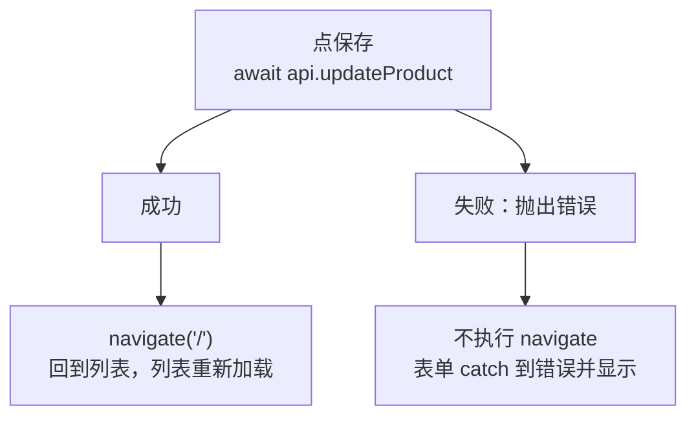

# 第 13B 章 保存后跳转：useNavigate

## 这一章解决什么问题

编辑页保存成功后，页面停在原地，用户还得自己点「返回列表」才能看到结果。本章在保存成功之后，用代码跳回列表；保存失败时留在编辑页，让用户看到错误、改完再提交。

本章只讲一个技术点：**`useNavigate`**。

## 开始之前

- 上一章你已经会了：编辑页加载完产品后才显示表单，表单用原值作初始值。
- 起点代码：仓库 `code/ch13A/price-list`（不含练习答案）。两个终端分别运行开发服务器和 `npm run mock`。
- 预计耗时：20 分钟。

## 正文

### 13B.1 useNavigate 是什么

**白话定义**：`useNavigate()` 是 React Router 提供的 Hook，返回一个函数（习惯叫 `navigate`）。调用 `navigate('/')` 就跳转到 `/`，效果和点 `<Link to="/">` 一样，区别是它可以写在代码里，在「保存成功之后」这样的时机调用。

**业务场景**：编辑完点保存，成功后自动回到列表，看到修改后的结果。保存失败时留在编辑页，让用户看到错误、改完再提交。

**反例（什么时候不该用）**：用户点一下就要去另一个页面、不需要先做别的事时，用 `<Link>`，不要写成 `<button onClick={() => navigate('/about')}>`。`Link` 渲染成真正的 `<a>` 链接，浏览器能识别：可以右键「在新标签页中打开」，鼠标移上去能在左下角看到地址，读屏软件也能识别为链接。

#### 🖼 图解



#### 💻 最小可运行代码

用下面的内容整个替换 `src/pages/ProductEditPage.tsx`。和上一章相比：import 里多了 `useNavigate`；多了 `const navigate = useNavigate()`；`handleSubmit` 在保存成功后调用 `navigate('/')`。

```tsx
// src/pages/ProductEditPage.tsx
// 编辑页：地址 /products/3/edit。先加载这个产品，加载完再显示表单；保存成功后回到列表
import { Link, useNavigate, useParams } from 'react-router'
import { useProduct } from '../hooks/useProduct.ts'
import { ProductForm } from '../components/ProductForm.tsx'
import * as api from '../api.ts'
import type { ProductInput } from '../api.ts'

export function ProductEditPage() {
  const { id } = useParams()
  const state = useProduct(id)
  // useNavigate 返回一个函数，调用它就跳转到指定地址，效果和点 Link 一样
  const navigate = useNavigate()

  async function handleSubmit(input: ProductInput) {
    // 失败时 updateProduct 抛出错误，这里不接住，交给表单显示
    const saved = await api.updateProduct(Number(id), input)
    navigate('/')
    return saved
  }

  return (
    <section>
      <p>
        <Link to="/">← 返回列表</Link>
      </p>
      {state.status === 'loading' && <p>加载中…</p>}
      {state.status === 'error' && <p className="error">加载失败：{state.message}</p>}
      {/* 加载成功后才显示表单：表单的 useState 只在第一次显示时读取 initial，必须那时数据已经到了 */}
      {state.status === 'success' && <ProductForm title="编辑产品" initial={state.product} onSubmit={handleSubmit} />}
    </section>
  )
}
```

#### 🔍 拆解运行结果

进入便携彩超主机的编辑页，把编号改成 H-002 保存。实测：按钮先变成「保存中…」，地址还是 `/products/3/edit`；约半秒后跳到 `/`，列表第三行编号是 H-002。第二个终端依次是 `PUT /api/products/3`、`GET /api/products`（列表页重新加载）。

`handleSubmit` 里 `await api.updateProduct(...)` 失败时会抛出错误，后面的 `navigate('/')` 就不会执行。错误继续往外抛，被表单的 `catch` 接住并显示。编辑页自己不需要写 `try / catch`。

跳转后按浏览器的「后退」，会回到编辑页，并重新加载，显示的是保存后的值 H-002。`navigate('/')` 默认在浏览历史里**新增**一条记录；如果不想让用户后退回编辑页，可以写 `navigate('/', { replace: true })`，用新地址**替换**当前这条记录。实测改成这样后，保存回到列表再按「后退」，停在列表，不会回到编辑页。

#### 改坏一处试试

把 `handleSubmit` 里的 `await` 去掉：`const saved = api.updateProduct(Number(id), input)`。TypeScript **不报错**（`async` 函数返回一个 Promise 时，结果会被自动展开，类型对得上）。

进入凸阵探头的编辑页，把编号改成 P-002（和线阵探头重复）保存。实测：页面**立刻**跳回列表，第二个终端里那次 `PUT` 返回的是 400，修改并没有保存，页面上却没有任何提示。

没有 `await`，`navigate('/')` 在请求发出后马上执行，不等结果。用户以为保存成功了。改回 `await`。第 12C 章说的规则在这里同样适用：调用返回 Promise 的函数，前面写 `await`。

## ⚠️ 踩坑警告

| 现象 | 原因 | 怎么改 |
| --- | --- | --- |
| 保存失败了，页面却跳回了列表 | 调用接口时少了 `await`，`navigate` 没等结果就执行了 | `await` 接口调用，成功后再 `navigate` |
| 保存回到列表后按「后退」，又回到了编辑页 | `navigate` 默认新增一条浏览记录 | 不想让用户退回编辑页时写 `navigate('/', { replace: true })` |
| 普通的「去某个页面」按钮写成 `onClick={() => navigate(...)}`，不能右键在新标签页打开 | `navigate` 只是一次函数调用，页面上没有真正的链接 | 不需要先做别的事的跳转用 `<Link>` |

## 🎯 动手练习

**练习 1：编辑页的「取消」按钮**

在编辑页表单下面加一个「取消」按钮，点了以后回到进入编辑页之前的那一页，不保存。

验收标准：

- 从列表进入便携彩超主机的编辑页，改了单价但不保存，点「取消」：回到列表，单价没变；模拟接口的终端没有出现 `PUT`。

提示：`navigate(-1)` 相当于点浏览器的「后退」。

**练习 2：保存后去详情页**

保存成功后不回列表，而是跳到这个产品的详情页 `/products/:id`。

验收标准：

- 编辑便携彩超主机，单价改成 170000 保存：地址变成 `/products/3`，详情页显示这个产品。

提示：`handleSubmit` 里的 `saved` 是服务器返回的产品，有 `id`。

卡住了看文末参考答案。

## 📌 一句话总结

保存成功后调用 navigate 跳转，失败时不跳，普通跳转仍用 Link。

## 下一章

编号改成重复的，现在只在底部显示一句「保存失败：编号 P-001 已存在」。第 13C 章把它显示在编号输入框下面。

---

<!-- 以下是参考答案，先自己动手，卡住了再往下翻 -->


## 参考答案

两个练习都改 `ProductEditPage.tsx`，下面是都做完后的版本。

### 练习 1

思路：`navigate(-1)` 回到浏览历史的上一条。按钮写 `type="button"`，并且放在 `<form>` 外面，点它不会提交表单。

### 练习 2

思路：把 `navigate('/')` 改成用 `saved.id` 拼出的地址。

```tsx
// src/pages/ProductEditPage.tsx
// 两个练习都做完后的版本
// 编辑页：地址 /products/3/edit。先加载这个产品，加载完再显示表单；保存成功后回到列表
import { Link, useNavigate, useParams } from 'react-router'
import { useProduct } from '../hooks/useProduct.ts'
import { ProductForm } from '../components/ProductForm.tsx'
import * as api from '../api.ts'
import type { ProductInput } from '../api.ts'

export function ProductEditPage() {
  const { id } = useParams()
  const state = useProduct(id)
  // useNavigate 返回一个函数，调用它就跳转到指定地址，效果和点 Link 一样
  const navigate = useNavigate()

  async function handleSubmit(input: ProductInput) {
    // 失败时 updateProduct 抛出错误，这里不接住，交给表单显示
    const saved = await api.updateProduct(Number(id), input)
    // 练习 2：保存后去这个产品的详情页。saved 是服务器返回的产品，id 一定正确
    navigate(`/products/${saved.id}`)
    return saved
  }

  return (
    <section>
      <p>
        <Link to="/">← 返回列表</Link>
      </p>
      {state.status === 'loading' && <p>加载中…</p>}
      {state.status === 'error' && <p className="error">加载失败：{state.message}</p>}
      {/* 加载成功后才显示表单：表单的 useState 只在第一次显示时读取 initial，必须那时数据已经到了 */}
      {state.status === 'success' && <ProductForm title="编辑产品" initial={state.product} onSubmit={handleSubmit} />}
      {/* 练习 1：navigate(-1) 相当于点浏览器的「后退」，回到进入编辑页之前的那一页 */}
      <button type="button" onClick={() => navigate(-1)}>
        取消
      </button>
    </section>
  )
}
```

实测：点「取消」回到列表，没有发出 `PUT`，单价还是 168,000；单价改成 170000 保存后，依次是 `PUT /api/products/3`（200）和详情页重新加载的 `GET /api/products`，地址变成 `/products/3`，详情页显示「单价：170,000 元」。
