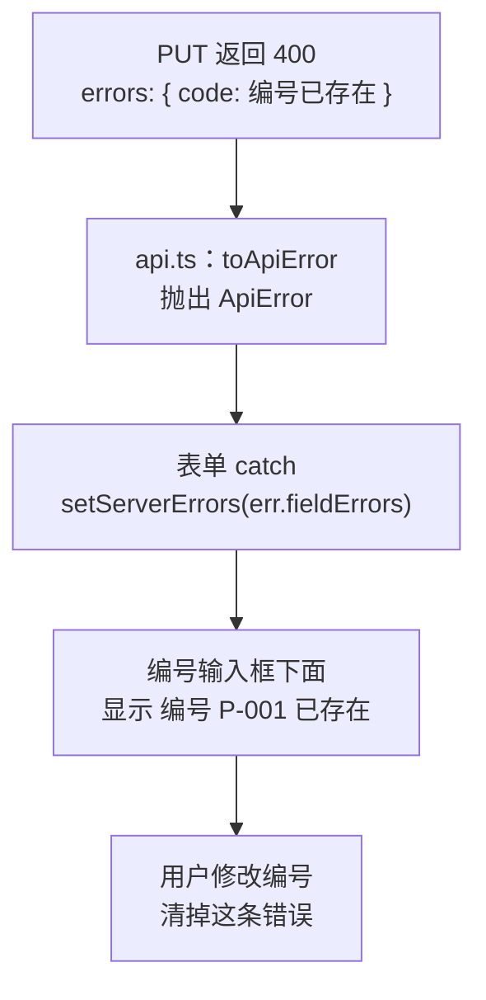

# 第 13C 章 把后端校验错误显示到对应的输入框

## 这一章解决什么问题

「编号不能重复」只有服务器知道。现在编号重复时，表单底部只显示一句「保存失败：编号 P-001 已存在」，表单长一点，用户还得自己找是哪个输入框的问题。本章把服务器按字段返回的错误，显示在对应输入框的下面。

本章只讲一个技术点：**后端字段错误映射到表单**。

## 开始之前

- 上一章你已经会了：保存成功后用 `navigate` 跳回列表。
- 起点代码：仓库 `code/ch13B/price-list`（不含练习答案）。两个终端分别运行开发服务器和 `npm run mock`。
- 预计耗时：30 分钟。

## 正文

### 13C.1 后端字段错误是什么

**白话定义**：后端校验失败时，常见做法是返回 400，并在响应里按字段列出错误，比如 `{ "message": "校验失败", "errors": { "code": "编号 P-001 已存在" } }`。前端要做三件事：把这些字段错误从响应里取出来带给表单；表单把每条错误显示在对应输入框下面；用户修改了这个输入框，就把它的旧错误清掉。

**业务场景**：「编号不能重复」只有服务器知道，前端拿不到所有产品的编号去比对。编号重复时，错误应该出现在编号输入框下面，用户一眼就知道改哪里。

**反例（什么时候不该用）**：不要因为后端会校验，就删掉前端校验；也不要因为前端校验了，就以为后端可以不校验。前端校验让用户**马上**看到错误，不用等网络往返；后端校验保证数据**一定**正确，因为前端的检查可以被绕过（比如有人直接用工具发请求）。两边都要有：前端检查格式（必填、是不是数字），后端检查全部规则，包括只有它才知道的规则（编号重复）。

#### 🖼 图解



#### 💻 最小可运行代码

**① 用下面的内容整个替换 `src/api.ts`。** 和第 12A 章相比：原来的 `failMessage` 只返回一句文字，换成了 `toApiError`，返回一个 `ApiError` 对象，里面带着状态码和逐个字段的错误；三处 `throw new Error(await failMessage(response))` 换成了 `throw await toApiError(response)`。

```ts
// src/api.ts
// 所有「写」接口集中放在这里。页面和 Hook 只调用这些函数，不直接拼地址、写请求头
import type { Product } from './types.ts'

// 新增、修改时提交的内容：Product 去掉 id。id 由服务器分配，前端不能自己定
export type ProductInput = Omit<Product, 'id'>

const BASE = import.meta.env.VITE_API_BASE

// 接口失败时抛出的错误。比普通 Error 多带两样东西：HTTP 状态码，以及逐个字段的校验错误
export class ApiError extends Error {
  status: number
  // 例如 { code: '编号 P-001 已存在' }。没有字段错误时是空对象
  fieldErrors: Record<string, string>

  constructor(message: string, status: number, fieldErrors: Record<string, string>) {
    // super(...) 调用父类 Error 的构造函数，设置 message
    super(message)
    this.status = status
    this.fieldErrors = fieldErrors
  }
}

// 把失败的响应转换成 ApiError。模拟接口出错时返回 { message, errors? }
async function toApiError(response: Response): Promise<ApiError> {
  try {
    const body: { message?: string; errors?: Record<string, string> } = await response.json()
    return new ApiError(body.message ?? `服务器返回 ${response.status}`, response.status, body.errors ?? {})
  } catch {
    // 响应内容不是 JSON（例如代理返回的 502 页面），只能用状态码
    return new ApiError(`服务器返回 ${response.status}`, response.status, {})
  }
}

export async function createProduct(input: ProductInput): Promise<Product> {
  const response = await fetch(`${BASE}/products`, {
    // 默认是 GET，新增要写明 POST
    method: 'POST',
    // 告诉服务器：请求体是 JSON。不写的话很多后端不知道怎么解析，会拒绝
    headers: { 'Content-Type': 'application/json' },
    // 请求体只能是字符串，把对象转成 JSON 文本
    body: JSON.stringify(input),
  })
  if (!response.ok) {
    throw await toApiError(response)
  }
  // 服务器返回保存后的产品，带上了它分配的 id
  const saved: Product = await response.json()
  return saved
}

export async function updateProduct(id: number, input: ProductInput): Promise<Product> {
  const response = await fetch(`${BASE}/products/${id}`, {
    method: 'PUT',
    headers: { 'Content-Type': 'application/json' },
    body: JSON.stringify(input),
  })
  if (!response.ok) {
    throw await toApiError(response)
  }
  const saved: Product = await response.json()
  return saved
}

export async function deleteProduct(id: number): Promise<void> {
  const response = await fetch(`${BASE}/products/${id}`, { method: 'DELETE' })
  if (!response.ok) {
    throw await toApiError(response)
  }
  // 删除成功返回 204，没有内容，不要调用 response.json()
}
```

`class ApiError extends Error` 定义了一个**类**（class）：`extends Error` 表示它是一种 `Error`，拥有 `message`，另外多了 `status` 和 `fieldErrors` 两个字段。`constructor` 是 `new ApiError(...)` 时执行的函数，`super(message)` 先让父类 `Error` 设置好 `message`，再给新字段赋值。因为 `ApiError` 是一种 `Error`，第 12C 章列表页里 `err instanceof Error ? err.message : ...` 的写法不用改，删除失败时照样显示「还有库存，不能删除」。

**② 用下面的内容整个替换 `src/components/ProductForm.tsx`。** 和第 13A 章相比：

- 多了 `serverErrors` 这个 state，存服务器返回的字段错误；
- 多了 `errorOf` 函数：每个字段显示哪条错误，前端检查到的优先，没有就显示服务器给的；
- 多了 `clearServerError` 函数：编号、名称、单价的 `onChange` 里都调用它，清掉这个字段的旧错误；
- `catch` 里用 `err instanceof ApiError` 判断，是就取出 `fieldErrors`；
- 三个输入框下面改成显示 `codeMessage` 等。

```tsx
// src/components/ProductForm.tsx
// 新增和编辑共用的表单。传了 initial 就是编辑：输入框先填好原来的值
import { useState } from 'react'
import type { ChangeEvent, SubmitEvent } from 'react'
import type { Product } from '../types.ts'
import { ApiError } from '../api.ts'
import type { ProductInput } from '../api.ts'

type ProductFormProps = {
  // 标题，新增时是「录入新产品」，编辑时由编辑页传「编辑产品」
  title?: string
  // 编辑时的原始数据。不传就是新增
  initial?: Product
  // 保存时把填好的内容交给父组件，父组件决定调哪个接口。返回 Promise：表单要等它完成，才知道成功还是失败
  onSubmit: (input: ProductInput) => Promise<Product>
}

export function ProductForm({ title = '录入新产品', initial, onSubmit }: ProductFormProps) {
  // useState 的参数只在组件第一次显示时使用。编辑时用原来的值，新增时为空。数字要转成字符串，输入框只认字符串
  const [code, setCode] = useState(initial?.code ?? '')
  const [name, setName] = useState(initial?.name ?? '')
  const [category, setCategory] = useState(initial?.category ?? '探头')
  const [price, setPrice] = useState(initial ? String(initial.price) : '')
  // 保存成功后显示的提示
  const [message, setMessage] = useState('')
  // 点过一次「保存」才显示错误，免得一打开页面就满屏红字
  const [triedSubmit, setTriedSubmit] = useState(false)
  // 正在等服务器响应。这期间禁用保存按钮，防止重复提交
  const [submitting, setSubmitting] = useState(false)
  // 服务器返回的失败原因
  const [submitError, setSubmitError] = useState('')
  // 服务器返回的逐个字段的错误，例如 { code: '编号 P-001 已存在' }
  const [serverErrors, setServerErrors] = useState<Record<string, string>>({})

  // 派生值：每次渲染都从 state 现算，不另存 state，所以永远和输入框一致
  const priceNumber = Number(price)
  const codeError = code.trim() === '' ? '请填写编号' : ''
  const nameError = name.trim() === '' ? '请填写名称' : ''
  // Number('abc') 是 NaN，NaN > 0 不成立，所以「不是数字」和「小于等于 0」一起拦住
  const priceError = price.trim() === '' ? '请填写单价' : priceNumber > 0 ? '' : '单价必须是大于 0 的数字'
  const isValid = codeError === '' && nameError === '' && priceError === ''

  // 每个字段最终显示哪条错误：前端检查到的优先，没有时显示服务器给的
  function errorOf(field: string, clientError: string): string {
    return triedSubmit && clientError ? clientError : (serverErrors[field] ?? '')
  }

  // 用户改了某个字段，就把服务器对这个字段的旧错误清掉：那条错误针对的是改之前的值
  function clearServerError(field: string) {
    setServerErrors((prev) => {
      const next = { ...prev }
      delete next[field]
      return next
    })
  }

  // 单独写成函数时，参数类型要写明：input 元素上的变化事件
  function handlePriceChange(e: ChangeEvent<HTMLInputElement>) {
    setPrice(e.target.value)
    clearServerError('price')
  }

  async function handleSubmit(e: SubmitEvent<HTMLFormElement>) {
    // 阻止浏览器默认的「提交表单 = 刷新整页」，改由我们自己处理
    e.preventDefault()
    setTriedSubmit(true)
    if (!isValid) {
      setMessage('')
      return
    }
    // 新增时库存为 0；编辑时这个表单不改库存，沿用原来的值
    const input: ProductInput = {
      code: code.trim(),
      name: name.trim(),
      category,
      price: priceNumber,
      stock: initial?.stock ?? 0,
    }
    setSubmitting(true)
    setSubmitError('')
    setServerErrors({})
    setMessage('')
    try {
      const saved = await onSubmit(input)
      setMessage(`已保存：${saved.name}（编号 ${saved.code}，id ${saved.id}）`)
      // 新增成功后清空，方便录下一个；编辑时保留，父组件会跳转走
      if (!initial) {
        setCode('')
        setName('')
        setPrice('')
        setTriedSubmit(false)
      }
    } catch (err) {
      if (err instanceof ApiError) {
        // instanceof 判断成立后，TypeScript 知道 err 有 fieldErrors
        setServerErrors(err.fieldErrors)
        setSubmitError(Object.keys(err.fieldErrors).length > 0 ? '请修改标红的项' : err.message)
      } else {
        // 网络断了等情况，fetch 抛出的是普通错误，没有 fieldErrors
        setSubmitError(err instanceof Error ? err.message : String(err))
      }
    } finally {
      // 不管成功还是失败，都要恢复按钮。写在 finally 里就不会漏
      setSubmitting(false)
    }
  }

  const codeMessage = errorOf('code', codeError)
  const nameMessage = errorOf('name', nameError)
  const priceMessage = errorOf('price', priceError)

  return (
    <form className="product-form" onSubmit={handleSubmit}>
      <h2>{title}</h2>
      {/* value 来自 state，onChange 把用户输入写回 state：输入框完全由 React 控制 */}
      <label>
        编号{' '}
        <input
          value={code}
          onChange={(e) => {
            setCode(e.target.value)
            clearServerError('code')
          }}
        />
      </label>
      {codeMessage && <span className="error">{codeMessage}</span>}
      <label>
        名称{' '}
        <input
          value={name}
          onChange={(e) => {
            setName(e.target.value)
            clearServerError('name')
          }}
        />
      </label>
      {nameMessage && <span className="error">{nameMessage}</span>}
      <label>
        分类{' '}
        <select value={category} onChange={(e) => setCategory(e.target.value)}>
          <option value="探头">探头</option>
          <option value="主机">主机</option>
          <option value="耗材">耗材</option>
        </select>
      </label>
      <label>单价 <input value={price} onChange={handlePriceChange} /></label>
      {priceMessage && <span className="error">{priceMessage}</span>}
      {/* type="submit"：点击或在输入框里按回车都会触发表单的 onSubmit */}
      <button type="submit" disabled={submitting}>
        {submitting ? '保存中…' : '保存'}
      </button>
      {message && <p className="success">{message}</p>}
      {submitError && <p className="error">保存失败：{submitError}</p>}
    </form>
  )
}
```

`clearServerError` 里先复制一份对象（`{ ...prev }`），再用 `delete next[field]` 删掉一个键，最后返回这份新对象。和第 5B 章的数组一样，state 里的对象也不能直接改，要生成新的。

#### 🔍 拆解运行结果

进入便携彩超主机（H-001）的编辑页，实测：

| 操作 | 表单显示 |
| --- | --- |
| 编号改成 P-001、单价改成 0，保存 | 只有单价下面「单价必须是大于 0 的数字」。前端校验没通过，**没有发请求** |
| 单价改回 168000，保存 | 第二个终端 `PUT /api/products/3`，返回 400。编号下面「编号 P-001 已存在」，底部「保存失败：请修改标红的项」 |
| 把编号改成 H-002 | 编号下面的错误立刻消失（底部那句要等下次保存才更新） |
| 保存 | 「保存中…」，然后跳回列表，第三行编号 H-002 |

前端校验和后端校验的分工在这里看得很清楚：格式错误前端马上拦住，省一次网络请求；编号重复只能等服务器告诉我们。

#### 改坏一处试试

把 `catch` 里的 `if (err instanceof ApiError)` 整段换成 `setServerErrors(err.fieldErrors)`，报：

```text
error TS18046: 'err' is of type 'unknown'.
```

`catch` 接到的可能是任何东西：`ApiError`、网络断开时 `fetch` 抛出的 `TypeError`，甚至不是错误对象。只有 `instanceof ApiError` 判断成立之后，TypeScript 才允许读 `fieldErrors`。这和第 7D 章判别联合的「收窄」是同一个道理。改回去。

## ⚠️ 踩坑警告

| 现象 | 原因 | 怎么改 |
| --- | --- | --- |
| 服务器返回了字段错误，页面只显示「保存失败」 | 错误对象里没带字段信息，或者表单没按字段显示 | 用 `ApiError` 带上 `fieldErrors`，表单按字段名取出显示 |
| 改了输入框，旧的服务器错误还挂在下面 | 服务器错误存在 state 里，没人清 | 在这个字段的 `onChange` 里清掉对应的错误 |
| `catch` 里直接读 `err.fieldErrors`，报 `TS18046: 'err' is of type 'unknown'.` | `catch` 接到的可能是任何东西 | 先 `if (err instanceof ApiError)` 再读 |
| 只做了前端校验，后来发现数据库里有重复编号 | 前端校验可以被绕过，并且前端不知道别的数据 | 后端必须校验全部规则；前端校验只是为了让用户早点看到错误 |

## 🎯 动手练习

**练习 1：新增时编号重复**

不改代码，在列表页的「录入新产品」表单里录入编号 `P-001`、名称「重复」、单价 `1`，保存。

验收标准：

- 编号输入框下面显示「编号 P-001 已存在」，底部显示「保存失败：请修改标红的项」。
- 能说出为什么新增表单也有这个效果，却不用改任何代码。

**练习 2：表单里加库存，只靠服务器校验**

在单价下面加「库存」输入框（新增时默认 0，编辑时显示原值）。**不写前端校验**，填错时显示服务器返回的错误。

验收标准：

- 编辑便携彩超主机，库存显示 2；改成 1.5 保存：库存下面显示「库存必须是不小于 0 的整数」（这句话来自模拟接口），模拟接口终端里的 `PUT` 返回 400。
- 在列表页录入新产品，库存填 -1：同样的错误显示在库存下面；改成 4 保存，表格里新产品的库存是 4。

提示：库存没有前端错误，`errorOf('stock', '')` 就只会显示服务器的。

卡住了看文末参考答案。

## 📌 一句话总结

api.ts 抛出带 fieldErrors 的 ApiError，表单按字段显示，改动时清掉。

## 下一章

现在谁都能删除产品。第 14A 章加登录，在所有页面共享「当前用户」。

---

<!-- 以下是参考答案，先自己动手，卡住了再往下翻 -->


## 参考答案

### 练习 1

不用写代码。实测编号下面显示「编号 P-001 已存在」，底部「保存失败：请修改标红的项」。新增和编辑用的是同一个 `ProductForm`（第 13A 章），列表页的 `addProduct` 调用的也是同一个 `api.ts`。`createProduct` 失败时同样抛出 `ApiError`，表单的 `catch` 不区分是新增还是编辑。

### 练习 2

思路：库存和单价一样按字符串存，保存时 `Number(stock)` 转换。`Number('1.5')` 是 1.5，`Number('-1')` 是 -1，都原样发给服务器，由服务器判断。服务器返回 `errors.stock` 时，`errorOf('stock', '')` 把它显示在库存下面。

```tsx
// src/components/ProductForm.tsx
// 练习 2 之后的版本：多了库存输入框，库存只靠服务器校验
// 新增和编辑共用的表单。传了 initial 就是编辑：输入框先填好原来的值
import { useState } from 'react'
import type { ChangeEvent, SubmitEvent } from 'react'
import type { Product } from '../types.ts'
import { ApiError } from '../api.ts'
import type { ProductInput } from '../api.ts'

type ProductFormProps = {
  // 标题，新增时是「录入新产品」，编辑时由编辑页传「编辑产品」
  title?: string
  // 编辑时的原始数据。不传就是新增
  initial?: Product
  // 保存时把填好的内容交给父组件，父组件决定调哪个接口。返回 Promise：表单要等它完成，才知道成功还是失败
  onSubmit: (input: ProductInput) => Promise<Product>
}

export function ProductForm({ title = '录入新产品', initial, onSubmit }: ProductFormProps) {
  // useState 的参数只在组件第一次显示时使用。编辑时用原来的值，新增时为空。数字要转成字符串，输入框只认字符串
  const [code, setCode] = useState(initial?.code ?? '')
  const [name, setName] = useState(initial?.name ?? '')
  const [category, setCategory] = useState(initial?.category ?? '探头')
  const [price, setPrice] = useState(initial ? String(initial.price) : '')
  // 练习 2：库存。新增时默认 0
  const [stock, setStock] = useState(initial ? String(initial.stock) : '0')
  // 保存成功后显示的提示
  const [message, setMessage] = useState('')
  // 点过一次「保存」才显示错误，免得一打开页面就满屏红字
  const [triedSubmit, setTriedSubmit] = useState(false)
  // 正在等服务器响应。这期间禁用保存按钮，防止重复提交
  const [submitting, setSubmitting] = useState(false)
  // 服务器返回的失败原因
  const [submitError, setSubmitError] = useState('')
  // 服务器返回的逐个字段的错误，例如 { code: '编号 P-001 已存在' }
  const [serverErrors, setServerErrors] = useState<Record<string, string>>({})

  // 派生值：每次渲染都从 state 现算，不另存 state，所以永远和输入框一致
  const priceNumber = Number(price)
  const codeError = code.trim() === '' ? '请填写编号' : ''
  const nameError = name.trim() === '' ? '请填写名称' : ''
  // Number('abc') 是 NaN，NaN > 0 不成立，所以「不是数字」和「小于等于 0」一起拦住
  const priceError = price.trim() === '' ? '请填写单价' : priceNumber > 0 ? '' : '单价必须是大于 0 的数字'
  const isValid = codeError === '' && nameError === '' && priceError === ''

  // 每个字段最终显示哪条错误：前端检查到的优先，没有时显示服务器给的
  function errorOf(field: string, clientError: string): string {
    return triedSubmit && clientError ? clientError : (serverErrors[field] ?? '')
  }

  // 用户改了某个字段，就把服务器对这个字段的旧错误清掉：那条错误针对的是改之前的值
  function clearServerError(field: string) {
    setServerErrors((prev) => {
      const next = { ...prev }
      delete next[field]
      return next
    })
  }

  // 单独写成函数时，参数类型要写明：input 元素上的变化事件
  function handlePriceChange(e: ChangeEvent<HTMLInputElement>) {
    setPrice(e.target.value)
    clearServerError('price')
  }

  async function handleSubmit(e: SubmitEvent<HTMLFormElement>) {
    // 阻止浏览器默认的「提交表单 = 刷新整页」，改由我们自己处理
    e.preventDefault()
    setTriedSubmit(true)
    if (!isValid) {
      setMessage('')
      return
    }
    // 练习 2：库存由用户填写。故意不在前端检查，填错时显示服务器返回的错误
    const input: ProductInput = {
      code: code.trim(),
      name: name.trim(),
      category,
      price: priceNumber,
      stock: Number(stock),
    }
    setSubmitting(true)
    setSubmitError('')
    setServerErrors({})
    setMessage('')
    try {
      const saved = await onSubmit(input)
      setMessage(`已保存：${saved.name}（编号 ${saved.code}，id ${saved.id}）`)
      // 新增成功后清空，方便录下一个；编辑时保留，父组件会跳转走
      if (!initial) {
        setCode('')
        setName('')
        setPrice('')
        setStock('0')
        setTriedSubmit(false)
      }
    } catch (err) {
      if (err instanceof ApiError) {
        // instanceof 判断成立后，TypeScript 知道 err 有 fieldErrors
        setServerErrors(err.fieldErrors)
        setSubmitError(Object.keys(err.fieldErrors).length > 0 ? '请修改标红的项' : err.message)
      } else {
        // 网络断了等情况，fetch 抛出的是普通错误，没有 fieldErrors
        setSubmitError(err instanceof Error ? err.message : String(err))
      }
    } finally {
      // 不管成功还是失败，都要恢复按钮。写在 finally 里就不会漏
      setSubmitting(false)
    }
  }

  const codeMessage = errorOf('code', codeError)
  const nameMessage = errorOf('name', nameError)
  const priceMessage = errorOf('price', priceError)
  // 库存没有前端检查，只显示服务器给的错误
  const stockMessage = errorOf('stock', '')

  return (
    <form className="product-form" onSubmit={handleSubmit}>
      <h2>{title}</h2>
      {/* value 来自 state，onChange 把用户输入写回 state：输入框完全由 React 控制 */}
      <label>
        编号{' '}
        <input
          value={code}
          onChange={(e) => {
            setCode(e.target.value)
            clearServerError('code')
          }}
        />
      </label>
      {codeMessage && <span className="error">{codeMessage}</span>}
      <label>
        名称{' '}
        <input
          value={name}
          onChange={(e) => {
            setName(e.target.value)
            clearServerError('name')
          }}
        />
      </label>
      {nameMessage && <span className="error">{nameMessage}</span>}
      <label>
        分类{' '}
        <select value={category} onChange={(e) => setCategory(e.target.value)}>
          <option value="探头">探头</option>
          <option value="主机">主机</option>
          <option value="耗材">耗材</option>
        </select>
      </label>
      <label>单价 <input value={price} onChange={handlePriceChange} /></label>
      {priceMessage && <span className="error">{priceMessage}</span>}
      <label>
        库存{' '}
        <input
          value={stock}
          onChange={(e) => {
            setStock(e.target.value)
            clearServerError('stock')
          }}
        />
      </label>
      {stockMessage && <span className="error">{stockMessage}</span>}
      {/* type="submit"：点击或在输入框里按回车都会触发表单的 onSubmit */}
      <button type="submit" disabled={submitting}>
        {submitting ? '保存中…' : '保存'}
      </button>
      {message && <p className="success">{message}</p>}
      {submitError && <p className="error">保存失败：{submitError}</p>}
    </form>
  )
}
```

实测：编辑页库存填 1.5、新增时库存填 -1，都显示「库存必须是不小于 0 的整数」，请求分别是 `PUT` 400 和 `POST` 400；库存填 4 保存后，表格里新产品库存为 4，输入框恢复成 0。
