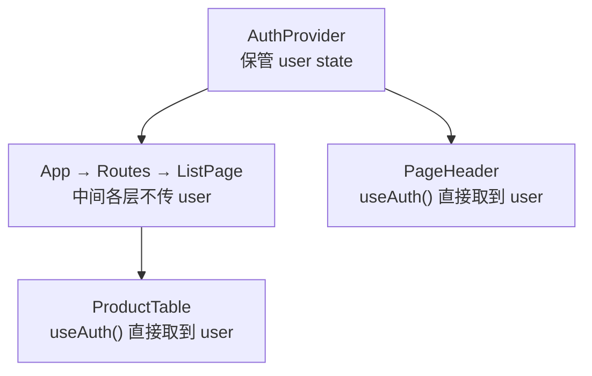

# 第 14A 章 Context：跨层级共享「当前用户」

## 这一章解决什么问题

系统要知道「现在是谁在用」：页头显示当前用户的名字，没登录不能录入产品，只有管理员能看到「删除」按钮。「当前用户」页头要用、列表页要用、表格也要用，它们之间隔着好几层组件。按第 8B 章的状态提升，就得从 `App` 一层层用 props 传下去，每一层都要加 prop，中间的组件自己根本用不到它。

第 14 章分三步：本章用 Context 做出登录，让任何组件都能取到当前用户；第 14B 章按登录状态和角色显示界面；第 14C 章介绍排查这类问题最常用的工具 React DevTools。

本章只讲一个技术点：**Context**。

## 开始之前

- 上一章你已经会了：编辑页、`useNavigate`、把后端的字段错误显示到输入框。
- 起点代码：仓库 `code/ch13C/price-list`（不含练习答案）。两个终端分别运行开发服务器和 `npm run mock`。
- 模拟接口里有两个用户：`admin` / `123456`（系统管理员，角色 admin）、`zhangsan` / `123456`（张三，角色 sales）。
- 预计耗时：35 分钟。

## 正文

### 14A.1 Context 是什么

**白话定义**：Context（上下文）是 React 提供的一种「广播」方式：在组件树的某一层放一个提供者（provider），给它一个值；它里面**任何一层**的组件都可以用 `useContext` 直接取到这个值，中间的组件不用传 props。值变了，所有用到它的组件都会重新渲染。

**业务场景**：「当前登录用户」几乎每个页面都要用：页头显示名字、列表页决定能不能录入、表格决定显不显示删除按钮、编辑页决定让不让进。把它放进 Context，哪个组件需要就自己取。

**反例（什么时候不该用）**：只有父子两层、或者只有一两个组件用的数据，用 props 传就好。Context 让数据来源变得不明显：看一个组件的 props 就知道它依赖什么，用了 Context 就得翻进代码里才看得到。所以 Context 只放「全局性」的、很多地方都要用的数据，比如当前用户、界面语言、主题颜色。产品列表这种业务数据，仍然按第 8、9 章的办法处理。

不用 Context 时，要把用户传给表格，需要这样一层层传：

| 组件 | 自己用不用 `user` | 为了传下去要加的 prop |
| --- | --- | --- |
| `App` | 不用 | 传给 `ListPage` |
| `ListPage` | 用（决定显不显示表单） | 传给 `ProductTable` |
| `ProductTable` | 用（决定显不显示删除） | |

页面越多、层级越深，这种「路过的 props」越多，改一处要改一串。

#### 🖼 图解



#### 💻 最小可运行代码

**① 用户类型。** 用下面的内容整个替换 `src/types.ts`，在末尾加了 `User` 类型：

```ts
// src/types.ts
// 产品数据的形状。全书共用这一个类型，以后数据从 JSON 文件来也是这个结构
export type Product = {
  id: number
  code: string
  name: string
  category: string
  price: number
  stock: number
}

// 登录用户。role：admin 是管理员，sales 是销售
export type User = {
  username: string
  name: string
  role: 'admin' | 'sales'
}
```

`role: 'admin' | 'sales'` 表示 `role` 只能是这两个字符串之一，写别的 TypeScript 会报错。

**② 登录接口。** 用下面的内容整个替换 `src/api.ts`，第一行 import 多了 `User`，末尾多了 `login` 函数：

```ts
// src/api.ts
// 所有「写」接口集中放在这里。页面和 Hook 只调用这些函数，不直接拼地址、写请求头
import type { Product, User } from './types.ts'

// 新增、修改时提交的内容：Product 去掉 id。id 由服务器分配，前端不能自己定
export type ProductInput = Omit<Product, 'id'>

const BASE = import.meta.env.VITE_API_BASE

// 接口失败时抛出的错误。比普通 Error 多带两样东西：HTTP 状态码，以及逐个字段的校验错误
export class ApiError extends Error {
  status: number
  // 例如 { code: '编号 P-001 已存在' }。没有字段错误时是空对象
  fieldErrors: Record<string, string>

  constructor(message: string, status: number, fieldErrors: Record<string, string>) {
    // super(...) 调用父类 Error 的构造函数，设置 message
    super(message)
    this.status = status
    this.fieldErrors = fieldErrors
  }
}

// 把失败的响应转换成 ApiError。模拟接口出错时返回 { message, errors? }
async function toApiError(response: Response): Promise<ApiError> {
  try {
    const body: { message?: string; errors?: Record<string, string> } = await response.json()
    return new ApiError(body.message ?? `服务器返回 ${response.status}`, response.status, body.errors ?? {})
  } catch {
    // 响应内容不是 JSON（例如代理返回的 502 页面），只能用状态码
    return new ApiError(`服务器返回 ${response.status}`, response.status, {})
  }
}

export async function createProduct(input: ProductInput): Promise<Product> {
  const response = await fetch(`${BASE}/products`, {
    // 默认是 GET，新增要写明 POST
    method: 'POST',
    // 告诉服务器：请求体是 JSON。不写的话很多后端不知道怎么解析，会拒绝
    headers: { 'Content-Type': 'application/json' },
    // 请求体只能是字符串，把对象转成 JSON 文本
    body: JSON.stringify(input),
  })
  if (!response.ok) {
    throw await toApiError(response)
  }
  // 服务器返回保存后的产品，带上了它分配的 id
  const saved: Product = await response.json()
  return saved
}

export async function updateProduct(id: number, input: ProductInput): Promise<Product> {
  const response = await fetch(`${BASE}/products/${id}`, {
    method: 'PUT',
    headers: { 'Content-Type': 'application/json' },
    body: JSON.stringify(input),
  })
  if (!response.ok) {
    throw await toApiError(response)
  }
  const saved: Product = await response.json()
  return saved
}

export async function deleteProduct(id: number): Promise<void> {
  const response = await fetch(`${BASE}/products/${id}`, { method: 'DELETE' })
  if (!response.ok) {
    throw await toApiError(response)
  }
  // 删除成功返回 204，没有内容，不要调用 response.json()
}

// 登录：用户名密码正确时返回用户信息（不含密码）；错误时服务器返回 401，这里抛出 ApiError
export async function login(username: string, password: string): Promise<User> {
  const response = await fetch(`${BASE}/login`, {
    method: 'POST',
    headers: { 'Content-Type': 'application/json' },
    body: JSON.stringify({ username, password }),
  })
  if (!response.ok) {
    throw await toApiError(response)
  }
  const user: User = await response.json()
  return user
}
```

**③ 创建 Context。** 新建文件夹 `src/auth`，在里面新建 `AuthContext.ts`：

```ts
// src/auth/AuthContext.ts
// 「当前登录用户」的 Context：任何组件都能直接取到，不用一层层用 props 往下传
import { createContext, useContext } from 'react'
import type { User } from '../types.ts'

// Context 里放的东西：当前用户（没登录是 null），以及登录、退出两个函数
export type AuthValue = {
  user: User | null
  login: (username: string, password: string) => Promise<void>
  logout: () => void
}

// 创建 Context。参数是默认值：组件不在 AuthProvider 里面时取到的就是它。用 null 表示「没有提供者」
export const AuthContext = createContext<AuthValue | null>(null)

// 自定义 Hook：组件里写 const { user } = useAuth() 就能拿到当前用户
export function useAuth(): AuthValue {
  const value = useContext(AuthContext)
  // 取到 null 说明忘了在外层包 AuthProvider。立刻报错，比悄悄当成「没登录」更容易发现问题
  if (value === null) {
    throw new Error('useAuth 必须在 AuthProvider 里面使用')
  }
  return value
}
```

| 代码 | 说明 |
| --- | --- |
| `createContext<AuthValue \| null>(null)` | 创建一个 Context，尖括号里写它装的值的类型。参数是默认值，组件**不在**提供者里面时取到的就是它 |
| `useContext(AuthContext)` | 取出离自己最近的那个提供者给的值 |
| `useAuth()` | 包了一层自定义 Hook（第 8C 章）：其他组件只要写 `useAuth()`，不用每次都 import `AuthContext` 再判断 `null` |

**④ 提供者组件。** 在 `src/auth` 里新建 `AuthProvider.tsx`：

```tsx
// src/auth/AuthProvider.tsx
// 提供者组件：自己保管「当前用户」这个 state，通过 AuthContext 提供给里面的所有组件
import { useState } from 'react'
import type { ReactNode } from 'react'
import * as api from '../api.ts'
import type { User } from '../types.ts'
import { AuthContext } from './AuthContext.ts'

type AuthProviderProps = {
  children: ReactNode
}

export function AuthProvider({ children }: AuthProviderProps) {
  // 当前用户只存在浏览器内存里：刷新页面就回到「未登录」（练习 2 解决）
  const [user, setUser] = useState<User | null>(null)

  async function login(username: string, password: string) {
    // 用户名或密码错误时 api.login 抛出错误，这里不接住，交给登录页显示
    const loggedIn = await api.login(username, password)
    setUser(loggedIn)
  }

  function logout() {
    setUser(null)
  }

  // React 19 起，Context 对象本身就能当提供者用：<AuthContext value={...}>。
  // 以前的写法是 <AuthContext.Provider value={...}>，网上的资料大多是这种，两种效果相同
  return <AuthContext value={{ user, login, logout }}>{children}</AuthContext>
}
```

`AuthProvider` 是一个普通组件：它有自己的 `user` state，把 `user`、`login`、`logout` 打包成一个对象交给 `<AuthContext value={...}>`。`login` 成功后 `setUser`，`AuthProvider` 重新渲染，Context 的值变了，所有用到 `useAuth()` 的组件跟着更新。

为什么 Context 和提供者分成两个文件？`AuthContext.ts` 导出的是 Context 和 Hook，`AuthProvider.tsx` 只导出一个组件。如果放在同一个 `.tsx` 文件里，`npm run lint` 会警告 `react(only-export-components): Fast refresh only works when a file only exports components.`：一个文件里既有组件又有别的导出时，第 1C 章的热更新没法只替换组件，会退回整页刷新。

**⑤ 放到最外层。** 用下面的内容整个替换 `src/main.tsx`，在 `BrowserRouter` 里面、`App` 外面包了 `AuthProvider`：

```tsx
// src/main.tsx
// 整个前端的入口：index.html 里的 <script> 只引用这一个文件
import { StrictMode } from 'react'
import { createRoot } from 'react-dom/client'
import { BrowserRouter } from 'react-router'
import { AuthProvider } from './auth/AuthProvider.tsx'
// CSS 也能 import：Vite 会把它变成 <style> 插进页面
import './index.css'
import App from './App.tsx'

// 找到 index.html 里的 <div id="root">，React 从此接管它里面的内容
// 末尾的 ! 告诉 TypeScript：这个元素一定存在（否则它认为可能是 null）
createRoot(document.getElementById('root')!).render(
  // StrictMode 只在开发时做额外检查，打包后的正式版本不受影响
  <StrictMode>
    {/* BrowserRouter 用浏览器地址栏的路径决定显示哪个页面；包在最外层，里面的组件才能用路由功能 */}
    {/* basename：网站部署在子路径（如 /price-list/）时，路由要去掉这个前缀再匹配。值来自 vite.config.ts 的 base */}
    <BrowserRouter basename={import.meta.env.BASE_URL}>
      {/* AuthProvider 包住 App：App 里面所有组件都能用 useAuth() 取到当前用户 */}
      <AuthProvider>
        <App />
      </AuthProvider>
    </BrowserRouter>
  </StrictMode>,
)
```

`AuthProvider` 放在 `BrowserRouter` 外面还是里面？实测两种都能正常工作：`AuthProvider` 自己没有用路由功能，用 `useNavigate` 的是登录页，而登录页在两种写法下都在 `BrowserRouter` 里面。这里放在里面，以后如果想在 `AuthProvider` 里加「退出后跳到登录页」，可以直接用 `useNavigate`。

**⑥ 登录页。** 新建 `src/pages/LoginPage.tsx`：

```tsx
// src/pages/LoginPage.tsx
// 登录页：地址 /login。登录成功后回到列表
import { useState } from 'react'
import type { SubmitEvent } from 'react'
import { useNavigate } from 'react-router'
import { useAuth } from '../auth/AuthContext.ts'

export function LoginPage() {
  // 从 Context 里取出登录函数。LoginPage 和 AuthProvider 之间隔着 App、Routes 好几层，没有传任何 props
  const { login } = useAuth()
  const navigate = useNavigate()
  const [username, setUsername] = useState('')
  const [password, setPassword] = useState('')
  const [submitting, setSubmitting] = useState(false)
  const [error, setError] = useState('')

  async function handleSubmit(e: SubmitEvent<HTMLFormElement>) {
    e.preventDefault()
    setSubmitting(true)
    setError('')
    try {
      await login(username, password)
      navigate('/')
    } catch (err) {
      setError(err instanceof Error ? err.message : String(err))
    } finally {
      setSubmitting(false)
    }
  }

  return (
    <form className="product-form" onSubmit={handleSubmit}>
      <h2>登录</h2>
      <label>用户名 <input value={username} onChange={(e) => setUsername(e.target.value)} /></label>
      {/* type="password"：输入的内容显示成圆点 */}
      <label>密码 <input type="password" value={password} onChange={(e) => setPassword(e.target.value)} /></label>
      <button type="submit" disabled={submitting}>
        {submitting ? '登录中…' : '登录'}
      </button>
      {error && <p className="error">登录失败：{error}</p>}
      <p className="subtitle">测试账号：admin / 123456（管理员），zhangsan / 123456（销售）</p>
    </form>
  )
}
```

**⑦ 加路由。** 用下面的内容整个替换 `src/App.tsx`，import 和路由表各多了一行 `/login`：

```tsx
// src/App.tsx
// App 变成「外框」：页头、导航、页脚所有页面共用，中间按地址显示不同的页面
import { Link, Route, Routes } from 'react-router'
import { PageHeader } from './components/PageHeader.tsx'
import { PageFooter } from './components/PageFooter.tsx'
import { ListPage } from './pages/ListPage.tsx'
import { AboutPage } from './pages/AboutPage.tsx'
import { ProductDetailPage } from './pages/ProductDetailPage.tsx'
import { ProductEditPage } from './pages/ProductEditPage.tsx'
import { NotFoundPage } from './pages/NotFoundPage.tsx'
import { LoginPage } from './pages/LoginPage.tsx'

function App() {
  return (
    <main>
      <PageHeader />
      <nav className="nav">
        {/* Link 改地址但不刷新页面；React Router 发现地址变了，换掉下面 Routes 里显示的页面 */}
        <Link to="/">产品清单</Link> | <Link to="/about">关于</Link>
      </nav>
      {/* 路由表：React Router 找出与当前地址最匹配的那条 path，显示它的 element */}
      <Routes>
        <Route path="/" element={<ListPage />} />
        <Route path="/about" element={<AboutPage />} />
        <Route path="/login" element={<LoginPage />} />
        {/* :id 是参数，/products/1、/products/25 都匹配这一条 */}
        <Route path="/products/:id" element={<ProductDetailPage />} />
        {/* 编辑页：/products/3/edit */}
        <Route path="/products/:id/edit" element={<ProductEditPage />} />
        {/* * 匹配任何地址，但只有别的路由都对不上时才会用它，相当于兜底 */}
        <Route path="*" element={<NotFoundPage />} />
      </Routes>
      <PageFooter />
    </main>
  )
}

export default App
```

**⑧ 页头显示当前用户。** 用下面的内容整个替换 `src/components/PageHeader.tsx`：

```tsx
// src/components/PageHeader.tsx
// 页面顶部：标题、说明，右边显示当前用户
import { Link } from 'react-router'
import { useAuth } from '../auth/AuthContext.ts'

// 角色在数据里是英文，显示给用户看时换成中文
const ROLE_NAMES = { admin: '管理员', sales: '销售' }

export function PageHeader() {
  const { user, logout } = useAuth()

  return (
    <header>
      <h1>产品价格清单</h1>
      <p className="subtitle">
        超声事业部 · 内部报价参考 ·{' '}
        {user ? (
          <>
            {user.name}（{ROLE_NAMES[user.role]}）{' '}
            <button type="button" onClick={logout}>退出</button>
          </>
        ) : (
          <Link to="/login">登录</Link>
        )}
      </p>
    </header>
  )
}
```

`ROLE_NAMES[user.role]`：`user.role` 是 `'admin'` 时取到 `'管理员'`。TypeScript 知道 `role` 只有两种可能，`ROLE_NAMES` 里两种都有，所以不会报「取不到」。

#### 🔍 拆解运行结果

实测（本章还没改表格，所以删除按钮暂时谁都能看到）：

| 操作 | 结果 |
| --- | --- |
| 打开首页 | 页头「超声事业部 · 内部报价参考 · 登录」 |
| 点「登录」，填 zhangsan 和错误密码，点登录 | 按钮先变成「登录中…」，约半秒后显示「登录失败：用户名或密码错误」，地址还是 `/login` |
| 改成正确密码 123456 登录 | 跳回 `/`，页头「张三（销售） 退出」 |
| 点「关于」 | 页头仍然是「张三（销售） 退出」：换了页面，`AuthProvider` 没有被移除，用户还在 |
| 按 `F5` 刷新 | 页头变回「登录」 |

刷新后为什么丢了？`user` 是 `AuthProvider` 里的 state，只存在于浏览器内存，刷新页面整个应用重新启动，state 回到初始值 `null`。练习 1 解决。

`LoginPage` 拿到 `login` 函数时，没有任何组件给它传 props：它和 `AuthProvider` 之间隔着 `App`、`Routes`，`useAuth()` 直接取到了。

#### 改坏一处试试

**① 去掉提供者。** 把 `main.tsx` 里的 `<AuthProvider>` 和 `</AuthProvider>` 删掉，只留 `<App />`。实测页面整片空白，控制台报：

```text
Uncaught Error: useAuth 必须在 AuthProvider 里面使用
```

这就是 `useAuth` 里那个 `if (value === null)` 的作用：`useContext` 取到了默认值 `null`，说明外面没有提供者。如果不检查，`user` 会悄悄变成「没登录」，你会以为是登录逻辑出了问题。改回去。

**② 不检查 `null`。** 把 `useAuth` 里那个 `if` 整段删掉，直接 `return value`，报：

```text
error TS2322: Type 'AuthValue | null' is not assignable to type 'AuthValue'.
```

**③ 提供的值少一样。** 把 `AuthProvider` 里的 `value={{ user, login, logout }}` 写成 `value={{ user, login }}`，报 `TS2741: Property 'logout' is missing in type ... but required in type 'AuthValue'.` 和 props 一样，Context 的值也按类型检查。

每次实验后改回。

## ⚠️ 踩坑警告

| 现象 | 原因 | 怎么改 |
| --- | --- | --- |
| 页面空白，控制台 `useAuth 必须在 AuthProvider 里面使用` | 用了 `useAuth()` 的组件不在 `AuthProvider` 里面 | 在 `main.tsx` 里用 `<AuthProvider>` 包住 `<App />` |
| `npm run lint` 警告 `only-export-components` | 一个 `.tsx` 文件里同时导出了组件和非组件（Context、Hook） | 拆成两个文件：Context 和 Hook 放 `.ts`，组件放 `.tsx` |
| 刷新页面后要重新登录 | 当前用户只存在内存里的 state | 登录后存进 `localStorage`，启动时读出来（练习 1）；真实系统通常由后端用 Cookie 会话或令牌保持登录 |
| 网上的代码写 `<AuthContext.Provider value={...}>` | React 19 之前的写法 | 两种写法效果相同，React 19 可以直接写 `<AuthContext value={...}>` |

## 🎯 动手练习

**练习 1：刷新后保持登录**

登录成功后把用户信息存进浏览器的 `localStorage`，页面打开时读出来作为初始值；退出时删掉。

验收标准：

- 用 admin 登录后按 `F5`：页头仍是「系统管理员（管理员） 退出」。
- 点「退出」再按 `F5`：页头是「登录」。

提示：`localStorage.setItem('键', '字符串')` 保存，`localStorage.getItem('键')` 读取（没有时返回 `null`），`localStorage.removeItem('键')` 删除。只能存字符串，对象要用 `JSON.stringify` / `JSON.parse` 转换。

**练习 2：页脚也显示当前用户**

页脚的更新日期下面加一行「当前用户：张三」，没登录时显示「当前用户：未登录」。不给 `PageFooter` 加任何 prop。

验收标准：

- 未登录时页脚显示「当前用户：未登录」；用 zhangsan 登录后变成「当前用户：张三」。
- `App.tsx` 里的 `<PageFooter />` 没有改动。

卡住了看文末参考答案。

## 📌 一句话总结

提供者放最外层，任何组件用 useAuth 直接取当前用户，不用层层传 props。

## 下一章

现在谁登录、谁没登录，看到的界面都一样。第 14B 章按登录状态和角色显示界面：没登录不能录入，只有管理员能删除。

---

<!-- 以下是参考答案，先自己动手，卡住了再往下翻 -->


## 参考答案

### 练习 1

思路：只改 `AuthProvider`。`useState(loadSavedUser)` 传的是**函数本身**（没有括号），React 只在第一次显示时调用它取初始值；如果写成 `useState(loadSavedUser())`，每次渲染都会去读一遍 `localStorage`，虽然结果一样但白白浪费。

```tsx
// src/auth/AuthProvider.tsx
// 练习 1 之后的版本：登录状态存进 localStorage，刷新页面不丢
// 提供者组件：自己保管「当前用户」这个 state，通过 AuthContext 提供给里面的所有组件
import { useState } from 'react'
import type { ReactNode } from 'react'
import * as api from '../api.ts'
import type { User } from '../types.ts'
import { AuthContext } from './AuthContext.ts'

type AuthProviderProps = {
  children: ReactNode
}

// localStorage 里用的键名
const STORAGE_KEY = 'price-list-user'

// 页面打开时读取上次保存的用户。没有保存过时 getItem 返回 null
function loadSavedUser(): User | null {
  const text = localStorage.getItem(STORAGE_KEY)
  if (text === null) {
    return null
  }
  // JSON.parse 的结果是 any，马上标注类型，不让 any 往下传
  const saved: User = JSON.parse(text)
  return saved
}

export function AuthProvider({ children }: AuthProviderProps) {
  // 给 useState 传一个函数（而不是值）：React 只在第一次显示时调用它，之后每次渲染不会再去读 localStorage
  const [user, setUser] = useState<User | null>(loadSavedUser)

  async function login(username: string, password: string) {
    // 用户名或密码错误时 api.login 抛出错误，这里不接住，交给登录页显示
    const loggedIn = await api.login(username, password)
    // localStorage 只能存字符串，对象要转成 JSON
    localStorage.setItem(STORAGE_KEY, JSON.stringify(loggedIn))
    setUser(loggedIn)
  }

  function logout() {
    localStorage.removeItem(STORAGE_KEY)
    setUser(null)
  }

  // React 19 起，Context 对象本身就能当提供者用：<AuthContext value={...}>。
  // 以前的写法是 <AuthContext.Provider value={...}>，网上的资料大多是这种，两种效果相同
  return <AuthContext value={{ user, login, logout }}>{children}</AuthContext>
}
```

实测：admin 登录后 `localStorage` 里存着 `{"username":"admin","name":"系统管理员","role":"admin"}`，刷新后仍是登录状态；退出后这一项被删除，刷新后回到「登录」。

注意：`localStorage` 里的内容用户可以在开发者工具里随意修改，比如把 `role` 改成 `admin`。这再次说明前端的「我是谁」不可信，权限必须由后端判断。

### 练习 2

思路：`PageFooter` 在 `AuthProvider` 里面，直接 `useAuth()` 就能取到 `user`，不需要任何人传给它。

```tsx
// src/components/PageFooter.tsx
// 练习 2：页脚也显示当前用户。PageFooter 没有任何 props，直接从 Context 里取
import { useAuth } from '../auth/AuthContext.ts'

export function PageFooter() {
  const updatedAt = '2026-10-30'
  const { user } = useAuth()
  return (
    <footer>
      数据更新日期：{updatedAt}
      {/* 三元表达式：登录了显示名字，没登录显示「未登录」 */}
      <p>当前用户：{user ? user.name : '未登录'}</p>
    </footer>
  )
}
```

实测：未登录时页脚是「当前用户：未登录」，用 zhangsan 登录后是「当前用户：张三」。
