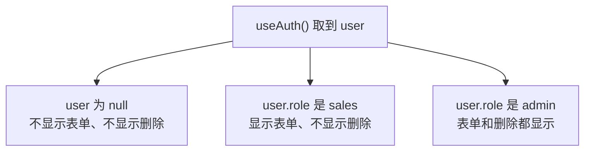

# 第 14B 章 按登录状态和角色显示界面

## 这一章解决什么问题

上一章做好了登录，但不管谁登录、有没有登录，看到的界面都一样：没登录也能录入产品，销售也能看到「删除」按钮。本章让界面按登录状态和角色变化，并亲手验证一件很重要的事：藏起按钮不等于做好了权限控制。

本章只讲一个技术点：**按登录状态和角色显示界面**。

## 开始之前

- 上一章你已经会了：用 Context 共享当前用户，任何组件用 `useAuth()` 取到它。
- 起点代码：仓库 `code/ch14A/price-list`（不含练习答案）。两个终端分别运行开发服务器和 `npm run mock`。
- 预计耗时：25 分钟。

## 正文

### 14B.1 按角色显示是什么

**白话定义**：有了 Context 里的 `user`，任何组件都可以按「有没有登录」「是什么角色」决定显示什么，写法就是第 5C 章的条件渲染。

**业务场景**：没登录时不显示录入表单，提示「登录后才能录入新产品」；销售登录后能录入、能编辑，但看不到「删除」；管理员能看到「删除」。

**反例（什么时候不该用）**：**不要以为在界面上藏起按钮，就做好了权限控制。** 按钮藏起来了，接口还在。懂一点技术的人可以在浏览器控制台里直接调用接口（下面「改坏一处」会实测）。前端按角色显示界面，只是为了**好用**（不让用户看到点了也没用的按钮）；真正的权限必须由**后端**在每个接口里检查：请求来自谁、他有没有这个权限。

#### 🖼 图解



#### 💻 最小可运行代码

用下面的内容整个替换 `src/components/ProductTable.tsx`。和第 13C 章相比：多了 `useAuth` 的 import 和调用；「删除」按钮外面包了 `{isAdmin && (...)}`。

```tsx
// src/components/ProductTable.tsx
// 只负责显示表格。数据从 props 来；点了按钮不自己改数据，而是调用父组件给的函数「通知」它
import { Link } from 'react-router'
import type { Product } from '../types.ts'
import { useAuth } from '../auth/AuthContext.ts'
// 导入 CSS Module 得到一个对象：键是你写的类名，值是打包后真正使用的类名
import styles from './ProductTable.module.css'

type ProductTableProps = {
  products: Product[]
  // 回调 props：类型写清楚「调用时传什么参数、返回什么」。void 表示不关心返回值
  onDelete: (id: number) => void
  onRestock: (id: number) => void
}

export function ProductTable({ products, onDelete, onRestock }: ProductTableProps) {
  // 直接从 Context 取当前用户，ListPage 不用为了它多传一个 prop
  const { user } = useAuth()
  // 可选链：没登录时 user 是 null，user?.role 得到 undefined，不会报错
  const isAdmin = user?.role === 'admin'

  if (products.length === 0) {
    return <p className="empty">暂无产品</p>
  }

  return (
    <table className={styles.table}>
      <thead>
        <tr>
          <th>编号</th>
          <th>名称</th>
          <th>单价（元）</th>
          <th>库存</th>
          <th>操作</th>
        </tr>
      </thead>
      <tbody>
        {products.map((p) => (
          <tr key={p.id}>
            <td>{p.code}</td>
            <td>
              {/* 点产品名进入详情页，地址形如 /products/3 */}
              <Link to={`/products/${p.id}`}>{p.name}</Link>
              {p.stock === 0 && <span className={styles.outOfStock}>缺货</span>}
            </td>
            <td>{p.price.toLocaleString()}</td>
            <td className={p.stock < 5 ? styles.low : undefined}>{p.stock}</td>
            <td>
              <button type="button" onClick={() => onRestock(p.id)}>入库 +1</button>{' '}
              {/* 只有管理员看得到删除按钮。注意：这只是界面上藏起来，真正的权限要靠后端检查 */}
              {isAdmin && (
                <>
                  <button type="button" onClick={() => onDelete(p.id)}>删除</button>{' '}
                </>
              )}
              {/* 编辑是换一个页面，所以用 Link，不是按钮 */}
              <Link to={`/products/${p.id}/edit`}>编辑</Link>
            </td>
          </tr>
        ))}
      </tbody>
    </table>
  )
}
```

用下面的内容整个替换 `src/pages/ListPage.tsx`。和第 13C 章相比：多了 `useAuth` 的 import 和 `const { user } = useAuth()`；表单改成登录后才显示。

```tsx
// src/pages/ListPage.tsx
// 产品列表页：第 8C 章 App 的内容原样搬过来，去掉页头页脚（它们留在 App 里，所有页面共用）
import { useEffect, useState } from 'react'
import type { ReactNode } from 'react'
import { useProducts } from '../hooks/useProducts.ts'
import { FilterBar } from '../components/FilterBar.tsx'
import { ProductTable } from '../components/ProductTable.tsx'
import { ProductForm } from '../components/ProductForm.tsx'
import { useAuth } from '../auth/AuthContext.ts'

export function ListPage() {
  // 加载和增删改的细节都在 useProducts 里，列表页只拿结果
  const { state, addProduct, deleteProduct, restockProduct } = useProducts()
  // 登录后才能录入新产品
  const { user } = useAuth()
  // 状态提升：搜索框和表格都要用 keyword，所以放在它们共同的父组件 App 里
  const [keyword, setKeyword] = useState('')
  // 删除、入库失败时显示的原因（例如「还有库存，不能删除」）
  const [actionError, setActionError] = useState('')

  // 表格只负责报告「点了哪一行」，调用接口、处理失败在这里做
  async function handleDelete(id: number) {
    setActionError('')
    try {
      await deleteProduct(id)
    } catch (err) {
      setActionError(`删除失败：${err instanceof Error ? err.message : String(err)}`)
    }
  }

  async function handleRestock(id: number) {
    setActionError('')
    try {
      await restockProduct(id)
    } catch (err) {
      setActionError(`入库失败：${err instanceof Error ? err.message : String(err)}`)
    }
  }

  const count = state.status === 'success' ? state.products.length : 0

  useEffect(() => {
    document.title = `产品价格清单（${count} 种）`
  }, [count])

  let content: ReactNode
  if (state.status === 'loading') {
    content = <p>加载中…</p>
  } else if (state.status === 'error') {
    content = <p className="error">加载失败：{state.message}</p>
  } else {
    // 筛选结果是派生值：由 products 和 keyword 现算，不另存 state
    const k = keyword.trim().toLowerCase()
    const visible = state.products.filter(
      (p) => p.name.toLowerCase().includes(k) || p.code.toLowerCase().includes(k),
    )
    // 传的是上面包了一层错误处理的函数
    content = <ProductTable products={visible} onDelete={handleDelete} onRestock={handleRestock} />
  }

  return (
    <section>
      <p>共 {count} 种产品</p>
      {/* 把值和「修改它的函数」一起交给搜索框 */}
      <FilterBar keyword={keyword} onKeywordChange={setKeyword} />
      {actionError && <p className="error">{actionError}</p>}
      {content}
      {user ? <ProductForm onSubmit={addProduct} /> : <p className="empty">登录后才能录入新产品</p>}
    </section>
  )
}
```

`ProductTable` 自己调用 `useAuth()`，`ListPage` 没有为它多传一个 prop。这就是 Context 省掉的那一层传递。

#### 🔍 拆解运行结果

实测：

| 状态 | 页头 | 删除按钮 | 录入表单 |
| --- | --- | --- | --- |
| 未登录 | 登录 | 0 个 | 显示「登录后才能录入新产品」 |
| 张三（销售） | 张三（销售） 退出 | 0 个 | 显示 |
| 点「退出」 | 登录 | 0 个 | 不显示 |
| 系统管理员（管理员） | 系统管理员（管理员） 退出 | 每行一个 | 显示 |

`user?.role === 'admin'` 用了第 12C 章练习 1 里的可选链：没登录时 `user` 是 `null`，`user?.role` 得到 `undefined`，比较结果是 `false`，不会报错。

#### 改坏一处试试

**① 角色名写错。** 把 `'admin'` 写成 `'administrator'`，报：

```text
error TS2367: This comparison appears to be unintentional because the types '"admin" | "sales" | undefined' and '"administrator"' have no overlap.
```

`User` 类型里把 `role` 写成了两个固定值的联合，拼错角色名在写代码时就会发现。如果写成 `role: string`，这个错误就漏过去了。

**② 绕过界面直接调接口。** 以张三（销售）登录，页面上没有删除按钮。按 `F12` 打开控制台，输入下面这行回车：

```js
await fetch('/api/products/5', { method: 'DELETE' }).then((r) => r.status)
```

实测返回 `204`，回到产品清单，「探头保护套」已经被删掉了。本教程的模拟接口没有做权限检查，所以谁都能删。真实系统里，后端要在删除接口里检查当前用户是不是管理员，不是就返回 403（Forbidden，禁止访问）。这需要登录时由后端发一个凭证（令牌 token 或 Cookie 会话），之后每个请求都带上它，后端据此认出是谁。这部分属于后端和安全设计，本教程不展开。做完实验重启模拟接口恢复数据。

## ⚠️ 踩坑警告

| 现象 | 原因 | 怎么改 |
| --- | --- | --- |
| 藏起了删除按钮，数据还是被销售删掉了 | 前端隐藏只是界面效果，接口本身没有权限检查 | 后端在每个接口里检查当前用户的权限 |
| 角色名拼错了，按钮一直不显示，也没报错 | `role` 声明成了 `string`，TypeScript 不知道有哪些合法值 | 声明成 `'admin' \| 'sales'` 这样的联合类型，拼错时会报 `TS2367` |
| 在编辑页判断没登录就提前 `return`，`npm run lint` 报 `React Hook ... is called conditionally` | `return` 写在了某个 Hook 调用前面 | 所有 Hook 调用写在前面，判断写在后面（第 4A 章；练习 1） |

## 🎯 动手练习

**练习 1：编辑页要求登录**

没登录时直接打开 `/products/3/edit`，不显示表单，显示「请先登录再编辑产品。」和「去登录」链接。

验收标准：

- 未登录打开 `/products/3/edit`：只看到提示和链接，没有表单。
- 点「去登录」登录后，再打开这个地址，表单正常显示编号 H-001。
- 在编辑页点页头的「退出」，表单立刻消失，换成提示。

提示：判断 `user` 后提前 `return` 时，要写在所有 Hook（`useParams`、`useProduct`、`useNavigate`、`useAuth`）调用**之后**，原因见第 4A 章踩坑警告。

**练习 2：没登录不显示「编辑」链接**

表格里每行的「编辑」链接只在登录后显示。

验收标准：

- 未登录时表格里没有「编辑」；任意用户登录后每行都有「编辑」。

卡住了看文末参考答案。

## 📌 一句话总结

界面按 user 和角色条件渲染只为好用，真正的权限必须后端检查。

## 下一章

「删除按钮怎么没出来」这类问题，除了加 `console.log`，还可以直接看组件此刻的 state 和 Context。第 14C 章介绍 React DevTools。

---

<!-- 以下是参考答案，先自己动手，卡住了再往下翻 -->


## 参考答案

### 练习 1

思路：编辑页自己 `useAuth()` 取当前用户，没登录就提前返回提示。所有 Hook 都在 `if` 前面调用，保证每次渲染调用的 Hook 数量和顺序都一样。退出时 Context 的值变了，编辑页重新渲染，走进 `if` 分支。

```tsx
// src/pages/ProductEditPage.tsx
// 练习 1 之后的版本：没登录时不显示表单
// 编辑页：地址 /products/3/edit。先加载这个产品，加载完再显示表单；保存成功后回到列表
import { Link, useNavigate, useParams } from 'react-router'
import { useProduct } from '../hooks/useProduct.ts'
import { ProductForm } from '../components/ProductForm.tsx'
import { useAuth } from '../auth/AuthContext.ts'
import * as api from '../api.ts'
import type { ProductInput } from '../api.ts'

export function ProductEditPage() {
  const { id } = useParams()
  const state = useProduct(id)
  // useNavigate 返回一个函数，调用它就跳转到指定地址，效果和点 Link 一样
  const navigate = useNavigate()
  const { user } = useAuth()

  async function handleSubmit(input: ProductInput) {
    // 失败时 updateProduct 抛出 ApiError，这里不接住，交给表单显示
    const saved = await api.updateProduct(Number(id), input)
    navigate('/')
    return saved
  }

  // 练习 1：没登录就提前返回。注意要写在所有 Hook 调用之后（第 4A 章：Hook 不能写在 return 后面）
  if (!user) {
    return (
      <section>
        <p className="error">请先登录再编辑产品。</p>
        <p>
          <Link to="/login">去登录</Link>
        </p>
      </section>
    )
  }

  return (
    <section>
      <p>
        <Link to="/">← 返回列表</Link>
      </p>
      {state.status === 'loading' && <p>加载中…</p>}
      {state.status === 'error' && <p className="error">加载失败：{state.message}</p>}
      {/* 加载成功后才显示表单：表单的 useState 只在第一次显示时读取 initial，必须那时数据已经到了 */}
      {state.status === 'success' && <ProductForm title="编辑产品" initial={state.product} onSubmit={handleSubmit} />}
    </section>
  )
}
```

### 练习 2

思路：`ProductTable` 已经调用了 `useAuth()`，拿到了 `user`。「编辑」链接外面包一层 `user &&`。

```tsx
// src/components/ProductTable.tsx
// 练习 2 做完后的版本
// 只负责显示表格。数据从 props 来；点了按钮不自己改数据，而是调用父组件给的函数「通知」它
import { Link } from 'react-router'
import type { Product } from '../types.ts'
import { useAuth } from '../auth/AuthContext.ts'
// 导入 CSS Module 得到一个对象：键是你写的类名，值是打包后真正使用的类名
import styles from './ProductTable.module.css'

type ProductTableProps = {
  products: Product[]
  // 回调 props：类型写清楚「调用时传什么参数、返回什么」。void 表示不关心返回值
  onDelete: (id: number) => void
  onRestock: (id: number) => void
}

export function ProductTable({ products, onDelete, onRestock }: ProductTableProps) {
  // 直接从 Context 取当前用户，ListPage 不用为了它多传一个 prop
  const { user } = useAuth()
  // 可选链：没登录时 user 是 null，user?.role 得到 undefined，不会报错
  const isAdmin = user?.role === 'admin'

  if (products.length === 0) {
    return <p className="empty">暂无产品</p>
  }

  return (
    <table className={styles.table}>
      <thead>
        <tr>
          <th>编号</th>
          <th>名称</th>
          <th>单价（元）</th>
          <th>库存</th>
          <th>操作</th>
        </tr>
      </thead>
      <tbody>
        {products.map((p) => (
          <tr key={p.id}>
            <td>{p.code}</td>
            <td>
              {/* 点产品名进入详情页，地址形如 /products/3 */}
              <Link to={`/products/${p.id}`}>{p.name}</Link>
              {p.stock === 0 && <span className={styles.outOfStock}>缺货</span>}
            </td>
            <td>{p.price.toLocaleString()}</td>
            <td className={p.stock < 5 ? styles.low : undefined}>{p.stock}</td>
            <td>
              <button type="button" onClick={() => onRestock(p.id)}>入库 +1</button>{' '}
              {/* 只有管理员看得到删除按钮。注意：这只是界面上藏起来，真正的权限要靠后端检查 */}
              {isAdmin && (
                <>
                  <button type="button" onClick={() => onDelete(p.id)}>删除</button>{' '}
                </>
              )}
              {/* 练习 2：登录了才显示编辑链接。user 是 null 时 && 的结果是 null，什么都不显示 */}
              {user && <Link to={`/products/${p.id}/edit`}>编辑</Link>}
            </td>
          </tr>
        ))}
      </tbody>
    </table>
  )
}
```

实测：未登录时页面上「编辑」链接 0 个，用 admin 登录后 5 个。
