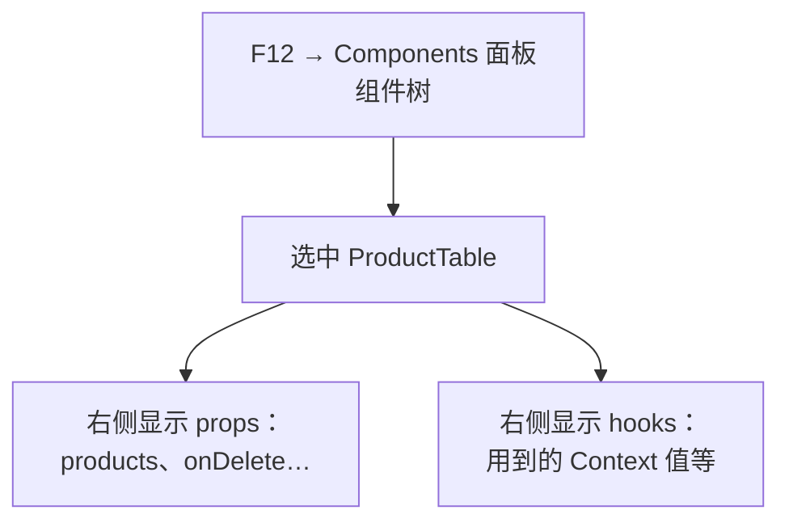

# 第 14C 章 React DevTools：看组件、props 和 state

## 这一章解决什么问题

页面上「删除按钮怎么没出来」「搜索框里明明输入了字，表格怎么没筛选」：到目前为止，排查这类问题靠的是加 `console.log`，再一遍遍刷新。本章介绍 React 官方的浏览器扩展，直接看到每个组件此刻的 props、state 和 Context 值。

本章只讲一个技术点：**React DevTools**。本章不改代码。

## 开始之前

- 上一章你已经会了：按登录状态和角色显示界面。
- 起点代码：仓库 `code/ch14B/price-list`（不含练习答案）。两个终端分别运行开发服务器和 `npm run mock`。
- 预计耗时：20 分钟。

## 正文

### 14C.1 React DevTools 是什么

> ⚠️ 本章的浏览器扩展安装和界面操作未实机验证（实测环境是无头浏览器，不能安装扩展）。面板名称和按钮位置以你安装的版本为准。

**白话定义**：React DevTools（React 开发者工具）是 React 官方提供的浏览器扩展。装好后，`F12` 开发者工具里会多出「⚛ Components」面板：以组件树的形式显示页面，选中一个组件，就能看到它此刻的 props、state、用到的 Context 值，还能直接修改它们看效果。

**业务场景**：页面上「删除按钮怎么没出来」。在 Components 面板选中 `ProductTable`，看它用到的 Context 里 `user` 是不是 `null`、`role` 是什么；选中 `ListPage`，看 `keyword`、`actionError` 这些 state 的当前值。不用到处加 `console.log`。

**反例（什么时候不该用）**：看**请求**有没有发出去、服务器返回了什么，不用 React DevTools，用浏览器自带的「网络（Network）」面板（第 7C、11B 章用过）。React DevTools 只管 React 组件本身。

#### 🖼 图解



#### 💻 安装与使用

1. 在 Chrome 或 Edge 的扩展商店搜索「React Developer Tools」，安装 React 官方（Meta）发布的那个。
2. 打开 `http://localhost:5173/`，按 `F12`。开发者工具的标签页里多了「⚛ Components」和「⚛ Profiler」。没看到的话，点标签栏右边的 `»` 找一找，或者关掉开发者工具重新打开。
3. 点「⚛ Components」。左边是组件树：`App`、`AuthProvider`、`PageHeader`、`ListPage`、`ProductTable`……和你写的组件一一对应。
4. 点选 `ListPage`，右边能看到它的 hooks：`useProducts` 里的 state（加载状态和产品列表）、`keyword`、`actionError` 等。
5. 在搜索框里输入几个字，看右边 `keyword` 的值跟着变；点「入库 +1」，看产品列表里那一行的 `stock` 跟着变。

还有一个顺手的用法：左上角有个「选择元素」的图标，点它，再点页面上的某个按钮，组件树会跳到渲染这个按钮的组件。接手别人的代码、不知道某块界面是哪个文件写的时，这个功能很有用。

#### 🔍 你会看到什么

第 1B 章开始，控制台里一直有一行提示：

```text
Download the React DevTools for a better development experience: https://react.dev/link/react-devtools
```

这行就是 React 在开发模式下建议你安装这个扩展。装好后这行提示消失（⚠️ 未实机验证）。

#### 改坏一处试试

在 Components 面板里选中 `AuthProvider`，找到它的 state（值是 `null` 或者当前用户对象），双击把它改成别的值（⚠️ 未实机验证：能否直接编辑对象类型的 state，取决于扩展版本）。页头和删除按钮会立刻跟着变化，但刷新页面后恢复，第二个终端里也不会有任何请求：这里改的只是浏览器内存里的 state。这再次说明，前端看到的「我是管理员」完全可以被用户自己改掉，权限只能由后端判断。

## ⚠️ 踩坑警告

| 现象 | 原因 | 怎么改 |
| --- | --- | --- |
| 想看接口返回了什么，在 Components 面板里找不到 | React DevTools 只管组件，不管网络请求 | 用浏览器自带的「网络（Network）」面板 |
| 打包后用 `npm run preview` 打开，控制台里那行「Download the React DevTools」提示不见了 | 这行提示只在开发模式下打印。实测 `npm run preview` 打开时控制台没有任何输出 | 正常现象。调试时用开发服务器 |
| 在 Components 面板里改了 state，刷新后又变回去了（⚠️ 未实机验证） | 面板里改的只是浏览器内存里的 state | 正常现象，适合临时试效果，不能代替改代码 |

## 🎯 动手练习

**练习 1：找到渲染「删除」按钮的组件**（⚠️ 本练习的扩展操作未实机验证）

装好 React DevTools，用 admin 登录，在 Components 面板里用「选择元素」图标点一下表格里的某个「删除」按钮。

验收标准：

- 组件树跳到 `ProductTable`。
- 在右侧找到它用到的 Context 值，看到 `user` 的 `role` 是 `"admin"`。
- 点「退出」后，同一处变成 `null`。

**练习 2：开发版和打包版的控制台**

分别用开发服务器和 `npm run build` 加 `npm run preview` 打开首页，对比控制台。

验收标准：

- 开发服务器打开时，控制台有一行 `Download the React DevTools for a better development experience`。
- `npm run preview` 打开时，没有这一行。
- 能说出为什么。

卡住了看文末参考答案。

## 📌 一句话总结

React DevTools 看组件的 props、state 和 Context，看请求用网络面板。

## 下一章

后端一直是模拟接口。第 15A 章换成 ASP.NET Core Minimal API，并把前端打包进后端，合成一个网站。

---

<!-- 以下是参考答案，先自己动手，卡住了再往下翻 -->


## 参考答案

### 练习 1

不用写代码。`ProductTable` 自己调用了 `useAuth()`，所以在它的 hooks 列表里能看到 Context 的值：登录时是 `{ user: { username: "admin", name: "系统管理员", role: "admin" }, login, logout }`，退出后 `user` 是 `null`。⚠️ 面板里的显示格式以你安装的扩展版本为准，未实机验证。

### 练习 2

实测开发服务器打开时控制台有那一行提示，`npm run preview` 打开时控制台没有任何输出。`npm run build` 打包的是 React 的生产版本，去掉了开发时的提示和检查（第 4C 章的 `StrictMode` 双重渲染也只在开发时有），文件更小、运行更快。
