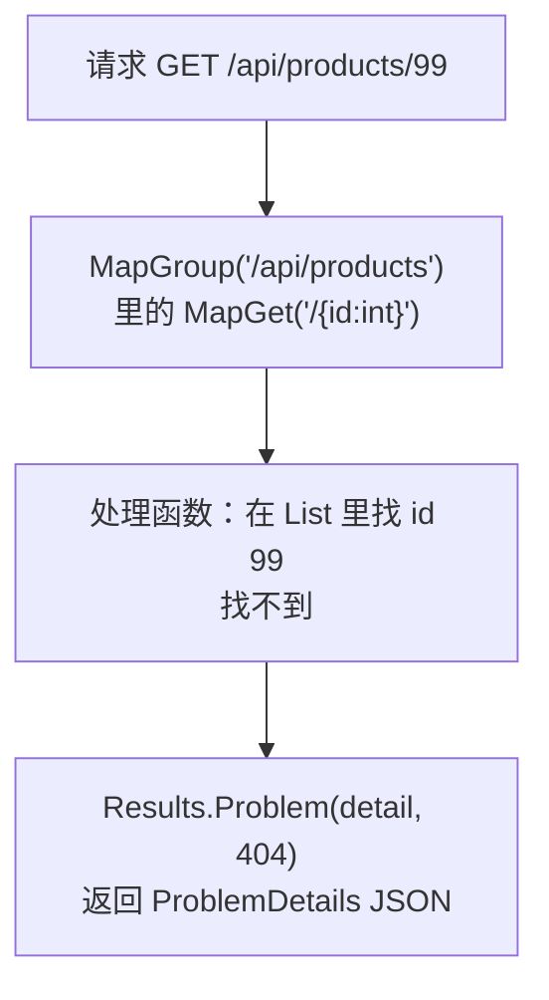
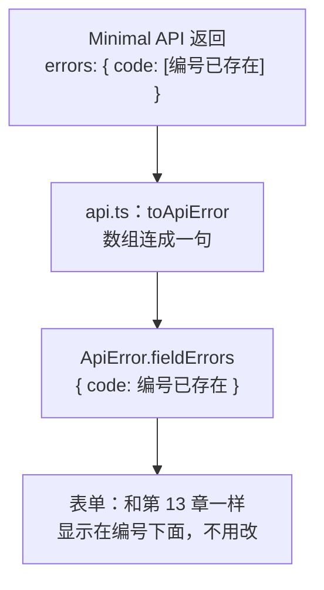
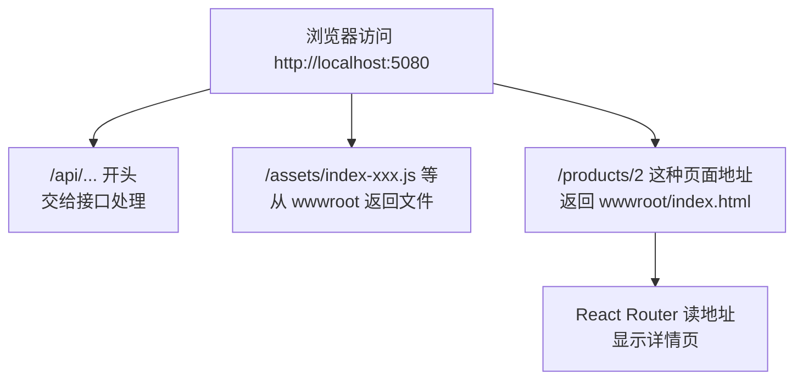

# 第 15 章 换成真实后端：ASP.NET Core Minimal API

## 这一章解决什么问题

前 14 章的后端是一个 Node.js 模拟接口，作用是让你不装后端也能学前端。真实项目里，后端由正式的 Web 框架实现。本章用 .NET 10 的 ASP.NET Core Minimal API 写一个功能相同的后端，把前端接上去，最后把前端打包进后端，前后端合成一个网站运行。

你会看到：前端的组件、Hook、表单一行都不用改；要改的只有三处：开发代理指向哪个端口、`api.ts` 怎么读后端的错误格式、打包输出到哪里。这正是第 12 章把接口调用集中到 `api.ts` 的好处。

## 开始之前

- 前面你已经会了：开发代理和 `.env`（第 11 章）、`api.ts` 写请求（第 12 章）、`ApiError` 和字段错误（第 13 章）、登录与 Context（第 14 章）。
- 起点代码：仓库 `code/ch14/price-list`（不含练习答案）。
- 需要 .NET 10 SDK。安装 Visual Studio 2026 时勾选「ASP.NET 和 Web 开发」工作负载会一起装上；也可以单独从 `https://dotnet.microsoft.com/download` 下载 .NET 10 SDK。在 PowerShell 里执行 `dotnet --version`，显示 `10.0.xxx` 就可以了（实测 10.0.403）。⚠️ Windows 安装过程未实机验证。
- 本章不再需要 `npm run mock`，把那个终端关掉。`mock-server` 文件夹可以留着不管。
- 预计耗时：80 分钟。

本章的目录结构：前端和后端两个项目放在同一个上级文件夹里，**并排**。

```text
D:\react-study\
├── price-list\      ← 前端（第 1–14 章的项目）
└── PriceApi\        ← 后端（本章新建）
```

## 正文

### 15.1 Minimal API 接口与 ProblemDetails 错误格式

**白话定义**：Minimal API 是 ASP.NET Core 写 HTTP 接口最简洁的方式：在 `Program.cs` 里用 `app.MapGet("/路径", 处理函数)` 这样一行登记一个接口，处理函数的返回值（`Results.Ok(...)`、`Results.NotFound()` 等）决定状态码和响应内容。出错时，ASP.NET Core 习惯用 **ProblemDetails**（问题详情，RFC 9457 标准定义的一种 JSON 错误格式）来描述错误：`{ "title": ..., "status": ..., "detail": ... }`，校验失败时多一个 `errors`。

**业务场景**：价格清单的后端需要提供和模拟接口一模一样的 6 个接口：查列表、查一个、新增、修改、删除、登录。规则也一样：编号不能重复、有库存不能删、用户名密码要对。

**反例（什么时候不该用）**：接口很多、业务分层复杂（几十个实体、每个都有一套增删改查和权限）时，把所有接口都堆在一个 `Program.cs` 里会很难维护，要按业务拆成多个文件，或者改用 Controller 的写法。本章只有 6 个接口，放在一个文件里最直观。数据放在内存 `List` 里也只是为了演示，真实项目要接数据库。

#### 🖼 图解



#### 💻 新建项目

> ⚠️ 本小节的 Visual Studio 2026 界面操作未实机验证（实测环境没有 Visual Studio），菜单和选项名称以你的版本为准。命令行方式已实测。

**用 Visual Studio 2026：**

1. 菜单「文件 → 新建 → 项目」。
2. 搜索「ASP.NET Core 空」，选它（C#），点「下一步」。
3. 项目名称填 `PriceApi`，位置选 `D:\react-study`，勾选「将解决方案和项目放在同一目录中」，点「下一步」。
4. 框架选「.NET 10.0」，「配置 HTTPS」**不勾选**（本章用 http），点「创建」。

📷 截图占位 ch15-01：新建项目对话框

**或者用命令行：**

```powershell
# 在 D:\react-study 目录执行
dotnet new web -n PriceApi
```

实测输出：

```text
The template "ASP.NET Core Empty" was created successfully.

Processing post-creation actions...
Restoring D:\react-study\PriceApi\PriceApi.csproj:
Restore succeeded.
```

两种方式建出的项目相同。模板的 `Program.cs` 只有四行，访问 `/` 返回 `Hello World!`。

**固定端口。** 模板给的端口是随机的（实测是 5294），每次新建都不一样。把它固定成 5080，前端的代理才好配置。用下面的内容整个替换 `Properties/launchSettings.json`：

```json
{
  "$schema": "https://json.schemastore.org/launchsettings.json",
  "profiles": {
    "http": {
      "commandName": "Project",
      "dotnetRunMessages": true,
      "launchBrowser": false,
      "applicationUrl": "http://localhost:5080",
      "environmentVariables": {
        "ASPNETCORE_ENVIRONMENT": "Development"
      }
    }
  }
}
```

`launchBrowser: false`：启动时不自动打开浏览器。前端开发时你访问的是 Vite 的 5173，不是 5080。

#### 💻 最小可运行代码

用下面的内容整个替换 `PriceApi/Program.cs`：

```csharp
// Program.cs（15.1 版本，15.3 节会再改）
// 产品价格接口：和前 14 章的模拟接口功能相同，改用 ASP.NET Core Minimal API 实现。
// 数据放在内存 List 里：程序运行期间增删改一直有效，重启后恢复成初始的 5 个产品。

var builder = WebApplication.CreateBuilder(args);
var app = builder.Build();

// 初始数据。List 不是线程安全的，多个请求同时修改时用 dataLock 排队
var products = new List<Product>
{
    new(1, "P-001", "凸阵探头 C5-2", "探头", 12800m, 6),
    new(2, "P-002", "线阵探头 L12-5", "探头", 15600m, 3),
    new(3, "H-001", "便携彩超主机", "主机", 168000m, 2),
    new(4, "C-001", "耦合剂 250ml", "耗材", 18m, 120),
    new(5, "C-002", "探头保护套", "耗材", 6.5m, 0),
};
var dataLock = new object();
string[] categories = ["探头", "主机", "耗材"];
var users = new List<User>
{
    new("admin", "123456", "系统管理员", "admin"),
    new("zhangsan", "123456", "张三", "sales"),
};

// 每个 /api 请求：打印一行日志，并故意延迟 500 毫秒，让前端的「加载中」「保存中」看得见
app.Use(async (context, next) =>
{
    if (context.Request.Path.StartsWithSegments("/api"))
    {
        Console.WriteLine($"{DateTime.Now:HH:mm:ss} {context.Request.Method} {context.Request.Path}");
        await Task.Delay(500);
    }
    await next();
});

// 后端校验：前端校验过了也要再查一遍。selfId 是修改时自己的 id，查重时排除自己
Dictionary<string, string[]> Validate(ProductInput input, int? selfId)
{
    var errors = new Dictionary<string, string[]>();
    var code = input.Code?.Trim() ?? "";
    if (code == "")
    {
        errors["code"] = ["请填写编号"];
    }
    else if (products.Any(p => p.Code == code && p.Id != selfId))
    {
        errors["code"] = [$"编号 {code} 已存在"];
    }
    if (string.IsNullOrWhiteSpace(input.Name)) errors["name"] = ["请填写名称"];
    if (!categories.Contains(input.Category)) errors["category"] = ["分类必须是探头、主机或耗材"];
    if (!(input.Price > 0)) errors["price"] = ["单价必须大于 0"];
    if (input.Stock is not { } stock || stock < 0 || stock != Math.Floor(stock)) errors["stock"] = ["库存必须是不小于 0 的整数"];
    return errors;
}

// 校验通过后，把提交的内容变成 Product
Product ToProduct(int id, ProductInput input) =>
    new(id, input.Code!.Trim(), input.Name!.Trim(), input.Category!, input.Price!.Value, (int)input.Stock!.Value);

// 产品相关的接口都以 /api/products 开头，用 MapGroup 统一加前缀
var api = app.MapGroup("/api/products");

api.MapGet("/", () =>
{
    lock (dataLock) return Results.Ok(products.ToList());
});

api.MapGet("/{id:int}", (int id) =>
{
    lock (dataLock)
    {
        var product = products.FirstOrDefault(p => p.Id == id);
        // 找不到时返回 404，内容是 ProblemDetails 格式：{ title, status, detail }
        return product is null
            ? Results.Problem(detail: $"产品 {id} 不存在", statusCode: StatusCodes.Status404NotFound)
            : Results.Ok(product);
    }
});

api.MapPost("/", (ProductInput input) =>
{
    lock (dataLock)
    {
        var errors = Validate(input, null);
        if (errors.Count > 0)
        {
            // 400 + ProblemDetails，多一个 errors：{ "code": ["编号 P-001 已存在"] }，每个字段是字符串数组
            return Results.ValidationProblem(errors, title: "校验失败");
        }
        var product = ToProduct(products.Max(p => (int?)p.Id) + 1 ?? 1, input);
        products.Add(product);
        // 201 Created，响应头 Location 指向新产品的地址
        return Results.Created($"/api/products/{product.Id}", product);
    }
});

api.MapPut("/{id:int}", (int id, ProductInput input) =>
{
    lock (dataLock)
    {
        var index = products.FindIndex(p => p.Id == id);
        if (index < 0)
        {
            return Results.Problem(detail: $"产品 {id} 不存在", statusCode: StatusCodes.Status404NotFound);
        }
        var errors = Validate(input, id);
        if (errors.Count > 0)
        {
            return Results.ValidationProblem(errors, title: "校验失败");
        }
        var updated = ToProduct(id, input);
        products[index] = updated;
        return Results.Ok(updated);
    }
});

api.MapDelete("/{id:int}", (int id) =>
{
    lock (dataLock)
    {
        var product = products.FirstOrDefault(p => p.Id == id);
        if (product is null)
        {
            return Results.Problem(detail: $"产品 {id} 不存在", statusCode: StatusCodes.Status404NotFound);
        }
        // 业务规则：还有库存的产品不能删除
        if (product.Stock > 0)
        {
            return Results.Problem(detail: $"{product.Name} 还有库存 {product.Stock}，不能删除", statusCode: StatusCodes.Status409Conflict);
        }
        products.Remove(product);
        return Results.NoContent();
    }
});

app.MapPost("/api/login", (LoginInput input) =>
{
    var user = users.FirstOrDefault(u => u.Username == input.Username && u.Password == input.Password);
    if (user is null)
    {
        return Results.Problem(detail: "用户名或密码错误", statusCode: StatusCodes.Status401Unauthorized);
    }
    // 不返回密码
    return Results.Ok(new { user.Username, user.Name, user.Role });
});

app.Run();

// 数据类型。record 是只用来装数据的类型，属性名在 JSON 里自动变成小写开头：Id → id
record Product(int Id, string Code, string Name, string Category, decimal Price, int Stock);

// 新增、修改时提交的内容。全部可空：前端漏传某个字段时不会直接报 400，而是走上面的校验，给出中文提示
record ProductInput(string? Code, string? Name, string? Category, decimal? Price, decimal? Stock);

record LoginInput(string? Username, string? Password);

record User(string Username, string Password, string Name, string Role);
```

启动后端：

```powershell
# 在 D:\react-study\PriceApi 目录执行（开着不要关）
dotnet run
```

用 Visual Studio 时按 `F5` 或 `Ctrl + F5`，启动配置选「http」（⚠️ 未实机验证）。实测输出：

```text
Using launch settings from D:\react-study\PriceApi\Properties\launchSettings.json...
Building...
info: Microsoft.Hosting.Lifetime[14]
      Now listening on: http://localhost:5080
info: Microsoft.Hosting.Lifetime[0]
      Application started. Press Ctrl+C to shut down.
info: Microsoft.Hosting.Lifetime[0]
      Hosting environment: Development
```

#### 🔍 拆解运行结果

在浏览器里打开 `http://localhost:5080/api/products`，看到 5 个产品的 JSON，和模拟接口完全一样：

```json
[{"id":1,"code":"P-001","name":"凸阵探头 C5-2","category":"探头","price":12800,"stock":6}, ...]
```

终端里每个请求打印一行，例如 `02:11:11 GET /api/products`。

C# 里属性名是大写开头（`Id`、`Code`），JSON 里却是小写开头（`id`、`code`）。这是 ASP.NET Core 的默认设置：输出 JSON 时自动转成小写开头的驼峰命名（camelCase），读取请求体时也不区分大小写。所以前端的 `Product` 类型一个字都不用改。

几处关键代码：

| 代码 | 说明 |
| --- | --- |
| `app.MapGroup("/api/products")` | 建一组接口，组里每个接口的路径都自动加上这个前缀。`api.MapGet("/{id:int}", ...)` 的完整路径就是 `/api/products/{id}` |
| `"/{id:int}"` | 路由参数，`:int` 表示只匹配整数。`(int id)` 参数会自动拿到地址里的值 |
| `(ProductInput input)` | 参数是一个 record 类型时，Minimal API 自动把请求体的 JSON 转成这个对象 |
| `Results.Ok(x)` / `Results.Created(地址, x)` / `Results.NoContent()` | 200、201、204 |
| `Results.Problem(detail: ..., statusCode: 404)` | 返回 ProblemDetails |
| `Results.ValidationProblem(errors, title: "校验失败")` | 400 + 带 `errors` 的 ProblemDetails |
| `lock (dataLock) { ... }` | 多个请求可能同时修改同一个 `List`，`lock` 让它们排队执行 |
| `record Product(int Id, ...)` | record（记录类型）：一行定义一个只装数据的类型，自动带属性和构造函数 |
| `app.Use(async (context, next) => ...)` | 中间件：每个请求都先经过这里。这里用它打印日志、延迟 500 毫秒 |

用 curl 实测各接口出错时的返回（`curl` 是 Windows 10/11 自带的命令行工具，在 PowerShell 里要写成 `curl.exe`，⚠️ Windows 下的写法未实机验证）。和模拟接口对比：

| 情况 | 模拟接口（第 11–14 章） | Minimal API（本章，实测） |
| --- | --- | --- |
| 产品不存在 | 404 `{"message":"产品 99 不存在"}` | 404 `{"type":"...","title":"Not Found","status":404,"detail":"产品 99 不存在"}` |
| 校验失败 | 400 `{"message":"校验失败","errors":{"code":"编号 P-001 已存在"}}` | 400 `{"type":"...","title":"校验失败","status":400,"errors":{"code":["编号 P-001 已存在"]}}` |
| 还有库存不能删 | 409 `{"message":"..."}` | 409 `{..."title":"Conflict","status":409,"detail":"凸阵探头 C5-2 还有库存 6，不能删除"}` |
| 登录失败 | 401 `{"message":"用户名或密码错误"}` | 401 `{..."title":"Unauthorized","status":401,"detail":"用户名或密码错误"}` |
| 不写 `Content-Type` | 415 + 一句提示 | 415，没有内容（ASP.NET Core 自动返回） |

两个差别决定了前端要改什么：

1. 具体原因在 `detail` 里，不在 `message` 里。
2. `errors` 里每个字段是**字符串数组**：`["编号 P-001 已存在"]`。一个字段可能同时有多条错误，所以 ASP.NET Core 用数组。

另外，ProblemDetails 的响应头是 `Content-Type: application/problem+json`，不是普通的 `application/json`，但 `response.json()` 照样能解析。

#### 改坏一处试试

把 `record ProductInput` 里的 `decimal? Stock` 改成 `int? Stock`（看起来更合理，库存本来就是整数），并相应改掉 `Validate` 和 `ToProduct` 里用到 `Stock` 的地方。新增一个库存为 1.5 的产品，实测返回的**不是**字段错误，而是：

```text
HTTP/1.1 400 Bad Request
Content-Type: text/plain; charset=utf-8

Microsoft.AspNetCore.Http.BadHttpRequestException: Failed to read parameter "ProductInput input" from the request body as JSON.
```

后面还跟着一大段异常堆栈。1.5 转不成 `int`，在**进入处理函数之前**就失败了，`Validate` 根本没有机会执行，前端也拿不到 `errors.stock`。所以 `ProductInput` 里的数字都声明成 `decimal?`：先把用户提交的值原样接住，再由 `Validate` 判断是否合法，给出中文提示。改回 `decimal?`。

（这段异常堆栈只在开发环境 `Development` 下显示，正式环境只返回 400，不会把程序内部细节暴露给外人。⚠️ 正式环境的行为未单独实测。）

### 15.2 前端对接：代理目标和错误格式

**白话定义**：前端连新后端只需要改两处。开发代理的目标从 3001 改成 5080；`api.ts` 里把失败响应转成 `ApiError` 的函数，改成读 ProblemDetails 的 `detail`、`title`，并把 `errors` 里每个字段的数组连成一句话。`ApiError` 交给表单和列表的格式不变，所以页面代码不用改。

**业务场景**：公司后端从一种技术换成另一种，或者从测试环境换到正式环境，只要接口路径和数据字段没变，前端改的就只有 `vite.config.ts` 和 `api.ts`。

**反例（什么时候不该用）**：不要在页面组件里直接读 `body.detail`、`body.errors.code[0]` 这种后端格式。那样后端格式一变，就要改遍所有页面。后端格式只在 `api.ts` 一个地方解析，转换成前端自己的 `ApiError`。

#### 🖼 图解



#### 💻 最小可运行代码

**① 代理目标。** 打开前端项目 `D:\react-study\price-list`，用下面的内容整个替换 `vite.config.ts`，只改了端口和注释：

```ts
import react from '@vitejs/plugin-react'
import { defineConfig } from 'vite'

// https://vite.dev/config/
export default defineConfig({
  plugins: [react()],
  server: {
    // 开发代理：/api 开头的请求转发给 5080 端口的 Minimal API（第 11 章是 3001 端口的模拟接口）
    proxy: {
      '/api': 'http://localhost:5080',
    },
  },
})
```

**② 错误格式。** 用下面的内容整个替换 `src/api.ts`。和第 14 章相比：多了 `ProblemDetails` 类型；`toApiError` 改成读 `detail` / `title`，并把 `errors` 的数组连成一句话。其余函数不变。

```ts
// src/api.ts
// 所有「写」接口集中放在这里。页面和 Hook 只调用这些函数，不直接拼地址、写请求头
import type { Product, User } from './types.ts'

// 新增、修改时提交的内容：Product 去掉 id。id 由服务器分配，前端不能自己定
export type ProductInput = Omit<Product, 'id'>

const BASE = import.meta.env.VITE_API_BASE

// 接口失败时抛出的错误。比普通 Error 多带两样东西：HTTP 状态码，以及逐个字段的校验错误（每个字段一句话）
export class ApiError extends Error {
  status: number
  // 例如 { code: '编号 P-001 已存在' }。没有字段错误时是空对象
  fieldErrors: Record<string, string>

  constructor(message: string, status: number, fieldErrors: Record<string, string>) {
    // super(...) 调用父类 Error 的构造函数，设置 message
    super(message)
    this.status = status
    this.fieldErrors = fieldErrors
  }
}

// ASP.NET Core 返回错误时用的 ProblemDetails 格式（RFC 9457 标准）。
// 404、409、401 时有 title 和 detail；校验失败时多一个 errors，每个字段对应一个字符串数组
type ProblemDetails = {
  title?: string
  status?: number
  detail?: string
  errors?: Record<string, string[]>
}

// 把失败的响应转换成 ApiError
async function toApiError(response: Response): Promise<ApiError> {
  try {
    const body: ProblemDetails = await response.json()
    // 每个字段可能有多条错误，表单里一个字段只显示一行，用「；」连起来
    const fieldErrors: Record<string, string> = {}
    for (const [field, messages] of Object.entries(body.errors ?? {})) {
      fieldErrors[field] = messages.join('；')
    }
    // detail 是具体原因（「产品 99 不存在」），没有时退回 title（「校验失败」「Not Found」）
    return new ApiError(body.detail ?? body.title ?? `服务器返回 ${response.status}`, response.status, fieldErrors)
  } catch {
    // 响应内容不是 JSON（例如代理返回的 502、后端的异常页），只能用状态码
    return new ApiError(`服务器返回 ${response.status}`, response.status, {})
  }
}

export async function createProduct(input: ProductInput): Promise<Product> {
  const response = await fetch(`${BASE}/products`, {
    // 默认是 GET，新增要写明 POST
    method: 'POST',
    // 告诉服务器：请求体是 JSON。不写的话很多后端不知道怎么解析，会拒绝
    headers: { 'Content-Type': 'application/json' },
    // 请求体只能是字符串，把对象转成 JSON 文本
    body: JSON.stringify(input),
  })
  if (!response.ok) {
    throw await toApiError(response)
  }
  // 服务器返回保存后的产品，带上了它分配的 id
  const saved: Product = await response.json()
  return saved
}

export async function updateProduct(id: number, input: ProductInput): Promise<Product> {
  const response = await fetch(`${BASE}/products/${id}`, {
    method: 'PUT',
    headers: { 'Content-Type': 'application/json' },
    body: JSON.stringify(input),
  })
  if (!response.ok) {
    throw await toApiError(response)
  }
  const saved: Product = await response.json()
  return saved
}

export async function deleteProduct(id: number): Promise<void> {
  const response = await fetch(`${BASE}/products/${id}`, { method: 'DELETE' })
  if (!response.ok) {
    throw await toApiError(response)
  }
  // 删除成功返回 204，没有内容，不要调用 response.json()
}

// 登录：用户名密码正确时返回用户信息（不含密码）；错误时服务器返回 401，这里抛出 ApiError
export async function login(username: string, password: string): Promise<User> {
  const response = await fetch(`${BASE}/login`, {
    method: 'POST',
    headers: { 'Content-Type': 'application/json' },
    body: JSON.stringify({ username, password }),
  })
  if (!response.ok) {
    throw await toApiError(response)
  }
  const user: User = await response.json()
  return user
}
```

`Object.entries(obj)` 把对象变成「键、值」对的数组：`{ code: ['编号已存在'] }` 变成 `[['code', ['编号已存在']]]`。`for (const [field, messages] of ...)` 依次取出每一对，并用数组解构把键和值分别放进 `field`、`messages` 两个变量。

**③ 详情页、编辑页的加载错误。** `useProduct.ts` 没有经过 `api.ts`，自己读了错误内容，也要改。用下面的内容整个替换 `src/hooks/useProduct.ts`，只改了读错误的那三行：

```ts
// src/hooks/useProduct.ts
// 只加载一个产品。id 来自地址栏，所以 id 要写进依赖数组：从 /products/1 换到 /products/2 时重新加载
import { useEffect, useState } from 'react'
import type { Product } from '../types.ts'

export type ProductState =
  | { status: 'loading' }
  | { status: 'error'; message: string }
  | { status: 'success'; product: Product }

export function useProduct(id: string | undefined) {
  // 记下「这份结果是哪个 id 的」。还没有结果时是 null
  const [loaded, setLoaded] = useState<{ id: string | undefined; state: ProductState } | null>(null)

  useEffect(() => {
    let ignore = false

    async function load() {
      try {
        const response = await fetch(`${import.meta.env.VITE_API_BASE}/products/${id}`)
        if (!response.ok) {
          // Minimal API 出错时返回 ProblemDetails：{ title, status, detail }，detail 是具体原因
          const body: { title?: string; detail?: string } = await response.json()
          throw new Error(body.detail ?? body.title ?? `服务器返回 ${response.status}`)
        }
        const product: Product = await response.json()
        if (!ignore) {
          setLoaded({ id, state: { status: 'success', product } })
        }
      } catch (err) {
        if (!ignore) {
          setLoaded({ id, state: { status: 'error', message: err instanceof Error ? err.message : String(err) } })
        }
      }
    }

    load()
    return () => {
      ignore = true
    }
  }, [id])

  // 派生出当前状态：还没有结果，或者结果属于上一个 id（刚从 /products/1 换到 /products/2），都算「加载中」
  // 这样就不用在 effect 里先 setState 成 loading，少一次多余的渲染
  return loaded !== null && loaded.id === id ? loaded.state : { status: 'loading' as const }
}
```

两个终端分别运行：

```powershell
# 终端 1，在 D:\react-study\PriceApi 目录执行
dotnet run
```

```powershell
# 终端 2，在 D:\react-study\price-list 目录执行
npm run dev
```

#### 🔍 拆解运行结果

打开 `http://localhost:5173/`，实测和第 14 章的使用体验完全一样，只是请求都到了 Minimal API（终端 1 里能看到每个请求）：

| 操作 | 页面 | 请求和状态码 |
| --- | --- | --- |
| 打开列表 | 先「加载中…」，约半秒后 5 行 | `GET /api/products` 200（两次，StrictMode） |
| 用 zhangsan 和错误密码登录 | 「登录失败：用户名或密码错误」 | `POST /api/login` 401 |
| 用 admin 登录后删除凸阵探头 | 「删除失败：凸阵探头 C5-2 还有库存 6，不能删除」 | `DELETE /api/products/1` 409 |
| 删除探头保护套 | 这一行消失 | `DELETE /api/products/5` 204 |
| 耦合剂「入库 +1」 | 库存 120 变 121 | `PUT /api/products/4` 200 |
| 录入编号 P-001 | 编号下面「编号 P-001 已存在」，底部「保存失败：请修改标红的项」 | `POST /api/products` 400 |
| 录入 P-003 微凸探头 C8-4 | 「已保存：微凸探头 C8-4（编号 P-003，id 5）」 | `POST /api/products` 201 |
| 编辑便携彩超主机，编号改成 P-002 | 编号下面「编号 P-002 已存在」 | `PUT /api/products/3` 400 |
| 编号改成 H-002 保存 | 跳回列表，第三行编号 H-002 | `PUT /api/products/3` 200 |

新产品的 id 是 5 而不是 6：刚才删掉了 id 5 的探头保护套，Minimal API 用「当前最大 id 加 1」，现在最大是 4。

#### 改坏一处试试

**① 用回第 14 章的 `api.ts`。** 实测：编号重复时，编号下面**照样显示**「编号 P-001 已存在」；但删除凸阵探头时，只显示「删除失败：服务器返回 409」，原因丢了。

第一种情况是碰巧对了：旧代码把 `["编号 P-001 已存在"]` 这个数组当成字符串直接放进页面，只有一个元素的数组显示出来恰好就是那句话。如果一个字段有两条错误，就会变成两句话直接连在一起，中间没有分隔。第二种情况旧代码找的是 `message`，ProblemDetails 里没有这个字段，只能退回状态码。只有读对字段，错误才显示得可靠。改回本章的 `api.ts`。

**② 停掉后端。** 在终端 1 按 `Ctrl + C`，刷新页面。实测「加载失败：服务器返回 502」，和第 11 章停掉模拟接口时一样：前端不知道、也不关心后端用什么技术实现。重新 `dotnet run`。

### 15.3 同站点部署：前端打包进后端的 wwwroot

**白话定义**：ASP.NET Core 可以同时提供接口和静态文件：项目里 `wwwroot` 文件夹的文件按原样提供给浏览器。把前端 `npm run build` 的结果输出到后端的 `wwwroot`，再让后端把「找不到的地址」都返回 `index.html`，前端和后端就成了**同一个网站**：同一个地址、同一个端口，不需要开发代理，也没有跨域问题。

**业务场景**：交付时只部署一个 ASP.NET Core 网站（比如 IIS 上的一个站点），用户访问 `http://服务器:端口/` 打开页面，页面请求同一个地址下的 `/api/...`。运维只需要维护一个程序。

**反例（什么时候不该用）**：前端和后端由不同团队维护、各自独立发布，或者同一套后端要给多个前端（网页、手机 App、其他系统）用时，前后端分开部署更合适：前端放在 Nginx 或 CDN 上，后端单独部署，通过反向代理或 CORS 连接（练习 2）。另外，开发时**不要**用这种方式：每改一行前端代码都要重新打包，没有热更新。开发时仍然是两个终端：`dotnet run` + `npm run dev`。

#### 🖼 图解



#### 💻 最小可运行代码

**① 后端：提供静态文件和页面回退。** 用下面的内容整个替换 `PriceApi/Program.cs`。和 15.1 相比，只在 `app.Run()` 前面加了四行代码（`UseDefaultFiles`、`UseStaticFiles`、`/api/{**rest}`、`MapFallbackToFile`）和几行注释：

```csharp
// Program.cs
// 产品价格接口：和前 14 章的模拟接口功能相同，改用 ASP.NET Core Minimal API 实现。
// 数据放在内存 List 里：程序运行期间增删改一直有效，重启后恢复成初始的 5 个产品。

var builder = WebApplication.CreateBuilder(args);
var app = builder.Build();

// 初始数据。List 不是线程安全的，多个请求同时修改时用 dataLock 排队
var products = new List<Product>
{
    new(1, "P-001", "凸阵探头 C5-2", "探头", 12800m, 6),
    new(2, "P-002", "线阵探头 L12-5", "探头", 15600m, 3),
    new(3, "H-001", "便携彩超主机", "主机", 168000m, 2),
    new(4, "C-001", "耦合剂 250ml", "耗材", 18m, 120),
    new(5, "C-002", "探头保护套", "耗材", 6.5m, 0),
};
var dataLock = new object();
string[] categories = ["探头", "主机", "耗材"];
var users = new List<User>
{
    new("admin", "123456", "系统管理员", "admin"),
    new("zhangsan", "123456", "张三", "sales"),
};

// 每个 /api 请求：打印一行日志，并故意延迟 500 毫秒，让前端的「加载中」「保存中」看得见
app.Use(async (context, next) =>
{
    if (context.Request.Path.StartsWithSegments("/api"))
    {
        Console.WriteLine($"{DateTime.Now:HH:mm:ss} {context.Request.Method} {context.Request.Path}");
        await Task.Delay(500);
    }
    await next();
});

// 后端校验：前端校验过了也要再查一遍。selfId 是修改时自己的 id，查重时排除自己
Dictionary<string, string[]> Validate(ProductInput input, int? selfId)
{
    var errors = new Dictionary<string, string[]>();
    var code = input.Code?.Trim() ?? "";
    if (code == "")
    {
        errors["code"] = ["请填写编号"];
    }
    else if (products.Any(p => p.Code == code && p.Id != selfId))
    {
        errors["code"] = [$"编号 {code} 已存在"];
    }
    if (string.IsNullOrWhiteSpace(input.Name)) errors["name"] = ["请填写名称"];
    if (!categories.Contains(input.Category)) errors["category"] = ["分类必须是探头、主机或耗材"];
    if (!(input.Price > 0)) errors["price"] = ["单价必须大于 0"];
    if (input.Stock is not { } stock || stock < 0 || stock != Math.Floor(stock)) errors["stock"] = ["库存必须是不小于 0 的整数"];
    return errors;
}

// 校验通过后，把提交的内容变成 Product
Product ToProduct(int id, ProductInput input) =>
    new(id, input.Code!.Trim(), input.Name!.Trim(), input.Category!, input.Price!.Value, (int)input.Stock!.Value);

// 产品相关的接口都以 /api/products 开头，用 MapGroup 统一加前缀
var api = app.MapGroup("/api/products");

api.MapGet("/", () =>
{
    lock (dataLock) return Results.Ok(products.ToList());
});

api.MapGet("/{id:int}", (int id) =>
{
    lock (dataLock)
    {
        var product = products.FirstOrDefault(p => p.Id == id);
        // 找不到时返回 404，内容是 ProblemDetails 格式：{ title, status, detail }
        return product is null
            ? Results.Problem(detail: $"产品 {id} 不存在", statusCode: StatusCodes.Status404NotFound)
            : Results.Ok(product);
    }
});

api.MapPost("/", (ProductInput input) =>
{
    lock (dataLock)
    {
        var errors = Validate(input, null);
        if (errors.Count > 0)
        {
            // 400 + ProblemDetails，多一个 errors：{ "code": ["编号 P-001 已存在"] }，每个字段是字符串数组
            return Results.ValidationProblem(errors, title: "校验失败");
        }
        var product = ToProduct(products.Max(p => (int?)p.Id) + 1 ?? 1, input);
        products.Add(product);
        // 201 Created，响应头 Location 指向新产品的地址
        return Results.Created($"/api/products/{product.Id}", product);
    }
});

api.MapPut("/{id:int}", (int id, ProductInput input) =>
{
    lock (dataLock)
    {
        var index = products.FindIndex(p => p.Id == id);
        if (index < 0)
        {
            return Results.Problem(detail: $"产品 {id} 不存在", statusCode: StatusCodes.Status404NotFound);
        }
        var errors = Validate(input, id);
        if (errors.Count > 0)
        {
            return Results.ValidationProblem(errors, title: "校验失败");
        }
        var updated = ToProduct(id, input);
        products[index] = updated;
        return Results.Ok(updated);
    }
});

api.MapDelete("/{id:int}", (int id) =>
{
    lock (dataLock)
    {
        var product = products.FirstOrDefault(p => p.Id == id);
        if (product is null)
        {
            return Results.Problem(detail: $"产品 {id} 不存在", statusCode: StatusCodes.Status404NotFound);
        }
        // 业务规则：还有库存的产品不能删除
        if (product.Stock > 0)
        {
            return Results.Problem(detail: $"{product.Name} 还有库存 {product.Stock}，不能删除", statusCode: StatusCodes.Status409Conflict);
        }
        products.Remove(product);
        return Results.NoContent();
    }
});

app.MapPost("/api/login", (LoginInput input) =>
{
    var user = users.FirstOrDefault(u => u.Username == input.Username && u.Password == input.Password);
    if (user is null)
    {
        return Results.Problem(detail: "用户名或密码错误", statusCode: StatusCodes.Status401Unauthorized);
    }
    // 不返回密码
    return Results.Ok(new { user.Username, user.Name, user.Role });
});

// 下面三行让这个程序同时提供前端页面（15.3 节）：
// 访问 / 时返回 wwwroot/index.html；wwwroot 里的 JS、CSS 原样提供；
// 其他找不到的地址（例如刷新 /products/2）也返回 index.html，交给 React Router
app.UseDefaultFiles();
app.UseStaticFiles();
// 拼错的接口地址（如 /api/nothing）返回 404，不要被下一行当成页面返回 index.html
app.Map("/api/{**rest}", (string rest) =>
    Results.Problem(detail: $"没有这个接口：/api/{rest}", statusCode: StatusCodes.Status404NotFound));
app.MapFallbackToFile("index.html");

app.Run();

// 数据类型。record 是只用来装数据的类型，属性名在 JSON 里自动变成小写开头：Id → id
record Product(int Id, string Code, string Name, string Category, decimal Price, int Stock);

// 新增、修改时提交的内容。全部可空：前端漏传某个字段时不会直接报 400，而是走上面的校验，给出中文提示
record ProductInput(string? Code, string? Name, string? Category, decimal? Price, decimal? Stock);

record LoginInput(string? Username, string? Password);

record User(string Username, string Password, string Name, string Role);
```

| 代码 | 作用 |
| --- | --- |
| `app.UseDefaultFiles()` | 访问 `/` 时改为找 `wwwroot/index.html` |
| `app.UseStaticFiles()` | `wwwroot` 里有这个文件就直接返回（JS、CSS、图标） |
| `app.Map("/api/{**rest}", ...)` | 所有没登记过的 `/api/...` 地址返回 404 ProblemDetails。`{**rest}` 匹配后面任意长的路径 |
| `app.MapFallbackToFile("index.html")` | 前面都没匹配上的地址（`/products/2`、`/login`）返回 `index.html`，相当于第 10 章 IIS `web.config` 里的回退规则 |

为什么要单独处理 `/api/...`？没有那一行时，实测访问 `/api/nothing` 返回的是 `index.html`，状态码 200。前端请求一个写错的接口地址，拿到的却是一个网页，`response.json()` 报 `Unexpected token '<'`（第 7 章见过），很难看出是地址写错了。加上这一行后，实测返回 404 和 `{"title":"Not Found","status":404,"detail":"没有这个接口：/api/nothing"}`。

**② 前端：打包到后端的 wwwroot。** 用下面的内容整个替换前端的 `package.json`，在 `scripts` 里多了一行 `build:api`：

```json
{
  "name": "price-list",
  "private": true,
  "version": "0.0.0",
  "type": "module",
  "scripts": {
    "dev": "vite",
    "build": "tsc -b && vite build",
    "build:api": "tsc -b && vite build --outDir ../PriceApi/wwwroot --emptyOutDir",
    "lint": "oxlint",
    "preview": "vite preview",
    "mock": "node mock-server/server.ts"
  },
  "dependencies": {
    "react": "^19.3.1",
    "react-dom": "^19.3.1",
    "react-router": "^8.5.1"
  },
  "devDependencies": {
    "@types/node": "^24.19.2",
    "@types/react": "^19.3.0",
    "@types/react-dom": "^19.3.0",
    "@vitejs/plugin-react": "^6.1.2",
    "oxlint": "^1.89.0",
    "typescript": "~7.0.2",
    "vite": "^8.3.5"
  }
}
```

`--outDir ../PriceApi/wwwroot` 让打包结果直接写进并排的后端项目里；输出目录在项目外面时，Vite 默认不敢清空它，`--emptyOutDir` 表示允许先清空，免得旧文件越积越多。

再删掉 `public/web.config`。它是第 10 章给「IIS 直接托管静态文件」写的回退规则，现在回退由 `MapFallbackToFile` 负责；而 ASP.NET Core 程序部署到 IIS 时，发布工具会生成自己的 `web.config`，两者会冲突（⚠️ IIS 部署未实机验证）。

**③ 打包并运行。** 先在终端 2 按 `Ctrl + C` 停掉 `npm run dev`，然后：

```powershell
# 在 D:\react-study\price-list 目录执行
npm run build:api
```

```powershell
# 在 D:\react-study\PriceApi 目录执行（如果 dotnet run 还开着，先 Ctrl + C 再重新执行）
dotnet run
```

`.env` 里的 `VITE_API_BASE=/api` 不用改：页面和接口在同一个网站，`/api` 就是对的。

#### 🔍 拆解运行结果

`PriceApi\wwwroot` 里多了 `index.html`、`assets\`、`favicon.svg`。浏览器打开 **`http://localhost:5080/`**（注意是 5080，没有 Vite 了），实测：

- 列表正常显示 5 行，标签页标题「产品价格清单（5 种）」。
- 「网络」里的请求依次是 `GET /` 200、`GET /assets/index-....css` 200、`GET /assets/index-....js` 200、`GET /favicon.svg` 200、`GET /api/products` 200，全部来自 5080。
- 直接打开 `http://localhost:5080/products/2`：显示线阵探头 L12-5。第一个请求 `GET /products/2` 返回的是 `index.html`（200），React Router 再按地址显示详情页。
- 用 admin 登录、删除、编辑，都和开发时一样。

部署到服务器时，执行 `dotnet publish -c Release`，把发布输出的文件夹交给 IIS 等托管。IIS 托管 ASP.NET Core 的步骤（安装 Hosting Bundle、应用池选「无托管代码」等）见仓库里的 Minimal API 教程（21 章版）（⚠️ 本教程未实机验证 IIS 部署）。

#### 改坏一处试试

把 `app.MapFallbackToFile("index.html");` 注释掉，重新 `dotnet run`。实测打开 `http://localhost:5080/` 正常，但直接打开或刷新 `http://localhost:5080/products/2` 返回 **404**。

和第 10 章 `npx serve dist` 不加 `-s` 时一样：服务器上没有 `/products/2` 这个文件，又没有回退规则。在应用里点链接跳转不受影响（`Link` 不请求服务器），只有刷新、直接输入地址、收藏夹打开时才出问题，所以很容易漏测。改回去。

## ⚠️ 踩坑警告

| 现象 | 原因 | 怎么改 |
| --- | --- | --- |
| 页面显示「服务器返回 502」，Vite 终端 `http proxy error ... ECONNREFUSED 127.0.0.1:5080` | 后端没启动，或者端口和 `vite.config.ts` 里写的不一致 | 先 `dotnet run`，看输出的 `Now listening on:` 地址，和代理目标核对 |
| 每次新建项目端口都不一样 | 模板随机生成 `launchSettings.json` 里的端口 | 把 `applicationUrl` 改成固定的 `http://localhost:5080` |
| 删除失败只显示「服务器返回 409」，看不到原因 | 前端读的是 `message`，ProblemDetails 的原因在 `detail` | `toApiError` 读 `detail ?? title` |
| 一个字段的两条错误挤在一起显示 | ProblemDetails 的 `errors` 是字符串数组，被当成字符串直接显示 | 用 `messages.join('；')` 连成一句 |
| 库存填 1.5，返回一大段英文异常而不是中文提示 | `ProductInput` 里声明成了 `int?`，JSON 转换在校验之前就失败了 | 接收用的类型声明成 `decimal?` 等宽松类型，在 `Validate` 里判断 |
| 部署后刷新子页面 404 | 没有 `MapFallbackToFile("index.html")` | 加上，并放在所有接口和 `UseStaticFiles` 之后 |
| 请求写错的接口地址，拿到一个网页，报 `Unexpected token '<'` | 回退规则把 `/api/...` 也返回成了 `index.html` | 在回退之前加 `app.Map("/api/{**rest}", ...)` 返回 404 |
| `npm run build:api` 后页面还是旧的 | 浏览器缓存了旧的 `index.html`，或者后端没重新启动 | `Ctrl + F5` 强制刷新；`dotnet run` 重新启动 |
| 打包时提示 `(!) outDir ... is not inside project root and will not be emptied.`，`wwwroot` 里旧文件越积越多 | 输出目录在项目外面，Vite 默认不清空 | 加上 `--emptyOutDir` |

## 🎯 动手练习

**练习 1：只在后端加一条规则**

公司规定单价超过 1,000,000 元的产品要财务确认，系统里不能直接录入。只改后端 `Validate`，前端一行都不改，让这条错误显示在单价输入框下面。

验收标准：

- 编辑便携彩超主机，单价改成 1680000 保存：单价下面显示「单价不能超过 1,000,000 元，请联系财务确认」，底部「保存失败：请修改标红的项」。
- 前端的代码文件都没有修改。

提示：C# 里数字可以写成 `1_000_000m`，下划线只是为了好读，`m` 表示 `decimal`。

**练习 2：不用代理，改用 CORS**

开发时不走 Vite 代理，前端直接请求 `http://localhost:5080/api/...`。要让浏览器放行，后端必须开启 CORS，允许 `http://localhost:5173` 访问。

验收标准：

- 「网络」里的请求地址是 `http://localhost:5080/api/products/3` 这种完整地址，不再是 `localhost:5173/api/...`。
- 响应头里有 `Access-Control-Allow-Origin: http://localhost:5173`。
- 编辑、保存都正常，没有第 11 章那样的 `blocked by CORS policy` 报错。

提示：前端新建 `.env.development`，只在 `npm run dev` 时覆盖 `VITE_API_BASE`；后端用 `builder.Services.AddCors(...)` 和 `app.UseCors()`。改了 `.env` 文件后 Vite 会自动重启。

卡住了看文末参考答案。

## 📌 一句话总结

换后端只改代理端口和 api.ts；打包进 wwwroot 加回退，前后端就是一个网站。

## 下一章

本教程到此结束。你已经用 React 19 + TypeScript 做出一个连接 ASP.NET Core 接口、能增删改查、带登录的系统，并能把它作为一个网站部署。下一步可以给 Minimal API 接上数据库（比如仓库里的 Dapper 教程、EF Core 教程），或者给登录加上真正的身份认证。

---

<!-- 以下是参考答案，先自己动手，卡住了再往下翻 -->


## 参考答案

两个练习都只改后端 `Program.cs`，练习 2 另外在前端新建一个文件。

### 练习 1

思路：在单价的那条判断后面加一个 `else if`。后端返回 `errors.price`，前端第 13 章的 `errorOf('price', ...)` 本来就会显示服务器给的单价错误，所以不用改。这就是把字段错误做成通用机制的好处：后端以后加多少条规则，前端都自动显示。

### 练习 2

思路：CORS 是后端的责任：浏览器要看到响应头 `Access-Control-Allow-Origin` 里有当前页面的来源，才把结果交给页面。`WithOrigins` 只写开发时的 `http://localhost:5173`，不要用 `AllowAnyOrigin()` 放开所有来源。`AllowAnyHeader()` 和 `AllowAnyMethod()` 是因为页面会发带 `Content-Type: application/json` 的 `PUT`、`DELETE` 请求，这类请求浏览器会先发一个 `OPTIONS` 预检请求（preflight）询问是否允许，`UseCors` 会自动应答（⚠️ 预检请求本身未单独实测）。

两个练习都做完后的 `Program.cs`：

```csharp
// Program.cs
// 两个练习都做完后的版本
// 产品价格接口：和前 14 章的模拟接口功能相同，改用 ASP.NET Core Minimal API 实现。
// 数据放在内存 List 里：程序运行期间增删改一直有效，重启后恢复成初始的 5 个产品。

var builder = WebApplication.CreateBuilder(args);
// 练习 2：允许 http://localhost:5173 的页面跨域访问。只放开开发时用的这一个来源，不要写成「允许所有来源」
builder.Services.AddCors(options =>
{
    options.AddDefaultPolicy(policy =>
        policy.WithOrigins("http://localhost:5173")
            // 允许请求头 Content-Type: application/json，以及 PUT、DELETE 这些方法
            .AllowAnyHeader()
            .AllowAnyMethod());
});
var app = builder.Build();
// 在所有接口之前启用，响应里才会带上 Access-Control-Allow-Origin
app.UseCors();

// 初始数据。List 不是线程安全的，多个请求同时修改时用 dataLock 排队
var products = new List<Product>
{
    new(1, "P-001", "凸阵探头 C5-2", "探头", 12800m, 6),
    new(2, "P-002", "线阵探头 L12-5", "探头", 15600m, 3),
    new(3, "H-001", "便携彩超主机", "主机", 168000m, 2),
    new(4, "C-001", "耦合剂 250ml", "耗材", 18m, 120),
    new(5, "C-002", "探头保护套", "耗材", 6.5m, 0),
};
var dataLock = new object();
string[] categories = ["探头", "主机", "耗材"];
var users = new List<User>
{
    new("admin", "123456", "系统管理员", "admin"),
    new("zhangsan", "123456", "张三", "sales"),
};

// 每个 /api 请求：打印一行日志，并故意延迟 500 毫秒，让前端的「加载中」「保存中」看得见
app.Use(async (context, next) =>
{
    if (context.Request.Path.StartsWithSegments("/api"))
    {
        Console.WriteLine($"{DateTime.Now:HH:mm:ss} {context.Request.Method} {context.Request.Path}");
        await Task.Delay(500);
    }
    await next();
});

// 后端校验：前端校验过了也要再查一遍。selfId 是修改时自己的 id，查重时排除自己
Dictionary<string, string[]> Validate(ProductInput input, int? selfId)
{
    var errors = new Dictionary<string, string[]>();
    var code = input.Code?.Trim() ?? "";
    if (code == "")
    {
        errors["code"] = ["请填写编号"];
    }
    else if (products.Any(p => p.Code == code && p.Id != selfId))
    {
        errors["code"] = [$"编号 {code} 已存在"];
    }
    if (string.IsNullOrWhiteSpace(input.Name)) errors["name"] = ["请填写名称"];
    if (!categories.Contains(input.Category)) errors["category"] = ["分类必须是探头、主机或耗材"];
    if (!(input.Price > 0)) errors["price"] = ["单价必须大于 0"];
    // 练习 1：新规则只加在后端，前端不用改
    else if (input.Price > 1_000_000m) errors["price"] = ["单价不能超过 1,000,000 元，请联系财务确认"];
    if (input.Stock is not { } stock || stock < 0 || stock != Math.Floor(stock)) errors["stock"] = ["库存必须是不小于 0 的整数"];
    return errors;
}

// 校验通过后，把提交的内容变成 Product
Product ToProduct(int id, ProductInput input) =>
    new(id, input.Code!.Trim(), input.Name!.Trim(), input.Category!, input.Price!.Value, (int)input.Stock!.Value);

// 产品相关的接口都以 /api/products 开头，用 MapGroup 统一加前缀
var api = app.MapGroup("/api/products");

api.MapGet("/", () =>
{
    lock (dataLock) return Results.Ok(products.ToList());
});

api.MapGet("/{id:int}", (int id) =>
{
    lock (dataLock)
    {
        var product = products.FirstOrDefault(p => p.Id == id);
        // 找不到时返回 404，内容是 ProblemDetails 格式：{ title, status, detail }
        return product is null
            ? Results.Problem(detail: $"产品 {id} 不存在", statusCode: StatusCodes.Status404NotFound)
            : Results.Ok(product);
    }
});

api.MapPost("/", (ProductInput input) =>
{
    lock (dataLock)
    {
        var errors = Validate(input, null);
        if (errors.Count > 0)
        {
            // 400 + ProblemDetails，多一个 errors：{ "code": ["编号 P-001 已存在"] }，每个字段是字符串数组
            return Results.ValidationProblem(errors, title: "校验失败");
        }
        var product = ToProduct(products.Max(p => (int?)p.Id) + 1 ?? 1, input);
        products.Add(product);
        // 201 Created，响应头 Location 指向新产品的地址
        return Results.Created($"/api/products/{product.Id}", product);
    }
});

api.MapPut("/{id:int}", (int id, ProductInput input) =>
{
    lock (dataLock)
    {
        var index = products.FindIndex(p => p.Id == id);
        if (index < 0)
        {
            return Results.Problem(detail: $"产品 {id} 不存在", statusCode: StatusCodes.Status404NotFound);
        }
        var errors = Validate(input, id);
        if (errors.Count > 0)
        {
            return Results.ValidationProblem(errors, title: "校验失败");
        }
        var updated = ToProduct(id, input);
        products[index] = updated;
        return Results.Ok(updated);
    }
});

api.MapDelete("/{id:int}", (int id) =>
{
    lock (dataLock)
    {
        var product = products.FirstOrDefault(p => p.Id == id);
        if (product is null)
        {
            return Results.Problem(detail: $"产品 {id} 不存在", statusCode: StatusCodes.Status404NotFound);
        }
        // 业务规则：还有库存的产品不能删除
        if (product.Stock > 0)
        {
            return Results.Problem(detail: $"{product.Name} 还有库存 {product.Stock}，不能删除", statusCode: StatusCodes.Status409Conflict);
        }
        products.Remove(product);
        return Results.NoContent();
    }
});

app.MapPost("/api/login", (LoginInput input) =>
{
    var user = users.FirstOrDefault(u => u.Username == input.Username && u.Password == input.Password);
    if (user is null)
    {
        return Results.Problem(detail: "用户名或密码错误", statusCode: StatusCodes.Status401Unauthorized);
    }
    // 不返回密码
    return Results.Ok(new { user.Username, user.Name, user.Role });
});

// 下面三行让这个程序同时提供前端页面（15.3 节）：
// 访问 / 时返回 wwwroot/index.html；wwwroot 里的 JS、CSS 原样提供；
// 其他找不到的地址（例如刷新 /products/2）也返回 index.html，交给 React Router
app.UseDefaultFiles();
app.UseStaticFiles();
// 拼错的接口地址（如 /api/nothing）返回 404，不要被下一行当成页面返回 index.html
app.Map("/api/{**rest}", (string rest) =>
    Results.Problem(detail: $"没有这个接口：/api/{rest}", statusCode: StatusCodes.Status404NotFound));
app.MapFallbackToFile("index.html");

app.Run();

// 数据类型。record 是只用来装数据的类型，属性名在 JSON 里自动变成小写开头：Id → id
record Product(int Id, string Code, string Name, string Category, decimal Price, int Stock);

// 新增、修改时提交的内容。全部可空：前端漏传某个字段时不会直接报 400，而是走上面的校验，给出中文提示
record ProductInput(string? Code, string? Name, string? Category, decimal? Price, decimal? Stock);

record LoginInput(string? Username, string? Password);

record User(string Username, string Password, string Name, string Role);
```

前端新建 `D:\react-study\price-list\.env.development`：

```ini
# .env.development
# 练习 2：只在 npm run dev 时使用。直接写后端的完整地址，不经过 Vite 代理，靠后端的 CORS 放行
VITE_API_BASE=http://localhost:5080/api
```

实测：编辑页的请求变成 `GET http://localhost:5080/api/products/3`、`PUT http://localhost:5080/api/products/3`，每个响应都带 `Access-Control-Allow-Origin: http://localhost:5173`，保存后回到列表，便携彩超主机单价变成 170,000。

`.env.development` 只影响 `npm run dev`。`npm run build:api` 打包时用的仍是 `.env` 里的 `/api`，部署后前后端同一个网站，不需要 CORS。
