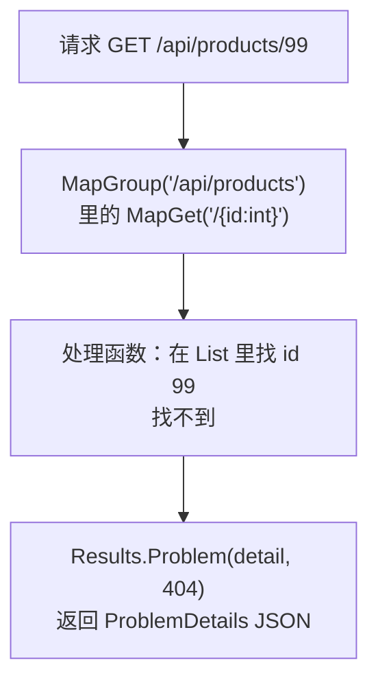

# 第 15A 章 Minimal API 接口与 ProblemDetails 错误格式

## 这一章解决什么问题

前面的后端是一个 Node.js 模拟接口，作用是让你不装后端也能学前端。真实项目里，后端由正式的 Web 框架实现。第 15 章用 .NET 10 的 ASP.NET Core Minimal API 写一个功能相同的后端，分三步：本章写出后端的 6 个接口，并看清它的错误格式和模拟接口有什么不同；第 15B 章把前端接上去；第 15C 章把前端打包进后端，前后端合成一个网站。

本章只讲一个技术点：**Minimal API 接口与 ProblemDetails 错误格式**。前端代码本章不改。

## 开始之前

- 前面你已经会了：开发代理和 `.env`（第 11C、11D 章）、`api.ts` 写请求（第 12A–12C 章）、`ApiError` 和字段错误（第 13C 章）、登录与 Context（第 14A–14C 章）。
- 起点代码：前端仓库 `code/ch14C/price-list`（不含练习答案），本章不改它。
- 需要 .NET 10 SDK。安装 Visual Studio 2026 时勾选「ASP.NET 和 Web 开发」工作负载会一起装上；也可以单独从 `https://dotnet.microsoft.com/download` 下载 .NET 10 SDK。在 PowerShell 里执行 `dotnet --version`，显示 `10.0.xxx` 就可以了（实测 10.0.403）。⚠️ Windows 安装过程未实机验证。
- 预计耗时：35 分钟。

本章的目录结构：前端和后端两个项目放在同一个上级文件夹里，**并排**。

```text
D:\react-study\
├── price-list\      ← 前端（第 1A–14C 章的项目）
└── PriceApi\        ← 后端（第 15A 章新建）
```

## 正文

### 15A.1 Minimal API 是什么

**白话定义**：Minimal API 是 ASP.NET Core 写 HTTP 接口最简洁的方式：在 `Program.cs` 里用 `app.MapGet("/路径", 处理函数)` 这样一行登记一个接口，处理函数的返回值（`Results.Ok(...)`、`Results.NotFound()` 等）决定状态码和响应内容。出错时，ASP.NET Core 习惯用 **ProblemDetails**（问题详情，RFC 9457 标准定义的一种 JSON 错误格式）来描述错误：`{ "title": ..., "status": ..., "detail": ... }`，校验失败时多一个 `errors`。

**业务场景**：价格清单的后端需要提供和模拟接口一模一样的 6 个接口：查列表、查一个、新增、修改、删除、登录。规则也一样：编号不能重复、有库存不能删、用户名密码要对。

**反例（什么时候不该用）**：接口很多、业务分层复杂（几十个实体、每个都有一套增删改查和权限）时，把所有接口都堆在一个 `Program.cs` 里会很难维护，要按业务拆成多个文件，或者改用 Controller 的写法。本章只有 6 个接口，放在一个文件里最直观。数据放在内存 `List` 里也只是为了演示，真实项目要接数据库。

#### 🖼 图解



#### 💻 新建项目

> ⚠️ 本小节的 Visual Studio 2026 界面操作未实机验证（实测环境没有 Visual Studio），菜单和选项名称以你的版本为准。命令行方式已实测。

**用 Visual Studio 2026：**

1. 菜单「文件 → 新建 → 项目」。
2. 搜索「ASP.NET Core 空」，选它（C#），点「下一步」。
3. 项目名称填 `PriceApi`，位置选 `D:\react-study`，勾选「将解决方案和项目放在同一目录中」，点「下一步」。
4. 框架选「.NET 10.0」，「配置 HTTPS」**不勾选**（本章用 http），点「创建」。

📷 截图占位 ch15-01：新建项目对话框

**或者用命令行：**

```powershell
# 在 D:\react-study 目录执行
dotnet new web -n PriceApi
```

实测输出：

```text
The template "ASP.NET Core Empty" was created successfully.

Processing post-creation actions...
Restoring D:\react-study\PriceApi\PriceApi.csproj:
Restore succeeded.
```

两种方式建出的项目相同。模板的 `Program.cs` 只有四行，访问 `/` 返回 `Hello World!`。

**固定端口。** 模板给的端口是随机的（实测是 5294），每次新建都不一样。把它固定成 5080，前端的代理才好配置。用下面的内容整个替换 `Properties/launchSettings.json`：

```json
{
  "$schema": "https://json.schemastore.org/launchsettings.json",
  "profiles": {
    "http": {
      "commandName": "Project",
      "dotnetRunMessages": true,
      "launchBrowser": false,
      "applicationUrl": "http://localhost:5080",
      "environmentVariables": {
        "ASPNETCORE_ENVIRONMENT": "Development"
      }
    }
  }
}
```

`launchBrowser: false`：启动时不自动打开浏览器。前端开发时你访问的是 Vite 的 5173，不是 5080。

#### 💻 最小可运行代码

用下面的内容整个替换 `PriceApi/Program.cs`：

```csharp
// Program.cs
// 产品价格接口：和前 14 章的模拟接口功能相同，改用 ASP.NET Core Minimal API 实现。
// 数据放在内存 List 里：程序运行期间增删改一直有效，重启后恢复成初始的 5 个产品。

var builder = WebApplication.CreateBuilder(args);
var app = builder.Build();

// 初始数据。List 不是线程安全的，多个请求同时修改时用 dataLock 排队
var products = new List<Product>
{
    new(1, "P-001", "凸阵探头 C5-2", "探头", 12800m, 6),
    new(2, "P-002", "线阵探头 L12-5", "探头", 15600m, 3),
    new(3, "H-001", "便携彩超主机", "主机", 168000m, 2),
    new(4, "C-001", "耦合剂 250ml", "耗材", 18m, 120),
    new(5, "C-002", "探头保护套", "耗材", 6.5m, 0),
};
var dataLock = new object();
string[] categories = ["探头", "主机", "耗材"];
var users = new List<User>
{
    new("admin", "123456", "系统管理员", "admin"),
    new("zhangsan", "123456", "张三", "sales"),
};

// 每个 /api 请求：打印一行日志，并故意延迟 500 毫秒，让前端的「加载中」「保存中」看得见
app.Use(async (context, next) =>
{
    if (context.Request.Path.StartsWithSegments("/api"))
    {
        Console.WriteLine($"{DateTime.Now:HH:mm:ss} {context.Request.Method} {context.Request.Path}");
        await Task.Delay(500);
    }
    await next();
});

// 后端校验：前端校验过了也要再查一遍。selfId 是修改时自己的 id，查重时排除自己
Dictionary<string, string[]> Validate(ProductInput input, int? selfId)
{
    var errors = new Dictionary<string, string[]>();
    var code = input.Code?.Trim() ?? "";
    if (code == "")
    {
        errors["code"] = ["请填写编号"];
    }
    else if (products.Any(p => p.Code == code && p.Id != selfId))
    {
        errors["code"] = [$"编号 {code} 已存在"];
    }
    if (string.IsNullOrWhiteSpace(input.Name)) errors["name"] = ["请填写名称"];
    if (!categories.Contains(input.Category)) errors["category"] = ["分类必须是探头、主机或耗材"];
    if (!(input.Price > 0)) errors["price"] = ["单价必须大于 0"];
    if (input.Stock is not { } stock || stock < 0 || stock != Math.Floor(stock)) errors["stock"] = ["库存必须是不小于 0 的整数"];
    return errors;
}

// 校验通过后，把提交的内容变成 Product
Product ToProduct(int id, ProductInput input) =>
    new(id, input.Code!.Trim(), input.Name!.Trim(), input.Category!, input.Price!.Value, (int)input.Stock!.Value);

// 产品相关的接口都以 /api/products 开头，用 MapGroup 统一加前缀
var api = app.MapGroup("/api/products");

api.MapGet("/", () =>
{
    lock (dataLock) return Results.Ok(products.ToList());
});

api.MapGet("/{id:int}", (int id) =>
{
    lock (dataLock)
    {
        var product = products.FirstOrDefault(p => p.Id == id);
        // 找不到时返回 404，内容是 ProblemDetails 格式：{ title, status, detail }
        return product is null
            ? Results.Problem(detail: $"产品 {id} 不存在", statusCode: StatusCodes.Status404NotFound)
            : Results.Ok(product);
    }
});

api.MapPost("/", (ProductInput input) =>
{
    lock (dataLock)
    {
        var errors = Validate(input, null);
        if (errors.Count > 0)
        {
            // 400 + ProblemDetails，多一个 errors：{ "code": ["编号 P-001 已存在"] }，每个字段是字符串数组
            return Results.ValidationProblem(errors, title: "校验失败");
        }
        var product = ToProduct(products.Max(p => (int?)p.Id) + 1 ?? 1, input);
        products.Add(product);
        // 201 Created，响应头 Location 指向新产品的地址
        return Results.Created($"/api/products/{product.Id}", product);
    }
});

api.MapPut("/{id:int}", (int id, ProductInput input) =>
{
    lock (dataLock)
    {
        var index = products.FindIndex(p => p.Id == id);
        if (index < 0)
        {
            return Results.Problem(detail: $"产品 {id} 不存在", statusCode: StatusCodes.Status404NotFound);
        }
        var errors = Validate(input, id);
        if (errors.Count > 0)
        {
            return Results.ValidationProblem(errors, title: "校验失败");
        }
        var updated = ToProduct(id, input);
        products[index] = updated;
        return Results.Ok(updated);
    }
});

api.MapDelete("/{id:int}", (int id) =>
{
    lock (dataLock)
    {
        var product = products.FirstOrDefault(p => p.Id == id);
        if (product is null)
        {
            return Results.Problem(detail: $"产品 {id} 不存在", statusCode: StatusCodes.Status404NotFound);
        }
        // 业务规则：还有库存的产品不能删除
        if (product.Stock > 0)
        {
            return Results.Problem(detail: $"{product.Name} 还有库存 {product.Stock}，不能删除", statusCode: StatusCodes.Status409Conflict);
        }
        products.Remove(product);
        return Results.NoContent();
    }
});

app.MapPost("/api/login", (LoginInput input) =>
{
    var user = users.FirstOrDefault(u => u.Username == input.Username && u.Password == input.Password);
    if (user is null)
    {
        return Results.Problem(detail: "用户名或密码错误", statusCode: StatusCodes.Status401Unauthorized);
    }
    // 不返回密码
    return Results.Ok(new { user.Username, user.Name, user.Role });
});

app.Run();

// 数据类型。record 是只用来装数据的类型，属性名在 JSON 里自动变成小写开头：Id → id
record Product(int Id, string Code, string Name, string Category, decimal Price, int Stock);

// 新增、修改时提交的内容。全部可空：前端漏传某个字段时不会直接报 400，而是走上面的校验，给出中文提示
record ProductInput(string? Code, string? Name, string? Category, decimal? Price, decimal? Stock);

record LoginInput(string? Username, string? Password);

record User(string Username, string Password, string Name, string Role);
```

启动后端：

```powershell
# 在 D:\react-study\PriceApi 目录执行（开着不要关）
dotnet run
```

用 Visual Studio 时按 `F5` 或 `Ctrl + F5`，启动配置选「http」（⚠️ 未实机验证）。实测输出：

```text
Using launch settings from D:\react-study\PriceApi\Properties\launchSettings.json...
Building...
info: Microsoft.Hosting.Lifetime[14]
      Now listening on: http://localhost:5080
info: Microsoft.Hosting.Lifetime[0]
      Application started. Press Ctrl+C to shut down.
info: Microsoft.Hosting.Lifetime[0]
      Hosting environment: Development
```

#### 🔍 拆解运行结果

在浏览器里打开 `http://localhost:5080/api/products`，看到 5 个产品的 JSON，和模拟接口完全一样：

```json
[{"id":1,"code":"P-001","name":"凸阵探头 C5-2","category":"探头","price":12800,"stock":6}, ...]
```

终端里每个请求打印一行，例如 `02:11:11 GET /api/products`。

C# 里属性名是大写开头（`Id`、`Code`），JSON 里却是小写开头（`id`、`code`）。这是 ASP.NET Core 的默认设置：输出 JSON 时自动转成小写开头的驼峰命名（camelCase），读取请求体时也不区分大小写。所以前端的 `Product` 类型一个字都不用改。

几处关键代码：

| 代码 | 说明 |
| --- | --- |
| `app.MapGroup("/api/products")` | 建一组接口，组里每个接口的路径都自动加上这个前缀。`api.MapGet("/{id:int}", ...)` 的完整路径就是 `/api/products/{id}` |
| `"/{id:int}"` | 路由参数，`:int` 表示只匹配整数。`(int id)` 参数会自动拿到地址里的值 |
| `(ProductInput input)` | 参数是一个 record 类型时，Minimal API 自动把请求体的 JSON 转成这个对象 |
| `Results.Ok(x)` / `Results.Created(地址, x)` / `Results.NoContent()` | 200、201、204 |
| `Results.Problem(detail: ..., statusCode: 404)` | 返回 ProblemDetails |
| `Results.ValidationProblem(errors, title: "校验失败")` | 400 + 带 `errors` 的 ProblemDetails |
| `lock (dataLock) { ... }` | 多个请求可能同时修改同一个 `List`，`lock` 让它们排队执行 |
| `record Product(int Id, ...)` | record（记录类型）：一行定义一个只装数据的类型，自动带属性和构造函数 |
| `app.Use(async (context, next) => ...)` | 中间件：每个请求都先经过这里。这里用它打印日志、延迟 500 毫秒 |

用 curl 实测各接口出错时的返回（`curl` 是 Windows 10/11 自带的命令行工具，在 PowerShell 里要写成 `curl.exe`，⚠️ Windows 下的写法未实机验证）。和模拟接口对比：

| 情况 | 模拟接口（第 11A–14C 章） | Minimal API（本章，实测） |
| --- | --- | --- |
| 产品不存在 | 404 `{"message":"产品 99 不存在"}` | 404 `{"type":"...","title":"Not Found","status":404,"detail":"产品 99 不存在"}` |
| 校验失败 | 400 `{"message":"校验失败","errors":{"code":"编号 P-001 已存在"}}` | 400 `{"type":"...","title":"校验失败","status":400,"errors":{"code":["编号 P-001 已存在"]}}` |
| 还有库存不能删 | 409 `{"message":"..."}` | 409 `{..."title":"Conflict","status":409,"detail":"凸阵探头 C5-2 还有库存 6，不能删除"}` |
| 登录失败 | 401 `{"message":"用户名或密码错误"}` | 401 `{..."title":"Unauthorized","status":401,"detail":"用户名或密码错误"}` |
| 不写 `Content-Type` | 415 + 一句提示 | 415，没有内容（ASP.NET Core 自动返回） |

两个差别决定了前端要改什么：

1. 具体原因在 `detail` 里，不在 `message` 里。
2. `errors` 里每个字段是**字符串数组**：`["编号 P-001 已存在"]`。一个字段可能同时有多条错误，所以 ASP.NET Core 用数组。

另外，ProblemDetails 的响应头是 `Content-Type: application/problem+json`，不是普通的 `application/json`，但 `response.json()` 照样能解析。

#### 改坏一处试试

把 `record ProductInput` 里的 `decimal? Stock` 改成 `int? Stock`（看起来更合理，库存本来就是整数），并相应改掉 `Validate` 和 `ToProduct` 里用到 `Stock` 的地方。新增一个库存为 1.5 的产品，实测返回的**不是**字段错误，而是：

```text
HTTP/1.1 400 Bad Request
Content-Type: text/plain; charset=utf-8

Microsoft.AspNetCore.Http.BadHttpRequestException: Failed to read parameter "ProductInput input" from the request body as JSON.
```

后面还跟着一大段异常堆栈。1.5 转不成 `int`，在**进入处理函数之前**就失败了，`Validate` 根本没有机会执行，前端也拿不到 `errors.stock`。所以 `ProductInput` 里的数字都声明成 `decimal?`：先把用户提交的值原样接住，再由 `Validate` 判断是否合法，给出中文提示。改回 `decimal?`。

（这段异常堆栈只在开发环境 `Development` 下显示，正式环境只返回 400，不会把程序内部细节暴露给外人。⚠️ 正式环境的行为未单独实测。）

## ⚠️ 踩坑警告

| 现象 | 原因 | 怎么改 |
| --- | --- | --- |
| 每次新建项目端口都不一样 | 模板随机生成 `launchSettings.json` 里的端口 | 把 `applicationUrl` 改成固定的 `http://localhost:5080` |
| 库存填 1.5，返回一大段英文异常而不是中文提示 | `ProductInput` 里声明成了 `int?`，JSON 转换在校验之前就失败了 | 接收用的类型声明成 `decimal?` 等宽松类型，在 `Validate` 里判断 |
| 前端代码以为错误原因在 `message` 里，换成 Minimal API 后读不到 | ProblemDetails 的原因在 `detail`，字段错误是字符串数组 | 下一章在 `api.ts` 里按新格式解析 |

## 🎯 动手练习

**练习 1：加一个分类接口**

加一个接口 `GET /api/categories`，返回分类数组 `["探头","主机","耗材"]`。

验收标准：

- 后端运行时，浏览器打开 `http://localhost:5080/api/categories`，显示 `["探头","主机","耗材"]`。

提示：`Program.cs` 里已经有一个 `categories` 变量。这个接口不在 `/api/products` 这一组里，用 `app.MapGet` 单独登记。

**练习 2：名称最多 20 个字**

在 `Validate` 里加一条规则：名称超过 20 个字时，`errors.name` 是「名称不能超过 20 个字」。

验收标准：

- 用 curl 新增一个名称有 21 个字的产品，返回 400，内容里有 `"errors":{"name":["名称不能超过 20 个字"]}`。

卡住了看文末参考答案。

## 📌 一句话总结

MapGroup 加 MapGet/MapPost 登记接口，出错返回 ProblemDetails，原因在 detail。

## 下一章

后端已经能用了，但前端还连着模拟接口。第 15B 章把前端接到 Minimal API 上，只改代理端口和 `api.ts`。

---

<!-- 以下是参考答案，先自己动手，卡住了再往下翻 -->


## 参考答案

两个练习都改 `Program.cs`，下面是都做完后的版本。

### 练习 1

思路：`app.MapGet("/api/categories", () => Results.Ok(categories))` 一行就够。实测返回 `["探头","主机","耗材"]`。

### 练习 2

思路：在「请填写名称」那条判断后面加 `else if`，用 `Trim().Length` 取字数。字段错误用字符串数组，和其他规则一样。实测用 curl 提交 21 个字的名称，返回：

```text
{"type":"https://tools.ietf.org/html/rfc9110#section-15.5.1","title":"校验失败","status":400,"errors":{"name":["名称不能超过 20 个字"]}}
```

```csharp
// Program.cs
// 两个练习都做完后的版本
// 产品价格接口：和前 14 章的模拟接口功能相同，改用 ASP.NET Core Minimal API 实现。
// 数据放在内存 List 里：程序运行期间增删改一直有效，重启后恢复成初始的 5 个产品。

var builder = WebApplication.CreateBuilder(args);
var app = builder.Build();

// 初始数据。List 不是线程安全的，多个请求同时修改时用 dataLock 排队
var products = new List<Product>
{
    new(1, "P-001", "凸阵探头 C5-2", "探头", 12800m, 6),
    new(2, "P-002", "线阵探头 L12-5", "探头", 15600m, 3),
    new(3, "H-001", "便携彩超主机", "主机", 168000m, 2),
    new(4, "C-001", "耦合剂 250ml", "耗材", 18m, 120),
    new(5, "C-002", "探头保护套", "耗材", 6.5m, 0),
};
var dataLock = new object();
string[] categories = ["探头", "主机", "耗材"];
var users = new List<User>
{
    new("admin", "123456", "系统管理员", "admin"),
    new("zhangsan", "123456", "张三", "sales"),
};

// 每个 /api 请求：打印一行日志，并故意延迟 500 毫秒，让前端的「加载中」「保存中」看得见
app.Use(async (context, next) =>
{
    if (context.Request.Path.StartsWithSegments("/api"))
    {
        Console.WriteLine($"{DateTime.Now:HH:mm:ss} {context.Request.Method} {context.Request.Path}");
        await Task.Delay(500);
    }
    await next();
});

// 后端校验：前端校验过了也要再查一遍。selfId 是修改时自己的 id，查重时排除自己
Dictionary<string, string[]> Validate(ProductInput input, int? selfId)
{
    var errors = new Dictionary<string, string[]>();
    var code = input.Code?.Trim() ?? "";
    if (code == "")
    {
        errors["code"] = ["请填写编号"];
    }
    else if (products.Any(p => p.Code == code && p.Id != selfId))
    {
        errors["code"] = [$"编号 {code} 已存在"];
    }
    if (string.IsNullOrWhiteSpace(input.Name)) errors["name"] = ["请填写名称"];
    // 练习 2：名称最多 20 个字
    else if (input.Name.Trim().Length > 20) errors["name"] = ["名称不能超过 20 个字"];
    if (!categories.Contains(input.Category)) errors["category"] = ["分类必须是探头、主机或耗材"];
    if (!(input.Price > 0)) errors["price"] = ["单价必须大于 0"];
    if (input.Stock is not { } stock || stock < 0 || stock != Math.Floor(stock)) errors["stock"] = ["库存必须是不小于 0 的整数"];
    return errors;
}

// 校验通过后，把提交的内容变成 Product
Product ToProduct(int id, ProductInput input) =>
    new(id, input.Code!.Trim(), input.Name!.Trim(), input.Category!, input.Price!.Value, (int)input.Stock!.Value);

// 产品相关的接口都以 /api/products 开头，用 MapGroup 统一加前缀
// 练习 1：分类列表。不在 /api/products 这一组里，单独登记
app.MapGet("/api/categories", () => Results.Ok(categories));

var api = app.MapGroup("/api/products");

api.MapGet("/", () =>
{
    lock (dataLock) return Results.Ok(products.ToList());
});

api.MapGet("/{id:int}", (int id) =>
{
    lock (dataLock)
    {
        var product = products.FirstOrDefault(p => p.Id == id);
        // 找不到时返回 404，内容是 ProblemDetails 格式：{ title, status, detail }
        return product is null
            ? Results.Problem(detail: $"产品 {id} 不存在", statusCode: StatusCodes.Status404NotFound)
            : Results.Ok(product);
    }
});

api.MapPost("/", (ProductInput input) =>
{
    lock (dataLock)
    {
        var errors = Validate(input, null);
        if (errors.Count > 0)
        {
            // 400 + ProblemDetails，多一个 errors：{ "code": ["编号 P-001 已存在"] }，每个字段是字符串数组
            return Results.ValidationProblem(errors, title: "校验失败");
        }
        var product = ToProduct(products.Max(p => (int?)p.Id) + 1 ?? 1, input);
        products.Add(product);
        // 201 Created，响应头 Location 指向新产品的地址
        return Results.Created($"/api/products/{product.Id}", product);
    }
});

api.MapPut("/{id:int}", (int id, ProductInput input) =>
{
    lock (dataLock)
    {
        var index = products.FindIndex(p => p.Id == id);
        if (index < 0)
        {
            return Results.Problem(detail: $"产品 {id} 不存在", statusCode: StatusCodes.Status404NotFound);
        }
        var errors = Validate(input, id);
        if (errors.Count > 0)
        {
            return Results.ValidationProblem(errors, title: "校验失败");
        }
        var updated = ToProduct(id, input);
        products[index] = updated;
        return Results.Ok(updated);
    }
});

api.MapDelete("/{id:int}", (int id) =>
{
    lock (dataLock)
    {
        var product = products.FirstOrDefault(p => p.Id == id);
        if (product is null)
        {
            return Results.Problem(detail: $"产品 {id} 不存在", statusCode: StatusCodes.Status404NotFound);
        }
        // 业务规则：还有库存的产品不能删除
        if (product.Stock > 0)
        {
            return Results.Problem(detail: $"{product.Name} 还有库存 {product.Stock}，不能删除", statusCode: StatusCodes.Status409Conflict);
        }
        products.Remove(product);
        return Results.NoContent();
    }
});

app.MapPost("/api/login", (LoginInput input) =>
{
    var user = users.FirstOrDefault(u => u.Username == input.Username && u.Password == input.Password);
    if (user is null)
    {
        return Results.Problem(detail: "用户名或密码错误", statusCode: StatusCodes.Status401Unauthorized);
    }
    // 不返回密码
    return Results.Ok(new { user.Username, user.Name, user.Role });
});

app.Run();

// 数据类型。record 是只用来装数据的类型，属性名在 JSON 里自动变成小写开头：Id → id
record Product(int Id, string Code, string Name, string Category, decimal Price, int Stock);

// 新增、修改时提交的内容。全部可空：前端漏传某个字段时不会直接报 400，而是走上面的校验，给出中文提示
record ProductInput(string? Code, string? Name, string? Category, decimal? Price, decimal? Stock);

record LoginInput(string? Username, string? Password);

record User(string Username, string Password, string Name, string Role);
```
