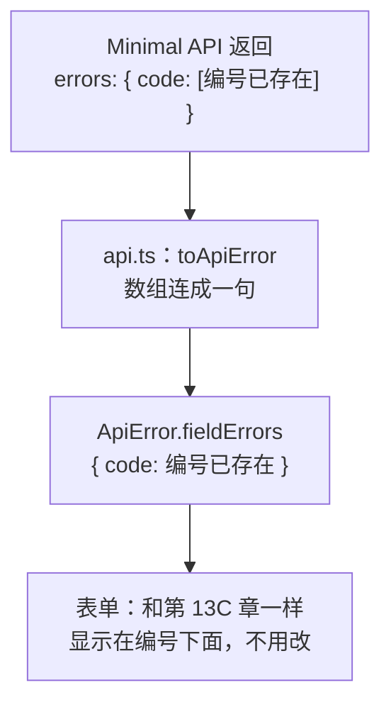

# 第 15B 章 前端对接：代理目标和错误格式

## 这一章解决什么问题

Minimal API 已经在 5080 端口运行，前端还连着 3001 的模拟接口。本章把前端接过去。你会看到：组件、Hook、表单一行都不用改；要改的只有开发代理的端口，和 `api.ts` 读错误的方式。这正是第 12A 章把接口调用集中到 `api.ts` 的好处。

本章只讲一个技术点：**前端对接新的错误格式**。

## 开始之前

- 上一章你已经会了：用 Minimal API 写出 6 个接口，出错时返回 ProblemDetails。
- 起点代码：前端 `code/ch14C/price-list`，后端 `code/ch15A/PriceApi`（都不含练习答案）。
- 本章不再需要 `npm run mock`，把那个终端关掉。`mock-server` 文件夹可以留着不管。
- 预计耗时：25 分钟。

## 正文

### 15B.1 前端对接是什么

**白话定义**：前端连新后端只需要改两处。开发代理的目标从 3001 改成 5080；`api.ts` 里把失败响应转成 `ApiError` 的函数，改成读 ProblemDetails 的 `detail`、`title`，并把 `errors` 里每个字段的数组连成一句话。`ApiError` 交给表单和列表的格式不变，所以页面代码不用改。

**业务场景**：公司后端从一种技术换成另一种，或者从测试环境换到正式环境，只要接口路径和数据字段没变，前端改的就只有 `vite.config.ts` 和 `api.ts`。

**反例（什么时候不该用）**：不要在页面组件里直接读 `body.detail`、`body.errors.code[0]` 这种后端格式。那样后端格式一变，就要改遍所有页面。后端格式只在 `api.ts` 一个地方解析，转换成前端自己的 `ApiError`。

#### 🖼 图解



#### 💻 最小可运行代码

**① 代理目标。** 打开前端项目 `D:\react-study\price-list`，用下面的内容整个替换 `vite.config.ts`，只改了端口和注释：

```ts
import react from '@vitejs/plugin-react'
import { defineConfig } from 'vite'

// https://vite.dev/config/
export default defineConfig({
  plugins: [react()],
  server: {
    // 开发代理：/api 开头的请求转发给 5080 端口的 Minimal API（第 11A–11D 章是 3001 端口的模拟接口）
    proxy: {
      '/api': 'http://localhost:5080',
    },
  },
})
```

**② 错误格式。** 用下面的内容整个替换 `src/api.ts`。和第 14C 章相比：多了 `ProblemDetails` 类型；`toApiError` 改成读 `detail` / `title`，并把 `errors` 的数组连成一句话。其余函数不变。

```ts
// src/api.ts
// 所有「写」接口集中放在这里。页面和 Hook 只调用这些函数，不直接拼地址、写请求头
import type { Product, User } from './types.ts'

// 新增、修改时提交的内容：Product 去掉 id。id 由服务器分配，前端不能自己定
export type ProductInput = Omit<Product, 'id'>

const BASE = import.meta.env.VITE_API_BASE

// 接口失败时抛出的错误。比普通 Error 多带两样东西：HTTP 状态码，以及逐个字段的校验错误（每个字段一句话）
export class ApiError extends Error {
  status: number
  // 例如 { code: '编号 P-001 已存在' }。没有字段错误时是空对象
  fieldErrors: Record<string, string>

  constructor(message: string, status: number, fieldErrors: Record<string, string>) {
    // super(...) 调用父类 Error 的构造函数，设置 message
    super(message)
    this.status = status
    this.fieldErrors = fieldErrors
  }
}

// ASP.NET Core 返回错误时用的 ProblemDetails 格式（RFC 9457 标准）。
// 404、409、401 时有 title 和 detail；校验失败时多一个 errors，每个字段对应一个字符串数组
type ProblemDetails = {
  title?: string
  status?: number
  detail?: string
  errors?: Record<string, string[]>
}

// 把失败的响应转换成 ApiError
async function toApiError(response: Response): Promise<ApiError> {
  try {
    const body: ProblemDetails = await response.json()
    // 每个字段可能有多条错误，表单里一个字段只显示一行，用「；」连起来
    const fieldErrors: Record<string, string> = {}
    for (const [field, messages] of Object.entries(body.errors ?? {})) {
      fieldErrors[field] = messages.join('；')
    }
    // detail 是具体原因（「产品 99 不存在」），没有时退回 title（「校验失败」「Not Found」）
    return new ApiError(body.detail ?? body.title ?? `服务器返回 ${response.status}`, response.status, fieldErrors)
  } catch {
    // 响应内容不是 JSON（例如代理返回的 502、后端的异常页），只能用状态码
    return new ApiError(`服务器返回 ${response.status}`, response.status, {})
  }
}

export async function createProduct(input: ProductInput): Promise<Product> {
  const response = await fetch(`${BASE}/products`, {
    // 默认是 GET，新增要写明 POST
    method: 'POST',
    // 告诉服务器：请求体是 JSON。不写的话很多后端不知道怎么解析，会拒绝
    headers: { 'Content-Type': 'application/json' },
    // 请求体只能是字符串，把对象转成 JSON 文本
    body: JSON.stringify(input),
  })
  if (!response.ok) {
    throw await toApiError(response)
  }
  // 服务器返回保存后的产品，带上了它分配的 id
  const saved: Product = await response.json()
  return saved
}

export async function updateProduct(id: number, input: ProductInput): Promise<Product> {
  const response = await fetch(`${BASE}/products/${id}`, {
    method: 'PUT',
    headers: { 'Content-Type': 'application/json' },
    body: JSON.stringify(input),
  })
  if (!response.ok) {
    throw await toApiError(response)
  }
  const saved: Product = await response.json()
  return saved
}

export async function deleteProduct(id: number): Promise<void> {
  const response = await fetch(`${BASE}/products/${id}`, { method: 'DELETE' })
  if (!response.ok) {
    throw await toApiError(response)
  }
  // 删除成功返回 204，没有内容，不要调用 response.json()
}

// 登录：用户名密码正确时返回用户信息（不含密码）；错误时服务器返回 401，这里抛出 ApiError
export async function login(username: string, password: string): Promise<User> {
  const response = await fetch(`${BASE}/login`, {
    method: 'POST',
    headers: { 'Content-Type': 'application/json' },
    body: JSON.stringify({ username, password }),
  })
  if (!response.ok) {
    throw await toApiError(response)
  }
  const user: User = await response.json()
  return user
}
```

`Object.entries(obj)` 把对象变成「键、值」对的数组：`{ code: ['编号已存在'] }` 变成 `[['code', ['编号已存在']]]`。`for (const [field, messages] of ...)` 依次取出每一对，并用数组解构把键和值分别放进 `field`、`messages` 两个变量。

**③ 详情页、编辑页的加载错误。** `useProduct.ts` 没有经过 `api.ts`，自己读了错误内容，也要改。用下面的内容整个替换 `src/hooks/useProduct.ts`，只改了读错误的那三行：

```ts
// src/hooks/useProduct.ts
// 只加载一个产品。id 来自地址栏，所以 id 要写进依赖数组：从 /products/1 换到 /products/2 时重新加载
import { useEffect, useState } from 'react'
import type { Product } from '../types.ts'

export type ProductState =
  | { status: 'loading' }
  | { status: 'error'; message: string }
  | { status: 'success'; product: Product }

export function useProduct(id: string | undefined) {
  // 记下「这份结果是哪个 id 的」。还没有结果时是 null
  const [loaded, setLoaded] = useState<{ id: string | undefined; state: ProductState } | null>(null)

  useEffect(() => {
    let ignore = false

    async function load() {
      try {
        const response = await fetch(`${import.meta.env.VITE_API_BASE}/products/${id}`)
        if (!response.ok) {
          // Minimal API 出错时返回 ProblemDetails：{ title, status, detail }，detail 是具体原因
          const body: { title?: string; detail?: string } = await response.json()
          throw new Error(body.detail ?? body.title ?? `服务器返回 ${response.status}`)
        }
        const product: Product = await response.json()
        if (!ignore) {
          setLoaded({ id, state: { status: 'success', product } })
        }
      } catch (err) {
        if (!ignore) {
          setLoaded({ id, state: { status: 'error', message: err instanceof Error ? err.message : String(err) } })
        }
      }
    }

    load()
    return () => {
      ignore = true
    }
  }, [id])

  // 派生出当前状态：还没有结果，或者结果属于上一个 id（刚从 /products/1 换到 /products/2），都算「加载中」
  // 这样就不用在 effect 里先 setState 成 loading，少一次多余的渲染
  return loaded !== null && loaded.id === id ? loaded.state : { status: 'loading' as const }
}
```

两个终端分别运行：

```powershell
# 终端 1，在 D:\react-study\PriceApi 目录执行
dotnet run
```

```powershell
# 终端 2，在 D:\react-study\price-list 目录执行
npm run dev
```

#### 🔍 拆解运行结果

打开 `http://localhost:5173/`，实测和第 14C 章的使用体验完全一样，只是请求都到了 Minimal API（终端 1 里能看到每个请求）：

| 操作 | 页面 | 请求和状态码 |
| --- | --- | --- |
| 打开列表 | 先「加载中…」，约半秒后 5 行 | `GET /api/products` 200（两次，StrictMode） |
| 用 zhangsan 和错误密码登录 | 「登录失败：用户名或密码错误」 | `POST /api/login` 401 |
| 用 admin 登录后删除凸阵探头 | 「删除失败：凸阵探头 C5-2 还有库存 6，不能删除」 | `DELETE /api/products/1` 409 |
| 删除探头保护套 | 这一行消失 | `DELETE /api/products/5` 204 |
| 耦合剂「入库 +1」 | 库存 120 变 121 | `PUT /api/products/4` 200 |
| 录入编号 P-001 | 编号下面「编号 P-001 已存在」，底部「保存失败：请修改标红的项」 | `POST /api/products` 400 |
| 录入 P-003 微凸探头 C8-4 | 「已保存：微凸探头 C8-4（编号 P-003，id 5）」 | `POST /api/products` 201 |
| 编辑便携彩超主机，编号改成 P-002 | 编号下面「编号 P-002 已存在」 | `PUT /api/products/3` 400 |
| 编号改成 H-002 保存 | 跳回列表，第三行编号 H-002 | `PUT /api/products/3` 200 |

新产品的 id 是 5 而不是 6：刚才删掉了 id 5 的探头保护套，Minimal API 用「当前最大 id 加 1」，现在最大是 4。

#### 改坏一处试试

**① 用回第 14C 章的 `api.ts`。** 实测：编号重复时，编号下面**照样显示**「编号 P-001 已存在」；但删除凸阵探头时，只显示「删除失败：服务器返回 409」，原因丢了。

第一种情况是碰巧对了：旧代码把 `["编号 P-001 已存在"]` 这个数组当成字符串直接放进页面，只有一个元素的数组显示出来恰好就是那句话。如果一个字段有两条错误，就会变成两句话直接连在一起，中间没有分隔。第二种情况旧代码找的是 `message`，ProblemDetails 里没有这个字段，只能退回状态码。只有读对字段，错误才显示得可靠。改回本章的 `api.ts`。

**② 停掉后端。** 在终端 1 按 `Ctrl + C`，刷新页面。实测「加载失败：服务器返回 502」，和第 11C 章停掉模拟接口时一样：前端不知道、也不关心后端用什么技术实现。重新 `dotnet run`。

## ⚠️ 踩坑警告

| 现象 | 原因 | 怎么改 |
| --- | --- | --- |
| 页面显示「服务器返回 502」，Vite 终端 `http proxy error ... ECONNREFUSED 127.0.0.1:5080` | 后端没启动，或者端口和 `vite.config.ts` 里写的不一致 | 先 `dotnet run`，看输出的 `Now listening on:` 地址，和代理目标核对 |
| 删除失败只显示「服务器返回 409」，看不到原因 | 前端读的是 `message`，ProblemDetails 的原因在 `detail` | `toApiError` 读 `detail ?? title` |
| 一个字段的两条错误挤在一起显示 | ProblemDetails 的 `errors` 是字符串数组，被当成字符串直接显示 | 用 `messages.join('；')` 连成一句 |
| 改用 CORS 直连后端，控制台报 `blocked by CORS policy` | 后端没有开启 CORS，或者 `WithOrigins` 里的地址和页面地址不一致（比如写成了 `127.0.0.1`） | 后端 `AddCors` + `UseCors`，来源写 `http://localhost:5173`（练习 2） |

## 🎯 动手练习

**练习 1：只在后端加一条规则**

公司规定单价超过 1,000,000 元的产品要财务确认，系统里不能直接录入。只改后端 `Validate`，前端一行都不改，让这条错误显示在单价输入框下面。

验收标准：

- 编辑便携彩超主机，单价改成 1680000 保存：单价下面显示「单价不能超过 1,000,000 元，请联系财务确认」，底部「保存失败：请修改标红的项」。
- 前端的代码文件都没有修改。

提示：C# 里数字可以写成 `1_000_000m`，下划线只是为了好读，`m` 表示 `decimal`。改了 `Program.cs` 要重新 `dotnet run`。

**练习 2：不用代理，改用 CORS**

开发时不走 Vite 代理，前端直接请求 `http://localhost:5080/api/...`。要让浏览器放行，后端必须开启 CORS，允许 `http://localhost:5173` 访问。

验收标准：

- 「网络」里的请求地址是 `http://localhost:5080/api/products/3` 这种完整地址，不再是 `localhost:5173/api/...`。
- 响应头里有 `Access-Control-Allow-Origin: http://localhost:5173`。
- 编辑、保存都正常，没有第 11B 章那样的 `blocked by CORS policy` 报错。

提示：前端新建 `.env.development`，只在开发服务器上覆盖 `VITE_API_BASE`；后端用 `builder.Services.AddCors(...)` 和 `app.UseCors()`。改了 `.env` 文件后 Vite 会自动重启。

卡住了看文末参考答案。

## 📌 一句话总结

换后端只改代理端口和 api.ts，后端的错误格式只在 api.ts 一处解析。

## 下一章

开发时前后端是两个程序、两个端口。第 15C 章把前端打包进后端的 `wwwroot`，部署时只有一个网站。

---

<!-- 以下是参考答案，先自己动手，卡住了再往下翻 -->


## 参考答案

两个练习都只改后端 `Program.cs`，练习 2 另外在前端新建一个文件。

### 练习 1

思路：在单价的那条判断后面加一个 `else if`。后端返回 `errors.price`，前端第 13C 章的 `errorOf('price', ...)` 本来就会显示服务器给的单价错误，所以不用改。这就是把字段错误做成通用机制的好处：后端以后加多少条规则，前端都自动显示。实测单价改成 1680000 保存，单价下面显示「单价不能超过 1,000,000 元，请联系财务确认」。

### 练习 2

思路：CORS 是后端的责任：浏览器要看到响应头 `Access-Control-Allow-Origin` 里有当前页面的来源，才把结果交给页面。`WithOrigins` 只写开发时的 `http://localhost:5173`，不要用 `AllowAnyOrigin()` 放开所有来源。`AllowAnyHeader()` 和 `AllowAnyMethod()` 是因为页面会发带 `Content-Type: application/json` 的 `PUT`、`DELETE` 请求，这类请求浏览器会先发一个 `OPTIONS` 预检请求（preflight）询问是否允许，`UseCors` 会自动应答（⚠️ 预检请求本身未单独实测）。

两个练习都做完后的 `Program.cs`：

```csharp
// Program.cs
// 两个练习都做完后的版本
// 产品价格接口：和前 14 章的模拟接口功能相同，改用 ASP.NET Core Minimal API 实现。
// 数据放在内存 List 里：程序运行期间增删改一直有效，重启后恢复成初始的 5 个产品。

var builder = WebApplication.CreateBuilder(args);
// 练习 2：允许 http://localhost:5173 的页面跨域访问。只放开开发时用的这一个来源，不要写成「允许所有来源」
builder.Services.AddCors(options =>
{
    options.AddDefaultPolicy(policy =>
        policy.WithOrigins("http://localhost:5173")
            // 允许请求头 Content-Type: application/json，以及 PUT、DELETE 这些方法
            .AllowAnyHeader()
            .AllowAnyMethod());
});
var app = builder.Build();
// 在所有接口之前启用，响应里才会带上 Access-Control-Allow-Origin
app.UseCors();

// 初始数据。List 不是线程安全的，多个请求同时修改时用 dataLock 排队
var products = new List<Product>
{
    new(1, "P-001", "凸阵探头 C5-2", "探头", 12800m, 6),
    new(2, "P-002", "线阵探头 L12-5", "探头", 15600m, 3),
    new(3, "H-001", "便携彩超主机", "主机", 168000m, 2),
    new(4, "C-001", "耦合剂 250ml", "耗材", 18m, 120),
    new(5, "C-002", "探头保护套", "耗材", 6.5m, 0),
};
var dataLock = new object();
string[] categories = ["探头", "主机", "耗材"];
var users = new List<User>
{
    new("admin", "123456", "系统管理员", "admin"),
    new("zhangsan", "123456", "张三", "sales"),
};

// 每个 /api 请求：打印一行日志，并故意延迟 500 毫秒，让前端的「加载中」「保存中」看得见
app.Use(async (context, next) =>
{
    if (context.Request.Path.StartsWithSegments("/api"))
    {
        Console.WriteLine($"{DateTime.Now:HH:mm:ss} {context.Request.Method} {context.Request.Path}");
        await Task.Delay(500);
    }
    await next();
});

// 后端校验：前端校验过了也要再查一遍。selfId 是修改时自己的 id，查重时排除自己
Dictionary<string, string[]> Validate(ProductInput input, int? selfId)
{
    var errors = new Dictionary<string, string[]>();
    var code = input.Code?.Trim() ?? "";
    if (code == "")
    {
        errors["code"] = ["请填写编号"];
    }
    else if (products.Any(p => p.Code == code && p.Id != selfId))
    {
        errors["code"] = [$"编号 {code} 已存在"];
    }
    if (string.IsNullOrWhiteSpace(input.Name)) errors["name"] = ["请填写名称"];
    if (!categories.Contains(input.Category)) errors["category"] = ["分类必须是探头、主机或耗材"];
    if (!(input.Price > 0)) errors["price"] = ["单价必须大于 0"];
    // 练习 1：新规则只加在后端，前端不用改
    else if (input.Price > 1_000_000m) errors["price"] = ["单价不能超过 1,000,000 元，请联系财务确认"];
    if (input.Stock is not { } stock || stock < 0 || stock != Math.Floor(stock)) errors["stock"] = ["库存必须是不小于 0 的整数"];
    return errors;
}

// 校验通过后，把提交的内容变成 Product
Product ToProduct(int id, ProductInput input) =>
    new(id, input.Code!.Trim(), input.Name!.Trim(), input.Category!, input.Price!.Value, (int)input.Stock!.Value);

// 产品相关的接口都以 /api/products 开头，用 MapGroup 统一加前缀
var api = app.MapGroup("/api/products");

api.MapGet("/", () =>
{
    lock (dataLock) return Results.Ok(products.ToList());
});

api.MapGet("/{id:int}", (int id) =>
{
    lock (dataLock)
    {
        var product = products.FirstOrDefault(p => p.Id == id);
        // 找不到时返回 404，内容是 ProblemDetails 格式：{ title, status, detail }
        return product is null
            ? Results.Problem(detail: $"产品 {id} 不存在", statusCode: StatusCodes.Status404NotFound)
            : Results.Ok(product);
    }
});

api.MapPost("/", (ProductInput input) =>
{
    lock (dataLock)
    {
        var errors = Validate(input, null);
        if (errors.Count > 0)
        {
            // 400 + ProblemDetails，多一个 errors：{ "code": ["编号 P-001 已存在"] }，每个字段是字符串数组
            return Results.ValidationProblem(errors, title: "校验失败");
        }
        var product = ToProduct(products.Max(p => (int?)p.Id) + 1 ?? 1, input);
        products.Add(product);
        // 201 Created，响应头 Location 指向新产品的地址
        return Results.Created($"/api/products/{product.Id}", product);
    }
});

api.MapPut("/{id:int}", (int id, ProductInput input) =>
{
    lock (dataLock)
    {
        var index = products.FindIndex(p => p.Id == id);
        if (index < 0)
        {
            return Results.Problem(detail: $"产品 {id} 不存在", statusCode: StatusCodes.Status404NotFound);
        }
        var errors = Validate(input, id);
        if (errors.Count > 0)
        {
            return Results.ValidationProblem(errors, title: "校验失败");
        }
        var updated = ToProduct(id, input);
        products[index] = updated;
        return Results.Ok(updated);
    }
});

api.MapDelete("/{id:int}", (int id) =>
{
    lock (dataLock)
    {
        var product = products.FirstOrDefault(p => p.Id == id);
        if (product is null)
        {
            return Results.Problem(detail: $"产品 {id} 不存在", statusCode: StatusCodes.Status404NotFound);
        }
        // 业务规则：还有库存的产品不能删除
        if (product.Stock > 0)
        {
            return Results.Problem(detail: $"{product.Name} 还有库存 {product.Stock}，不能删除", statusCode: StatusCodes.Status409Conflict);
        }
        products.Remove(product);
        return Results.NoContent();
    }
});

app.MapPost("/api/login", (LoginInput input) =>
{
    var user = users.FirstOrDefault(u => u.Username == input.Username && u.Password == input.Password);
    if (user is null)
    {
        return Results.Problem(detail: "用户名或密码错误", statusCode: StatusCodes.Status401Unauthorized);
    }
    // 不返回密码
    return Results.Ok(new { user.Username, user.Name, user.Role });
});

app.Run();

// 数据类型。record 是只用来装数据的类型，属性名在 JSON 里自动变成小写开头：Id → id
record Product(int Id, string Code, string Name, string Category, decimal Price, int Stock);

// 新增、修改时提交的内容。全部可空：前端漏传某个字段时不会直接报 400，而是走上面的校验，给出中文提示
record ProductInput(string? Code, string? Name, string? Category, decimal? Price, decimal? Stock);

record LoginInput(string? Username, string? Password);

record User(string Username, string Password, string Name, string Role);
```

前端新建 `D:\react-study\price-list\.env.development`：

```ini
# .env.development
# 练习 2：只在 npm run dev 时使用。直接写后端的完整地址，不经过 Vite 代理，靠后端的 CORS 放行
VITE_API_BASE=http://localhost:5080/api
```

实测：编辑页的请求变成 `GET http://localhost:5080/api/products/3`、`PUT http://localhost:5080/api/products/3`，每个响应都带 `Access-Control-Allow-Origin: http://localhost:5173`，保存后回到列表，便携彩超主机单价变成 170,000。

`.env.development` 只影响开发服务器。打包时用的仍是 `.env` 里的 `/api`；第 15C 章把前后端合成一个网站后，就不需要 CORS 了。
