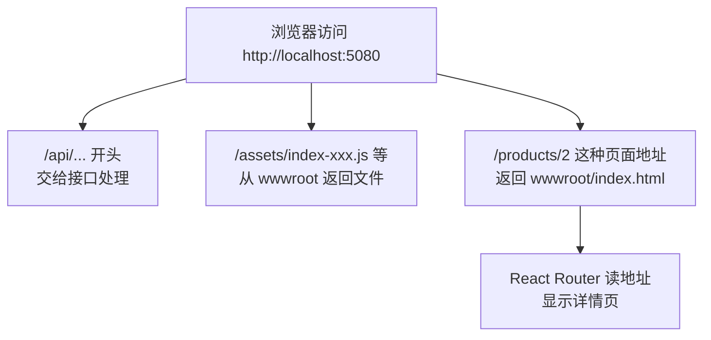

# 第 15C 章 同站点部署：前端打包进后端的 wwwroot

## 这一章解决什么问题

开发时是两个程序：Vite 在 5173，Minimal API 在 5080，靠开发代理连起来。交付时不想让运维维护两个程序，也不想处理跨域。本章把前端打包进后端的 `wwwroot` 文件夹，前端和后端成为同一个网站：同一个地址、同一个端口。

本章只讲一个技术点：**同站点部署**（`wwwroot` + 页面回退）。

## 开始之前

- 上一章你已经会了：前端通过代理连 Minimal API，`api.ts` 读 ProblemDetails。
- 起点代码：前端 `code/ch15B/price-list`，后端 `code/ch15B/PriceApi`（都不含练习答案）。
- 预计耗时：25 分钟。

## 正文

### 15C.1 同站点部署是什么

**白话定义**：ASP.NET Core 可以同时提供接口和静态文件：项目里 `wwwroot` 文件夹的文件按原样提供给浏览器。把前端 `npm run build` 的结果输出到后端的 `wwwroot`，再让后端把「找不到的地址」都返回 `index.html`，前端和后端就成了**同一个网站**：同一个地址、同一个端口，不需要开发代理，也没有跨域问题。

**业务场景**：交付时只部署一个 ASP.NET Core 网站（比如 IIS 上的一个站点），用户访问 `http://服务器:端口/` 打开页面，页面请求同一个地址下的 `/api/...`。运维只需要维护一个程序。

**反例（什么时候不该用）**：前端和后端由不同团队维护、各自独立发布，或者同一套后端要给多个前端（网页、手机 App、其他系统）用时，前后端分开部署更合适：前端放在 Nginx 或 CDN 上，后端单独部署，通过反向代理或 CORS 连接（第 15B 章练习 2）。另外，开发时**不要**用这种方式：每改一行前端代码都要重新打包，没有热更新。开发时仍然是两个终端：`dotnet run` + `npm run dev`。

#### 🖼 图解



#### 💻 最小可运行代码

**① 后端：提供静态文件和页面回退。** 用下面的内容整个替换 `PriceApi/Program.cs`。和第 15A 章相比，只在 `app.Run()` 前面加了四行代码（`UseDefaultFiles`、`UseStaticFiles`、`/api/{**rest}`、`MapFallbackToFile`）和几行注释：

```csharp
// Program.cs
// 产品价格接口：和前 14 章的模拟接口功能相同，改用 ASP.NET Core Minimal API 实现。
// 数据放在内存 List 里：程序运行期间增删改一直有效，重启后恢复成初始的 5 个产品。

var builder = WebApplication.CreateBuilder(args);
var app = builder.Build();

// 初始数据。List 不是线程安全的，多个请求同时修改时用 dataLock 排队
var products = new List<Product>
{
    new(1, "P-001", "凸阵探头 C5-2", "探头", 12800m, 6),
    new(2, "P-002", "线阵探头 L12-5", "探头", 15600m, 3),
    new(3, "H-001", "便携彩超主机", "主机", 168000m, 2),
    new(4, "C-001", "耦合剂 250ml", "耗材", 18m, 120),
    new(5, "C-002", "探头保护套", "耗材", 6.5m, 0),
};
var dataLock = new object();
string[] categories = ["探头", "主机", "耗材"];
var users = new List<User>
{
    new("admin", "123456", "系统管理员", "admin"),
    new("zhangsan", "123456", "张三", "sales"),
};

// 每个 /api 请求：打印一行日志，并故意延迟 500 毫秒，让前端的「加载中」「保存中」看得见
app.Use(async (context, next) =>
{
    if (context.Request.Path.StartsWithSegments("/api"))
    {
        Console.WriteLine($"{DateTime.Now:HH:mm:ss} {context.Request.Method} {context.Request.Path}");
        await Task.Delay(500);
    }
    await next();
});

// 后端校验：前端校验过了也要再查一遍。selfId 是修改时自己的 id，查重时排除自己
Dictionary<string, string[]> Validate(ProductInput input, int? selfId)
{
    var errors = new Dictionary<string, string[]>();
    var code = input.Code?.Trim() ?? "";
    if (code == "")
    {
        errors["code"] = ["请填写编号"];
    }
    else if (products.Any(p => p.Code == code && p.Id != selfId))
    {
        errors["code"] = [$"编号 {code} 已存在"];
    }
    if (string.IsNullOrWhiteSpace(input.Name)) errors["name"] = ["请填写名称"];
    if (!categories.Contains(input.Category)) errors["category"] = ["分类必须是探头、主机或耗材"];
    if (!(input.Price > 0)) errors["price"] = ["单价必须大于 0"];
    if (input.Stock is not { } stock || stock < 0 || stock != Math.Floor(stock)) errors["stock"] = ["库存必须是不小于 0 的整数"];
    return errors;
}

// 校验通过后，把提交的内容变成 Product
Product ToProduct(int id, ProductInput input) =>
    new(id, input.Code!.Trim(), input.Name!.Trim(), input.Category!, input.Price!.Value, (int)input.Stock!.Value);

// 产品相关的接口都以 /api/products 开头，用 MapGroup 统一加前缀
var api = app.MapGroup("/api/products");

api.MapGet("/", () =>
{
    lock (dataLock) return Results.Ok(products.ToList());
});

api.MapGet("/{id:int}", (int id) =>
{
    lock (dataLock)
    {
        var product = products.FirstOrDefault(p => p.Id == id);
        // 找不到时返回 404，内容是 ProblemDetails 格式：{ title, status, detail }
        return product is null
            ? Results.Problem(detail: $"产品 {id} 不存在", statusCode: StatusCodes.Status404NotFound)
            : Results.Ok(product);
    }
});

api.MapPost("/", (ProductInput input) =>
{
    lock (dataLock)
    {
        var errors = Validate(input, null);
        if (errors.Count > 0)
        {
            // 400 + ProblemDetails，多一个 errors：{ "code": ["编号 P-001 已存在"] }，每个字段是字符串数组
            return Results.ValidationProblem(errors, title: "校验失败");
        }
        var product = ToProduct(products.Max(p => (int?)p.Id) + 1 ?? 1, input);
        products.Add(product);
        // 201 Created，响应头 Location 指向新产品的地址
        return Results.Created($"/api/products/{product.Id}", product);
    }
});

api.MapPut("/{id:int}", (int id, ProductInput input) =>
{
    lock (dataLock)
    {
        var index = products.FindIndex(p => p.Id == id);
        if (index < 0)
        {
            return Results.Problem(detail: $"产品 {id} 不存在", statusCode: StatusCodes.Status404NotFound);
        }
        var errors = Validate(input, id);
        if (errors.Count > 0)
        {
            return Results.ValidationProblem(errors, title: "校验失败");
        }
        var updated = ToProduct(id, input);
        products[index] = updated;
        return Results.Ok(updated);
    }
});

api.MapDelete("/{id:int}", (int id) =>
{
    lock (dataLock)
    {
        var product = products.FirstOrDefault(p => p.Id == id);
        if (product is null)
        {
            return Results.Problem(detail: $"产品 {id} 不存在", statusCode: StatusCodes.Status404NotFound);
        }
        // 业务规则：还有库存的产品不能删除
        if (product.Stock > 0)
        {
            return Results.Problem(detail: $"{product.Name} 还有库存 {product.Stock}，不能删除", statusCode: StatusCodes.Status409Conflict);
        }
        products.Remove(product);
        return Results.NoContent();
    }
});

app.MapPost("/api/login", (LoginInput input) =>
{
    var user = users.FirstOrDefault(u => u.Username == input.Username && u.Password == input.Password);
    if (user is null)
    {
        return Results.Problem(detail: "用户名或密码错误", statusCode: StatusCodes.Status401Unauthorized);
    }
    // 不返回密码
    return Results.Ok(new { user.Username, user.Name, user.Role });
});

// 下面几行让这个程序同时提供前端页面（第 15C 章）：
// 访问 / 时返回 wwwroot/index.html；wwwroot 里的 JS、CSS 原样提供；
// 其他找不到的地址（例如刷新 /products/2）也返回 index.html，交给 React Router
app.UseDefaultFiles();
app.UseStaticFiles();
// 拼错的接口地址（如 /api/nothing）返回 404，不要被下一行当成页面返回 index.html
app.Map("/api/{**rest}", (string rest) =>
    Results.Problem(detail: $"没有这个接口：/api/{rest}", statusCode: StatusCodes.Status404NotFound));
app.MapFallbackToFile("index.html");

app.Run();

// 数据类型。record 是只用来装数据的类型，属性名在 JSON 里自动变成小写开头：Id → id
record Product(int Id, string Code, string Name, string Category, decimal Price, int Stock);

// 新增、修改时提交的内容。全部可空：前端漏传某个字段时不会直接报 400，而是走上面的校验，给出中文提示
record ProductInput(string? Code, string? Name, string? Category, decimal? Price, decimal? Stock);

record LoginInput(string? Username, string? Password);

record User(string Username, string Password, string Name, string Role);
```

| 代码 | 作用 |
| --- | --- |
| `app.UseDefaultFiles()` | 访问 `/` 时改为找 `wwwroot/index.html` |
| `app.UseStaticFiles()` | `wwwroot` 里有这个文件就直接返回（JS、CSS、图标） |
| `app.Map("/api/{**rest}", ...)` | 所有没登记过的 `/api/...` 地址返回 404 ProblemDetails。`{**rest}` 匹配后面任意长的路径 |
| `app.MapFallbackToFile("index.html")` | 前面都没匹配上的地址（`/products/2`、`/login`）返回 `index.html`，相当于第 10C 章 IIS `web.config` 里的回退规则 |

为什么要单独处理 `/api/...`？没有那一行时，实测访问 `/api/nothing` 返回的是 `index.html`，状态码 200。前端请求一个写错的接口地址，拿到的却是一个网页，`response.json()` 报 `Unexpected token '<'`（第 7C 章见过），很难看出是地址写错了。加上这一行后，实测返回 404 和 `{"title":"Not Found","status":404,"detail":"没有这个接口：/api/nothing"}`。

**② 前端：打包到后端的 wwwroot。** 用下面的内容整个替换前端的 `package.json`，在 `scripts` 里多了一行 `build:api`：

```json
{
  "name": "price-list",
  "private": true,
  "version": "0.0.0",
  "type": "module",
  "scripts": {
    "dev": "vite",
    "build": "tsc -b && vite build",
    "build:api": "tsc -b && vite build --outDir ../PriceApi/wwwroot --emptyOutDir",
    "lint": "oxlint",
    "preview": "vite preview",
    "mock": "node mock-server/server.ts"
  },
  "dependencies": {
    "react": "^19.3.1",
    "react-dom": "^19.3.1",
    "react-router": "^8.5.1"
  },
  "devDependencies": {
    "@types/node": "^24.19.2",
    "@types/react": "^19.3.0",
    "@types/react-dom": "^19.3.0",
    "@vitejs/plugin-react": "^6.1.2",
    "oxlint": "^1.89.0",
    "typescript": "~7.0.2",
    "vite": "^8.3.5"
  }
}
```

`--outDir ../PriceApi/wwwroot` 让打包结果直接写进并排的后端项目里；输出目录在项目外面时，Vite 默认不敢清空它，`--emptyOutDir` 表示允许先清空，免得旧文件越积越多。

再删掉 `public/web.config`。它是第 10C 章给「IIS 直接托管静态文件」写的回退规则，现在回退由 `MapFallbackToFile` 负责；而 ASP.NET Core 程序部署到 IIS 时，发布工具会生成自己的 `web.config`，两者会冲突（⚠️ IIS 部署未实机验证）。

**③ 打包并运行。** 先在终端 2 按 `Ctrl + C` 停掉 `npm run dev`，然后：

```powershell
# 在 D:\react-study\price-list 目录执行
npm run build:api
```

```powershell
# 在 D:\react-study\PriceApi 目录执行（如果 dotnet run 还开着，先 Ctrl + C 再重新执行）
dotnet run
```

`.env` 里的 `VITE_API_BASE=/api` 不用改：页面和接口在同一个网站，`/api` 就是对的。

#### 🔍 拆解运行结果

`PriceApi\wwwroot` 里多了 `index.html`、`assets\`、`favicon.svg`。浏览器打开 **`http://localhost:5080/`**（注意是 5080，没有 Vite 了），实测：

- 列表正常显示 5 行，标签页标题「产品价格清单（5 种）」。
- 「网络」里的请求依次是 `GET /` 200、`GET /assets/index-....css` 200、`GET /assets/index-....js` 200、`GET /favicon.svg` 200、`GET /api/products` 200，全部来自 5080。
- 直接打开 `http://localhost:5080/products/2`：显示线阵探头 L12-5。第一个请求 `GET /products/2` 返回的是 `index.html`（200），React Router 再按地址显示详情页。
- 用 admin 登录、删除、编辑，都和开发时一样。

部署到服务器时，执行 `dotnet publish -c Release`，把发布输出的文件夹交给 IIS 等托管。IIS 托管 ASP.NET Core 的步骤（安装 Hosting Bundle、应用池选「无托管代码」等）见仓库里的 Minimal API 教程（21 章版）（⚠️ 本教程未实机验证 IIS 部署）。

#### 改坏一处试试

把 `app.MapFallbackToFile("index.html");` 注释掉，重新 `dotnet run`。实测打开 `http://localhost:5080/` 正常，但直接打开或刷新 `http://localhost:5080/products/2` 返回 **404**。

和第 10C 章 `npx serve dist` 不加 `-s` 时一样：服务器上没有 `/products/2` 这个文件，又没有回退规则。在应用里点链接跳转不受影响（`Link` 不请求服务器），只有刷新、直接输入地址、收藏夹打开时才出问题，所以很容易漏测。改回去。

## ⚠️ 踩坑警告

| 现象 | 原因 | 怎么改 |
| --- | --- | --- |
| 部署后刷新子页面 404 | 没有 `MapFallbackToFile("index.html")` | 加上，并放在所有接口和 `UseStaticFiles` 之后 |
| 请求写错的接口地址，拿到一个网页，报 `Unexpected token '<'` | 回退规则把 `/api/...` 也返回成了 `index.html` | 在回退之前加 `app.Map("/api/{**rest}", ...)` 返回 404 |
| `npm run build:api` 后页面还是旧的 | 浏览器缓存了旧的 `index.html`，或者后端没重新启动 | `Ctrl + F5` 强制刷新；`dotnet run` 重新启动 |
| 打包时提示 `(!) outDir ... is not inside project root and will not be emptied.`，`wwwroot` 里旧文件越积越多 | 输出目录在项目外面，Vite 默认不清空 | 加上 `--emptyOutDir` |

## 🎯 动手练习

**练习 1：看发布结果里有没有前端**

在后端项目目录执行 `dotnet publish -c Release -o publish`，看 `publish` 文件夹里有什么。

验收标准：

- `publish` 里有 `PriceApi.dll`、`web.config` 和 `wwwroot` 文件夹。
- `publish\wwwroot` 里有 `index.html` 和 `assets`。
- 能说出 `web.config` 是谁生成的（对比第 15C.1 节删掉的 `public/web.config`）。

**练习 2：换端口不用重新打包前端**

把后端 `launchSettings.json` 里的端口改成 5090，重新 `dotnet run`，**不要**重新执行 `npm run build:api`。

验收标准：

- 打开 `http://localhost:5090/products/2`，显示线阵探头 L12-5。
- 「网络」里请求的是 `http://localhost:5090/api/products`。
- 能说出为什么前端不用重新打包。做完把端口改回 5080。

卡住了看文末参考答案。

## 📌 一句话总结

前端打包进 wwwroot，后端加静态文件和回退，前后端就是一个网站。

## 下一章

本教程到此结束。你已经用 React 19 + TypeScript 做出一个连接 ASP.NET Core 接口、能增删改查、带登录的系统，并能把它作为一个网站部署。下一步可以给 Minimal API 接上数据库（比如仓库里的 Dapper 教程、EF Core 教程），或者给登录加上真正的身份认证。

---

<!-- 以下是参考答案，先自己动手，卡住了再往下翻 -->


## 参考答案

### 练习 1

实测 `dotnet publish -c Release -o publish` 的输出里有：

```text
appsettings.Development.json
appsettings.json
PriceApi
PriceApi.deps.json
PriceApi.dll
PriceApi.pdb
PriceApi.runtimeconfig.json
PriceApi.staticwebassets.endpoints.json
web.config
wwwroot
```

`publish\wwwroot` 里有 `index.html`、`assets`、`favicon.svg`，还多了 `index.html.br`、`index.html.gz` 这样的压缩版本：发布时 ASP.NET Core 预先压缩好静态文件，浏览器支持时直接发压缩版，传得更快。

`web.config` 是 `dotnet publish` 生成的，告诉 IIS 用 ASP.NET Core 模块启动 `PriceApi.dll`。这就是要删掉前端 `public/web.config` 的原因：两个 `web.config` 会冲突（⚠️ IIS 部署未实机验证）。

### 练习 2

思路：只改后端的端口：

```json
{
  "$schema": "https://json.schemastore.org/launchsettings.json",
  "profiles": {
    "http": {
      "commandName": "Project",
      "dotnetRunMessages": true,
      "launchBrowser": false,
      "applicationUrl": "http://localhost:5090",
      "environmentVariables": {
        "ASPNETCORE_ENVIRONMENT": "Development"
      }
    }
  }
}
```

实测终端显示 `Now listening on: http://localhost:5090`，打开 `http://localhost:5090/products/2` 显示线阵探头 L12-5，请求的是 `http://localhost:5090/api/products`。前端里的接口地址是 `/api`（`.env` 里的 `VITE_API_BASE`），以 `/` 开头、不写主机和端口，意思是「当前网站下的 `/api`」。页面从哪个端口打开，请求就发到哪个端口，所以换端口不用重新打包。
