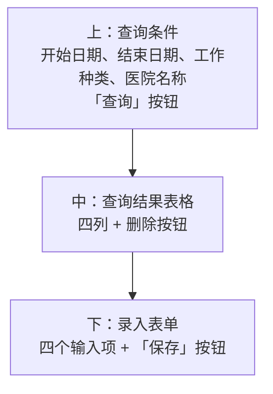
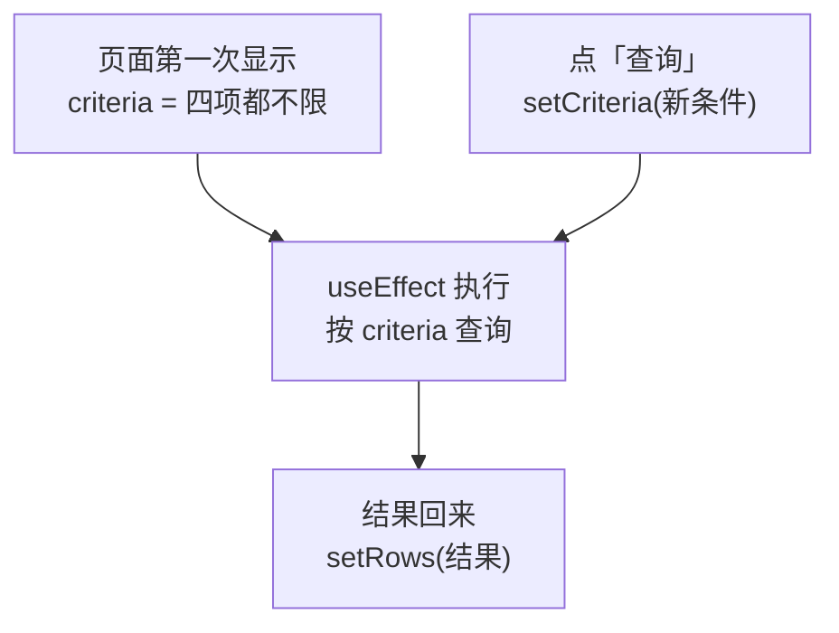

# 第 16A 章 综合实战（一）：查询条件和结果表格

## 这一章做什么

从这一章开始，用三个小章做一个完整的「工作记录」页面。它是日常业务系统里最常见的页面形状：上面填条件，中间看结果，下面录入新数据。



三个小章的分工：

| 小章 | 做出什么 |
| --- | --- |
| **16A（本章）** | 上面的查询条件、中间的表格。页面一打开自动查出全部记录；填好条件点「查询」，表格按条件更新 |
| 16B | 表格每行的「删除」：先确认，删除后按原来的条件重新查询 |
| 16C | 下面的录入表单：校验、保存，保存后表格按原来的条件重新查询 |

本章结束时，页面上的查询是这样工作的：

- 打开 `http://localhost:5173/work-logs`，表格立刻列出全部 6 条记录，新的在前。
- 开始日期选 2026-10-01、结束日期选 2026-10-31，点「查询」，表格只剩 10 月的 3 条。
- 工作种类选「维修」，医院名称填「人民」（只填一部分），按回车，查出「市第二人民医院」那一条。

本章有三个新东西：**查询字符串（`URLSearchParams`）**、**日期输入框（`<input type="date">`）**、**「正在输入的条件」和「生效的条件」分开存**。其余都是前面学过的技术的组合。

## 开始之前

**需要已经会的**：

| 技术 | 在哪一章 |
| --- | --- |
| 受控输入框、下拉框、表单提交 `onSubmit` + `preventDefault` | 第 6A、6B 章 |
| 在 `useEffect` 里加载数据，用 `ignore` 丢掉过时的结果 | 第 7C 章 |
| 回调 props（子组件通知父组件）、状态提升 | 第 8A、8B 章 |
| 路由表和 `Link` | 第 9A、9B 章 |
| CSS Modules | 第 10A 章 |
| 模拟接口、开发代理、`ApiError` | 第 11B、11D、13C 章 |
| 设成新对象一定会触发更新 | 第 4D 章 |

**起点代码**：第 15 章把后端换成了 .NET，第 16 部分回到第 11B 章的本地模拟接口，不需要 .NET。按下面的步骤准备一个新文件夹，原来的 `D:\react-study\price-list` 不用动：

1. 把仓库里的 `code/ch14C/price-list` 整个复制到 `D:\react-study\worklog`。
2. 在 `D:\react-study\worklog` 执行 `npm install`。
3. 开两个终端，都在 `D:\react-study\worklog`：一个执行 `npm run mock`（模拟接口，3001 端口），一个执行 `npm run dev`（开发服务器，5173 端口）。`vite.config.ts` 里的代理已经把 `/api` 转给 3001。

**预计耗时**：60 分钟。

## 一、原理

### 1.1 两份查询条件：正在输入的和生效的

查询页面上其实有两份条件，很容易混成一份：

| | 正在输入的条件 | 生效的条件 |
| --- | --- | --- |
| 是什么 | 四个输入框此刻的内容 | 最后一次点「查询」时的四个值 |
| 什么时候变 | 每输入一个字、每选一次日期 | 只在点「查询」（或按回车）时 |
| 决定什么 | 只决定输入框里显示什么 | 决定表格里显示哪些记录 |
| 存在哪 | 上面的 `QueryPanel` 自己的 state | 三个 panel 的父组件 `WorkLogPage` 的 state `criteria` |

为什么要分开？设想用户把工作种类从「全部」改成「维修」，还没点「查询」，就先去下面录入了一条记录。保存后表格要刷新（第 16C 章），这时应该用哪份条件查？用户没点过「查询」，「维修」还不算数，表格应该还按原来的条件刷新。只有分开存，父组件才拿得到「原来的条件」。

所以规则是：**输入框归 `QueryPanel` 自己管；点「查询」那一刻，`QueryPanel` 把四个值交给父组件，父组件存成 `criteria`，表格只跟着 `criteria` 走**。

### 1.2 查询条件怎么交给后端：查询字符串

查询是「读数据」，用 GET 请求（第 11A 章）。GET 请求没有请求体，条件写在地址的问号后面，这一段叫查询字符串（query string）：

```text
/api/work-logs?start=2026-10-01&end=2026-10-31&workType=维修&hospital=人民
```

格式规则只有三条：`?` 后面开始；每个条件写成 `名字=值`；条件之间用 `&` 隔开。后端按名字取值，取不到就当没有这个条件。

麻烦在于 `&`、`=`、`#`、`+`、空格这些字符在地址里有特殊含义。如果值里恰好有它们，直接拼字符串就会出错。下面是在模拟接口上实测的结果，用户在「医院名称」里填了 `人民&workType=安装`：

| 写法 | 实际发出的地址（模拟接口终端里打印的） | 后端看到的条件 | 查到 |
| --- | --- | --- | --- |
| 直接拼：`'?hospital=' + hospital` | `?hospital=%E4%BA%BA%E6%B0%91&workType=%E5%AE%89%E8%A3%85` | 医院含「人民」，**并且**工作种类是「安装」 | 1 条 |
| 用 `URLSearchParams` | `?hospital=%E4%BA%BA%E6%B0%91%26workType%3D%E5%AE%89%E8%A3%85` | 医院含「人民&workType=安装」这一整串 | 0 条 |

直接拼的那一行，用户的输入里的 `&` 被当成了分隔符，凭空多出一个「安装」条件。`URLSearchParams` 把 `&` 编码成 `%26`、`=` 编码成 `%3D`，整串原样到达后端。中文也被编码成 `%E4%BA%BA` 这种形式，叫百分号编码（percent-encoding）。后端读取时会自动解码回原文，你不用管。

**`URLSearchParams` 是什么**：浏览器自带的类，专门用来生成和读取查询字符串。不用安装。

```ts
const params = new URLSearchParams()
params.set('start', '2026-10-01')
params.set('workType', '维修')
params.set('hospital', '人民')
params.toString()
// 实测得到：start=2026-10-01&workType=%E7%BB%B4%E4%BF%AE&hospital=%E4%BA%BA%E6%B0%91
```

`set(名字, 值)` 加一个条件，`toString()` 拼出 `?` 后面那一段（不含 `?`）。后端也用同一个类读取：模拟接口里的 `url.searchParams.get('hospital')` 拿到的就是解码后的「人民」。换成 Spring Boot 等其他后端，读的也是同一段查询字符串，前端写法不变。

**什么时候不该用查询字符串**：条件很长（比如勾选了几百个 id），或者条件里有密码之类不该出现在地址里的内容。地址会被浏览器历史、服务器日志记下来，长度也有上限。这种情况改用 POST 把条件放进请求体。本页面的四个条件都很短，用 GET 合适。

### 1.3 日期输入框

**白话定义**：`<input type="date">` 是浏览器自带的日期输入框，点它会弹出日历让用户选。它和普通文本框一样是受控的，`value` + `onChange`，但 `value` 只有两种可能：

| 情况 | `value` |
| --- | --- |
| 还没选，或者没填完整 | `''`（空字符串） |
| 选好了 | `'YYYY-MM-DD'`，例如 `'2026-10-01'` |

界面上显示成什么样（`2026/10/01`、`2026年10月01日`……）由浏览器和操作系统的语言决定，**和 `value` 无关**，代码里拿到的永远是 `YYYY-MM-DD`。⚠ 中文 Windows 上 Chrome、Edge 的显示样式和日历外观本教程未实机验证，实测环境是无头 Chromium。

**为什么选它而不是普通文本框**：普通文本框里用户可能填 `2026.10.1`、`10/1`、`二〇二六年`，前端要先校验格式，后端也要猜。日期输入框从源头保证格式统一，前后端都省事。

**`YYYY-MM-DD` 的一个好性质**：月和日都补足两位，所以**按字符串比大小，结果和按日期先后一样**。`'2026-09-30' < '2026-10-01'` 成立。判断「开始日期不能晚于结束日期」直接写 `start > end`，不用转成日期对象。如果不补零（`2026-9-30`），这个性质就不成立了。

**反例（什么时候不该用）**：要精确到时、分的场合用 `type="datetime-local"`；只选年月（比如月报）用 `type="month"`。本页面只填日期，用 `type="date"`。

### 1.4 查询由 `useEffect` 跟着 `criteria` 触发

「页面一打开就查」和「点了查询再查」，可以用同一段代码完成：



`useEffect(..., [criteria])` 的意思是：组件第一次显示时执行一次，以后每当 `criteria` 变了再执行（第 7B 章）。第一次执行就是「页面一打开就自动查询」，`criteria` 的初始值是四项都不限，所以查出全部记录。点「查询」时只做一件事：`setCriteria(新条件)`，查询由 effect 自动完成。

**和「在点击事件里直接 fetch」比较**：

| 做法 | 页面打开时 | 点「查询」时 | 第 16B、16C 章删除、保存后刷新 |
| --- | --- | --- | --- |
| effect 跟着 `criteria` 查 | effect 自动查 | 改 `criteria` | 让 effect 再执行一次（第 16B 章讲怎么做） |
| 在事件里直接 `fetch` | 还要另写一段 effect 去查 | 在事件里查 | 每个地方都要自己调查询，并且自己处理「先发的请求后回来」 |

第一种只有一处查询代码，第 7C 章的 `ignore` 也只写一次。本章用第一种。

**点两次「查询」、条件一样，会不会不查？** 不会。`QueryPanel` 每次交给父组件的都是一个新对象 `{ start, end, workType, hospital }`，第 4D 章讲过：对象比的是「是不是同一个」，新对象一定会触发更新。用户点「查询」就是想再查一次，这正是我们要的。

## 二、实现思路和方法

### 2.1 组件划分

```text
WorkLogPage（父组件，存 criteria 和表格数据）
├─ QueryPanel   上：四个输入框（自己的 state）+「查询」按钮
├─ ResultTable  中：只负责显示表格
└─ EntryForm    下：录入表单（第 16C 章）
```

| 组件 | 自己的 state | 从父组件拿到的 props | 职责 |
| --- | --- | --- | --- |
| `WorkLogPage` | `criteria`、`rows`、`loading`、`error` | 无 | 按 `criteria` 查询，把结果交给表格 |
| `QueryPanel` | 四个输入框的值、日期先后的错误提示 | `onSearch(条件)` | 点「查询」时把四个值交出去 |
| `ResultTable` | 无 | `rows` | 显示表格 |

表格数据 `rows` 为什么不放在 `ResultTable` 里：第 16B 章的删除、第 16C 章的保存都会让表格刷新，刷新要用父组件里的 `criteria`。数据放在父组件，三个 panel 都能通过回调让它变化（第 8B 章的状态提升）。

### 2.2 文件放在哪

```text
src/pages/WorkLogPage/
├─ WorkLogPage.tsx          父组件
├─ QueryPanel.tsx           上
├─ ResultTable.tsx          中
├─ workLogTypes.ts          类型：WorkLog、WorkLogQuery……
├─ workLogApi.ts            接口函数：searchWorkLogs……
└─ WorkLogPage.module.css   这个页面的样式
```

和产品清单的文件分散在 `components/`、`hooks/` 不同，这次把一个页面的所有文件放进同一个文件夹，叫按功能分文件夹。好处是改这个页面只看这一个文件夹，删掉这个页面也只删一个文件夹。共用的东西（`ApiError`）仍然从 `src/api.ts` 导入。

### 2.3 和后端的约定

模拟接口本章一次加好三个接口，第 16B、16C 章直接用：

| 操作 | 请求 | 成功 | 失败 |
| --- | --- | --- | --- |
| 查询 | `GET /api/work-logs?start=&end=&workType=&hospital=` | 200，记录数组 | 400，`{ message }`（日期格式不对、开始晚于结束、没有这个工作种类） |
| 新增 | `POST /api/work-logs`，请求体是 JSON | 201，保存后的记录（带 `id`） | 400，`{ message, errors }`，`errors` 按字段给原因 |
| 删除 | `DELETE /api/work-logs/{id}` | 204，没有内容 | 404，`{ message }` |

查询规则：

| 条件 | 规则 |
| --- | --- |
| 开始日期 `start` | 记录的开始日期**不早于**它 |
| 结束日期 `end` | 记录的结束日期**不晚于**它 |
| 工作种类 `workType` | 相等；不传或传空字符串表示「全部」 |
| 医院名称 `hospital` | 模糊匹配：名称里**包含**这段文字就算，前后空格去掉 |
| 排序 | 开始日期从晚到早，同一天按 id 从大到小 |

每条记录的 JSON 有 5 个字段：`id`、`startDate`、`endDate`、`workType`、`hospitalName`。表格只显示后四个，`id` 用来做 `key`（第 5A 章），第 16B 章删除时也要用它指明删哪一条。

### 2.4 「查询中」怎么显示

第 7D 章用判别联合 `loading | error | success` 三选一。这一页不这样做，因为重新查询时我们**想保留上一次的表格**：只在标题上显示「（查询中…）」，等新结果回来再替换。如果用三选一，进入 `loading` 时表格就没了，每点一次查询表格都会闪一下变空。

所以拆成三个独立的 state：

| state | 含义 | 什么时候改 |
| --- | --- | --- |
| `rows` | 最近一次查询成功的结果 | 查询成功时 |
| `loading` | 有没有查询在进行 | 点「查询」时设 `true`（在事件处理函数里）；查询结束时设 `false`（在 effect 里，用 `finally`） |
| `error` | 最近一次查询失败的原因 | 失败时设原因，成功时清空 |

`loading` 的初始值是 `true`，因为页面一打开就在查询。

### 2.5 下拉框的值要从 `string` 变成 `WorkType`

工作种类只有三种，类型写成 `'安装' | '维修' | '其它'`（第 7D 章的 `status: 'loading'` 用的也是这种写法）。但下拉框 `onChange` 里的 `e.target.value` 是普通的 `string`，TypeScript 不会相信它一定是三种之一，直接存进 state 会报错（见常见问题）。

办法是在选项数组里找它：

```ts
WORK_TYPES.find((t) => t === e.target.value) ?? ''
```

`WORK_TYPES` 的类型是 `WorkType[]`，`find` 返回 `WorkType | undefined`：找到了就是三种之一，找不到是 `undefined`，再用 `??` 换成 `''`（全部）。这样存进 state 的值，类型上一定合法。

## 三、代码实现

按「后端 → 类型 → 接口函数 → 组件 → 路由」的顺序写。每一步写完，页面可能暂时报错，全部写完就好了。

### 3.1 模拟接口：加三个工作记录接口

新建 `mock-server/workLogs.ts`。它只负责「收到什么请求 → 返回什么状态码和内容」，不碰 `res`，由 `server.ts` 统一写回响应。数据放在内存里，重启模拟接口就恢复成初始的 6 条。

```ts
// mock-server/workLogs.ts
// 工作记录的三个模拟接口：查询、新增、删除。第 16A–16C 章都用它，第 16A 章一次写好。
// 这个文件只负责「收到什么请求 → 返回什么状态码和内容」，真正写回响应由 server.ts 统一做。

type WorkType = '安装' | '维修' | '其它'
type WorkLog = { id: number; startDate: string; endDate: string; workType: WorkType; hospitalName: string }

// 处理结果：状态码 + 要返回的内容。body 不写表示没有内容（删除成功的 204）
export type WorkLogResult = { status: number; body?: unknown }

const WORK_TYPES: WorkType[] = ['安装', '维修', '其它']

// 日期一律是 'YYYY-MM-DD' 格式的字符串，和 <input type="date"> 的 value 格式相同
let workLogs: WorkLog[] = [
  { id: 1, startDate: '2026-09-02', endDate: '2026-09-03', workType: '安装', hospitalName: '市人民医院' },
  { id: 2, startDate: '2026-09-15', endDate: '2026-09-15', workType: '维修', hospitalName: '市第二人民医院' },
  { id: 3, startDate: '2026-10-08', endDate: '2026-10-09', workType: '安装', hospitalName: '市中心医院' },
  { id: 4, startDate: '2026-10-12', endDate: '2026-10-12', workType: '其它', hospitalName: '市人民医院' },
  { id: 5, startDate: '2026-10-20', endDate: '2026-10-22', workType: '维修', hospitalName: '县中医院' },
  { id: 6, startDate: '2026-11-03', endDate: '2026-11-03', workType: '维修', hospitalName: '市妇幼保健院' },
]

// 判断是不是真实存在的日期：格式对，并且不是 2026-02-30 这种「格式对、日子不存在」的写法
function isValidDate(value: string): boolean {
  if (!/^\d{4}-\d{2}-\d{2}$/.test(value)) return false
  const d = new Date(`${value}T00:00:00Z`)
  return !Number.isNaN(d.getTime()) && d.toISOString().slice(0, 10) === value
}

function isWorkType(value: string): value is WorkType {
  return WORK_TYPES.some((t) => t === value)
}

// GET /api/work-logs?start=...&end=...&workType=...&hospital=...
// 四个条件都可以不传；传了空字符串也当作「不限」
function search(params: URLSearchParams): WorkLogResult {
  const start = params.get('start') ?? ''
  const end = params.get('end') ?? ''
  const workType = params.get('workType') ?? ''
  const hospital = (params.get('hospital') ?? '').trim()

  if (start !== '' && !isValidDate(start)) return { status: 400, body: { message: `开始日期格式不对：${start}` } }
  if (end !== '' && !isValidDate(end)) return { status: 400, body: { message: `结束日期格式不对：${end}` } }
  // 'YYYY-MM-DD' 的字符串按字典顺序比较，结果和按日期先后比较一样，所以可以直接用 > 比
  if (start !== '' && end !== '' && start > end) return { status: 400, body: { message: '开始日期不能晚于结束日期' } }
  if (workType !== '' && !isWorkType(workType)) return { status: 400, body: { message: `没有这个工作种类：${workType}` } }

  const rows = workLogs
    // 记录的开始日期不早于查询的开始日期
    .filter((w) => start === '' || w.startDate >= start)
    // 记录的结束日期不晚于查询的结束日期
    .filter((w) => end === '' || w.endDate <= end)
    .filter((w) => workType === '' || w.workType === workType)
    // 医院名称模糊匹配：名称里包含输入的文字就算
    .filter((w) => hospital === '' || w.hospitalName.includes(hospital))
    // 新的在前：按开始日期从晚到早，同一天按 id 从大到小
    .sort((a, b) => (a.startDate === b.startDate ? b.id - a.id : a.startDate < b.startDate ? 1 : -1))
  return { status: 200, body: rows }
}

// POST /api/work-logs。前端校验过也要再查一遍：请求可能不是从页面发来的
function create(body: Record<string, unknown>): WorkLogResult {
  const startDate = typeof body.startDate === 'string' ? body.startDate : ''
  const endDate = typeof body.endDate === 'string' ? body.endDate : ''
  const workType = typeof body.workType === 'string' ? body.workType : ''
  const hospitalName = typeof body.hospitalName === 'string' ? body.hospitalName.trim() : ''

  const errors: Record<string, string> = {}
  if (!isValidDate(startDate)) errors.startDate = '请选择开始日期'
  if (!isValidDate(endDate)) errors.endDate = '请选择结束日期'
  else if (isValidDate(startDate) && endDate < startDate) errors.endDate = '结束日期不能早于开始日期'
  if (!isWorkType(workType)) errors.workType = '工作种类必须是安装、维修或其它'
  if (hospitalName === '') errors.hospitalName = '请填写医院名称'
  else if (hospitalName.length > 50) errors.hospitalName = '医院名称不能超过 50 个字'
  // 只有后端能做的检查：要看全部已有数据才知道是否重复
  else if (workLogs.some((w) => w.startDate === startDate && w.workType === workType && w.hospitalName === hospitalName)) {
    errors.hospitalName = `${hospitalName} 在 ${startDate} 已经有一条「${workType}」记录`
  }
  // 后半个条件是写给 TypeScript 看的：过了这一关，它才确定 workType 是 WorkType 而不是任意字符串
  if (Object.keys(errors).length > 0 || !isWorkType(workType)) {
    return { status: 400, body: { message: '校验失败', errors } }
  }

  const saved: WorkLog = { id: Math.max(0, ...workLogs.map((w) => w.id)) + 1, startDate, endDate, workType, hospitalName }
  workLogs = [...workLogs, saved]
  return { status: 201, body: saved }
}

// DELETE /api/work-logs/3
function remove(id: number): WorkLogResult {
  if (!workLogs.some((w) => w.id === id)) {
    return { status: 404, body: { message: `工作记录 ${id} 不存在，可能已经被删除` } }
  }
  workLogs = workLogs.filter((w) => w.id !== id)
  return { status: 204 }
}

// 地址不是 /api/work-logs 开头时返回 null，交回 server.ts 按原来的规则处理
export async function handleWorkLogs(
  method: string,
  url: URL,
  readBody: () => Promise<Record<string, unknown>>,
): Promise<WorkLogResult | null> {
  if (url.pathname === '/api/work-logs') {
    if (method === 'GET') return search(url.searchParams)
    if (method === 'POST') return create(await readBody())
  }
  const match = url.pathname.match(/^\/api\/work-logs\/(\d+)$/)
  if (match && method === 'DELETE') return remove(Number(match[1]))
  return null
}
```

几处值得看的地方：

| 代码 | 说明 |
| --- | --- |
| `params.get('start') ?? ''` | `get` 取不到这个名字时返回 `null`，换成 `''` 后，「没传」和「传了空字符串」都当「不限」 |
| `w.startDate >= start` | 1.3 节说的字符串比较就是日期比较 |
| `w.hospitalName.includes(hospital)` | 模糊匹配就是「包含」。真实数据库里对应 SQL 的 `LIKE '%人民%'` |
| `isValidDate` | 光看格式不够：`2026-02-30` 格式对，日子不存在。转成日期再转回字符串，对不上就是不存在的日子 |
| 查重复记录 | 前端只看得到自己填的内容，看不到库里已有的数据，所以这种检查只能在后端做（第 16C 章会用到） |

然后改 `mock-server/server.ts`，一共三处。第一处，文件开头的 import 区加一行：

```ts
// 片段：mock-server/server.ts
import type { IncomingMessage, ServerResponse } from 'node:http'
// 🟨 第 16A 章：工作记录的接口写在单独的文件里
import { handleWorkLogs } from './workLogs.ts'
```

第二处，`handle` 函数开头原来只取了地址的路径部分 `pathname`，现在要整个 `URL` 对象，因为工作记录接口要从它读查询字符串：

```ts
// 片段：mock-server/server.ts
  const method = req.method ?? 'GET'
  // 🟨 第 16A 章：先把整个地址解析成 URL 对象，工作记录接口要用它读查询字符串
  const url = new URL(req.url ?? '/', `http://localhost:${PORT}`)
  const path = url.pathname
```

第三处，在 `if (path === '/api/products' && method === 'GET')` 这一行的上面插入：

```ts
// 片段：mock-server/server.ts
  // 🟨 第 16A 章：工作记录的请求交给 workLogs.ts。返回 null 表示不是工作记录的地址，接着往下走
  const workLogResult = await handleWorkLogs(method, url, () => readJson(req))
  if (workLogResult) {
    return send(res, workLogResult.status, workLogResult.body)
  }
```

插在 Content-Type 检查的后面，所以新增工作记录也必须带 `Content-Type: application/json`，和产品接口一样。`() => readJson(req)` 传的是「怎么读请求体」的函数，只有新增接口会调用它，查询和删除不读请求体。

改完在模拟接口的终端按 `Ctrl+C` 停掉，再执行 `npm run mock`。模拟接口不会热更新，改了必须重启。完整文件见仓库 `code/ch16A/price-list/mock-server/server.ts`。

### 3.2 `src/api.ts`：导出 `toApiError`

`api.ts` 里把失败的响应变成 `ApiError` 的函数 `toApiError` 原来只在文件内部用，工作记录的接口函数也要用它。在函数前面加 `export`：

```ts
// 片段：src/api.ts
// 把失败的响应转换成 ApiError。模拟接口出错时返回 { message, errors? }
// 🟨 第 16A 章：加了 export，工作记录的接口函数（workLogApi.ts）也要用它
export async function toApiError(response: Response): Promise<ApiError> {
```

文件其他地方不变。

### 3.3 类型

新建 `src/pages/WorkLogPage/workLogTypes.ts`：

```ts
// src/pages/WorkLogPage/workLogTypes.ts
// 工作记录页用到的类型。只有这个页面用，所以放在页面自己的文件夹里，不放进全书共用的 src/types.ts

// 工作种类只有三种。写成字面量联合类型，代码里写错一个字 TypeScript 就会报错
export type WorkType = '安装' | '维修' | '其它'

// 下拉框的选项从这个数组生成。标注成 WorkType[]，数组里也不能写错字
export const WORK_TYPES: WorkType[] = ['安装', '维修', '其它']

// 一条工作记录，字段和后端返回的 JSON 一一对应。日期是 'YYYY-MM-DD' 格式的字符串
export type WorkLog = {
  id: number
  startDate: string
  endDate: string
  workType: WorkType
  hospitalName: string
}

// 查询条件。每一项都是字符串，空字符串表示「不限」。工作种类多一个 ''，代表下拉框里的「全部」
export type WorkLogQuery = {
  start: string
  end: string
  workType: WorkType | ''
  hospital: string
}

// 四个条件都不限。页面刚打开时用它查询，所以一打开就列出全部记录
export const EMPTY_QUERY: WorkLogQuery = { start: '', end: '', workType: '', hospital: '' }
```

`WorkLogQuery` 的四项都是字符串，和输入框一致：日期没选是 `''`，工作种类「全部」是 `''`。`EMPTY_QUERY` 是「四项都不限」，页面打开时用它。

### 3.4 接口函数

新建 `src/pages/WorkLogPage/workLogApi.ts`：

```ts
// src/pages/WorkLogPage/workLogApi.ts
// 工作记录的接口函数。组件只调用这些函数，不自己拼地址、不自己判断状态码
import { toApiError } from '../../api.ts'
import type { WorkLog, WorkLogQuery } from './workLogTypes.ts'

const BASE = import.meta.env.VITE_API_BASE

// 把查询条件变成查询字符串，例如 start=2026-10-01&workType=%E7%BB%B4%E4%BF%AE
function toQueryString(query: WorkLogQuery): string {
  const params = new URLSearchParams()
  // 只放有值的条件。空的不放，后端就按「不限」处理
  if (query.start !== '') params.set('start', query.start)
  if (query.end !== '') params.set('end', query.end)
  if (query.workType !== '') params.set('workType', query.workType)
  // 医院名称去掉首尾空格再发。中文、&、#、空格这些字符由 URLSearchParams 负责编码
  const hospital = query.hospital.trim()
  if (hospital !== '') params.set('hospital', hospital)
  return params.toString()
}

// GET /api/work-logs?...：按条件查询，返回符合条件的记录
export async function searchWorkLogs(query: WorkLogQuery): Promise<WorkLog[]> {
  const qs = toQueryString(query)
  // 一个条件都没有时，地址后面不留一个孤零零的 ?
  const url = qs === '' ? `${BASE}/work-logs` : `${BASE}/work-logs?${qs}`
  const response = await fetch(url)
  if (!response.ok) {
    throw await toApiError(response)
  }
  const rows: WorkLog[] = await response.json()
  return rows
}
```

`toQueryString` 只把有值的条件放进去。四项都不限时 `toString()` 得到 `''`，这时地址后面不要问号，所以 `searchWorkLogs` 里判断了一下。失败时抛出的 `ApiError` 带着后端的原因，比如「开始日期不能晚于结束日期」。

### 3.5 样式

新建 `src/pages/WorkLogPage/WorkLogPage.module.css`：

```css
/* src/pages/WorkLogPage/WorkLogPage.module.css */
/* 查询条件、录入表单：输入项横着排，一行放不下自动换行 */
.fields label {
  display: inline-block;
  margin: 0 16px 8px 0;
}

.table {
  border-collapse: collapse;
}

.table th,
.table td {
  border: 1px solid #ddd;
  padding: 4px 12px;
  text-align: left;
}

.table th {
  background: #f3f4f6;
}
```

每个 panel 外框沿用全局的 `panel` 类（左边一条蓝线），这里只加查询条件横排和表格边框。

### 3.6 上面：`QueryPanel`

新建 `src/pages/WorkLogPage/QueryPanel.tsx`：

```tsx
// src/pages/WorkLogPage/QueryPanel.tsx
// 上面的「查询条件」panel。四个输入框的内容是它自己的 state（还没生效的草稿），
// 点「查询」时才把条件交给父组件，父组件据此查询
import { useState } from 'react'
import type { SubmitEvent } from 'react'
import { WORK_TYPES } from './workLogTypes.ts'
import type { WorkLogQuery, WorkType } from './workLogTypes.ts'
import styles from './WorkLogPage.module.css'

type QueryPanelProps = {
  // 点「查询」时调用，参数是这一刻四个输入框的内容
  onSearch: (query: WorkLogQuery) => void
}

export function QueryPanel({ onSearch }: QueryPanelProps) {
  // 日期输入框的 value 是 'YYYY-MM-DD' 或 ''（没选），所以初始值用 ''
  const [start, setStart] = useState('')
  const [end, setEnd] = useState('')
  // '' 代表「全部」
  const [workType, setWorkType] = useState<WorkType | ''>('')
  const [hospital, setHospital] = useState('')
  const [error, setError] = useState('')

  // 用 form 的 onSubmit：点「查询」按钮、在医院名称框里按回车，都会查询
  function handleSubmit(e: SubmitEvent<HTMLFormElement>) {
    e.preventDefault()
    // 两个日期字符串格式相同，可以直接比较先后。后端也会检查，这里先挡一下，不用等请求回来
    if (start !== '' && end !== '' && start > end) {
      setError('开始日期不能晚于结束日期')
      return
    }
    setError('')
    onSearch({ start, end, workType, hospital })
  }

  return (
    <form className={`panel ${styles.fields}`} onSubmit={handleSubmit}>
      <h2>查询条件</h2>
      {/* type="date"：浏览器显示日期选择器，value 永远是 'YYYY-MM-DD'，和界面上显示成什么样无关 */}
      <label>
        开始日期 <input type="date" value={start} onChange={(e) => setStart(e.target.value)} />
      </label>
      <label>
        结束日期 <input type="date" value={end} onChange={(e) => setEnd(e.target.value)} />
      </label>
      <label>
        工作种类{' '}
        {/* e.target.value 是 string，要换成 WorkType | '' 才能存进 state：在选项里找到它，找不到就当「全部」 */}
        <select value={workType} onChange={(e) => setWorkType(WORK_TYPES.find((t) => t === e.target.value) ?? '')}>
          <option value="">全部</option>
          {WORK_TYPES.map((t) => (
            <option key={t} value={t}>
              {t}
            </option>
          ))}
        </select>
      </label>
      <label>
        医院名称 <input value={hospital} onChange={(e) => setHospital(e.target.value)} placeholder="可以只填一部分" />
      </label>
      <button type="submit">查询</button>
      {error && <span className="error">{error}</span>}
    </form>
  )
}
```

| 代码 | 说明 |
| --- | --- |
| 四个 `useState` | 1.1 节「正在输入的条件」，只有这个组件知道 |
| `<form onSubmit>` + `type="submit"` | 点按钮、在输入框里按回车都会查询（第 6B 章） |
| `start > end` 时不调用 `onSearch` | 前端先挡一下，提示立刻出现。后端也检查，这里漏了也不会查出错的数据 |
| `<option value="">全部</option>` | 「全部」的值是空字符串，正好对应「不限」 |
| `WORK_TYPES.map(...)` 生成选项 | 选项和类型来自同一个数组，以后加一种工作种类只改 `workLogTypes.ts` |
| `onSearch({ start, end, workType, hospital })` | 把这一刻的四个值打包成新对象交出去 |

### 3.7 中间：`ResultTable`

新建 `src/pages/WorkLogPage/ResultTable.tsx`：

```tsx
// src/pages/WorkLogPage/ResultTable.tsx
// 中间的「查询结果」表格。只负责显示：数据从 props 来，自己没有 state
import type { WorkLog } from './workLogTypes.ts'
import styles from './WorkLogPage.module.css'

type ResultTableProps = {
  rows: WorkLog[]
}

export function ResultTable({ rows }: ResultTableProps) {
  if (rows.length === 0) {
    return <p className="empty">没有符合条件的记录</p>
  }

  return (
    <table className={styles.table}>
      <thead>
        <tr>
          <th>开始日期</th>
          <th>结束日期</th>
          <th>工作种类</th>
          <th>医院名称</th>
        </tr>
      </thead>
      <tbody>
        {/* 表格里不显示 id，但 key 要用它：只有 id 能唯一区分一条记录 */}
        {rows.map((w) => (
          <tr key={w.id}>
            <td>{w.startDate}</td>
            <td>{w.endDate}</td>
            <td>{w.workType}</td>
            <td>{w.hospitalName}</td>
          </tr>
        ))}
      </tbody>
    </table>
  )
}
```

没有 state，只看 props，所以它显示的永远是父组件交给它的 `rows`。没有记录时显示「没有符合条件的记录」，而不是一个只有表头的空表格。

### 3.8 父组件：`WorkLogPage`

新建 `src/pages/WorkLogPage/WorkLogPage.tsx`：

```tsx
// src/pages/WorkLogPage/WorkLogPage.tsx
// 工作记录页：上、中、下三个 panel 的父组件（本章先做上、中两个）。
// 「生效的查询条件」和「表格数据」放在这里：第 16B、16C 章的删除和录入也要让表格重新查询
import { useEffect, useState } from 'react'
import { QueryPanel } from './QueryPanel.tsx'
import { ResultTable } from './ResultTable.tsx'
import { searchWorkLogs } from './workLogApi.ts'
import { EMPTY_QUERY } from './workLogTypes.ts'
import type { WorkLog, WorkLogQuery } from './workLogTypes.ts'

export function WorkLogPage() {
  // 最后一次点「查询」时的条件。输入框里正在改、还没点查询的内容不在这里，在 QueryPanel 里
  const [criteria, setCriteria] = useState<WorkLogQuery>(EMPTY_QUERY)
  const [rows, setRows] = useState<WorkLog[]>([])
  // 页面一打开就要查询，所以初始值是 true
  const [loading, setLoading] = useState(true)
  const [error, setError] = useState('')

  // criteria 变了就按新条件查询。组件第一次显示时也会执行一次，这就是「页面一打开就自动查询」
  useEffect(() => {
    // 连点两次「查询」时，先发的请求可能后回来。旧请求的结果用 ignore 丢掉（第 7C 章）
    let ignore = false

    async function load() {
      try {
        const data = await searchWorkLogs(criteria)
        if (!ignore) {
          setRows(data)
          setError('')
        }
      } catch (err) {
        if (!ignore) {
          setError(err instanceof Error ? err.message : String(err))
        }
      } finally {
        // finally：成功、失败都会执行，「查询中」在这里关掉
        if (!ignore) {
          setLoading(false)
        }
      }
    }

    load()
    return () => {
      ignore = true
    }
  }, [criteria])

  function handleSearch(next: WorkLogQuery) {
    // 「查询中」在事件处理函数里打开，查询结果回来后在 load 里关掉
    setLoading(true)
    // next 每次都是新对象：条件和上次一模一样，React 也认为 criteria 变了，会再查一次（第 4D 章）
    setCriteria(next)
  }

  return (
    <section>
      <QueryPanel onSearch={handleSearch} />
      <div className="panel">
        {/* 查询期间表格保留上一次的结果，只在标题上提示，避免表格闪一下变空 */}
        <h2>查询结果{loading ? '（查询中…）' : `（共 ${rows.length} 条）`}</h2>
        {error ? <p className="error">查询失败：{error}</p> : <ResultTable rows={rows} />}
      </div>
    </section>
  )
}
```

| 代码 | 说明 |
| --- | --- |
| `useState<WorkLogQuery>(EMPTY_QUERY)` | 1.1 节「生效的条件」。初始是四项都不限 |
| `useState(true)` 给 `loading` | 页面一打开就在查询 |
| `useEffect(..., [criteria])` | 1.4 节：第一次显示和 `criteria` 每次变化时查询 |
| `let ignore = false` + 清理函数 | 连点两次「查询」，第一次的请求被作废，它的结果回来也不用（第 7C 章） |
| `finally` 里 `setLoading(false)` | 成功、失败都要关掉「查询中」，写在 `finally` 不会漏 |
| `handleSearch` 先 `setLoading(true)` 再 `setCriteria(next)` | 打开「查询中」放在事件里做，effect 里只在结果回来后改 state |
| `error ? ... : <ResultTable />` | 查询失败时显示原因，不显示表格，免得用户把旧结果当成新结果 |

### 3.9 路由：`src/App.tsx`

用下面的内容整个替换 `src/App.tsx`。改动三处，都用 🟨 标出：导入 `WorkLogPage`、导航加「工作记录」、路由表加 `/work-logs`。

```tsx
// src/App.tsx
// App 变成「外框」：页头、导航、页脚所有页面共用，中间按地址显示不同的页面
import { Link, Route, Routes } from 'react-router'
import { PageHeader } from './components/PageHeader.tsx'
import { PageFooter } from './components/PageFooter.tsx'
import { ListPage } from './pages/ListPage.tsx'
import { AboutPage } from './pages/AboutPage.tsx'
import { ProductDetailPage } from './pages/ProductDetailPage.tsx'
import { ProductEditPage } from './pages/ProductEditPage.tsx'
import { NotFoundPage } from './pages/NotFoundPage.tsx'
import { LoginPage } from './pages/LoginPage.tsx'
// 🟨 第 16A 章：工作记录页
import { WorkLogPage } from './pages/WorkLogPage/WorkLogPage.tsx'

function App() {
  return (
    <main>
      <PageHeader />
      <nav className="nav">
        {/* Link 改地址但不刷新页面；React Router 发现地址变了，换掉下面 Routes 里显示的页面 */}
        {/* 🟨 第 16A 章：导航里加「工作记录」 */}
        <Link to="/">产品清单</Link> | <Link to="/work-logs">工作记录</Link> | <Link to="/about">关于</Link>
      </nav>
      {/* 路由表：React Router 找出与当前地址最匹配的那条 path，显示它的 element */}
      <Routes>
        <Route path="/" element={<ListPage />} />
        <Route path="/about" element={<AboutPage />} />
        <Route path="/login" element={<LoginPage />} />
        {/* 🟨 第 16A 章：工作记录页 */}
        <Route path="/work-logs" element={<WorkLogPage />} />
        {/* :id 是参数，/products/1、/products/25 都匹配这一条 */}
        <Route path="/products/:id" element={<ProductDetailPage />} />
        {/* 编辑页：/products/3/edit */}
        <Route path="/products/:id/edit" element={<ProductEditPage />} />
        {/* * 匹配任何地址，但只有别的路由都对不上时才会用它，相当于兜底 */}
        <Route path="*" element={<NotFoundPage />} />
      </Routes>
      <PageFooter />
    </main>
  )
}

export default App
```

## 四、运行和验证

确认两个终端都在运行（`npm run mock` 和 `npm run dev`），点导航里的「工作记录」。下面是实测结果：

| 操作 | 页面 | 模拟接口终端 |
| --- | --- | --- |
| 打开 `/work-logs` | 标题「查询结果（共 6 条）」，第一行是「2026-11-03 2026-11-03 维修 市妇幼保健院」 | `GET /api/work-logs`（打印两次，见常见问题） |
| 开始日期选 2026-10-01、结束日期选 2026-10-31，点「查询」 | 标题先变成「查询结果（查询中…）」，表格保留原来的 6 行；约半秒后变成「共 3 条」：县中医院、市人民医院、市中心医院 | `GET /api/work-logs?start=2026-10-01&end=2026-10-31` |
| 清空两个日期，工作种类选「维修」，医院名称填「人民」，按回车 | 「共 1 条」：2026-09-15 维修 市第二人民医院 | `GET /api/work-logs?workType=%E7%BB%B4%E4%BF%AE&hospital=%E4%BA%BA%E6%B0%91` |
| 工作种类改回「全部」，医院名称还是「人民」，点「查询」 | 「共 3 条」：两条「市人民医院」和一条「市第二人民医院」。这就是模糊匹配 | `GET /api/work-logs?hospital=%E4%BA%BA%E6%B0%91` |
| 医院名称填「协和」，点「查询」 | 「共 0 条」，显示「没有符合条件的记录」 | `GET /api/work-logs?hospital=%E5%8D%8F%E5%92%8C` |
| 开始日期 2026-11-01、结束日期 2026-10-01，点「查询」 | 「查询」按钮后面出现「开始日期不能晚于结束日期」，表格不变 | 没有新请求 |
| 改了条件但不点「查询」 | 表格不变 | 没有新请求 |

最后一行就是 1.1 节说的：表格只跟着生效的条件走。

如果表格的位置显示「查询失败：……」，看下面常见问题的前两行。

## ⚠ 常见问题

| 现象 | 原因 | 怎么改 |
| --- | --- | --- |
| 页面上显示「查询失败：服务器返回 502」 | 模拟接口没有启动。开发服务器的终端里同时出现 `[vite] http proxy error: /api/work-logs` | 在另一个终端执行 `npm run mock` |
| 页面上显示「查询失败：没有这个接口：GET /api/work-logs」 | 改了 `server.ts` 后没有重启模拟接口，还在跑旧代码 | 在模拟接口的终端按 `Ctrl+C`，再执行 `npm run mock` |
| 下拉框写成 `onChange={(e) => setWorkType(e.target.value)}`，`npx tsc -b` 报 `TS2345: Argument of type 'string' is not assignable to parameter of type 'SetStateAction<"" \| WorkType>'.` | `e.target.value` 是任意字符串，state 只接受四个值之一 | 用 2.5 节的写法：`WORK_TYPES.find((t) => t === e.target.value) ?? ''` |
| 点「查询」后标题一直是「查询中…」，表格不变 | `useEffect` 的依赖数组写成了 `[]`，effect 只在页面打开时执行一次，`criteria` 变了也不再查。`npm run lint` 会警告 `React Hook useEffect has a missing dependency: 'criteria'` | 依赖数组写 `[criteria]` |
| 打开页面，模拟接口终端打印了两行 `GET /api/work-logs` | 开发模式下 `StrictMode` 会把 effect 执行两次（第 7A 章），第一次的结果被 `ignore` 丢掉 | 正常现象，只在开发时出现，打包后只请求一次 |
| 自己用字符串拼查询字符串，医院名称里有 `&` 时查出来的结果不对 | `&` 被当成条件之间的分隔符（1.2 节的实测） | 用 `URLSearchParams` 生成查询字符串 |
| 想给日期框默认填今天，写成 `new Date().toISOString().slice(0, 10)`，早上 8 点前打开页面得到的是**昨天** | `toISOString()` 给的是 UTC 时间，北京时间比 UTC 早 8 小时。实测 2026-11-16 07:30（北京时间）得到 `2026-11-15` | 用本地时间拼：`` `${d.getFullYear()}-${String(d.getMonth() + 1).padStart(2, '0')}-${String(d.getDate()).padStart(2, '0')}` `` 实测得到 `2026-11-16` |

## 🎯 动手练习

**练习 1：「重置」按钮**

在「查询」按钮后面加「重置」按钮：点一下，四个输入框清空、工作种类回到「全部」，并且马上按「四项都不限」查询。

验收标准：

- 按工作种类「维修」查询后，点「重置」：四个输入框变空，下拉框显示「全部」，表格变回「共 6 条」。
- **刚打开页面、什么都没改**，直接点「重置」：标题从「查询中…」变回「共 6 条」，不会一直停在「查询中…」。

**练习 2：显示当前生效的条件**

在「查询结果」标题下面加一行「当前条件：……」，四项都不限时显示「当前条件：全部」，否则按「开始日期 起，结束日期 止，工作种类，医院含「…」」的顺序列出有值的项，用「，」隔开。

验收标准：

- 开始日期 2026-10-01、工作种类「维修」、医院名称「 人民 」（前后有空格），点「查询」后显示「当前条件：2026-10-01 起，维修，医院含「人民」」。
- 接着把工作种类改成「安装」但不点「查询」，这一行不变。

卡住了看文末参考答案。

## 📌 小结

输入框归 QueryPanel，生效条件归父组件；条件用 URLSearchParams 编码，effect 跟着条件查询。

## 下一章

表格只能看，还不能删。第 16B 章给每行加「删除」按钮：先弹确认框，删除后按生效的条件重新查询。

---

<!-- 以下是参考答案，先自己动手，卡住了再往下翻 -->


## 参考答案

### 练习 1

思路：清空四个 state，再调用 `onSearch`。容易错在交出去的对象：**必须是新对象 `{ ...EMPTY_QUERY }`**。如果直接传 `EMPTY_QUERY`，而生效的条件本来就是它（刚打开页面时），`setCriteria` 收到同一个对象，按第 4D 章的规则跳过更新，effect 不执行，前面打开的「查询中…」就永远关不掉。实测直接传 `EMPTY_QUERY` 时，刚打开页面就点「重置」，标题一直停在「查询结果（查询中…）」。

```tsx
// src/pages/WorkLogPage/QueryPanel.tsx
// 练习 1 做完后的版本，🟨 标出练习改动的地方
// 上面的「查询条件」panel。四个输入框的内容是它自己的 state（还没生效的草稿），
// 点「查询」时才把条件交给父组件，父组件据此查询
import { useState } from 'react'
import type { SubmitEvent } from 'react'
// 🟨 练习 1：多导入 EMPTY_QUERY
import { EMPTY_QUERY, WORK_TYPES } from './workLogTypes.ts'
import type { WorkLogQuery, WorkType } from './workLogTypes.ts'
import styles from './WorkLogPage.module.css'

type QueryPanelProps = {
  // 点「查询」时调用，参数是这一刻四个输入框的内容
  onSearch: (query: WorkLogQuery) => void
}

export function QueryPanel({ onSearch }: QueryPanelProps) {
  // 日期输入框的 value 是 'YYYY-MM-DD' 或 ''（没选），所以初始值用 ''
  const [start, setStart] = useState('')
  const [end, setEnd] = useState('')
  // '' 代表「全部」
  const [workType, setWorkType] = useState<WorkType | ''>('')
  const [hospital, setHospital] = useState('')
  const [error, setError] = useState('')

  // 用 form 的 onSubmit：点「查询」按钮、在医院名称框里按回车，都会查询
  function handleSubmit(e: SubmitEvent<HTMLFormElement>) {
    e.preventDefault()
    // 两个日期字符串格式相同，可以直接比较先后。后端也会检查，这里先挡一下，不用等请求回来
    if (start !== '' && end !== '' && start > end) {
      setError('开始日期不能晚于结束日期')
      return
    }
    setError('')
    onSearch({ start, end, workType, hospital })
  }

  // 🟨 练习 1：清空四个输入框和提示，并马上按「不限」查询
  function handleReset() {
    setStart('')
    setEnd('')
    setWorkType('')
    setHospital('')
    setError('')
    // 必须复制一份新对象。直接传 EMPTY_QUERY 时，如果生效的条件本来就是它，
    // React 认为 criteria 没变，跳过更新，不会查询，「查询中…」也就一直关不掉
    onSearch({ ...EMPTY_QUERY })
  }

  return (
    <form className={`panel ${styles.fields}`} onSubmit={handleSubmit}>
      <h2>查询条件</h2>
      {/* type="date"：浏览器显示日期选择器，value 永远是 'YYYY-MM-DD'，和界面上显示成什么样无关 */}
      <label>
        开始日期 <input type="date" value={start} onChange={(e) => setStart(e.target.value)} />
      </label>
      <label>
        结束日期 <input type="date" value={end} onChange={(e) => setEnd(e.target.value)} />
      </label>
      <label>
        工作种类{' '}
        {/* e.target.value 是 string，要换成 WorkType | '' 才能存进 state：在选项里找到它，找不到就当「全部」 */}
        <select value={workType} onChange={(e) => setWorkType(WORK_TYPES.find((t) => t === e.target.value) ?? '')}>
          <option value="">全部</option>
          {WORK_TYPES.map((t) => (
            <option key={t} value={t}>
              {t}
            </option>
          ))}
        </select>
      </label>
      <label>
        医院名称 <input value={hospital} onChange={(e) => setHospital(e.target.value)} placeholder="可以只填一部分" />
      </label>
      <button type="submit">查询</button>{' '}
      {/* 🟨 练习 1：type="button"，点它不会触发表单提交 */}
      <button type="button" onClick={handleReset}>
        重置
      </button>
      {error && <span className="error">{error}</span>}
    </form>
  )
}
```

### 练习 2

思路：要显示的是生效的条件，它在父组件的 `criteria` 里，所以这一行写在 `WorkLogPage`。用一个普通函数把 `criteria` 转成文字，每次渲染现算（派生值，第 6C 章），不用另存 state。

```tsx
// src/pages/WorkLogPage/WorkLogPage.tsx
// 练习 2 做完后的版本，🟨 标出练习改动的地方
// 工作记录页：上、中、下三个 panel 的父组件（本章先做上、中两个）。
// 「生效的查询条件」和「表格数据」放在这里：第 16B、16C 章的删除和录入也要让表格重新查询
import { useEffect, useState } from 'react'
import { QueryPanel } from './QueryPanel.tsx'
import { ResultTable } from './ResultTable.tsx'
import { searchWorkLogs } from './workLogApi.ts'
import { EMPTY_QUERY } from './workLogTypes.ts'
import type { WorkLog, WorkLogQuery } from './workLogTypes.ts'

// 🟨 练习 2：把生效的条件写成一句话。四个条件都不限时返回「全部」
function describe(c: WorkLogQuery): string {
  const parts: string[] = []
  if (c.start !== '') parts.push(`${c.start} 起`)
  if (c.end !== '') parts.push(`${c.end} 止`)
  if (c.workType !== '') parts.push(c.workType)
  if (c.hospital.trim() !== '') parts.push(`医院含「${c.hospital.trim()}」`)
  return parts.length === 0 ? '全部' : parts.join('，')
}

export function WorkLogPage() {
  // 最后一次点「查询」时的条件。输入框里正在改、还没点查询的内容不在这里，在 QueryPanel 里
  const [criteria, setCriteria] = useState<WorkLogQuery>(EMPTY_QUERY)
  const [rows, setRows] = useState<WorkLog[]>([])
  // 页面一打开就要查询，所以初始值是 true
  const [loading, setLoading] = useState(true)
  const [error, setError] = useState('')

  // criteria 变了就按新条件查询。组件第一次显示时也会执行一次，这就是「页面一打开就自动查询」
  useEffect(() => {
    // 连点两次「查询」时，先发的请求可能后回来。旧请求的结果用 ignore 丢掉（第 7C 章）
    let ignore = false

    async function load() {
      try {
        const data = await searchWorkLogs(criteria)
        if (!ignore) {
          setRows(data)
          setError('')
        }
      } catch (err) {
        if (!ignore) {
          setError(err instanceof Error ? err.message : String(err))
        }
      } finally {
        // finally：成功、失败都会执行，「查询中」在这里关掉
        if (!ignore) {
          setLoading(false)
        }
      }
    }

    load()
    return () => {
      ignore = true
    }
  }, [criteria])

  function handleSearch(next: WorkLogQuery) {
    // 「查询中」在事件处理函数里打开，查询结果回来后在 load 里关掉
    setLoading(true)
    // next 每次都是新对象：条件和上次一模一样，React 也认为 criteria 变了，会再查一次（第 4D 章）
    setCriteria(next)
  }

  return (
    <section>
      <QueryPanel onSearch={handleSearch} />
      <div className="panel">
        {/* 查询期间表格保留上一次的结果，只在标题上提示，避免表格闪一下变空 */}
        <h2>查询结果{loading ? '（查询中…）' : `（共 ${rows.length} 条）`}</h2>
        {/* 🟨 练习 2：显示的是生效的条件 criteria，不是输入框里正在改的内容 */}
        <p>当前条件：{describe(criteria)}</p>
        {error ? <p className="error">查询失败：{error}</p> : <ResultTable rows={rows} />}
      </div>
    </section>
  )
}
```
